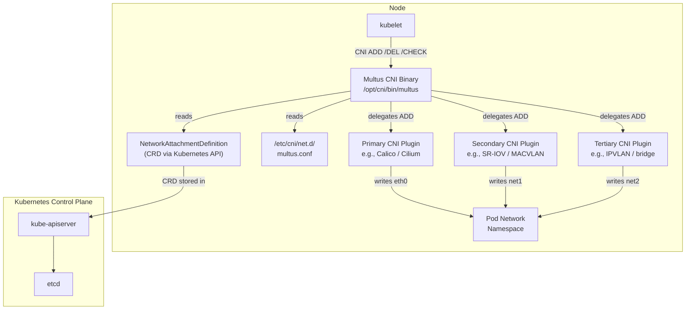
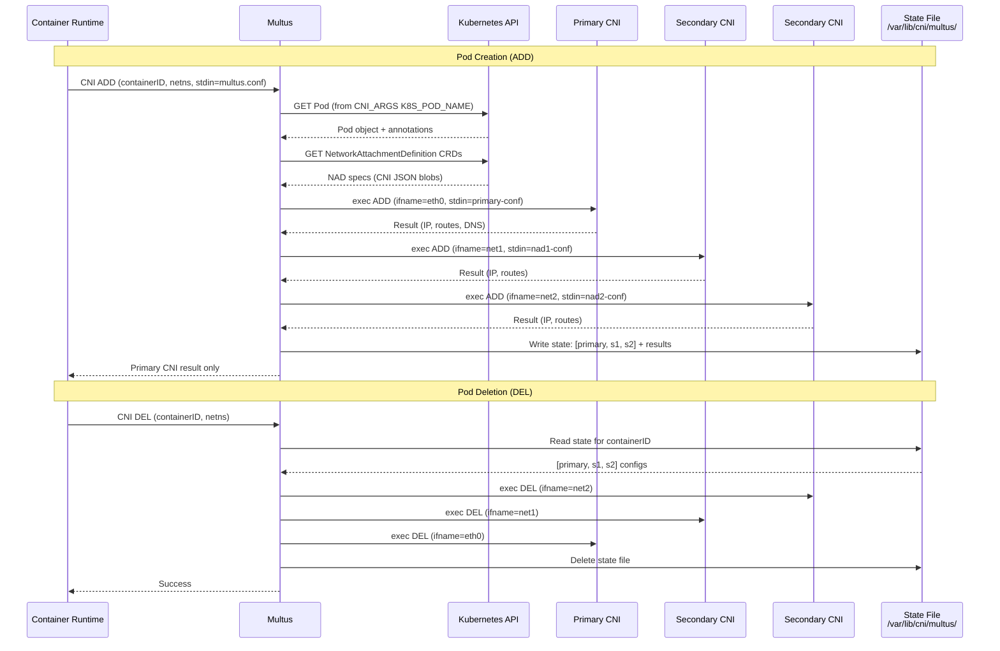
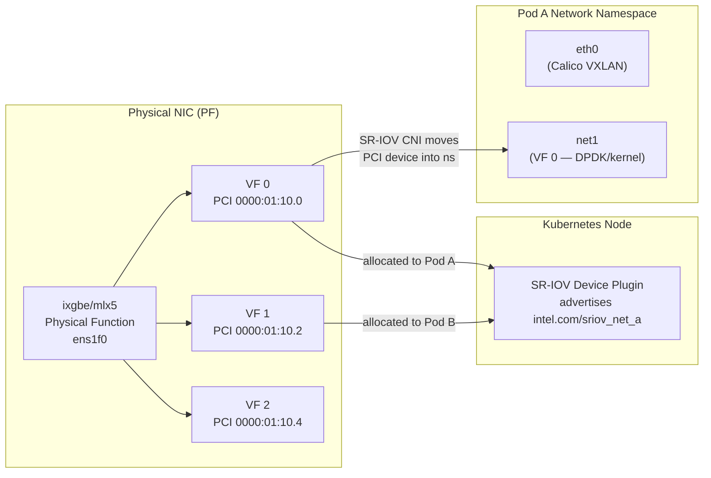
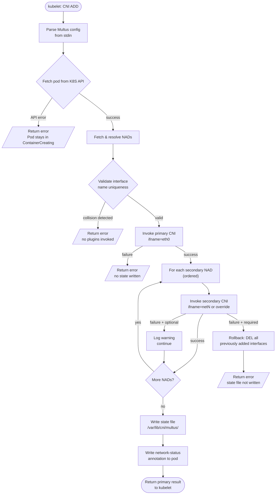

# Lesson 1: Multus CNI — Multi-Network Interfaces in Kubernetes

## 1. First-Principles Intuition & Invariants

### The Fundamental Constraint of Standard Kubernetes Networking

The Kubernetes networking model enforces a critical invariant: every pod gets exactly one network namespace, and within that namespace, the Container Network Interface (CNI) framework provisions exactly one primary network interface (beyond `lo`). This "one pod, one IP" model is intentional — it simplifies service discovery, load balancing, and network policy enforcement. The kubelet invokes a single CNI plugin binary via a well-defined POSIX exec interface, passing JSON configuration over stdin and expecting results on stdout. The CNI specification (maintained by the CNCF) defines four operations: `ADD`, `DEL`, `CHECK`, and `VERSION`.

This model is insufficient for a broad class of real workloads:

- **Telecommunications NFV/VNF**: A virtual router or firewall needs dedicated interfaces on management, data-plane, and out-of-band networks simultaneously, often with SR-IOV or DPDK-backed interfaces for line-rate packet processing.
- **High-Performance Computing (HPC)**: An MPI job needs both a low-latency RDMA/InfiniBand interface for collective operations and a standard Ethernet interface for control-plane communication.
- **5G Core Network Functions (CNFs)**: A UPF (User Plane Function) requires separate N3, N4, N6, and N9 interfaces per 3GPP TS 23.501, each on a distinct VLAN or physical network segment.
- **Security-Isolated Architectures**: A data processing pod needs one interface on a PCI-scoped network carrying sensitive data and a separate interface for observability egress, with strict firewall policy between them.

The root constraint is architectural: `kubelet` calls the configured CNI plugin once per pod lifecycle event. There is no native mechanism in the CNI spec for a single invocation to produce multiple named interfaces. Multus solves this by inserting itself as a **meta-plugin** — a CNI plugin whose sole responsibility is to invoke other CNI plugins in a defined sequence.

### Invariants That Govern Multus Behavior

The following invariants define the correctness contract of Multus:

1. **Primary interface delegation is mandatory.** Multus always invokes a designated "default" CNI plugin first. This plugin owns `eth0` and sets the pod's default route. All cluster-level connectivity (kube-proxy, CoreDNS, CNI health checks) depends on this interface being correctly provisioned before any secondary interfaces are attached.

2. **Network namespace atomicity.** All interfaces for a given pod are configured within the same Linux network namespace created by the container runtime (CRI-O, containerd). Multus passes the namespace path (`/proc/<pid>/ns/net`) to each delegated plugin. No interface escapes the pod's namespace boundary.

3. **Failure semantics are fail-fast on primary, configurable on secondary.** If the primary CNI invocation fails, pod creation fails and the runtime must clean up. For secondary networks, Multus supports annotation-level `optional` flags, allowing pods to start with degraded connectivity.

4. **Idempotent cleanup.** On `DEL`, Multus invokes every previously-added plugin's `DEL` operation, even if one fails mid-sequence, to prevent namespace and IPAM resource leaks.

5. **Configuration source of truth is the Kubernetes API.** Network attachment definitions (NADs) are stored as CRDs in etcd. Multus reads them at pod scheduling time, not at plugin load time, enabling runtime network topology changes without restarting Multus.

---

## 2. Core Architecture & Mechanics

### Component Overview

Multus is deployed as a DaemonSet on every node. Its binary is copied to `/opt/cni/bin/multus` via an init container, and its configuration is written to `/etc/cni/net.d/00-multus.conf` (the leading `00` ensures lexicographic priority, so `kubelet` selects it as the active CNI plugin).



### The NetworkAttachmentDefinition CRD

The `NetworkAttachmentDefinition` (NAD) is the central configuration primitive. It is a cluster-scoped or namespace-scoped Custom Resource that encapsulates a complete CNI configuration JSON blob. This abstraction allows network administrators to define reusable network profiles that workload authors reference by name.

```yaml
apiVersion: k8s.cni.cncf.io/v1
kind: NetworkAttachmentDefinition
metadata:
  name: macvlan-conf-1
  namespace: production
spec:
  config: |
    {
      "cniVersion": "0.3.1",
      "name": "macvlan-conf-1",
      "type": "macvlan",
      "master": "eth1",
      "mode": "bridge",
      "ipam": {
        "type": "whereabouts",
        "range": "192.168.10.0/24",
        "range_start": "192.168.10.20",
        "range_end": "192.168.10.50",
        "gateway": "192.168.10.1"
      }
    }
```

The `spec.config` field is a raw JSON string. The CNI version, plugin type, and all plugin-specific parameters are expressed here verbatim — Multus passes this blob directly to the delegated plugin's stdin without modification.

A pod references one or more NADs via the `k8s.v1.cni.cncf.io/networks` annotation:

```yaml
apiVersion: v1
kind: Pod
metadata:
  name: multihomed-pod
  namespace: production
  annotations:
    k8s.v1.cni.cncf.io/networks: |
      [
        {
          "name": "macvlan-conf-1",
          "interface": "net1",
          "ips": ["192.168.10.25/24"],
          "gateway": ["192.168.10.1"]
        },
        {
          "name": "sriov-net-a",
          "interface": "net2"
        }
      ]
spec:
  containers:
  - name: app
    image: busybox
    resources:
      limits:
        intel.com/sriov_net_a: "1"   # SR-IOV device plugin allocation
```

The annotation accepts either a JSON array (as above) or a comma-separated list of NAD names for simpler cases: `k8s.v1.cni.cncf.io/networks: "macvlan-conf-1,sriov-net-a"`.

### Delegation Mechanism: Deep Internals

The CNI specification defines the interface between the runtime and a plugin as a POSIX exec invocation. The runtime sets environment variables (`CNI_COMMAND`, `CNI_CONTAINERID`, `CNI_NETNS`, `CNI_IFNAME`, `CNI_ARGS`, `CNI_PATH`) and writes the network configuration JSON to the plugin's stdin.

Multus reimplements this exec interface internally. When it needs to delegate to a subordinate plugin, it constructs the same environment variable set and stdin payload, then uses Go's `os/exec` package to invoke the target plugin binary. The key implementation detail is that `CNI_IFNAME` is overridden per delegation — the primary plugin receives `eth0`, the first secondary receives `net1`, and so on (unless the NAD annotation specifies an explicit interface name).

The following Go pseudocode captures the delegation logic accurately (based on the Multus v4.x source):

```go
// pkg/multus/multus.go (simplified and annotated for clarity)

func (m *Multus) CmdAdd(args *skel.CmdArgs) error {
    // 1. Parse the Multus configuration to find the default CNI plugin
    multusConf, err := config.ParseMultusConf(args.StdinData)
    if err != nil {
        return err
    }

    // 2. Retrieve the pod object from the Kubernetes API to read annotations
    pod, err := m.client.GetPod(args.Args) // parses CNI_ARGS for K8S_POD_NAMESPACE/NAME
    if err != nil {
        return err
    }

    // 3. Invoke the primary (default) CNI plugin first
    // The primary interface name is always "eth0" per Kubernetes convention
    primaryResult, err := m.delegateAdd("eth0", multusConf.Delegates[0], args)
    if err != nil {
        // Primary failure is fatal — return immediately, kubelet will retry
        return logging.Errorf("failed to configure primary interface: %v", err)
    }

    // 4. Parse network attachment annotations from the pod spec
    networks, err := nadutils.ParseNetworkAnnotation(pod)
    if err != nil {
        // If annotation is malformed, clean up primary and fail
        _ = m.delegateDel("eth0", multusConf.Delegates[0], args)
        return err
    }

    // 5. Resolve each NAD reference to a full CNI config
    delegates, err := m.resolveNetworkAttachments(networks, pod.Namespace)
    if err != nil {
        _ = m.delegateDel("eth0", multusConf.Delegates[0], args)
        return err
    }

    // 6. Iterate secondary plugins in order, assigning interface names
    ifaceIndex := 1
    var cleanupDelegates []delegateEntry
    for _, delegate := range delegates {
        ifName := delegate.IfName
        if ifName == "" {
            ifName = fmt.Sprintf("net%d", ifaceIndex)
        }

        result, err := m.delegateAdd(ifName, delegate, args)
        if err != nil {
            if delegate.Optional {
                // Log warning, continue — degraded mode
                logging.Verbosef("optional network %s failed: %v", delegate.Name, err)
                continue
            }
            // Non-optional failure: clean up all interfaces added so far
            m.cleanupOnFailure(cleanupDelegates, args)
            _ = m.delegateDel("eth0", multusConf.Delegates[0], args)
            return fmt.Errorf("failed to configure %s: %v", ifName, err)
        }

        cleanupDelegates = append(cleanupDelegates, delegateEntry{ifName, delegate, result})
        ifaceIndex++
    }

    // 7. Persist the delegation state so DEL can replay it correctly
    // State is written to /var/lib/cni/multus/<containerID> as JSON
    if err := m.saveDelegates(args.ContainerID, delegates, primaryResult); err != nil {
        return err
    }

    // 8. Return only the primary interface result to kubelet
    // Kubelet only understands a single CNI result; secondary results are stored internally
    return types.PrintResult(primaryResult, multusConf.CNIVersion)
}
```

### State Persistence and DEL Semantics

One of the most consequential design decisions in Multus is the state file at `/var/lib/cni/multus/<containerID>`. When `CmdAdd` completes, Multus serializes the full list of delegated plugin configurations and their results to this file. When `CmdDel` is later invoked (on pod termination), Multus reads this file to replay the exact set of plugin `DEL` calls in reverse order.

This is necessary because `CmdDel` receives only the `CNI_CONTAINERID` and the Multus configuration — it does not receive the pod annotation. By the time the container runtime calls `DEL`, the pod object may already be deleted from the Kubernetes API. Without the state file, Multus would not know which secondary plugins to clean up, causing IPAM leaks and orphaned virtual functions.



### NetworkAttachmentDefinition Resolution

Multus resolves a NAD reference by namespace-scoping the lookup. If the annotation specifies `"namespace/name"` syntax, Multus fetches the NAD from that specific namespace. If only a bare name is given, it fetches from the pod's own namespace. This allows cluster administrators to centrally define shared network profiles in a dedicated namespace (`kube-system` or `network-operator`) and grant cross-namespace access via RBAC, while workloads in tenant namespaces reference them with fully-qualified names.

The Multus ServiceAccount must have RBAC permissions to `get` and `list` `network-attachment-definitions` across the relevant namespaces:

```yaml
apiVersion: rbac.authorization.k8s.io/v1
kind: ClusterRole
metadata:
  name: multus
rules:
- apiGroups: ["k8s.cni.cncf.io"]
  resources: ["network-attachment-definitions"]
  verbs: ["get", "list", "watch"]
- apiGroups: [""]
  resources: ["pods", "pods/status"]
  verbs: ["get", "update"]
- apiGroups: [""]
  resources: ["events"]
  verbs: ["create", "patch"]
```

The `pods/status` permission is required because Multus writes the provisioned interface details (IPs, MAC addresses, interface names) back to the pod's `k8s.v1.cni.cncf.io/network-status` annotation after successful `ADD`.

---

## 3. Network Status Annotation and Observability

After all interfaces are provisioned, Multus writes a structured status annotation back to the pod. This is the authoritative record of what was actually configured, as opposed to what was requested:

```json
[
  {
    "name": "cbr0",
    "interface": "eth0",
    "ips": ["10.244.1.4"],
    "mac": "0a:58:0a:f4:01:04",
    "default": true,
    "dns": {}
  },
  {
    "name": "production/macvlan-conf-1",
    "interface": "net1",
    "ips": ["192.168.10.25"],
    "mac": "d2:51:f3:a1:2b:04",
    "default": false,
    "dns": {}
  },
  {
    "name": "production/sriov-net-a",
    "interface": "net2",
    "ips": ["10.56.217.100"],
    "mac": "00:11:22:33:44:55",
    "default": false,
    "dns": {}
  }
]
```

This annotation is the basis for tooling like `kubectl exec <pod> -- ip addr` verification and is consumed by network observability platforms to build pod-level topology maps. The `default: true` field marks the interface that owns the pod's default route.

---

## 4. High-Performance Optimization & Failure Modes

### SR-IOV Integration and the Device Plugin Bridge

The most performance-sensitive Multus deployment pattern combines it with the SR-IOV Network Device Plugin and the SR-IOV CNI plugin. SR-IOV (Single Root I/O Virtualization) partitions a physical NIC into multiple Virtual Functions (VFs), each of which appears as a PCI device to the OS. When a VF is assigned to a pod's network namespace, packets bypass the kernel network stack entirely, achieving near line-rate throughput with microsecond latency.

The integration requires three cooperating components:

1. **SR-IOV Network Device Plugin** (`k8s.io/sriov-network-device-plugin`): Discovers VFs on the node, advertises them as extended resources (e.g., `intel.com/sriov_net_a`), and allocates them via the `DevicePlugin` API when a pod requests them. The allocated VF's PCI address is passed to the runtime via `DevicePlugin` environment variables.

2. **SR-IOV CNI Plugin** (`github.com/k8snetworkplumbingwg/sriov-cni`): Receives the VF PCI address, moves it into the pod's network namespace, sets the MAC address, and optionally configures VLAN tagging via the PF (Physical Function) using `ip link set <VF> vf <idx> vlan <vlan_id>`.

3. **Multus**: Orchestrates the SR-IOV CNI invocation alongside the primary CNI plugin.



### Latency and Throughput Benchmarks

The following data is representative of published benchmarks from the Kubernetes Network SIG and Intel's Network Builder program. Actual numbers vary by hardware, kernel version, and workload.

| Interface Type | Throughput (Gbps) | Latency P99 (μs) | CPU overhead |
|---|---|---|---|
| Calico VXLAN (eth0) | ~9 (10GbE line) | 80–200 | Medium (iptables) |
| MACVLAN bridge mode | ~9.9 | 20–50 | Low |
| SR-IOV VF (kernel) | ~9.9 | 5–15 | Very low |
| SR-IOV VF (DPDK/userspace) | ~9.9 | < 2 | Near zero (kernel bypass) |

For 100GbE deployments, SR-IOV with DPDK is the only practical approach to achieve line-rate throughput per VF — kernel-based interfaces saturate at approximately 20–40 Gbps per core due to interrupt coalescing overhead.

### Concurrency Model and Kubelet Interaction

Multus itself does not introduce significant concurrency complexity — `kubelet` calls CNI binaries as single-threaded exec invocations. Each `kubelet` pod sandbox creation is serialized per pod but can proceed in parallel across different pods. The concurrency challenge arises from IPAM plugins: if multiple Multus invocations on the same node contact a shared IPAM backend (e.g., `whereabouts` with etcd) simultaneously, the IPAM backend must handle concurrent IP allocation with appropriate locking.

The `whereabouts` IPAM plugin handles this via etcd distributed transactions (compare-and-swap) or Kubernetes leader election depending on its configured backend. The `host-local` IPAM plugin uses a filesystem lock (`flock(2)`) scoped to the host, which serializes allocation but avoids external dependencies.

### Failure Modes and Mitigations

**Mode 1: Primary CNI plugin failure.** If the primary plugin (e.g., Calico) fails during `ADD`, Multus returns the error immediately to `kubelet`. The pod moves to `ContainerCreating` state indefinitely. `kubelet` retries on its configured interval. No secondary plugins are invoked. No state file is written. This is correct behavior — partial interface setup would leave the pod in an inconsistent routing state.

**Mode 2: Secondary CNI plugin failure (non-optional).** If a non-optional secondary plugin fails, Multus invokes `DEL` on all previously-added interfaces (including primary) before returning the error. This rollback sequence is best-effort: if `DEL` itself fails (e.g., the kernel namespace is already torn down), Multus logs the error and proceeds. IPAM leaks in this case require manual cleanup or expiry-based reclamation (supported by `whereabouts`).

**Mode 3: State file corruption or loss.** If the state file is missing or unreadable when `DEL` is called, Multus falls back to parsing the Multus configuration file to identify the default CNI plugin and invokes only its `DEL` operation. Secondary interface IPAM addresses are not reclaimed. This is a known limitation. Operators must ensure `/var/lib/cni/multus/` is on persistent storage and not a `tmpfs` mount that is cleared on node reboot without proper pod termination.

**Mode 4: Kubernetes API unavailability during ADD.** If the API server is unreachable when Multus attempts to fetch the pod object or NADs, `ADD` fails and the pod does not start. This creates a bootstrapping dependency: Multus requires a functional API server to provision pods, but Kubernetes system pods (kube-apiserver itself, etcd) must start without full CNI functionality. Multus addresses this via a "readiness annotation" mechanism and by supporting a `confDir` fallback where NAD configs are stored as flat files on the node — used specifically for static/system pods that must start before the API server is healthy.

**Mode 5: Interface name collision.** If two NAD references in a single pod annotation request the same interface name (e.g., both specify `"interface": "net1"`), Multus detects the collision and fails the `ADD` with a descriptive error. This validation occurs before any plugin is invoked.



---

## 5. Advanced Configuration Patterns

### Chaining CNI Plugins within a Single NAD

The CNI `conflist` format allows multiple plugins to execute in sequence against the same interface. This is distinct from Multus's multi-interface model: conflist chaining operates on a single interface name, with each plugin in the chain receiving the previous plugin's result. Multus fully supports `conflist`-format NADs:

```json
{
  "cniVersion": "0.3.1",
  "name": "macvlan-tuning",
  "plugins": [
    {
      "type": "macvlan",
      "master": "bond0",
      "mode": "private",
      "ipam": {
        "type": "whereabouts",
        "range": "10.56.0.0/16"
      }
    },
    {
      "type": "tuning",
      "sysctl": {
        "net.core.somaxconn": "32768",
        "net.ipv4.tcp_rmem": "4096 87380 16777216"
      }
    },
    {
      "type": "bandwidth",
      "ingressRate": 1000000000,
      "ingressBurst": 100000000,
      "egressRate": 1000000000,
      "egressBurst": 100000000
    }
  ]
}
```

Here, `macvlan` creates the interface and assigns an IP, `tuning` adjusts kernel sysctl parameters within the pod namespace, and `bandwidth` installs Linux Traffic Control (tc) qdiscs for rate limiting. Each plugin in the chain enriches or modifies the interface without Multus needing to understand the chain's internals — it passes the entire `conflist` blob as-is to the first plugin, which handles chaining internally per the CNI spec.

### Admission Control and Validation

The Kubernetes Network Plumbing Working Group (NPWG) maintains a webhook (`net-attach-def-admission-controller`) that validates NAD references in pod annotations at admission time. Without this webhook, a pod with a typo in its NAD name will pass scheduling and fail only at CNI `ADD` time, leaving the pod in `ContainerCreating` for the full timeout. The webhook validates:

- Referenced NADs exist in the specified namespace.
- The requesting pod's service account has RBAC access to the NAD.
- The JSON in the NAD's `spec.config` is syntactically valid.

Deploying this webhook converts a runtime failure into a fast admission rejection, which significantly improves operator experience in large-scale deployments.

### IPAM Strategies for Secondary Interfaces

The choice of IPAM plugin for secondary interfaces has significant operational implications:

- **`host-local`**: Allocates from a node-local CIDR range. No external dependencies. Appropriate when secondary IPs are node-local and do not need to be routable across the cluster. IPAM state is stored in `/var/lib/cni/networks/`.
- **`whereabouts`**: Cluster-wide IP address management with duplicate prevention. Stores allocation records as `IPPool` CRDs in Kubernetes (or in etcd). Required when the same CIDR range is shared across nodes. Supports IP expiry for leak recovery.
- **`static`**: Assigns a fixed IP specified directly in the NAD or pod annotation. Used for deterministic addressing in NFV scenarios.
- **`dhcp`**: Sends DHCP requests from within the pod namespace. Requires a `dhcp` CNI daemon running on the host as a Unix socket server. Used when IP assignment is managed by an external DHCP infrastructure (e.g., bare-metal ToR switch DHCP).

---

## 6. Deployment and Operational Reference

### Installation via the NPWG Helm Chart

```bash
# Add the NPWG chart repository
helm repo add npwg https://k8snetworkplumbingwg.github.io/helm-charts
helm repo update

# Install Multus with thick plugin mode (includes Kubernetes client)
# Thin mode (no built-in K8S client, relies on external NAD server) is also available
helm install multus npwg/multus-cni \
  --namespace kube-system \
  --set "config.cni_conf.clusterNetwork=calico-k8s-network" \
  --set "image.tag=v4.0.2"
```

Multus v4.x introduces a **thick plugin** architecture where the Multus binary running as a DaemonSet pod holds a long-lived Kubernetes API client connection. The thin binary in `/opt/cni/bin/multus-shim` communicates with the DaemonSet pod via a Unix socket, offloading Kubernetes API calls to the daemon. This eliminates per-invocation API client initialization overhead (TLS handshake, kubeconfig parsing) which at high pod creation rates (> 50 pods/sec) was a measurable bottleneck.

### Verifying Interface Configuration

```bash
# Inspect the network-status annotation
kubectl get pod multihomed-pod -n production \
  -o jsonpath='{.metadata.annotations.k8s\.v1\.cni\.cncf\.io/network-status}' | jq .

# Exec into the pod and verify interface state
kubectl exec -n production multihomed-pod -- ip -d addr show

# Check Multus state files on the node (requires node access)
ls -la /var/lib/cni/multus/
cat /var/lib/cni/multus/<containerID> | jq '.[] | {name, iface: .ifname, ip: .result.ips}'

# Verify CNI logs (location varies by container runtime)
# For containerd with CRI-O style logging:
journalctl -u containerd --since "5 minutes ago" | grep -i multus

# For kubeadm clusters, CNI logs are in kubelet journal:
journalctl -u kubelet | grep -E "multus|NetworkAttachment"
```

### Common Misconfiguration Patterns

**Misconfiguration 1: Missing RBAC for cross-namespace NADs.** A pod in namespace `app` referencing `infra/sriov-net` requires the Multus ServiceAccount to have `get` on `network-attachment-definitions` in namespace `infra`. Symptom: `failed to get network attachment definition: networkattachmentdefinitions.k8s.cni.cncf.io "sriov-net" not found`. The error message says "not found" even when the NAD exists, because RBAC denial surfaces as a 404 from the API server.

**Misconfiguration 2: SR-IOV VF count not set before Multus installation.** VFs must be created at the kernel level before the Device Plugin discovers them. This is typically done via a MachineConfig (OpenShift) or a DaemonSet that writes to `/sys/class/net/<PF>/device/sriov_numvfs`. If VFs are not present, the Device Plugin reports zero allocatable resources, and pods requesting `intel.com/sriov_net_a` are unschedulable.

**Misconfiguration 3: CNI version mismatch.** If the `cniVersion` in a NAD's config blob specifies `0.4.0` but the delegated CNI plugin binary only supports up to `0.3.1`, the plugin returns an error. Multus propagates this error verbatim. Always verify plugin binary versions with `<plugin-binary> --version` and align `cniVersion` accordingly.
