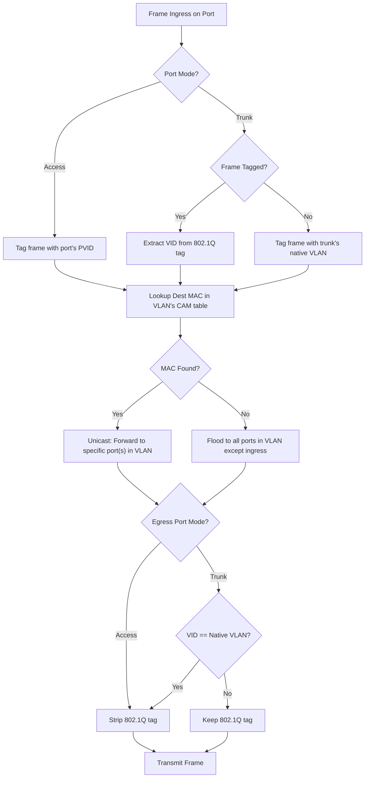
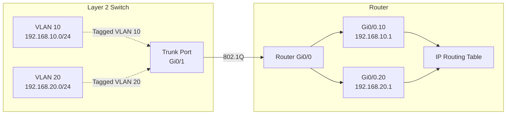

# Lesson 2: VLAN Networking Fundamentals

## 1. First-Principles Foundation and Invariants

Virtual Local Area Networks (VLANs) address a fundamental problem in switched Ethernet networks: broadcast domains scale poorly. In a flat Layer 2 network, every broadcast frame—ARP requests, DHCP discovery, multicast routing protocol hellos—floods to every port. As networks grow beyond 100-200 hosts, broadcast storms degrade performance, and the lack of isolation creates security and operational risk.

VLANs solve this by partitioning a single physical switched fabric into multiple logical broadcast domains. Each VLAN operates as an independent Layer 2 segment with its own broadcast domain, MAC address forwarding table namespace, and spanning tree instance (in per-VLAN spanning tree protocols). Critically, VLAN segmentation is transparent to Layer 3: IP subnets map cleanly to VLANs, but the VLAN itself operates purely at the data link layer.

### IEEE 802.1Q Tagging Mechanism

The 802.1Q standard defines VLAN tagging by inserting a 4-byte tag into the Ethernet frame between the source MAC address and the EtherType/Length field:

```
Original Ethernet Frame:
[Dest MAC][Src MAC][EtherType][Payload][FCS]

802.1Q Tagged Frame:
[Dest MAC][Src MAC][TPID][TCI][EtherType][Payload][FCS]
                     |    |
                     |    +-- Tag Control Information (2 bytes)
                     +------- Tag Protocol ID = 0x8100 (2 bytes)
```

The Tag Control Information (TCI) contains:
- **3-bit Priority Code Point (PCP)**: IEEE 802.1p class of service for QoS (0-7)
- **1-bit Drop Eligible Indicator (DEI)**: Marks frames eligible for drop during congestion
- **12-bit VLAN ID (VID)**: VLAN identifier (1-4094; 0 and 4095 reserved)

The 12-bit VID space yields 4094 usable VLANs per switch. VLAN 1 is the default VLAN on most switches and cannot be deleted. The tag increases the frame size from 1518 to 1522 bytes, requiring switches to support "baby giant" frames to avoid fragmentation.

### Core Invariants

1. **Layer 2 Scope**: VLANs segment broadcast domains but do not route. Inter-VLAN communication requires a Layer 3 device (router or Layer 3 switch).
2. **Port-Based Membership**: Each access port belongs to exactly one VLAN at a time. Trunk ports carry multiple VLANs simultaneously.
3. **Tag Preservation**: Tagged frames traverse trunk links with tags intact. Access ports strip tags on egress and add tags on ingress.
4. **MAC Learning Per-VLAN**: Switches maintain separate MAC address tables per VLAN. A MAC address on VLAN 10 is distinct from the same address on VLAN 20.
5. **Spanning Tree Per-VLAN**: In PVST/PVST+, each VLAN runs an independent spanning tree instance. A port may be forwarding in VLAN 10 and blocking in VLAN 20.

## 2. Switch Forwarding Architecture

### Frame Processing Pipeline

When a switch receives a frame on a port, the VLAN-aware forwarding pipeline executes:



### Port Modes and Native VLAN

**Access Ports**: Configured for a single VLAN (Port VLAN ID, or PVID). All traffic is untagged. The switch tags ingress frames internally and strips tags on egress.

**Trunk Ports**: Carry multiple VLANs using 802.1Q tags. The **native VLAN** is the VLAN for untagged frames. Native VLAN traffic is not tagged by default (though this is configurable). Cisco devices default to VLAN 1 as native; best practice is to set it to an unused VLAN to prevent VLAN hopping attacks.

### Content Addressable Memory (CAM) Table

Switches maintain a CAM table (or MAC address table) per VLAN. Each entry maps:

```
[VLAN ID][MAC Address] -> [Port, Timestamp]
```

When a frame arrives, the switch:
1. Learns the source MAC and VLAN, updating the CAM table.
2. Looks up the destination MAC in the VLAN's CAM table.
3. Forwards to the mapped port (unicast) or floods to all ports in the VLAN (unknown unicast, broadcast, multicast).

CAM table entries age out (typically 300 seconds). Dynamic entries are learned from traffic; static entries are manually configured.

### Example Configuration: Cisco IOS

```shell
! Create VLANs
Switch(config)# vlan 10
Switch(config-vlan)# name Engineering
Switch(config-vlan)# exit
Switch(config)# vlan 20
Switch(config-vlan)# name Finance
Switch(config-vlan)# exit
Switch(config)# vlan 99
Switch(config-vlan)# name Management
Switch(config-vlan)# exit

! Configure access ports
Switch(config)# interface range FastEthernet0/1-10
Switch(config-if-range)# switchport mode access
Switch(config-if-range)# switchport access vlan 10
Switch(config-if-range)# spanning-tree portfast
Switch(config-if-range)# exit

Switch(config)# interface range FastEthernet0/11-20
Switch(config-if-range)# switchport mode access
Switch(config-if-range)# switchport access vlan 20
Switch(config-if-range)# exit

! Configure trunk with native VLAN security
Switch(config)# interface GigabitEthernet0/1
Switch(config-if)# switchport trunk encapsulation dot1q
Switch(config-if)# switchport mode trunk
Switch(config-if)# switchport trunk allowed vlan 10,20,99
Switch(config-if)# switchport trunk native vlan 99
Switch(config-if)# exit

! Verify configuration
Switch# show vlan brief
Switch# show interfaces trunk
Switch# show mac address-table
```

**Critical Configuration Notes**:
- `switchport trunk encapsulation dot1q`: Required on platforms supporting both ISL and 802.1Q (e.g., Catalyst 3560). Modern switches only support 802.1Q.
- `switchport trunk allowed vlan`: Explicit whitelist prevents VLAN leakage. Default is all VLANs (1-4094).
- `switchport trunk native vlan 99`: Using an unused VLAN as native prevents VLAN hopping via double-tagging attacks.
- `spanning-tree portfast`: Skips listening/learning states on access ports, reducing DHCP timeouts. Do not enable on trunk ports.

### Linux Bridge with VLAN Filtering

Linux bridges support VLAN filtering via the `bridge` utility:

```bash
# Create bridge with VLAN filtering
ip link add name br0 type bridge vlan_filtering 1

# Add ports to bridge
ip link set eth0 master br0
ip link set eth1 master br0
ip link set eth2 master br0

# Configure VLAN membership (eth0 access port in VLAN 10)
bridge vlan del dev eth0 vid 1  # Remove default VLAN 1
bridge vlan add dev eth0 vid 10 pvid untagged

# Configure trunk port (eth1 carries VLANs 10, 20)
bridge vlan del dev eth1 vid 1
bridge vlan add dev eth1 vid 10
bridge vlan add dev eth1 vid 20

# Set native VLAN on trunk
bridge vlan add dev eth1 vid 99 pvid untagged

# Bring up interfaces
ip link set br0 up
ip link set eth0 up
ip link set eth1 up
ip link set eth2 up

# Verify VLAN table
bridge vlan show
```

Flags:
- `pvid`: Port VLAN ID (default VLAN for untagged ingress)
- `untagged`: Strip tag on egress

## 3. Inter-VLAN Routing Architectures

VLANs isolate traffic; routing between VLANs requires Layer 3 forwarding.

### Router-on-a-Stick

A single physical router interface connects to a trunk port and uses subinterfaces for each VLAN:



Cisco IOS configuration:

```shell
Router(config)# interface GigabitEthernet0/0
Router(config-if)# no ip address
Router(config-if)# no shutdown
Router(config-if)# exit

Router(config)# interface GigabitEthernet0/0.10
Router(config-subif)# encapsulation dot1Q 10
Router(config-subif)# ip address 192.168.10.1 255.255.255.0
Router(config-subif)# exit

Router(config)# interface GigabitEthernet0/0.20
Router(config-subif)# encapsulation dot1Q 20
Router(config-subif)# ip address 192.168.20.1 255.255.255.0
Router(config-subif)# exit
```

Limitations: All inter-VLAN traffic traverses a single physical link, creating a bottleneck. A 1 Gbps link limits aggregate inter-VLAN throughput to 1 Gbps (bidirectional traffic uses the same link).

### Switched Virtual Interface (SVI)

Layer 3 switches route in hardware using VLAN interfaces (SVIs). Each VLAN has a virtual interface with an IP address. The switch's ASIC performs wire-speed routing between VLANs.

```shell
Switch(config)# ip routing
Switch(config)# interface vlan 10
Switch(config-if)# ip address 192.168.10.1 255.255.255.0
Switch(config-if)# no shutdown
Switch(config-if)# exit

Switch(config)# interface vlan 20
Switch(config-if)# ip address 192.168.20.1 255.255.255.0
Switch(config-if)# no shutdown
Switch(config-if)# exit
```

Performance: Modern Layer 3 switches (e.g., Catalyst 9000, Arista 7000) route at line rate across hundreds of VLANs. The ASIC uses a Ternary CAM (TCAM) for longest-prefix match lookups in hardware.

## 4. VLAN Trunking Protocol (VTP)

VTP propagates VLAN configurations across multiple switches in a domain, reducing administrative overhead. VTP operates over trunk links and uses multicast frames (destination MAC 01:00:0C:CC:CC:CC).

### VTP Modes

- **Server**: Creates, modifies, deletes VLANs. Propagates updates to domain. Default mode.
- **Client**: Receives VLAN updates from servers. Cannot modify VLANs locally.
- **Transparent**: Forwards VTP advertisements but does not synchronize. Local VLAN changes are not propagated.

### VTP Danger: Configuration Revision Number

VTP uses a **configuration revision number** to determine which database is most recent. When a switch with a higher revision joins the domain, it overwrites all other switches' VLAN databases. If a switch from another network (with a higher revision) is introduced, it can wipe out the entire VLAN configuration.

**Best Practice**: Use VTP transparent mode or disable VTP. Manually configure VLANs on each switch for deterministic control.

```shell
! Disable VTP
Switch(config)# vtp mode transparent
Switch(config)# no vtp file
```

## 5. Security Vulnerabilities and Mitigations

### VLAN Hopping: Double-Tagging Attack

An attacker on an access port in the native VLAN sends a frame with two 802.1Q tags:

```
[Dest MAC][Src MAC][0x8100][VLAN 1][0x8100][VLAN 20][Payload]
```

The first switch strips the outer tag (VLAN 1, the native VLAN) and forwards the frame over the trunk. The second switch sees a tagged frame for VLAN 20 and forwards it to VLAN 20 ports, bypassing access controls.

**Mitigation**:
1. Set native VLAN to an unused VLAN (e.g., 999).
2. Tag native VLAN traffic explicitly: `vlan dot1q tag native`
3. Prune unused VLANs from trunks: `switchport trunk allowed vlan 10,20`

### Switch Spoofing

An attacker negotiates a trunk with the switch using Dynamic Trunking Protocol (DTP), gaining access to all VLANs.

**Mitigation**:
```shell
Switch(config)# interface range FastEthernet0/1-24
Switch(config-if-range)# switchport mode access
Switch(config-if-range)# switchport nonegotiate
```

### MAC Address Table Overflow (CAM Table Flooding)

An attacker floods the switch with frames containing random source MACs, filling the CAM table. The switch enters fail-open mode and floods all traffic, turning the switch into a hub.

**Mitigation**: Port security limits the number of MAC addresses per port:

```shell
Switch(config)# interface FastEthernet0/1
Switch(config-if)# switchport port-security
Switch(config-if)# switchport port-security maximum 2
Switch(config-if)# switchport port-security violation restrict
Switch(config-if)# switchport port-security mac-address sticky
```

Violation actions:
- `protect`: Drops frames from unknown MACs, no log.
- `restrict`: Drops frames, logs violation, increments counter.
- `shutdown`: Places port in err-disabled state (requires manual re-enable).

## 6. Performance Considerations

### VLAN Scaling Limits

- **4094 VLANs per switch**: 12-bit VID space. Extended VLANs (1006-4094) are not stored in VLAN database and require VTP transparent mode.
- **STP Scaling**: Per-VLAN Spanning Tree (PVST+) runs 1 STP instance per VLAN. A switch with 1000 VLANs runs 1000 STP instances, consuming CPU and memory. Multiple Spanning Tree (MST) maps VLANs to instances, reducing overhead.
- **TCAM Limits**: Layer 3 switches use TCAM for routing lookups. TCAM size (e.g., 32K entries on Catalyst 3850) limits the number of routes, ACLs, and QoS policies.

### Trunk Link Oversubscription

Trunk links aggregate traffic from multiple VLANs. If VLANs 10, 20, and 30 each generate 400 Mbps, a 1 Gbps trunk becomes a bottleneck (1200 Mbps demand vs. 1000 Mbps capacity).

**Mitigation**: Link aggregation (EtherChannel/LACP) bundles multiple physical links into a logical trunk:

```shell
Switch(config)# interface range GigabitEthernet0/1-2
Switch(config-if-range)# channel-group 1 mode active
Switch(config-if-range)# exit
Switch(config)# interface port-channel 1
Switch(config-if)# switchport mode trunk
Switch(config-if)# switchport trunk allowed vlan 10,20,30
```

LACP (802.3ad) provides dynamic negotiation and fault detection. A 2-link bundle provides 2 Gbps aggregate bandwidth with load balancing based on source/destination MAC, IP, or port.

### Broadcast Storm Mitigation

Even with VLANs, broadcast storms within a VLAN degrade performance. Enable storm control to rate-limit broadcast, multicast, and unknown unicast traffic:

```shell
Switch(config)# interface GigabitEthernet0/1
Switch(config-if)# storm-control broadcast level 10.00
Switch(config-if)# storm-control multicast level 10.00
Switch(config-if)# storm-control action shutdown
```

This limits broadcast and multicast to 10% of interface bandwidth. If the threshold is exceeded, the port enters err-disabled.

## 7. Failure Modes and Troubleshooting

### Native VLAN Mismatch

If trunk ports on two switches have different native VLANs, untagged traffic is misinterpreted. Traffic from VLAN 1 on switch A is placed in VLAN 99 on switch B.

**Symptom**: CDP/LLDP reports native VLAN mismatch. Untagged traffic appears in the wrong VLAN.

**Diagnosis**:
```shell
Switch# show interfaces trunk
Switch# show cdp neighbors detail
```

**Fix**: Standardize native VLAN across all trunks:
```shell
Switch(config)# interface GigabitEthernet0/1
Switch(config-if)# switchport trunk native vlan 99
```

### VLAN Pruning Issues

If a VLAN is pruned from a trunk but devices in that VLAN exist on both sides, connectivity fails.

**Diagnosis**:
```shell
Switch# show interfaces GigabitEthernet0/1 trunk
```

Check "VLANs allowed and active in management domain" and "VLANs in spanning tree forwarding state."

**Fix**:
```shell
Switch(config)# interface GigabitEthernet0/1
Switch(config-if)# switchport trunk allowed vlan add 10
```

### Spanning Tree Blocking Trunk

If STP places a trunk in blocking state, VLANs on that trunk lose connectivity.

**Diagnosis**:
```shell
Switch# show spanning-tree vlan 10
```

Look for port state (FWD/BLK).

**Fix**: Adjust STP priority to make the desired switch root:
```shell
Switch(config)# spanning-tree vlan 10 priority 4096
```

Or enable RSTP (802.1w) for faster convergence:
```shell
Switch(config)# spanning-tree mode rapid-pvst
```

### Asymmetric VLAN Configuration

VLANs exist on one switch but not another. Traffic is black-holed.

**Diagnosis**:
```shell
Switch# show vlan brief
Switch# show mac address-table vlan 10
```

**Fix**: Ensure all switches in the path have the VLAN configured:
```shell
Switch(config)# vlan 10
Switch(config-vlan)# name Engineering
```

### Packet Capture for VLAN Debugging

Capture traffic on a trunk to verify VLAN tags:

```bash
# Linux with tcpdump
tcpdump -i eth0 -e -n -v 'vlan'

# Example output
12:34:56.789012 00:1a:2b:3c:4d:5e > ff:ff:ff:ff:ff:ff, ethertype 802.1Q (0x8100), length 64: vlan 10, p 0, ethertype ARP, Request who-has 192.168.10.1 tell 192.168.10.50
```

Verify:
- `vlan 10`: Correct VLAN tag.
- `ethertype 802.1Q (0x8100)`: Proper TPID.

On access ports, traffic should be untagged. On trunks, traffic should be tagged unless it's native VLAN.

## 8. Advanced Topics

### Private VLANs (PVLANs)

PVLANs subdivide a VLAN into isolated broadcast domains, useful for multi-tenant environments (e.g., web hosting).

- **Promiscuous Port**: Communicates with all ports (typically a gateway router).
- **Isolated Port**: Communicates only with promiscuous ports (client isolation).
- **Community Port**: Communicates with promiscuous ports and other community ports in the same community.

Configuration:
```shell
Switch(config)# vlan 100
Switch(config-vlan)# private-vlan primary
Switch(config-vlan)# private-vlan association 101,102
Switch(config-vlan)# exit

Switch(config)# vlan 101
Switch(config-vlan)# private-vlan isolated
Switch(config-vlan)# exit

Switch(config)# vlan 102
Switch(config-vlan)# private-vlan community
Switch(config-vlan)# exit

Switch(config)# interface GigabitEthernet0/1
Switch(config-if)# switchport mode private-vlan promiscuous
Switch(config-if)# switchport private-vlan mapping 100 101,102
Switch(config-if)# exit

Switch(config)# interface range FastEthernet0/1-10
Switch(config-if-range)# switchport mode private-vlan host
Switch(config-if-range)# switchport private-vlan host-association 100 101
Switch(config-if-range)# exit
```

### Q-in-Q (802.1ad)

Q-in-Q tunnels 802.1Q tags inside another 802.1Q tag, allowing service providers to preserve customer VLANs across the provider network. The outer tag (S-TAG, TPID 0x88a8) belongs to the provider; the inner tag (C-TAG, TPID 0x8100) belongs to the customer.

```
[Dest MAC][Src MAC][0x88a8][Provider VLAN][0x8100][Customer VLAN][Payload]
```

Configuration:
```shell
Switch(config)# interface GigabitEthernet0/1
Switch(config-if)# switchport mode dot1q-tunnel
Switch(config-if)# switchport access vlan 200
```

The provider VLAN (200) encapsulates customer VLAN tags.

### VXLAN (Virtual Extensible LAN)

VXLAN (RFC 7348) overlays Layer 2 networks over Layer 3 infrastructure using UDP encapsulation. VXLAN addresses VLAN scaling limits (4094 VLANs) by using a 24-bit VXLAN Network Identifier (VNI), supporting 16 million segments.

VXLAN encapsulation:
```
[Outer Ethernet][Outer IP][Outer UDP (port 4789)][VXLAN Header (VNI)][Inner Ethernet][Payload]
```

VXLAN is foundational for network virtualization in data centers (e.g., VMware NSX, Cisco ACI).

## 9. Summary

VLANs are a foundational Layer 2 segmentation technology. Key takeaways:

- VLANs use 802.1Q tags (12-bit VID) to partition broadcast domains within a switched fabric.
- Switches maintain per-VLAN MAC address tables and forward frames only within the same VLAN.
- Access ports belong to a single VLAN (untagged). Trunk ports carry multiple VLANs (tagged).
- Inter-VLAN routing requires a Layer 3 device (router or Layer 3 switch with SVIs).
- Security best practices: set native VLAN to unused VLAN, disable DTP, enable port security.
- Failure modes include native VLAN mismatches, VLAN pruning errors, and STP blocking.
- Advanced techniques (PVLANs, Q-in-Q, VXLAN) extend VLAN functionality for multi-tenancy and overlay networks.

VLANs trade operational complexity for security and performance. Proper configuration, consistent native VLAN settings, and disciplined VLAN pruning are critical for stable, secure networks.
