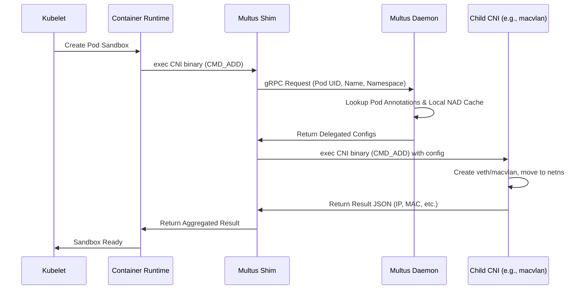
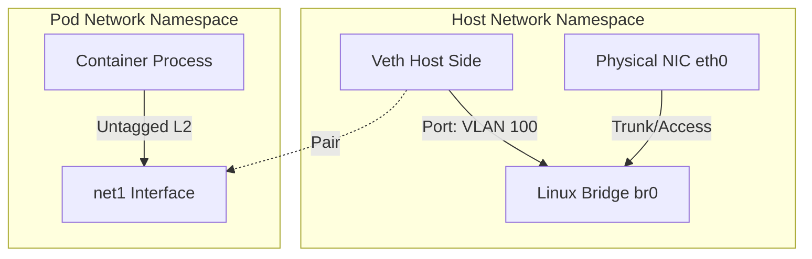
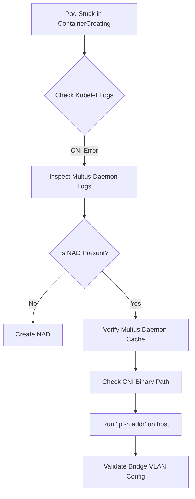

# Lesson 3: Multus VLAN Integration

## 1. First-Principles Intuition & Invariants

Kubernetes assumes a flat, single-interface network topology per pod by default. The Container Network Interface (CNI) standard provides a pluggable mechanism to configure pod networking, but the base specification only supports a single delegation per pod. **Multus CNI** is a "meta-plugin" that circumvents this limitation, enabling the creation of multi-homed pods with multiple network interfaces. This is critical for environments requiring network segmentation, such as separating control plane traffic from data plane traffic, or integrating with existing VLAN-based infrastructure.

Multus operates as a delegating plugin. It does not implement network logic itself; instead, it reads pod annotations to determine which additional networks are required, fetches the corresponding **NetworkAttachmentDefinition (NAD)** custom resources, and delegates the actual interface configuration to secondary CNI plugins (e.g., `macvlan`, `ipvlan`, `bridge`).

When integrating VLANs, the system relies on Linux kernel 802.1Q tagging and bridge VLAN filtering. The fundamental invariants are:

1.  **Interface Isolation**: Each network interface attached to a pod must reside in the pod's dedicated network namespace, isolated from the host and other pods except via explicit routing or bridging.
2.  **Declarative Configuration Synchronization**: The desired network state (defined in NADs) must be consistent across the cluster. Multus Thick plugin achieves this by running a DaemonSet that caches NADs locally, ensuring the kubelet can resolve configurations without high-latency API server queries during pod startup.
3.  **Deterministic L2 Tagging**: Traffic leaving a pod's interface must be tagged with the correct VLAN ID (802.1Q) either by the kernel (software) or the NIC (hardware offload). The host-side bridge port must enforce this tag, restricting traffic to the specified VLAN broadcast domain.
4.  **CNI Lifecycle Idempotency**: CNI operations (`CMD_ADD` and `CMD_DEL`) must be idempotent. If a pod creation fails midway, the CRI (e.g., containerd) will issue a `CMD_DEL` to clean up partially configured interfaces. Multus and its delegates must handle these commands without leaving orphaned network namespaces or interfaces.

## 2. Core Architecture & Mechanics

### Multus Thick Plugin Architecture

Modern Multus deployments utilize the "Thick" plugin architecture. In this model, Multus runs as a DaemonSet (`multus-daemon`) that monitors the Kubernetes API for NADs and pods, maintaining a local cache of network configurations. The kubelet interacts with a lightweight CNI binary shim that communicates with the daemon via a local gRPC socket. This reduces pod startup latency and API server load.



### NetworkAttachmentDefinition (NAD)

A NAD is a Kubernetes Custom Resource (CRD) that encapsulates a CNI configuration. For VLAN integration, the configuration typically delegates to `macvlan` or `bridge`.

**macvlan NAD Example:**
This configuration creates a `macvlan` sub-interface bound to a host interface (`eth0`). It assumes the underlying network switch is already configured for the respective VLAN, as `macvlan` in `bridge` mode simply forwards traffic to the parent interface.

```yaml
apiVersion: k8s.cni.cncf.io/v1
kind: NetworkAttachmentDefinition
metadata:
  name: vlan100-macvlan
spec:
  config: |-
    {
      "cniVersion": "0.3.1",
      "name": "vlan100",
      "type": "macvlan",
      "master": "eth0",
      "mode": "bridge",
      "ipam": {
        "type": "whereabouts",
        "range": "192.168.100.0/24",
        "range_start": "192.168.100.10",
        "range_end": "192.168.100.100"
      }
    }
```

**bridge NAD with VLAN Tagging:**
This configuration uses the CNI `bridge` plugin. It creates a Linux bridge (`br0`) and attaches the pod's veth interface to it. The `vlan` field configures the bridge port to only accept traffic with VLAN ID 100.

```yaml
apiVersion: k8s.cni.cncf.io/v1
kind: NetworkAttachmentDefinition
metadata:
  name: vlan100-bridge
spec:
  config: |-
    {
      "cniVersion": "0.4.0",
      "name": "vlan100-bridge",
      "type": "bridge",
      "bridge": "br0",
      "vlan": 100,
      "ipam": {
        "type": "host-local",
        "subnet": "192.168.100.0/24",
        "gateway": "192.168.100.1"
      }
    }
```

### Pod Integration

Pods consume these networks via the `k8s.v1.cni.cncf.io/networks` annotation. The annotation value is a comma-separated list of NAD names.

```yaml
apiVersion: v1
kind: Pod
metadata:
  name: multi-homed-pod
  annotations:
    k8s.v1.cni.cncf.io/networks: vlan100-macvlan, vlan200-bridge
spec:
  containers:
  - name: app
    image: nginx:alpine
```

### Kernel Mechanics: 802.1Q and Linux Bridges

When the `bridge` CNI plugin is invoked with a `vlan` parameter, it relies on the Linux kernel's bridge VLAN filtering feature (`vlan_filtering`). 

1.  The plugin creates a `veth` pair. One end is placed in the pod's network namespace (e.g., `net1`), the other remains on the host.
2.  The host-side end is enslaved to the bridge `br0`.
3.  The plugin configures the port to only allow tagged traffic for VLAN 100 using `bridge vlan add dev <port> vid 100 pvid untagged` (or similar configurations depending on whether the pod interface should receive tagged or untagged frames).

If the pod interface is expected to see untagged frames (standard for most container workloads), the bridge port acts as an access port. It strips the VLAN tag on egress to the pod and adds the PVID (100) on ingress from the pod. If the pod requires raw 802.1Q frames (e.g., for a virtualized network function), the interface is configured as a trunk.



## 3. High-Performance Optimization & Failure Modes

### Performance Optimization

VLAN tagging introduces minimal CPU overhead in modern kernels, but high-throughput workloads require optimization.

**Hardware Offloading**: Modern NICs support VLAN tag insertion/stripping in hardware. When a driver supports `VLAN offload`, the kernel delegates 802.1Q tagging to the NIC, reducing CPU cycles per packet. Verify offloading status using `ethtool`:

```bash
# Check VLAN offload status
ethtool -k eth0 | grep vlan

# Enable VLAN offload if supported
ethtool -K eth0 rxvlan on txvlan on
```

**SR-IOV**: For latency-sensitive workloads (e.g., telco NFV), software bridges introduce unacceptable context switches. Single Root I/O Virtualization (SR-IOV) allows a physical NIC to present multiple virtual functions (VFs) directly to pods. The `sriov-cni` plugin can be used in conjunction with Multus to attach a VF directly to a pod's network namespace, bypassing the Linux bridge entirely. The VLAN tag can be configured on the VF via the NIC firmware or via `ip link` before attachment.

**Interrupt Coalescing**: High packet rates can cause interrupt storms. Tuning `rx-usecs` via `ethtool -C eth0 rx-usecs 50` coalesces interrupts, reducing CPU overhead at the cost of slightly increased latency.

### Failure Modes and Recovery

**CNI Plugin Execution Failure**: If a delegated CNI plugin fails during `CMD_ADD`, Multus returns an error to the CRI. The CRI then issues a `CMD_DEL` to clean up. However, if the plugin crashes before writing state, `CMD_DEL` might fail to find resources to clean. Multus Thick plugin includes a "network readiness" check that can block pod startup if networks are not ready, preventing race conditions.

**NAD Deletion Race**: Deleting a NAD that is in use by pods can cause issues if new pods referencing that NAD are scheduled. Multus caches NADs, so existing pods may retain connectivity, but new pods on that node will fail to start if the NAD is gone. Ensure NADs are only deleted after all dependent workloads are drained.

**Orphaned Interfaces**: If a node crashes, `veth` pairs and bridge configurations are lost on reboot (they are in-memory state). When the node rejoins, the kubelet restarts pods, and CNI reconfigures the network. The risk is if the node recovers but the CNI daemon (Multus) fails to start; pods will be running without network connectivity. Implement node readiness probes and drain nodes where the Multus daemon is unhealthy.

**VLAN Hopping**: A security failure mode where a pod on VLAN 100 can send tagged traffic for VLAN 200. The Linux bridge with `vlan_filtering` prevents this by dropping frames with unauthorized VLAN tags at the ingress port. However, misconfiguration of the bridge (e.g., setting a port as a trunk allowing all VLANs) exposes the network. Use network policies (NetworkPolicy API) and eBPF-based tools (e.g., Cilium) for L3/L4 enforcement, but rely on strict L2 bridge configuration for VLAN isolation.

**Debugging Flow**:


```bash
# Debugging commands
# 1. Check pod status and events
kubectl describe pod <pod-name>

# 2. Find the pod's network namespace path
PID=$(docker inspect -f '{{.State.Pid}}' <container-id>)
nsenter -t $PID -n ip addr

# 3. Check bridge VLAN configuration on host
bridge vlan show
```
