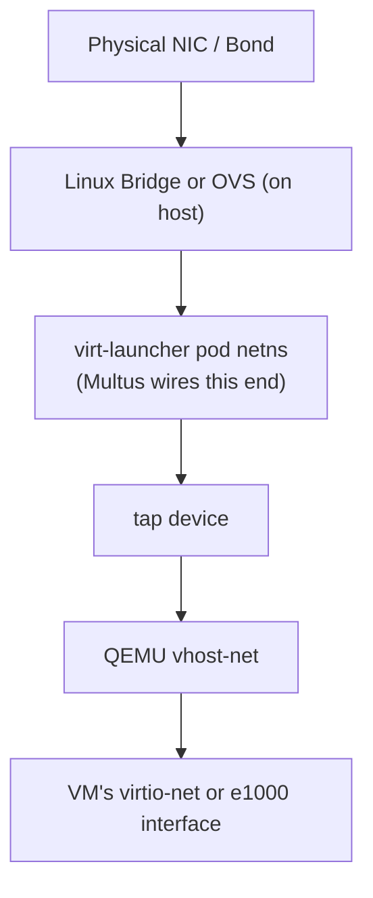
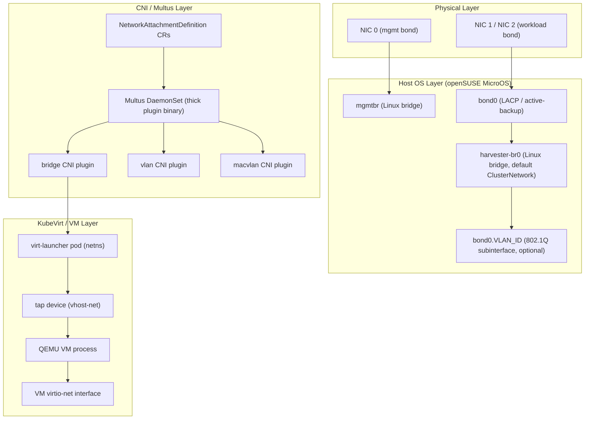
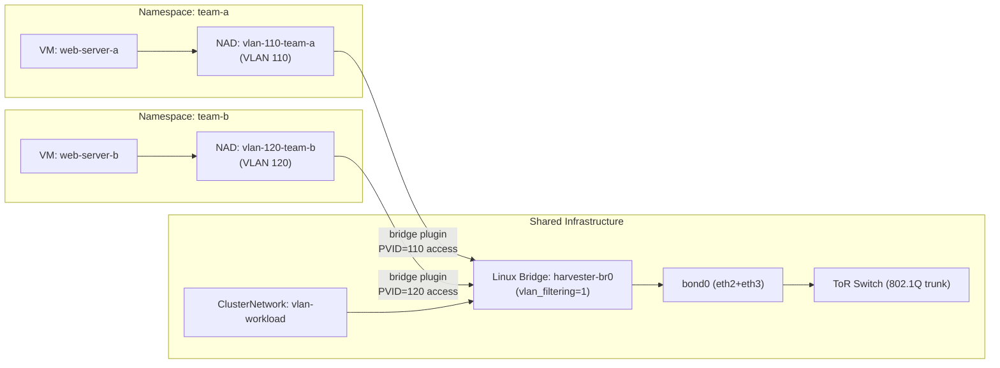
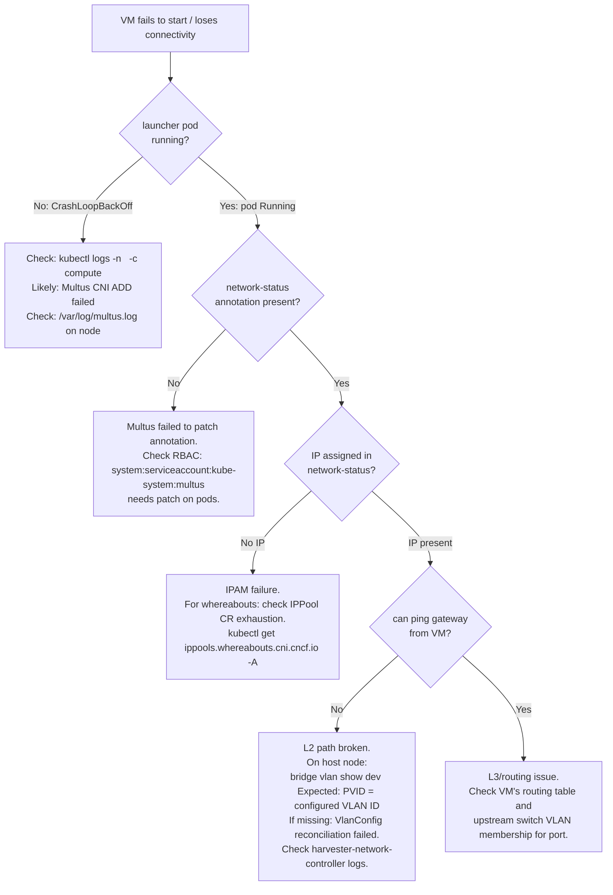

# Lesson 4: Advanced Multus VLAN Use Cases in Harvester HCI

## 1. First-Principles Intuition & Invariants

Harvester is a modern, open-source hyperconverged infrastructure (HCI) platform built on top of Kubernetes, KubeVirt, and Longhorn. Its networking model inherits the full complexity of Kubernetes CNI (Container Network Interface) while extending it to handle virtual machine workloads—which have fundamentally different network requirements than containerized microservices. VMs need L2 adjacency, stable MAC addresses, VLAN trunking, and predictable hardware offload behavior. Multus CNI is the mechanism Harvester uses to satisfy these requirements.

Understanding Multus at a first-principles level requires understanding what problem it solves in the CNI architecture. The CNI specification defines a single interface contract: a runtime calls a plugin binary at pod/VM creation time, passing a JSON configuration, and the plugin wires the network namespace to exactly one network. This "single attachment" model is baked into the original design of Kubernetes. Multus is a *meta-plugin*: it is itself a CNI plugin that the runtime calls, but instead of wiring a single network, it reads a list of `NetworkAttachmentDefinition` (NAD) objects from the Kubernetes API and delegates to multiple downstream CNI plugins in sequence, injecting the results of each into the pod's or VM's network namespace.

The fundamental invariant is:

> Each network attachment produces exactly one (interface, IP, route-set) tuple in the target network namespace. Multus serializes these attachments at creation time; there is no dynamic re-attachment without destroying and recreating the namespace.

For VMs running under KubeVirt, the network namespace belongs to the `virt-launcher` pod. KubeVirt then plumbs network interfaces from that namespace into the QEMU process via either a bridge (the `bridge` binding method) or a passthrough mechanism such as SR-IOV or VFIO. The result is a two-hop wiring model:



The VLAN invariant at the host level is that any frame carrying a dot1q tag with VLAN ID `N` must arrive at a bridge port that is configured to either (a) accept tagged frames for VLAN `N` and present them tagged to the VM (trunk mode), or (b) strip the tag and present untagged frames to the VM (access mode). These two modes map directly to the `vlanConfig` settings in Harvester's `ClusterNetwork` and `NetworkAttachmentDefinition` resources.

The mathematical framing in the original material is imprecise. A more accurate model is a function:

```
attach : NAD × VMLauncherPod → (netns, iface, VLANContext)
```

Where `VLANContext = {mode ∈ {access, trunk}, vlanID ∈ 1..4094, allowedVLANs ⊆ 1..4094}`. The constraints are:

- `vlanID` must be unique per bridge port in access mode.
- In trunk mode, `allowedVLANs` must be a subset of the VLANs trunked on the upstream physical bond.
- The same `vlanID` can appear on multiple bridge ports belonging to different bridges (ClusterNetworks) without conflict.

Violations of these constraints produce silent data-plane failures—traffic is silently dropped or leaks into the wrong segment—making disciplined VLAN planning a hard operational requirement, not a suggestion.

---

## 2. Harvester Network Architecture: Layers and Components

Harvester's network stack consists of four distinct layers. Understanding where each layer lives is prerequisite to diagnosing or extending it.



### 2.1 ClusterNetwork and VLAN Config

A `ClusterNetwork` in Harvester maps to a Linux bridge on every node. The `VlanConfig` resource associates a ClusterNetwork with a set of physical NICs or a bond and configures the bridge's uplink. This is managed by the `harvester-network-controller`, which runs as part of the `harvester` controller deployment and watches `VlanConfig` objects via the Harvester API server.

```yaml
# ClusterNetwork: defines a logical L2 domain across all nodes
apiVersion: network.harvesterhci.io/v1beta1
kind: ClusterNetwork
metadata:
  name: vlan-workload
spec:
  enable: true
  description: "Workload VLAN network backed by bond0"
---
# VlanConfig: per-node or per-selector uplink configuration
apiVersion: network.harvesterhci.io/v1beta1
kind: VlanConfig
metadata:
  name: vlan-workload-config
spec:
  clusterNetwork: vlan-workload
  uplink:
    bondMode: active-backup      # or 802.3ad for LACP
    nics:
      - eth2
      - eth3
    mtu: 9000                    # jumbo frames for storage/VM traffic
```

When this VlanConfig is applied, the `harvester-network-controller` creates `bond0` from `eth2+eth3`, creates a Linux bridge named after the ClusterNetwork, and enslaves `bond0` to that bridge on each node matching the node selector (or all nodes if none is specified). The bridge is configured with `vlan_filtering 1`, enabling per-port VLAN membership enforcement at the kernel bridge level.

### 2.2 NetworkAttachmentDefinition for VMs

A NAD is the per-network-segment configuration unit. For VM workloads, the most common CNI plugin used in NADs is the `bridge` plugin (bundled with the standard CNI plugins reference implementation), which connects the VM launcher pod to the host bridge created by the VlanConfig above.

```yaml
apiVersion: k8s.cni.cncf.io/v1
kind: NetworkAttachmentDefinition
metadata:
  name: vlan-100-prod
  namespace: default
  labels:
    network.harvesterhci.io/clusternetwork: vlan-workload
    network.harvesterhci.io/type: L2VlanNetwork
    network.harvesterhci.io/ready: "true"
spec:
  config: |
    {
      "cniVersion": "0.3.1",
      "name": "vlan-100-prod",
      "type": "bridge",
      "bridge": "harvester-br0",
      "vlan": 100,
      "ipam": {
        "type": "whereabouts",
        "range": "10.100.0.0/24",
        "range_start": "10.100.0.10",
        "range_end": "10.100.0.250",
        "gateway": "10.100.0.1",
        "routes": [
          { "dst": "0.0.0.0/0" }
        ]
      },
      "mtu": 9000
    }
```

The `"vlan": 100` field instructs the `bridge` plugin to create the bridge port with PVID 100 in access mode: incoming frames from the VM are tagged with VLAN 100 as they traverse the bridge, and outgoing frames with VLAN 100 have the tag stripped before delivery to the VM. This is the canonical access-port behavior defined by IEEE 802.1Q.

For trunk-mode (passing multiple VLANs into a VM acting as a router or gateway), the configuration differs:

```yaml
spec:
  config: |
    {
      "cniVersion": "0.3.1",
      "name": "vlan-trunk-gw",
      "type": "bridge",
      "bridge": "harvester-br0",
      "vlanTrunk": [
        { "minVLAN": 100, "maxVLAN": 150 },
        { "minVLAN": 200, "maxVLAN": 200 }
      ],
      "ipam": {},
      "mtu": 9000
    }
```

The VM receives 802.1Q-tagged frames for all specified VLANs. The VM's guest OS must have 802.1Q support (the `8021q` kernel module in Linux) and must configure subinterfaces or a trunk bond to handle them.

---

## 3. The Multus Execution Flow: What Actually Happens at VM Boot

The sequence below describes the precise ordering of events when a KubeVirt VM is started and Multus wires its network interfaces. Each step maps to a real code path in the Multus source (`pkg/multus/multus.go`) and the KubeVirt virt-launcher.

```mermaid
sequenceDiagram
    participant K8s as Kubernetes API
    participant Kubelet as kubelet (CRI)
    participant Multus as Multus (CNI meta-plugin)
    participant BridgeCNI as bridge CNI plugin
    participant NetNS as virt-launcher netns
    participant KV as virt-handler (KubeVirt)

    Kubelet->>Multus: ADD call (pod sandbox created, netns path provided)
    Multus->>K8s: GET pod annotations (v1.multus-cni.io/default-network, k8s.v1.cni.cncf.io/networks)
    Multus->>K8s: GET NetworkAttachmentDefinition objects (per annotation list)
    loop For each NAD in order
        Multus->>BridgeCNI: Delegate ADD (NAD config JSON, netns path)
        BridgeCNI->>NetNS: Create veth pair; enslave host-end to bridge with VLAN config
        BridgeCNI->>NetNS: Assign IP via IPAM plugin (whereabouts/static/dhcp)
        BridgeCNI-->>Multus: Return CNI result (interface, IPs, routes)
    end
    Multus->>K8s: PATCH pod annotation (k8s.v1.cni.cncf.io/network-status) with all results
    Multus-->>Kubelet: Return combined CNI result
    Kubelet-->>KV: Pod running; virt-handler reads network-status annotation
    KV->>NetNS: Create tap device; bridge veth to tap inside netns
    KV->>KV: Pass tap fd to QEMU via -netdev tap,fd=N
```

The critical detail is step 7: Multus patches the `network-status` annotation on the pod with a JSON array describing every attached interface, its MAC, and its IPs. KubeVirt's `virt-handler` reads this annotation to determine how many tap devices to create and how to configure the QEMU command line. If this annotation is malformed or missing (e.g., due to a Multus failure), the VM will not start and will show a `CrashLoopBackOff` on the launcher pod with the error `"failed to find interface in network-status"`.

---

## 4. Advanced Use Cases

### 4.1 Multi-Tenant VLAN Isolation with Namespace-Scoped NADs

In a multi-tenant Harvester cluster, different teams consume different VLANs. The standard pattern is to scope NADs to tenant namespaces and use Kubernetes RBAC to prevent cross-tenant attachment.



The kernel bridge with `vlan_filtering=1` enforces the VLAN boundary: a frame arriving on the port for `team-a`'s VM (tagged VLAN 110) cannot egress on the port for `team-b`'s VM (PVID 120) because the bridge's per-port VLAN membership table does not permit it. This is a hardware-equivalent isolation guarantee enforced by the Linux kernel's `net/bridge/br_vlan.c` path.

RBAC enforcement:

```yaml
# Role: allows team-a to attach only their NAD
apiVersion: rbac.authorization.k8s.io/v1
kind: Role
metadata:
  name: team-a-network-consumer
  namespace: team-a
rules:
  - apiGroups: ["k8s.cni.cncf.io"]
    resources: ["network-attach-definitions"]
    resourceNames: ["vlan-110-team-a"]
    verbs: ["get", "list", "watch"]
---
apiVersion: rbac.authorization.k8s.io/v1
kind: RoleBinding
metadata:
  name: team-a-network-binding
  namespace: team-a
subjects:
  - kind: Group
    name: team-a-developers
    apiGroup: rbac.authorization.k8s.io
roleRef:
  kind: Role
  name: team-a-network-consumer
  apiGroup: rbac.authorization.k8s.io
```

### 4.2 SR-IOV with VLAN Offload

For latency-sensitive workloads (financial trading systems, real-time telemetry, NFV), the veth-and-bridge path introduces software switching overhead on every packet. SR-IOV (Single Root I/O Virtualization) bypasses this by assigning a PCIe Virtual Function (VF) directly to the VM. Harvester supports this via the SR-IOV Network Operator and a corresponding NAD using the `sriov` CNI plugin.

The VLAN offload model for SR-IOV is architecturally distinct from the bridge model. Rather than the kernel bridge enforcing VLANs, the NIC's hardware switch (implemented in the Physical Function driver and NIC firmware) enforces the VLAN. The VLAN ID is set on the VF by the Physical Function driver (e.g., `ip link set eth2 vf 0 vlan 100`), and the NIC hardware tags/strips frames without kernel involvement.

```bash
# Check VF VLAN assignment (host side, diagnostics)
ip link show eth2
# Expected output for a configured VF:
#     vf 0     link/ether 52:54:00:ab:cd:ef brd ff:ff:ff:ff:ff:ff
#              vlan 100, spoof checking on, link-state auto, trust off

# SriovNetwork CR (harvester-system namespace or sriov-network-operator namespace)
```

```yaml
apiVersion: sriovnetwork.openshift.io/v1
kind: SriovNetwork
metadata:
  name: sriov-vlan-200
  namespace: sriov-network-operator
spec:
  resourceName: intel_sriov_netdevice   # matches SriovNetworkNodePolicy
  networkNamespace: team-a
  vlan: 200
  ipam: |
    {
      "type": "whereabouts",
      "range": "10.200.0.0/24",
      "gateway": "10.200.0.1"
    }
  spoofChk: "on"
  trust: "off"
  linkState: auto
```

The SR-IOV path eliminates the guest-to-bridge software forwarding overhead entirely. Measured latency for UDP packet forwarding drops from ~50–80 µs (bridge/veth) to ~5–10 µs (SR-IOV VF) on modern Intel X710/XXV710 and Mellanox ConnectX-5 NICs. The tradeoff is that VF count is bounded by NIC hardware (typically 32–64 VFs per PF), and VF migration across NUMA boundaries incurs a PCIe topology penalty.

### 4.3 IP-over-VLAN with Static MAC Assignment for VM Migration

KubeVirt live migration moves a VM's running QEMU process from one node to another. For this to be transparent to the guest's network peers, the VM's MAC address must follow it. Multus and the bridge CNI plugin preserve MAC addresses through migration because the MAC is stored in the KubeVirt `VirtualMachineInterface` spec and is re-applied to the new tap interface on the destination node.

The critical invariant during migration is that both source and destination nodes momentarily have an interface with the same MAC on the same VLAN. The bridge handles this by marking the source port for deletion only after the QEMU migration completion signal is received; during the brief overlap period, the bridge's FDB (Forwarding Database) may have two entries for the same MAC, resolved by the most recently received gratuitous ARP or RARP. KubeVirt's virt-handler sends a gratuitous ARP from the destination node immediately after QEMU reports migration success.

```python
#!/usr/bin/env python3
"""
Diagnostic: validate VLAN membership and FDB state across all Harvester nodes
after a live migration. Requires SSH access to nodes and 'bridge' CLI tool.
"""
import subprocess
import json
import sys
from dataclasses import dataclass
from typing import List

@dataclass
class FDBEntry:
    mac: str
    dev: str
    vlan: int
    is_local: bool

def get_fdb_entries(bridge_name: str, node_ip: str) -> List[FDBEntry]:
    """Retrieve bridge FDB entries via SSH for post-migration validation."""
    cmd = [
        "ssh", "-o", "StrictHostKeyChecking=no",
        f"root@{node_ip}",
        f"bridge -j fdb show br {bridge_name}"
    ]
    result = subprocess.run(cmd, capture_output=True, text=True, timeout=10)
    if result.returncode != 0:
        raise RuntimeError(f"SSH failed on {node_ip}: {result.stderr}")

    raw = json.loads(result.stdout)
    entries = []
    for entry in raw:
        if entry.get("mac") and not entry["mac"].startswith("33:33"):  # skip mcast
            entries.append(FDBEntry(
                mac=entry["mac"],
                dev=entry.get("dev", ""),
                vlan=entry.get("vlan", 0),
                is_local=entry.get("local", False),
            ))
    return entries

def check_duplicate_macs(node_entries: dict) -> List[str]:
    """Return list of MACs that appear on more than one node (post-migration stale)."""
    mac_nodes: dict[str, list] = {}
    for node, entries in node_entries.items():
        for e in entries:
            if not e.is_local:
                mac_nodes.setdefault(e.mac, []).append(node)

    return [mac for mac, nodes in mac_nodes.items() if len(nodes) > 1]

if __name__ == "__main__":
    BRIDGE = "harvester-br0"
    NODES = ["192.168.1.10", "192.168.1.11", "192.168.1.12"]

    all_entries = {}
    for node in NODES:
        try:
            all_entries[node] = get_fdb_entries(BRIDGE, node)
            print(f"[OK] {node}: {len(all_entries[node])} FDB entries")
        except RuntimeError as e:
            print(f"[FAIL] {node}: {e}", file=sys.stderr)
            all_entries[node] = []

    duplicates = check_duplicate_macs(all_entries)
    if duplicates:
        print(f"\n[WARN] Stale FDB entries found for MACs: {duplicates}")
        print("       Run: bridge fdb del <MAC> dev <PORT> on the source node.")
        sys.exit(1)
    else:
        print("\n[OK] No duplicate MAC entries. Migration FDB state is clean.")
```

### 4.4 Bonding Modes and Their Impact on VLAN Behavior

The bond mode chosen for the ClusterNetwork uplink has non-obvious interactions with VLAN traffic, particularly for broadcast and multicast frames.

| Bond Mode | 802.3ad (LACP) | active-backup | balance-rr | balance-xor |
|---|---|---|---|---|
| Hash basis | Layer 3+4 (default) | N/A (single active) | Round-robin | Layer 2 or L3+4 |
| VLAN broadcast duplication | No (single Tx path per flow) | No | Yes—same frame Tx on multiple slaves | No |
| Requires switch config | Yes (LACP port-channel) | No | No | No |
| Recommended for | High-throughput production | Simple HA | Lab only | Simple HA with Tx balance |

For 802.3ad, the default `xmit_hash_policy` of `layer2` hashes only on src+dst MAC, which means all traffic from a single VM (fixed MAC) is pinned to one slave regardless of VLAN. Setting `xmit_hash_policy=layer3+4` distributes based on IP+port and is strongly preferred for multi-VLAN workloads to avoid a single slave becoming a bottleneck.

```bash
# Verify and update hash policy (host, non-destructive read)
cat /sys/class/net/bond0/bonding/xmit_hash_policy
# If 'layer2', update:
echo "layer3+4" > /sys/class/net/bond0/bonding/xmit_hash_policy
# Persist via /etc/sysconfig/network/ifcfg-bond0 (openSUSE wicked) or nmcli
```

---

## 5. Failure Mode Taxonomy and Diagnosis

Multus/VLAN failures in Harvester fall into four categories. The original material conflated all failure modes under a vague "monitoring" recommendation. This section provides precise diagnostics for each category.



### 5.1 VLAN Membership Verification (Host-Level)

After a VM boots, the following commands validate the entire data path from VM to bridge to bond:

```bash
# 1. Find the veth port connected to the VM's launcher pod
POD_NS=$(kubectl get pod -n team-a web-server-a-virt-launcher \
  -o jsonpath='{.metadata.uid}')
# The veth host-end is named after the pod interface, e.g., "pod8a3f1b2@if3"
ip link show | grep -A1 "pod${POD_NS:0:8}"

VETH_PORT="poda1b2c3d4"   # substitute actual port name

# 2. Verify VLAN membership on that bridge port
bridge vlan show dev ${VETH_PORT}
# Expected output for VLAN 100 access mode:
# port    vlan ids
# poda1b2c3d4   100 PVID Egress Untagged

# 3. Verify the uplink (bond0) carries VLAN 100
bridge vlan show dev bond0
# Expected: 100 (and other trunked VLANs)

# 4. Verify the bridge has vlan_filtering enabled
cat /sys/class/net/harvester-br0/bridge/vlan_filtering
# Must be: 1

# 5. Check FDB for the VM's MAC
VM_MAC=$(kubectl get vmi -n team-a web-server-a \
  -o jsonpath='{.status.interfaces[0].mac}')
bridge fdb show br harvester-br0 | grep "${VM_MAC}"
# Expected: <MAC> dev <veth-port> vlan 100 master harvester-br0
```

### 5.2 IPAM Exhaustion with Whereabouts

Whereabouts is the IPAM plugin Harvester uses by default for VLAN networks. It stores IP allocation state in `IPAllocation` custom resources in the `kube-system` namespace. A common failure mode is allocation leak: when a VM is force-deleted (e.g., node failure), the IPAM release call is never made, and the leaked IP remains reserved indefinitely.

```bash
# List all whereabouts allocations for a specific range
kubectl get ipallocation -n kube-system \
  -l whereabouts.cni.cncf.io/ip-range=10.100.0.0/24

# Cross-reference against running VMs—any allocation without a live pod is leaked
kubectl get ipallocation -n kube-system -o json | \
  python3 -c "
import json, sys
data = json.load(sys.stdin)
for item in data['items']:
    pod_ref = item['metadata'].get('annotations', {}).get('whereabouts.cni.cncf.io/node','')
    print(f\"{item['metadata']['name']}: {pod_ref}\")
"

# Force-delete a stale allocation (replace with actual allocation name)
kubectl delete ipallocation -n kube-system 10.100.0.50-vlan-100-prod
```

Whereabouts also runs a reconciler (the `ip-reconciler` CronJob) that periodically scans allocations and removes orphans. Verify it is running and succeeding:

```bash
kubectl get cronjob -n kube-system ip-reconciler
kubectl get jobs -n kube-system --sort-by=.metadata.creationTimestamp | tail -5
```

---

## 6. Performance Optimization: Measured Tradeoffs

### 6.1 Jumbo Frames and MTU Consistency

The MTU must be consistent across the entire data path: VM interface → tap → veth → bridge → bond → physical NIC → switch port → remote host. A mismatch at any hop results in silent fragmentation (if IP fragmentation is allowed) or black-hole drops (if the PMTUD DF bit is set, as it is for most modern TCP stacks).

For storage traffic (Longhorn iSCSI/NVMe-oF over the same VLAN), the recommended MTU is 9000 bytes (jumbo frames). The correct configuration sequence is:

```bash
# Order matters: set MTU on physical NICs first, then bond, then bridge
ip link set eth2 mtu 9000
ip link set eth3 mtu 9000
ip link set bond0 mtu 9000
ip link set harvester-br0 mtu 9000
# The NAD must also specify "mtu": 9000 (see Section 2.2 above)
# The VM guest interface will inherit this MTU via virtio negotiation
```

Failing to set MTU on the bridge before the VMs are created results in existing VM interfaces retaining the old MTU. MTU changes on running tap/veth pairs require VM reboot or a manual `ip link set <iface> mtu 9000` inside the guest.

### 6.2 CPU Overhead: Interrupt Coalescing and NAPI

For high-throughput VLAN workloads (10+ Gbps per VM), interrupt overhead from the NIC → kernel → bridge path becomes the dominant CPU consumer. The Linux NAPI (New API) polling mechanism mitigates this by batching receive processing, but its effectiveness depends on `ethtool` interrupt coalescing settings on the physical NIC.

```bash
# Check current coalescing settings
ethtool -c eth2

# Tune for throughput (increases latency slightly, reduces CPU interrupts)
ethtool -C eth2 adaptive-rx on adaptive-tx on rx-usecs 50 tx-usecs 50

# For latency-sensitive workloads, disable adaptive coalescing
ethtool -C eth2 adaptive-rx off adaptive-tx off rx-usecs 0 tx-usecs 0
```

The VLAN processing overhead itself—the cost of `skb_vlan_tag_present()` checks and `__vlan_hwaccel_put_tag()` in the kernel fast path—is negligible on hardware that supports VLAN offload (virtually all server NICs manufactured after 2010). Verify offload is enabled:

```bash
ethtool -k eth2 | grep vlan
# Desired:
# vlan-challenged: off
# tx-vlan-offload: on
# rx-vlan-offload: on
```

The claim in the original material that "VLAN striping" reduces overhead is factually imprecise and refers to a concept from older proprietary switch firmware, not Linux networking. The correct term is VLAN hardware offload. When offload is enabled, the CPU never processes the 4-byte 802.1Q header on the hot path; the NIC strips or inserts it in hardware.

---

## 7. Operational Checklist for Production VLAN Deployments

The following invariants must hold before a VLAN network segment is considered production-ready on Harvester:

1. **Physical layer**: ToR switch ports connected to Harvester nodes are configured as 802.1Q trunks carrying all required VLAN IDs. Verify with `show interfaces trunk` (Cisco) or `show vlan` (Arista/Juniper).

2. **Bond layer**: Bond mode is `802.3ad` or `active-backup`. `xmit_hash_policy` is `layer3+4`. MTU matches the intended frame size.

3. **Bridge layer**: `vlan_filtering=1` on all bridges used for VM traffic. Uplink port carries all required VLAN IDs (tagged). Confirm with `bridge vlan show`.

4. **NAD layer**: Each NAD specifies the correct `vlan` ID, correct `bridge` name, correct MTU, and a working IPAM configuration. The `network.harvesterhci.io/ready: "true"` label is set (Harvester UI checks this label to offer the network for VM attachment).

5. **IPAM layer**: Whereabouts `ip-reconciler` CronJob is running. IP ranges do not overlap across NADs on the same VLAN. Gateway IP is excluded from the `range_start`/`range_end` allocation window.

6. **Migration readiness**: VM NICs are using `virtio` model (not `e1000`) for maximum throughput and proper MTU negotiation. MAC addresses are statically assigned in the VMI spec to survive migration and VM restarts.

7. **Monitoring**: `harvester-network-controller` and `multus` DaemonSet pods are healthy on all nodes. Alert on `kube_pod_container_status_restarts_total` for these components. Instrument `bridge_vlan_show` output via a Prometheus textfile collector for VLAN membership drift detection.
