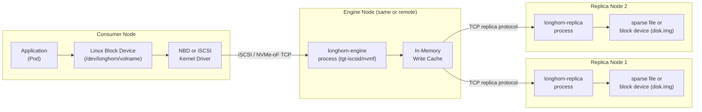
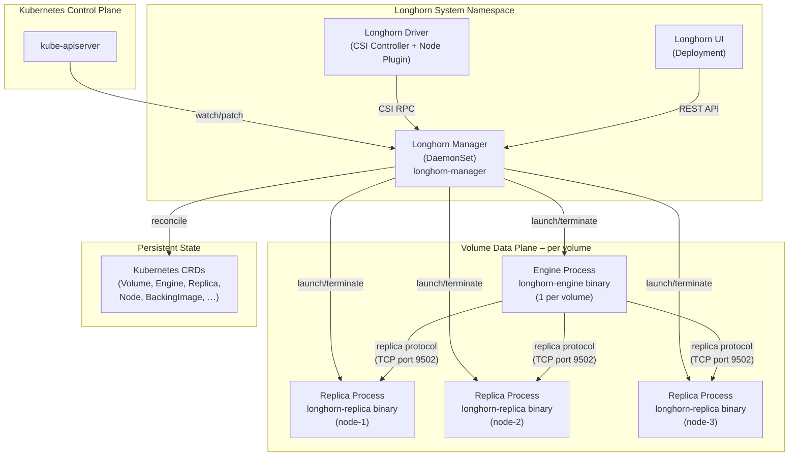
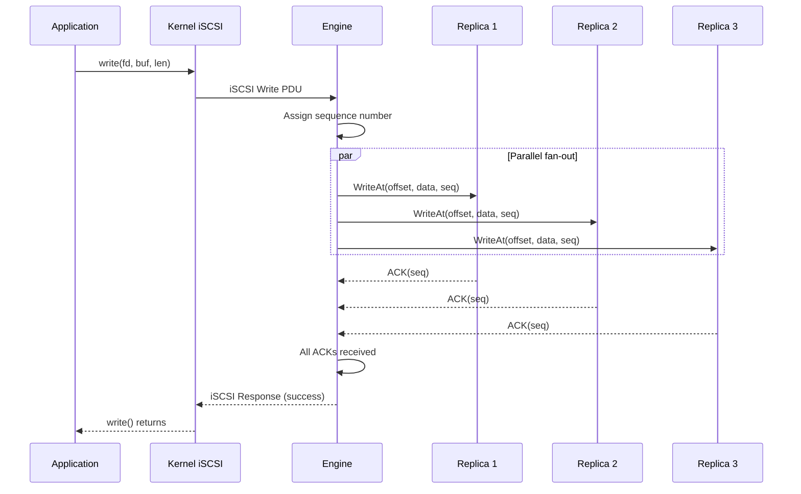
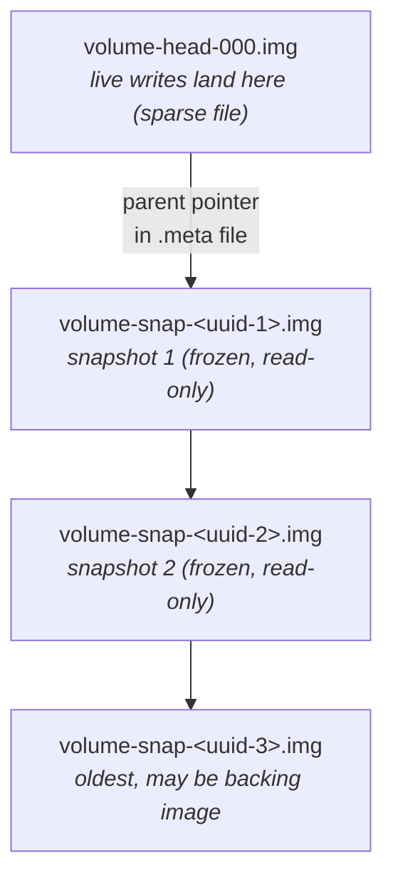
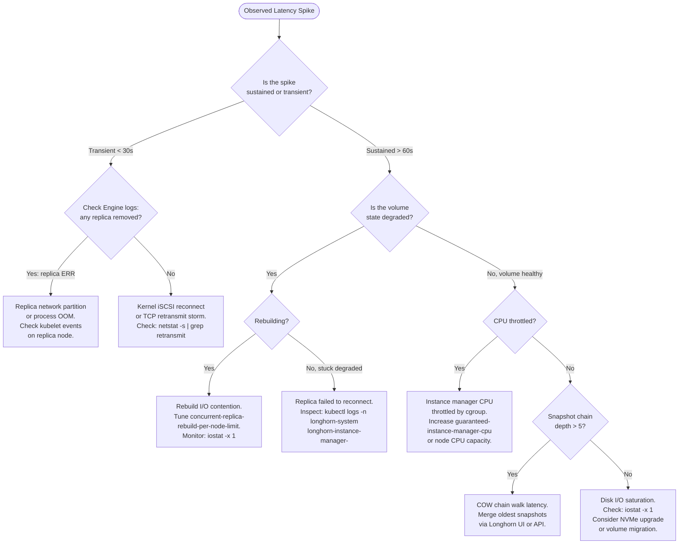

# Lesson 5: Performance Optimization in Longhorn Distributed Block Storage

---

## 1. First-Principles Intuition & Invariants

Longhorn is a cloud-native distributed block storage system built for Kubernetes, implemented in Go and open-sourced by Rancher (now SUSE). Unlike monolithic storage daemons, Longhorn decomposes every volume into a small cluster of independent Unix processes — one Engine per volume and N Replica processes per volume — all running as containers on worker nodes. This architecture has profound performance implications that cannot be reasoned about without first understanding the invariants it enforces.

### 1.1 The Replication Invariant and Its Cost

Longhorn's Engine synchronously mirrors every write to all healthy replicas before acknowledging the write to the caller. This is a **synchronous, multi-replica write quorum** identical in semantics to the "chain replication" or "primary-backup" model. The practical consequence is that **write latency is bounded below by the slowest replica**, not the average. For a volume with three replicas spread across three nodes:

```
write_latency ≥ max(RTT_replica_1, RTT_replica_2, RTT_replica_3) + disk_fsync_time
```

This is not a configuration artifact — it is a fundamental invariant of Longhorn's strong consistency guarantee. Any optimization strategy that ignores this bound will fail to explain observed latency floors.

### 1.2 CAP Positioning: CP with Bounded Unavailability

Longhorn chooses Consistency over Availability in the CAP sense. When the Engine cannot reach a quorum of replicas, it faults the volume rather than serving stale reads or partial writes. The practical expression of this choice:

- A replica that falls more than a configurable `RevisionCounterDisabled` threshold behind the Engine's sequence counter is marked `ERR` and excluded from the write set.
- Volume degradation (fewer than N replicas healthy) is tolerated; volume operation continues with the surviving replicas.
- Complete Engine failure (node hosting the Engine pod dies) triggers a re-attach cycle orchestrated by the Longhorn Manager, during which the volume is unavailable — typically 10–30 seconds depending on `--engine-upgrade-timeout` and CSI node failure detection parameters.

Understanding this placement informs every tuning decision: you are optimizing a CP system, and apparent "availability" improvements that relax consistency checks (e.g., disabling `Revision Counter`) carry real data-safety trade-offs.

### 1.3 Data Path Topology

The actual I/O path in Longhorn traverses multiple abstraction layers, each adding measurable overhead:



Each arrow crossing a node boundary is a TCP connection. A single 4 KiB write from an application traverses: **VFS → block layer → iSCSI initiator → TCP/IP stack → Engine userspace → 2× TCP/IP stack → Replica userspace → pwrite syscall → ext4/xfs → disk**. This path exists entirely because Longhorn is a pure userspace, software-defined storage system — portability and Kubernetes integration come at the cost of this multi-hop data path.

### 1.4 Resource Contention Invariants

Because each volume's Engine and Replica processes are independent OS processes, resource contention follows container cgroup boundaries. Three immutable constraints govern resource behavior:

1. **CPU pinning does not exist** at the Longhorn level; CPU shares are set through standard Kubernetes resource requests/limits on the `longhorn-engine` and `longhorn-replica` pods.
2. **Network bandwidth is shared** across all volumes on a node unless explicit egress shaping (e.g., `tc qdisc`) is applied at the host level — Longhorn has no internal bandwidth arbitration.
3. **Disk I/O is serialized** at the block device level; multiple replicas sharing the same disk compete through the kernel's I/O scheduler. This makes colocation of multiple replicas on the same disk a correctness-safe but performance-hazardous configuration.

---

## 2. Core Architecture & Mechanics

### 2.1 Component Decomposition

Longhorn consists of four distinct runtime subsystems. Understanding each in depth is prerequisite to any tuning exercise.



**Longhorn Manager** is a DaemonSet (one pod per node) that runs a set of Kubernetes controllers. It does not sit in the data path at all — it is a pure control-plane component. Its state is stored in Kubernetes Custom Resources (CRDs), not in a separate etcd instance. This is a critical factual correction from common misconceptions: Longhorn uses the existing Kubernetes etcd through the kube-apiserver, not a standalone etcd cluster.

**Longhorn Engine** is a per-volume process that exposes an iSCSI or NVMe-oF target to the host kernel. It consumes writes from the initiator, fans them out to all replica processes, and waits for acknowledgment from all healthy replicas before returning success. The Engine binary (`longhorn-engine`) also contains `longhorn replica` and `longhorn controller` subcommands — the same binary serves both roles.

**Longhorn Replica** manages the actual data storage. Each replica stores volume data as a chain of sparse files: a `volume-head-000.img` (the live write head) layered on top of zero or more snapshot files (`volume-snap-<uuid>.img`). The snapshot chain is a classic copy-on-write (COW) differencing disk structure, semantically identical to QCOW2 differencing disks but implemented directly in the Longhorn codebase.

**CSI Driver** implements the Container Storage Interface, translating Kubernetes `PersistentVolumeClaim` lifecycle events into Longhorn Manager API calls.

### 2.2 The Replica Write Protocol

The Engine-to-Replica protocol is a custom binary protocol over TCP, implemented in the `longhorn-engine` repository under `pkg/replica` and `pkg/controller`. Understanding it is essential to diagnosing latency.

For a single write operation, the sequence is:



The Engine awaits **all** ACKs before responding. If any replica is `ERR` state, it is removed from the fan-out set before the write is dispatched, so a degraded volume (e.g., 2 of 3 replicas healthy) writes only to the surviving replicas — no quorum vote, no minority rejection. This simplifies the protocol but means that replica failure detection latency directly contributes to write stall duration.

### 2.3 Snapshot Chain and COW Mechanics

The replica's on-disk layout is a differencing chain:



A read of block X must walk the chain from head toward the oldest ancestor until a layer that contains a write to block X is found. In the worst case (block never written since volume creation), the read walks the entire chain length. This is the primary reason **snapshot accumulation degrades read performance** — not because of snapshot metadata overhead, but because of chain walk depth.

The Go implementation in `pkg/replica/replica.go` uses a `uint32` bitmap per 4 KiB sector to track which sectors each layer owns. A read operation:

1. Checks the head bitmap — if the bit is set, reads from head.
2. Otherwise walks the chain toward older snapshots until a set bit is found.
3. Falls back to returning zeros (unallocated) if no layer owns the sector.

This is an O(snapshot_depth) operation per read cache miss. Snapshot coalescing (merging) reduces chain depth to O(1) but requires reading and rewriting data, creating a temporary write amplification spike.

---

## 3. High-Performance Optimization & Failure Modes

### 3.1 Measuring Before Optimizing

Before applying any tuning, establish a baseline with `fio` running inside a pod attached to the Longhorn volume. The following job file exercises the critical I/O patterns:

```ini
# longhorn-baseline.fio
[global]
ioengine=libaio
direct=1
time_based=1
runtime=120
group_reporting=1
filename=/dev/longhorn-vol   ; or mountpoint file path

[rand-read-4k]
rw=randread
bs=4k
iodepth=1
numjobs=1

[rand-write-4k]
rw=randwrite
bs=4k
iodepth=1
numjobs=1

[seq-read-128k]
rw=read
bs=128k
iodepth=4
numjobs=1

[seq-write-128k]
rw=write
bs=128k
iodepth=4
numjobs=1
```

Run the baseline, then run the same `fio` job directly against the underlying disk (bypassing Longhorn) to measure the **overhead ratio**: `overhead_ratio = longhorn_iops / raw_disk_iops`. A healthy single-replica, single-node Longhorn volume should show an overhead ratio of 0.60–0.85 for sequential I/O and 0.40–0.70 for 4 KiB random I/O, depending on network RTT and kernel version. Values below these ranges indicate a configuration or infrastructure problem worth investigating before tuning Longhorn internals.

### 3.2 Network Tuning: The Dominant Latency Factor

For a 3-replica Longhorn volume with replicas on separate nodes, network round-trip time is the dominant term in write latency. Each write requires two network hops (Engine → Replica, Replica → Engine ACK) multiplied by the fan-out count. Practical tuning steps:

**Jumbo frames.** Set MTU 9000 on all storage-network interfaces and switches. This reduces per-packet header overhead and interrupt rate for large sequential writes.

```bash
# Apply on each node — persist via your network manager (NetworkManager/systemd-networkd)
ip link set eth1 mtu 9000

# Verify end-to-end (ping with DF bit set)
ping -M do -s 8972 <replica-node-ip>
```

**TCP buffer sizing.** The default Linux TCP send/receive buffers (87 KiB) are too small for high-bandwidth, low-latency storage traffic. The Bandwidth-Delay Product (BDP) formula determines the minimum useful buffer size:

```
BDP = bandwidth_bps × RTT_seconds
# Example: 10 Gbps link, 100 µs RTT
BDP = 10,000,000,000 × 0.0001 = 1,000,000 bytes ≈ 1 MiB
```

Configure the kernel accordingly, ideally via a `MachineConfig` or `sysctl` DaemonSet in Kubernetes:

```bash
# /etc/sysctl.d/99-longhorn-net.conf
net.core.rmem_max = 134217728
net.core.wmem_max = 134217728
net.ipv4.tcp_rmem = 4096 87380 134217728
net.ipv4.tcp_wmem = 4096 65536 134217728
net.ipv4.tcp_mtu_probing = 1
net.ipv4.tcp_congestion_control = bbr
```

**Network interface queue depth.** For NVMe-backed storage nodes, the NIC is often the bottleneck, not the disk:

```bash
ethtool -G eth1 rx 4096 tx 4096
ethtool -K eth1 gro on gso on tso on
```

### 3.3 Disk I/O Scheduler Tuning

Longhorn replica processes issue `pwrite`/`pread` syscalls directly (using `O_DIRECT` when configured). The kernel I/O scheduler's behavior with `O_DIRECT` synchronous writes differs from buffered writes.

For NVMe SSDs:

```bash
# NVMe devices should use 'none' scheduler — the drive's internal queue is better
echo none > /sys/block/nvme0n1/queue/scheduler
# Increase queue depth to match NVMe capabilities
echo 1024 > /sys/block/nvme0n1/queue/nr_requests
```

For spinning disks (HDD) or SATA SSDs:

```bash
# mq-deadline provides bounded latency for mixed read/write workloads
echo mq-deadline > /sys/block/sda/queue/scheduler
# Tune write deadline to avoid starvation on write-heavy workloads
echo 10 > /sys/block/sda/queue/iosched/write_expire
```

Persist these via udev rules:

```udev
# /etc/udev/rules.d/60-longhorn-io-scheduler.rules
ACTION=="add|change", KERNEL=="nvme[0-9]*", ATTR{queue/scheduler}="none"
ACTION=="add|change", KERNEL=="sd[a-z]", ATTR{queue/scheduler}="mq-deadline"
```

### 3.4 Snapshot Chain Management

As established in §2.3, snapshot chain depth is a direct read latency multiplier. The following Python snippet queries the Longhorn API to report snapshot chain depth per volume, enabling proactive management:

```python
#!/usr/bin/env python3
"""
longhorn_snapshot_audit.py

Reports snapshot chain depth for all Longhorn volumes via the Manager REST API.
Requires: requests library, Longhorn Manager accessible at LONGHORN_URL.
"""

import os
import sys
import json
import requests
from dataclasses import dataclass
from typing import List

LONGHORN_URL = os.environ.get("LONGHORN_URL", "http://longhorn-frontend.longhorn-system.svc/v1")
WARN_DEPTH = int(os.environ.get("WARN_DEPTH", "5"))

@dataclass
class VolumeSnapshotReport:
    name: str
    state: str
    snapshot_count: int
    chain_depth: int  # longest ancestor chain, excluding volume-head

def get_volumes(session: requests.Session) -> List[dict]:
    resp = session.get(f"{LONGHORN_URL}/volumes", timeout=10)
    resp.raise_for_status()
    return resp.json().get("data", [])

def get_snapshots(session: requests.Session, volume_name: str) -> List[dict]:
    resp = session.get(f"{LONGHORN_URL}/volumes/{volume_name}/snapshots", timeout=10)
    resp.raise_for_status()
    return resp.json().get("data", [])

def compute_chain_depth(snapshots: List[dict]) -> int:
    """
    Walk the parent chain from the most recent non-volume-head snapshot.
    Snapshots have a 'parent' field containing the name of the ancestor.
    """
    if not snapshots:
        return 0
    # Build parent map; exclude 'volume-head' pseudo-snapshot
    parent_map = {
        s["name"]: s.get("parent", "")
        for s in snapshots
        if s["name"] != "volume-head"
    }
    if not parent_map:
        return 0
    # Find leaf nodes (snapshots that are not parents of any other snapshot)
    all_parents = set(parent_map.values())
    leaves = [name for name in parent_map if name not in all_parents]
    # Walk the longest chain
    max_depth = 0
    for leaf in leaves:
        depth = 0
        current = leaf
        visited = set()
        while current and current in parent_map and current not in visited:
            visited.add(current)
            current = parent_map[current]
            depth += 1
        max_depth = max(max_depth, depth)
    return max_depth

def main():
    session = requests.Session()
    volumes = get_volumes(session)
    reports = []
    for vol in volumes:
        name = vol["name"]
        state = vol["state"]
        try:
            snapshots = get_snapshots(session, name)
        except requests.HTTPError as e:
            print(f"WARN: could not fetch snapshots for {name}: {e}", file=sys.stderr)
            continue
        real_snaps = [s for s in snapshots if s["name"] != "volume-head"]
        depth = compute_chain_depth(real_snaps)
        reports.append(VolumeSnapshotReport(
            name=name,
            state=state,
            snapshot_count=len(real_snaps),
            chain_depth=depth,
        ))

    reports.sort(key=lambda r: r.chain_depth, reverse=True)
    print(f"{'Volume':<40} {'State':<12} {'Snapshots':>10} {'ChainDepth':>10} {'Status'}")
    print("-" * 82)
    for r in reports:
        status = "WARN" if r.chain_depth >= WARN_DEPTH else "OK"
        print(f"{r.name:<40} {r.state:<12} {r.snapshot_count:>10} {r.chain_depth:>10}  {status}")

if __name__ == "__main__":
    main()
```

Volumes with chain depth ≥ 5 should have their oldest snapshots merged. Merge via the UI or API triggers a background coalescing job on the Replica node. Schedule merges during off-peak hours; they are I/O-intensive and will temporarily increase disk write amplification.

### 3.5 Kubernetes Resource Configuration

Longhorn Engine and Replica processes are launched by the Longhorn Manager as pods with configurable resource limits. Under-provisioning CPU causes the Engine process to stall under high concurrency; over-provisioning wastes node capacity.

A production-grade Longhorn Manager configuration (`longhorn-system` namespace) with explicit resource governance:

```yaml
# longhorn-default-setting.yaml
apiVersion: longhorn.io/v1beta2
kind: Setting
metadata:
  name: guaranteed-instance-manager-cpu
  namespace: longhorn-system
spec:
  value: "12"  # 12% of one CPU guaranteed per instance manager pod
---
apiVersion: longhorn.io/v1beta2
kind: Setting
metadata:
  name: storage-over-provisioning-percentage
  namespace: longhorn-system
spec:
  value: "100"  # Allow allocating up to 2× physical disk capacity (thin provisioning)
---
apiVersion: longhorn.io/v1beta2
kind: Setting
metadata:
  name: storage-minimal-available-percentage
  namespace: longhorn-system
spec:
  value: "15"  # Reserve 15% of disk space; prevent write failures from full disks
---
apiVersion: longhorn.io/v1beta2
kind: Setting
metadata:
  name: concurrent-replica-rebuild-per-node-limit
  namespace: longhorn-system
spec:
  value: "2"   # Limit concurrent replica rebuilds to prevent rebuild I/O saturation
```

The `guaranteed-instance-manager-cpu` setting directly controls the `resources.requests.cpu` on the `longhorn-instance-manager` pods that host Engine and Replica processes. Setting this too low causes CPU throttling under heavy I/O; a value of 12–25% of one vCPU is typical for moderate workloads.

### 3.6 Volume-Level Tuning Parameters

Longhorn exposes several per-volume tunables as StorageClass parameters or via the Longhorn API. The following StorageClass represents a performance-optimized configuration for a database workload:

```yaml
# storageclass-longhorn-db.yaml
apiVersion: storage.k8s.io/v1
kind: StorageClass
metadata:
  name: longhorn-db-performance
provisioner: driver.longhorn.io
allowVolumeExpansion: true
reclaimPolicy: Retain
volumeBindingMode: Immediate
parameters:
  numberOfReplicas: "2"           # Reduce to 2 for lower write latency (less fan-out)
  staleReplicaTimeout: "30"       # Minutes before a disconnected replica is declared stale
  fromBackup: ""
  fsType: "ext4"
  dataLocality: "best-effort"     # Prefer co-locating Engine and one Replica on the same node
  revisionCounterDisabled: "false" # Keep revision counters; required for split-brain detection
  unmapMarkSnapChainRemoved: "enabled"
  diskSelector: "nvme"            # Only schedule replicas on nodes with disks tagged 'nvme'
  nodeSelector: "storage-tier:hot"
```

**`dataLocality: best-effort`** is the most impactful single setting for latency-sensitive workloads. When enabled, Longhorn attempts to schedule one replica on the same node as the Engine. The local replica is served over a Unix socket or loopback TCP rather than crossing the network fabric, eliminating one network hop from the write critical path. The measured latency improvement for 4 KiB synchronous writes is typically 30–60% depending on inter-node RTT.

**`numberOfReplicas: 2`** vs **`3`**: reducing replica count from 3 to 2 lowers write fan-out but reduces fault tolerance from tolerating 1 failure to needing both replicas healthy. This is a deliberate durability trade-off, not a pure optimization.

### 3.7 Failure Modes and Their Performance Signatures

Each failure mode in Longhorn produces a characteristic performance signature that can be identified from metrics and logs.



**Replica rebuild I/O contention** is the most common sustained performance degradation pattern in production. When a replica is re-added after a node failure, the Engine must transfer the entire volume's data to the new replica while simultaneously serving application I/O. With `concurrent-replica-rebuild-per-node-limit` set too high (default was `5` in older Longhorn versions; reduced to `2` in v1.3+), a node with many volumes can saturate its disk and network simultaneously rebuilding multiple replicas. The symptom is elevated `await` for the data disk in `iostat -x` combined with Longhorn volume state showing multiple volumes in `degraded` state.

### 3.8 Monitoring with Prometheus

Longhorn exposes a Prometheus metrics endpoint on port `9500` of each Longhorn Manager pod. Key metrics to track for performance regression detection:

```yaml
# prometheus-rule-longhorn-performance.yaml
apiVersion: monitoring.coreos.com/v1
kind: PrometheusRule
metadata:
  name: longhorn-performance
  namespace: monitoring
  labels:
    prometheus: kube-prometheus
    role: alert-rules
spec:
  groups:
    - name: longhorn.performance
      interval: 30s
      rules:
        - alert: LonghornVolumeActualSizeGrowingFast
          expr: |
            rate(longhorn_volume_actual_size_bytes[5m]) > 100 * 1024 * 1024
          for: 5m
          labels:
            severity: warning
          annotations:
            summary: "Volume {{ $labels.volume }} growing > 100 MiB/s (snapshot accumulation?)"

        - alert: LonghornReplicaRebuildInProgress
          expr: |
            longhorn_volume_robustness == 2  # 2 = degraded
          for: 0m
          labels:
            severity: warning
          annotations:
            summary: "Volume {{ $labels.volume }} is degraded; replica rebuild may impact performance"

        - alert: LonghornInstanceManagerCPUThrottled
          expr: |
            rate(container_cpu_cfs_throttled_seconds_total{
              container="longhorn-instance-manager"
            }[5m]) > 0.1
          for: 5m
          labels:
            severity: critical
          annotations:
            summary: "Longhorn instance manager on {{ $labels.node }} is CPU-throttled"

        - alert: LonghornDiskPressure
          expr: |
            (longhorn_disk_capacity_bytes - longhorn_disk_usage_bytes)
              / longhorn_disk_capacity_bytes < 0.15
          for: 5m
          labels:
            severity: warning
          annotations:
            summary: "Longhorn disk on {{ $labels.node }} below 15% free"
```

### 3.9 Concurrency: iodepth and Engine Queue Depth

The Longhorn Engine uses a fixed-size in-flight operation window. The Engine accepts concurrent I/O requests up to its internal queue limit (`--iscsi-max-pending-commands`, default 128 in recent versions). Sending more concurrent operations than this limit causes the iSCSI initiator to queue at the kernel level, adding queuing delay without improving throughput.

The optimal `iodepth` for `fio` benchmarks (and by extension, real application concurrency) is determined empirically by sweeping:

```bash
#!/usr/bin/env bash
# sweep-iodepth.sh — find optimal iodepth for a Longhorn volume
VOL_DEV="/dev/longhorn-testvol"
for depth in 1 2 4 8 16 32 64 128; do
  echo -n "iodepth=${depth}: "
  fio --name=test \
      --filename="${VOL_DEV}" \
      --ioengine=libaio \
      --direct=1 \
      --rw=randwrite \
      --bs=4k \
      --iodepth="${depth}" \
      --numjobs=1 \
      --time_based \
      --runtime=30 \
      --output-format=terse \
  | awk -F';' '{printf "IOPS=%s LAT_us=%s\n", $8, $40}'
done
```

Typical results show IOPS rising steeply from depth 1 to 8–16, then plateauing or declining as queuing latency increases. The knee of the IOPS/latency curve is the target operating point.

---

## 4. Summary of Optimization Levers

The following table organizes all tuning levers by impact tier and reversibility. High-impact changes should be validated in a non-production cluster before applying.

| Lever | Mechanism | Impact | Reversibility |
|---|---|---|---|
| `dataLocality: best-effort` | Eliminates one network hop for local replica | High | Instant (StorageClass edit) |
| MTU 9000 (jumbo frames) | Reduces packet overhead for large I/O | High | Requires network maintenance window |
| TCP buffer sizing (sysctl) | Prevents TCP send buffer starvation | High | Instant (`sysctl -w`) |
| I/O scheduler (`none` for NVMe) | Removes kernel scheduling overhead for NVMe | Medium | Instant (`echo none > …`) |
| `numberOfReplicas: 2` | Reduces fan-out write latency | Medium | Volume recreation required |
| `guaranteed-instance-manager-cpu` increase | Prevents CPU throttling under load | Medium | Longhorn Manager restart |
| `concurrent-replica-rebuild-per-node-limit: 2` | Limits rebuild I/O contention | Medium | Instant (Setting CR update) |
| Snapshot chain merging | Reduces COW chain walk depth | Low–High (workload dependent) | Background operation, non-disruptive |
| NIC queue depth / offload tuning | Reduces interrupt rate and CPU overhead | Low–Medium | Instant (`ethtool`) |

No single optimization lever produces universally optimal results. The correct tuning is a function of your workload's I/O access pattern (sequential vs. random, read-heavy vs. write-heavy), the cluster's network RTT, and the underlying disk technology. Measure, change one variable, measure again.
