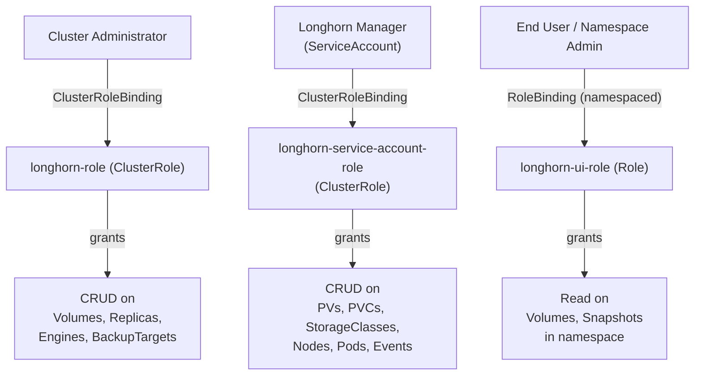
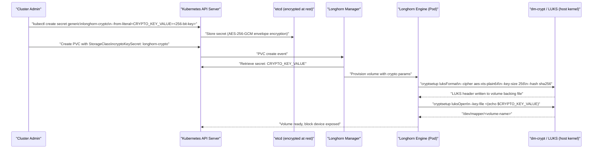
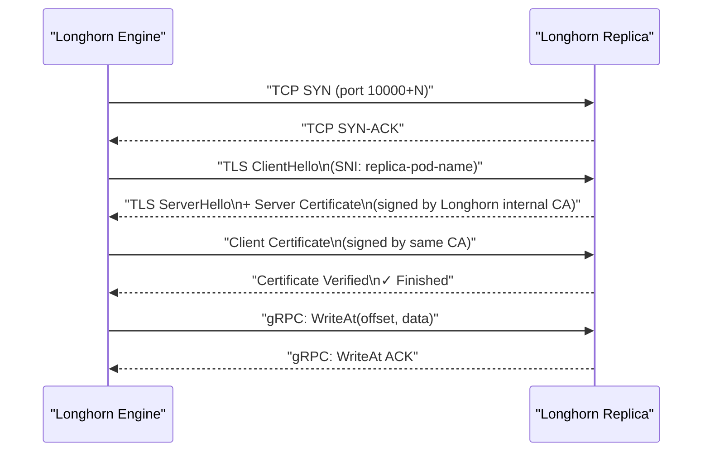
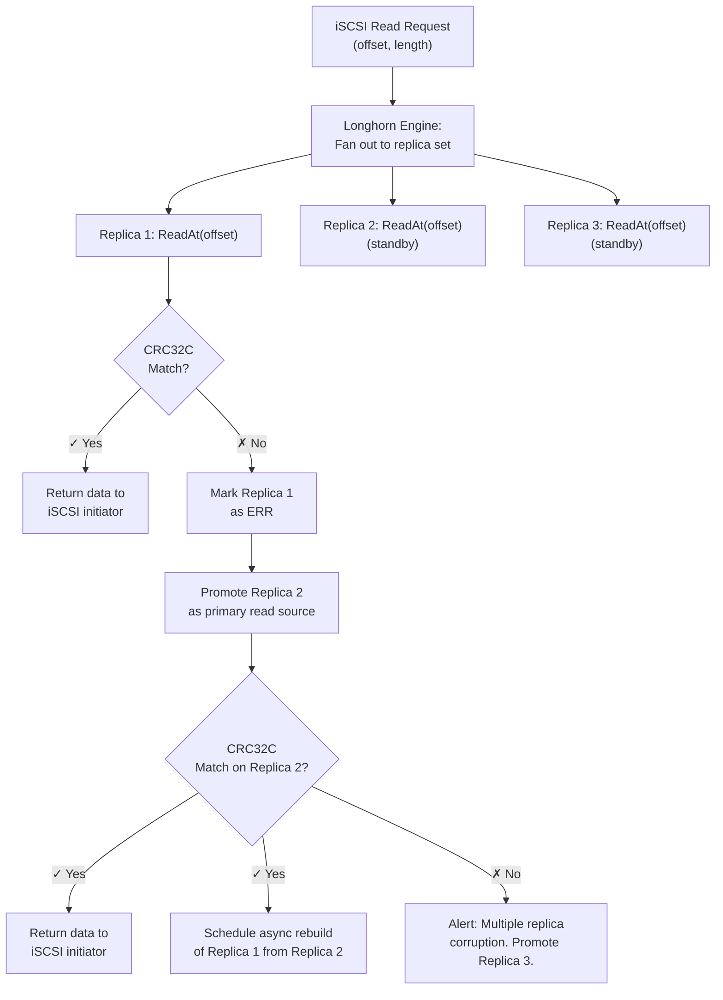
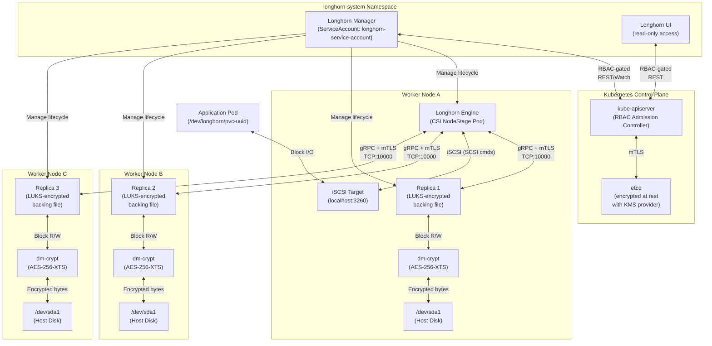

# Lesson 6: Security and Access Control in Longhorn

## 1. First-Principles Intuition & Invariants

Distributed block storage exposes a uniquely hostile attack surface. Data traverses untrusted networks, lands on physical disks managed by shared operating systems, and is orchestrated by control planes that are themselves network-accessible services. Longhorn's security model is a layered defense-in-depth architecture that addresses each of these surfaces independently and compositely.

The classical CIA triad — Confidentiality, Integrity, Availability — maps directly onto Longhorn's security mechanisms:

- **Confidentiality** is enforced through LUKS-based volume encryption (AES-256-XTS) and TLS mutual authentication between all Longhorn components.
- **Integrity** is enforced through per-block CRC32C checksums stored in replica metadata, and through Kubernetes RBAC preventing unauthorized mutation of Longhorn custom resources.
- **Availability** is maintained by Longhorn's replica replication protocol, which ensures that data remains accessible despite disk or node failures, while security controls do not introduce single points of failure in the data path.

Understanding *why* these mechanisms are architecturally necessary requires understanding the trust boundaries in a Kubernetes-hosted storage system:

```
┌──────────────────────────────────────────────────────────────────┐
│  Kubernetes Control Plane (etcd, kube-apiserver)                 │
│  Trust boundary: cluster admin credentials, RBAC policies        │
├──────────────────────────────────────────────────────────────────┤
│  Longhorn Manager (Deployment, namespace: longhorn-system)       │
│  Trust boundary: ServiceAccount with scoped RBAC roles           │
├──────────────────────────────────────────────────────────────────┤
│  Longhorn Engine (per-volume, iSCSI/NVMe-oF frontend)            │
│  Trust boundary: Unix socket, localhost-only iSCSI target        │
├──────────────────────────────────────────────────────────────────┤
│  Longhorn Replica (per-disk, file-backed block device)           │
│  Trust boundary: TLS-authenticated gRPC, LUKS-encrypted files    │
├──────────────────────────────────────────────────────────────────┤
│  Host OS / Physical Disk                                         │
│  Trust boundary: dm-crypt/LUKS layer, kernel block driver        │
└──────────────────────────────────────────────────────────────────┘
```

Each layer must independently validate its inputs and enforce access controls. A compromise at the host OS level must not expose cleartext data (hence LUKS). A compromised network path must not expose data in transit (hence TLS). A misconfigured Kubernetes workload must not be able to mutate volume snapshots or backup targets (hence RBAC).

### Core Invariants

The following invariants must hold at all times in a correctly operating Longhorn cluster:

1. **No plaintext data at rest**: Every byte written to a host disk backing an encrypted Longhorn volume passes through the dm-crypt kernel layer before it reaches the block device. The encryption key never touches disk in cleartext — it is sealed in a Kubernetes Secret and injected into the engine process at mount time.

2. **No unauthenticated replica connections**: The Longhorn engine and replicas communicate over TCP. For encrypted volumes, Longhorn uses HTTPS/TLS for the replica TCP protocol, with certificate verification enforced. Unauthenticated connections are rejected at the socket-accept layer.

3. **Checksum coverage is total**: Every 512-byte sector written by the Longhorn engine has a corresponding CRC32C entry in the replica's on-disk checksum table. A read that returns data whose checksum does not match triggers a replica rebuild from a healthy peer before surfacing data to the caller.

4. **RBAC is the sole authorization path**: There is no secondary authentication mechanism in Longhorn itself. All authorization flows through the Kubernetes API server's RBAC admission controller. Longhorn does not implement its own authentication tokens.

---

## 2. Core Architecture & Mechanics

### 2.1 Role-Based Access Control (RBAC)

Longhorn ships with a set of ClusterRoles and ClusterRoleBindings that implement a least-privilege model. The critical insight is that Longhorn components are Kubernetes-native — they interact with cluster state via the kube-apiserver, not through direct database access or proprietary APIs. This means Kubernetes RBAC is the complete and sufficient authorization mechanism.

**Longhorn's RBAC Principal Hierarchy:**



The Longhorn Manager ServiceAccount requires broad cluster-level permissions because it must create and delete PersistentVolumes (cluster-scoped resources), manage DaemonSet pods on specific nodes, and patch Node objects with scheduling annotations. This is a privileged posture and must be audited carefully.

The actual RBAC manifests installed by Longhorn are:

```yaml
# ClusterRole: longhorn-role
# Source: longhorn/templates/clusterrole.yaml (Helm chart)
apiVersion: rbac.authorization.k8s.io/v1
kind: ClusterRole
metadata:
  name: longhorn-role
rules:
  - apiGroups: [""]
    resources: ["pods", "events", "persistentvolumes",
                "persistentvolumeclaims", "nodes",
                "configmaps", "secrets",
                "serviceaccounts", "services",
                "endpoints"]
    verbs: ["*"]
  - apiGroups: ["apps"]
    resources: ["daemonsets", "statefulsets", "deployments"]
    verbs: ["*"]
  - apiGroups: ["longhorn.io"]
    resources: ["*"]
    verbs: ["*"]
  - apiGroups: ["storage.k8s.io"]
    resources: ["storageclasses", "volumeattachments",
                "csinodes", "csidrivers",
                "csistoragecapacities"]
    verbs: ["*"]
  - apiGroups: ["batch"]
    resources: ["jobs", "cronjobs"]
    verbs: ["*"]
  - apiGroups: ["policy"]
    resources: ["poddisruptionbudgets"]
    verbs: ["*"]
  - apiGroups: ["apiextensions.k8s.io"]
    resources: ["customresourcedefinitions"]
    verbs: ["*"]
---
# Minimal read-only role for end users to inspect volumes
apiVersion: rbac.authorization.k8s.io/v1
kind: Role
metadata:
  name: longhorn-readonly-role
  namespace: longhorn-system
rules:
  - apiGroups: ["longhorn.io"]
    resources: ["volumes", "snapshots", "backups",
                "backupvolumes", "engineimages",
                "nodes"]
    verbs: ["get", "list", "watch"]
  - apiGroups: [""]
    resources: ["persistentvolumeclaims"]
    verbs: ["get", "list", "watch"]
```

**Security hardening note**: The `verbs: ["*"]` on `longhorn.io/*` is intentionally broad for the manager's ServiceAccount. For production clusters, audit log review should be enabled on the `longhorn.io` API group to detect unexpected mutations:

```bash
# Enable audit logging for Longhorn CRD mutations in kube-apiserver
# /etc/kubernetes/audit-policy.yaml
apiVersion: audit.k8s.io/v1
kind: Policy
rules:
  - level: RequestResponse
    verbs: ["create", "update", "patch", "delete"]
    resources:
      - group: "longhorn.io"
        resources: ["volumes", "snapshots", "backuptargets",
                    "engineimages"]
  - level: Metadata
    verbs: ["get", "list"]
    resources:
      - group: "longhorn.io"
        resources: ["*"]
```

### 2.2 Volume Encryption: LUKS over dm-crypt

Longhorn implements volume encryption at the block device layer using **Linux Unified Key Setup (LUKS)** via the dm-crypt kernel subsystem. This is not application-layer encryption — it is transparent, full-disk encryption where the kernel intercepts every block read and write and applies AES-256-XTS before the data reaches the backing file on the host filesystem.

**Why AES-XTS (not AES-CBC) for disk encryption?**

AES-CBC has a critical weakness for disk encryption: it is malleable in a predictable way and leaks information about identical plaintext blocks (identical sectors encrypt to identical ciphertext with a fixed IV). AES-XTS (XEX-based Tweaked-codebook mode with ciphertext Stealing) addresses both problems by using the physical sector number as a "tweak" value, ensuring that the same plaintext at different disk locations produces different ciphertext, and that bitflips in ciphertext produce pseudo-random changes in the decrypted block rather than predictable corruption.

The key size for AES-256-XTS is actually 512 bits (two 256-bit subkeys: one for the block cipher and one for the tweak), referenced as "AES-256" because each individual AES invocation uses a 256-bit key.

**Encryption Key Lifecycle in Longhorn:**



**StorageClass configuration for encryption:**

```yaml
apiVersion: storage.k8s.io/v1
kind: StorageClass
metadata:
  name: longhorn-encrypted
provisioner: driver.longhorn.io
allowVolumeExpansion: true
parameters:
  numberOfReplicas: "3"
  staleReplicaTimeout: "2880"
  fromBackup: ""
  encrypted: "true"
  # Reference to the Kubernetes Secret holding the LUKS passphrase.
  # The Secret must exist in the same namespace as the PVC
  # (or in longhorn-system if using a global secret).
  csi.storage.k8s.io/provisioner-secret-name: "longhorn-crypto"
  csi.storage.k8s.io/provisioner-secret-namespace: "longhorn-system"
  csi.storage.k8s.io/node-publish-secret-name: "longhorn-crypto"
  csi.storage.k8s.io/node-publish-secret-namespace: "longhorn-system"
  csi.storage.k8s.io/node-stage-secret-name: "longhorn-crypto"
  csi.storage.k8s.io/node-stage-secret-namespace: "longhorn-system"
```

The corresponding Secret:

```yaml
apiVersion: v1
kind: Secret
metadata:
  name: longhorn-crypto
  namespace: longhorn-system
type: Opaque
stringData:
  # CRYPTO_KEY_VALUE: a 64-character hex string (256-bit key).
  # In production, generate with: openssl rand -hex 32
  # Store this in Vault or AWS KMS; never commit to source control.
  CRYPTO_KEY_VALUE: "your-256-bit-hex-encoded-key-here"
  CRYPTO_KEY_PROVIDER: "secret"
  CRYPTO_KEY_CIPHER: "aes-xts-plain64"
  CRYPTO_KEY_HASH: "sha256"
  CRYPTO_KEY_SIZE: "256"
  CRYPTO_PBKDF: "argon2i"
```

**Key provider extensibility**: Longhorn supports a `CRYPTO_KEY_PROVIDER` field that determines how the key is sourced. The `secret` provider reads from the Kubernetes Secret directly. For production workloads requiring hardware-backed key management, Longhorn can be integrated with HashiCorp Vault via the `hashivault` provider, which causes the engine to perform a Vault `GET /v1/secret/data/<path>` call at mount time and never persists the key in Kubernetes etcd.

### 2.3 TLS Between Engine and Replicas

Longhorn's internal replica protocol operates over TCP. Each replica process listens on a port (default: 10000 + replica index) and the engine connects to it. Without TLS, this channel is susceptible to man-in-the-middle attacks on flat cluster networks (e.g., a compromised pod performing ARP spoofing on a /16 cluster CIDR).

Longhorn generates per-volume TLS certificates issued by an internal CA managed by `cert-manager` or by Longhorn's own certificate generation logic. The mutual TLS (mTLS) handshake ensures both sides authenticate:



The certificates are mounted into the engine and replica pods via Kubernetes Secret volume mounts. Certificate rotation is handled by Longhorn's manager controller, which watches for certificate expiry and triggers a rolling restart of affected engine and replica pods.

### 2.4 Data Integrity: Checksums and Repair

Longhorn maintains a checksum for every data block it writes. The checksum algorithm is **CRC32C** (Castagnoli variant), which is hardware-accelerated on modern x86-64 (via the `SSE4.2 CRC32` instruction) and ARM64 (via the `CRC32` FEAT_CRC32 extension), making it essentially free in terms of CPU overhead at typical storage I/O rates.

The checksum is stored in a separate sidecar file adjacent to each replica's data file:

```
/var/lib/longhorn/replicas/<volume-name>-<uuid>/
├── volume-head-000.img          # Active data file (sparse, up to 2GB segments)
├── volume-head-000.img.meta     # Metadata: size, sequence number, checksum table
├── volume-snap-<snapshot-uuid>.img     # Snapshot chain file
└── volume-snap-<snapshot-uuid>.img.meta
```

Each `.meta` file contains a CRC32C entry for every 512-byte sector:

```go
// Simplified from Longhorn replica's checksum implementation
// Source: github.com/longhorn/longhorn-engine/pkg/replica/checksum.go

package replica

import (
    "encoding/binary"
    "hash/crc32"
    "os"
)

const (
    sectorSize    = 512
    checksumBytes = 4 // CRC32C is 32 bits = 4 bytes
)

var crc32cTable = crc32.MakeTable(crc32.Castagnoli)

// ChecksumTable maps sector index → CRC32C checksum.
// Stored as a flat binary array: index i maps to bytes [i*4, i*4+4).
type ChecksumTable struct {
    entries []uint32
    file    *os.File
}

// Compute calculates the CRC32C checksum for a single 512-byte sector.
func Compute(sector []byte) uint32 {
    if len(sector) != sectorSize {
        panic("sector must be exactly 512 bytes")
    }
    return crc32.Checksum(sector, crc32cTable)
}

// Verify reads the stored checksum for the given sector index and
// compares it with the actual checksum of the provided data.
// Returns true if the data is intact, false if corruption is detected.
func (ct *ChecksumTable) Verify(sectorIndex int64, data []byte) bool {
    if int(sectorIndex) >= len(ct.entries) {
        return false
    }
    actual := Compute(data)
    stored := ct.entries[sectorIndex]
    return actual == stored
}

// ReadAndVerify reads a sector from the replica data file and verifies
// its integrity. If corrupted, returns an error triggering a rebuild.
func (ct *ChecksumTable) ReadAndVerify(dataFile *os.File, sectorIndex int64) ([]byte, error) {
    offset := sectorIndex * sectorSize
    buf := make([]byte, sectorSize)
    if _, err := dataFile.ReadAt(buf, offset); err != nil {
        return nil, err
    }
    if !ct.Verify(sectorIndex, buf) {
        return nil, &ChecksumMismatchError{SectorIndex: sectorIndex}
    }
    return buf, nil
}

// ChecksumMismatchError signals that a sector's data does not match
// its stored checksum. The engine uses this to trigger a rebuild.
type ChecksumMismatchError struct {
    SectorIndex int64
}

func (e *ChecksumMismatchError) Error() string {
    return fmt.Sprintf("checksum mismatch at sector %d: data corruption detected", e.SectorIndex)
}
```

**Checksum verification in the read path:**

When the Longhorn engine receives a read request from the iSCSI initiator (the node's block device driver), it fans the read out to all healthy replicas. By default it reads from a single replica and verifies the checksum. If the checksum fails, it marks that replica as errored, reads from an alternate replica, initiates an automatic rebuild of the bad replica from the healthy copies, and surfaces the correct data to the caller — all transparently.



### 2.5 Full Architecture View



---

## 3. High-Performance Optimization & Failure Modes

### 3.1 Encryption Performance: AES-NI Hardware Acceleration

The CPU overhead of AES-256-XTS in the data path is negligible on any CPU manufactured after 2010 that supports the AES-NI instruction set extension. AES-NI reduces AES round computation from ~100 clock cycles to ~1 clock cycle per 16-byte block via dedicated silicon, delivering throughput exceeding 10 GB/s on a single core.

Verify that the host OS kernel dm-crypt subsystem is using AES-NI:

```bash
# Check that the kernel crypto subsystem is using the hardware-accelerated
# implementation, not the generic software fallback.
cat /proc/crypto | grep -A 10 "name.*aes"
# Expected output for hardware acceleration:
# name         : xts(aes)
# driver       : xts-aes-aesni
# module       : kernel
# priority     : 401        # higher priority = hardware, 100 = software
# refcnt       : 1
# selftest      : passed
# internal     : no
# type         : skcipher
# async        : yes

# Measure encryption throughput directly:
cryptsetup benchmark --cipher aes-xts-plain64 --key-size 256
# Expected on a modern CPU:
# #     Algorithm |       Key |      Encryption |      Decryption
#     aes-xts-plain64        256b     3.2 GiB/s     3.2 GiB/s
```

If the driver shown is `xts-aes-generic` rather than `xts-aes-aesni`, the host kernel may have been built without `CONFIG_CRYPTO_AES_NI_INTEL=y`, or the CPU genuinely lacks AES-NI. In this case, encryption overhead will be significant at high I/O rates (expect ~40% throughput reduction at sequential workloads).

### 3.2 CRC32C Hardware Acceleration

Similarly, CRC32C is hardware-accelerated via the x86-64 `CRC32` instruction (SSE4.2). The Go standard library's `hash/crc32` package automatically selects the hardware path when the runtime detects SSE4.2 support via CPUID. The checksum path in Longhorn thus adds microseconds, not milliseconds, to the I/O path.

A Python benchmark to verify hardware CRC32C throughput on the host:

```python
#!/usr/bin/env python3
"""
Benchmark CRC32C throughput to verify hardware acceleration.
Requires: pip install crcmod
"""
import crcmod
import time
import struct

# Castagnoli polynomial: 0x1EDC6F41
# crcmod uses hardware SSE4.2 via ctypes if available on Linux
crc32c = crcmod.predefined.mkCrcFun('crc-32c')

SECTOR_SIZE = 512
ITERATIONS = 100_000
data = bytes(range(256)) * 2  # 512 bytes

start = time.perf_counter()
for _ in range(ITERATIONS):
    checksum = crc32c(data)
elapsed = time.perf_counter() - start

throughput_mb = (SECTOR_SIZE * ITERATIONS) / elapsed / 1e6
print(f"CRC32C throughput: {throughput_mb:.0f} MB/s over {ITERATIONS} sectors")
print(f"Expected with SSE4.2: >5000 MB/s")
print(f"Expected software fallback: ~500 MB/s")
```

### 3.3 Concurrency Model: The Engine's I/O Scheduler

Longhorn's engine processes concurrent I/O requests using a goroutine-per-I/O model bounded by a semaphore. Each write is replicated to all replicas in parallel (not serially). An acknowledgment is returned to the iSCSI initiator only after all replicas have confirmed the write, maintaining strong consistency semantics equivalent to synchronous mirroring (RAID-1).

```go
// Simplified write path illustrating parallel fan-out to replicas.
// Source: github.com/longhorn/longhorn-engine/pkg/controller/controller.go

func (c *Controller) Write(offset int64, data []byte) error {
    // Fan out write to all replicas in parallel using a WaitGroup.
    var wg sync.WaitGroup
    errs := make([]error, len(c.replicas))

    for i, replica := range c.replicas {
        wg.Add(1)
        go func(idx int, r ReplicaClient) {
            defer wg.Done()
            errs[idx] = r.WriteAt(data, offset)
        }(i, replica)
    }
    wg.Wait()

    // Any single replica failure marks it as error state and
    // triggers an async rebuild. The write is considered successful
    // as long as a quorum (> n/2) of replicas acknowledge.
    for i, err := range errs {
        if err != nil {
            c.markReplicaError(c.replicas[i], err)
        }
    }
    if c.healthyReplicaCount() == 0 {
        return ErrNoHealthyReplica
    }
    return nil
}
```

**Write ordering and durability**: The engine uses a monotonically increasing sequence number for each I/O. Replicas apply writes in sequence number order, buffering out-of-order writes. This prevents data corruption during concurrent writes from multiple goroutines hitting the same replica over different connections.

### 3.4 Failure Modes and Their Mitigations

The following table covers the primary failure scenarios in Longhorn's security-sensitive paths:

| Failure Mode | Detection Mechanism | Recovery Action | Data Safety |
|---|---|---|---|
| Replica checksum mismatch (silent disk corruption) | CRC32C verification on read | Mark replica ERR; rebuild from healthy peer | Guaranteed if ≥1 healthy replica |
| LUKS key unavailable at node boot | Engine pod fails to open dm-crypt device | Pod enters `CrashLoopBackOff`; Longhorn Manager reports volume degraded | No data exposure; volume inaccessible |
| Kubernetes Secret deleted (key loss) | Engine cannot fetch key; mount fails | Volume permanently inaccessible (data unrecoverable without key backup) | Encrypted data on disk is safe from exposure |
| TLS certificate expiry | Replica connection handshake fails with `certificate has expired` | Longhorn Manager triggers certificate rotation and pod restart | Write I/O paused during rotation (~5–30s) |
| etcd corruption (RBAC data loss) | kube-apiserver audit log gaps; authorization failures | Restore etcd from backup; re-apply RBAC manifests | Existing volume data unaffected |
| Node compromise (host OS attacker) | Out-of-band (host IDS, audit daemon) | Revoke node from cluster; rebuild affected replicas | Encrypted volumes: data safe. Unencrypted: exposed |

#### 3.4.1 Key Loss: The Catastrophic Failure

The most severe security-related failure mode is loss of the LUKS encryption key. If the Kubernetes Secret containing `CRYPTO_KEY_VALUE` is deleted and no external backup exists (e.g., Vault, AWS KMS), the data on all replicas of that volume is **permanently and irrecoverably encrypted**. The LUKS format does not embed a recovery mechanism by design — this is the security guarantee.

Operational best practices to prevent key loss:

```bash
# 1. Backup the secret to HashiCorp Vault before provisioning volumes:
kubectl get secret longhorn-crypto -n longhorn-system -o json | \
    vault kv put secret/longhorn/crypto/pvc-uuid -

# 2. Enable Vault's KV v2 versioning so accidental overwrites are recoverable:
vault kv enable-versioning secret/longhorn/

# 3. Annotate the Secret with a Vault path reference for auditing:
kubectl annotate secret longhorn-crypto \
    vault-backup-path="secret/longhorn/crypto/pvc-uuid" \
    backup-date="$(date -u +%Y-%m-%dT%H:%M:%SZ)"

# 4. Use Kubernetes finalizers to prevent accidental deletion:
kubectl patch secret longhorn-crypto \
    -p '{"metadata":{"finalizers":["longhorn.io/key-protection"]}}'
# A controller must remove this finalizer before kubectl delete will succeed.
```

#### 3.4.2 Network Partition and Split-Brain Prevention

If a network partition isolates the Longhorn engine from some replicas, the engine applies an **automatic rebuild quorum** rule: it continues operating with the surviving replicas and marks the unreachable replicas as errored. When connectivity is restored, the unreachable replicas do not automatically rejoin — the manager must explicitly rebuild them from the current primary replica state to prevent split-brain scenarios where both sides accepted divergent writes.

This is enforced by a **Generation Counter** in the replica's `.meta` file. A replica with an older generation number than the engine's current generation will be rejected at reconnect and immediately rebuilt rather than merged.

### 3.5 Network Policy: Restricting Longhorn Traffic

Longhorn does not natively enforce Kubernetes NetworkPolicy, but the cluster's CNI plugin should be configured to restrict traffic to Longhorn components:

```yaml
# Allow only the Longhorn engine pods to reach replica pods on port 10000+.
# Block all other pods from connecting to replicas directly.
apiVersion: networking.k8s.io/v1
kind: NetworkPolicy
metadata:
  name: longhorn-replica-isolation
  namespace: longhorn-system
spec:
  podSelector:
    matchLabels:
      longhorn.io/component: replica
  policyTypes:
    - Ingress
  ingress:
    # Only allow ingress from Longhorn engine pods
    - from:
        - podSelector:
            matchLabels:
              longhorn.io/component: engine-manager
      ports:
        - protocol: TCP
          port: 10000
        - protocol: TCP
          port: 10001
        - protocol: TCP
          port: 10002
---
# Allow only Longhorn Manager to reach the Longhorn API server.
apiVersion: networking.k8s.io/v1
kind: NetworkPolicy
metadata:
  name: longhorn-manager-ingress
  namespace: longhorn-system
spec:
  podSelector:
    matchLabels:
      app: longhorn-manager
  policyTypes:
    - Ingress
  ingress:
    - from:
        - podSelector:
            matchLabels:
              app: longhorn-ui
      ports:
        - protocol: TCP
          port: 9500  # Longhorn Manager API port
```

### 3.6 Hardening Checklist

The following hardening measures should be applied for production Longhorn deployments handling sensitive data:

```bash
# 1. Confirm etcd encryption at rest is enabled on the control plane.
#    Without this, Kubernetes Secrets (including LUKS keys) are stored
#    in plaintext in etcd.
kubectl get pods -n kube-system kube-apiserver-<node> -o yaml | \
    grep encryption-provider-config
# Expected: --encryption-provider-config=/etc/kubernetes/enc/enc.yaml

# 2. Verify that the encryption provider config uses AES-GCM or KMS,
#    not the 'identity' provider (which is plaintext).
cat /etc/kubernetes/enc/enc.yaml
# providers:
#   - aescbc:        <-- acceptable but legacy
#       keys: [...]
#   - aesgcm:        <-- preferred (authenticated encryption)
#       keys: [...]
#   - kms:           <-- preferred for production (externally managed key)
#       name: aws-kms
#   - identity: {}   <-- MUST be last or absent; if first, secrets are plaintext

# 3. Rotate encryption keys for all Longhorn Secrets:
kubectl get secrets --all-namespaces | grep longhorn-crypto | \
    awk '{print $1, $2}' | while read ns name; do
        kubectl get secret "$name" -n "$ns" -o json | \
        kubectl replace -f -  # Forces re-encryption with current active key
    done

# 4. Enable Pod Security Admission to prevent privilege escalation
#    from workloads that share a node with Longhorn components:
kubectl label namespace longhorn-system \
    pod-security.kubernetes.io/enforce=restricted \
    pod-security.kubernetes.io/warn=restricted
# Note: Longhorn manager and engine pods require hostPath volumes and
# privileged containers (for dm-crypt). They must be exempted from
# 'restricted' and placed under 'privileged' PSA with a narrow exemption.
# See: https://longhorn.io/docs/latest/advanced-resources/security/pod-security-policy/

# 5. Audit Longhorn component image digests (prevent supply chain attacks):
kubectl get pods -n longhorn-system -o jsonpath=\
    '{range .items[*]}{.spec.containers[*].image}{"\n"}{end}' | \
    while read img; do
        docker inspect "$img" --format '{{index .RepoDigests 0}}'
    done
# Pin images in Helm values.yaml to sha256 digests, not :latest or :v1.x tags.
```

---

## 4. Practical Lab Exercises

### Exercise 1: Provision an Encrypted Volume and Verify LUKS Layer

```bash
# Step 1: Create the encryption key Secret.
kubectl create secret generic my-vol-crypto \
  --from-literal=CRYPTO_KEY_VALUE="$(openssl rand -hex 32)" \
  --from-literal=CRYPTO_KEY_PROVIDER="secret" \
  --from-literal=CRYPTO_KEY_CIPHER="aes-xts-plain64" \
  --from-literal=CRYPTO_KEY_HASH="sha256" \
  --from-literal=CRYPTO_KEY_SIZE="256" \
  --from-literal=CRYPTO_PBKDF="argon2i" \
  -n longhorn-system

# Step 2: Create an encrypted StorageClass.
kubectl apply -f - <<'EOF'
apiVersion: storage.k8s.io/v1
kind: StorageClass
metadata:
  name: longhorn-encrypted
provisioner: driver.longhorn.io
parameters:
  numberOfReplicas: "3"
  encrypted: "true"
  csi.storage.k8s.io/node-stage-secret-name: "my-vol-crypto"
  csi.storage.k8s.io/node-stage-secret-namespace: "longhorn-system"
  csi.storage.k8s.io/node-publish-secret-name: "my-vol-crypto"
  csi.storage.k8s.io/node-publish-secret-namespace: "longhorn-system"
  csi.storage.k8s.io/provisioner-secret-name: "my-vol-crypto"
  csi.storage.k8s.io/provisioner-secret-namespace: "longhorn-system"
EOF

# Step 3: Provision a PVC.
kubectl apply -f - <<'EOF'
apiVersion: v1
kind: PersistentVolumeClaim
metadata:
  name: encrypted-pvc
  namespace: default
spec:
  accessModes: [ReadWriteOnce]
  storageClassName: longhorn-encrypted
  resources:
    requests:
      storage: 5Gi
EOF

# Step 4: Attach a test pod to trigger the mount.
kubectl apply -f - <<'EOF'
apiVersion: v1
kind: Pod
metadata:
  name: encrypt-test
  namespace: default
spec:
  containers:
  - name: test
    image: busybox:1.36
    command: ["sh", "-c", "echo 'hello encrypted world' > /data/test.txt && sleep 3600"]
    volumeMounts:
    - name: data
      mountPath: /data
  volumes:
  - name: data
    persistentVolumeClaim:
      claimName: encrypted-pvc
EOF

# Step 5: On the worker node hosting the replica, verify the LUKS device is active.
# First, find the node:
kubectl get pod encrypt-test -o wide
# Then SSH to that node and inspect:
ssh worker-node-a "lsblk -f | grep crypt && cryptsetup status /dev/mapper/<volume-uuid>"
# Expected output from cryptsetup status:
# /dev/mapper/pvc-<uuid> is active.
#   type:    LUKS2
#   cipher:  aes-xts-plain64
#   keysize: 256 bits
#   key location: keyring
#   device:  /dev/longhorn/pvc-<uuid>
#   ...

# Step 6: Verify that the raw backing file is NOT readable as plaintext:
ssh worker-node-a "strings /var/lib/longhorn/replicas/pvc-<uuid>*/volume-head-000.img | head -5"
# Expected: Gibberish/no readable output. The string "hello encrypted world" should NOT appear.
```

### Exercise 2: Simulate Checksum Corruption and Observe Automatic Repair

```bash
# WARNING: This exercise intentionally corrupts a replica for educational purposes.
# Perform ONLY in a non-production lab environment with a volume that holds test data.

# Step 1: Identify a replica pod and its backing file location.
kubectl get replicas.longhorn.io -n longhorn-system -o wide | grep encrypted-pvc

# Step 2: Write known data to the volume.
kubectl exec -n default encrypt-test -- sh -c \
    'dd if=/dev/urandom of=/data/testdata bs=4K count=256 && sync'

# Step 3: SSH to the node hosting one replica and corrupt a sector directly.
# DANGER: Only do this on a Longhorn-managed replica backing file, in a lab.
ssh worker-node-a
# Find the replica backing file:
ls /var/lib/longhorn/replicas/
# Corrupt bytes at offset 1MB (sector 2048) using dd:
dd if=/dev/urandom \
   of=/var/lib/longhorn/replicas/<pvc-uuid>-<replica-uuid>/volume-head-000.img \
   bs=512 count=1 seek=2048 conv=notrunc
# This writes 512 bytes of random data over sector 2048, invalidating its CRC32C.

# Step 4: Back on the control plane, monitor Longhorn's response.
# The corruption will be detected the next time the engine reads sector 2048.
kubectl get volumes.longhorn.io -n longhorn-system -w
# Watch for the volume to transition to 'degraded' as the corrupt replica is marked ERR.

# Step 5: Observe replica rebuild in Longhorn UI or via CLI.
kubectl describe volume.longhorn.io pvc-<uuid> -n longhorn-system
# Look for Events showing:
#   "replica <name> is marked as error because of checksum mismatch"
#   "starting rebuild of replica <name> from healthy source"

# Step 6: Verify data integrity after rebuild completes.
kubectl exec -n default encrypt-test -- sh -c \
    'md5sum /data/testdata'
# Compare with the md5sum captured before the corruption step.
# They must match, proving the engine recovered correct data from healthy replicas.
```

### Exercise 3: Audit RBAC Permissions for a Custom Longhorn Role

```python
#!/usr/bin/env python3
"""
Audit the effective RBAC permissions of Longhorn-related ServiceAccounts.
Requires: kubectl configured, kubernetes Python client installed.
  pip install kubernetes
"""
import subprocess
import json
from dataclasses import dataclass
from typing import List

LONGHORN_NAMESPACE = "longhorn-system"
RESOURCES_TO_CHECK = [
    ("longhorn.io", "volumes"),
    ("longhorn.io", "snapshots"),
    ("longhorn.io", "backuptargets"),
    ("longhorn.io", "engineimages"),
    ("", "secrets"),  # Critical: can the SA read encryption keys?
    ("", "persistentvolumes"),
]
VERBS = ["get", "list", "create", "update", "patch", "delete"]

@dataclass
class PermissionResult:
    resource: str
    verb: str
    allowed: bool

def check_permission(sa_name: str, namespace: str, 
                     group: str, resource: str, verb: str) -> bool:
    """Use kubectl auth can-i to check a specific permission."""
    resource_ref = f"{resource}.{group}" if group else resource
    cmd = [
        "kubectl", "auth", "can-i", verb, resource_ref,
        "--as", f"system:serviceaccount:{namespace}:{sa_name}",
        "-n", namespace,
        "--quiet"
    ]
    result = subprocess.run(cmd, capture_output=True, text=True)
    return result.returncode == 0

def audit_service_account(sa_name: str) -> List[PermissionResult]:
    results = []
    for group, resource in RESOURCES_TO_CHECK:
        for verb in VERBS:
            allowed = check_permission(
                sa_name, LONGHORN_NAMESPACE, group, resource, verb
            )
            results.append(PermissionResult(
                resource=f"{group}/{resource}" if group else resource,
                verb=verb,
                allowed=allowed
            ))
    return results

def print_audit_report(sa_name: str, results: List[PermissionResult]):
    print(f"\n{'='*60}")
    print(f"RBAC Audit: ServiceAccount '{sa_name}' in '{LONGHORN_NAMESPACE}'")
    print(f"{'='*60}")
    
    # Group by resource for readability
    by_resource = {}
    for r in results:
        by_resource.setdefault(r.resource, []).append(r)
    
    for resource, perms in sorted(by_resource.items()):
        allowed_verbs = [p.verb for p in perms if p.allowed]
        denied_verbs = [p.verb for p in perms if not p.allowed]
        print(f"\n  {resource}:")
        print(f"    ✓ Allowed: {', '.join(allowed_verbs) or 'none'}")
        print(f"    ✗ Denied:  {', '.join(denied_verbs) or 'none'}")
        
        # Flag dangerous permissions
        if "secrets" in resource and "get" in allowed_verbs:
            print(f"    ⚠ WARNING: This SA can read Secrets (including LUKS keys)!")
        if "backuptargets" in resource and "delete" in allowed_verbs:
            print(f"    ⚠ WARNING: This SA can delete backup targets!")

if __name__ == "__main__":
    service_accounts = ["longhorn-service-account", "longhorn-ui-service-account"]
    for sa in service_accounts:
        results = audit_service_account(sa)
        print_audit_report(sa, results)
```

---

## 5. Key Concepts Reference

**AES-256-XTS**: The encryption algorithm used by Longhorn's LUKS volumes. XTS mode uses sector number as a tweak to prevent identical plaintext blocks from producing identical ciphertext, which would leak information about data layout. Key size is 512 bits (two 256-bit subkeys), commonly called "AES-256" in reference to the per-block key size.

**CRC32C (Castagnoli)**: A 32-bit cyclic redundancy check variant using the Castagnoli polynomial (0x1EDC6F41). Hardware-accelerated on x86-64 via the `CRC32` instruction in SSE4.2. Detects all single-bit errors, all burst errors up to 32 bits, and most larger burst errors. It is not a cryptographic hash and does not protect against malicious modification — its purpose is to detect accidental corruption, not adversarial tampering.

**dm-crypt / LUKS**: The Linux kernel's device mapper target for transparent block device encryption. LUKS (Linux Unified Key Setup) is the on-disk metadata format that stores cipher parameters and salted key slots. LUKS2 (used by Longhorn on modern kernels) adds Argon2 as the PBKDF (Password-Based Key Derivation Function), replacing LUKS1's PBKDF2, providing stronger resistance against brute-force attacks.

**mTLS (Mutual TLS)**: A TLS handshake in which both client and server present certificates for verification. This is distinct from standard TLS where only the server presents a certificate. Longhorn uses mTLS between the engine and replicas so that a compromised pod cannot impersonate a legitimate replica.

**RBAC (Role-Based Access Control)**: Kubernetes' authorization model based on Role objects (listing permitted verbs on API resources) and RoleBinding/ClusterRoleBinding objects (associating Roles with subjects: users, groups, or ServiceAccounts). Longhorn relies entirely on Kubernetes RBAC; it implements no secondary authorization layer.

**Generation Counter**: A monotonically increasing integer stored in each replica's metadata. The engine and replicas exchange generation numbers during reconnect. A replica with a stale generation is rebuilt rather than merged, preventing split-brain data divergence after network partitions.

**Quorum Write**: Longhorn's default write model requires acknowledgment from all healthy replicas (not a majority quorum). This provides stronger durability guarantees than quorum-based systems (no data loss if any subset of replicas is healthy) but means write I/O pauses if a replica becomes temporarily unavailable. The tradeoff is explicit: Longhorn prioritizes consistency over availability in the write path.
