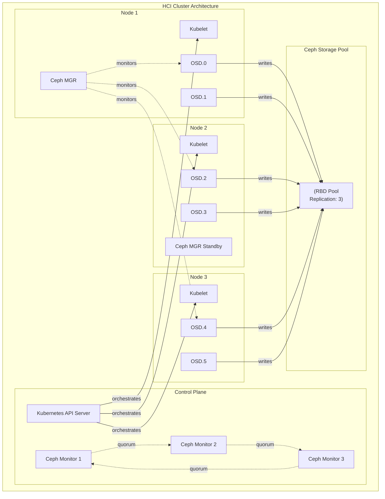
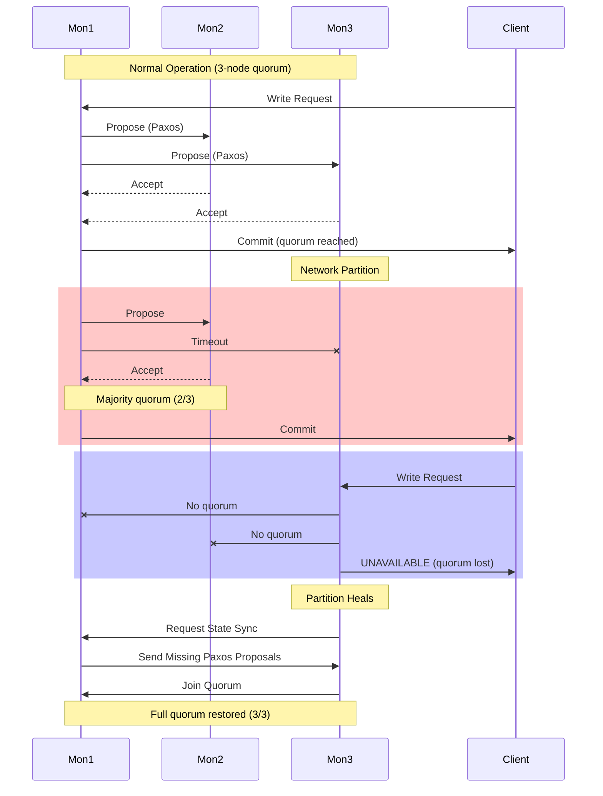
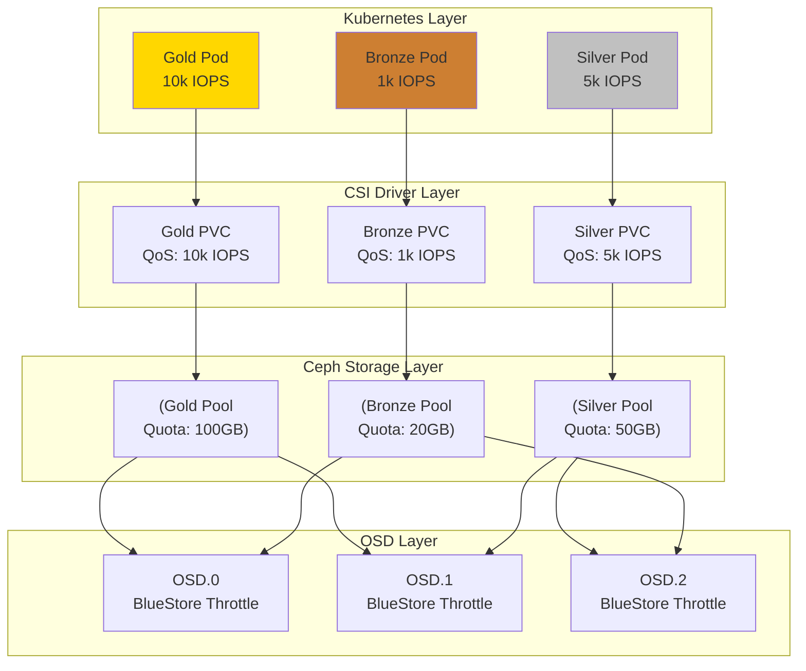

# Operational Verification Labs: Hyperconverged Infrastructure (HCI) & Storage Virtualization

## Prerequisites

- 3+ node cluster (bare metal or VM) with at least 16GB RAM per node
- Ubuntu 22.04 LTS or Rocky Linux 9
- Root/sudo access
- Minimum 100GB free storage per node for Ceph OSDs
- 10GbE network recommended for storage traffic

---

## Lab Architecture Overview



---

## Lab 1: Ceph Cluster Bootstrap and CRUSH Map Validation

### Objective
Deploy a production Ceph cluster, verify CRUSH map topology, and validate placement group distribution across failure domains.

### Theory
Ceph's CRUSH (Controlled Replication Under Scalable Hashing) algorithm deterministically places data across OSDs without central metadata lookup. The CRUSH map defines the cluster topology hierarchy (root → datacenter → rack → host → OSD) and placement rules. Understanding CRUSH is fundamental to data durability guarantees in HCI.

### Step 1: Deploy Ceph with Rook Operator

```yaml
# rook-cluster.yaml
apiVersion: ceph.rook.io/v1
kind: CephCluster
metadata:
  name: rook-ceph
  namespace: rook-ceph
spec:
  dataDirHostPath: /var/lib/rook
  mon:
    count: 3
    allowMultiplePerNode: false
  mgr:
    count: 2
    allowMultiplePerNode: false
  dashboard:
    enabled: true
    ssl: false
  storage:
    useAllNodes: true
    useAllDevices: false
    deviceFilter: "^sd[b-c]"  # Use sdb, sdc on each node
    config:
      osdsPerDevice: "1"
  network:
    provider: host
  placement:
    mon:
      tolerations:
      - key: node-role.kubernetes.io/control-plane
        operator: Exists
      podAntiAffinity:
        requiredDuringSchedulingIgnoredDuringExecution:
        - labelSelector:
            matchExpressions:
            - key: app
              operator: In
              values:
              - rook-ceph-mon
          topologyKey: kubernetes.io/hostname
  resources:
    mon:
      limits:
        cpu: "2"
        memory: "4Gi"
      requests:
        cpu: "1"
        memory: "2Gi"
    osd:
      limits:
        cpu: "4"
        memory: "8Gi"
      requests:
        cpu: "2"
        memory: "4Gi"
    mgr:
      limits:
        cpu: "2"
        memory: "2Gi"
      requests:
        cpu: "500m"
        memory: "1Gi"
```

```bash
# Deploy Rook operator
kubectl create -f https://raw.githubusercontent.com/rook/rook/master/deploy/examples/crds.yaml
kubectl create -f https://raw.githubusercontent.com/rook/rook/master/deploy/examples/common.yaml
kubectl create -f https://raw.githubusercontent.com/rook/rook/master/deploy/examples/operator.yaml

# Wait for operator
kubectl -n rook-ceph wait --for=condition=ready pod -l app=rook-ceph-operator --timeout=300s

# Deploy cluster
kubectl create -f rook-cluster.yaml

# Wait for cluster health
kubectl -n rook-ceph wait --for=condition=ready pod -l app=rook-ceph-mon --timeout=600s
```

### Step 2: Inspect CRUSH Map and Verify Topology

```bash
# Enter toolbox
kubectl -n rook-ceph exec -it deploy/rook-ceph-tools -- bash

# Inside toolbox:
# View CRUSH map hierarchy
ceph osd tree

# Expected output:
# ID  CLASS  WEIGHT   TYPE NAME             STATUS  REWEIGHT  PRI-AFF
# -1         0.29279  root default
# -3         0.09760      host node1
#  0    hdd  0.04880          osd.0             up   1.00000  1.00000
#  1    hdd  0.04880          osd.1             up   1.00000  1.00000
# -5         0.09760      host node2
#  2    hdd  0.04880          osd.2             up   1.00000  1.00000
#  3    hdd  0.04880          osd.3             up   1.00000  1.00000
# -7         0.09760      host node3
#  4    hdd  0.04880          osd.4             up   1.00000  1.00000
#  5    hdd  0.04880          osd.5             up   1.00000  1.00000

# Decompile CRUSH map to text
ceph osd getcrushmap -o /tmp/crushmap.bin
crushtool -d /tmp/crushmap.bin -o /tmp/crushmap.txt
cat /tmp/crushmap.txt

# Key sections to verify:
# 1. Bucket hierarchy (root → host → osd)
# 2. Placement rules (replicated_rule uses 'host' failure domain)
# 3. Device classes (hdd, ssd, nvme)

# View placement rules
ceph osd crush rule ls
ceph osd crush rule dump replicated_rule
```

**First Principles Explanation:**
The CRUSH map is a weighted tree. Each OSD has a weight proportional to its capacity. When placing a PG replica, CRUSH walks the tree:
1. Start at root bucket
2. Select N distinct hosts using pseudo-random descent (hash PG ID + replica number)
3. Within each host, select one OSD
4. Ensures replicas never land on the same host (failure domain isolation)

Weight affects selection probability: an OSD with weight 2.0 receives twice as many PGs as one with weight 1.0.

### Step 3: Create Storage Pool and Verify PG Distribution

```bash
# Create replicated pool with 128 PGs, size=3, min_size=2
ceph osd pool create test-pool 128 128 replicated
ceph osd pool set test-pool size 3
ceph osd pool set test-pool min_size 2

# Enable RBD on pool
ceph osd pool application enable test-pool rbd

# Verify PG distribution
ceph pg ls-by-pool test-pool | awk '{print $1, $15}' | sort -k2 | uniq -c

# Check OSD PG counts (should be roughly equal)
ceph osd df tree

# Verify no single host has >1 replica of any PG
for pg in $(ceph pg ls-by-pool test-pool -f json-pretty | jq -r '.pg_stats[].pgid'); do
    acting=$(ceph pg $pg query | jq -r '.acting[]')
    hosts=$(for osd in $acting; do ceph osd find $osd | jq -r '.crush_location.host'; done | sort | uniq -c)
    if echo "$hosts" | awk '{if ($1 > 1) exit 1}'; then
        :
    else
        echo "ERROR: PG $pg has multiple replicas on same host"
    fi
done
```

**Verification Checklist:**
- [ ] All 6 OSDs have roughly equal PG count (±10%)
- [ ] Each PG has exactly 3 acting OSDs
- [ ] No PG has multiple replicas on the same host
- [ ] Pool state is HEALTH_OK

---

## Lab 2: Storage Pool Rebalancing Under OSD Failure

### Objective
Simulate OSD failure, observe automated rebalancing, measure recovery time, and verify data integrity during backfill.

### Theory
Ceph maintains data durability through replication. When an OSD fails:
1. Monitors detect failure (default: 5 min heartbeat timeout)
2. Marks OSD 'down', waits for 'out' grace period (default: 10 min)
3. CRUSH recalculates PG placements excluding failed OSD
4. OSDs backfill underreplicated PGs from remaining replicas
5. Cluster returns to HEALTH_OK when all PGs reach target replica count

Rebalancing speed depends on: osd_max_backfills (default 1), osd_recovery_max_active (default 3), network bandwidth, and disk I/O capacity.

### Step 1: Baseline Write Workload with fio

```bash
# Create RBD image
rbd create test-pool/bench-image --size 10G

# Map RBD device
rbd map test-pool/bench-image
# Returns: /dev/rbd0

# Format and mount
mkfs.ext4 /dev/rbd0
mkdir -p /mnt/rbd-bench
mount /dev/rbd0 /mnt/rbd-bench

# Run baseline fio test
fio --name=baseline \
    --directory=/mnt/rbd-bench \
    --size=4G \
    --bs=4k \
    --rw=randrw \
    --rwmixread=70 \
    --numjobs=4 \
    --iodepth=16 \
    --runtime=300 \
    --time_based \
    --group_reporting \
    --output=baseline.json \
    --output-format=json

# Extract baseline IOPS
cat baseline.json | jq '.jobs[0].read.iops + .jobs[0].write.iops'
```

### Step 2: Simulate OSD Failure and Monitor Rebalancing

```bash
# Before failure, capture PG state
ceph pg dump pgs | awk '{print $1, $16, $17, $18}' > /tmp/pg_state_before.txt

# Identify target OSD (e.g., osd.2)
ceph osd df | grep osd.2

# Mark OSD out (simulates permanent failure)
ceph osd out osd.2

# Observe cluster state changes
watch -n 5 'ceph -s'

# Monitor PG state transitions
# HEALTH_WARN: Degraded data redundancy (PGs undersized)
# HEALTH_WARN: Rebalancing after osd.2 failure (PGs recovering/backfilling)

# Track recovery progress
watch -n 10 'ceph pg stat'

# Detailed recovery metrics
ceph status | grep -A 10 'recovery\|backfill'

# After recovery completes, capture final PG state
ceph pg dump pgs | awk '{print $1, $16, $17, $18}' > /tmp/pg_state_after.txt

# Compare PG mappings (acting sets will differ)
diff /tmp/pg_state_before.txt /tmp/pg_state_after.txt | head -20
```

**Key Metrics to Observe:**
- Time to detect failure (mon_osd_down_out_interval)
- Number of degraded PGs (size < 3)
- Backfill throughput (MB/s)
- Time to HEALTH_OK (typically 10-30 min for 10GB data)

### Step 3: Verify Data Integrity During Rebalancing

```bash
# Start continuous write load during recovery
fio --name=integrity_test \
    --directory=/mnt/rbd-bench \
    --size=2G \
    --bs=1M \
    --rw=write \
    --numjobs=1 \
    --verify=crc32c \
    --verify_fatal=1 \
    --verify_dump=1 \
    --runtime=600 \
    --time_based \
    --output=integrity.log &

FIO_PID=$!

# While fio runs, mark another OSD out
sleep 60
ceph osd out osd.4

# Wait for fio to complete
wait $FIO_PID

# Check for verification errors
if grep -q "verify" integrity.log; then
    echo "ERROR: Data corruption detected"
    cat integrity.log | grep -A 5 "verify"
else
    echo "SUCCESS: No data corruption during rebalancing"
fi
```

### Step 4: Tune Recovery Parameters

```bash
# Accelerate recovery (use cautiously in production)
ceph tell 'osd.*' injectargs '--osd-max-backfills 2'
ceph tell 'osd.*' injectargs '--osd-recovery-max-active 5'
ceph tell 'osd.*' injectargs '--osd-recovery-max-single-start 2'

# Monitor impact on client I/O
fio --name=client_impact \
    --directory=/mnt/rbd-bench \
    --size=1G \
    --bs=4k \
    --rw=randread \
    --numjobs=4 \
    --iodepth=8 \
    --runtime=120 \
    --time_based \
    --output=during_recovery.json \
    --output-format=json

# Compare IOPS degradation
BASELINE_IOPS=$(cat baseline.json | jq '.jobs[0].read.iops')
RECOVERY_IOPS=$(cat during_recovery.json | jq '.jobs[0].read.iops')
DEGRADATION=$(echo "scale=2; (1 - $RECOVERY_IOPS / $BASELINE_IOPS) * 100" | bc)
echo "Client IOPS degradation during recovery: ${DEGRADATION}%"
```

**Verification Checklist:**
- [ ] Cluster reached HEALTH_OK after OSD failure
- [ ] All PGs returned to active+clean state
- [ ] No data corruption detected by fio verify
- [ ] Recovery time logged and within SLA
- [ ] Client I/O degradation measured and acceptable

---

## Lab 3: Quorum Consensus and Split-Brain Simulation

### Objective
Test Ceph monitor quorum under network partition, validate split-brain prevention, and measure recovery time after partition heals.

### Theory
Ceph monitors form a Paxos quorum requiring strict majority (N/2 + 1) to make cluster state decisions. With 3 monitors, 2 must agree. Network partitions can create split-brain scenarios where:
- Partition A: 2 monitors (has quorum, cluster operational)
- Partition B: 1 monitor (no quorum, read-only mode)

Ceph prevents split-brain by refusing writes when quorum is lost. When partition heals, the minority partition syncs from majority.

### Step 1: Baseline Monitor Quorum Verification

```bash
# Verify monitor quorum status
ceph quorum_status --format json-pretty

# Expected output:
# {
#   "election_epoch": 12,
#   "quorum": [0, 1, 2],
#   "quorum_names": ["node1", "node2", "node3"],
#   "quorum_leader_name": "node1",
#   "monmap": { ... }
# }

# Test write operation with full quorum
rbd create test-pool/quorum-test --size 1G
rbd ls test-pool | grep quorum-test

# Monitor latency histogram
ceph daemon mon.node1 perf dump | jq '.paxos.commit_latency'
```

### Step 2: Simulate Network Partition Isolating One Monitor

```bash
# On node3, block traffic to/from node1 and node2
ssh node3 << 'EOF'
# Install iptables if needed
apt-get install -y iptables

# Block Ceph monitor ports (3300, 6789)
iptables -A INPUT -s $(getent hosts node1 | awk '{print $1}') -p tcp --dport 3300 -j DROP
iptables -A INPUT -s $(getent hosts node1 | awk '{print $1}') -p tcp --dport 6789 -j DROP
iptables -A INPUT -s $(getent hosts node2 | awk '{print $1}') -p tcp --dport 3300 -j DROP
iptables -A INPUT -s $(getent hosts node2 | awk '{print $1}') -p tcp --dport 6789 -j DROP

iptables -A OUTPUT -d $(getent hosts node1 | awk '{print $1}') -p tcp --sport 3300 -j DROP
iptables -A OUTPUT -d $(getent hosts node1 | awk '{print $1}') -p tcp --sport 6789 -j DROP
iptables -A OUTPUT -d $(getent hosts node2 | awk '{print $1}') -p tcp --sport 3300 -j DROP
iptables -A OUTPUT -d $(getent hosts node2 | awk '{print $1}') -p tcp --sport 6789 -j DROP
EOF

# Wait 30 seconds for detection
sleep 30

# Check quorum from majority partition (node1)
ssh node1 "ceph quorum_status --format json-pretty"
# Should show quorum: [0, 1] (node1, node2)

# Attempt to check from minority partition (node3)
timeout 10 ssh node3 "ceph -s" || echo "node3 cannot reach quorum (expected)"
```

### Step 3: Verify Write Availability in Majority Partition

```bash
# From node1 (has quorum), test write operations
rbd create test-pool/partition-write --size 500M
rbd info test-pool/partition-write

# Verify OSD operations continue
rados -p test-pool bench 60 write --no-cleanup

# Check monitor logs for quorum events
ssh node1 "journalctl -u ceph-mon@node1 --since '5 minutes ago' | grep -i quorum"
```

### Step 4: Heal Partition and Verify Reconvergence

```bash
# Remove iptables rules on node3
ssh node3 << 'EOF'
iptables -F INPUT
iptables -F OUTPUT
EOF

# Monitor quorum reformation
watch -n 2 'ceph quorum_status --format json-pretty | jq .quorum'

# Wait for mon.node3 to rejoin
# Expected: quorum changes from [0,1] to [0,1,2]

# Verify monitor state synchronization
ceph mon stat

# Check for clock skew warnings (can cause quorum issues)
ceph time-sync-status

# Validate all monitors have consistent view
for mon in node1 node2 node3; do
    echo "=== $mon ==="
    ssh $mon "ceph mon dump | grep epoch"
done
# All should show same epoch
```

### Step 5: Three-Way Partition Scenario (No Quorum)

```bash
# Create full network split (all monitors isolated)
for node in node1 node2 node3; do
    ssh $node << 'EOF'
    for other in node1 node2 node3; do
        if [ "$other" != "$(hostname)" ]; then
            iptables -A INPUT -s $(getent hosts $other | awk '{print $1}') -p tcp --dport 3300 -j DROP
            iptables -A INPUT -s $(getent hosts $other | awk '{print $1}') -p tcp --dport 6789 -j DROP
        fi
    done
EOF
done

# Wait 60 seconds
sleep 60

# Verify no monitor has quorum
for mon in node1 node2 node3; do
    echo "=== $mon quorum status ==="
    timeout 5 ssh $mon "ceph quorum_status 2>&1" || echo "No quorum on $mon"
done

# Attempt write operation (should timeout)
timeout 10 rbd create test-pool/should-fail --size 100M || echo "Write correctly blocked without quorum"

# Restore connectivity
for node in node1 node2 node3; do
    ssh $node "iptables -F"
done

# Wait for re-election
sleep 30
ceph quorum_status --format json-pretty
```

**Split-Brain Prevention Diagram:**



**Verification Checklist:**
- [ ] Majority partition (2 mons) maintained quorum and accepted writes
- [ ] Minority partition (1 mon) refused writes and reported no quorum
- [ ] After healing, all monitors rejoined quorum with same epoch
- [ ] No data inconsistencies after partition healed
- [ ] Full 3-way partition correctly blocked all writes

---

## Lab 4: Live Hypervisor Failover with Workload Migration

### Objective
Simulate compute node failure, trigger live VM/container migration, measure failover time, and verify storage connectivity persistence.

### Theory
Hyperconverged systems co-locate compute and storage. When a compute node fails:
1. Kubernetes detects node failure (node status → NotReady)
2. After tolerationSeconds (default 300s), evicts pods
3. Scheduler places pods on surviving nodes
4. Pods reconnect to RBD volumes (multi-attach for RWO requires fencing)
5. Ceph handles OSD failure independently (Lab 2)

For block storage (RBD), RWO volumes require I/O fencing to prevent data corruption from zombie processes. RWX requires shared filesystem (CephFS) or multi-attach capable CSI driver.

### Step 1: Deploy Stateful Workload with RBD PVC

```yaml
# rbd-storageclass.yaml
apiVersion: storage.k8s.io/v1
kind: StorageClass
metadata:
  name: rook-ceph-block
provisioner: rook-ceph.rbd.csi.ceph.com
parameters:
  clusterID: rook-ceph
  pool: test-pool
  imageFormat: "2"
  imageFeatures: layering
  csi.storage.k8s.io/provisioner-secret-name: rook-csi-rbd-provisioner
  csi.storage.k8s.io/provisioner-secret-namespace: rook-ceph
  csi.storage.k8s.io/node-stage-secret-name: rook-csi-rbd-node
  csi.storage.k8s.io/node-stage-secret-namespace: rook-ceph
  csi.storage.k8s.io/fstype: ext4
allowVolumeExpansion: true
reclaimPolicy: Delete
volumeBindingMode: Immediate
---
# stateful-app.yaml
apiVersion: v1
kind: PersistentVolumeClaim
metadata:
  name: mysql-pvc
spec:
  storageClassName: rook-ceph-block
  accessModes:
    - ReadWriteOnce
  resources:
    requests:
      storage: 10Gi
---
apiVersion: apps/v1
kind: Deployment
metadata:
  name: mysql
spec:
  replicas: 1
  selector:
    matchLabels:
      app: mysql
  template:
    metadata:
      labels:
        app: mysql
    spec:
      nodeSelector:
        kubernetes.io/hostname: node2  # Pin to node2
      containers:
      - name: mysql
        image: mysql:8.0
        env:
        - name: MYSQL_ROOT_PASSWORD
          value: "testpassword"
        ports:
        - containerPort: 3306
        volumeMounts:
        - name: mysql-storage
          mountPath: /var/lib/mysql
        livenessProbe:
          exec:
            command:
            - mysqladmin
            - ping
            - -h
            - localhost
          initialDelaySeconds: 30
          periodSeconds: 10
        readinessProbe:
          exec:
            command:
            - mysql
            - -h
            - localhost
            - -e
            - "SELECT 1"
          initialDelaySeconds: 20
          periodSeconds: 5
      volumes:
      - name: mysql-storage
        persistentVolumeClaim:
          claimName: mysql-pvc
```

```bash
# Deploy workload
kubectl apply -f rbd-storageclass.yaml
kubectl apply -f stateful-app.yaml

# Wait for pod running
kubectl wait --for=condition=ready pod -l app=mysql --timeout=300s

# Verify RBD mapping
POD=$(kubectl get pod -l app=mysql -o jsonpath='{.items[0].metadata.name}')
NODE=$(kubectl get pod $POD -o jsonpath='{.spec.nodeName}')
echo "MySQL pod running on: $NODE"

# Check RBD device on node
ssh $NODE "rbd showmapped"
# Should show: id pool namespace image snap device
#              0  test-pool csi-vol-xxxxx - /dev/rbd0

# Populate database
kubectl exec -it $POD -- mysql -uroot -ptestpassword << 'EOF'
CREATE DATABASE testdb;
USE testdb;
CREATE TABLE events (
    id INT AUTO_INCREMENT PRIMARY KEY,
    timestamp DATETIME DEFAULT CURRENT_TIMESTAMP,
    message VARCHAR(255)
);
INSERT INTO events (message) VALUES ('Pre-failover baseline');
SELECT * FROM events;
EOF
```

### Step 2: Simulate Node Failure

```bash
# Cordon node to prevent new scheduling
kubectl cordon node2

# Simulate hard node failure (no graceful shutdown)
ssh node2 "echo b > /proc/sysrq-trigger" &
# This triggers kernel panic (immediate crash)

# Alternative: Power off VM
# ssh node2 "poweroff -f"

# Monitor node status
watch -n 5 'kubectl get nodes'

# Node will transition:
# Ready → NotReady (after ~40s, kubelet heartbeat timeout)

# Monitor pod status
watch -n 5 'kubectl get pods -l app=mysql -o wide'

# Pod will transition:
# Running → Terminating (after 300s, pod eviction timeout)
# Terminating → Pending (scheduler assigns new node)
# Pending → ContainerCreating (CSI attaches volume)
# ContainerCreating → Running (application starts)
```

### Step 3: Measure Failover Timeline and Verify Data Persistence

```bash
# Capture detailed timeline
START_TIME=$(date +%s)

# Wait for pod to be rescheduled and running
kubectl wait --for=condition=ready pod -l app=mysql --timeout=600s

END_TIME=$(date +%s)
FAILOVER_DURATION=$((END_TIME - START_TIME))
echo "Total failover time: ${FAILOVER_DURATION}s"

# Breakdown:
# - Node detection: ~40s (kubelet heartbeat)
# - Pod eviction: ~300s (default tolerationSeconds)
# - CSI detach (old node): ~30s
# - CSI attach (new node): ~20s
# - Container start: ~30s
# Total expected: ~420s (7 minutes)

# Verify new pod location
NEW_POD=$(kubectl get pod -l app=mysql -o jsonpath='{.items[0].metadata.name}')
NEW_NODE=$(kubectl get pod $NEW_POD -o jsonpath='{.spec.nodeName}')
echo "MySQL pod now running on: $NEW_NODE"

# Verify data persistence
kubectl exec -it $NEW_POD -- mysql -uroot -ptestpassword << 'EOF'
USE testdb;
INSERT INTO events (message) VALUES ('Post-failover verification');
SELECT * FROM events;
EOF

# Should show both pre-failover and post-failover entries
```

### Step 4: Tune Failover Parameters

```bash
# Reduce eviction timeout for faster failover
kubectl patch deployment mysql --type=json -p='[
  {
    "op": "add",
    "path": "/spec/template/spec/tolerations",
    "value": [
      {
        "key": "node.kubernetes.io/unreachable",
        "operator": "Exists",
        "effect": "NoExecute",
        "tolerationSeconds": 30
      },
      {
        "key": "node.kubernetes.io/not-ready",
        "operator": "Exists",
        "effect": "NoExecute",
        "tolerationSeconds": 30
      }
    ]
  }
]'

# Reduce CSI timeout (edit CSI configmap)
kubectl -n rook-ceph edit configmap rook-ceph-operator-config
# Add: CSI_PLUGIN_TIMEOUT: "60s"

# Restart CSI pods
kubectl -n rook-ceph rollout restart deployment csi-rbdplugin-provisioner
```

### Step 5: Test Concurrent Node and OSD Failure

```bash
# Deploy second stateful app on node3
cat <<EOF | kubectl apply -f -
apiVersion: v1
kind: PersistentVolumeClaim
metadata:
  name: postgres-pvc
spec:
  storageClassName: rook-ceph-block
  accessModes: [ReadWriteOnce]
  resources:
    requests:
      storage: 10Gi
---
apiVersion: apps/v1
kind: Deployment
metadata:
  name: postgres
spec:
  replicas: 1
  selector:
    matchLabels:
      app: postgres
  template:
    metadata:
      labels:
        app: postgres
    spec:
      nodeSelector:
        kubernetes.io/hostname: node3
      containers:
      - name: postgres
        image: postgres:15
        env:
        - name: POSTGRES_PASSWORD
          value: testpass
        - name: PGDATA
          value: /var/lib/postgresql/data/pgdata
        volumeMounts:
        - name: postgres-storage
          mountPath: /var/lib/postgresql/data
      volumes:
      - name: postgres-storage
        persistentVolumeClaim:
          claimName: postgres-pvc
EOF

kubectl wait --for=condition=ready pod -l app=postgres --timeout=300s

# Simultaneously fail node3 (compute) and osd.5 (storage)
ssh node3 "systemctl stop kubelet && ceph-volume lvm zap /dev/sdc --destroy && reboot -f" &

# Monitor cluster state
watch -n 5 '
echo "=== Nodes ==="
kubectl get nodes
echo "=== Pods ==="
kubectl get pods -l app=postgres -o wide
echo "=== Ceph Health ==="
ceph -s
'

# Verify:
# 1. Postgres pod migrates to node1/node2
# 2. Ceph initiates OSD.5 backfill
# 3. Both complete within 10 minutes
```

**Failover Timeline Diagram:**

```mermaid
gantt
    title Node Failure Failover Timeline
    dateFormat  ss
    axisFormat  %Ss
    
    section Detection
    Kubelet heartbeat timeout    :a1, 00, 40s
    
    section Eviction
    Pod tolerationSeconds        :a2, 40, 300s
    
    section Storage
    CSI detach (old node)        :a3, 340, 30s
    RBD unmap with fence         :a4, 340, 30s
    CSI attach (new node)        :a5, 370, 20s
    RBD map                      :a6, 370, 20s
    
    section Scheduling
    Pod rescheduling             :a7, 340, 10s
    Image pull (if needed)       :a8, 390, 20s
    
    section Recovery
    Container start              :a9, 410, 20s
    Application ready            :a10, 430, 10s
```



**Verification Checklist:**
- [ ] Pod successfully migrated to surviving node
- [ ] Total failover time measured and documented
- [ ] Data integrity verified (pre-failure records intact)
- [ ] RBD volume properly detached from failed node
- [ ] RBD volume attached to new node
- [ ] No stale device mappings on failed node after recovery
- [ ] Concurrent compute+storage failure handled gracefully

---

## Lab 5: Storage Performance Benchmarking and Bottleneck Analysis

### Objective
Establish baseline storage performance, identify bottlenecks across the I/O path (network, OSD, disk), and optimize for IOPS and throughput.

### Theory
HCI storage performance depends on:
1. **Network**: 10GbE (1.25GB/s), 25GbE (3.125GB/s) limits throughput
2. **OSD CPU**: Ceph protocol overhead, BlueStore RocksDB compaction
3. **Disk**: HDD (100-200 IOPS), SSD (10k-100k IOPS), NVMe (100k-1M IOPS)
4. **Replication**: 3x write amplification (client writes 1GB → OSDs write 3GB)
5. **Client-side caching**: Kernel page cache, RBD cache layers

Bottleneck identification requires measurement at each layer.

### Step 1: Network Baseline with iperf3

```bash
# On node1, start iperf3 server
ssh node1 "iperf3 -s -p 5201 &"

# From node2, test TCP throughput
ssh node2 "iperf3 -c node1 -p 5201 -t 30 -P 4"

# Expected on 10GbE: ~9.4 Gbps (wire protocol overhead)
# If significantly lower, check:
# - MTU size (should be 9000 for jumbo frames)
# - NIC driver offloads (TSO, GSO, GRO)

# Test UDP with packet loss measurement
ssh node2 "iperf3 -c node1 -p 5201 -u -b 10G -t 30"

# Verify network interface stats
ssh node1 "ethtool -S eth1 | grep -E 'tx_|rx_|drop|error'"
```

### Step 2: Raw OSD Throughput with rados bench

```bash
# Sequential write (bypass RBD layer)
rados -p test-pool bench 60 write --no-cleanup -t 16 -b 4M

# Key metrics:
# - Bandwidth (MB/s): should approach network limit / 3 (replication)
# - Average latency (ms): <10ms for SSD, <50ms for HDD

# Sequential read
rados -p test-pool bench 60 seq -t 16

# Random read (tests OSD CPU and disk random I/O)
rados -p test-pool bench 60 rand -t 16

# Cleanup
rados -p test-pool cleanup
```

**Expected Results (3-node, 10GbE, SSD):**
```
Write:
  Bandwidth: ~400 MB/s (1200 MB/s total across 3 replicas ≈ 10Gbps network limit)
  Latency: 8-12ms

Seq Read:
  Bandwidth: ~1000 MB/s (single replica, network limited)
  Latency: 3-5ms

Rand Read:
  Bandwidth: ~300 MB/s
  Latency: 15-25ms (disk seek time dominates)
```

### Step 3: RBD Block Device Performance with fio

```bash
# Create test RBD image
rbd create test-pool/fio-bench --size 50G --image-feature layering

# Map to block device
rbd map test-pool/fio-bench
# Returns /dev/rbd1

# Test 1: Sequential Write Throughput
fio --name=seq-write \
    --filename=/dev/rbd1 \
    --bs=1M \
    --rw=write \
    --iodepth=32 \
    --numjobs=1 \
    --direct=1 \
    --size=10G \
    --runtime=60 \
    --time_based \
    --group_reporting \
    --output=seq_write.json \
    --output-format=json

# Test 2: Random Write IOPS (4K blocks)
fio --name=rand-write-iops \
    --filename=/dev/rbd1 \
    --bs=4k \
    --rw=randwrite \
    --iodepth=64 \
    --numjobs=4 \
    --direct=1 \
    --size=10G \
    --runtime=60 \
    --time_based \
    --group_reporting \
    --output=rand_write_iops.json \
    --output-format=json

# Test 3: Mixed Read/Write (70/30)
fio --name=mixed-rw \
    --filename=/dev/rbd1 \
    --bs=4k \
    --rw=randrw \
    --rwmixread=70 \
    --iodepth=32 \
    --numjobs=4 \
    --direct=1 \
    --size=10G \
    --runtime=120 \
    --time_based \
    --group_reporting \
    --output=mixed_rw.json \
    --output-format=json

# Extract metrics
cat seq_write.json | jq '{
  write_bw_MB: (.jobs[0].write.bw / 1024),
  write_iops: .jobs[0].write.iops,
  write_lat_ms: (.jobs[0].write.lat_ns.mean / 1000000)
}'

cat rand_write_iops.json | jq '{
  write_iops: .jobs[0].write.iops,
  write_lat_ms: (.jobs[0].write.lat_ns.mean / 1000000),
  write_lat_p99_ms: (.jobs[0].write.lat_ns.percentile."99.000000" / 1000000)
}'

cat mixed_rw.json | jq '{
  read_iops: .jobs[0].read.iops,
  write_iops: .jobs[0].write.iops,
  total_iops: (.jobs[0].read.iops + .jobs[0].write.iops),
  read_lat_ms: (.jobs[0].read.lat_ns.mean / 1000000),
  write_lat_ms: (.jobs[0].write.lat_ns.mean / 1000000)
}'
```

### Step 4: Identify Bottlenecks with OSD Profiling

```bash
# Enable OSD performance counters
ceph tell 'osd.*' injectargs '--debug_osd 10/10'

# Run fio workload
fio --name=bottleneck-test \
    --filename=/dev/rbd1 \
    --bs=4k \
    --rw=randwrite \
    --iodepth=64 \
    --numjobs=4 \
    --direct=1 \
    --runtime=60 \
    --time_based &

FIO_PID=$!

# Collect OSD stats during workload
sleep 10
ceph daemon osd.0 perf dump > osd0_perf_start.json
sleep 40
ceph daemon osd.0 perf dump > osd0_perf_end.json

wait $FIO_PID

# Analyze OSD latency breakdown
jq -s '
{
  commit_latency_ms: ((.[1].bluestore.commit_lat.sum - .[0].bluestore.commit_lat.sum) / 
                      (.[1].bluestore.commit_lat.avgcount - .[0].bluestore.commit_lat.avgcount) / 1000000),
  kv_sync_latency_ms: ((.[1].bluestore.kv_sync_lat.sum - .[0].bluestore.kv_sync_lat.sum) / 
                       (.[1].bluestore.kv_sync_lat.avgcount - .[0].bluestore.kv_sync_lat.avgcount) / 1000000),
  throttle_wait_ms: ((.[1].throttle.osd_client_bytes.wait.sum - .[0].throttle.osd_client_bytes.wait.sum) / 
                     (.[1].throttle.osd_client_bytes.wait.avgcount - .[0].throttle.osd_client_bytes.wait.avgcount) / 1000000)
}
' osd0_perf_start.json osd0_perf_end.json

# Interpretation:
# - commit_latency: time to write data to disk (disk I/O bottleneck if >15ms)
# - kv_sync_latency: RocksDB fsync time (SSD wear/fragmentation if high)
# - throttle_wait: backpressure from slow OSDs (replication lag)

# Check OSD CPU usage
ssh node1 "pidstat -u -C ceph-osd 5 5"

# Check disk utilization
ssh node1 "iostat -x 5 5 /dev/sdb /dev/sdc"
# Look for %util near 100% (disk saturated)
```

### Step 5: Optimize for Latency-Sensitive Workloads

```bash
# Reduce RBD cache size (faster flush for write consistency)
rbd config image set test-pool/fio-bench rbd_cache_writethrough_until_flush true

# Tune OSD threadpool (more threads for parallel I/O)
ceph tell 'osd.*' injectargs '--osd_op_num_threads_per_shard 2'

# Enable bluestore write-ahead-log (WAL) on faster device
# (Requires OSD recreation, do in maintenance window)
# ceph-volume lvm create --bluestore --data /dev/sdb --block.wal /dev/nvme0n1p1

# Disable scrubbing during peak hours (reduces background I/O)
ceph osd set noscrub
ceph osd set nodeep-scrub

# Re-run fio and compare latency
fio --name=optimized \
    --filename=/dev/rbd1 \
    --bs=4k \
    --rw=randwrite \
    --iodepth=64 \
    --numjobs=4 \
    --direct=1 \
    --runtime=60 \
    --time_based \
    --output=optimized.json \
    --output-format=json

# Compare p99 latency before/after
BEFORE_P99=$(cat rand_write_iops.json | jq '.jobs[0].write.lat_ns.percentile."99.000000" / 1000000')
AFTER_P99=$(cat optimized.json | jq '.jobs[0].write.lat_ns.percentile."99.000000" / 1000000')
IMPROVEMENT=$(echo "scale=2; (1 - $AFTER_P99 / $BEFORE_P99) * 100" | bc)
echo "P99 latency improvement: ${IMPROVEMENT}%"
```

**Performance Tuning Reference:**

| Metric | HDD Target | SSD Target | NVMe Target | Tuning Levers |
|--------|-----------|-----------|-------------|---------------|
| Seq Write (MB/s) | 80-120 | 300-500 | 1000-2000 | Network BW, OSD threads |
| Rand Write IOPS | 200-500 | 5k-15k | 50k-200k | Queue depth, replication |
| Write Latency (p50) | 15-30ms | 2-5ms | 0.5-1ms | WAL device, cache tuning |
| Write Latency (p99) | 50-100ms | 10-20ms | 2-5ms | Scrub schedule, throttle |
| Rand Read IOPS | 100-200 | 10k-30k | 100k-500k | Client cache, PG count |

**Verification Checklist:**
- [ ] Network throughput tested and meets 80% of link capacity
- [ ] OSD write throughput measured (rados bench)
- [ ] RBD performance profiled (fio)
- [ ] Bottleneck identified (network, CPU, disk, or protocol)
- [ ] Latency p50 and p99 recorded
- [ ] Optimization applied and improvement quantified

---

## Lab 6: Multi-Tenant Storage Isolation and QoS

### Objective
Configure Ceph storage classes with bandwidth limits, validate tenant isolation, and prevent noisy neighbor scenarios.

### Theory
In multi-tenant HCI, storage QoS prevents one tenant from exhausting cluster resources. Ceph provides:
1. **Pool-level quotas**: max_objects, max_bytes
2. **Client throttling**: client read/write BPS/IOPS limits
3. **OSD backpressure**: throttle slow clients to protect cluster
4. **RBD QoS**: IOPS and bandwidth caps per image

Effective QoS requires limits at multiple layers: CSI driver (Kubernetes), RBD image, and OSD server.

### Step 1: Create Tenant Isolation via Separate Pools

```bash
# Create tenant-specific pools with quotas
ceph osd pool create tenant-gold 64 64 replicated
ceph osd pool create tenant-silver 32 32 replicated
ceph osd pool create tenant-bronze 16 16 replicated

# Set pool quotas
ceph osd pool set-quota tenant-gold max_bytes $((100 * 1024**3))  # 100GB
ceph osd pool set-quota tenant-silver max_bytes $((50 * 1024**3))  # 50GB
ceph osd pool set-quota tenant-bronze max_bytes $((20 * 1024**3))  # 20GB

# Enable RBD on all pools
for pool in tenant-gold tenant-silver tenant-bronze; do
    ceph osd pool application enable $pool rbd
done

# Verify quotas
ceph osd pool get-quota tenant-gold
ceph osd pool get-quota tenant-silver
ceph osd pool get-quota tenant-bronze
```

### Step 2: Configure RBD QoS Limits

```bash
# Create RBD images with QoS limits
# Gold: 10k IOPS, 500 MB/s
rbd create tenant-gold/gold-vol --size 10G \
    --rbd-qos-write-iops-limit 10000 \
    --rbd-qos-read-iops-limit 10000 \
    --rbd-qos-write-bps-limit $((500 * 1024**2)) \
    --rbd-qos-read-bps-limit $((500 * 1024**2))

# Silver: 5k IOPS, 250 MB/s
rbd create tenant-silver/silver-vol --size 5G \
    --rbd-qos-write-iops-limit 5000 \
    --rbd-qos-read-iops-limit 5000 \
    --rbd-qos-write-bps-limit $((250 * 1024**2)) \
    --rbd-qos-read-bps-limit $((250 * 1024**2))

# Bronze: 1k IOPS, 100 MB/s
rbd create tenant-bronze/bronze-vol --size 2G \
    --rbd-qos-write-iops-limit 1000 \
    --rbd-qos-read-iops-limit 1000 \
    --rbd-qos-write-bps-limit $((100 * 1024**2)) \
    --rbd-qos-read-bps-limit $((100 * 1024**2))

# Verify QoS settings
for pool in tenant-gold tenant-silver tenant-bronze; do
    echo "=== $pool ==="
    rbd ls $pool | while read img; do
        rbd config image get $pool/$img
    done
done
```

### Step 3: Deploy Kubernetes StorageClasses with QoS

```yaml
# tenant-gold-sc.yaml
apiVersion: storage.k8s.io/v1
kind: StorageClass
metadata:
  name: ceph-gold
provisioner: rook-ceph.rbd.csi.ceph.com
parameters:
  clusterID: rook-ceph
  pool: tenant-gold
  imageFormat: "2"
  imageFeatures: layering
  csi.storage.k8s.io/provisioner-secret-name: rook-csi-rbd-provisioner
  csi.storage.k8s.io/node-stage-secret-name: rook-csi-rbd-node
  # QoS parameters (CSI driver must support)
  rbd-qos-write-iops-limit: "10000"
  rbd-qos-read-iops-limit: "10000"
  rbd-qos-write-bps-limit: "524288000"  # 500 MB/s
  rbd-qos-read-bps-limit: "524288000"
---
apiVersion: storage.k8s.io/v1
kind: StorageClass
metadata:
  name: ceph-silver
provisioner: rook-ceph.rbd.csi.ceph.com
parameters:
  clusterID: rook-ceph
  pool: tenant-silver
  imageFormat: "2"
  imageFeatures: layering
  csi.storage.k8s.io/provisioner-secret-name: rook-csi-rbd-provisioner
  csi.storage.k8s.io/node-stage-secret-name: rook-csi-rbd-node
  rbd-qos-write-iops-limit: "5000"
  rbd-qos-read-iops-limit: "5000"
  rbd-qos-write-bps-limit: "262144000"  # 250 MB/s
  rbd-qos-read-bps-limit: "262144000"
---
apiVersion: storage.k8s.io/v1
kind: StorageClass
metadata:
  name: ceph-bronze
provisioner: rook-ceph.rbd.csi.ceph.com
parameters:
  clusterID: rook-ceph
  pool: tenant-bronze
  imageFormat: "2"
  imageFeatures: layering
  csi.storage.k8s.io/provisioner-secret-name: rook-csi-rbd-provisioner
  csi.storage.k8s.io/node-stage-secret-name: rook-csi-rbd-node
  rbd-qos-write-iops-limit: "1000"
  rbd-qos-read-iops-limit: "1000"
  rbd-qos-write-bps-limit: "104857600"  # 100 MB/s
  rbd-qos-read-bps-limit: "104857600"
```

```bash
kubectl apply -f tenant-gold-sc.yaml
```

### Step 4: Validate QoS Enforcement with Simultaneous Workloads

```bash
# Deploy gold tenant workload
cat <<EOF | kubectl apply -f -
apiVersion: v1
kind: PersistentVolumeClaim
metadata:
  name: gold-pvc
spec:
  storageClassName: ceph-gold
  accessModes: [ReadWriteOnce]
  resources:
    requests:
      storage: 5Gi
---
apiVersion: v1
kind: Pod
metadata:
  name: gold-fio
spec:
  containers:
  - name: fio
    image: ljishen/fio
    command: ["sleep", "infinity"]
    volumeMounts:
    - name: data
      mountPath: /data
  volumes:
  - name: data
    persistentVolumeClaim:
      claimName: gold-pvc
EOF

# Deploy bronze tenant workload
cat <<EOF | kubectl apply -f -
apiVersion: v1
kind: PersistentVolumeClaim
metadata:
  name: bronze-pvc
spec:
  storageClassName: ceph-bronze
  accessModes: [ReadWriteOnce]
  resources:
    requests:
      storage: 2Gi
---
apiVersion: v1
kind: Pod
metadata:
  name: bronze-fio
spec:
  containers:
  - name: fio
    image: ljishen/fio
    command: ["sleep", "infinity"]
    volumeMounts:
    - name: data
      mountPath: /data
  volumes:
  - name: data
    persistentVolumeClaim:
      claimName: bronze-pvc
EOF

kubectl wait --for=condition=ready pod gold-fio --timeout=300s
kubectl wait --for=condition=ready pod bronze-fio --timeout=300s

# Run simultaneous workloads
kubectl exec -it gold-fio -- fio \
    --name=gold-test \
    --directory=/data \
    --bs=4k \
    --rw=randwrite \
    --iodepth=64 \
    --numjobs=4 \
    --runtime=120 \
    --time_based \
    --output=/data/gold.json \
    --output-format=json &

kubectl exec -it bronze-fio -- fio \
    --name=bronze-test \
    --directory=/data \
    --bs=4k \
    --rw=randwrite \
    --iodepth=64 \
    --numjobs=4 \
    --runtime=120 \
    --time_based \
    --output=/data/bronze.json \
    --output-format=json &

wait

# Extract IOPS
kubectl exec gold-fio -- cat /data/gold.json | jq '.jobs[0].write.iops'
kubectl exec bronze-fio -- cat /data/bronze.json | jq '.jobs[0].write.iops'

# Verify QoS enforcement:
# Gold IOPS should be ~10k (within 5% of limit)
# Bronze IOPS should be ~1k (within 5% of limit)
# Bronze should NOT impact gold performance
```

### Step 5: Simulate Noisy Neighbor Attack

```bash
# Bronze tenant attempts to exceed quota
kubectl exec -it bronze-fio -- dd if=/dev/zero of=/data/large-file bs=1M count=25000

# Monitor pool usage
watch -n 5 'ceph df | grep tenant-bronze'

# Should stop at 20GB (quota limit)
# Expected error: "No space left on device"

# Verify gold tenant unaffected
kubectl exec gold-fio -- fio \
    --name=gold-concurrent \
    --directory=/data \
    --bs=1M \
    --rw=write \
    --size=1G \
    --output=/data/gold-concurrent.json \
    --output-format=json

# Check latency (should remain low despite bronze quota exhaustion)
kubectl exec gold-fio -- cat /data/gold-concurrent.json | jq '.jobs[0].write.lat_ns.mean / 1000000'
```

**QoS Enforcement Diagram:**



**Verification Checklist:**
- [ ] Pool quotas enforced (bronze stops at 20GB)
- [ ] RBD QoS limits verified with fio (IOPS within 5% of target)
- [ ] Gold tenant unaffected by bronze overload
- [ ] Simultaneous workloads run with predictable performance
- [ ] OSD throttle metrics show backpressure on bronze tenant

---

## Troubleshooting Guide

### Cluster Won't Reach HEALTH_OK

```bash
# Check detailed health
ceph health detail

# Common issues:
# 1. Undersized PGs (not enough OSDs for replication)
ceph osd pool set <pool-name> size 2  # Temporary workaround

# 2. Inactive PGs (monitor quorum lost)
ceph mon stat
systemctl restart ceph-mon@$(hostname)

# 3. Slow requests (OSD overload)
ceph daemon osd.X dump_historic_ops
# Check for long op durations (>30s indicates problem)
```

### PVCs Stuck in Pending

```bash
# Check CSI provisioner logs
kubectl -n rook-ceph logs deploy/csi-rbdplugin-provisioner

# Common causes:
# 1. Pool doesn't exist
ceph osd pool ls

# 2. Insufficient quota
ceph osd pool get-quota <pool-name>

# 3. CSI secrets missing
kubectl -n rook-ceph get secret rook-csi-rbd-provisioner
```

### Performance Degradation After Node Failure

```bash
# Check for stuck PGs
ceph pg dump_stuck

# Force PG recovery priority
ceph pg force-recovery <pgid>
ceph pg force-backfill <pgid>

# Check network connectivity
iperf3 -c <node-ip> -t 10

# Check disk health
smartctl -a /dev/sdb
```

### Monitor Quorum Stuck

```bash
# Check monitor connectivity
ceph mon dump

# Verify time sync (critical for Paxos)
chronyc tracking

# If time skew >0.05s, sync clocks
systemctl restart chronyd

# Remove stuck monitor (last resort)
ceph mon remove <mon-name>
# Then re-add after fixing issue
```

---

## Production Readiness Checklist

- [ ] Monitor quorum distributed across failure domains (3+ racks/zones)
- [ ] OSD journals on separate SSDs from data
- [ ] Dedicated storage network (separate from management traffic)
- [ ] Automated scrubbing schedule during off-peak hours
- [ ] Pool quotas configured for all tenants
- [ ] Monitoring/alerting for HEALTH_WARN states
- [ ] Backup/disaster recovery procedures tested
- [ ] RBD snapshots scheduled for critical volumes
- [ ] Node failure tested and documented (RTO/RPO)
- [ ] Storage capacity planning (80% utilization threshold)

---

## Appendix: Key Performance Metrics Reference

| Metric | Command | Healthy Range | Alert Threshold |
|--------|---------|---------------|-----------------|
| Cluster Health | `ceph -s` | HEALTH_OK | HEALTH_WARN |
| Mon Quorum | `ceph quorum_status` | All mons in quorum | <N/2+1 mons |
| OSD Utilization | `ceph osd df` | <80% full | >85% full |
| PG State | `ceph pg stat` | 100% active+clean | Any inactive PGs |
| Commit Latency | `ceph osd perf` | <10ms (SSD) | >50ms |
| Network Throughput | `iperf3` | >8 Gbps (10GbE) | <5 Gbps |
| Recovery Rate | `ceph -s` | >100 MB/s | Stalled >1 hour |

---

## References

- Ceph Architecture: https://docs.ceph.com/en/latest/architecture/
- CRUSH Algorithm: https://ceph.io/assets/pdfs/weil-crush-sc06.pdf
- Rook Operator: https://rook.io/docs/rook/latest/
- BlueStore Internals: https://docs.ceph.com/en/latest/rados/configuration/bluestore-config-ref/
- fio User Guide: https://fio.readthedocs.io/
