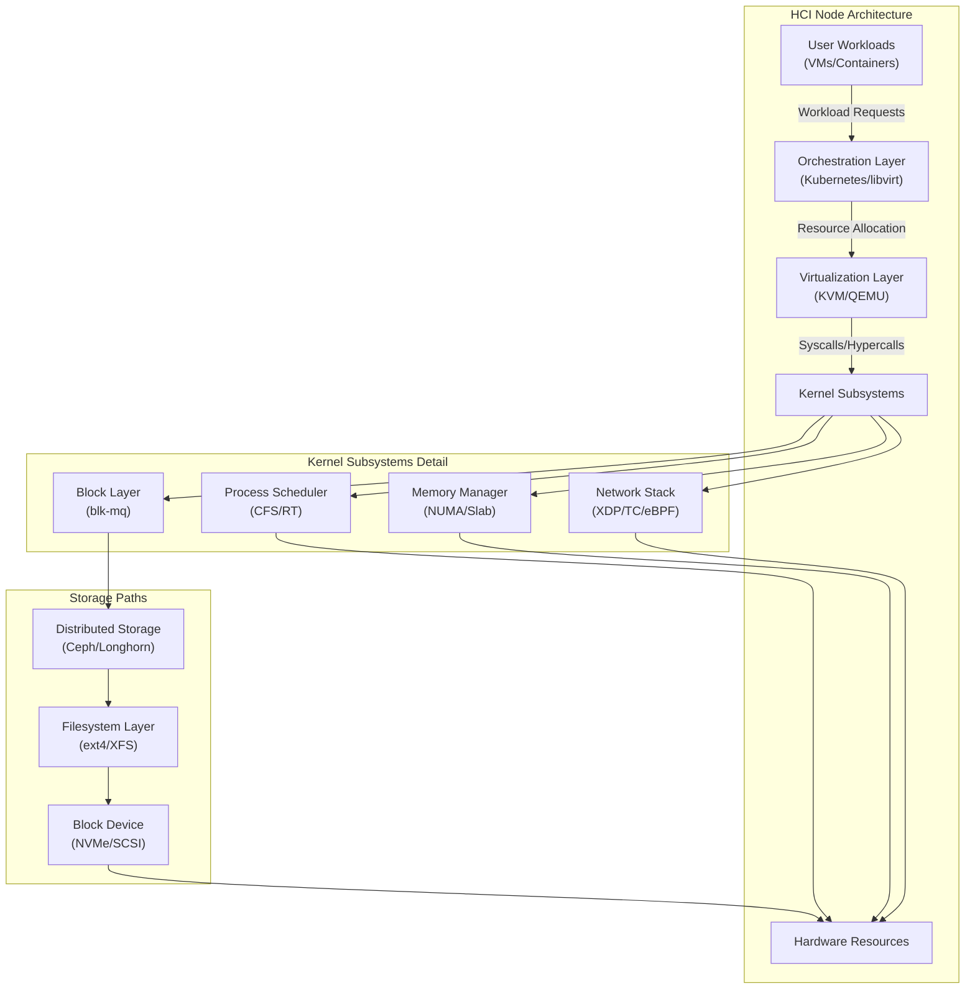
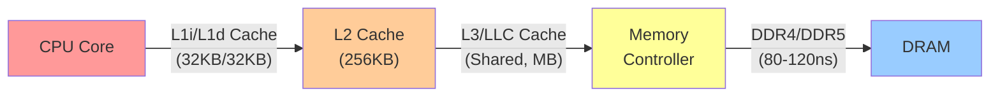
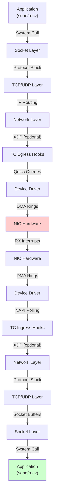
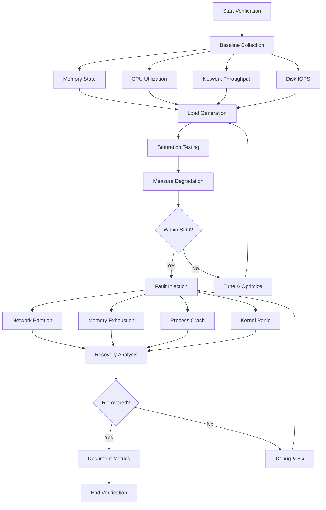

# Operational Verification Labs: Hyperconverged Infrastructure Core

## Objective & Environment Setup

This operational verification lab targets the **Core** domain of **Hyperconverged Infrastructure (HCI)**, providing comprehensive hands-on experience in diagnosing, profiling, and fault-injecting the fundamental subsystems that underpin modern HCI platforms. Hyperconverged infrastructure collapses compute, storage, and networking into software-defined layers atop commodity hardware, creating complex interdependencies between kernel subsystems, distributed storage protocols, and orchestration planes. This lab assumes a Linux kernel ≥5.10 on bare-metal or nested virtualization with root privileges, eBPF support enabled, and network interfaces capable of multi-gigabit packet capture.

### Architectural Context

HCI platforms abstract physical resources through multiple interconnected layers:

1. **Kernel Subsystems**: Process scheduling (CFS/RT), memory management (NUMA, slab allocators), network stack (XDP, TC), and block I/O (blk-mq).
2. **Storage Layer**: Distributed block devices (Ceph RBD, Longhorn), filesystem abstractions (ext4, XFS, Btrfs), and RAID controllers.
3. **Virtualization**: KVM/QEMU for compute virtualization, SR-IOV for network passthrough, and vhost-net/vhost-user for I/O acceleration.
4. **Orchestration**: Kubernetes for container workloads, libvirt for VM lifecycle management, and etcd for distributed state.

Performance bottlenecks emerge at subsystem boundaries: memory contention between hypervisor and VMs, network saturation at vSwitch layers, storage I/O amplification in distributed writes, and scheduler latency under CPU overcommitment. This lab exercises each layer under normal operation, saturation, and fault conditions.



### Required CLI Tools

Install the following diagnostic and profiling tools:

- `bpftool` (≥5.10): eBPF program and map introspection
- `kubectl` (≥1.25): Kubernetes cluster state inspection
- `iproute2` (≥5.10): Network namespace and TC filter management
- `tcpdump` (≥4.99): Packet capture with BPF filtering
- `strace` (≥5.10): System call tracing with filtering capabilities
- `perf` (≥5.10): CPU profiling, PMU event counting, kernel tracing
- `bpftrace` (≥0.14): Dynamic tracing with eBPF scripting
- `trace-cmd` (≥2.9): ftrace frontend for kernel function tracing
- `lsof`, `ss`, `vmstat`, `iostat`, `sar`: Standard UNIX diagnostics
- `dmesg`, `journalctl`: Kernel and systemd log inspection
- `stress-ng` (≥0.13): Multi-modal resource stress testing
- `iperf3` (≥3.9): Network throughput and latency benchmarking
- `fio` (≥3.28): Flexible I/O tester for disk benchmarking
- `sysbench` (≥1.0): CPU, memory, and thread benchmarking

### Environment Configuration

Verify the following prerequisites:

```bash
# 1. Kernel version and configuration
uname -r  # Expected: ≥5.10.0
zgrep CONFIG_BPF /proc/config.gz  # Expected: CONFIG_BPF=y
zgrep CONFIG_DEBUG_INFO_BTF /proc/config.gz  # Expected: =y for CO-RE eBPF

# 2. eBPF infrastructure
bpftool version
bpftool feature probe | grep -E "(program_type|map_type)"

# 3. Kubernetes cluster state (if applicable)
kubectl cluster-info
kubectl get nodes -o wide

# 4. Network interface validation
ip link show
ethtool -i eth0  # Verify driver and firmware versions

# 5. Storage subsystem
lsblk -o NAME,SIZE,TYPE,MOUNTPOINT,FSTYPE
cat /sys/block/*/queue/scheduler  # Verify I/O scheduler

# 6. CPU topology and NUMA layout
lscpu | grep -E "(Socket|Core|Thread|NUMA)"
numactl --hardware

# 7. Root privileges
id  # Expected: uid=0(root)
```

**Critical**: All exercises require root privileges for kernel introspection, eBPF program loading, and network packet capture. Use `sudo -i` or direct root login.

---

## Exercise 1: Live State & Internal Subsystem Inspection

This exercise dissects the runtime state of kernel subsystems, eBPF infrastructure, process scheduling, and network stack internals. Understanding these mechanisms is foundational for diagnosing HCI performance anomalies.

### 1.1 Kernel Memory Subsystem Inspection

The Linux kernel employs a multi-tier memory allocator: buddy allocator for page frames, slab allocator (SLUB/SLAB/SLOB) for small objects, and vmalloc for non-contiguous virtual memory. Memory fragmentation, slab cache exhaustion, and NUMA imbalance directly impact VM density and storage performance.

```bash
# View system-wide memory statistics
cat /proc/meminfo | grep -E "(MemTotal|MemFree|MemAvailable|Active|Inactive|Slab|PageTables|KernelStack)"

# Inspect slab allocator state (top 20 caches by object count)
sudo cat /proc/slabinfo | sort -k3 -nr | head -20

# Detailed slab cache information with specific cache inspection
sudo slabtop -o  # Real-time slab monitoring

# For a specific process, view virtual memory layout
cat /proc/self/maps  # Replace self with target PID
# Format: start-end perms offset dev:inode pathname
# Example: 7f1234567000-7f1234568000 r-xp 00000000 08:01 12345 /lib/x86_64-linux-gnu/libc.so.6

# NUMA memory allocation statistics per node
numastat -c qemu-system-x86  # Replace with target process

# Page cache and buffer cache state
cat /proc/vmstat | grep -E "(nr_file_pages|nr_dirty|nr_writeback|nr_slab_reclaimable)"

# Transparent Huge Pages (THP) usage
cat /sys/kernel/mm/transparent_hugepage/enabled
grep AnonHugePages /proc/meminfo

# Memory cgroup statistics (for containerized workloads)
cat /sys/fs/cgroup/memory/memory.stat  # cgroup v1
cat /sys/fs/cgroup/memory.current      # cgroup v2
```

**Key Metrics**:
- **Slab fragmentation**: High `nr_slab_unreclaimable` indicates kernel memory leaks or fragmentation.
- **Page cache churn**: Rapid changes in `nr_file_pages` suggest insufficient memory for filesystem caching.
- **NUMA imbalance**: Uneven memory allocation across nodes causes cross-socket latency penalties (40-60ns overhead).

### 1.2 eBPF Program and Map Introspection

eBPF programs run in kernel space with JIT compilation to native code. Maps provide data structures (hash tables, arrays, ring buffers) shared between kernel and userspace. In HCI, eBPF powers network filtering (XDP), observability (tracepoints), and security (LSM hooks).

```bash
# List all loaded eBPF programs with metadata
sudo bpftool prog show
# Output fields: id, type (xdp/tc/tracepoint/kprobe), name, tag (hash), loaded_at

# Dump specific program's JIT-compiled instructions
sudo bpftool prog dump xlated id <prog_id>
sudo bpftool prog dump jited id <prog_id>

# View program BTF (BPF Type Format) debug information
sudo bpftool btf dump id <btf_id>

# List all BPF maps with type and key/value sizes
sudo bpftool map show
# Output: id, type (hash/array/ringbuf), key_size, value_size, max_entries

# Dump map contents (example: hash map)
sudo bpftool map dump id <map_id>

# Inspect perf event arrays and ring buffers
sudo bpftool map show type perf_event_array
sudo bpftool map show type ringbuf

# View program attachment points (cgroup, netdev, tracepoint)
sudo bpftool cgroup tree /sys/fs/cgroup  # cgroup-attached programs
sudo bpftool net show  # XDP/TC programs attached to network interfaces

# Pin/unpin maps to BPF filesystem for persistence
sudo bpftool map pin id <map_id> /sys/fs/bpf/my_map
ls -la /sys/fs/bpf/

# Realtime BPF map statistics
sudo bpftrace -e 'tracepoint:syscalls:sys_enter_bpf { @calls[args->cmd] = count(); }'
```

**Verification**:
- **XDP programs**: Check attachment to physical interfaces with `ip link show dev eth0 | grep xdp`.
- **Map memory overhead**: Large maps consume locked kernel memory (check `rlimit MEMLOCK`).
- **Verifier logs**: If program load fails, inspect `/sys/kernel/debug/tracing/trace_pipe`.

### 1.3 Process Scheduling and CFS Internals

The Completely Fair Scheduler (CFS) maintains per-CPU runqueues and uses red-black trees for O(log n) task selection. Understanding scheduling latency and CPU affinity is critical for latency-sensitive workloads (storage I/O, network packet processing).

```bash
# View per-CPU runqueue statistics
cat /proc/schedstat
# Format: cpu<N> yld_count schedule_count schedule_idle_count ttwu_count ttwu_local_count

# Monitor scheduling events with perf
sudo perf stat -e 'sched:sched_switch,sched:sched_wakeup,sched:sched_migrate_task' -a -I 1000

# Inspect CFS parameters
cat /proc/sys/kernel/sched_latency_ns        # Target preemption latency (default: 6ms)
cat /proc/sys/kernel/sched_min_granularity_ns  # Minimum preemption granularity (default: 0.75ms)
cat /proc/sys/kernel/sched_wakeup_granularity_ns  # Wake-up preemption granularity

# Per-process scheduling statistics
cat /proc/<PID>/sched
# Key fields: sum_exec_runtime (total CPU time), nr_voluntary_switches, nr_involuntary_switches

# CPU affinity and cgroup assignment
taskset -cp <PID>  # View CPU affinity mask
cat /proc/<PID>/cgroup  # View cgroup membership

# Realtime scheduling priorities
chrt -p <PID>  # View scheduling policy (SCHED_OTHER/FIFO/RR)

# Trace scheduling latency with bpftrace
sudo bpftrace -e 'tracepoint:sched:sched_wakeup { @start[args->pid] = nsecs; }
                   tracepoint:sched:sched_switch /args->prev_state == 0/ {
                     @latency_ns = hist(nsecs - @start[args->next_pid]); delete(@start[args->next_pid]);
                   }'

# CPU frequency scaling and governors
cat /sys/devices/system/cpu/cpu*/cpufreq/scaling_governor
cat /sys/devices/system/cpu/cpu*/cpufreq/scaling_cur_freq

# Monitor context switches and CPU migrations
vmstat 1 10  # cs column = context switches per second
perf stat -e 'migrations' -a sleep 10
```

**Performance Indicators**:
- **High involuntary switches**: Indicates CPU contention or scheduler overload.
- **Scheduling latency spikes**: Visible in `sched_wakeup` → `sched_switch` histogram, caused by CPU-bound processes or IRQ storms.
- **NUMA migrations**: Excessive cross-socket migrations degrade memory locality.

### 1.4 Network Stack and Interface Inspection

The Linux network stack spans multiple layers: NIC driver → XDP → TC (traffic control) → netfilter → socket buffer. HCI network planes (management, storage, VM traffic) require careful separation and performance isolation.

```bash
# Detailed interface statistics with error counters
ip -s -s link show eth0
# Key metrics: RX/TX packets, errors, dropped, overruns, carrier errors

# View all network namespaces (used by containers and VMs)
ip netns list
ip netns exec <namespace> ip addr show

# Inspect routing table and policy routing
ip route show table all
ip rule show

# View active TCP/UDP connections with process info
sudo ss -tunap
sudo ss -s  # Summary statistics

# Detailed socket buffer and queue information
cat /proc/net/sockstat
cat /proc/net/netstat | grep -E "(TcpExt|IpExt)"

# XDP and TC filter inspection
sudo tc qdisc show dev eth0
sudo tc filter show dev eth0 ingress
sudo bpftool net show dev eth0

# Netfilter (iptables/nftables) rule inspection
sudo iptables -L -v -n -t filter
sudo iptables -L -v -n -t nat
sudo nft list ruleset

# Hardware offload capabilities
ethtool -k eth0 | grep -E "(offload|segmentation|checksum)"
ethtool -S eth0  # NIC-specific hardware counters

# Interrupt affinity and IRQ statistics
cat /proc/interrupts | grep eth0
cat /proc/irq/<IRQ>/smp_affinity

# SNMP protocol statistics
cat /proc/net/snmp | column -t
# Key metrics: Tcp.RetransSegs, Udp.InErrors, Ip.FragFails

# Connection tracking table (conntrack)
sudo conntrack -L -o extended | head -20
cat /proc/sys/net/netfilter/nf_conntrack_count
cat /proc/sys/net/netfilter/nf_conntrack_max

# Network namespace resource usage
ip netns exec <ns> ss -s
ip netns exec <ns> ip -s link show
```

**Diagnostic Patterns**:
- **RX/TX drops**: Often caused by ring buffer exhaustion (increase with `ethtool -G`).
- **TCP retransmissions**: High `RetransSegs` indicates congestion or lossy links.
- **Conntrack table full**: Exhausted `nf_conntrack_max` drops new connections (tune via sysctl).

### 1.5 Kernel Event Tracing and Logging

```bash
# Kernel ring buffer (dmesg) with timestamps and log levels
sudo dmesg -T -l err,warn | tail -50  # Errors and warnings only
sudo dmesg -w  # Follow mode

# Systemd journal with structured logging
sudo journalctl -k --since "1 hour ago"  # Kernel messages
sudo journalctl -u kubelet.service --since today -o json-pretty
sudo journalctl --disk-usage  # Journal storage consumption

# Trace kernel functions with ftrace
echo function > /sys/kernel/debug/tracing/current_tracer
echo kvm_* > /sys/kernel/debug/tracing/set_ftrace_filter
cat /sys/kernel/debug/tracing/trace

# Use trace-cmd for function graph tracing
sudo trace-cmd record -p function_graph -g kvm_vcpu_ioctl sleep 5
sudo trace-cmd report

# Perf-based kernel event tracing
sudo perf record -e 'kmem:*' -a -g -- sleep 10
sudo perf script | head -50

# Audit subsystem for security events
sudo ausearch -m AVC -ts recent  # SELinux denials
sudo ausearch -k sched_latency  # Custom audit rules

# BPF-based live tracing with bpftrace
sudo bpftrace -e 'kprobe:tcp_sendmsg { @bytes = hist(arg2); }'
```

**Log Analysis Goals**:
- **OOM killer events**: Search for "Out of memory" or "Killed process" in dmesg.
- **Hardware errors**: NVMe timeouts, PCIe AER errors, EDAC memory errors.
- **KVM exits**: High frequency in `trace_kvm_exit` indicates excessive VM exits.

---

## Exercise 2: Benchmarking & Saturation Profiling

This exercise quantifies resource capacity and identifies bottlenecks through synthetic load generation. Saturation testing reveals contention points, queueing delays, and scheduler inefficiencies before production deployment.

### 2.1 CPU Saturation and PMU-Based Profiling

```bash
# Generate CPU load across all cores with stress-ng
sudo stress-ng --cpu $(nproc) --cpu-method all --timeout 60s --metrics

# Profile CPU usage with perf top (live view)
sudo perf top -F 999  # 999 Hz sampling frequency
# Press 'a' to annotate assembly, 's' to sort by overhead

# Record CPU flamegraph data
sudo perf record -F 999 -a -g -- sleep 30
sudo perf script > out.perf
# Generate flamegraph with FlameGraph toolkit (https://github.com/brendangregg/FlameGraph)
~/FlameGraph/stackcollapse-perf.pl out.perf | ~/FlameGraph/flamegraph.pl > cpu.svg

# CPU benchmark with sysbench
sysbench cpu --cpu-max-prime=50000 --threads=$(nproc) --time=30 run

# PMU (Performance Monitoring Unit) event counting
sudo perf stat -e cycles,instructions,cache-references,cache-misses,branch-misses -a sleep 10
# Calculate IPC (Instructions Per Cycle): instructions / cycles
# Low IPC (<1.0) indicates CPU stalls from memory access or branch mispredictions

# Detailed per-CPU statistics
sudo perf stat -a -A -e cycles,instructions -I 1000

# CPU cache hierarchy analysis
sudo perf stat -e L1-dcache-loads,L1-dcache-load-misses,LLC-loads,LLC-load-misses -a sleep 10
# Calculate cache miss rates to identify memory-bound workloads

# Trace scheduler runqueue latency
sudo perf sched record -a -- sleep 10
sudo perf sched latency  # Average and max scheduling latency per task

# CPU frequency and C-state transitions
sudo turbostat --interval 1 --num_iterations 10
```



**Bottleneck Indicators**:
- **High cache miss rate**: LLC-load-misses / LLC-loads > 10% indicates poor spatial locality.
- **Low IPC**: IPC < 0.5 suggests memory stalls; IPC > 2.0 indicates efficient execution.
- **Scheduling latency**: Max latency > 10ms indicates CPU oversubscription or RT priority inversion.

### 2.2 Memory Saturation and Allocation Profiling

```bash
# Memory pressure with controlled allocation patterns
sudo stress-ng --vm 4 --vm-bytes 2G --vm-method all --timeout 60s --metrics

# Monitor memory allocation rates
sudo vmstat 1 10
# Key columns: si/so (swap in/out), bi/bo (block in/out), us/sy/id/wa (CPU states)

# Memory bandwidth measurement with stress-ng
sudo stress-ng --vm 8 --vm-bytes 512M --vm-method read --timeout 30s --metrics-brief
sudo stress-ng --vm 8 --vm-bytes 512M --vm-method write --timeout 30s --metrics-brief

# NUMA memory bandwidth (requires numactl)
sudo numactl --cpunodebind=0 --membind=0 stress-ng --vm 4 --vm-bytes 1G --timeout 30s
sudo numactl --cpunodebind=0 --membind=1 stress-ng --vm 4 --vm-bytes 1G --timeout 30s
# Compare bandwidth to detect cross-socket penalty

# Perf-based memory profiling
sudo perf record -e mem-loads,mem-stores -a -g -- stress-ng --vm 2 --vm-bytes 1G --timeout 10s
sudo perf report --stdio

# Page fault tracing
sudo perf stat -e page-faults,minor-faults,major-faults -a sleep 10

# Memory access latency (requires Intel PCM or similar)
sudo pcm-memory 1  # Monitor DRAM bandwidth and latency

# Swap usage and thrashing detection
watch -n 1 'free -h && cat /proc/vmstat | grep -E "(pgpgin|pgpgout|pswpin|pswpout)"'

# Huge page allocation and usage
cat /proc/meminfo | grep -i huge
cat /sys/kernel/mm/hugepages/hugepages-*/nr_hugepages

# Memory cgroup pressure stall information (PSI)
cat /sys/fs/cgroup/memory.pressure  # cgroup v2
# some/full avg10/avg60/avg300/total metrics
```

**Memory Stall Patterns**:
- **Major page faults**: Indicates disk-backed paging (swap thrashing) under memory pressure.
- **NUMA remote access**: Cross-socket allocation latency 1.5-2x higher than local.
- **THP allocation failures**: Check `/proc/vmstat | grep thp` for defrag stalls.

### 2.3 Network Throughput and Latency Profiling

```bash
# Server-side network throughput test
sudo iperf3 -s -p 5201 --one-off &

# Client-side TCP throughput test with tuned parameters
sudo iperf3 -c <server-ip> -p 5201 -t 60 -P 4 -w 512K --logfile iperf3.log
# -P 4: 4 parallel streams to saturate multi-queue NICs
# -w 512K: TCP window size (tune based on BDP)

# UDP throughput and packet loss testing
sudo iperf3 -c <server-ip> -u -b 10G -t 30  # 10 Gbps target bandwidth

# Capture packets during throughput test
sudo tcpdump -i eth0 -w iperf_capture.pcap -s 128 port 5201 &
# -s 128: Snapshot length (headers only for high-rate capture)

# Analyze pcap with detailed statistics
tcpdump -r iperf_capture.pcap -nn | head -100
tshark -r iperf_capture.pcap -q -z io,stat,1  # I/O statistics per second

# Network latency measurement with ping
ping -c 1000 -i 0.2 -s 1400 <target-ip> | tee ping.log
# -i 0.2: 200ms interval, -s 1400: jumbo frame test

# TCP RTT histogram with ss
watch -n 1 'ss -ti dst <target-ip> | grep -E "(rtt|cwnd)"'

# Packet loss and retransmission analysis
netstat -s | grep -E "(segments retransmitted|failed connection)"
nstat -az | grep -E "(TcpRetrans|TcpLost)"

# XDP-based packet forwarding benchmark (requires custom XDP program)
# Example: xdp_redirect_map.c from kernel samples

# Network device interrupt rate
watch -n 1 'cat /proc/interrupts | grep eth0'

# NIC ring buffer utilization
ethtool -g eth0  # View current ring buffer sizes
ethtool -S eth0 | grep -E "(rx_queue_.*_drops|tx_queue_.*_drops)"

# TC (traffic control) qdisc latency
sudo tc qdisc add dev eth0 root netem delay 10ms
ping -c 10 <target-ip>
sudo tc qdisc del dev eth0 root

# BPF-based packet latency tracing
sudo bpftrace -e 'kprobe:__netif_receive_skb_core { @start[arg0] = nsecs; }
                   kretprobe:__netif_receive_skb_core /@start[arg0]/ {
                     @latency_us = hist((nsecs - @start[arg0]) / 1000); delete(@start[arg0]);
                   }'
```



**Network Performance Metrics**:
- **Throughput ceiling**: 10GbE should achieve ~9.4 Gbps with TCP overhead.
- **Latency baseline**: Intra-datacenter RTT typically 0.1-0.5ms.
- **Retransmission rate**: Should be <0.1% in stable networks; higher indicates congestion or errors.

### 2.4 Disk I/O Saturation and Filesystem Profiling

```bash
# Disk I/O load with various patterns (requires fio)
# Sequential write test
sudo fio --name=seq-write --rw=write --bs=1M --size=2G --numjobs=4 --group_reporting --directory=/mnt/test

# Random read IOPS test
sudo fio --name=rand-read --rw=randread --bs=4k --size=1G --numjobs=8 --iodepth=32 --group_reporting --directory=/mnt/test

# Mixed workload (70% read, 30% write)
sudo fio --name=mixed --rw=randrw --rwmixread=70 --bs=4k --size=1G --numjobs=4 --iodepth=16 --runtime=60 --time_based --group_reporting --directory=/mnt/test

# Filesystem metadata stress
sudo fio --name=metadata --rw=randwrite --bs=512 --size=100M --numjobs=16 --fsync=1 --group_reporting --directory=/mnt/test

# Monitor I/O with iostat (extended statistics)
sudo iostat -xz 1 10
# Key metrics: r/s, w/s (IOPS), rkB/s, wkB/s (throughput), await (latency), %util (saturation)

# Per-process I/O statistics
sudo iotop -o -b -n 10  # Only show processes doing I/O

# Block layer tracepoints
sudo perf record -e 'block:*' -a -g -- sleep 10
sudo perf script | head -100

# Disk I/O latency histogram with bpftrace
sudo bpftrace -e 'tracepoint:block:block_rq_complete {
  @latency_ms = hist((nsecs - @start[args->dev, args->sector]) / 1000000);
}
tracepoint:block:block_rq_issue {
  @start[args->dev, args->sector] = nsecs;
}'

# Filesystem cache hit ratio
cat /proc/vmstat | grep -E "(pgpgin|pgpgout)"
# Compare to actual block device I/O to estimate cache effectiveness

# Direct I/O vs buffered I/O comparison
sudo fio --name=direct --rw=write --bs=1M --size=1G --direct=1 --directory=/mnt/test
sudo fio --name=buffered --rw=write --bs=1M --size=1G --direct=0 --directory=/mnt/test

# NVMe device statistics
sudo nvme smart-log /dev/nvme0n1
sudo cat /sys/block/nvme0n1/queue/scheduler  # Should be 'none' for NVMe

# Device mapper and LVM statistics (if applicable)
sudo dmsetup status
sudo dmsetup table

# Distributed storage I/O patterns (Ceph example)
sudo ceph osd perf  # OSD performance statistics
sudo rados bench -p <pool> 30 write --no-cleanup
sudo rados bench -p <pool> 30 seq
```

**I/O Performance Baselines**:
- **NVMe SSD**: 500K+ random read IOPS, <100µs latency at low queue depth.
- **SATA SSD**: 80K-100K IOPS, ~200µs latency.
- **HDD**: 100-200 IOPS, 5-10ms latency.
- **Filesystem overhead**: XFS and ext4 add ~5-10% latency for metadata operations.

---

## Exercise 3: Fault Injection & Recovery Analysis

This exercise simulates real-world failures to validate resilience mechanisms: network partitions, memory exhaustion, process crashes, and kernel panics. Observing recovery behavior under controlled faults is essential for building robust HCI systems.

### 3.1 Network Partition and Split-Brain Simulation

```bash
# Simulate complete network partition to specific IP
sudo iptables -A OUTPUT -d <target-ip> -j DROP
sudo iptables -A INPUT -s <target-ip> -j DROP

# Verify partition
ping -c 5 <target-ip>  # Should timeout

# Monitor distributed system behavior (Kubernetes example)
kubectl get nodes  # Check node status
kubectl describe node <node-name> | grep -A 10 Conditions

# Simulate asymmetric partition (one-way drop)
sudo iptables -A OUTPUT -d <target-ip> -j DROP
# INPUT remains open, creating directional failure

# Introduce latency instead of complete drop
sudo tc qdisc add dev eth0 root netem delay 500ms 100ms distribution normal
# 500ms mean delay with 100ms jitter

# Introduce packet loss
sudo tc qdisc change dev eth0 root netem loss 30%

# Introduce packet reordering
sudo tc qdisc change dev eth0 root netem delay 10ms reorder 25% 50%

# Restore network connectivity
sudo iptables -F OUTPUT
sudo iptables -F INPUT
sudo tc qdisc del dev eth0 root

# Monitor recovery time
watch -n 1 'kubectl get nodes'
journalctl -u kubelet.service --since "1 minute ago" | grep -i "node.*ready"

# Distributed storage split-brain detection (Ceph example)
sudo ceph health detail
sudo ceph osd tree
```

**Recovery Verification**:
- **Kubernetes node recovery**: Typically 40-90 seconds (node-monitor-grace-period + node-monitor-period).
- **Distributed storage**: Quorum-based systems (Ceph, etcd) should maintain read/write with majority availability.
- **Connection re-establishment**: TCP connections should re-sync within RTT × 2 after partition heal.

### 3.2 Memory Exhaustion and OOM Killer Behavior

```bash
# Gradually allocate memory until OOM trigger
sudo stress-ng --vm 1 --vm-bytes 90% --vm-method all --timeout 60s

# Monitor OOM killer invocation
sudo dmesg -w | grep -i "oom\|killed"

# Inspect OOM killer scores (lower score = higher protection)
cat /proc/*/oom_score | sort -n
cat /proc/*/oom_score_adj  # Adjustment value (-1000 to +1000)

# Set OOM protection for critical process
echo -1000 | sudo tee /proc/<critical-pid>/oom_score_adj

# Memory cgroup OOM simulation (cgroup v2)
sudo mkdir /sys/fs/cgroup/test_oom
echo "100M" | sudo tee /sys/fs/cgroup/test_oom/memory.max
echo $$ | sudo tee /sys/fs/cgroup/test_oom/cgroup.procs
# Run memory-intensive process in this cgroup
stress-ng --vm 1 --vm-bytes 200M --timeout 30s

# View cgroup OOM events
cat /sys/fs/cgroup/test_oom/memory.events | grep oom

# Disable OOM killer (dangerous - system may deadlock)
echo 2 | sudo tee /proc/sys/vm/panic_on_oom  # Panic instead of killing
echo 0 | sudo tee /proc/sys/vm/overcommit_memory  # Strict accounting

# Monitor memory pressure stall information
cat /sys/fs/cgroup/memory.pressure
# some: at least one task stalled, full: all tasks stalled

# Analyze OOM victim selection
sudo journalctl -k | grep "oom_reaper\|Out of memory"
```

**OOM Analysis**:
- **Victim selection**: Kernel selects process with highest oom_score (adjusted by oom_score_adj).
- **Memory overcommit**: `vm.overcommit_memory=0` (heuristic), `1` (always), `2` (never overcommit).
- **Recovery time**: Typically <5 seconds for OOM reaper to free memory.

### 3.3 Process Crash and Restart Verification

```bash
# Identify target process PID
systemctl status kubelet.service | grep "Main PID"

# Simulate abrupt termination (SIGKILL)
sudo kill -9 <PID>

# Monitor systemd restart behavior
sudo journalctl -u kubelet.service -f

# Check restart policy and backoff
sudo systemctl show kubelet.service | grep -E "(Restart|RestartSec)"

# Verify process state transitions
ps aux | grep kubelet

# Simulate graceful shutdown (SIGTERM)
sudo kill -15 <PID>

# Monitor cleanup and shutdown hooks
sudo strace -p <PID> -e trace=signal,exit_group

# Crash with core dump generation
ulimit -c unlimited
sudo kill -SEGV <PID>
ls -lh /var/lib/systemd/coredump/ || ls -lh core.*

# Analyze core dump with gdb
sudo coredumpctl list
sudo coredumpctl debug <PID>
# (gdb) bt  # Backtrace
# (gdb) info threads

# Test watchdog/liveness probe failure (Kubernetes example)
kubectl exec <pod-name> -- rm /tmp/healthy
kubectl describe pod <pod-name> | grep -A 5 Liveness
kubectl get pod <pod-name> -w  # Watch restart

# Distributed consensus recovery (etcd example)
systemctl stop etcd
etcdctl member list
systemctl start etcd
etcdctl endpoint health
```

**Restart Patterns**:
- **Systemd restart**: Exponential backoff by default (RestartSec doubles each failure).
- **Kubernetes pod restart**: CrashLoopBackOff with capped 5-minute backoff.
- **State preservation**: Check for state files, WAL logs, or persistent volume claims.

### 3.4 Controlled Kernel Panic for Recovery Testing

**WARNING**: The following commands will immediately crash the kernel. Only execute on disposable test systems with no production workload.

```bash
# Enable SysRq key
echo 1 | sudo tee /proc/sys/kernel/sysrq

# Trigger kernel panic
echo c | sudo tee /proc/sysrq-trigger

# Alternative: trigger specific kernel bug
# echo b | sudo tee /proc/sysrq-trigger  # Reboot
# echo s | sudo tee /proc/sysrq-trigger  # Sync disks
# echo u | sudo tee /proc/sysrq-trigger  # Unmount filesystems

# After reboot, analyze crash dump (requires kdump)
sudo crash /usr/lib/debug/boot/vmlinux-$(uname -r) /var/crash/*/vmcore
# (crash) bt  # Backtrace
# (crash) log  # Kernel log buffer

# View last boot kernel panic
sudo journalctl -b -1 -k | grep -i "panic\|oops"

# Configure kdump for automatic crash dumps
sudo systemctl enable kdump
sudo systemctl start kdump
cat /proc/cmdline | grep crashkernel
```

**Panic Recovery Verification**:
- **Boot time**: Measure time from panic to login prompt (typically 30-90 seconds).
- **Filesystem consistency**: ext4/XFS journal replay should be automatic.
- **Service restoration**: Verify all systemd units reach "active" state.

### 3.5 Distributed System Failure Cascade Analysis

```bash
# Simulate cascading pod failures (Kubernetes)
kubectl delete pod -l app=frontend --grace-period=0 --force

# Monitor deployment reconciliation
kubectl get pods -l app=frontend -w

# Check horizontal pod autoscaler response
kubectl get hpa -w
kubectl describe hpa <hpa-name>

# Distributed storage node failure (Ceph example)
sudo systemctl stop ceph-osd@0
sudo ceph health detail
sudo ceph osd tree  # Verify OSD marked 'down'

# Monitor data rebalancing
sudo ceph -w  # Watch cluster state changes

# Restore failed node
sudo systemctl start ceph-osd@0
sudo ceph osd in osd.0

# etcd quorum loss simulation (requires 3+ member cluster)
systemctl stop etcd  # On 2 of 3 nodes
etcdctl endpoint health --cluster  # Should show majority unavailable

# Restore quorum
systemctl start etcd  # On stopped nodes
etcdctl member list
```

**Cascade Detection**:
- **Kubernetes**: Watch for eviction events (`kubectl get events --sort-by='.lastTimestamp'`).
- **Storage**: Monitor recovery I/O (`iostat`, `ceph osd perf`).
- **Coordination**: etcd latency spikes indicate leader election or split-brain.

---

## Diagnostic Cheat Sheet & Verification Checklist

### Quick Reference Commands

| Category | Command | Purpose | Expected Baseline |
|----------|---------|---------|-------------------|
| **Memory** | `cat /proc/meminfo` | System-wide memory stats | MemAvailable > 20% MemTotal |
| | `cat /proc/slabinfo \| head -20` | Kernel slab allocator state | No single cache >500MB |
| | `numastat -c <process>` | NUMA allocation balance | <10% cross-node allocation |
| **eBPF** | `bpftool prog show` | List loaded eBPF programs | Expected programs attached |
| | `bpftool map show` | List BPF maps | No maps with excessive entries |
| | `bpftool net show` | XDP/TC program attachments | XDP on high-throughput interfaces |
| **Scheduling** | `cat /proc/schedstat` | Per-CPU runqueue stats | schedule_count < 100k/sec per CPU |
| | `perf sched latency` | Scheduling latency histogram | Max latency <10ms |
| | `cat /proc/<PID>/sched` | Process scheduling stats | nr_involuntary_switches < 1k/sec |
| **Network** | `ip -s -s link show eth0` | Interface error counters | RX/TX errors < 0.01% |
| | `ss -s` | Socket statistics summary | TCP memory pressure = 0 |
| | `ethtool -S eth0` | NIC hardware counters | No queue drops |
| | `tc qdisc show` | Traffic control qdisc state | Default: pfifo_fast or fq |
| **I/O** | `iostat -xz 1` | Disk I/O utilization | await <10ms, %util <80% |
| | `fio --name=test --rw=randread --bs=4k` | IOPS benchmark | NVMe: >100k IOPS |
| | `cat /proc/vmstat \| grep pgpg` | Page-in/page-out rates | Major faults = 0 |
| **CPU** | `perf stat -e cycles,instructions` | PMU event counting | IPC > 1.0 for compute workloads |
| | `perf top -F 999` | Live CPU profiling | Uniform distribution or expected hotspots |
| | `turbostat` | CPU frequency and C-states | P-states match workload |
| **Logs** | `dmesg -T -l err,warn` | Kernel errors and warnings | No OOM, hardware errors, or crashes |
| | `journalctl -u <service> --since today` | Service-specific logs | No failed starts or crashes |
| | `ausearch -m AVC -ts recent` | SELinux denials | Zero denials in enforcing mode |
| **Fault Injection** | `iptables -A OUTPUT -d <IP> -j DROP` | Network partition | Verify timeout and recovery |
| | `stress-ng --vm 1 --vm-bytes 90%` | Memory exhaustion | OOM killer triggered, system stable |
| | `kill -9 <PID>` | Process crash | Restart within RestartSec |
| | `echo c > /proc/sysrq-trigger` | Kernel panic | System reboots, services recover |
| **Recovery** | `systemctl status <service>` | Service state post-fault | Active (running) with recent start time |
| | `kubectl get pods -w` | Pod restart monitoring | Running state within 60s |
| | `ceph health detail` | Storage cluster health | HEALTH_OK after OSD recovery |

### Verification Workflow



### Performance SLO Targets for HCI

| Metric | SLO Target | Measurement Method |
|--------|------------|-------------------|
| CPU Scheduler Latency | p99 < 5ms | `perf sched latency` |
| Memory Allocation Latency | p99 < 100µs | `perf probe` on `__alloc_pages` |
| Network RTT (intra-DC) | p50 < 500µs | `ping` with large sample |
| Disk Read Latency (NVMe) | p99 < 1ms | `fio --randread --iodepth=1` |
| Disk Write Latency (NVMe) | p99 < 2ms | `fio --randwrite --iodepth=1` |
| Storage IOPS (4K random) | > 50K IOPS per OSD | `fio --bs=4k --iodepth=32` |
| Network Throughput | > 9 Gbps per 10GbE | `iperf3 -P 4` |
| VM Boot Time | < 30s (cold), < 5s (cached) | Time from `virsh start` to SSH |
| Pod Restart Time | < 10s (healthy image) | `kubectl` event timestamps |
| OOM Recovery Time | < 5s (process killed to stable) | `dmesg` timestamps |
| Node Rejoin Time | < 90s (network partition heal) | `kubectl get nodes` watch |

### Common Failure Signatures

| Symptom | Likely Cause | Diagnostic Command |
|---------|--------------|-------------------|
| High `si/so` in vmstat | Memory pressure, swapping | `cat /proc/meminfo \| grep Swap` |
| `%iowait` > 20% | Disk I/O bottleneck | `iostat -xz 1`, `iotop` |
| TCP `RetransSegs` increasing | Network congestion or errors | `netstat -s`, `ss -ti` |
| High `cs` in vmstat | Excessive context switching | `perf stat -e context-switches` |
| `Load average` > 2× CPU count | CPU saturation or I/O wait | `uptime`, `perf top` |
| `dmesg` OOM messages | Memory exhaustion | `cat /proc/sys/vm/overcommit_memory` |
| XDP drops in `bpftool net` | Packet processing overload | `ethtool -S eth0 \| grep xdp` |
| `nr_slab_unreclaimable` high | Kernel memory leak | `slabtop`, `cat /proc/slabinfo` |
| etcd `etcd_disk_fsync_duration_seconds` high | Slow disk or overcommit | `etcdctl check perf` |
| Ceph `slow ops` warnings | Network latency or OSD overload | `ceph health detail` |

---

## Advanced Topics: Production Debugging Scenarios

### Scenario 1: Unexplained Network Latency Spikes

```bash
# Capture full packet headers during spike
sudo tcpdump -i any -w latency_spike.pcap -s 256 "tcp" &

# Monitor TCP retransmissions in real-time
sudo bpftrace -e 'tracepoint:tcp:tcp_retransmit_skb {
  printf("%s retrans to %s:%d\n", comm, ntop(args->daddr), args->dport);
}'

# Check for NIC interrupt coalescing issues
ethtool -c eth0
# Adjust if needed: ethtool -C eth0 rx-usecs 50

# Inspect CPU affinity of network interrupt handlers
cat /proc/irq/*/smp_affinity_list | grep -v "0-$(nproc --all)"

# Verify XPS (Transmit Packet Steering) configuration
cat /sys/class/net/eth0/queues/tx-*/xps_cpus
```

### Scenario 2: Distributed Storage Performance Degradation

```bash
# Identify slow OSDs (Ceph example)
sudo ceph osd perf
sudo ceph osd df tree

# Trace storage backend latency
sudo perf record -e 'block:block_rq_*' -a -g -- sleep 30
sudo perf report --sort=dso,symbol --stdio | head -50

# Check for NUMA misplacement
sudo numastat -c ceph-osd
# If remote allocation > 20%, consider pinning: numactl --cpunodebind=X --membind=X

# Monitor rebalancing I/O
watch -n 1 'ceph pg dump | grep "backfill\|recovery"'
```

### Scenario 3: Kubernetes Pod Eviction Storms

```bash
# Identify eviction triggers
kubectl get events --sort-by='.lastTimestamp' | grep -i evict

# Check node memory pressure
kubectl describe nodes | grep -A 5 "MemoryPressure\|DiskPressure"

# Analyze pod resource requests vs limits
kubectl get pods -o custom-columns=NAME:.metadata.name,CPU_REQ:.spec.containers[*].resources.requests.cpu,MEM_REQ:.spec.containers[*].resources.requests.memory

# Monitor kubelet decision-making
sudo journalctl -u kubelet -f | grep -i "evict\|threshold"
```

---

This lab provides a systematic framework for operational verification of hyperconverged infrastructure core subsystems. Practitioners should adapt exercises to their specific HCI platform (Nutanix, VMware vSAN, Proxmox, OpenStack, etc.) while maintaining the fundamental diagnostic methodology: baseline → load → saturation → fault → recovery.
