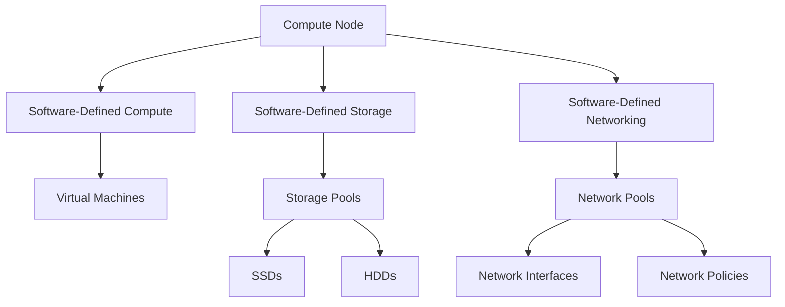

# Lesson 1: Hyperconverged Infrastructure Overview

## 1. First-Principles Intuition & Invariants

Hyperconverged infrastructure (HCI) represents a significant evolution in the landscape of data center and cloud computing architectures. To fully appreciate the transformative impact of HCI, it is essential to understand the underlying principles and the problem space it addresses. Traditional data centers often rely on a siloed approach, where compute, storage, and networking resources are managed separately. This separation leads to inefficiencies in resource utilization, increased complexity in management, and higher costs. HCI, on the other hand, integrates these components into a single, unified system, offering a more efficient and scalable solution.

At the heart of HCI is the concept of hyperconvergence, which involves the convergence of storage, compute, and networking resources into a single platform. This convergence is achieved through the use of software-defined technologies that abstract and virtualize these resources, allowing them to be managed as a single entity. The key invariant in HCI is the seamless integration of these components, enabling a more efficient use of resources and simplifying the management of the infrastructure.

The problem space that HCI addresses is multifaceted. In traditional data centers, the separation of compute, storage, and networking resources leads to inefficiencies in resource utilization. For example, storage resources may be underutilized while compute resources are overprovisioned, leading to increased costs and reduced efficiency. HCI solves this problem by allowing these resources to be dynamically allocated and managed as a single entity, leading to more efficient use of resources and reduced costs.

Another invariant in HCI is the use of software-defined technologies to abstract and virtualize these resources. This abstraction allows for greater flexibility and scalability, as resources can be dynamically allocated and managed based on demand. The use of software-defined technologies also enables greater automation and simplifies the management of the infrastructure, reducing the need for manual intervention.

## 2. Core Architecture & Mechanics

The core architecture of HCI is based on the integration of compute, storage, and networking resources into a single platform. This integration is achieved through the use of software-defined technologies that abstract and virtualize these resources, allowing them to be managed as a single entity. The architecture of HCI can be broken down into several key components, including compute nodes, storage nodes, and networking nodes.

Compute nodes are responsible for providing the processing power required to run virtual machines and other workloads. These nodes are typically equipped with high-performance CPUs, memory, and other resources required to run workloads efficiently. Storage nodes are responsible for providing the storage resources required to store data and support workloads. These nodes are typically equipped with high-performance storage devices, such as solid-state drives (SSDs) and hard disk drives (HDDs), and are designed to provide high levels of performance and reliability. Networking nodes are responsible for providing the networking resources required to connect compute and storage nodes and support workloads. These nodes are typically equipped with high-performance network interfaces and are designed to provide high levels of performance and reliability.

The architecture of HCI is based on the use of software-defined technologies to abstract and virtualize these resources. This abstraction allows for greater flexibility and scalability, as resources can be dynamically allocated and managed based on demand. The use of software-defined technologies also enables greater automation and simplifies the management of the infrastructure, reducing the need for manual intervention.

One of the key components of HCI is the software-defined storage (SDS) layer. The SDS layer is responsible for providing a virtualized storage layer that abstracts and virtualizes the underlying storage resources. This abstraction allows for greater flexibility and scalability, as storage resources can be dynamically allocated and managed based on demand. The SDS layer is typically implemented using a distributed storage architecture, where storage resources are distributed across multiple nodes in the cluster. This distribution allows for greater scalability and reliability, as storage resources can be dynamically allocated and managed based on demand.

Another key component of HCI is the software-defined networking (SDN) layer. The SDN layer is responsible for providing a virtualized networking layer that abstracts and virtualizes the underlying networking resources. This abstraction allows for greater flexibility and scalability, as networking resources can be dynamically allocated and managed based on demand. The SDN layer is typically implemented using a distributed networking architecture, where networking resources are distributed across multiple nodes in the cluster. This distribution allows for greater scalability and reliability, as networking resources can be dynamically allocated and managed based on demand.

The architecture of HCI can be visualized using the following Mermaid diagram:

In this diagram, compute nodes are equipped with software-defined compute, storage, and networking layers. The software-defined compute layer is responsible for providing the processing power required to run virtual machines and other workloads. The software-defined storage layer is responsible for providing a virtualized storage layer that abstracts and virtualizes the underlying storage resources. The software-defined networking layer is responsible for providing a virtualized networking layer that abstracts and virtualizes the underlying networking resources.

## 3. High-Performance Optimization & Failure Modes

The high-performance optimization of HCI is achieved through the use of software-defined technologies that abstract and virtualize the underlying resources. These technologies enable greater flexibility and scalability, as resources can be dynamically allocated and managed based on demand. The use of software-defined technologies also enables greater automation and simplifies the management of the infrastructure, reducing the need for manual intervention.

One of the key optimizations in HCI is the use of distributed storage and networking architectures. These architectures allow for greater scalability and reliability, as resources can be dynamically allocated and managed based on demand. The use of distributed storage and networking architectures also enables greater performance, as resources can be distributed across multiple nodes in the cluster, reducing the load on individual nodes.

Another key optimization in HCI is the use of software-defined storage and networking layers. These layers provide a virtualized storage and networking layer that abstracts and virtualizes the underlying resources. This abstraction allows for greater flexibility and scalability, as resources can be dynamically allocated and managed based on demand. The use of software-defined storage and networking layers also enables greater performance, as resources can be dynamically allocated and managed based on demand.

The failure modes in HCI are similar to those in traditional data centers, but the use of software-defined technologies and distributed architectures can help mitigate these failures. One of the key failure modes in HCI is the failure of individual nodes in the cluster. The use of distributed storage and networking architectures can help mitigate this failure mode, as resources can be dynamically allocated and managed based on demand. The use of software-defined storage and networking layers can also help mitigate this failure mode, as resources can be dynamically allocated and managed based on demand.

Another key failure mode in HCI is the failure of the software-defined storage and networking layers. The use of software-defined storage and networking layers can help mitigate this failure mode, as these layers provide a virtualized storage and networking layer that abstracts and virtualizes the underlying resources. This abstraction allows for greater flexibility and scalability, as resources can be dynamically allocated and managed based on demand.

In conclusion, hyperconverged infrastructure represents a significant evolution in the landscape of data center and cloud computing architectures. The core architecture of HCI is based on the integration of compute, storage, and networking resources into a single platform, achieved through the use of software-defined technologies that abstract and virtualize these resources. The high-performance optimization of HCI is achieved through the use of distributed storage and networking architectures, and the failure modes in HCI are similar to those in traditional data centers, but the use of software-defined technologies and distributed architectures can help mitigate these failures.
