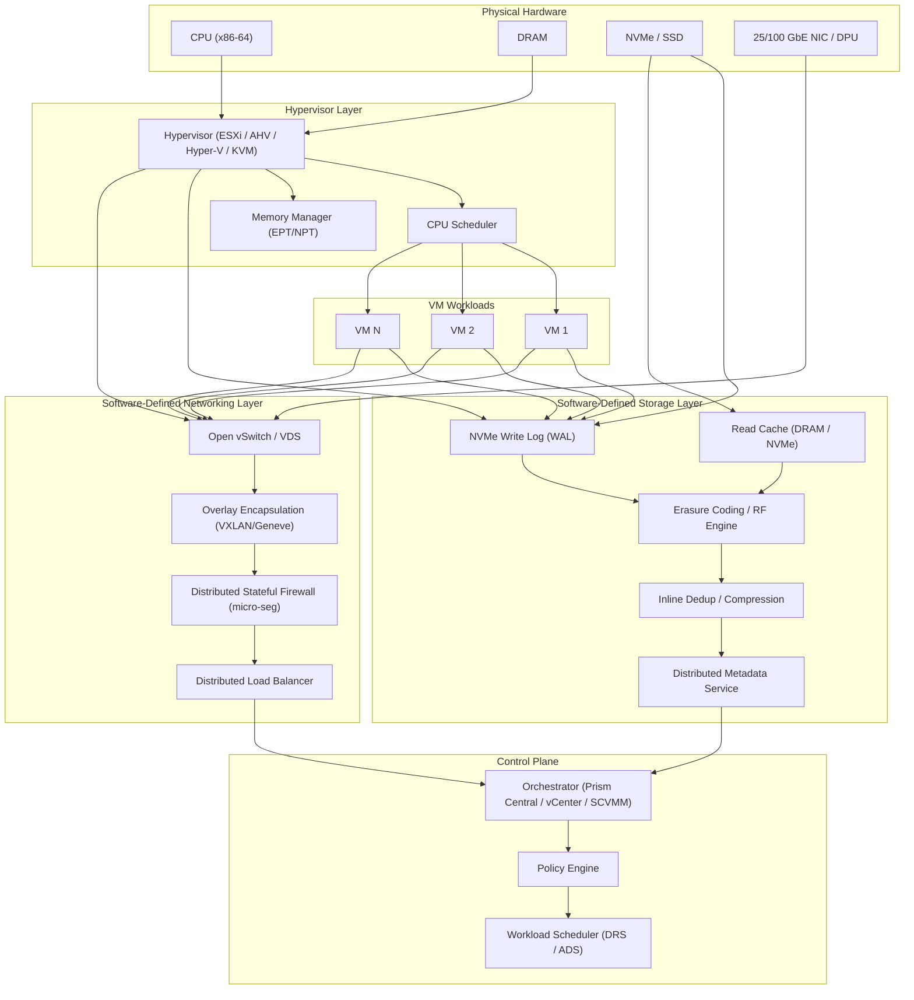
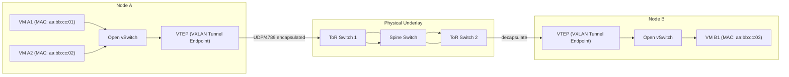
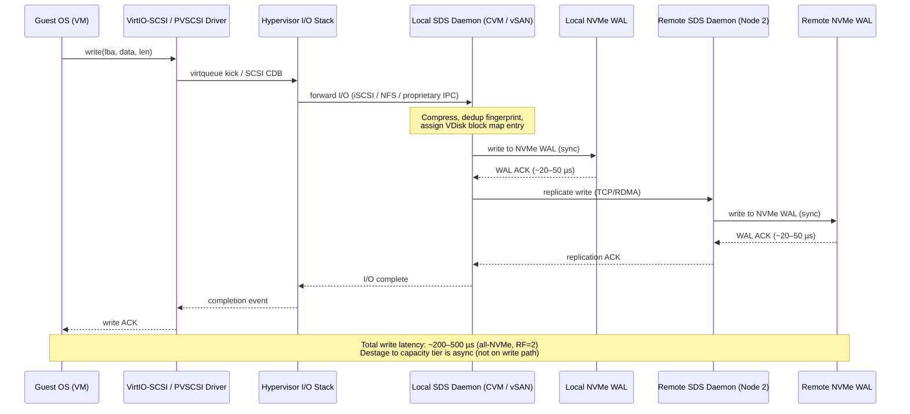
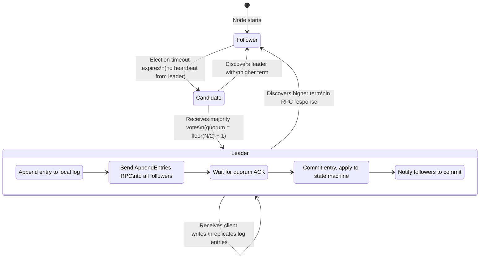
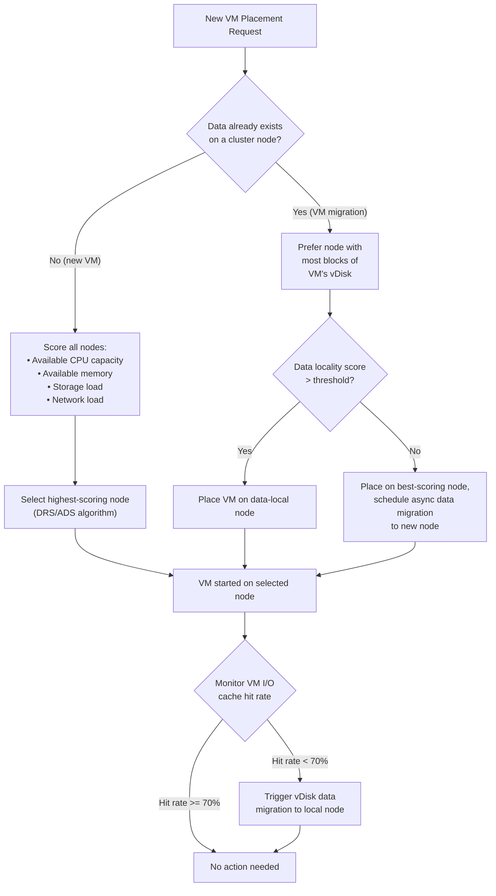
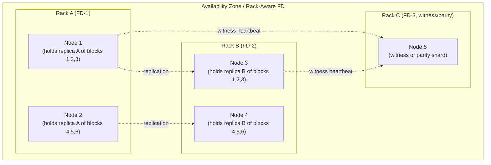
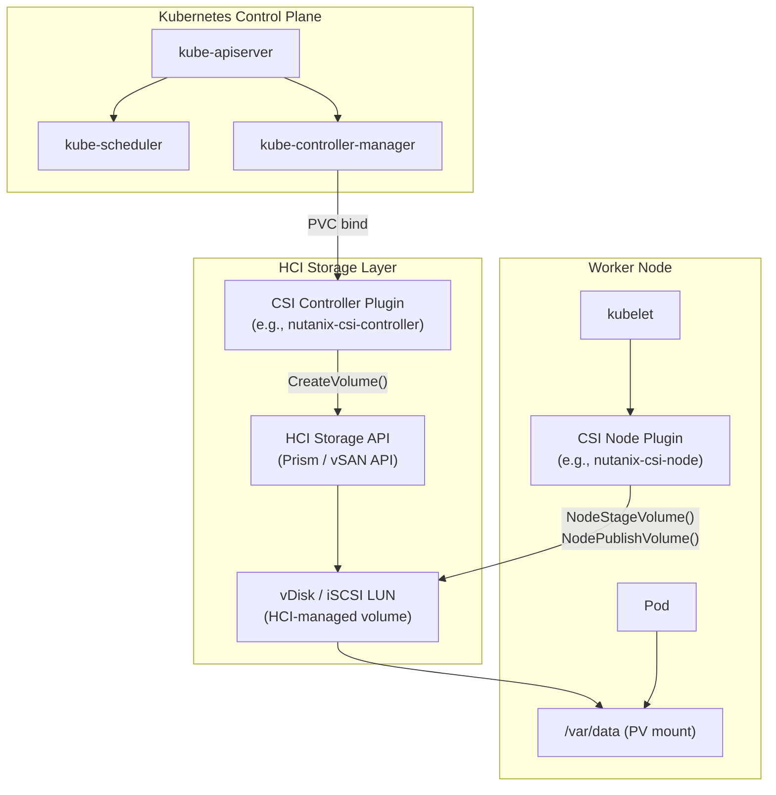

# Hyperconverged Infrastructure: Architecture, Mechanics, and Operational Mastery

## 1. First-Principles Foundations

### The Fundamental Problem: Resource Silos and the Cost of Indirection

Traditional three-tier data center architecture—discrete SAN/NAS storage, blade compute, and ToR switching—solved the consolidation problem of the mainframe era but introduced a different class of inefficiencies. Each tier is independently provisioned to its peak demand, creating stranded capacity in every dimension simultaneously. A compute cluster sized for a CPU-intensive batch workload carries idle DRAM. A SAN provisioned for a latency-sensitive OLTP database has excess spindle capacity during off-peak hours. Because each tier has its own management plane, a single VM deployment touches a compute administrator, a storage administrator, and a network administrator—three change-control windows for one logical operation.

The deeper structural problem is that the data path between compute and storage in a traditional three-tier architecture crosses a physical network fabric (Fibre Channel or iSCSI/NFS over Ethernet). Every I/O operation from a virtual machine must traverse: the hypervisor I/O stack → the HBA/NIC → the SAN fabric switches → the storage array's front-end controller → the array's cache → the back-end disk controller → the physical media. This chain introduces 4–7 discrete hardware hops with associated latency, failure domains, and licensing surfaces.

**The invariant that HCI enforces:** storage I/O from a virtual machine should, as often as possible, complete entirely within the same physical host where the VM is scheduled—a property called *data locality*. When locality is achieved, the I/O path collapses to: hypervisor I/O stack → software storage driver → local NVMe/SSD. Round-trip latency drops from hundreds of microseconds (SAN) to tens of microseconds (local NVMe via software-defined storage), and the SAN fabric becomes a replication path rather than an I/O path.

### Convergence as an Architectural Primitive

Hyperconvergence is not simply co-location of hardware. It is the deliberate use of software to dissolve the administrative and data-plane boundaries between compute, storage, and networking such that they present a single, unified resource pool with a single management surface. The word *hyperconverged* distinguishes it from *converged infrastructure* (CI), where pre-racked and pre-validated compute + storage systems from a single vendor still expose separate management planes (e.g., VCE Vblock, which ran vCenter and EMC Unisphere independently).

The three invariants of a correct HCI implementation:

1. **Unified resource pool**: Compute, storage, and networking capacity are expressed in a single API surface and scheduled by a common control plane.
2. **Software-defined everything**: No resource characteristic (IOPS limits, VLAN membership, CPU reservation) requires touching firmware or physical hardware reconfiguration. All policy is expressed in software.
3. **Linear scalability**: Adding one node simultaneously and proportionally increases compute capacity, storage capacity, and network bandwidth available to the cluster. No tier becomes a bottleneck before the others.

---

## 2. Core Architecture and Mechanics

### Physical Layer: The HCI Node

An HCI node is a standard x86 server with a specific hardware composition that enables it to serve all three roles simultaneously. A representative production node (circa 2024) contains:

- **CPU**: 2× AMD EPYC Genoa or Intel Xeon Sapphire Rapids, 32–96 cores each. High core count is necessary because CPU cycles are consumed not only by VM workloads but by the storage I/O stack (erasure coding, compression, deduplication, encryption) running in a privileged storage VM or kernel module.
- **Memory**: 512 GB–6 TB DDR5 ECC RDIMM. Memory serves VM working sets and, critically, the storage tier's read cache and write buffer.
- **Storage devices**: A mix of NVMe SSDs (write log / cache tier) and higher-capacity SATA/SAS SSDs or QLC NVMe (capacity tier). Some vendors support a small number of HDDs as a cold tier.
- **Network**: 2× 25 GbE or 2× 100 GbE NICs, often SmartNICs (DPUs such as NVIDIA BlueField-3 or Marvell Octeon) that offload storage and networking processing from the host CPU.
- **Boot media**: Separate M.2 NVMe or SD card for hypervisor/OS, isolating the management OS from workload storage devices.

The node participates in the cluster as a symmetric peer: every node runs the hypervisor, the storage daemon, and the networking agent. There are no dedicated storage nodes or dedicated compute nodes in a homogeneous HCI cluster (though some platforms support disaggregated storage nodes as a scale-out option).

### The Software Stack: Layered Architecture



### Software-Defined Storage: The Distributed Storage Fabric

The SDS layer is architecturally the most complex component of an HCI system. Its responsibilities include:

**Write path (the critical path for I/O latency):**

1. A VM issues a write via the hypervisor's virtual disk driver (e.g., VMware's PVSCSI or VirtIO-SCSI in KVM).
2. The storage I/O stack (a CVM—Controller VM—in Nutanix AOS, or the VSAN ESA storage stack directly in a kernel module for VMware vSAN) intercepts the write.
3. The write is acknowledged to the guest OS only after it has been committed to: (a) the local NVMe write log (WAL) **and** (b) the write log on `RF-1` remote nodes (where RF is the replication factor, typically 2 or 3).
4. This two-phase atomic write commit ensures durability: the guest receives an ACK only when the write cannot be lost due to a single node failure.
5. A background destage process moves data from the write log to the capacity tier, applying erasure coding or replication, deduplication, and compression.

**Read path (data locality optimization):**

1. The storage I/O stack checks whether the requested block is cached locally in DRAM or the NVMe read cache.
2. If the block is in the local read cache (a cache hit), it is returned with sub-100 µs latency, entirely bypassing the network.
3. If the block resides on a remote node (a cache miss), the request is forwarded over the cluster network via RDMA (if supported) or TCP/IP. The data is fetched, returned to the requesting node, and inserted into the read cache.
4. When a VM is migrated (vMotion/Live Migration), data locality is temporarily broken. The scheduler's storage awareness policy may proactively warm the read cache on the destination node or prefer scheduling VMs on nodes that already hold their data locally.

**Distributed metadata:**

All HCI storage systems maintain a distributed metadata service that maps logical block addresses (or object identifiers) to physical locations across the cluster. This service is itself replicated (typically using Paxos or Raft consensus) to survive node failures. In Nutanix AOS, this is the Cassandra-based metadata ring. In VMware vSAN, it is the CLOM/DOM layer. In Ceph (used in open-source HCI stacks like Red Hat OpenShift Data Foundation), it is the RADOS monitor cluster (ceph-mon daemons running Paxos).

### Erasure Coding vs. Replication: A Technical Comparison

| Property | Replication (RF=2) | Replication (RF=3) | Erasure Coding (4+2) |
|---|---|---|---|
| Usable capacity efficiency | 50% | 33% | 67% |
| Write amplification | 2× | 3× | 1.5× |
| Read latency | Low (local copy) | Low (local copy) | Higher (reconstruction) |
| Tolerated simultaneous failures | 1 node | 2 nodes | 2 nodes (configurable) |
| CPU overhead | Low | Low | Moderate (XOR/GF arithmetic) |
| Minimum nodes required | 2 | 3 | 6 (4+2 scheme) |
| Optimal workload | Hot data, latency-sensitive | Critical data | Warm/cold data, capacity-optimized |

Erasure coding applies a systematic linear code over `k` data shards to produce `m` parity shards, such that any `k` of the `k+m` shards suffice to reconstruct the original data. For a (4,2) Reed-Solomon code over GF(2^8), the encoding operation for a stripe is:

```
parity_1 = d1 ⊕ d2 ⊕ d3 ⊕ d4         (simplified XOR parity)
parity_2 = g^0·d1 ⊕ g^1·d2 ⊕ g^2·d3 ⊕ g^3·d4  (Galois field multiplication)
```

where `g` is a generator element of GF(256). The reconstruction of any missing shard requires solving a system of linear equations over GF(2^8), which is why EC carries higher CPU cost than simple replication, and why it is preferred for warm/cold data tiers rather than hot write paths.

### Software-Defined Networking in HCI

HCI networking collapses the traditional physical network hierarchy (access, distribution, core) into a software overlay. The dominant model uses VXLAN (RFC 7348) or Geneve (RFC 8926) encapsulation to create Layer 2 segments over a Layer 3 underlay:



Each VXLAN Network Identifier (VNI, 24-bit) defines a logical Layer 2 broadcast domain. Because VNIs are carried in the UDP payload over the physical IP network, the physical underlay can be a simple, routed Layer 3 fabric (leaf-spine) with no spanning tree and no VLAN trunking—dramatically simplifying physical network operations.

Micro-segmentation is implemented by distributing stateful firewall rules to the kernel on every hypervisor host rather than choke-pointing traffic through a physical firewall appliance. In VMware NSX-T (now NSX), these are enforced by the distributed firewall (DFW) kernel module. In Nutanix Flow, they are enforced via Open vSwitch ACLs. Because the firewall is applied at the vNIC of every VM, east-west traffic (VM-to-VM within the same host) is inspected and filtered without leaving the CPU—it never hits the physical network.

---

## 3. Data Path Deep-Dive: I/O Latency Stack

Understanding where latency is consumed in the HCI I/O path is essential for performance engineering. The following shows a typical synchronous write I/O trace from guest OS to durable media:



The critical observation: the guest's write ACK latency is dominated by the round-trip time for remote WAL replication. On a 25 GbE network with ~100 µs RTT (including software stack overhead), and ~40 µs for each NVMe write, the minimum end-to-end write latency is on the order of 200–400 µs. This is why high-performance HCI configurations use RDMA (RoCEv2) networking, which reduces the network stack overhead from ~50 µs to ~5 µs, pushing total write latency below 100 µs.

---

## 4. Distributed Consensus and Cluster State Management

HCI clusters must maintain consistent metadata state across all nodes despite concurrent writes, node failures, and network partitions. All production HCI platforms use a form of distributed consensus. The Raft algorithm (the dominant choice for newer systems) works as follows:



For an HCI cluster of N nodes, Raft tolerates `floor((N-1)/2)` simultaneous failures before the cluster loses quorum and becomes read-only (or halts writes to prevent split-brain). This means:
- 3-node cluster: tolerates 1 failure
- 5-node cluster: tolerates 2 failures
- 7-node cluster: tolerates 3 failures

This directly constrains the minimum viable HCI cluster size: a 2-node cluster (with a witness VM or cloud witness for tiebreaking) requires a third voter for quorum even though it has only two data-bearing nodes. VMware vSAN 2-node and Nutanix 2-node both implement this via a hosted witness appliance.

---

## 5. High-Performance Optimization Techniques

### Storage I/O Optimization

**Write coalescing and batching**: The NVMe WAL absorbs random writes and coalesces them into sequential large writes to the capacity tier. This transforms the I/O pattern from random 4K writes (which SSDs handle at ~500K IOPS with high write amplification) into sequential 1–4 MB destage writes (handled efficiently by the SSD's FTL with low write amplification). This is conceptually identical to LSM-tree operation in databases like RocksDB.

**Read cache hierarchy (ARC/LIRS policy)**: HCI storage systems implement multi-level read caches. DRAM holds the hottest data (~100 ns access). NVMe L2 cache holds warm data (~20 µs access). The capacity tier holds cold data. Cache eviction policies such as Adaptive Replacement Cache (ARC) or Low Inter-reference Recency Set (LIRS) outperform LRU for database workloads with scan-resistant behavior.

**CPU pinning and NUMA awareness**: The storage daemon (CVM or equivalent) must be pinned to CPU cores on the same NUMA node as the NVMe devices it owns. Crossing NUMA nodes for storage I/O adds ~40–80 ns per access and can reduce throughput by 15–30% due to remote memory controller contention. Modern HCI platforms (vSAN ESA, Nutanix AOS 6.x) are NUMA-topology-aware.

**NVMe over Fabrics (NVMe-oF)**: For disaggregated HCI or storage-heavy node configurations, NVMe-oF (using RoCEv2 or TCP transport) allows NVMe SSDs on remote nodes to be accessed with latency approaching that of local NVMe. NVMe-oF eliminates the SCSI/iSCSI translation overhead (command sizes are smaller, queue depths are higher with native NVMe queues of up to 65,535 entries per namespace vs. iSCSI's 1 queue).

### Network Optimization

**ECMP (Equal-Cost Multi-Path) on the underlay**: A properly designed leaf-spine underlay uses ECMP hashing to distribute storage replication traffic across all available uplinks. With a 2-link LACP bond at 25 GbE, the effective bisection bandwidth per node is 50 Gbps. Incorrect ECMP hash configuration (e.g., hashing on only source IP, which maps all traffic from one CVM to one uplink) can cause severe bandwidth imbalance and storage performance degradation.

**Jumbo frames (MTU 9000)**: Storage replication traffic is large-block sequential I/O. Enabling jumbo frames reduces the per-packet overhead for a 1 MB replication write from ~700 Ethernet frames (1500 MTU) to ~115 frames (9000 MTU), reducing interrupt rate and CPU overhead at both the sender and receiver NICs by ~6×.

**RDMA for ultra-low latency**: RoCEv2 (RDMA over Converged Ethernet v2) requires Priority Flow Control (PFC) on the physical switches to prevent packet loss (since RDMA does not retransmit gracefully under loss). Explicit Congestion Notification (ECN) is used in conjunction with DCQCN (Data Center Quantized Congestion Notification) to prevent buffer bloat. Misconfiguring PFC (enabling it on wrong switch queues, or forgetting to enable it on a transit switch) is the most common cause of RDMA performance degradation in HCI deployments.

### VM Scheduling and Data Locality



---

## 6. Failure Modes, Blast Radius, and Resilience Patterns

### Failure Taxonomy

HCI systems face a richer failure taxonomy than traditional SAN-based architectures because every node participates in both compute and storage. A failure that in a traditional architecture would be scoped to the compute tier now has storage implications.

**Node failure (most common)**: When a node fails, the cluster must simultaneously:
1. Reschedule all VMs that were running on the failed node (compute recovery, analogous to HA failover).
2. Begin healing storage: every data block for which the failed node held a replica must be re-replicated from surviving replicas to restore the configured replication factor (RF=2 → RF=2). This *rebuild* consumes I/O bandwidth from surviving nodes and can last minutes to hours depending on the amount of data the failed node held.

The *rebuild storm* is a critical failure mode: if a second node fails during the rebuild of a first node failure, the cluster may lose all copies of some data (for RF=2 configurations). This is the same RAID rebuild vulnerability problem as RAID-5/6, applied at the distributed storage layer. The mitigation is RF=3 (tolerating two simultaneous failures) or erasure coding with sufficient parity.

**Network partition (split-brain)**: If the cluster network is partitioned such that two groups of nodes cannot communicate, Raft consensus ensures that only the partition containing a quorum majority can continue accepting writes. The minority partition becomes read-only (or stalls). The danger is a misconfigured witness or a network device that partially forwards traffic (some nodes can reach some other nodes but not all), creating a partial-mesh partition that is harder for the consensus algorithm to resolve than a clean split.

**Storage medium failure (silent data corruption)**: NAND flash SSDs can produce bit errors that pass the device's ECC detection but corrupt data silently. HCI platforms mitigate this with end-to-end checksums: every block is checksummed (typically CRC-32C or SHA-256) when written and verified when read. VMware vSAN calls this "data-at-rest integrity." Nutanix AOS applies checksums on ingestion. A checksum mismatch triggers an automatic heal from a good replica.

**CVM/storage daemon failure (software fault)**: In Nutanix's CVM architecture, the CVM is a privileged VM that owns the node's storage devices. If the CVM crashes, the hypervisor automatically redirects I/O to a CVM on another node (I/O continuity via "CVM autopath"). The failed CVM is restarted by the hypervisor watchdog. This introduces temporary latency (the first I/O after failover triggers an autopath redirect, adding ~1–2 ms) but does not cause VM downtime.

**Failure domain design:**



Fault domain configuration ensures that no single rack power or cooling failure can destroy both copies of any data. This requires explicit configuration in the HCI management plane (VMware vSAN fault domains, Nutanix block awareness). By default, most HCI systems are only host-aware (i.e., replicas are placed on different nodes), not rack-aware.

---

## 7. HCI Platform Comparison: Technical Differentiators

| Dimension | VMware vSAN ESA | Nutanix AOS 6.x | Red Hat OpenShift Data Foundation (Ceph) | Scale Computing HC3 |
|---|---|---|---|---|
| Storage architecture | Kernel module in ESXi | Privileged CVM (user-space) | Ceph OSD (user-space daemon) | Proprietary SCRIBE kernel module |
| Hypervisor support | ESXi only | AHV (native), ESXi, Hyper-V | Any (ODF is HV-agnostic) | Proprietary KVM-based |
| Minimum nodes | 2 (with witness) | 3 | 3 | 3 |
| Erasure coding minimum | 6 nodes (4+2) | 6 nodes (4+2) | 3 nodes (2+1 k=2 m=1) | N/A (replication only) |
| NVMe-oF support | Yes (vSAN ESA) | Roadmap | Yes (Ceph NVMe-oF gateway) | No |
| Object storage API | Via S3-compatible gateways | Native Nutanix Objects (S3) | Native Ceph RGW (S3/Swift) | No |
| Stretched cluster | vSAN Stretched Cluster (3 sites, 1 witness) | Metro Availability (2 sites + witness) | Ceph stretch mode | No |

---

## 8. Operational Tooling: Configuration and Monitoring Examples

### Nutanix CVM: Cluster Health and Storage Status (Python via REST API v3)

```python
"""
Nutanix Prism REST API v3 client for cluster storage and node health monitoring.
Requires: requests>=2.31.0, Python 3.9+
"""

import json
import sys
from dataclasses import dataclass, field
from typing import Any

import requests
from requests.auth import HTTPBasicAuth
from requests.exceptions import ConnectionError, HTTPError, Timeout

# Disable SSL warnings only in lab/dev environments; use verify=True in production.
import urllib3
urllib3.disable_warnings(urllib3.exceptions.InsecureRequestWarning)

PRISM_HOST = "prism-central.corp.example.com"
PRISM_PORT = 9440
BASE_URL = f"https://{PRISM_HOST}:{PRISM_PORT}/api/nutanix/v3"


@dataclass
class DiskStats:
    disk_uuid: str
    node_name: str
    usage_bytes: int
    capacity_bytes: int
    health_state: str
    tier: str  # "SSD-PCIe", "SSD-SATA", "HDD"
    iops_read: float = 0.0
    iops_write: float = 0.0
    latency_read_us: float = 0.0
    latency_write_us: float = 0.0


@dataclass
class ClusterStorageReport:
    cluster_name: str
    total_capacity_bytes: int
    used_capacity_bytes: int
    replication_factor: int
    disk_stats: list[DiskStats] = field(default_factory=list)
    degraded_node_count: int = 0

    @property
    def usable_capacity_bytes(self) -> int:
        return self.total_capacity_bytes // self.replication_factor

    @property
    def utilization_pct(self) -> float:
        if self.usable_capacity_bytes == 0:
            return 0.0
        return (self.used_capacity_bytes / self.usable_capacity_bytes) * 100.0


class NutanixClient:
    """Minimal Nutanix Prism REST v3 client for storage and cluster health queries."""

    def __init__(self, host: str, port: int, username: str, password: str) -> None:
        self.base_url = f"https://{host}:{port}/api/nutanix/v3"
        self.session = requests.Session()
        self.session.auth = HTTPBasicAuth(username, password)
        self.session.headers.update({
            "Content-Type": "application/json",
            "Accept": "application/json",
        })
        # In production: load the Prism CA certificate and set verify="/path/to/ca.pem"
        self.session.verify = False

    def _post(self, endpoint: str, payload: dict[str, Any]) -> dict[str, Any]:
        url = f"{self.base_url}/{endpoint}"
        try:
            response = self.session.post(url, json=payload, timeout=30)
            response.raise_for_status()
            return response.json()
        except (ConnectionError, Timeout) as exc:
            raise RuntimeError(f"Network error reaching Prism at {url}: {exc}") from exc
        except HTTPError as exc:
            raise RuntimeError(
                f"HTTP {exc.response.status_code} from Prism: {exc.response.text[:500]}"
            ) from exc

    def list_clusters(self) -> list[dict[str, Any]]:
        payload = {"kind": "cluster", "length": 100, "offset": 0}
        data = self._post("clusters/list", payload)
        return data.get("entities", [])

    def list_hosts(self) -> list[dict[str, Any]]:
        payload = {"kind": "host", "length": 500, "offset": 0}
        data = self._post("hosts/list", payload)
        return data.get("entities", [])

    def get_cluster_storage_report(self) -> ClusterStorageReport:
        clusters = self.list_clusters()
        if not clusters:
            raise RuntimeError("No clusters returned from Prism Central.")

        # Use the first cluster for this example; in multi-cluster PC, iterate.
        cluster = clusters[0]
        cluster_spec = cluster.get("spec", {})
        cluster_resources = cluster.get("status", {}).get("resources", {})

        cluster_name = cluster_spec.get("name", "unknown")
        replication_factor = (
            cluster_resources.get("config", {})
            .get("fault_tolerance_state", {})
            .get("current_max_fault_tolerance", 1)
        ) + 1  # Prism v3 reports max_fault_tolerance; RF = tolerance + 1

        # Aggregate storage from host list
        hosts = self.list_hosts()
        total_capacity = 0
        used_capacity = 0
        disk_stats_list: list[DiskStats] = []
        degraded_count = 0

        for host in hosts:
            host_status = host.get("status", {})
            host_resources = host_status.get("resources", {})
            host_name = host_status.get("name", "unknown")

            if host_status.get("state") != "COMPLETE":
                degraded_count += 1

            for disk in host_resources.get("disk_list", []):
                disk_capacity = disk.get("disk_capacity_in_bytes", 0)
                disk_used = disk.get("disk_usage_in_bytes", 0)
                total_capacity += disk_capacity
                used_capacity += disk_used

                disk_stats_list.append(DiskStats(
                    disk_uuid=disk.get("uuid", ""),
                    node_name=host_name,
                    usage_bytes=disk_used,
                    capacity_bytes=disk_capacity,
                    health_state=disk.get("disk_status", "UNKNOWN"),
                    tier=disk.get("storage_tier_name", "UNKNOWN"),
                ))

        return ClusterStorageReport(
            cluster_name=cluster_name,
            total_capacity_bytes=total_capacity,
            used_capacity_bytes=used_capacity,
            replication_factor=replication_factor,
            disk_stats=disk_stats_list,
            degraded_node_count=degraded_count,
        )


def format_bytes(n: int) -> str:
    for unit in ("B", "KiB", "MiB", "GiB", "TiB", "PiB"):
        if abs(n) < 1024.0:
            return f"{n:.2f} {unit}"
        n //= 1024
    return f"{n:.2f} EiB"


def main() -> None:
    import getpass
    username = input("Prism Central username: ")
    password = getpass.getpass("Prism Central password: ")

    client = NutanixClient(PRISM_HOST, PRISM_PORT, username, password)
    report = client.get_cluster_storage_report()

    print(f"\n=== Cluster Storage Report: {report.cluster_name} ===")
    print(f"  Replication factor : RF={report.replication_factor}")
    print(f"  Raw capacity       : {format_bytes(report.total_capacity_bytes)}")
    print(f"  Usable capacity    : {format_bytes(report.usable_capacity_bytes)}")
    print(f"  Used capacity      : {format_bytes(report.used_capacity_bytes)}")
    print(f"  Utilization        : {report.utilization_pct:.1f}%")
    print(f"  Degraded nodes     : {report.degraded_node_count}")

    if report.utilization_pct > 85.0:
        print("\n  ⚠ WARNING: Storage utilization exceeds 85%. "
              "Plan capacity expansion immediately.")
    if report.degraded_node_count > 0:
        print(f"\n  ⚠ ALERT: {report.degraded_node_count} node(s) in degraded state. "
              "Data protection may be reduced.")

    print("\n  Disk details:")
    for ds in report.disk_stats:
        utilization = (ds.usage_bytes / ds.capacity_bytes * 100) if ds.capacity_bytes else 0
        status_flag = "✓" if ds.health_state == "NORMAL" else "✗"
        print(f"    {status_flag} [{ds.tier:12s}] {ds.node_name:20s} "
              f"{format_bytes(ds.usage_bytes):>12s} / {format_bytes(ds.capacity_bytes):>12s} "
              f"({utilization:5.1f}%) [{ds.health_state}]")


if __name__ == "__main__":
    main()
```

### VMware vSAN: Health and Capacity via PowerCLI (PowerShell)

```powershell
<#
.SYNOPSIS
    Reports vSAN cluster storage health, capacity, and disk group status.
.NOTES
    Requires: VMware.PowerCLI 13.x+, PowerShell 7.x+
    Connect to vCenter before running: Connect-VIServer -Server vcenter.corp.example.com
#>

#Requires -Modules VMware.VimAutomation.Core

[CmdletBinding()]
param(
    [Parameter(Mandatory)]
    [string]$ClusterName
)

Set-StrictMode -Version Latest
$ErrorActionPreference = "Stop"

function Format-Bytes {
    param([long]$Bytes)
    $units = "B","KB","MB","GB","TB","PB"
    $idx = 0
    $val = [double]$Bytes
    while ($val -ge 1024 -and $idx -lt ($units.Count - 1)) {
        $val /= 1024; $idx++
    }
    return "{0:N2} {1}" -f $val, $units[$idx]
}

$cluster = Get-Cluster -Name $ClusterName -ErrorAction Stop
$vsanConfig = Get-VsanClusterConfiguration -Cluster $cluster

Write-Host "`n=== vSAN Cluster Report: $ClusterName ===" -ForegroundColor Cyan
Write-Host "  vSAN Enabled     : $($vsanConfig.VsanEnabled)"
Write-Host "  vSAN Version     : $($vsanConfig.VsanDiskVersion)"
Write-Host "  Dedup/Compress   : $($vsanConfig.SpaceEfficiencyEnabled)"
Write-Host "  Encryption       : $($vsanConfig.EncryptionEnabled)"

# Capacity summary via vSAN storage view
$vsanView = Get-VsanView -Id "VsanSpaceReportSystem-vsan-space-report-system"
$spaceDetail = $vsanView.VsanQuerySpaceUsage($cluster.ExtensionData.MoRef)

$rawCapacity = $spaceDetail.TotalCapacityB
$usedCapacity = $spaceDetail.SpaceDetail.VsanUsedB

Write-Host "`n  Raw capacity     : $(Format-Bytes $rawCapacity)"
Write-Host "  Used (vSAN)      : $(Format-Bytes $usedCapacity)"
$utilPct = if ($rawCapacity -gt 0) { ($usedCapacity / $rawCapacity * 100) } else { 0 }
Write-Host "  Utilization      : $("{0:N1}" -f $utilPct)%"

if ($utilPct -gt 80) {
    Write-Warning "Storage utilization exceeds 80%. vSAN may throttle writes above 92%."
}

# Disk group health per host
Write-Host "`n  Disk Group Status:" -ForegroundColor Cyan
$vmhosts = Get-VMHost -Cluster $cluster | Sort-Object Name

foreach ($vmhost in $vmhosts) {
    $vsanSystem = Get-VsanView -Id "HostVsanSystem-$($vmhost.ExtensionData.ConfigManager.VsanSystem.Value)"
    $diskGroups = $vsanSystem.Config.StorageInfo.DiskMapping

    foreach ($dg in $diskGroups) {
        $cacheDevice = $dg.SSD
        $capacityDevices = $dg.NonSSD

        Write-Host "`n    Host: $($vmhost.Name)"
        Write-Host "      Cache tier (SSD): $($cacheDevice.DisplayName) [$($cacheDevice.CanonicalName)]"

        foreach ($cap in $capacityDevices) {
            $healthStatus = if ($cap.OperationalState -eq "ok") { "✓" } else { "✗" }
            Write-Host "      $healthStatus Capacity: $($cap.DisplayName) " +
                       "[$($cap.CanonicalName)] - $($cap.OperationalState)"
        }
    }
}

# vSAN health check summary
Write-Host "`n  vSAN Health Checks:" -ForegroundColor Cyan
$healthSystem = Get-VsanView -Id "VsanVcClusterHealthSystem-vsan-cluster-health-system"
$healthSummary = $healthSystem.VsanQueryVcClusterHealthSummary(
    $cluster.ExtensionData.MoRef, $null, $null, $true, $null, $null, "defaultView"
)

foreach ($group in $healthSummary.Groups) {
    foreach ($test in $group.GroupTests) {
        $icon = switch ($test.TestHealth) {
            "green"  { "✓" }
            "yellow" { "⚠" }
            "red"    { "✗" }
            default  { "?" }
        }
        if ($test.TestHealth -ne "green") {
            Write-Host "    $icon [$($test.TestHealth.ToUpper())] $($test.TestName): $($test.TestShortDescription)"
        }
    }
}
```

### Ceph Storage Cluster: OSD Status and PG Health (Python + ceph-mgr REST API)

```python
"""
Ceph MGR REST API client for OSD and Placement Group (PG) health monitoring.
Assumes ceph-mgr dashboard module is enabled: `ceph mgr module enable dashboard`
API base: https://<mgr-host>:8443/api/

Requires: requests>=2.31.0, Python 3.9+
"""

import json
from dataclasses import dataclass, field
from typing import Any

import requests
from requests.exceptions import HTTPError

MGR_HOST = "ceph-mgr.corp.example.com"
MGR_PORT = 8443
BASE_URL = f"https://{MGR_HOST}:{MGR_PORT}/api"


@dataclass
class OSDStatus:
    osd_id: int
    host: str
    state: str          # "up+in", "down+in", "up+out", "down+out"
    weight: float
    capacity_bytes: int
    used_bytes: int
    device_class: str   # "nvme", "ssd", "hdd"
    pgs: int            # number of placement groups mapped to this OSD

    @property
    def utilization_pct(self) -> float:
        if self.capacity_bytes == 0:
            return 0.0
        return (self.used_bytes / self.capacity_bytes) * 100.0

    @property
    def is_healthy(self) -> bool:
        return self.state == "up+in"


@dataclass
class PlacementGroupSummary:
    total_pgs: int
    active_clean: int
    degraded: int
    recovering: int
    backfilling: int
    stale: int
    unknown: int

    @property
    def health_pct(self) -> float:
        if self.total_pgs == 0:
            return 0.0
        return (self.active_clean / self.total_pgs) * 100.0


class CephMgrClient:
    """Client for the Ceph MGR Dashboard REST API (v2)."""

    def __init__(self, host: str, port: int, username: str, password: str) -> None:
        self.base_url = f"https://{host}:{port}/api"
        self.session = requests.Session()
        self.session.verify = False  # Replace with CA bundle path in production
        self._authenticate(username, password)

    def _authenticate(self, username: str, password: str) -> None:
        """Obtain a JWT token from the Ceph MGR API."""
        resp = self.session.post(
            f"{self.base_url}/auth",
            json={"username": username, "password": password},
            timeout=15,
        )
        resp.raise_for_status()
        token = resp.json().get("token")
        if not token:
            raise RuntimeError("Authentication failed: no token in response.")
        self.session.headers.update({"Authorization": f"Bearer {token}"})

    def _get(self, endpoint: str) -> Any:
        resp = self.session.get(f"{self.base_url}/{endpoint}", timeout=30)
        resp.raise_for_status()
        return resp.json()

    def get_osd_summary(self) -> list[OSDStatus]:
        osd_map = self._get("osd")  # Returns list of OSD objects
        osd_stats = {
            osd["id"]: osd
            for osd in self._get("osd/stats").get("osd_stats", [])
        }

        result: list[OSDStatus] = []
        for osd in osd_map:
            osd_id = osd["osd"]
            stats = osd_stats.get(osd_id, {})
            kb_used = stats.get("kb_used", 0)
            kb_total = stats.get("kb", 0)

            # Determine state string from "up" and "in" flags
            is_up = osd.get("up", 0) == 1
            is_in = osd.get("in", 0) == 1
            state_str = f"{'up' if is_up else 'down'}+{'in' if is_in else 'out'}"

            result.append(OSDStatus(
                osd_id=osd_id,
                host=osd.get("host", "unknown"),
                state=state_str,
                weight=osd.get("weight", 0.0),
                capacity_bytes=kb_total * 1024,
                used_bytes=kb_used * 1024,
                device_class=osd.get("device_class", "unknown"),
                pgs=stats.get("num_pgs", 0),
            ))

        return result

    def get_pg_summary(self) -> PlacementGroupSummary:
        pg_data = self._get("pg_summary")
        by_state: dict[str, int] = {}
        total = 0

        for state_entry in pg_data.get("pg_stats_sum", {}).get("pg_state_counts", []):
            state_name = state_entry.get("state_name", "")
            count = state_entry.get("count", 0)
            by_state[state_name] = count
            total += count

        return PlacementGroupSummary(
            total_pgs=total,
            active_clean=by_state.get("active+clean", 0),
            degraded=by_state.get("active+degraded", 0)
                    + by_state.get("active+undersized+degraded", 0),
            recovering=by_state.get("active+recovering", 0)
                      + by_state.get("active+recovery_wait", 0),
            backfilling=by_state.get("active+backfilling", 0),
            stale=by_state.get("stale+active+clean", 0),
            unknown=by_state.get("unknown", 0),
        )


def print_osd_report(osds: list[OSDStatus]) -> None:
    print(f"\n{'OSD':>4} {'Host':20} {'Class':6} {'State':14} {'Used':>12} {'Cap':>12} {'Util%':>7} {'PGs':>6}")
    print("-" * 90)
    for osd in sorted(osds, key=lambda o: o.osd_id):
        flag = "✓" if osd.is_healthy else "✗"
        print(
            f"{flag} {osd.osd_id:>3} {osd.host:20} {osd.device_class:6} "
            f"{osd.state:14} "
            f"{osd.used_bytes // (1024**3):>10}G "
            f"{osd.capacity_bytes // (1024**3):>10}G "
            f"{osd.utilization_pct:>6.1f}% "
            f"{osd.pgs:>6}"
        )
    degraded_osds = [o for o in osds if not o.is_healthy]
    if degraded_osds:
        print(f"\n  ⚠ {len(degraded_osds)} OSD(s) not in up+in state: "
              f"{[o.osd_id for o in degraded_osds]}")


def print_pg_report(pg: PlacementGroupSummary) -> None:
    print(f"\n=== Placement Group Summary ===")
    print(f"  Total PGs     : {pg.total_pgs}")
    print(f"  active+clean  : {pg.active_clean:>6}  ({pg.health_pct:.1f}%)")
    print(f"  degraded      : {pg.degraded:>6}")
    print(f"  recovering    : {pg.recovering:>6}")
    print(f"  backfilling   : {pg.backfilling:>6}")
    print(f"  stale         : {pg.stale:>6}")
    print(f"  unknown       : {pg.unknown:>6}")

    if pg.health_pct < 100.0:
        print(f"\n  ⚠ Cluster is NOT fully healthy. "
              f"{pg.total_pgs - pg.active_clean} PGs require attention.")


def main() -> None:
    import getpass
    username = input("Ceph MGR username: ")
    password = getpass.getpass("Ceph MGR password: ")

    client = CephMgrClient(MGR_HOST, MGR_PORT, username, password)

    osds = client.get_osd_summary()
    pg_summary = client.get_pg_summary()

    print_osd_report(osds)
    print_pg_report(pg_summary)


if __name__ == "__main__":
    main()
```

---

## 9. HCI Sizing and Capacity Planning

Sizing an HCI cluster requires modeling four independent resource dimensions simultaneously, since all reside on the same nodes. The binding constraint (the first dimension to reach capacity) determines when expansion is required.

**Storage capacity formula:**

```
Raw capacity per node = Σ(NVMe capacity tier device sizes per node)

Usable capacity (RF=N) = (Raw cluster capacity) / N

Effective usable capacity = Usable capacity × (1 - overhead)
where overhead ≈ 0.25 for replication metadata, snapshots, and reserved headroom
```

**CPU overhead model:**

HCI storage processing consumes approximately 1 CPU core per 2–4 Gbps of storage throughput (depending on whether inline dedup/compression/encryption is enabled). For a cluster expected to deliver 20 Gbps aggregate storage throughput with encryption and compression enabled, reserve ~8–10 CPU cores per node exclusively for the storage daemon.

**Failure headroom rule (N+1 and N+2):**

The cluster must sustain its full workload even when one (or two, for RF=3) node is unavailable. This means usable capacity must account for the reduction in available storage during a node failure:

```
Effective workload capacity = Total usable capacity × ((N - failure_tolerance) / N)
```

For a 4-node RF=2 cluster: `Usable × (3/4) = 75% of usable capacity` is the safe working limit before a single failure would cause the cluster to run out of space during rebuild.

**Network bandwidth sanity check:**

```
Required replication bandwidth per node = Write IOPS × IO block size × (RF - 1)

Example: 50,000 write IOPS × 16 KiB × 1 replication copy = 800 MiB/s ≈ 6.4 Gbps

This must be < 50% of available uplink bandwidth (25 GbE = 2.5 GB/s ≈ 20 Gbps)
leaving headroom for VM workload network traffic and storage read I/O.
```

---

## 10. HCI in the Modern Infrastructure Landscape

### Edge and ROBO Deployments

HCI's small-footprint clusters (2–4 nodes) and single-pane-of-glass management make it well-suited for retail, branch office, and edge computing deployments. A 3-node HCI cluster can replace a traditional rack of discrete servers, SAN, and switches with a single chassis or three 1U nodes, managed from a central cloud-based orchestrator. The tradeoff is that edge nodes must have reliable WAN connectivity to the management plane; a prolonged management plane outage (while the data plane continues operating) complicates incident response.

### HCI and Kubernetes

The convergence of HCI and Kubernetes is the defining infrastructure trend of the mid-2020s. VMware's Tanzu on vSphere (now Broadcom vSphere with Tanzu), Nutanix Kubernetes Engine (NKE), and Red Hat OpenShift on ODF all use the HCI cluster as the substrate for Kubernetes persistent volumes via the Container Storage Interface (CSI). The CSI driver translates Kubernetes PersistentVolumeClaim operations into storage API calls on the underlying HCI platform, allowing Pods to consume HCI storage with the same IOPS guarantees and data protection policies applied to VMs.



### Limitations and When Not to Use HCI

HCI is not universally optimal. It is a poor fit when:

- **Extreme disaggregation is required**: A workload needing 10 PB of storage and 20 compute nodes cannot be efficiently run on HCI without an enormous number of nodes if storage and compute must scale in lockstep. Modern HCI platforms mitigate this with *storage-only* node types (Nutanix Storage Only nodes, vSAN ESA storage disaggregation), but this partially dissolves the HCI model.
- **Bare-metal performance requirements**: Workloads requiring direct hardware access (SR-IOV GPU workloads, DPDK networking at line rate, latency-sensitive HPC with MPI over InfiniBand) are poorly served by the virtualization overhead inherent to HCI.
- **Extremely high write amplification sensitivity**: Inline dedup, compression, and erasure coding all increase write amplification factor (WAF). Flash media has finite program/erase cycles. For write-intensive workloads (high-churn databases, logging pipelines), WAF must be explicitly modeled in the storage device endurance budget.
- **Air-gapped or disconnected edge sites**: HCI management planes typically assume periodic connectivity to a central Prism Central or vCenter instance. Fully disconnected operation for extended periods is supported but requires careful architectural design to handle certificate rotation, cluster expansion, and firmware updates.
