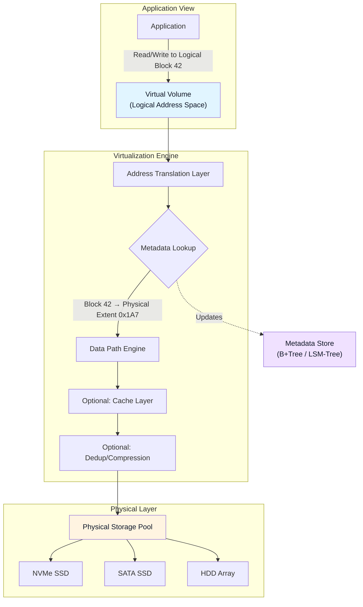
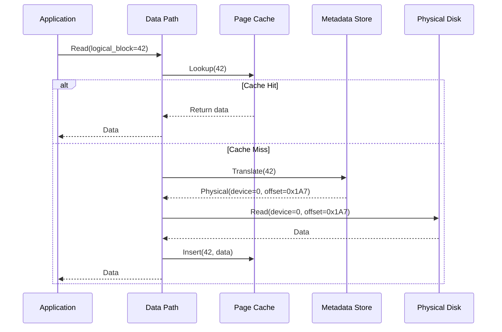
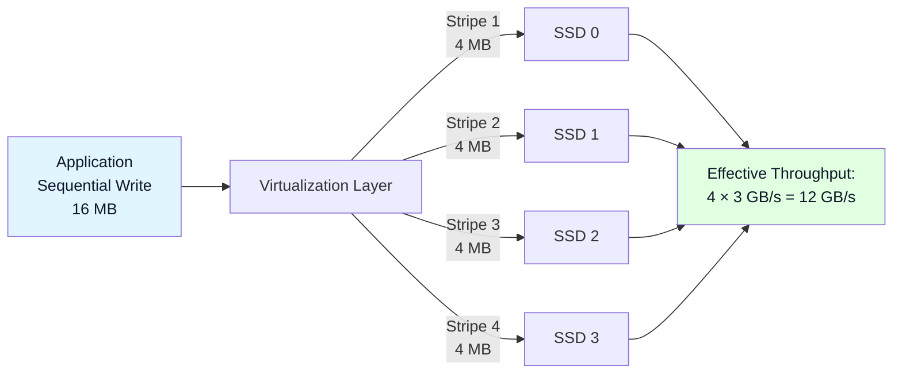

# Lesson 2: Storage Virtualization

## 1. First-Principles Intuition & Invariants

Storage virtualization solves a fundamental problem in computer systems: the impedance mismatch between how applications want to consume storage (contiguous, flexible, isolated) and how physical media provides it (fragmented, fixed-capacity, shared). This abstraction layer transforms heterogeneous storage devices into a unified pool with properties superior to any individual component—a classic example of emergence through composition.

**The Core Problem Space**

Physical storage imposes three hard constraints that storage virtualization must transcend:

1. **Capacity rigidity**: A 1TB disk cannot grow. Pre-allocating storage wastes capacity; under-allocating causes failures.
2. **Performance heterogeneity**: NVMe SSDs deliver 7 GB/s sequential reads; HDDs struggle past 200 MB/s. Applications should not care which underlies their virtual volume.
3. **Failure domains**: Individual drives fail at 0.5-1% annually. Resilience requires duplication at the physical layer, but applications should observe zero data loss.

Storage virtualization inverts the dependency: instead of applications adapting to storage characteristics, storage adapts to application requirements.

**Theoretical Invariants**

All storage virtualization systems must preserve three invariants to be correct:

1. **Linearizability of logical addresses**: If a write to logical block N completes, all subsequent reads from N must return that data (or newer writes), regardless of physical mapping changes. This is a stronger guarantee than eventual consistency; it ensures that the virtual storage behaves identically to a single, perfect physical disk from the application's perspective.

2. **Bijective mapping consistency**: At any instant, each logical block maps to exactly one physical location, and the inverse mapping (physical to logical) must be well-defined for garbage collection and rebuilds. Violations cause data corruption or loss.

3. **Atomicity across the abstraction boundary**: A write that commits to the logical layer must durably persist to physical media (within the system's durability contract, e.g., write-through or write-back cache). Partial writes must be detectable and recoverable.

These invariants force design tradeoffs. Maintaining linearizability under concurrent access requires either locks (hurting performance) or lock-free data structures (increasing implementation complexity). Bijective mapping consistency requires transactional metadata updates, often implemented with write-ahead logging or copy-on-write trees.

**Why Virtualization Enables Optimization**

The indirection layer provides leverage for three orthogonal optimizations:

- **Thin provisioning**: Allocate logical capacity larger than physical, relying on actual usage being sparse. This exploits the empirical observation that file systems typically use 30-70% of allocated capacity.
- **Deduplication**: Detect identical blocks (using content hashing) and store only one physical copy. Enterprise datasets show 2:1 to 10:1 deduplication ratios due to redundant OS images, backups, and document revisions.
- **Compression**: Apply entropy reduction before physical writes. Modern datasets compress 1.5:1 to 3:1 using algorithms like LZ4 (fast) or zstd (high ratio).

Each technique trades CPU cycles for storage efficiency. The key insight: storage $/GB has fallen slower than CPU performance has risen, making this tradeoff increasingly favorable.

**Mathematical Foundation: The Address Translation Problem**

Storage virtualization is fundamentally a function composition problem. Given:
- Logical address space L = [0, N)
- Physical address space P = [0, M) where M < N (overprovisioning)
- Mapping function f: L → P

The system must efficiently compute f(l) for reads/writes and maintain f⁻¹(p) for garbage collection. The naive solution—a full array mapping—consumes RAM proportional to logical capacity, making multi-TB virtual disks infeasible. Practical systems use hierarchical mappings (radix trees, extent maps) that consume space proportional to *used* capacity, achieving O(log n) lookup time.



## 2. Core Architecture & Mechanics

A production storage virtualization system comprises six interconnected subsystems, each addressing a specific aspect of the abstraction problem.

### 2.1 Metadata Management: The Persistent Mapping Layer

The metadata manager maintains the authoritative mapping from logical to physical addresses. This is the system's "source of truth" and must survive crashes without corruption or data loss.

**Data Structure Selection**

Three dominant approaches exist:

1. **Extent-based B+Trees** (used by ZFS, Btrfs): Store contiguous ranges (extents) as [logical_start, length, physical_start] tuples. Sequential writes coalesce into large extents, achieving O(log(num_extents)) lookup. Random writes fragment into many small extents, degrading performance.

2. **Log-Structured Merge Trees (LSM-Trees)** (used by RocksDB-backed systems): Append all updates to a write-ahead log, periodically compacting and merging. Optimized for write-heavy workloads but introduce read amplification (must check multiple levels).

3. **Radix trees with copy-on-write** (used by NetApp WAFL, ZFS): Each node update creates a new node version, propagating changes to the root. Provides implicit snapshots but requires garbage collection of unreferenced nodes.

**Example: Extent Map Implementation in Rust**

```rust
use std::collections::BTreeMap;

#[derive(Debug, Clone, Copy)]
struct PhysicalExtent {
    device_id: u32,
    offset: u64,
    length: u64,
}

/// Extent-based mapping from logical to physical addresses
struct ExtentMap {
    // Key: logical block address, Value: physical extent
    extents: BTreeMap<u64, PhysicalExtent>,
}

impl ExtentMap {
    fn lookup(&self, logical_addr: u64) -> Option<(u32, u64)> {
        // Find the extent containing this logical address
        let (extent_start, extent) = self.extents
            .range(..=logical_addr)
            .next_back()?;
        
        let offset_in_extent = logical_addr - extent_start;
        if offset_in_extent < extent.length {
            Some((extent.device_id, extent.offset + offset_in_extent))
        } else {
            None // Address not mapped (thin provisioning hole)
        }
    }
    
    fn insert(&mut self, logical_start: u64, physical_extent: PhysicalExtent) {
        // Coalesce with adjacent extents if contiguous
        // (simplified; production would check physical contiguity too)
        self.extents.insert(logical_start, physical_extent);
    }
}
```

**Metadata Durability: Write-Ahead Logging**

To ensure crash consistency, metadata updates follow a write-ahead logging (WAL) protocol:

1. Append intended update to WAL on durable storage
2. Flush WAL to disk (fsync)
3. Apply update to in-memory metadata structure
4. Checkpoint metadata to disk periodically

On recovery after a crash, replay the WAL to reconstruct the consistent state. This trades write amplification (every update written twice) for durability.

### 2.2 Data Path: The Fast Path for I/O Operations

The data path handles actual read/write requests, translating logical addresses to physical and orchestrating data movement.

**Read Path Architecture**



**Write Path: Write-Through vs. Write-Back**

Write-through: Acknowledge write only after physical media confirms durability. Guarantees no data loss but suffers from disk latency (1-10ms for SSDs, 5-15ms for HDDs).

Write-back: Acknowledge write after committing to non-volatile cache (NVRAM/persistent memory). Achieves microsecond latencies but requires cache flush logic and battery backup to prevent data loss on power failure.

**Example: Write-Back Cache Implementation**

```rust
use std::collections::HashMap;
use std::sync::{Arc, RwLock};

struct WritableBlock {
    data: Vec<u8>,
    dirty: bool,
}

struct WriteBackCache {
    cache: Arc<RwLock<HashMap<u64, WritableBlock>>>,
    max_dirty_blocks: usize,
}

impl WriteBackCache {
    fn write(&self, logical_addr: u64, data: Vec<u8>) -> Result<(), String> {
        let mut cache = self.cache.write().unwrap();
        
        // Insert into cache and mark dirty
        cache.insert(logical_addr, WritableBlock {
            data,
            dirty: true,
        });
        
        // Check if we need to flush
        let dirty_count = cache.values().filter(|b| b.dirty).count();
        if dirty_count >= self.max_dirty_blocks {
            // Trigger async flush (simplified)
            self.flush_dirty_blocks();
        }
        
        Ok(())
    }
    
    fn flush_dirty_blocks(&self) {
        // In production: select dirty blocks, write to physical storage,
        // update metadata, clear dirty flags
        // Uses write-ahead logging for crash consistency
    }
}
```

### 2.3 Thin Provisioning: Lazy Allocation

Thin provisioning decouples allocation from consumption. A virtual disk advertised as 1TB may physically consume only 100GB initially, growing as data is written.

**Implementation: Copy-on-Write with Hole Tracking**

1. Initialize virtual disk with metadata indicating "all blocks unallocated"
2. On first write to block N, allocate physical space, update metadata
3. On read from unallocated block, return zeros (or a template if cloning from an image)

**Space Reclamation: TRIM/UNMAP Support**

When applications delete files, filesystems issue TRIM commands to reclaim space. The virtualization layer must:
1. Remove logical-to-physical mappings
2. Add physical blocks to free pool
3. Update metadata atomically

Without TRIM support, thin provisioning can only grow, never shrink—a critical limitation.

```python
class ThinProvisionedVolume:
    def __init__(self, logical_size_gb, block_size=4096):
        self.logical_size = logical_size_gb * (1024**3)
        self.block_size = block_size
        self.allocated_blocks = {}  # logical_block_num -> physical_block
        self.free_physical_blocks = []
        self.physical_used = 0
    
    def write(self, logical_offset, data):
        block_num = logical_offset // self.block_size
        
        if block_num not in self.allocated_blocks:
            # Allocate new physical block (lazy allocation)
            if not self.free_physical_blocks:
                physical_block = self._allocate_new_physical_block()
            else:
                physical_block = self.free_physical_blocks.pop()
            
            self.allocated_blocks[block_num] = physical_block
            self.physical_used += self.block_size
        
        physical_block = self.allocated_blocks[block_num]
        self._write_physical(physical_block, data)
    
    def trim(self, logical_offset, length):
        """Reclaim space when data is deleted"""
        start_block = logical_offset // self.block_size
        num_blocks = (length + self.block_size - 1) // self.block_size
        
        for block_num in range(start_block, start_block + num_blocks):
            if block_num in self.allocated_blocks:
                physical_block = self.allocated_blocks.pop(block_num)
                self.free_physical_blocks.append(physical_block)
                self.physical_used -= self.block_size
    
    def capacity_report(self):
        return {
            'logical_size': self.logical_size,
            'physical_used': self.physical_used,
            'efficiency': (self.logical_size / self.physical_used 
                          if self.physical_used > 0 else float('inf'))
        }
```

### 2.4 Deduplication: Content-Addressed Storage

Deduplication identifies and eliminates redundant data by storing each unique block exactly once. Two approaches exist:

**Inline Deduplication**: Hash each block before writing. If hash exists, increment reference count instead of writing. Adds latency to write path (hashing cost) but prevents redundant data from ever reaching disk.

**Post-Process Deduplication**: Write all blocks initially, scan periodically for duplicates, consolidate. Lower write latency but stores duplicates temporarily.

**Cryptographic Hash Selection**

Must balance collision resistance vs. computation cost:
- **SHA-256**: 256-bit output, ~400 MB/s throughput on modern CPUs. Collision probability negligible for all practical purposes (2⁻²⁵⁶).
- **SHA-1**: 160-bit output, ~800 MB/s throughput. Vulnerable to collision attacks (SHAttered, 2017) but acceptable for deduplication if only comparing within a single system.
- **xxHash**: 64-bit output, ~10 GB/s throughput. Fast but collision probability (~2⁻⁶⁴) requires secondary verification with full block comparison.

**Reference Counting and Garbage Collection**

Each unique block stores a reference count. When count reaches zero (all logical references deleted), physical block becomes eligible for garbage collection. Must be crash-consistent: decrementing refcount and deallocating block must be atomic.

```go
package storage

import (
    "crypto/sha256"
    "sync"
)

type ContentHash [32]byte

type DedupEngine struct {
    blockStore   map[ContentHash][]byte  // hash -> actual data
    refCounts    map[ContentHash]int     // hash -> reference count
    blockToHash  map[uint64]ContentHash  // logical block -> hash
    mu           sync.RWMutex
}

func (de *DedupEngine) Write(logicalBlock uint64, data []byte) {
    hash := sha256.Sum256(data)
    
    de.mu.Lock()
    defer de.mu.Unlock()
    
    // Check if we've seen this content before
    if _, exists := de.blockStore[hash]; !exists {
        // New unique block: store it
        de.blockStore[hash] = make([]byte, len(data))
        copy(de.blockStore[hash], data)
        de.refCounts[hash] = 0
    }
    
    // Update mapping and increment refcount
    if oldHash, exists := de.blockToHash[logicalBlock]; exists {
        // This logical block previously pointed to different data
        de.decrementRefCount(oldHash)
    }
    
    de.blockToHash[logicalBlock] = hash
    de.refCounts[hash]++
}

func (de *DedupEngine) Read(logicalBlock uint64) ([]byte, bool) {
    de.mu.RLock()
    defer de.mu.RUnlock()
    
    hash, exists := de.blockToHash[logicalBlock]
    if !exists {
        return nil, false
    }
    
    data, exists := de.blockStore[hash]
    if !exists {
        // Corruption: logical block references non-existent hash
        return nil, false
    }
    
    // Return copy to prevent external mutation
    result := make([]byte, len(data))
    copy(result, data)
    return result, true
}

func (de *DedupEngine) decrementRefCount(hash ContentHash) {
    de.refCounts[hash]--
    if de.refCounts[hash] == 0 {
        // Garbage collect: no logical blocks reference this anymore
        delete(de.blockStore, hash)
        delete(de.refCounts, hash)
    }
}

func (de *DedupEngine) GetStats() (uniqueBlocks int, totalRefs int, dedupRatio float64) {
    de.mu.RLock()
    defer de.mu.RUnlock()
    
    uniqueBlocks = len(de.blockStore)
    totalRefs = len(de.blockToHash)
    
    if uniqueBlocks > 0 {
        dedupRatio = float64(totalRefs) / float64(uniqueBlocks)
    }
    
    return
}
```

**Deduplication Domain: Block vs. File vs. Sub-block**

- **Block-level**: Deduplicate fixed-size blocks (4KB-128KB). Simple but misses alignment-shifted duplicates.
- **File-level**: Deduplicate entire files. Misses partial duplicates within files.
- **Sub-block (variable chunking)**: Use content-defined chunking (CDC) to find boundaries invariant to insertions/deletions. Rabin fingerprinting is standard. Highest deduplication ratio but most CPU-intensive.

### 2.5 Compression: Entropy Reduction

Compression reduces physical storage requirements by exploiting redundancy and patterns in data. Choice of algorithm involves a three-way tradeoff: compression ratio, CPU cost, and latency.

| Algorithm | Ratio | Compression Speed | Decompression Speed | Use Case |
|-----------|-------|-------------------|---------------------|----------|
| LZ4 | 1.5-2.5:1 | 500 MB/s | 2 GB/s | Latency-sensitive, fast path |
| Zstd (level 3) | 2-3:1 | 250 MB/s | 800 MB/s | Balanced performance |
| Zstd (level 19) | 3-4:1 | 10 MB/s | 800 MB/s | Cold/archival storage |
| LZMA | 3-5:1 | 5 MB/s | 50 MB/s | Archival only |

**Block-Aligned Compression: The 4KB Problem**

Storage systems operate on fixed-size blocks (typically 4KB to match page size). Compressed data rarely aligns to block boundaries, creating fragmentation. Two solutions:

1. **Variable-length blocks with indirection**: Store compressed size in metadata, pack multiple compressed blocks into physical blocks. Adds complexity to space reclamation.
2. **Fixed-size blocks with compression abort**: If compressed data exceeds block size, store uncompressed. Simple but wastes CPU on incompressible data.

```c
#include <stdint.h>
#include <string.h>
#include <lz4.h>

#define BLOCK_SIZE 4096
#define MAX_COMPRESSED_SIZE (LZ4_COMPRESSBOUND(BLOCK_SIZE))

typedef struct {
    uint32_t compressed_size;  // 0 means stored uncompressed
    uint8_t data[MAX_COMPRESSED_SIZE];
} CompressedBlock;

int compress_block(const uint8_t *input, CompressedBlock *output) {
    // Attempt compression
    int compressed_size = LZ4_compress_default(
        (const char *)input,
        (char *)output->data,
        BLOCK_SIZE,
        MAX_COMPRESSED_SIZE
    );
    
    // Only store compressed if we achieved meaningful reduction
    // (heuristic: at least 10% savings to justify decompression overhead)
    if (compressed_size > 0 && compressed_size < (BLOCK_SIZE * 0.9)) {
        output->compressed_size = compressed_size;
        return compressed_size;
    } else {
        // Store uncompressed
        output->compressed_size = 0;
        memcpy(output->data, input, BLOCK_SIZE);
        return BLOCK_SIZE;
    }
}

int decompress_block(const CompressedBlock *input, uint8_t *output) {
    if (input->compressed_size == 0) {
        // Stored uncompressed
        memcpy(output, input->data, BLOCK_SIZE);
        return BLOCK_SIZE;
    } else {
        // Decompress
        int result = LZ4_decompress_safe(
            (const char *)input->data,
            (char *)output,
            input->compressed_size,
            BLOCK_SIZE
        );
        
        if (result != BLOCK_SIZE) {
            // Decompression error (corruption detected)
            return -1;
        }
        return BLOCK_SIZE;
    }
}
```

### 2.6 Resilience: RAID and Erasure Coding

Storage virtualization must mask physical device failures. Two primary techniques:

**RAID (Redundant Array of Independent Disks)**: Distributes data across multiple drives with redundancy.

- **RAID 1 (Mirroring)**: Store two copies. Survives one failure. 50% capacity overhead.
- **RAID 5 (Parity)**: Stripe data across N drives, store parity on Nth drive. Survives one failure. 1/N capacity overhead (e.g., 25% for 4 drives).
- **RAID 6 (Double Parity)**: Two parity drives. Survives two failures. 2/N overhead.

**Erasure Coding**: Generalized parity using Reed-Solomon codes. Store data in K chunks, generate M parity chunks. Can reconstruct data from any K of (K+M) chunks. Popular configurations: 8+3 (27% overhead, tolerates 3 failures) or 12+4 (25% overhead, tolerates 4 failures).

**Mathematical Foundation: Reed-Solomon Codes**

Treat each K data chunks as coefficients of a polynomial p(x) of degree K-1 over GF(2⁸). Evaluate p(x) at M additional points to generate parity. Reconstruction solves for polynomial coefficients given any K evaluations (Lagrange interpolation).

```python
import numpy as np

class ErasureCoder:
    """Simplified Reed-Solomon encoder (conceptual; production uses optimized libraries)"""
    
    def __init__(self, k, m):
        """k data chunks, m parity chunks"""
        self.k = k
        self.m = m
        # Vandermonde matrix for encoding (in GF(256))
        self.encode_matrix = self._generate_encode_matrix()
    
    def _generate_encode_matrix(self):
        """Generate (k+m) x k encoding matrix"""
        # Simplified: uses integers instead of true GF(256) arithmetic
        matrix = []
        for i in range(self.k + self.m):
            row = [(i + 1) ** j for j in range(self.k)]
            matrix.append(row)
        return np.array(matrix, dtype=np.uint8)
    
    def encode(self, data_chunks):
        """
        Encode k data chunks into k+m total chunks
        data_chunks: list of k byte arrays of equal length
        Returns: list of k+m chunks (first k are original data)
        """
        if len(data_chunks) != self.k:
            raise ValueError(f"Expected {self.k} chunks, got {len(data_chunks)}")
        
        # Convert chunks to matrix (each chunk is a column)
        chunk_len = len(data_chunks[0])
        data_matrix = np.array([list(chunk) for chunk in data_chunks], dtype=np.uint8).T
        
        # Encode: multiply encode matrix with data
        # encoded_matrix has (k+m) columns
        encoded_matrix = (self.encode_matrix @ data_matrix.T) % 256
        
        # Convert back to list of chunks
        all_chunks = [encoded_matrix[i, :].tobytes() for i in range(self.k + self.m)]
        return all_chunks
    
    def decode(self, available_chunks, chunk_indices):
        """
        Reconstruct data from any k available chunks
        available_chunks: list of available chunks
        chunk_indices: indices of which chunks these are (0 to k+m-1)
        """
        if len(available_chunks) < self.k:
            raise ValueError(f"Need at least {self.k} chunks to decode")
        
        # Use first k available chunks
        used_chunks = available_chunks[:self.k]
        used_indices = chunk_indices[:self.k]
        
        # Extract corresponding rows from encode matrix
        submatrix = self.encode_matrix[used_indices, :]
        
        # Invert submatrix and multiply to recover original data
        # (simplified; production uses Gaussian elimination in GF(256))
        inv_matrix = np.linalg.inv(submatrix)
        
        chunk_len = len(used_chunks[0])
        chunk_matrix = np.array([list(chunk) for chunk in used_chunks], dtype=np.uint8).T
        
        recovered_matrix = (inv_matrix @ chunk_matrix.T) % 256
        
        # Convert back to original data chunks
        data_chunks = [recovered_matrix[i, :].astype(np.uint8).tobytes() 
                      for i in range(self.k)]
        return data_chunks
```

**RAID Rebuild Performance**

When a drive fails, RAID must rebuild data from remaining drives onto a replacement. Rebuild time is critical: during rebuild, a second failure causes data loss.

For a 4TB drive at 200 MB/s sustained read (HDD), rebuild takes ~5.7 hours. During this window, probability of second failure = (annual failure rate) × (rebuild time / 8760 hours). With 0.5% AFR and 10 drives, probability ≈ 0.005 × 10 × (5.7 / 8760) ≈ 0.003 (0.3%). Not negligible at scale.

Modern systems use distributed rebuild: read from all surviving drives in parallel, write to multiple new drives. Reduces rebuild time to drive write bandwidth limit rather than single-drive read limit.

## 3. High-Performance Optimization & Failure Modes

### 3.1 Performance Optimization: Latency and Throughput

**Cache Hierarchies: Multi-Tier Caching**

Storage I/O follows a power-law distribution: a small fraction of blocks accounts for most accesses. Caching exploits this temporal locality.

```text
L1: DRAM cache (64 GB)       — 100 ns latency, hit rate ~70%
L2: NVMe SSD cache (1 TB)    — 100 µs latency, hit rate ~95%
L3: SATA SSD pool (10 TB)    — 500 µs latency, hit rate ~99%
L4: HDD pool (100 TB)        — 10 ms latency, hit rate 100%
```

**Cache Admission and Eviction Policies**

Not all blocks benefit from caching. Sequential scans pollute the cache with single-use blocks. Admission policies filter out non-beneficial blocks:

- **Adaptive Replacement Cache (ARC)**: Maintains two LRU lists (recent and frequent). Balances between recency and frequency dynamically.
- **LIRS (Low Inter-reference Recency Set)**: Prioritizes blocks with low reuse distance. Outperforms LRU for workloads with scanning.

**Write Coalescing: Batching Small Writes**

SSDs have high write amplification: a 4KB write may trigger a 256KB erase block rewrite. Coalescing multiple 4KB writes into a single 256KB write reduces wear and improves throughput.

Technique: Hold writes in non-volatile memory for 1-10ms. Coalesce adjacent writes. Flush batch to SSD.

Tradeoff: Increases latency by 1-10ms. Only acceptable for throughput-oriented workloads, not latency-sensitive applications.

**Parallelism: Striping Across Devices**

Distribute sequential I/O across N devices to achieve N× throughput. Stripe size must be tuned:
- Too small (4KB): Excessive overhead from coordinating N devices
- Too large (1MB): Single I/O cannot leverage parallelism

Optimal stripe size ≈ (device queue depth) × (average I/O size). For NVMe SSDs with 64-entry queues and 128KB average I/O, use 8MB stripes.



### 3.2 Failure Modes and Mitigations

**Metadata Corruption: The Single Point of Failure**

If the metadata store (mapping logical to physical addresses) corrupts, data becomes inaccessible even if physically intact. Mitigations:

1. **Checksumming**: Compute CRC32/SHA-256 for each metadata block. Detect corruption on read.
2. **Redundant metadata stores**: Keep two or three metadata replicas on independent devices. Use quorum for reads.
3. **Background scrubbing**: Periodically read all metadata, verify checksums, repair from replicas.

**Data Corruption: Silent Data Corruption (SDC)**

Cosmic rays, firmware bugs, and aging flash cells can flip bits. Disk checksums (T10 DIF) catch some corruption, but not all. End-to-end data integrity requires:

1. **Checksums at virtual layer**: Store checksum with each block. Verify on read. If mismatch, try alternate replica or reconstruct from parity.
2. **Scrubbing**: Periodically read all data, verify checksums, repair corruption before it spreads to multiple replicas.

**Failure Detection Latency: The Timeout Problem**

A failed disk may hang rather than report errors, blocking I/O for 30+ seconds. By the time timeout occurs, application may have crashed. Solution: aggressive timeouts (1-5 seconds) with speculative retry on alternate replica.

**Cascading Failures: The Rebuild Storm**

When a disk fails, rebuild stresses remaining disks with sustained reads. Increased load raises their failure probability. If a second disk fails during rebuild, data is lost.

Mitigation: Throttle rebuild I/O to 20-50% of disk bandwidth, extending rebuild time but reducing stress. In production clusters, sacrifice rebuild speed for stability.

**Capacity Overcommitment: The Out-of-Space Trap**

Thin provisioning can allocate more logical capacity than physical. If all VMs suddenly write to full capacity, system runs out of space. No writes can proceed—a hard failure.

Mitigations:
1. **Monitoring**: Alert when physical usage exceeds 80% of capacity.
2. **Reservation**: Guarantee minimum physical space per VM.
3. **Graceful degradation**: When low on space, reject new allocations but allow existing VMs to continue.

```python
class ThinProvisioningGuard:
    def __init__(self, total_physical_gb, overcommit_ratio=3.0, critical_threshold=0.9):
        self.total_physical = total_physical_gb * (1024**3)
        self.used_physical = 0
        self.allocated_logical = 0
        self.overcommit_ratio = overcommit_ratio
        self.critical_threshold = critical_threshold
        self.volumes = {}  # volume_id -> (logical_size, used_physical)
    
    def allocate_volume(self, volume_id, logical_size_gb):
        logical_size = logical_size_gb * (1024**3)
        
        # Check if allocation would exceed overcommit ratio
        new_logical_total = self.allocated_logical + logical_size
        max_logical = self.total_physical * self.overcommit_ratio
        
        if new_logical_total > max_logical:
            raise Exception(f"Cannot allocate: would exceed {self.overcommit_ratio}× overcommit")
        
        # Check if physical usage is critical
        if self.used_physical > (self.total_physical * self.critical_threshold):
            raise Exception(f"Cannot allocate: physical usage at {self._usage_percent():.1f}%")
        
        self.volumes[volume_id] = (logical_size, 0)
        self.allocated_logical += logical_size
        return volume_id
    
    def write_data(self, volume_id, size_bytes):
        if volume_id not in self.volumes:
            raise Exception("Volume not found")
        
        # Check if write would exceed physical capacity
        if self.used_physical + size_bytes > self.total_physical:
            raise Exception(f"Out of physical space (used: {self._usage_percent():.1f}%)")
        
        logical_size, used_physical = self.volumes[volume_id]
        self.volumes[volume_id] = (logical_size, used_physical + size_bytes)
        self.used_physical += size_bytes
    
    def _usage_percent(self):
        return (self.used_physical / self.total_physical) * 100
    
    def get_status(self):
        return {
            'physical_used_gb': self.used_physical / (1024**3),
            'physical_total_gb': self.total_physical / (1024**3),
            'usage_percent': self._usage_percent(),
            'logical_allocated_gb': self.allocated_logical / (1024**3),
            'overcommit_ratio': self.allocated_logical / self.used_physical if self.used_physical > 0 else 0,
        }
```

### 3.3 Real-World Performance Pathologies

**The Write Cliff: SSD Garbage Collection Stalls**

SSDs exhibit bimodal latency. When free space drops below ~20%, garbage collection must reclaim space before new writes can proceed. Latency spikes from 100µs to 10ms+. 

Mitigation: Overprovision SSDs by 20-30%. Reserve space never exposed to host. GC operates on reserved space without stalling foreground I/O.

**The Metadata Bottleneck: Small Random Write Amplification**

Each 4KB write may require updating multiple metadata structures: extent map, free space bitmap, checksums, dedup index. A single logical write can trigger 5-10 physical writes.

For workloads with small random writes (databases, VMs), metadata becomes the bottleneck. Mitigation: Use byte-addressable persistent memory (Intel Optane) for metadata, reducing update latency from milliseconds to microseconds.

**The Rebuild Bandwidth Tax**

During RAID rebuild, 100% of surviving disk bandwidth is consumed reading for reconstruction. Application I/O competes for the same bandwidth, causing severe performance degradation.

Measurement from production: In a 10-disk RAID 6 array rebuilding one failed disk, application I/O throughput dropped to 15% of normal. 

Mitigation: Implement I/O scheduling that reserves bandwidth for foreground (application) I/O and throttles background (rebuild) I/O. Common split: 70% foreground, 30% background.

### 3.4 Verification and Testing Strategies

**Fault Injection: Proving Correctness Under Failure**

Storage virtualization must behave correctly when disks fail, power is lost, or processes crash. Verification requires injecting faults:

1. **Disk failure injection**: Simulate disk returning I/O errors at random. Verify system detects failure, switches to replica, and rebuilds.
2. **Power loss injection**: Kill process with SIGKILL mid-write. Verify system recovers consistent state via WAL replay.
3. **Latency injection**: Artificially delay I/O by 100ms-10s. Verify timeouts trigger correctly and system retries on alternate paths.

**Jepsen-Style Consistency Testing**

Storage virtualization claims to provide linearizable semantics. To verify:
1. Run concurrent clients issuing reads/writes
2. Inject network partitions, process crashes, clock skew
3. Collect complete history of all operations and responses
4. Use model checker (e.g., Knossos) to verify history is linearizable

If model checker finds a violation, it produces a minimal counterexample showing the specific operation sequence that broke linearizability.

```python
# Pseudocode for Jepsen-style test
import random
import time

def test_linearizability():
    # Start storage virtualization cluster (3 nodes)
    cluster = start_cluster(num_nodes=3)
    
    # Concurrent clients issuing operations
    clients = [Client(cluster) for _ in range(10)]
    history = []
    
    def client_workload(client_id):
        for i in range(100):
            op = random.choice(['read', 'write'])
            if op == 'write':
                key = random.randint(0, 100)
                value = f"client{client_id}_write{i}"
                start_time = time.time()
                result = client.write(key, value)
                end_time = time.time()
                history.append({
                    'op': 'write', 
                    'key': key, 
                    'value': value, 
                    'start': start_time, 
                    'end': end_time,
                    'result': result
                })
            else:
                key = random.randint(0, 100)
                start_time = time.time()
                result = client.read(key)
                end_time = time.time()
                history.append({
                    'op': 'read',
                    'key': key,
                    'start': start_time,
                    'end': end_time,
                    'result': result
                })
    
    # Run clients concurrently while injecting faults
    with concurrent.futures.ThreadPoolExecutor() as executor:
        futures = [executor.submit(client_workload, i) for i in range(10)]
        
        # Inject faults during execution
        time.sleep(2)
        cluster.partition_network(nodes=[0], duration=5)
        time.sleep(3)
        cluster.kill_node(1)
        time.sleep(3)
        cluster.restart_node(1)
        
        for future in futures:
            future.result()
    
    # Verify linearizability
    assert check_linearizability(history), "Linearizability violated!"
```

**Benchmarking: Measuring Real Performance**

Standard benchmarks for storage virtualization:

- **FIO (Flexible I/O Tester)**: Synthetic workloads. Generate pure sequential/random reads/writes at various block sizes. Measures raw performance without application overhead.
- **YCSB (Yahoo Cloud Serving Benchmark)**: Key-value workloads. Simulates web application access patterns. Measures performance under realistic distribution of operations.
- **TPC-C**: OLTP database workload. Heavy random writes with reads. Stresses metadata subsystem and transactional consistency.

Key metrics to measure:
- **Latency percentiles**: p50, p99, p99.9. Mean is misleading; tail latencies dominate user experience.
- **Throughput under load**: IOPS at various queue depths. Single-threaded throughput often differs dramatically from multi-threaded.
- **Write amplification**: Physical writes / logical writes. Indicates efficiency of deduplication, compression, and metadata management.

---

## Summary

Storage virtualization abstracts physical storage into a flexible logical layer, solving three critical problems: capacity rigidity, performance heterogeneity, and failure domains. Its architecture comprises six interconnected subsystems: metadata management (maintains logical-to-physical mapping), data path (executes I/O), thin provisioning (lazy allocation), deduplication (content-addressed storage), compression (entropy reduction), and resilience (RAID/erasure coding).

The system must preserve three invariants: linearizability of logical addresses, bijective mapping consistency, and atomicity across abstraction boundaries. Performance optimizations include cache hierarchies, write coalescing, and parallelism through striping. Failure modes include metadata corruption, silent data corruption, cascading rebuild failures, and capacity overcommitment.

Real-world deployments face pathologies like SSD garbage collection stalls, metadata bottlenecks on small random writes, and rebuild bandwidth taxes. Verification requires fault injection, Jepsen-style consistency testing, and comprehensive benchmarking with metrics focused on tail latencies and write amplification.

Production storage virtualization systems (ZFS, Ceph, VMware vSAN) implement these principles with engineering tradeoffs: ZFS prioritizes data integrity with end-to-end checksums and copy-on-write; Ceph prioritizes scalability with distributed metadata and CRUSH placement; vSAN prioritizes integration with VMware's hypervisor ecosystem. Selecting the right system requires analyzing workload characteristics, failure tolerance requirements, and operational constraints.
