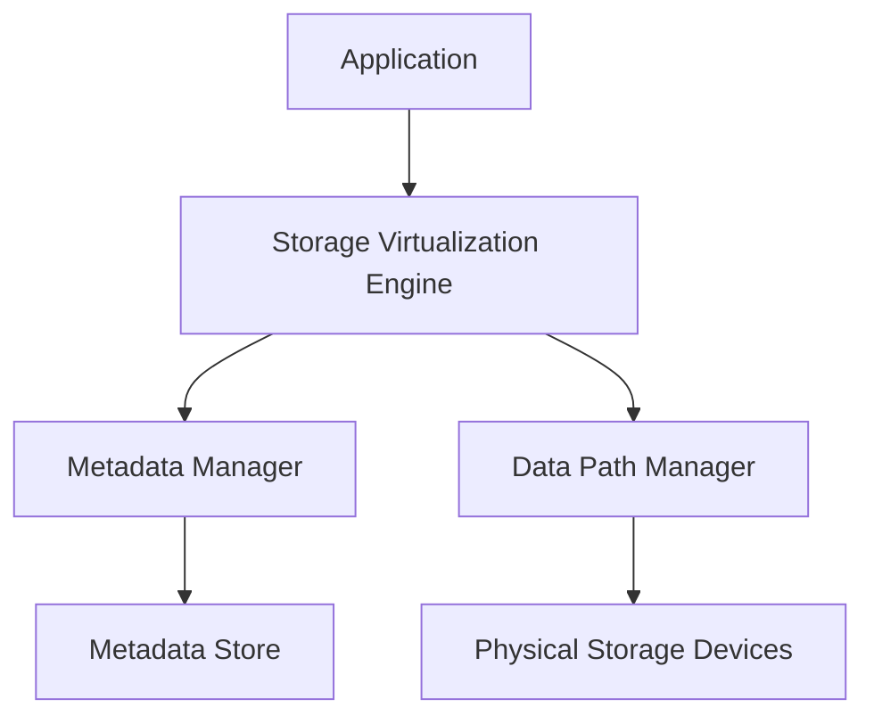

# Lesson 2: Storage Virtualization

## 1. First-Principles Intuition & Invariants

Storage virtualization is a foundational technology that abstracts physical storage resources, providing a flexible and efficient means to manage and utilize storage capacity across distributed systems. At its core, storage virtualization enables the decoupling of logical storage from physical storage, allowing for dynamic allocation, reallocation, and optimization of storage resources. This abstraction is crucial in modern data centers and cloud environments, where the ability to efficiently manage storage is paramount to performance, cost-effectiveness, and scalability.

The problem space addressed by storage virtualization is multifaceted. On one hand, it seeks to optimize the utilization of physical storage devices by abstracting away their underlying characteristics and presenting a unified, logical storage pool to the operating system and applications. On the other hand, it aims to enhance the flexibility and agility of storage management by enabling features such as thin provisioning, deduplication, and compression. These features not only improve storage efficiency but also simplify the management of storage resources, reducing operational overhead and improving system reliability.

From a theoretical standpoint, storage virtualization relies on several key invariants and principles. One such invariant is the preservation of data integrity and consistency across the virtual and physical storage layers. This means that any data written to the virtual storage must be reliably stored on the underlying physical devices, and any data read from the virtual storage must accurately reflect the data stored on the physical devices. Another invariant is the efficient utilization of storage resources, which involves minimizing wasted storage space and maximizing the throughput and performance of storage operations.

To achieve these invariants, storage virtualization systems employ a variety of techniques and algorithms. One such technique is thin provisioning, which allows storage to be allocated to virtual machines or applications on an as-needed basis, rather than being pre-allocated in fixed-size blocks. This approach not only reduces the amount of unused storage but also simplifies the management of storage resources, as administrators can allocate storage dynamically without having to pre-provision large amounts of physical storage.

Another key technique is deduplication, which involves identifying and eliminating duplicate data within the storage pool. By storing only unique data and creating references to this data, deduplication can significantly reduce the amount of physical storage required to store a given set of data. This, in turn, can improve storage efficiency and reduce the cost of storage infrastructure.

Compression is another important technique used in storage virtualization. By compressing data before storing it on physical devices, storage virtualization systems can reduce the amount of physical storage required to store a given set of data. Compression can also improve the performance of storage operations, as it reduces the amount of data that needs to be read from and written to physical storage devices.

## 2. Core Architecture & Mechanics

The architecture of a storage virtualization system is designed to provide a seamless abstraction layer between logical storage and physical storage. At the heart of this architecture is a storage virtualization engine, which manages the mapping of logical storage to physical storage and implements the various techniques and algorithms used to optimize storage utilization and performance.

One of the key components of the storage virtualization engine is the metadata manager, which maintains a mapping of logical storage to physical storage. This mapping is typically stored in a metadata store, which can be implemented using a variety of data structures, such as hash tables, B-trees, or distributed databases. The metadata manager is responsible for updating this mapping as storage is allocated, deallocated, or migrated between physical storage devices.

Another important component of the storage virtualization engine is the data path manager, which handles the actual storage and retrieval of data. The data path manager is responsible for translating logical storage addresses into physical storage addresses using the mapping maintained by the metadata manager. It also implements the various techniques and algorithms used to optimize storage utilization and performance, such as thin provisioning, deduplication, and compression.

To illustrate the architecture of a storage virtualization system, we can use a simple Mermaid diagram:

In this diagram, the application interacts with the storage virtualization engine, which manages the mapping of logical storage to physical storage. The metadata manager maintains the mapping in the metadata store, while the data path manager handles the actual storage and retrieval of data on the physical storage devices.

The metadata manager plays a critical role in the storage virtualization engine, as it is responsible for maintaining the mapping of logical storage to physical storage. This mapping is typically stored in a metadata store, which can be implemented using a variety of data structures, such as hash tables, B-trees, or distributed databases. The metadata manager is responsible for updating this mapping as storage is allocated, deallocated, or migrated between physical storage devices.

The data path manager is another critical component of the storage virtualization engine, as it handles the actual storage and retrieval of data. The data path manager is responsible for translating logical storage addresses into physical storage addresses using the mapping maintained by the metadata manager. It also implements the various techniques and algorithms used to optimize storage utilization and performance, such as thin provisioning, deduplication, and compression.

To illustrate the mechanics of thin provisioning, we can use a simple example. Suppose we have a virtual machine that requires 100 GB of storage. With thin provisioning, we can allocate 100 GB of logical storage to the virtual machine without having to pre-allocate 100 GB of physical storage. Instead, the storage virtualization engine can allocate physical storage on an as-needed basis, as the virtual machine writes data to the logical storage. This approach not only reduces the amount of unused storage but also simplifies the management of storage resources, as administrators can allocate storage dynamically without having to pre-provision large amounts of physical storage.

To illustrate the mechanics of deduplication, we can use another example. Suppose we have a storage pool that contains multiple copies of the same data. With deduplication, the storage virtualization engine can identify and eliminate these duplicate copies, storing only unique data and creating references to this data. This approach can significantly reduce the amount of physical storage required to store a given set of data, improving storage efficiency and reducing the cost of storage infrastructure.

To illustrate the mechanics of compression, we can use a final example. Suppose we have a storage pool that contains large amounts of data that can be compressed. With compression, the storage virtualization engine can compress this data before storing it on physical devices, reducing the amount of physical storage required to store the data. Compression can also improve the performance of storage operations, as it reduces the amount of data that needs to be read from and written to physical storage devices.

## 3. High-Performance Optimization & Failure Modes

The performance and reliability of a storage virtualization system depend on a variety of factors, including the efficiency of the metadata manager, the performance of the data path manager, and the effectiveness of the various techniques and algorithms used to optimize storage utilization and performance. To ensure high performance and reliability, storage virtualization systems employ a variety of optimization techniques and failure mitigation strategies.

One of the key optimization techniques used in storage virtualization is caching. By caching frequently accessed data in memory, storage virtualization systems can reduce the amount of time required to read and write data to physical storage devices. This can significantly improve the performance of storage operations, especially in high-performance computing environments.

Another important optimization technique is parallelism. By distributing storage operations across multiple physical storage devices, storage virtualization systems can improve the performance of storage operations by reducing the amount of time required to read and write data. This can be achieved using a variety of techniques, such as striping, mirroring, and RAID configurations.

To illustrate the mechanics of caching, we can use a simple example. Suppose we have a storage virtualization system that caches frequently accessed data in memory. When an application reads data from the logical storage, the storage virtualization engine first checks the cache to see if the data is available. If the data is available in the cache, the storage virtualization engine can return the data to the application without having to read it from physical storage devices. This can significantly reduce the amount of time required to read data, improving the performance of storage operations.

To illustrate the mechanics of parallelism, we can use another example. Suppose we have a storage virtualization system that distributes storage operations across multiple physical storage devices using striping. When an application writes data to the logical storage, the storage virtualization engine can distribute the data across multiple physical storage devices, reducing the amount of time required to write the data. This can significantly improve the performance of storage operations, especially in high-performance computing environments.

In addition to optimization techniques, storage virtualization systems also employ a variety of failure mitigation strategies to ensure high reliability. One such strategy is redundancy, which involves storing multiple copies of data on different physical storage devices. This can help to protect against data loss in the event of a hardware failure.

Another important failure mitigation strategy is error correction, which involves detecting and correcting errors in the data stored on physical storage devices. This can be achieved using a variety of techniques, such as parity checks, checksums, and error-correcting codes.

To illustrate the mechanics of redundancy, we can use a simple example. Suppose we have a storage virtualization system that stores multiple copies of data on different physical storage devices using RAID 5. If one of the physical storage devices fails, the storage virtualization engine can use the parity information stored on the other physical storage devices to reconstruct the data, protecting against data loss.

To illustrate the mechanics of error correction, we can use another example. Suppose we have a storage virtualization system that uses checksums to detect and correct errors in the data stored on physical storage devices. When an application writes data to the logical storage, the storage virtualization engine can compute a checksum for the data and store it along with the data. When an application reads data from the logical storage, the storage virtualization engine can compute a checksum for the data and compare it to the stored checksum to detect and correct any errors.

In conclusion, storage virtualization is a powerful technology that abstracts physical storage resources, providing a flexible and efficient means to manage and utilize storage capacity across distributed systems. By decoupling logical storage from physical storage, storage virtualization enables the dynamic allocation, reallocation, and optimization of storage resources, improving performance, cost-effectiveness, and scalability. The architecture of a storage virtualization system is designed to provide a seamless abstraction layer between logical storage and physical storage, while the mechanics of storage virtualization involve a variety of techniques and algorithms used to optimize storage utilization and performance. To ensure high performance and reliability, storage virtualization systems employ a variety of optimization techniques and failure mitigation strategies, including caching, parallelism, redundancy, and error correction.
