# Lesson 3: Compute Virtualization

## 1. First-Principles Intuition & Invariants

Compute virtualization solves a fundamental resource multiplexing problem: enabling multiple independent operating systems to execute concurrently on shared hardware while maintaining strict isolation, performance predictability, and security boundaries. This is not merely software partitioning but a formalization of the classical **Popek-Goldberg virtualization requirements** (1974): a virtual machine monitor must efficiently execute the vast majority of guest instructions directly on hardware (efficiency), provide an environment essentially identical to the original machine (equivalence), and maintain complete control over system resources (resource control).

The problem emerges from the rigid coupling between operating systems and hardware. Operating systems assume exclusive control over privileged instructions, interrupt vectors, and physical address spaces. Virtualization decouples this assumption through a **thin indirection layer**—the hypervisor—that multiplexes hardware resources while preserving the illusion of exclusive access. This requires solving three interrelated problems: **CPU virtualization** (how to safely execute guest code), **memory virtualization** (how to isolate and translate address spaces), and **I/O virtualization** (how to mediate device access).

### Core Invariants

**Isolation Invariant**: Each VM operates within a disjoint resource domain. A guest's memory writes, CPU state modifications, and I/O operations must not affect other VMs or the host. This is enforced through hardware mechanisms (Extended Page Tables, VMCS structures) and software policies (resource limits, access control). Formally, for VMs *A* and *B* sharing host *H*, state transitions in *A* must not be observable by *B* except through explicitly shared channels (e.g., virtual networks).

**Resource Allocation Invariant**: Physical resources must be partitioned or scheduled such that each VM receives its entitled share. Overcommitment introduces statistical multiplexing gains but requires admission control to prevent collapse. The hypervisor maintains a resource allocation graph where nodes represent VMs and edges represent resource dependencies. Allocation decisions must satisfy **work-conserving** properties (no idle resources when work exists) while respecting **reservation** and **limit** constraints.

**Performance Invariant**: Virtualization overhead must remain bounded. For CPU-bound workloads, overhead typically ranges from 2-10% depending on workload characteristics. Memory virtualization adds one additional memory reference per guest access (mitigated by TLB). I/O virtualization can introduce 10-30% overhead without hardware assistance (SR-IOV). The hypervisor's design must minimize **VM exits** (transitions from guest to host mode), as each exit costs 500-2000 CPU cycles plus cache pollution.

**Determinism Invariant**: For a given input sequence and initial state, a VM's execution should be reproducible. This is critical for debugging and fault tolerance. Hypervisors achieve this through **record-replay** mechanisms that log nondeterministic events (interrupts, DMA completions) and replay them during recovery.

### Theoretical Foundation

Virtualization rests on the concept of **privilege levels** and **trap-and-emulate**. The x86 architecture defines four privilege rings (0-3), with Ring 0 for kernel code and Ring 3 for user code. A naive hypervisor runs the host kernel in Ring 0 and guest kernels in Ring 1, trapping privileged instructions for emulation. However, x86 historically lacked **strict virtualizability**—17 instructions were "sensitive but unprivileged" (e.g., SGDT, SIDT), failing to trap when executed in Ring 1. This forced **binary translation** approaches (VMware's pre-2006 technique) or **paravirtualization** (Xen's original model).

Hardware-assisted virtualization (Intel VT-x in 2005, AMD-V in 2006) introduced a **VMX root** and **VMX non-root** mode distinction, creating a true hypervisor privilege level below Ring 0. This enables **direct execution** of guest code while guaranteeing that sensitive instructions always trap to the hypervisor via **VM exits**.

```mermaid
graph TD
    A["Hardware (VMX root mode)"]
    B["Hypervisor Kernel"]
    C["VM 1 (VMX non-root)"]
    D["VM 2 (VMX non-root)"]
    E["Guest OS 1"]
    F["Guest OS 2"]
    G["Guest App 1"]
    H["Guest App 2"]
    
    A -->|"Bare-metal execution"| B
    B -->|"VMLAUNCH/VMRESUME"| C
    B -->|"VMLAUNCH/VMRESUME"| D
    C -->|"Ring 0"| E
    D -->|"Ring 0"| F
    E -->|"Ring 3"| G
    F -->|"Ring 3"| H
    C -.->|"VM Exit on<br/>privileged instruction"| B
    D -.->|"VM Exit on<br/>privileged instruction"| B
    
    style A fill:#1a1a2e
    style B fill:#16213e
    style C fill:#0f3460
    style D fill:#0f3460
```



## 2. Core Architecture & Mechanics

### Hypervisor Taxonomy

Hypervisors fall into two architectural classes:

**Type-1 (Bare-Metal)**: The hypervisor runs directly on hardware, implementing its own device drivers and resource schedulers. Examples include VMware ESXi, Xen, KVM (technically a hybrid), and Microsoft Hyper-V. Type-1 hypervisors minimize software layers, achieving lower latency and higher throughput. The control flow is: Hardware → Hypervisor → VM.

**Type-2 (Hosted)**: The hypervisor runs as an application atop a host operating system, relying on the host for device access and resource management. Examples include VMware Workstation, VirtualBox, and QEMU (without KVM). Type-2 hypervisors simplify device compatibility but introduce additional context switches. The control flow is: Hardware → Host OS → Hypervisor → VM.

Modern systems blur this distinction. KVM (Kernel-based Virtual Machine) transforms the Linux kernel into a Type-1 hypervisor by loading a kernel module, yet retains access to Linux's extensive driver ecosystem. This hybrid approach combines bare-metal performance with operational flexibility.

### Virtual Machine Control Structure (VMCS)

Intel VT-x introduces the **VMCS**, a 4KB memory structure containing the complete execution context for a virtual CPU. Each vCPU has an associated VMCS that stores:

- **Guest State**: All architectural registers (GPRs, segment registers, control registers CR0/CR3/CR4, GDTR, IDTR, MSRs). When the CPU enters VMX non-root mode via VMLAUNCH/VMRESUME, it loads this state.
- **Host State**: The hypervisor's execution context to restore on VM exit (RIP, RSP, CR3, segment selectors).
- **VM-Execution Controls**: Bitmap of events that trigger VM exits (e.g., external interrupts, CPUID, HLT, I/O instructions). The hypervisor configures these to intercept operations requiring emulation.
- **VM-Exit Controls**: Specify what state to save on exit (e.g., save IA32_PAT MSR).
- **VM-Entry Controls**: Configuration for entry from host to guest (e.g., inject an interrupt upon entry).
- **Exit Reason and Qualification**: Populated by hardware on VM exit, indicating why the exit occurred (e.g., EPT violation, I/O instruction).

The VMCS eliminates the need for software context switching of architectural state, reducing VM entry/exit overhead to ~1000 cycles (compared to ~10,000 for full software emulation).

### CPU Virtualization: Scheduling and Fairness

The hypervisor's CPU scheduler manages the mapping of virtual CPUs (vCPUs) to physical CPUs (pCPUs). Unlike process schedulers that manage threads, the hypervisor scheduler operates on entire CPU contexts with their own register sets, page tables, and interrupt states.

**Proportional-Share Scheduling**: Assigns each VM a weight *w_i*, guaranteeing that VM *i* receives a CPU share of *w_i / Σw_j*. VMware ESXi uses a hierarchical scheduler that enforces resource pools with reservations (minimum CPU), limits (maximum CPU), and shares (relative priority). The scheduler runs every 20ms (default quantum), selecting the VM with the highest **effective priority**, computed as:

```text
effective_priority = base_priority + (entitled_time - actual_time) / time_quantum
```

where *entitled_time* is the cumulative time the VM should have received based on its shares, and *actual_time* is the time it actually received. VMs that are "owed" time (entitled > actual) receive higher priority, ensuring fairness over the long term.

**Work-Conserving vs. Non-Work-Conserving**: A work-conserving scheduler never idles pCPUs if runnable vCPUs exist. A non-work-conserving scheduler may idle pCPUs to enforce strict limits or reservations. Most hypervisors use work-conserving schedulers by default, with non-work-conserving behavior only when explicit limits are set.

**CPU Pinning and NUMA Awareness**: In NUMA (Non-Uniform Memory Access) systems, memory access latency depends on which CPU node issued the request. The hypervisor's scheduler must consider NUMA topology when placing VMs, preferring to schedule vCPUs on the same NUMA node where the VM's memory resides. **CPU pinning** (or affinity) binds specific vCPUs to specific pCPUs, eliminating migration overhead and cache thrashing, at the cost of reduced flexibility.

### Memory Virtualization: Nested Paging

Memory virtualization introduces a **two-level translation** from guest virtual addresses (GVA) to host physical addresses (HPA):

1. **GVA → GPA**: The guest OS's page tables translate guest virtual addresses to guest physical addresses (GPA). The guest believes these are real physical addresses.
2. **GPA → HPA**: The hypervisor's page tables (Extended Page Tables on Intel, Nested Page Tables on AMD) translate guest physical addresses to actual host physical addresses.

This nesting eliminates the need for **shadow page tables**, an older technique where the hypervisor maintained a shadow copy of each guest's page tables, synchronizing them on every guest page table modification. Shadow paging incurred high overhead due to frequent VM exits on page table writes (up to 30% overhead for memory-intensive workloads).

**Extended Page Tables (EPT)** are hardware-assisted nested page tables. The CPU's MMU performs both translations in a single memory reference:


When a guest accesses memory:
1. The CPU consults the guest's page tables to translate GVA → GPA.
2. Each guest page table entry itself resides at a GPA, requiring another EPT walk to translate that GPA → HPA.
3. The CPU caches the final GVA → HPA mapping in the TLB.

The worst-case translation requires up to 24 memory accesses (4 levels for guest PT × 4 levels for EPT + 4 EPT levels + 1 final access), but TLB hits reduce this to a single access. The hypervisor must carefully manage TLB invalidations (**TLB shootdowns**) when remapping memory, as unnecessary shootdowns destroy performance.

```mermaid
graph LR
    A["Guest Virtual Address (GVA)"]
    B["Guest Page Table"]
    C["Guest Physical Address (GPA)"]
    D["Extended Page Table (EPT)"]
    E["Host Physical Address (HPA)"]
    F["Physical Memory"]
    
    A -->|"Guest OS translation"| B
    B -->|"Produces"| C
    C -->|"Hypervisor translation"| D
    D -->|"Produces"| E
    E -->|"Access"| F
    
    B -.->|"Guest PT entries<br/>also translated via EPT"| D
    
    style C fill:#0f3460
    style E fill:#16213e
```



**Memory Overcommitment Techniques**:

- **Ballooning**: A balloon driver inside the guest inflates a pseudo-device that allocates guest memory. The guest OS treats this as a legitimate memory consumer, swapping out pages if necessary. The hypervisor reclaims the underlying physical pages. When the balloon deflates, the guest reclaims the memory. This technique leverages the guest OS's knowledge of which pages are least valuable.
  
- **Page Sharing**: The hypervisor scans VM memory for identical pages (common in VMs running the same OS) and merges them via copy-on-write. Linux KSM (Kernel Samepage Merging) and VMware's Transparent Page Sharing (TPS) implement this. Security concerns (timing side-channels) have limited its use.

- **Memory Compression**: Instead of swapping guest memory to disk, the hypervisor compresses it in RAM. VMware ESXi's compressed cache can achieve 2:1 compression ratios, reducing swap I/O.

- **Swapping**: As a last resort, the hypervisor swaps guest memory to disk. This is transparent to the guest but incurs severe performance penalties (10,000× slower than RAM access).

### I/O Virtualization: Emulation, Paravirtualization, and Passthrough

I/O virtualization mediates guest access to devices. Three approaches exist:

**Full Emulation**: The hypervisor emulates a hardware device (e.g., Intel e1000 NIC). Guests use unmodified drivers, but every I/O operation traps to the hypervisor for emulation. QEMU emulates dozens of legacy devices, enabling broad compatibility at high overhead (50-70% throughput loss for networking).

**Paravirtualization**: The guest uses a modified driver that knows it's virtualized. **VirtIO** is the standard paravirtualized I/O framework, defining a common interface for network, block, and console devices. VirtIO uses **shared memory rings** (virtqueues) for efficient batch communication between guest and hypervisor. A virtqueue consists of:

- **Descriptor Table**: Array of buffer descriptors (address, length, flags).
- **Available Ring**: Descriptors the guest has made available for the device.
- **Used Ring**: Descriptors the device has completed.

The guest posts descriptors to the available ring and kicks the hypervisor via a lightweight exit. The hypervisor processes descriptors and posts completions to the used ring. This batching amortizes exit costs, achieving near-native throughput (90-95% of bare metal).

```c
// VirtIO ring descriptor (simplified)
struct virtq_desc {
    uint64_t addr;   // Buffer physical address (GPA)
    uint32_t len;    // Buffer length
    uint16_t flags;  // VIRTQ_DESC_F_NEXT, VIRTQ_DESC_F_WRITE
    uint16_t next;   // Next descriptor in chain (if NEXT flag set)
};

// Guest posts a network packet
void virtio_net_send(struct virtqueue *vq, struct sk_buff *skb) {
    uint16_t head = vq->free_head;
    struct virtq_desc *desc = &vq->desc[head];
    
    desc->addr = virt_to_phys(skb->data);  // GPA of packet
    desc->len = skb->len;
    desc->flags = 0;  // Read-only buffer
    
    vq->avail->ring[vq->avail->idx % QUEUE_SIZE] = head;
    wmb();  // Memory barrier to ensure desc writes complete first
    vq->avail->idx++;
    
    // Kick hypervisor (causes VM exit)
    virtqueue_kick(vq);
}
```

**Direct Device Assignment (Passthrough)**: The hypervisor grants a VM exclusive access to a physical device via **IOMMU** (I/O Memory Management Unit). The device DMAs directly to/from guest memory without hypervisor mediation. Intel VT-d and AMD-Vi provide IOMMU support. **SR-IOV** (Single Root I/O Virtualization) extends this by allowing a single physical device to present multiple **virtual functions** (VFs), each assignable to a different VM. An SR-IOV NIC might expose 64 VFs, each appearing as an independent NIC to its guest. This achieves bare-metal performance (100% throughput, sub-microsecond latency) but sacrifices live migration (device state cannot be easily transferred).

```mermaid
graph TD
    A["VM 1"]
    B["VM 2"]
    C["Hypervisor"]
    D["IOMMU"]
    E["SR-IOV Physical Function (PF)"]
    F["Virtual Function 1 (VF1)"]
    G["Virtual Function 2 (VF2)"]
    H["Physical NIC Hardware"]
    
    A -->|"Direct DMA"| F
    B -->|"Direct DMA"| G
    F --> E
    G --> E
    E --> H
    
    D -->|"Translates GPA → HPA<br/>for DMA"| E
    C -->|"Configures IOMMU<br/>isolation"| D
    
    style F fill:#0f3460
    style G fill:#0f3460
    style D fill:#16213e
```



### Interrupt Virtualization

Physical interrupts are routed to the hypervisor, which then injects **virtual interrupts** into the appropriate VM. Intel **VT-x Posted Interrupts** and AMD **AVIC** (Advanced Virtual Interrupt Controller) optimize this path. With posted interrupts, the hardware directly delivers interrupts to a guest without a VM exit, checking a **posted interrupt descriptor** (PID) to determine if the target vCPU is running. If so, the interrupt is delivered immediately; if not, it's posted for later delivery.

### Live Migration

Live migration transfers a running VM from one host to another with minimal downtime (typically 50-300ms). The process:

1. **Pre-Copy Phase**: Iteratively copy memory pages while the VM runs. Track dirtied pages via **write-protection** (EPT write faults) or **dirty page logging**.
2. **Iterative Copy**: Repeat the copy for dirtied pages. Each iteration transmits fewer pages as the working set stabilizes.
3. **Stop-and-Copy**: When the dirty set is small enough (typically < 10MB), pause the VM, copy remaining pages, and transfer CPU/device state.
4. **Resume**: Start the VM on the destination, updating network routing and storage connections.

The **total migration time** equals the time to copy all memory plus iterative passes. The **downtime** equals the stop-and-copy duration. Network bandwidth and memory write rate (memory dirtying rate) determine feasibility. If the dirtying rate exceeds the network throughput, migration may never converge, requiring techniques like **post-copy migration** (move CPU state first, fault in memory pages on demand).

## 3. High-Performance Optimization & Failure Modes

### CPU Optimization

**Exit Minimization**: Every VM exit costs 1000-2000 cycles. Optimize by:
- **Batching**: Group I/O operations to amortize exits.
- **Exit Elision**: Use hardware features (posted interrupts, halt-polling) to avoid exits.
- **Direct Execution Paths**: For trusted guests, enable features like VMFUNC (Intel) for fast transitions between isolated address spaces without full VM exit.

**NUMA Affinity**: Pin VMs to NUMA nodes matching their memory allocation. Use `numactl` to enforce placement. Misalignment causes cross-socket memory access, doubling latency (50ns local → 100ns remote).

**Huge Pages**: Configure VMs to use 2MB or 1GB huge pages instead of 4KB pages. This reduces TLB pressure (512 entries cover 1GB instead of 2MB) and EPT walk overhead (fewer levels). Enable via `libvirt`:

```xml
<memoryBacking>
  <hugepages>
    <page size='1048576' unit='KiB'/>
  </hugepages>
</memoryBacking>
```

**CPU Isolation**: Use `isolcpus` and `nohz_full` kernel parameters to dedicate pCPUs to VMs, eliminating scheduler noise and interrupt load. For real-time VMs, also pin device interrupts (IRQ affinity) to non-isolated cores.

### Memory Optimization

**Avoiding Overcommit Penalties**: While overcommitment increases VM density, aggressive overcommit triggers swapping or ballooning, collapsing performance. Monitor **memory pressure metrics**:
- **Balloon Size**: How much memory the balloon driver has reclaimed.
- **Swap Usage**: Host swap I/O indicates severe overcommit.
- **Memory Grants**: The gap between VM configured memory and actually allocated memory.

Set **reservations** for latency-sensitive VMs to guarantee physical memory availability.

**TLB Shootdown Optimization**: Minimize global TLB invalidations. Use **PCID** (Process Context Identifier) and **VPID** (Virtual Processor Identifier) to tag TLB entries with address space IDs, avoiding full flushes on context switches.

**Cache Partitioning**: Intel **CAT** (Cache Allocation Technology) and **CDP** (Code and Data Prioritization) allow partitioning LLC (Last-Level Cache) among VMs, preventing noisy neighbors from thrashing shared cache.

### I/O Optimization

**Multi-Queue I/O**: Modern devices support multiple hardware queues, enabling per-CPU I/O submission without lock contention. Linux **blk-mq** (block multi-queue) and **XPS** (Transmit Packet Steering) exploit this. Configure VirtIO devices with multiple queues matching vCPU count:

```xml
<driver name='vhost' queues='8'/>
```

**Vhost Offload**: Move VirtIO backend processing to a kernel thread (vhost-net, vhost-blk) instead of running in QEMU userspace. This eliminates system call overhead and enables kernel-to-kernel data paths.

**SR-IOV for High Throughput**: For 10/25/100 Gbps networking, SR-IOV passthrough eliminates the hypervisor from the data path entirely. Latency drops from 10-30μs (VirtIO) to < 1μs (SR-IOV).

**I/O Throttling and QoS**: Prevent I/O-heavy VMs from starving others. Configure IOPS limits:

```bash
virsh blkdeviotune vm1 vda --total-iops-sec 5000
```

Use **blkio cgroups** for disk I/O proportional-share scheduling.

### Failure Modes and Mitigations

**Resource Exhaustion (Noisy Neighbor)**:
- **Symptom**: A VM monopolizes CPU, memory, or I/O, degrading other VMs.
- **Detection**: Monitor per-VM resource usage (CPU ready time, memory ballooning, I/O wait).
- **Mitigation**: Enforce reservations, limits, and shares. Use CPU pinning to isolate VMs. Enable cache partitioning (Intel CAT) for deterministic cache allocation.

**EPT Violation Storms**:
- **Symptom**: Excessive EPT faults cause thousands of VM exits per second.
- **Cause**: Insufficient EPT entries (4-level EPT covers 512GB; exceeding this triggers faults) or misconfigured huge pages.
- **Mitigation**: Use 1GB huge pages to reduce EPT depth. Monitor EPT violation rate via `perf kvm stat`.

**TLB Thrashing**:
- **Symptom**: High TLB miss rate (>10%) causes memory access stalls.
- **Cause**: Overcommitted VMs with large memory footprints exceed TLB capacity.
- **Mitigation**: Reduce VM count per host, use huge pages, enable VPID.

**Live Migration Failures**:
- **Symptom**: Migration stalls or fails to converge.
- **Cause**: High memory dirtying rate (memory write bandwidth exceeds network bandwidth).
- **Detection**: Monitor dirty page rate during pre-copy phase.
- **Mitigation**: Use post-copy migration (higher downtime but guarantees convergence), increase network bandwidth (25/100 Gbps), temporarily throttle guest workload during migration.

**VM Escape (CVE-class vulnerabilities)**:
- **Symptom**: Guest code executes arbitrary code on the host or accesses another VM's memory.
- **Cause**: Hypervisor bugs in emulation code, EPT misconfiguration, or I/O device emulation flaws (e.g., VENOM vulnerability in QEMU floppy controller).
- **Mitigation**: Run hypervisors with minimal attack surface (KVM vs. QEMU tcg), enable SELinux/AppArmor for QEMU, use hardware isolation (Intel TME, AMD SEV for memory encryption). Regularly patch hypervisor and firmware.

**Clock Drift and Time Synchronization**:
- **Symptom**: Guest clocks drift from real time.
- **Cause**: Missed timer interrupts during VM exits or CPU contention.
- **Mitigation**: Use **paravirtualized clocks** (kvmclock, Hyper-V TSC page) that provide accurate time accounting. Run NTP/chrony inside guests. Configure host TSC as a stable clocksource (`tsc=reliable`).

### Security Hardening

**Minimize Hypervisor TCB**: The hypervisor is the highest-privilege code, making it the prime attack target. Minimize its **Trusted Computing Base** (TCB):
- **KVM**: ~10,000 lines of code in the kernel module.
- **Xen**: ~150,000 lines in the hypervisor.
- **QEMU**: Over 1 million lines (bloated with device emulation).

Prefer **vhost** offload (moves code to kernel) and **virtio** (simple interface) over full emulation.

**Memory Isolation**: Enable **IOMMU** to prevent malicious devices from DMAs to arbitrary memory. Use **AMD SEV** (Secure Encrypted Virtualization) or **Intel TDX** (Trust Domain Extensions) to encrypt guest memory, preventing even the hypervisor from reading it.

**Speculative Execution Mitigations**: Spectre/Meltdown attacks allow guests to leak host or other guest memory. Mitigations:
- **IBPB** (Indirect Branch Prediction Barrier): Flush branch predictors on VM exit.
- **SSBD** (Speculative Store Bypass Disable): Prevent speculative loads from bypassing stores.
- **L1D Flush**: Flush L1 data cache on VM entry (severe performance hit, ~30% overhead).

Enable via hypervisor flags:
```bash
# KVM
echo 1 > /sys/module/kvm_intel/parameters/vmentry_l1d_flush_param
```

### Monitoring and Observability

**Key Metrics**:
- **CPU Ready Time**: Time a vCPU is runnable but waiting for a pCPU (indicates overcommit).
- **Balloon Size**: Memory reclaimed via ballooning (indicates memory pressure).
- **EPT Violations/s**: EPT page faults (should be < 1000/s).
- **VM Exits/s**: Trap rate (should be < 100k/s for low overhead).
- **Stolen Time**: CPU time stolen by hypervisor (visible in guest via `steal` in `top`).

**Tools**:
- **perf kvm**: Profile VM exits and hypervisor overhead.
- **virt-top**: Real-time VM resource usage.
- **trace-cmd**: Trace KVM events (VM entry/exit, EPT violations).

```bash
# Profile VM exits for 10 seconds
perf kvm stat record -a sleep 10
perf kvm stat report --event=vmexit

# Trace EPT violations
trace-cmd record -e kvm:kvm_page_fault -p <vm_pid>
trace-cmd report
```

### Advanced Topics: Nested Virtualization

Nested virtualization allows a VM to run its own VMs (VM-in-VM). The L0 hypervisor (host) runs an L1 hypervisor (guest), which runs L2 VMs. This requires the L0 hypervisor to emulate hardware virtualization features (VT-x/AMD-V) for L1. Intel **VMCS shadowing** and AMD **VMCB clean bits** optimize this by allowing the L0 hypervisor to cache L1's VMCS, avoiding full reconstruction on every L2 entry.

**Performance Cost**: Nested virtualization adds 10-30% overhead due to additional translation layers (L2 GVA → L2 GPA → L1 GPA → L0 HPA) and VM exit forwarding (L2 exit → L1 hypervisor → potential L0 exit).

**Use Case**: Cloud providers (AWS, Azure) use nested virtualization to enable customers to run their own hypervisors for testing or hybrid deployments.

## 4. Summary

Compute virtualization is a multi-layered abstraction that decouples operating systems from physical hardware through a thin indirection layer—the hypervisor. The architecture relies on three pillars: CPU virtualization (hardware-assisted VMX modes, efficient scheduling), memory virtualization (nested page tables, overcommitment techniques), and I/O virtualization (paravirtualization, passthrough). The invariants—isolation, fairness, and bounded overhead—must be maintained even under resource contention, hardware failures, and malicious guests.

High-performance virtualization demands careful tuning: huge pages to reduce TLB pressure, NUMA-aware placement to minimize memory latency, CPU pinning to eliminate migration overhead, and VirtIO or SR-IOV for efficient I/O. Failure modes include resource exhaustion (noisy neighbors), EPT violation storms, TLB thrashing, and VM escape vulnerabilities. Mitigations range from resource quotas and cache partitioning to hardware-assisted memory encryption and speculative execution barriers.

As workloads shift to containers and serverless, compute virtualization remains foundational. Containers (Docker, Kubernetes) use lightweight OS virtualization (cgroups, namespaces) but often run inside VMs for stronger isolation (AWS Firecracker, Google gVisor). Hyperconverged infrastructure relies on virtualization to multiplex storage, compute, and networking on commodity hardware. The principles—efficient multiplexing, strict isolation, and performance predictability—are invariant across abstractions.
