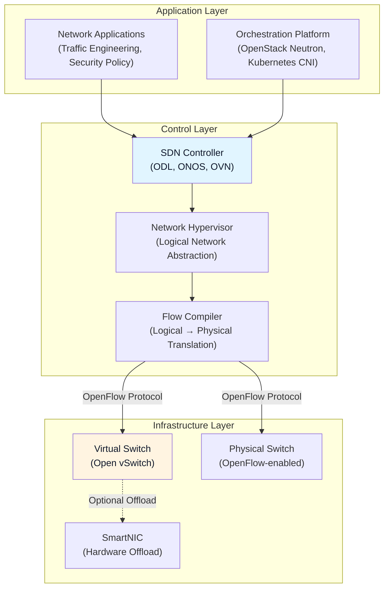
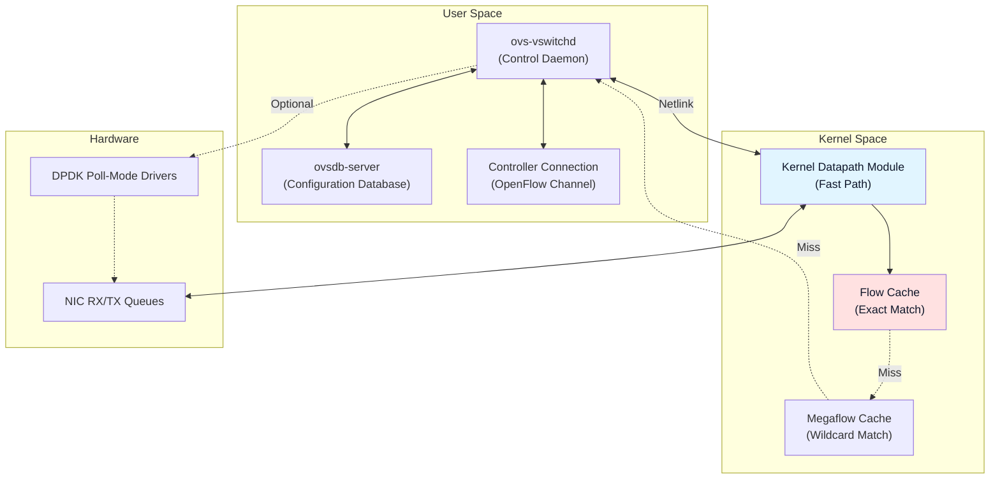
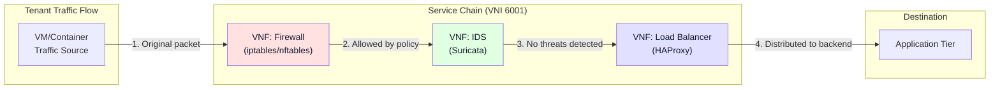
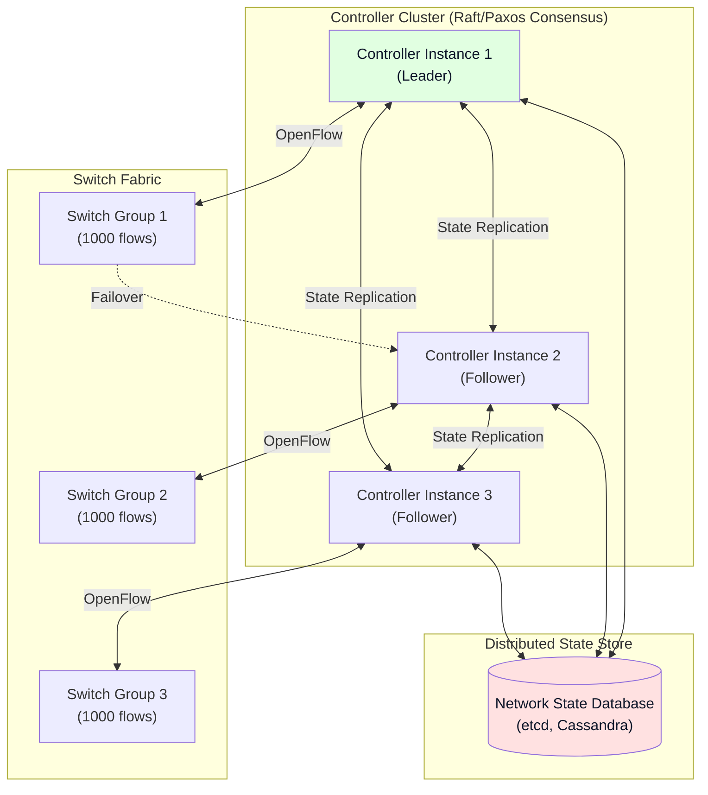
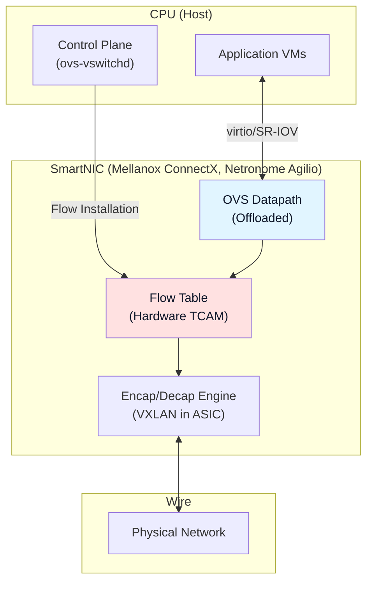
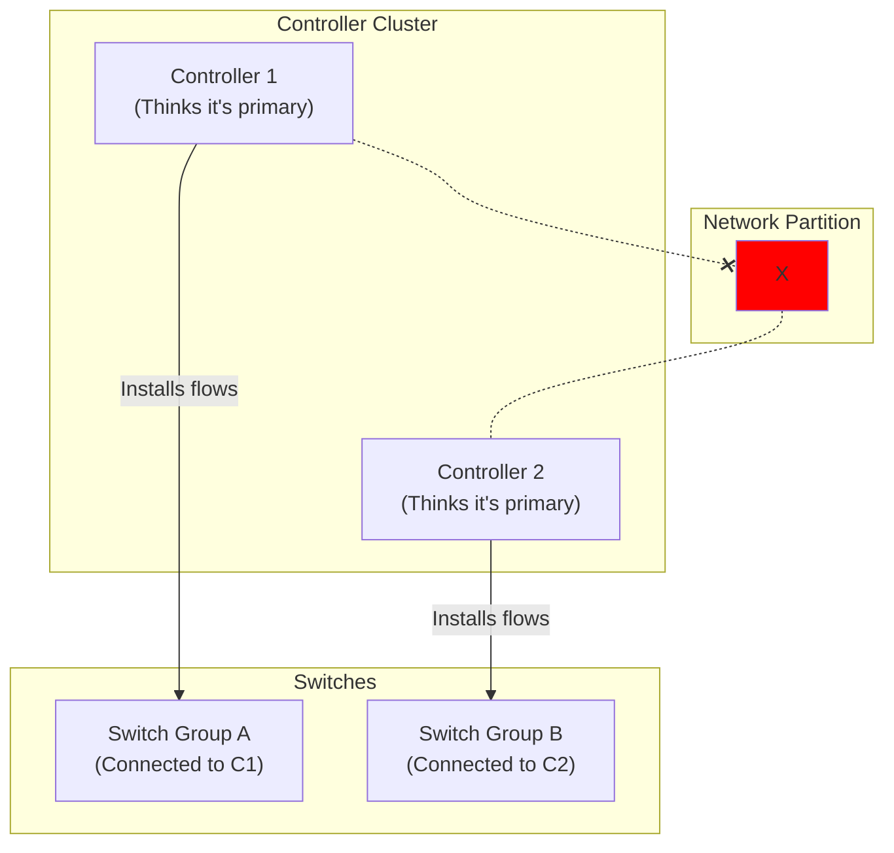
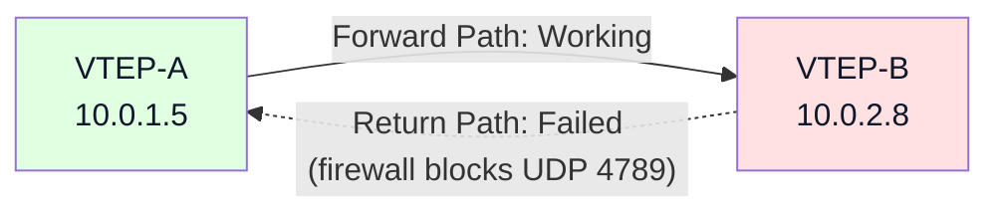
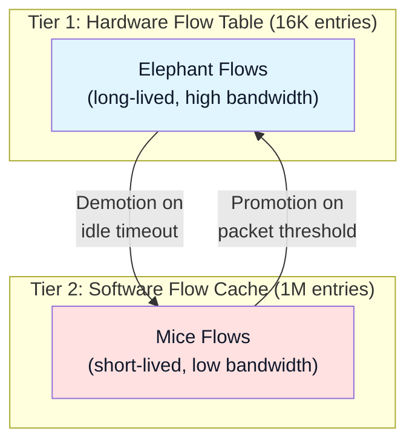

# Lesson 4: Network Virtualization in Hyperconverged Infrastructure

## 1. First-Principles Intuition & Invariants

Network virtualization represents a fundamental transformation in how we architect and operate distributed systems. At its essence, it is the programmatic disaggregation of the network control plane from the data plane, combined with the virtualization of network functions into software-defined entities that can be instantiated, migrated, and scaled independently of physical network topology.

### The Physical Reality and Its Limitations

Traditional networks operate as a tightly coupled system where:
- **Control decisions are distributed** across thousands of individual switches and routers, each running proprietary firmware
- **Topology is rigid**, dictated by physical cable plants and switch configurations
- **Changes require manual intervention** at individual devices, creating operational complexity that scales O(n) with infrastructure size
- **Network state is fragmented** across device configurations, making global optimization impossible

This architecture emerged from historical constraints: switches needed local intelligence because centralized control at scale was computationally infeasible with 1990s-era technology, and networks grew organically rather than being designed holistically.

### The Virtualization Transformation

Network virtualization inverts this model through three core mechanisms:

**Mechanism 1: Control-Data Plane Separation**

The control plane (which decides *where* packets go) is extracted from the data plane (which performs the actual *forwarding*). This separation is formalized in protocols like OpenFlow, which defines a standardized interface between a centralized controller and programmable switches. The switch becomes a simple packet-forwarding engine executing flow table entries installed by the controller.

The flow table is the fundamental abstraction. Each entry specifies:
- **Match fields**: packet header patterns (MAC addresses, IP addresses, TCP ports, VLAN tags)
- **Actions**: forward to port(s), modify headers, drop, send to controller
- **Priority**: for resolving overlapping matches
- **Counters**: bytes/packets matched for telemetry

This enables a single controller to compute optimal forwarding decisions with global network visibility, then program individual switches to execute that forwarding at line rate.

**Mechanism 2: Network Function Virtualization (NFV)**

Traditional network appliances (firewalls, load balancers, NAT gateways, IDS systems) are purpose-built hardware. NFV relocates these functions to software running on commodity x86 servers, often as virtual machines or containers. The same server that runs application VMs can run network function VMs, enabling:
- **Dynamic instantiation**: spin up a firewall instance in seconds
- **Elastic scaling**: add load balancer instances as traffic increases
- **Service chaining**: route traffic through a sequence of network functions programmatically

**Mechanism 3: Overlay Networks**

Physical networks provide L2/L3 connectivity between physical hosts. Overlay networks create isolated virtual networks *on top* of this physical underlay, typically using encapsulation protocols like VXLAN (Virtual Extensible LAN), NVGRE (Network Virtualization using Generic Routing Encapsulation), or Geneve.

VXLAN, for example, wraps the original Ethernet frame in a UDP packet with a 24-bit VXLAN Network Identifier (VNI), expanding the 4,096 VLAN limit to 16 million isolated networks. The physical network sees only the outer UDP/IP header and routes it normally, while the virtual network topology is encoded entirely in the VNI and the encapsulated inner frame.

### Invariants and Conservation Laws

Network virtualization preserves several invariants while transforming others:

**Preserved Invariants:**
- **Packet forwarding semantics**: A virtualized switch still performs L2 forwarding based on MAC addresses, just with flow tables instead of hardware CAMs
- **Protocol behavior**: TCP congestion control, IP routing, DNS resolution continue to operate identically
- **Performance constraints**: Physical link bandwidth, propagation delay, and switching latency remain bounded by hardware

**Transformed Invariants:**
- **Topology is now mutable state**: Network topology becomes programmable configuration rather than physical reality
- **Isolation multiplexing**: A single physical link can carry thousands of isolated virtual networks via encapsulation
- **Control loop latency**: Decision latency shifts from microseconds (local switch) to milliseconds (controller round-trip), requiring new approaches to elephant flow handling vs. mice flow handling

**New Invariants:**
- **Encapsulation overhead**: Overlay networks add 50-100 bytes per packet (VXLAN adds 50 bytes), reducing effective MTU
- **Controller as single point of failure**: The centralized controller becomes a critical component requiring fault tolerance
- **Flow table capacity**: Hardware switches have finite flow table sizes (typically 1K-100K entries in TCAM), creating a fundamental scaling constraint

## 2. Core Architecture & Mechanics

### SDN Architecture: The Control-Data Plane Contract

The canonical SDN architecture consists of three layers:



**Application Layer**: Consumes network services through high-level APIs (REST, gRPC). A traffic engineering application might request "balance traffic across paths to maximize throughput," while a security application might specify "isolate tenant A from tenant B."

**Control Layer**: The SDN controller implements the core control logic:
- **Topology discovery**: Learns physical network topology via LLDP (Link Layer Discovery Protocol) or BGP-LS (Link State)
- **Logical network management**: Maintains database of virtual networks, ports, and their mappings to physical infrastructure
- **Flow compilation**: Translates high-level policies into low-level flow table entries
- **State distribution**: Synchronizes network state across distributed controller instances for fault tolerance

**Infrastructure Layer**: Executes packet forwarding at line rate:
- **Virtual switches** (like Open vSwitch) run in hypervisors, bridging VMs to physical network
- **Physical switches** with OpenFlow support execute flows installed by controller
- **SmartNICs** offload packet processing from CPU to dedicated hardware, often implementing Open vSwitch datapath in FPGA or ASIC

### Open vSwitch: The Reference Virtual Switch

Open vSwitch (OVS) is the de facto standard for virtual switching in SDN environments. Its architecture illustrates key virtualization concepts:



**Two-Path Architecture**: OVS uses a fast path (kernel module) and slow path (user space daemon):

1. **Packet arrival**: NIC delivers packet to kernel datapath
2. **Exact match lookup**: Check exact-match flow cache (hash table, O(1) lookup)
3. **On hit**: Execute cached actions immediately (0.5-1 μs latency)
4. **On miss**: Check megaflow cache (wildcarded flows, optimized for CIDR matching)
5. **On miss**: Upcall to user space ovs-vswitchd for OpenFlow table lookup
6. **Cache insertion**: User space installs flow in kernel cache for subsequent packets
7. **Packet forwarding**: Execute actions and forward packet

This design separates the **control plane complexity** (OpenFlow tables, complex match logic) in user space from the **data plane performance** (simple hash lookup) in kernel space. The first packet of a flow pays the slow-path cost (~50-200 μs), while subsequent packets hit the fast path.

**DPDK Acceleration**: For even higher performance, OVS can bypass the kernel entirely using DPDK (Data Plane Development Kit):
- **Poll-mode drivers**: Dedicate CPU cores to continuously poll NIC queues, eliminating interrupt overhead
- **Huge pages**: Use 2MB/1GB pages instead of 4KB, reducing TLB misses
- **Cache-optimized data structures**: Align packet buffers to cache lines, use lock-free rings for inter-core communication
- **Batch processing**: Process packets in batches to amortize cache misses

This achieves 10-40 Mpps (million packets per second) per core, compared to 1-2 Mpps for kernel datapath.

### VXLAN Encapsulation: Overlay Network Mechanics

VXLAN creates L2 overlay networks over L3 underlay infrastructure. The encapsulation format:

```text
Original Ethernet Frame:
[Dest MAC|Src MAC|VLAN|EtherType|IP|TCP|Payload|FCS]

VXLAN Encapsulated Packet:
[Outer Dest MAC|Outer Src MAC|Outer EtherType|
 Outer IP Header (src=VTEP1, dst=VTEP2)|
 Outer UDP Header (dst port=4789)|
 VXLAN Header (VNI=8 bytes)|
 Original Ethernet Frame|
 FCS]
```

**VXLAN Tunnel End Points (VTEPs)**: These are the encapsulation/decapsulation engines, typically implemented in virtual switches:

1. **VM sends packet**: VM's virtual NIC sends standard Ethernet frame
2. **VXLAN lookup**: OVS checks destination MAC, determines it's on remote host
3. **Encapsulation**: Wraps frame in UDP/IP packet with outer headers pointing to remote VTEP
4. **Underlay routing**: Physical network routes UDP packet based on outer IP header
5. **Decapsulation**: Remote VTEP strips outer headers, delivers original frame to destination VM

**VNI to Physical Mapping**: The SDN controller maintains the mapping:
- VNI 5001 → VTEPs on hosts [10.0.1.5, 10.0.1.8, 10.0.1.12]
- VM A (MAC aa:bb:cc:dd:ee:ff, VNI 5001) → Host 10.0.1.5
- When packet arrives for aa:bb:cc:dd:ee:ff, encapsulate to VTEP 10.0.1.5

This is distributed via control plane protocols like EVPN (Ethernet VPN) with BGP, or via controller-driven flow installation.

### NFV Architecture: Service Function Chaining

NFV transforms network appliances into software, enabling dynamic service composition:



**Service Function Chaining (SFC)** routes traffic through an ordered sequence of VNFs:

1. **Classifier**: Identifies flows requiring service chaining (e.g., "all HTTP traffic from VLAN 10")
2. **Chain definition**: Specifies ordered VNF sequence and forwarding policy
3. **Encapsulation**: Packets are tagged with SFC metadata (NSH - Network Service Header, or in-band via VXLAN GPE)
4. **Per-hop forwarding**: Each VNF processes packet, passes to next hop based on chain metadata
5. **Chain termination**: Final VNF strips chain metadata, forwards to destination

**Implementation via Flow Rules**: The SDN controller installs flows implementing the chain:

```bash
# Classifier flow at ingress switch
match: in_port=10, eth_type=0x0800, ip_proto=6, tcp_dst=80
actions: set_field:vni=6001, output:VXLAN_tunnel_to_FW

# At firewall host
match: vni=6001, in_port=VXLAN
actions: output:firewall_vm_port
# Firewall processes, sends back to OVS on different port
match: in_port=firewall_vm_port
actions: set_field:vni=6001, output:VXLAN_tunnel_to_IDS

# At IDS host
match: vni=6001, in_port=VXLAN
actions: output:ids_vm_port
match: in_port=ids_vm_port
actions: set_field:vni=6001, output:VXLAN_tunnel_to_LB

# At load balancer host
match: vni=6001, in_port=VXLAN
actions: output:lb_vm_port
match: in_port=lb_vm_port
actions: strip_vxlan, output:destination_network
```

### Controller Scalability: Distributed Control Plane

A centralized controller creates a scaling bottleneck and single point of failure. Production systems use distributed controllers with consistency guarantees:



**Consistency Models**:

- **Strong consistency**: All controllers see identical network state (via Raft/Paxos consensus). Provides linearizability but increases latency (typically 3-10ms for writes across datacenter).
- **Eventual consistency**: Controllers sync state asynchronously (via gossip protocols). Reduces latency but risks temporary inconsistencies during network partitions.
- **Hybrid approach**: Use strong consistency for critical state (topology, security policies), eventual consistency for telemetry and statistics.

**Work Distribution**: Controllers partition switch management:
- **Geographical partitioning**: Controller 1 manages datacenter A, Controller 2 manages datacenter B
- **Functional partitioning**: Controller 1 handles L2 forwarding, Controller 2 handles L3 routing
- **Hash-based partitioning**: Switch assigned to controller via consistent hashing of switch DPID

**Failover**: When controller instance fails:
1. Switches detect loss of OpenFlow connection (TCP keepalive timeout)
2. Switches connect to backup controller (pre-configured or via DNS-SD)
3. Backup controller becomes primary, retrieves state from distributed database
4. Switches re-synchronize flow tables with new primary

Failover typically completes in 1-5 seconds, during which existing flows continue forwarding based on cached flow tables.

## 3. High-Performance Optimization & Failure Modes

### Performance Optimization: Eliminating Control Plane Bottlenecks

Network virtualization introduces indirection and centralization that can become performance bottlenecks. Optimization strategies target four areas:

#### 3.1 Flow Table Optimization

**Problem**: First-packet latency is dominated by controller upcall (50-200 μs) when flow table miss occurs.

**Solution 1: Proactive Flow Installation**: Pre-populate flow tables before traffic arrives. The controller computes all possible flows based on network policy and installs them in advance. Eliminates upcalls entirely but requires flow table space scaling with O(n²) for n hosts in full mesh connectivity.

**Solution 2: Hierarchical Flow Caching**: Use megaflows (wildcarded flows) to handle multiple specific flows with single table entry:

```bash
# Instead of installing one flow per (src_ip, dst_ip) pair:
match: ip_src=10.0.1.5, ip_dst=10.0.2.8 → forward to port 3
match: ip_src=10.0.1.5, ip_dst=10.0.2.9 → forward to port 3
match: ip_src=10.0.1.5, ip_dst=10.0.2.10 → forward to port 3

# Install single megaflow:
match: ip_src=10.0.1.5, ip_dst=10.0.2.0/24 → forward to port 3
```

This reduces flow table size by 10-100x while maintaining fast-path performance. The tradeoff is increased match complexity (CIDR matching vs. exact match).

**Solution 3: Idle Timeout Tuning**: Aggressively expire idle flows to reclaim table space:

```python
# Conservative: Keep flows for 5 minutes
ovs-ofctl add-flow br0 "idle_timeout=300,priority=100,..."

# Aggressive: Expire after 10 seconds of inactivity
ovs-ofctl add-flow br0 "idle_timeout=10,priority=100,..."
```

Requires balancing between cache hit rate and table churn.

#### 3.2 Data Plane Acceleration

**Kernel Bypass via DPDK**: Eliminate kernel networking stack overhead:

```c
// Traditional kernel path: ~1-2 Mpps per core
int sock = socket(AF_PACKET, SOCK_RAW, htons(ETH_P_ALL));
recv(sock, buffer, buffer_size, 0);  // System call overhead
process_packet(buffer);
send(sock, buffer, packet_size, 0);   // System call overhead

// DPDK path: ~10-40 Mpps per core
struct rte_mbuf *pkts[BURST_SIZE];
uint16_t nb_rx = rte_eth_rx_burst(port_id, queue_id, pkts, BURST_SIZE);
for (int i = 0; i < nb_rx; i++) {
    process_packet_lockfree(pkts[i]);  // No system calls, no locks
}
rte_eth_tx_burst(port_id, queue_id, pkts, nb_rx);
```

DPDK achieves 20-40x throughput improvement by:
- **Poll-mode I/O**: Dedicate CPU cores to continuously poll NIC queues (eliminates interrupt latency)
- **Huge pages**: Reduce TLB pressure (2MB pages vs. 4KB)
- **Cache-line alignment**: Ensure packet buffers align to 64-byte cache lines
- **Lock-free data structures**: Use atomic operations and per-core memory pools

**Hardware Offload to SmartNICs**: Offload OVS datapath to NIC hardware:



SmartNICs implement OVS datapath in hardware (FPGA or ASIC), achieving:
- **40-100 Gbps throughput** with near-zero CPU utilization
- **Sub-microsecond latency** for flow lookup and forwarding
- **1M+ concurrent flows** in hardware TCAM

The host CPU is freed to run application workloads, with SmartNIC handling all packet processing.

#### 3.3 Encapsulation Overhead Mitigation

VXLAN encapsulation adds 50 bytes per packet, reducing effective MTU from 1500 to 1450 bytes. This causes:
- **Fragmentation**: Large packets exceed MTU, requiring fragmentation
- **Throughput reduction**: More packets for same data (3.3% overhead)
- **CPU overhead**: Additional encap/decap processing

**Solution 1: Jumbo Frames**: Increase physical network MTU to 9000 bytes, allowing 8950-byte inner MTU. Requires end-to-end physical infrastructure support.

**Solution 2: Path MTU Discovery**: Applications dynamically discover maximum packet size:

```python
# Linux TCP automatically uses PMTU discovery
# Set MSS (Maximum Segment Size) to avoid fragmentation
import socket
sock = socket.socket(socket.AF_INET, socket.SOCK_STREAM)
sock.setsockopt(socket.IPPROTO_TCP, socket.TCP_MAXSEG, 1400)  # Account for 50-byte overhead
```

**Solution 3: Hardware TSO/GSO**: Offload segmentation to NIC hardware:
- **TSO (TCP Segmentation Offload)**: CPU passes large (up to 64KB) segments to NIC, which splits into MTU-sized packets
- **GSO (Generic Segmentation Offload)**: Similar, but for non-TCP protocols

This amortizes encapsulation overhead across multiple packets.

#### 3.4 Multi-Tenancy Isolation Performance

**Problem**: Per-tenant flow tables create multiplicative state explosion. With T tenants and F flows per tenant, total flow count is T × F.

**Solution: Hierarchical Flow Table Design**: Use OpenFlow multi-table pipeline:

```text
Table 0 (Tenant Classifier):
  match: in_port=1 → set_metadata=tenant_A, goto_table=1
  match: in_port=2 → set_metadata=tenant_B, goto_table=1

Table 1 (Per-Tenant Forwarding):
  match: metadata=tenant_A, dst_mac=aa:bb:cc:dd:ee:ff → output:3
  match: metadata=tenant_B, dst_mac=11:22:33:44:55:66 → output:4
```

Flow count becomes T + (F per tenant), approximately T + F for uniform tenant traffic patterns. Requires OpenFlow 1.1+ multi-table support.

### Failure Modes and Fault Tolerance

#### 3.5 Controller Failure: Split-Brain and Failover

**Scenario**: Network partition isolates controller from switches or separates controller replicas.

**Failure Mode 1: Split-Brain**: Multiple controllers believe they are primary, install conflicting flows.



**Consequences**:
- Switches in Group A forward traffic per C1's policy
- Switches in Group B forward traffic per C2's policy
- Traffic between groups may be blackholed or looped

**Mitigation**: Use strongly consistent leader election (Raft/Paxos):
- Only controller with quorum (majority of replicas reachable) can install flows
- During partition, minority partition becomes read-only
- Fencing tokens prevent stale controller from modifying state

**Implementation Example (Raft-based)**:

```python
class SDNController:
    def install_flow(self, switch_id, flow_entry):
        # Acquire distributed lock with fencing token
        lock_token = self.raft_cluster.acquire_lock(f"switch_{switch_id}")
        if lock_token is None:
            raise NotLeaderException("Lost leadership, cannot install flows")
        
        # Install flow with fencing token
        try:
            self.openflow_client.send_flow_mod(
                switch_id, 
                flow_entry,
                fencing_token=lock_token
            )
            # Log operation to replicated Raft log
            self.raft_cluster.append_log_entry({
                'op': 'install_flow',
                'switch': switch_id,
                'flow': flow_entry,
                'token': lock_token
            })
        finally:
            self.raft_cluster.release_lock(f"switch_{switch_id}")
```

Switches reject flows with stale fencing tokens, preventing split-brain.

**Failure Mode 2: Controller Overload**: Sudden traffic spike causes flow table misses, overwhelming controller with upcalls.

**Consequences**:
- Controller CPU saturates processing upcalls
- New flow installation latency increases from 50μs to 10ms+
- Applications experience timeouts and packet loss

**Mitigation Strategy 1: Packet-In Rate Limiting**: Limit upcall rate per switch:

```python
# OpenFlow Packet-In rate limiting
ovs-vsctl set Bridge br0 other-config:packet-in-rate-limit=1000  # Max 1000 upcalls/sec
ovs-vsctl set Bridge br0 other-config:packet-in-burst-limit=100   # Burst of 100 packets
```

Excess packets are dropped at switch, preventing controller overload at cost of flow setup failures.

**Mitigation Strategy 2: Proactive Fail-Open**: Configure switches to fail open when controller unreachable:

```python
ovs-vsctl set-fail-mode br0 standalone  # Fail open: switch acts as L2 learning switch
# vs.
ovs-vsctl set-fail-mode br0 secure      # Fail closed: drop all packets
```

In `standalone` mode, switch falls back to MAC learning and forwards based on local forwarding database, maintaining partial connectivity during controller outage.

#### 3.6 VXLAN Tunnel Failure: MTU Black Holes and Asymmetric Routing

**Failure Mode: MTU Black Hole**: Intermediate router drops oversized VXLAN packets without sending ICMP fragmentation needed.

```text
VM sends 1500-byte packet → VXLAN encaps to 1550 bytes → Router with 1500 MTU drops silently
```

**Consequence**: TCP connection hangs after initial handshake (small SYN/ACK packets succeed, large data packets fail silently).

**Diagnosis**:

```bash
# Test path MTU
tracepath -n <destination_ip>
# Output shows MTU bottleneck:
# 1:  10.0.1.1     0.5ms
# 2:  10.0.2.1     1.2ms pmtu 1450  ← VXLAN overhead detected

# Verify with ping
ping -M do -s 1472 <destination_ip>  # Should succeed (1500 - 28 header)
ping -M do -s 1522 <destination_ip>  # Should fail (exceeds VXLAN MTU)
```

**Mitigation**:
1. **Enable TCP MSS clamping** at VTEP to advertise correct MSS:

```bash
# iptables rule to clamp TCP MSS
iptables -t mangle -A POSTROUTING -p tcp --tcp-flags SYN,RST SYN \
  -j TCPMSS --set-mss 1410  # 1450 MTU - 40 TCP/IP header
```

2. **Configure PMTUD** (Path MTU Discovery) on VTEPs:

```bash
# Enable PMTUD on tunnel interfaces
ip link set vxlan0 mtu 1450
sysctl -w net.ipv4.ip_no_pmtu_disc=0
```

**Failure Mode: Asymmetric VTEP Failure**: One direction of VXLAN tunnel fails.



**Consequence**: TCP handshake fails (SYN succeeds, SYN-ACK dropped), or established connections hang on return traffic.

**Diagnosis**:

```bash
# On VTEP-A: Verify outbound VXLAN packets
tcpdump -i eth0 'udp port 4789'
# Should see outbound VXLAN packets

# On VTEP-B: Verify inbound VXLAN packets
tcpdump -i eth0 'udp port 4789 and src host 10.0.1.5'
# Should see packets arriving

# Verify return path from VTEP-B
# On VTEP-B:
tcpdump -i eth0 'udp port 4789 and dst host 10.0.1.5'
# Should see return packets sent

# On VTEP-A:
tcpdump -i eth0 'udp port 4789 and src host 10.0.2.8'
# If missing, return path is blocked
```

**Mitigation**: Implement bidirectional tunnel health checks:

```python
class VXLANHealthMonitor:
    def __init__(self, local_vtep, remote_vtep):
        self.local = local_vtep
        self.remote = remote_vtep
        self.last_rx = time.time()
        self.last_tx = time.time()
    
    def send_keepalive(self):
        """Send BFD (Bidirectional Forwarding Detection) packet over VXLAN tunnel"""
        bfd_packet = self.create_bfd_packet()
        send_vxlan_packet(self.local, self.remote, bfd_packet, vni=1)  # Control VNI
        self.last_tx = time.time()
    
    def receive_keepalive(self, packet):
        self.last_rx = time.time()
    
    def is_healthy(self, timeout=3.0):
        """Tunnel healthy if we've received keepalive in last 3 seconds"""
        return (time.time() - self.last_rx) < timeout
    
    def check_and_failover(self):
        if not self.is_healthy():
            # Remove failed tunnel from FIB
            self.remove_tunnel_routes(self.remote)
            # Notify controller to reroute traffic
            self.controller.notify_tunnel_failure(self.local, self.remote)
```

Controller installs backup paths when primary tunnel fails, maintaining connectivity.

#### 3.7 Flow Table Overflow and Eviction Policies

**Failure Mode**: Flow table fills to capacity, new flows cannot be installed.

**Hardware Constraints**: Physical switches have limited TCAM (Ternary Content-Addressable Memory) for flow tables:
- Low-end switches: 1,000-4,000 flows
- Enterprise switches: 16,000-32,000 flows  
- High-end switches: 100,000-256,000 flows

Virtual switches (OVS) have larger tables (1M+ flows) but are limited by kernel memory.

**Consequence**: When table full, new flows cause:
- **Eviction of existing flows**: LRU (Least Recently Used) or importance-based eviction
- **Packet drops**: New flow packets dropped if no table space
- **Controller overload**: Repeated upcalls for flows that cannot be installed

**Mitigation Strategy 1: Importance-Based Eviction**:

```python
# OpenFlow flow entry with importance level
flow_entry = {
    'match': {'eth_type': 0x0800, 'ip_proto': 6, 'tcp_dst': 443},
    'actions': ['output:3'],
    'priority': 100,
    'importance': 10,     # Scale 0-65535, higher = more important
    'idle_timeout': 60,
    'hard_timeout': 300
}

# Critical flows (production traffic, security policies) get high importance
# Mice flows (short-lived connections) get low importance
# On table overflow, low-importance flows evicted first
```

**Mitigation Strategy 2: Two-Tier Caching**:



Elephant flows (e.g., long-lived database connections, video streams) installed in hardware for line-rate forwarding. Mice flows (e.g., DNS queries, short HTTP requests) handled in software, accepting higher latency for infrequent packets.

**Implementation**:

```python
class FlowManager:
    def __init__(self):
        self.hw_table = {}  # Hardware TCAM flows (limited capacity)
        self.sw_cache = {}  # Software cache (large capacity)
        self.flow_stats = {}  # Track per-flow packet/byte counts
    
    def handle_new_flow(self, flow_key):
        # Install in software cache initially
        self.sw_cache[flow_key] = self.compute_flow_entry(flow_key)
        self.flow_stats[flow_key] = {'packets': 0, 'bytes': 0, 'timestamp': time.time()}
    
    def update_flow_stats(self, flow_key, packets, bytes_):
        self.flow_stats[flow_key]['packets'] += packets
        self.flow_stats[flow_key]['bytes'] += bytes_
        
        # Promote to hardware if becomes elephant flow
        if self.is_elephant_flow(flow_key):
            self.promote_to_hardware(flow_key)
    
    def is_elephant_flow(self, flow_key):
        stats = self.flow_stats[flow_key]
        # Elephant if >100 packets or >100KB in last 10 seconds
        age = time.time() - stats['timestamp']
        return (stats['packets'] > 100 or stats['bytes'] > 100_000) and age < 10.0
    
    def promote_to_hardware(self, flow_key):
        if len(self.hw_table) >= HW_TABLE_SIZE:
            # Evict LRU non-elephant flow from hardware
            self.evict_lru_from_hardware()
        
        flow_entry = self.sw_cache[flow_key]
        self.install_hardware_flow(flow_key, flow_entry)
        self.hw_table[flow_key] = flow_entry
```

This hybrid approach maximizes hardware utilization for high-value flows while accommodating unlimited mice flows in software.

### 3.8 Security Isolation Failures

**Failure Mode: VXLAN Injection Attack**: Attacker with access to underlay network injects malicious VXLAN packets.

**Attack Scenario**:
1. Attacker compromises host on physical network (underlay)
2. Attacker crafts VXLAN packets with arbitrary VNI and inner frames
3. Attacker sends packets to VTEP IP addresses
4. VTEPs decapsulate and forward into victim tenant networks

**Consequence**: Cross-tenant data exfiltration, lateral movement, denial of service.

**Mitigation 1: VTEP Authentication**: Use IPsec or DTLS to encrypt and authenticate VXLAN tunnels:

```bash
# Configure IPsec tunnel between VTEPs
# On VTEP-A:
ipsec.conf:
conn vtep-a-to-b
    left=10.0.1.5
    leftsubnet=0.0.0.0/0
    right=10.0.2.8
    rightsubnet=0.0.0.0/0
    ike=aes256-sha2_256-modp2048
    esp=aes256-sha2_256
    authby=psk
    auto=start

# All VXLAN traffic flows over encrypted IPsec tunnel
# Attacker cannot inject packets without PSK
```

**Mitigation 2: VTEP Allowlisting**: Configure VTEPs to accept VXLAN packets only from known peer VTEPs:

```python
# iptables rules on VTEP
iptables -A INPUT -p udp --dport 4789 -s 10.0.2.8 -j ACCEPT  # Known peer
iptables -A INPUT -p udp --dport 4789 -s 10.0.3.12 -j ACCEPT # Known peer
iptables -A INPUT -p udp --dport 4789 -j DROP  # Drop all other VXLAN
```

**Mitigation 3: VNI-to-Port Binding Verification**: Controller enforces bindings between VMs, VNIs, and physical switch ports. Any packet arriving on wrong port/VNI combination is dropped.

```python
class VNISecurityPolicy:
    def __init__(self):
        # Mapping: (switch_port, vni) → allowed_mac_addresses
        self.bindings = {}
    
    def register_vm(self, switch_id, port, vni, mac_address):
        """Controller registers VM placement"""
        key = (switch_id, port, vni)
        if key not in self.bindings:
            self.bindings[key] = set()
        self.bindings[key].add(mac_address)
    
    def generate_flow(self, switch_id, port, vni):
        """Generate OpenFlow rule enforcing MAC-port-VNI binding"""
        allowed_macs = self.bindings.get((switch_id, port, vni), set())
        flows = []
        for mac in allowed_macs:
            flows.append({
                'match': {
                    'in_port': port,
                    'tunnel_id': vni,  # VXLAN VNI
                    'eth_src': mac
                },
                'actions': ['normal']  # Allow
            })
        # Drop all other packets on this port/VNI
        flows.append({
            'match': {'in_port': port, 'tunnel_id': vni},
            'priority': 0,
            'actions': ['drop']
        })
        return flows
```

This prevents MAC spoofing and VXLAN injection across tenant boundaries.

## 4. Production Implementation Considerations

### 4.1 Capacity Planning

**Flow Table Dimensioning**: Estimate required flow table size:

```text
Total flows = (Active VMs) × (Avg connections per VM) × (Flow table entries per connection)

Example: 
- 10,000 VMs
- 100 active connections per VM average (web servers, databases, caches)
- 2 flow entries per connection (forward + reverse)
= 10,000 × 100 × 2 = 2,000,000 flows

Hardware requirement: Switches with ≥2M flow capacity, or software-based tiering
```

**Bandwidth Provisioning**: Account for encapsulation overhead:

```text
Effective bandwidth = Physical bandwidth × (1 - Encapsulation overhead)

For VXLAN with 1500-byte average packet size:
Overhead = 50 bytes / 1550 bytes = 3.2%
Effective bandwidth = 100 Gbps × 0.968 = 96.8 Gbps

For small packets (64 bytes + 50 VXLAN = 114 bytes):
Overhead = 50 / 114 = 43.9%
Effective bandwidth = 100 Gbps × 0.561 = 56.1 Gbps
```

Small packet workloads (e.g., high packet-rate applications) suffer significantly from encapsulation overhead. Consider jumbo frames or hardware offload.

### 4.2 Monitoring and Observability

**Key Metrics**:

```python
# Controller metrics
controller_metrics = {
    'flow_installs_per_sec': 'Rate of new flow installations',
    'flow_table_utilization': 'Percentage of flow table capacity used',
    'upcall_latency_p99': '99th percentile packet-in processing latency',
    'controller_cpu_utilization': 'CPU usage of controller instances',
    'openflow_connection_failures': 'Switch-controller connection drops'
}

# Data plane metrics
dataplane_metrics = {
    'tunnel_packet_rate': 'Packets/sec per VXLAN tunnel',
    'tunnel_byte_rate': 'Throughput per tunnel',
    'tunnel_errors': 'Encapsulation/decapsulation errors',
    'flow_cache_hit_rate': 'Percentage of packets hitting cached flows',
    'packet_drops': 'Packets dropped due to table overflow or policy'
}

# Example: Prometheus metrics collection
from prometheus_client import Counter, Histogram, Gauge

flow_installs = Counter('sdn_flow_installs_total', 'Total flow installations')
upcall_latency = Histogram('sdn_upcall_latency_seconds', 'Packet-in processing latency')
flow_table_usage = Gauge('sdn_flow_table_usage_ratio', 'Flow table utilization ratio')
```

**Distributed Tracing**: Trace packet path through virtual network:

```python
# Add trace IDs to VXLAN headers (using VXLAN GPE options)
def trace_packet(packet, trace_id):
    """Inject trace ID into packet metadata"""
    packet.vxlan_options['trace_id'] = trace_id
    return packet

# At each hop, log trace event
def process_packet_with_trace(packet):
    trace_id = packet.vxlan_options.get('trace_id')
    if trace_id:
        log_trace_event(trace_id, {
            'timestamp': time.time(),
            'node': socket.gethostname(),
            'action': 'forward',
            'output_port': determine_output_port(packet)
        })
```

Trace events aggregated in distributed tracing system (Jaeger, Zipkin) to visualize packet latency through network.

### 4.3 Operational Playbooks

**Flow Table Exhaustion Response**:

1. **Detect**: Monitor `flow_table_utilization` exceeding 80%
2. **Mitigate**: Adjust idle_timeout to expire old flows faster:
   ```bash
   ovs-ofctl mod-flows br0 'idle_timeout=30'
   ```
3. **Identify**: Find flows consuming most table space:
   ```bash
   ovs-ofctl dump-flows br0 | awk '{print $NF}' | sort | uniq -c | sort -rn | head -20
   ```
4. **Optimize**: Consolidate specific flows into megaflows
5. **Scale**: Add hardware flow table capacity or implement two-tier caching

**Controller Failover Test**:

```bash
# Simulate controller failure
systemctl stop openvswitch-controller

# Verify switches fail open and maintain forwarding
ovs-vsctl get-fail-mode br0  # Should show 'standalone'

# Verify failover to backup controller
tail -f /var/log/openvswitch/ovs-vswitchd.log | grep "connected to"

# Measure failover time
TIME_START=$(date +%s%N | cut -b1-13)
systemctl start openvswitch-controller
# Wait for "connection established" log
TIME_END=$(date +%s%N | cut -b1-13)
FAILOVER_MS=$((TIME_END - TIME_START))
echo "Failover took ${FAILOVER_MS}ms"
```

Target: < 5 seconds failover with zero packet loss for established flows.

**VXLAN Tunnel Debugging Workflow**:

```bash
# 1. Verify VTEP configuration
ip -d link show vxlan0
# Expected: vxlan id 5001, remote 10.0.2.8, dstport 4789

# 2. Check VXLAN forwarding database
bridge fdb show dev vxlan0
# Should show MAC → VTEP mappings

# 3. Capture VXLAN traffic
tcpdump -i eth0 -nn 'udp port 4789' -v
# Verify encapsulated packets with correct VNI

# 4. Test MTU path
ping -M do -s 1422 -c 5 <destination_vm_ip>  # 1422 + 28 header = 1450 (VXLAN MTU)

# 5. Verify inner frame delivery
tcpdump -i vxlan0 -nn icmp
# Should see inner ICMP packets being forwarded
```

---

## Summary

Network virtualization fundamentally transforms infrastructure by decoupling logical network topology from physical constraints. The core insight is that networks become programmable, composable entities managed through software abstractions rather than manual device configuration. This is achieved through three architectural pillars:

1. **SDN** separates control (decision-making) from forwarding (packet execution), enabling centralized optimization with global network visibility while maintaining distributed, line-rate data plane performance.

2. **NFV** relocates network functions from proprietary appliances to software, enabling dynamic instantiation, elastic scaling, and programmatic service composition through service function chaining.

3. **Overlay networks** (VXLAN, Geneve) multiplex thousands of isolated virtual networks over shared physical infrastructure through encapsulation, expanding address space and enabling tenant isolation at scale.

The performance characteristics are determined by the interaction between software-based control plane flexibility and hardware-based data plane throughput. Optimization strategies target minimizing control plane interaction (proactive flows, megaflow caching), accelerating data plane execution (DPDK, SmartNIC offload), and managing encapsulation overhead (MTU optimization, hardware TSO).

Failure modes arise from the introduction of centralized control (controller failures, split-brain), encapsulation complexity (MTU black holes, tunnel failures), and finite hardware resources (flow table overflow). Production systems require careful capacity planning, comprehensive monitoring, and operational discipline to detect and recover from these failure modes.

The ultimate result is infrastructure that can be provisioned in seconds, reconfigured dynamically in response to application needs, and scaled elastically to match demand—capabilities impossible with traditional physical networking.
