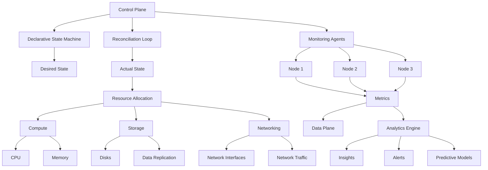

# Lesson 5: Management and Monitoring

## 1. First-Principles Intuition & Invariants

In the realm of hyperconverged infrastructure (HCI), the seamless integration of compute, storage, and networking resources into a single system presents a powerful yet complex landscape. The essence of HCI lies in its ability to abstract and virtualize these resources, enabling efficient management and scaling. At the heart of this abstraction is the need for robust management and monitoring mechanisms that ensure the system operates optimally while maintaining high availability and reliability.

The problem space in HCI is multifaceted, encompassing the challenges of resource allocation, fault tolerance, and performance optimization. The theoretical grounding for HCI management and monitoring is rooted in the principles of distributed systems and resource management. A key invariant in HCI is the need for a unified control plane that can manage and monitor all resources in a consistent and efficient manner. This control plane must be capable of handling the dynamic nature of resource demands, scaling up or down as necessary, and ensuring that the system remains resilient in the face of failures.

Another critical invariant is the need for real-time monitoring and alerting. In a hyperconverged environment, the interdependence of compute, storage, and networking resources means that a failure in one component can have cascading effects on the entire system. Therefore, the monitoring system must be capable of detecting anomalies and failures in real-time, allowing for prompt corrective actions. This requires a deep understanding of the system's internal data structures and execution models, as well as the ability to correlate data from multiple sources to identify root causes.

## 2. Core Architecture & Mechanics

The architecture of a hyperconverged infrastructure management and monitoring system is designed to provide a unified view of all resources within the system. At its core, this architecture consists of several key components: the control plane, the data plane, the monitoring agents, and the analytics engine.

The control plane is responsible for managing the allocation and distribution of resources across the system. It uses a declarative state machine to define the desired state of the system and a continuous level-triggered reconciliation loop to ensure that the actual state matches the desired state. This reconciliation loop is critical for maintaining the consistency and reliability of the system, as it continuously monitors the state of all resources and makes adjustments as necessary.

The data plane is responsible for the actual movement of data within the system. It includes the networking components that enable communication between nodes, as well as the storage components that manage data persistence. The data plane must be designed to handle high volumes of data with low latency and high throughput, while also providing mechanisms for data replication and fault tolerance.

The monitoring agents are responsible for collecting data from the system and reporting it back to the control plane. These agents are deployed on each node within the system and are responsible for gathering metrics such as CPU usage, memory usage, disk I/O, and network traffic. The data collected by the monitoring agents is used by the analytics engine to identify trends and anomalies within the system.

The analytics engine is responsible for processing the data collected by the monitoring agents and generating insights and alerts. It uses advanced algorithms to analyze the data and identify patterns that may indicate potential issues within the system. The analytics engine can also generate predictive models that can be used to forecast future resource demands and optimize resource allocation.

To illustrate the architecture of a hyperconverged infrastructure management and monitoring system, we can use a Mermaid diagram:

In this diagram, the control plane is responsible for managing the desired state of the system and ensuring that the actual state matches the desired state. The monitoring agents collect data from each node within the system and report it back to the control plane. The analytics engine processes the data collected by the monitoring agents and generates insights and alerts, as well as predictive models that can be used to optimize resource allocation.

## 3. High-Performance Optimization & Failure Modes

In a hyperconverged infrastructure, high-performance optimization is critical for ensuring that the system can handle high volumes of data with low latency and high throughput. This requires a deep understanding of the system's internal data structures and execution models, as well as the ability to optimize resource allocation and scheduling.

One key aspect of high-performance optimization in HCI is the use of efficient data structures and algorithms. For example, the control plane may use a red-black tree to manage the allocation of resources, as this data structure provides efficient insertion, deletion, and lookup operations. Similarly, the analytics engine may use machine learning algorithms to generate predictive models that can be used to optimize resource allocation.

Another key aspect of high-performance optimization is the use of concurrency and parallelism. In a hyperconverged infrastructure, multiple nodes may be processing data simultaneously, and it is critical to ensure that these nodes can operate efficiently without interfering with each other. This requires the use of advanced concurrency control mechanisms, such as locks and semaphores, as well as the ability to scale resources dynamically.

Failure modes in a hyperconverged infrastructure are diverse and can have significant impacts on system performance and reliability. One common failure mode is resource contention, which occurs when multiple nodes are competing for the same resources. This can lead to performance degradation and increased latency. To mitigate this, the control plane must be able to dynamically allocate resources and ensure that no single node is overloaded.

Another common failure mode is network congestion, which occurs when the network is unable to handle the volume of data being transmitted. This can lead to packet loss and increased latency. To mitigate this, the control plane must be able to optimize network traffic and ensure that the network is able to handle the volume of data being transmitted.

Finally, hardware failures can also have significant impacts on system performance and reliability. To mitigate this, the control plane must be able to detect hardware failures and take corrective actions, such as reallocating resources to other nodes or triggering failover procedures.

In summary, the management and monitoring of hyperconverged infrastructure is a complex and challenging task that requires a deep understanding of the system's internal data structures and execution models. By leveraging advanced algorithms and concurrency control mechanisms, and by implementing robust failure mitigation strategies, it is possible to ensure that the system operates optimally while maintaining high availability and reliability.
