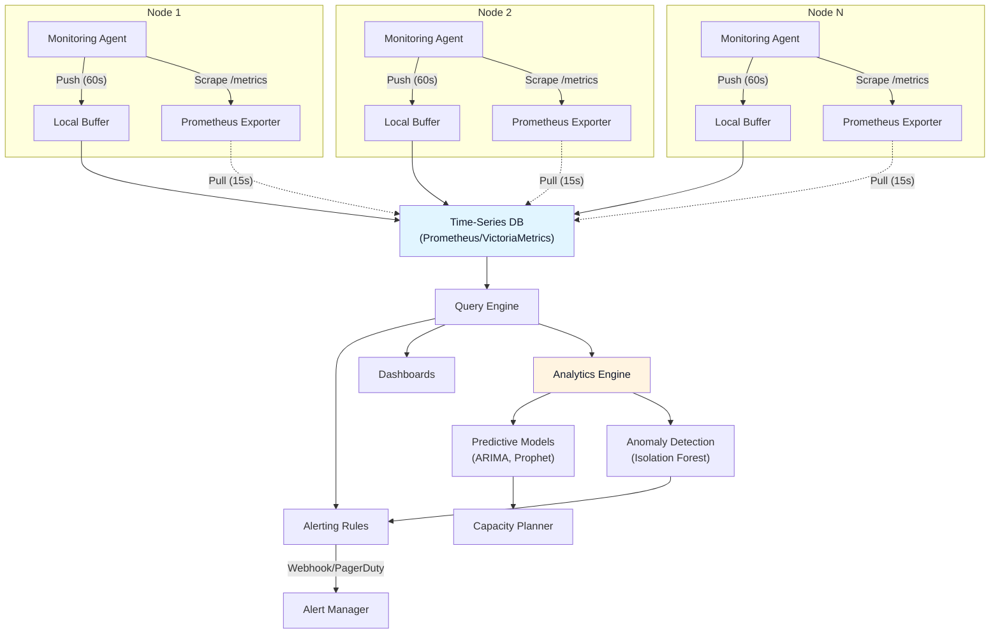
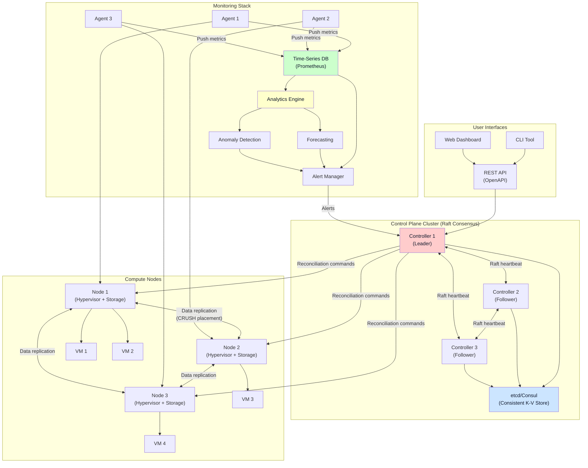

# Lesson 5: Management and Monitoring

## 1. First-Principles Intuition & Invariants

Hyperconverged infrastructure (HCI) collapses traditionally isolated silos—compute, storage, and networking—into a unified, software-defined system running on commodity hardware. This convergence creates an emergent complexity: the control plane must now reason about interdependencies that were previously handled by separate administrative domains. The core problem is **distributed state management under resource contention and partial failures**, where decisions made at the orchestration layer ripple through every subsystem.

### Theoretical Foundations

HCI management is fundamentally a distributed consensus and resource scheduling problem. The system must maintain a globally consistent view of resources while allowing local decisions for performance. This maps directly to the CAP theorem: in the presence of network partitions, HCI systems typically choose availability over strict consistency (AP systems), relying on eventual consistency models with conflict resolution strategies (last-write-wins, vector clocks, or CRDT-based approaches).

The control plane operates as a **declarative state machine** with continuous reconciliation—an architectural pattern derived from control theory's feedback loops. The desired state (intent) is compared against observed state (reality), and the delta drives corrective actions. This is mathematically a differential equation solver where the system seeks to minimize the error function `E(t) = ||desired_state(t) - actual_state(t)||` over time.

### Invariants

**Invariant 1: Monotonic Resource Accounting**  
Resource allocation must satisfy monotonicity: once a resource is allocated, it cannot be simultaneously allocated elsewhere until explicitly released. This requires distributed locks or lease-based mechanisms (e.g., Paxos, Raft consensus) to prevent double-booking. Violations lead to split-brain scenarios where two VMs believe they own the same disk blocks.

**Invariant 2: Causal Ordering of State Transitions**  
Operations must respect causality: if operation A causally precedes operation B (A → B), all nodes must observe them in that order. This prevents anomalies like deleting a VM before its creation is observed. Vector clocks or Lamport timestamps enforce this invariant in asynchronous systems.

**Invariant 3: Bounded Staleness for Monitoring Metrics**  
Monitoring data has temporal validity windows. A CPU metric sampled 10 seconds ago may no longer reflect current load. The system must timestamp all telemetry and enforce freshness bounds—typically on the order of the scrape interval (5-60 seconds). Stale data fed into autoscaling algorithms causes oscillations (thrashing) or missed scaling events.

**Invariant 4: Quorum Availability for Control Plane Operations**  
Critical operations (VM creation, volume migration) require quorum consensus (⌊N/2⌋ + 1 nodes). This ensures that even during network partitions, at most one partition can make progress, preventing divergent states. Systems like VMware vSAN require a witness node to break ties in two-site configurations.

### The Observability Challenge

Unlike traditional infrastructure where monitoring is additive, HCI monitoring is **structurally coupled** to the control plane. The scheduler cannot allocate VMs without real-time capacity data; storage policies cannot enforce replication without health checks; network QoS cannot shape traffic without flow telemetry. This creates a dependency cycle: the monitoring system must be highly available, yet it depends on the very infrastructure it monitors. The resolution is to run monitoring components on a separate, lightweight control plane (e.g., Kubernetes control plane nodes with taints) or use out-of-band management networks.

## 2. Core Architecture & Mechanics

A production-grade HCI management system comprises five layers, each with distinct responsibilities and failure domains:

### Layer 1: Distributed Control Plane

The control plane is a replicated state machine (RSM) implementing a consensus protocol. Most HCI systems use Raft or a variant (etcd in Nutanix, vSAN consensus in VMware). The RSM maintains the **desired state** in a strongly consistent key-value store, typically sharded by resource type:

```
/vms/<uuid> → VM specification (CPU, memory, disks, networks)
/volumes/<uuid> → Volume metadata (size, replication factor, placement)
/hosts/<uuid> → Host resources (capacity, health, placement group)
```

The reconciliation loop runs on each leader-elected controller:

```python
# Simplified reconciliation loop (Python pseudocode for clarity)
import time
from typing import Dict, Any
from dataclasses import dataclass

@dataclass
class ResourceState:
    uuid: str
    desired: Dict[str, Any]
    actual: Dict[str, Any]
    generation: int  # Optimistic concurrency control

class ReconciliationController:
    def __init__(self, state_store, executor):
        self.state_store = state_store
        self.executor = executor
        self.backoff_policy = ExponentialBackoff(base_ms=100, max_ms=60000)
    
    def reconcile_loop(self):
        """Level-triggered reconciliation with exponential backoff."""
        while True:
            try:
                # List all resources from consistent store
                resources = self.state_store.list_all_resources()
                
                for resource in resources:
                    delta = self.compute_delta(resource)
                    
                    if delta.is_empty():
                        continue  # Actual matches desired
                    
                    # Attempt to converge actual → desired
                    try:
                        actions = self.plan_actions(delta)
                        self.executor.execute(actions, resource.uuid)
                        
                        # Update actual state after successful execution
                        self.state_store.update_actual(
                            resource.uuid, 
                            resource.generation + 1
                        )
                        self.backoff_policy.reset(resource.uuid)
                        
                    except ExecutionError as e:
                        # Exponential backoff for failed reconciliations
                        backoff_ms = self.backoff_policy.next(resource.uuid)
                        self.log_reconciliation_failure(resource.uuid, e, backoff_ms)
                        time.sleep(backoff_ms / 1000.0)
                
                # Rate-limit reconciliation loop
                time.sleep(5)  # Typical: 5-10 second cycles
                
            except Exception as e:
                self.log_critical_error(e)
                time.sleep(1)
    
    def compute_delta(self, resource: ResourceState):
        """Compute diff between desired and actual state."""
        return ResourceDelta(
            additions=set(resource.desired.keys()) - set(resource.actual.keys()),
            deletions=set(resource.actual.keys()) - set(resource.desired.keys()),
            modifications={
                k: (resource.desired[k], resource.actual[k])
                for k in resource.desired.keys() & resource.actual.keys()
                if resource.desired[k] != resource.actual[k]
            }
        )
```

**Key Design Decision: Level-Triggered vs. Edge-Triggered**  
HCI control planes use level-triggered reconciliation (continuous state comparison) rather than edge-triggered (event-driven). This is more resilient to lost messages and transient failures. If a host crashes mid-operation, the next reconciliation cycle will re-attempt convergence. The tradeoff is higher CPU overhead for reconciliation loops.

### Layer 2: Data Plane and Storage Fabric

The data plane handles I/O operations and data replication. In software-defined storage (SDS) systems like Ceph or VMware vSAN, data is striped and replicated across nodes using erasure coding or mirroring.

**Placement Algorithm:**  
HCI systems use CRUSH (Controlled Replication Under Scalable Hashing) or similar algorithms to deterministically compute data placement without central coordination:

```rust
// Simplified CRUSH-like placement in Rust
use std::collections::hash_map::DefaultHasher;
use std::hash::{Hash, Hasher};

#[derive(Debug, Clone)]
struct PlacementGroup {
    pg_id: u64,
    pool_id: u32,
}

#[derive(Debug, Clone)]
struct OSDNode {
    id: u32,
    weight: f64,  // Capacity weight (0.0-1.0)
    failure_domain: String,  // rack, host, etc.
}

impl PlacementGroup {
    /// Compute OSD placement using consistent hashing with failure domain awareness
    fn compute_placement(
        &self,
        osds: &[OSDNode],
        replication_factor: usize,
    ) -> Vec<u32> {
        let mut selected = Vec::with_capacity(replication_factor);
        let mut hasher = DefaultHasher::new();
        self.pg_id.hash(&mut hasher);
        
        let mut candidates: Vec<_> = osds.iter().collect();
        candidates.sort_by_key(|osd| {
            let mut h = DefaultHasher::new();
            (self.pg_id, osd.id).hash(&mut h);
            h.finish()
        });
        
        // Select OSDs ensuring failure domain diversity
        let mut used_domains = std::collections::HashSet::new();
        
        for osd in candidates {
            if selected.len() >= replication_factor {
                break;
            }
            
            // Skip if same failure domain already selected (rack-level redundancy)
            if used_domains.contains(&osd.failure_domain) {
                continue;
            }
            
            selected.push(osd.id);
            used_domains.insert(osd.failure_domain.clone());
        }
        
        selected
    }
}

// Example: Compute placement for PG 42 with RF=3
fn main() {
    let osds = vec![
        OSDNode { id: 1, weight: 1.0, failure_domain: "rack1".into() },
        OSDNode { id: 2, weight: 1.0, failure_domain: "rack1".into() },
        OSDNode { id: 3, weight: 1.0, failure_domain: "rack2".into() },
        OSDNode { id: 4, weight: 0.8, failure_domain: "rack2".into() },
        OSDNode { id: 5, weight: 1.0, failure_domain: "rack3".into() },
    ];
    
    let pg = PlacementGroup { pg_id: 42, pool_id: 1 };
    let placement = pg.compute_placement(&osds, 3);
    
    println!("PG 42 placed on OSDs: {:?}", placement);
    // Output will select 3 OSDs from different failure domains
}
```

**Write Path with Quorum Consensus:**  
For a write to be acknowledged, it must reach a quorum of replicas (typically RF=3, quorum=2). This is implemented as a two-phase protocol:

1. **Phase 1 (Propose):** Primary replica broadcasts write to all replicas with a sequence number.
2. **Phase 2 (Commit):** Once quorum acknowledges, primary commits and responds to client.

If the primary fails, a new primary is elected using the highest committed sequence number (similar to Raft log replication).

### Layer 3: Monitoring Agents and Telemetry Pipeline

Monitoring agents run as privileged daemons on each node, collecting metrics via multiple channels:

- **Kernel metrics:** CPU, memory, disk I/O, network via `/proc`, `/sys`, BPF probes
- **Hypervisor metrics:** VM CPU steal time, memory balloon, disk latency via libvirt/ESXi APIs
- **Storage metrics:** IOPS, latency histograms, scrub status via storage daemon APIs
- **Hardware metrics:** Fan speeds, temperatures, PSU status via IPMI/Redfish

**Telemetry Pipeline Architecture:**



**Hybrid Push-Pull Model:**  
Agents push metrics to local buffers (resilient to network partitions) while also exposing Prometheus-compatible `/metrics` endpoints for scraping. This provides both low-latency alerting (push) and consistent historical queries (pull).

**Metric Cardinality Control:**  
High-cardinality labels (VM UUID, disk serial numbers) can explode time-series database storage. Production systems enforce cardinality limits:

```python
# Metric cardinality enforcement example
from prometheus_client import Counter, Gauge
import hashlib

class CardinalityLimitedGauge:
    """Gauge with cardinality protection."""
    
    def __init__(self, name, documentation, labelnames, max_cardinality=10000):
        self._gauge = Gauge(name, documentation, labelnames)
        self._seen_labels = {}
        self._max_cardinality = max_cardinality
    
    def labels(self, **kwargs):
        """Return gauge labels with cardinality protection."""
        label_key = self._hash_labels(kwargs)
        
        if label_key not in self._seen_labels:
            if len(self._seen_labels) >= self._max_cardinality:
                # Drop new labels, emit warning metric
                cardinality_exceeded.inc()
                # Return a sentinel "cardinality_exceeded" label
                return self._gauge.labels(**{"error": "cardinality_exceeded"})
            
            self._seen_labels[label_key] = kwargs
        
        return self._gauge.labels(**kwargs)
    
    def _hash_labels(self, labels):
        """Hash label dict for deduplication."""
        h = hashlib.sha256()
        for k in sorted(labels.keys()):
            h.update(f"{k}={labels[k]}".encode())
        return h.hexdigest()

# Usage
vm_cpu_usage = CardinalityLimitedGauge(
    'vm_cpu_usage_percent',
    'VM CPU usage percentage',
    ['vm_uuid', 'host'],
    max_cardinality=5000
)

vm_cpu_usage.labels(vm_uuid="abc-123", host="node1").set(45.2)
```

### Layer 4: Analytics Engine and Predictive Models

The analytics engine processes aggregated metrics to generate insights and forecasts. Modern HCI systems use time-series forecasting (ARIMA, Prophet, LSTM) to predict capacity exhaustion and trigger proactive scaling.

**Capacity Forecasting Example (Python with Prophet):**

```python
from prophet import Prophet
import pandas as pd
import numpy as np
from datetime import datetime, timedelta

class CapacityForecaster:
    """Forecast storage capacity usage with confidence intervals."""
    
    def __init__(self, history_days=90):
        self.history_days = history_days
        self.model = Prophet(
            changepoint_prior_scale=0.05,  # Moderate flexibility
            seasonality_mode='multiplicative',  # For percentage-based metrics
            daily_seasonality=True,
            weekly_seasonality=True,
        )
    
    def train(self, timestamps, usage_pct):
        """Train model on historical usage data."""
        df = pd.DataFrame({
            'ds': pd.to_datetime(timestamps),
            'y': usage_pct
        })
        
        self.model.fit(df)
    
    def forecast(self, days_ahead=30):
        """Generate forecast with 80% and 95% confidence intervals."""
        future = self.model.make_future_dataframe(periods=days_ahead)
        forecast = self.model.predict(future)
        
        return forecast[['ds', 'yhat', 'yhat_lower', 'yhat_upper']].tail(days_ahead)
    
    def alert_if_capacity_critical(self, forecast, threshold_pct=85):
        """Check if forecasted usage exceeds threshold."""
        critical_dates = forecast[forecast['yhat'] > threshold_pct]
        
        if not critical_dates.empty:
            first_critical = critical_dates.iloc[0]
            days_until_critical = (first_critical['ds'] - datetime.now()).days
            
            return {
                'alert': True,
                'days_until_critical': days_until_critical,
                'forecasted_usage': first_critical['yhat'],
                'confidence_lower': first_critical['yhat_lower'],
                'confidence_upper': first_critical['yhat_upper']
            }
        
        return {'alert': False}

# Example usage
forecaster = CapacityForecaster()

# Historical data: 90 days of daily storage usage
dates = pd.date_range(end=datetime.now(), periods=90, freq='D')
usage = 50 + 0.3 * np.arange(90) + 5 * np.random.randn(90)  # Trending upward with noise

forecaster.train(dates, usage)
forecast = forecaster.forecast(days_ahead=30)
alert = forecaster.alert_if_capacity_critical(forecast)

if alert['alert']:
    print(f"ALERT: Capacity will reach 85% in {alert['days_until_critical']} days")
    print(f"Forecasted usage: {alert['forecasted_usage']:.1f}% "
          f"(CI: {alert['confidence_lower']:.1f}% - {alert['confidence_upper']:.1f}%)")
```

**Anomaly Detection with Isolation Forest:**  
For detecting unusual behavior (e.g., sudden latency spikes, unexpected CPU patterns), unsupervised learning via Isolation Forest is effective:

```python
from sklearn.ensemble import IsolationForest
import numpy as np

class AnomalyDetector:
    """Detect anomalies in multivariate time-series metrics."""
    
    def __init__(self, contamination=0.01):
        """
        Args:
            contamination: Expected proportion of anomalies (1% default)
        """
        self.model = IsolationForest(
            contamination=contamination,
            random_state=42,
            n_estimators=100
        )
        self.fitted = False
    
    def fit(self, normal_metrics):
        """
        Train on normal behavior data.
        
        Args:
            normal_metrics: Array of shape (n_samples, n_features)
                            e.g., [cpu_pct, mem_pct, disk_iops, net_mbps]
        """
        self.model.fit(normal_metrics)
        self.fitted = True
    
    def predict(self, current_metrics):
        """
        Detect if current metrics are anomalous.
        
        Returns:
            score: Anomaly score (lower = more anomalous, threshold typically -0.5)
            is_anomaly: Boolean
        """
        if not self.fitted:
            raise ValueError("Model must be fitted before prediction")
        
        score = self.model.score_samples([current_metrics])[0]
        is_anomaly = self.model.predict([current_metrics])[0] == -1
        
        return score, is_anomaly

# Example: Train on 1000 normal samples, detect anomaly
normal_data = np.random.randn(1000, 4) * 10 + 50  # 4 metrics, centered at 50%
detector = AnomalyDetector(contamination=0.01)
detector.fit(normal_data)

# Current metrics: CPU spike to 98%
current = np.array([98, 45, 5000, 120])
score, is_anomaly = detector.predict(current)

if is_anomaly:
    print(f"ANOMALY DETECTED: score={score:.3f} (threshold: -0.5)")
    print(f"Metrics: CPU={current[0]}%, Mem={current[1]}%, "
          f"IOPS={current[2]}, Net={current[3]}Mbps")
```

### Layer 5: API and CLI Interfaces

Management interfaces expose RESTful APIs (OpenAPI/Swagger) and CLIs built on structured command patterns:

```python
# Example CLI with rich validation and idempotent operations
import click
import json
from typing import Optional

@click.group()
def hci_cli():
    """HCI Management CLI - Infrastructure as Code"""
    pass

@hci_cli.command()
@click.option('--name', required=True, help='VM name (DNS-compliant)')
@click.option('--cpu', type=int, required=True, help='Number of vCPUs')
@click.option('--memory', required=True, help='Memory size (e.g., 4G, 8192M)')
@click.option('--disk', required=True, help='Disk size (e.g., 100G)')
@click.option('--image', required=True, help='Base image UUID or name')
@click.option('--network', multiple=True, help='Network UUIDs (can specify multiple)')
@click.option('--dry-run', is_flag=True, help='Validate without creating')
def vm_create(name, cpu, memory, disk, image, network, dry_run):
    """Create a new virtual machine (idempotent)."""
    
    # Validate inputs
    if not is_valid_dns_name(name):
        raise click.BadParameter(f"VM name '{name}' must be DNS-compliant")
    
    if cpu < 1 or cpu > 64:
        raise click.BadParameter("CPU count must be between 1 and 64")
    
    memory_bytes = parse_size(memory)
    if memory_bytes < 512 * 1024 * 1024:
        raise click.BadParameter("Memory must be at least 512M")
    
    disk_bytes = parse_size(disk)
    
    vm_spec = {
        'name': name,
        'cpu': cpu,
        'memory': memory_bytes,
        'disk': disk_bytes,
        'image': image,
        'networks': list(network) if network else ['default']
    }
    
    if dry_run:
        click.echo("Dry-run mode: VM would be created with spec:")
        click.echo(json.dumps(vm_spec, indent=2))
        return
    
    # Idempotent creation: check if VM already exists
    existing_vm = api_client.get_vm_by_name(name)
    if existing_vm:
        if vm_matches_spec(existing_vm, vm_spec):
            click.echo(f"VM '{name}' already exists with desired spec (no-op)")
            return
        else:
            raise click.ClickException(
                f"VM '{name}' exists but does not match desired spec. "
                f"Use 'vm update' to modify."
            )
    
    # Create VM
    vm_uuid = api_client.create_vm(vm_spec)
    click.echo(f"Created VM '{name}' (UUID: {vm_uuid})")
    
    # Wait for VM to reach running state
    if not wait_for_vm_ready(vm_uuid, timeout=300):
        raise click.ClickException(f"VM '{name}' failed to reach ready state")
    
    click.echo(f"VM '{name}' is now running")

def parse_size(size_str: str) -> int:
    """Parse human-readable size to bytes (e.g., '4G' -> 4294967296)."""
    units = {'K': 1024, 'M': 1024**2, 'G': 1024**3, 'T': 1024**4}
    size_str = size_str.upper().strip()
    
    for unit, multiplier in units.items():
        if size_str.endswith(unit):
            return int(float(size_str[:-1]) * multiplier)
    
    return int(size_str)  # Assume bytes if no unit

if __name__ == '__main__':
    hci_cli()
```

**Architectural Diagram: Complete HCI Management Stack**



## 3. High-Performance Optimization & Failure Modes

### Optimization Strategies

**1. Zero-Copy I/O and RDMA**  
Traditional network I/O involves multiple data copies (user space → kernel → NIC). HCI systems use kernel bypass techniques:

- **RDMA (Remote Direct Memory Access):** Allows NICs to directly read/write remote memory without CPU involvement. Latencies drop from ~10µs (TCP) to ~1µs (RoCE/InfiniBand).
- **SPDK (Storage Performance Development Kit):** User-space NVMe drivers eliminate kernel context switches, achieving millions of IOPS per CPU core.

```c
// Simplified SPDK NVMe write example (C)
#include <spdk/nvme.h>
#include <spdk/env.h>

struct write_context {
    struct spdk_nvme_qpair *qpair;
    void *buffer;
    size_t length;
    uint64_t lba;
    bool complete;
};

static void write_complete(void *arg, const struct spdk_nvme_cpl *completion) {
    struct write_context *ctx = arg;
    
    if (spdk_nvme_cpl_is_error(completion)) {
        fprintf(stderr, "NVMe write failed: SC=0x%x, SCT=0x%x\n",
                completion->status.sc, completion->status.sct);
    }
    
    ctx->complete = true;
}

int nvme_write_async(struct spdk_nvme_ns *ns, struct spdk_nvme_qpair *qpair,
                     void *buffer, size_t length, uint64_t lba) {
    struct write_context ctx = {
        .qpair = qpair,
        .buffer = buffer,
        .length = length,
        .lba = lba,
        .complete = false
    };
    
    int rc = spdk_nvme_ns_cmd_write(ns, qpair, buffer,
                                     lba,  // Starting LBA
                                     length / 512,  // Number of sectors
                                     write_complete,
                                     &ctx,
                                     0);  // Flags
    
    if (rc != 0) {
        return rc;
    }
    
    // Poll for completion (or use event-driven approach)
    while (!ctx.complete) {
        spdk_nvme_qpair_process_completions(qpair, 0);
    }
    
    return 0;
}
```

**2. Lock-Free Data Structures**  
Control plane hot paths (VM placement, metric ingestion) use lock-free algorithms to avoid contention:

```rust
// Lock-free queue for metric ingestion (Rust)
use crossbeam::queue::SegQueue;
use std::sync::Arc;
use std::thread;

#[derive(Debug, Clone)]
struct Metric {
    timestamp: u64,
    name: String,
    value: f64,
    labels: Vec<(String, String)>,
}

struct MetricIngestionPipeline {
    queue: Arc<SegQueue<Metric>>,
    workers: usize,
}

impl MetricIngestionPipeline {
    fn new(workers: usize) -> Self {
        let queue = Arc::new(SegQueue::new());
        let pipeline = Self { queue: queue.clone(), workers };
        
        // Spawn worker threads
        for id in 0..workers {
            let q = queue.clone();
            thread::spawn(move || {
                loop {
                    match q.pop() {
                        Some(metric) => {
                            // Process metric (write to TSDB, aggregate, etc.)
                            Self::process_metric(metric);
                        }
                        None => {
                            thread::yield_now();  // Or use park/unpark for efficiency
                        }
                    }
                }
            });
        }
        
        pipeline
    }
    
    fn ingest(&self, metric: Metric) {
        self.queue.push(metric);
    }
    
    fn process_metric(metric: Metric) {
        // Placeholder: write to time-series database
        // In production, batch multiple metrics for efficiency
        println!("Processing metric: {:?}", metric.name);
    }
}

// Usage: Multiple producers, multiple consumers with zero locks
fn main() {
    let pipeline = MetricIngestionPipeline::new(4);  // 4 worker threads
    
    // Simulate multiple monitoring agents pushing metrics
    let handles: Vec<_> = (0..8).map(|agent_id| {
        let p = pipeline.clone();
        thread::spawn(move || {
            for i in 0..1000 {
                p.ingest(Metric {
                    timestamp: i,
                    name: format!("cpu.usage.agent{}", agent_id),
                    value: 50.0 + (i as f64 % 10.0),
                    labels: vec![("host".into(), format!("node{}", agent_id))],
                });
            }
        })
    }).collect();
    
    for h in handles {
        h.join().unwrap();
    }
}
```

**3. Adaptive Batch Sizing**  
Network and storage operations batch requests dynamically based on load:

```go
// Adaptive batching for storage writes (Go)
package storage

import (
    "context"
    "time"
)

type WriteRequest struct {
    LBA    uint64
    Data   []byte
    Result chan error
}

type AdaptiveBatcher struct {
    requests   chan WriteRequest
    minBatch   int
    maxBatch   int
    maxLatency time.Duration
    executor   func([]WriteRequest) error
}

func NewAdaptiveBatcher(minBatch, maxBatch int, maxLatency time.Duration,
                        executor func([]WriteRequest) error) *AdaptiveBatcher {
    b := &AdaptiveBatcher{
        requests:   make(chan WriteRequest, maxBatch*2),
        minBatch:   minBatch,
        maxBatch:   maxBatch,
        maxLatency: maxLatency,
        executor:   executor,
    }
    
    go b.runBatchLoop()
    return b
}

func (b *AdaptiveBatcher) Write(ctx context.Context, lba uint64, data []byte) error {
    req := WriteRequest{
        LBA:    lba,
        Data:   data,
        Result: make(chan error, 1),
    }
    
    select {
    case b.requests <- req:
        // Request queued
    case <-ctx.Done():
        return ctx.Err()
    }
    
    select {
    case err := <-req.Result:
        return err
    case <-ctx.Done():
        return ctx.Err()
    }
}

func (b *AdaptiveBatcher) runBatchLoop() {
    batch := make([]WriteRequest, 0, b.maxBatch)
    timer := time.NewTimer(b.maxLatency)
    
    for {
        select {
        case req := <-b.requests:
            batch = append(batch, req)
            
            // Flush if batch size reached or no more pending requests
            if len(batch) >= b.maxBatch || (len(batch) >= b.minBatch && len(b.requests) == 0) {
                b.flush(batch)
                batch = batch[:0]
                timer.Reset(b.maxLatency)
            }
            
        case <-timer.C:
            // Timeout: flush whatever we have
            if len(batch) > 0 {
                b.flush(batch)
                batch = batch[:0]
            }
            timer.Reset(b.maxLatency)
        }
    }
}

func (b *AdaptiveBatcher) flush(batch []WriteRequest) {
    err := b.executor(batch)
    
    // Send results to all waiters
    for _, req := range batch {
        req.Result <- err
    }
}
```

### Failure Modes and Mitigation

**Failure Mode 1: Split-Brain (Quorum Loss)**  
*Scenario:* Network partition separates the cluster into two groups, each believing it has quorum.

*Root Cause:* Incorrect quorum calculation or asymmetric network failures where each partition can reach a witness node.

*Mitigation:*
- Use **fencing** (STONITH - Shoot The Other Node In The Head): The partition that loses quorum must power-cycle nodes in the other partition via IPMI before allowing writes.
- Implement **lease-based locking**: Each partition must renew a lease with a external arbiter (e.g., shared disk or cloud service) to accept writes.

```python
# Simplified fencing logic
import subprocess
import time
from typing import List

class QuorumManager:
    def __init__(self, cluster_size: int, node_id: int):
        self.cluster_size = cluster_size
        self.node_id = node_id
        self.quorum_size = cluster_size // 2 + 1
        self.alive_nodes = set(range(cluster_size))
    
    def update_alive_nodes(self, alive: List[int]):
        """Called by heartbeat mechanism."""
        self.alive_nodes = set(alive)
        
        if len(self.alive_nodes) < self.quorum_size:
            self.enter_maintenance_mode()
        else:
            self.exit_maintenance_mode()
    
    def enter_maintenance_mode(self):
        """Loss of quorum: stop accepting writes, attempt to fence other nodes."""
        print(f"Node {self.node_id}: QUORUM LOST. Entering maintenance mode.")
        
        # Stop all VMs to prevent data corruption
        subprocess.run(["systemctl", "stop", "libvirtd"])
        
        # Attempt to fence nodes in the other partition
        for node in range(self.cluster_size):
            if node not in self.alive_nodes and node != self.node_id:
                self.fence_node(node)
    
    def fence_node(self, node_id: int):
        """Power-cycle node via IPMI."""
        ipmi_addr = f"10.0.0.{100 + node_id}"
        try:
            subprocess.run([
                "ipmitool", "-I", "lanplus",
                "-H", ipmi_addr,
                "-U", "admin", "-P", "password",
                "power", "cycle"
            ], timeout=10, check=True)
            print(f"Fenced node {node_id} via IPMI")
        except Exception as e:
            print(f"Failed to fence node {node_id}: {e}")
    
    def exit_maintenance_mode(self):
        """Quorum restored: resume normal operation."""
        print(f"Node {self.node_id}: Quorum restored. Exiting maintenance mode.")
        subprocess.run(["systemctl", "start", "libvirtd"])
```

**Failure Mode 2: Thundering Herd on Recovery**  
*Scenario:* After a power outage, all VMs attempt to start simultaneously, overwhelming storage IOPS.

*Mitigation:*
- Implement **staged boot ordering** based on VM priority (critical services first).
- Use **rate-limiting** on VM start operations (max 10 VMs/minute).
- Pre-warm storage caches by reading boot volumes into memory before starting VMs.

**Failure Mode 3: Metadata Corruption**  
*Scenario:* Control plane crashes mid-write, leaving inconsistent VM or volume metadata.

*Mitigation:*
- Use **write-ahead logging (WAL)** for all metadata changes. On recovery, replay the WAL to restore consistency.
- Implement **multi-version concurrency control (MVCC)** so readers always see consistent snapshots.
- Run periodic **scrub operations** to detect and repair inconsistencies (e.g., Ceph scrubbing).

```sql
-- Example: MVCC for VM metadata (PostgreSQL)
CREATE TABLE vms (
    uuid UUID PRIMARY KEY,
    name TEXT NOT NULL,
    cpu INT NOT NULL,
    memory BIGINT NOT NULL,
    -- MVCC fields
    version INT NOT NULL DEFAULT 1,
    created_at TIMESTAMPTZ NOT NULL DEFAULT NOW(),
    updated_at TIMESTAMPTZ NOT NULL DEFAULT NOW(),
    deleted_at TIMESTAMPTZ
);

-- Optimistic locking: update only if version matches
UPDATE vms
SET name = 'new-name',
    cpu = 4,
    version = version + 1,
    updated_at = NOW()
WHERE uuid = 'abc-123'
  AND version = 5  -- Must match expected version
  AND deleted_at IS NULL;

-- Check if update succeeded
-- If rows_affected = 0, another transaction modified the VM (conflict)
```

**Failure Mode 4: Cascading Latency (Tail Latency Amplification)**  
*Scenario:* A slow storage node causes requests to pile up, exhausting connection pools and triggering timeouts across the cluster.

*Mitigation:*
- Implement **adaptive timeouts** that adjust based on recent latency percentiles (p99).
- Use **circuit breakers** to stop sending requests to slow nodes until they recover.
- Apply **load shedding**: drop low-priority requests when queues exceed thresholds.

```python
# Circuit breaker implementation
import time
from enum import Enum
from typing import Callable, Any

class CircuitState(Enum):
    CLOSED = 1   # Normal operation
    OPEN = 2     # Failing, reject requests
    HALF_OPEN = 3  # Testing if service recovered

class CircuitBreaker:
    def __init__(self, failure_threshold=5, timeout=60, success_threshold=2):
        self.failure_threshold = failure_threshold
        self.timeout = timeout
        self.success_threshold = success_threshold
        
        self.state = CircuitState.CLOSED
        self.failure_count = 0
        self.success_count = 0
        self.last_failure_time = None
    
    def call(self, func: Callable, *args, **kwargs) -> Any:
        """Execute function through circuit breaker."""
        
        if self.state == CircuitState.OPEN:
            if time.time() - self.last_failure_time > self.timeout:
                self.state = CircuitState.HALF_OPEN
                self.success_count = 0
            else:
                raise CircuitBreakerOpenError("Circuit breaker is OPEN")
        
        try:
            result = func(*args, **kwargs)
            self.on_success()
            return result
        except Exception as e:
            self.on_failure()
            raise
    
    def on_success(self):
        if self.state == CircuitState.HALF_OPEN:
            self.success_count += 1
            if self.success_count >= self.success_threshold:
                self.state = CircuitState.CLOSED
                self.failure_count = 0
        elif self.state == CircuitState.CLOSED:
            self.failure_count = 0
    
    def on_failure(self):
        self.failure_count += 1
        self.last_failure_time = time.time()
        
        if self.failure_count >= self.failure_threshold:
            self.state = CircuitState.OPEN

class CircuitBreakerOpenError(Exception):
    pass

# Usage
def read_from_slow_node():
    # Simulate occasional failures
    import random
    if random.random() < 0.3:
        raise Exception("Node timeout")
    return "data"

breaker = CircuitBreaker(failure_threshold=3, timeout=10)

for i in range(20):
    try:
        data = breaker.call(read_from_slow_node)
        print(f"Request {i}: Success")
    except CircuitBreakerOpenError:
        print(f"Request {i}: Circuit OPEN, fast-failing")
    except Exception as e:
        print(f"Request {i}: Failed ({e})")
    
    time.sleep(1)
```

**Failure Mode 5: Noisy Neighbor (Resource Contention)**  
*Scenario:* A single VM consumes excessive storage IOPS, degrading performance for other VMs on the same node.

*Mitigation:*
- Implement **QoS policies** with configurable IOPS/bandwidth limits per VM using cgroups (blkio controller).
- Use **token bucket rate limiting** for I/O operations.
- Apply **work-conserving schedulers** (CFQ, BFQ) that allow unused quotas to be shared.

```bash
# Example: Limit VM to 1000 IOPS using cgroups v2
mkdir -p /sys/fs/cgroup/io/vm-abc-123

# Set IOPS limit (device major:minor 252:0 = first NVMe)
echo "252:0 riops=1000 wiops=1000" > /sys/fs/cgroup/io/vm-abc-123/io.max

# Assign VM's processes to cgroup
echo $VM_PID > /sys/fs/cgroup/io/vm-abc-123/cgroup.procs
```

## 4. Production Checklist

| Category | Item | Rationale |
|----------|------|-----------|
| **Consensus** | Odd number of control plane nodes (3 or 5) | Ensures quorum majority under single-node failures |
| **Monitoring** | Sub-second metric granularity for latency-sensitive workloads | Enables detection of transient issues (e.g., noisy neighbor bursts) |
| **Capacity** | Alert when forecasted capacity exhaustion < 30 days | Provides sufficient lead time for procurement and expansion |
| **Blast Radius** | Distribute VM replicas across failure domains (racks, AZs) | Prevents correlated failures from taking down applications |
| **Backup** | Automate etcd/Consul snapshots every 15 minutes | Control plane state loss is unrecoverable without backups |
| **Security** | Encrypt all data-plane traffic (IPsec or TLS) | Protect against passive network sniffing in multi-tenant environments |
| **Observability** | Structured logging with correlation IDs | Enables tracing of operations across distributed components |
| **Chaos** | Quarterly chaos engineering exercises (kill nodes, partition network) | Validates failure recovery procedures and exposes hidden dependencies |

HCI management and monitoring is an exercise in building resilient distributed systems that make local decisions with global awareness. The key is to design for failures as the norm, not the exception, and to ensure that the system can always converge back to the desired state, even under partial failures and network partitions.
