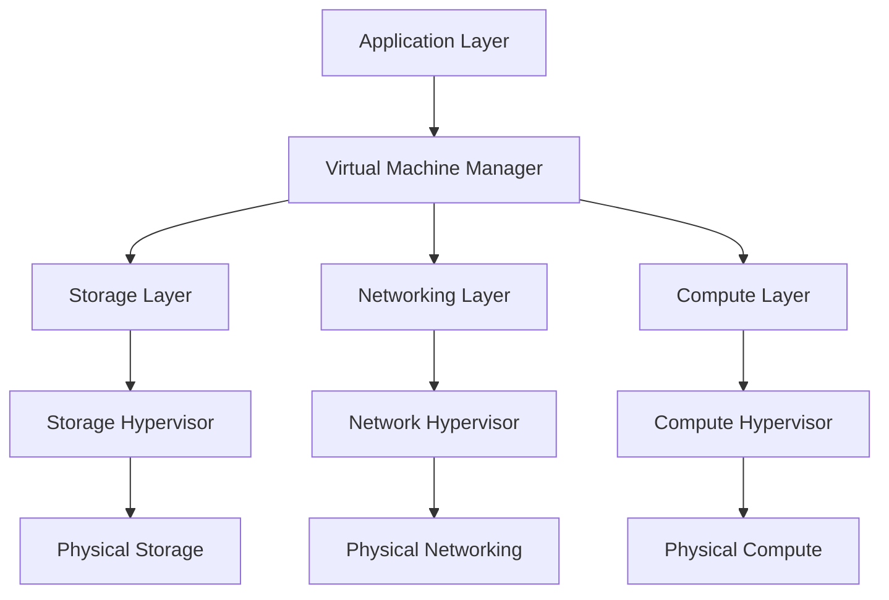

# Lesson 6: Security and Compliance

## 1. First-Principles Intuition & Invariants

Hyperconverged infrastructure (HCI) represents a paradigm shift in data center architecture, merging compute, storage, and networking into a single, unified system. This consolidation simplifies management and enhances scalability, but it also introduces unique security and compliance challenges. At its core, HCI relies on a tightly integrated stack of software and hardware components, each of which must be meticulously secured to ensure the integrity, confidentiality, and availability of the entire system. The problem space is further complicated by the need to comply with a myriad of regulatory standards and industry best practices, which often impose stringent requirements on data handling, access control, and audit logging.

To understand the security and compliance landscape of HCI, we must first establish several foundational principles. The principle of least privilege dictates that each component of the HCI system should have only the access rights necessary to perform its function, minimizing the potential impact of a security breach. Another critical invariant is the principle of defense in depth, which posits that multiple layers of security controls should be employed to protect against various types of threats. This layered approach ensures that even if one security mechanism is compromised, others can still provide a robust defense.

Mathematically, we can model the security of an HCI system as a function of its components and their interactions. Let \( S \) represent the overall security of the HCI system, and let \( C_i \) represent the security of each component \( i \). The security of the system can be expressed as:

\[ S = \min(C_1, C_2, \ldots, C_n) \]

This equation highlights that the security of the entire system is only as strong as its weakest link. Therefore, it is imperative to ensure that all components are rigorously secured and regularly audited.

Compliance, on the other hand, is a set of requirements that the HCI system must meet to satisfy regulatory standards and industry best practices. These requirements often include data encryption, access control policies, and audit logging mechanisms. Compliance can be modeled as a set of constraints that the HCI system must satisfy:

\[ \text{Compliance} = \bigwedge_{j=1}^{m} R_j \]

where \( R_j \) represents a compliance requirement. The HCI system must satisfy all compliance requirements to be considered compliant.

## 2. Core Architecture & Mechanics

The architecture of a hyperconverged infrastructure system is designed to integrate compute, storage, and networking resources into a single, unified system. This integration is achieved through a combination of hardware and software components, each of which plays a critical role in the system's security and compliance.

### 2.1. Hardware Abstraction Layer

At the hardware abstraction layer, HCI systems typically employ virtualization technologies to abstract physical resources and present them as virtual resources to the operating system. This abstraction layer is crucial for security because it allows for the isolation of workloads and the enforcement of access control policies. The virtualization layer can be implemented using hardware-assisted virtualization technologies such as Intel VT-x or AMD-V, which provide hardware support for virtualization features like memory isolation and interrupt handling.

### 2.2. Software Stack

The software stack of an HCI system is composed of several layers, each of which contributes to the system's security and compliance. The following diagram illustrates the key components of the software stack:

#### 2.2.1. Virtual Machine Manager

The virtual machine manager (VMM) is the core component of the HCI software stack, responsible for managing virtual machines and their resources. The VMM must be secured to prevent unauthorized access and ensure the integrity of the virtual machines. This can be achieved through the use of secure boot mechanisms, such as UEFI Secure Boot, which ensure that only trusted code is executed during the boot process. Additionally, the VMM should implement robust access control policies to restrict access to virtual machines and their resources.

#### 2.2.2. Storage Layer

The storage layer of an HCI system is responsible for managing storage resources and providing data persistence. The storage layer must be secured to prevent unauthorized access and ensure data integrity. This can be achieved through the use of encryption, such as AES-256, to protect data at rest. Additionally, the storage layer should implement access control policies to restrict access to storage resources and prevent unauthorized data access.

#### 2.2.3. Networking Layer

The networking layer of an HCI system is responsible for managing network resources and providing connectivity between virtual machines and external networks. The networking layer must be secured to prevent unauthorized access and ensure network integrity. This can be achieved through the use of network segmentation, such as VLANs, to isolate network traffic and prevent unauthorized access. Additionally, the networking layer should implement access control policies to restrict access to network resources and prevent unauthorized network access.

#### 2.2.4. Compute Layer

The compute layer of an HCI system is responsible for managing compute resources and providing processing power to virtual machines. The compute layer must be secured to prevent unauthorized access and ensure compute integrity. This can be achieved through the use of hardware-assisted virtualization technologies, such as Intel VT-x or AMD-V, to provide memory isolation and interrupt handling. Additionally, the compute layer should implement access control policies to restrict access to compute resources and prevent unauthorized processing.

## 3. High-Performance Optimization & Failure Modes

Hyperconverged infrastructure systems are designed to provide high performance and scalability, but they also introduce unique challenges in terms of concurrency, resource scaling, and failure modes. To ensure high performance and reliability, HCI systems must be optimized for concurrency and resource scaling, while also implementing robust failure mitigation mechanisms.

### 3.1. Concurrency

Concurrency is a critical aspect of HCI systems, as they must support multiple virtual machines and workloads running simultaneously. To optimize concurrency, HCI systems must employ efficient scheduling algorithms and resource management techniques. The Completely Fair Scheduler (CFS) is a popular scheduling algorithm used in Linux-based HCI systems, which ensures that each virtual machine receives a fair share of CPU resources. CFS uses a red-black tree data structure to manage the scheduling of virtual machines, and it employs a concept called `vruntime` to track the amount of CPU time each virtual machine has received. By using CFS, HCI systems can ensure that all virtual machines receive a fair share of CPU resources, even in the presence of high concurrency.

### 3.2. Resource Scaling

Resource scaling is another critical aspect of HCI systems, as they must be able to scale resources dynamically to meet changing workloads. To optimize resource scaling, HCI systems must employ efficient resource management techniques, such as dynamic resource allocation and load balancing. Dynamic resource allocation allows HCI systems to allocate resources to virtual machines based on their current workloads, ensuring that resources are used efficiently. Load balancing allows HCI systems to distribute workloads across multiple virtual machines, ensuring that no single virtual machine becomes a bottleneck.

### 3.3. Failure Modes

Failure modes are a critical aspect of HCI systems, as they must be able to recover from failures and maintain high availability. To mitigate failure modes, HCI systems must implement robust failure mitigation mechanisms, such as redundancy and failover. Redundancy allows HCI systems to maintain high availability by providing backup resources in case of a failure. Failover allows HCI systems to recover from failures by automatically switching to backup resources. By implementing redundancy and failover, HCI systems can ensure high availability and reliability, even in the presence of failures.

In conclusion, hyperconverged infrastructure systems present unique security and compliance challenges that must be addressed to ensure the integrity, confidentiality, and availability of the system. By establishing foundational principles, dissecting the core architecture and mechanics, and optimizing for concurrency, resource scaling, and failure modes, HCI systems can provide high performance and reliability while meeting regulatory standards and industry best practices.
