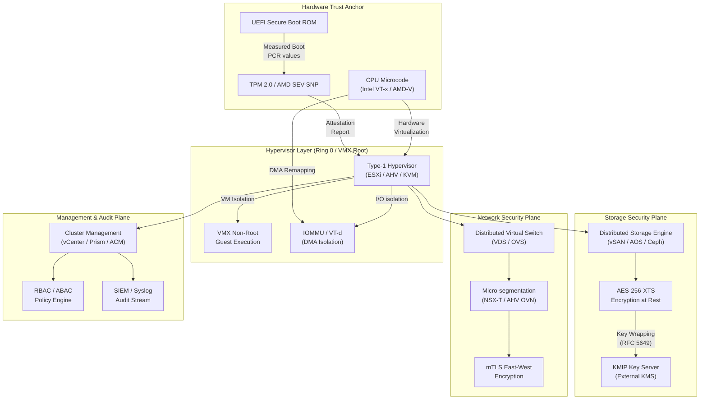
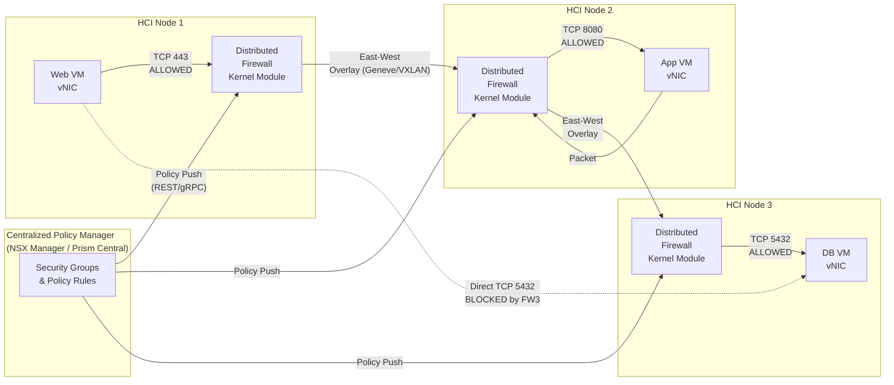
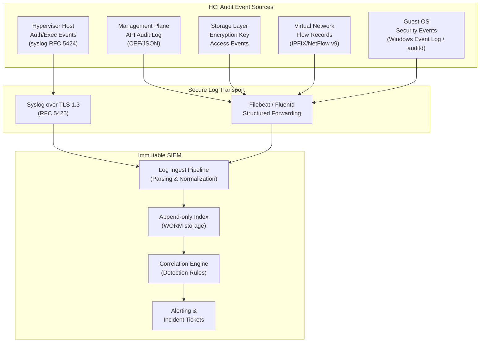
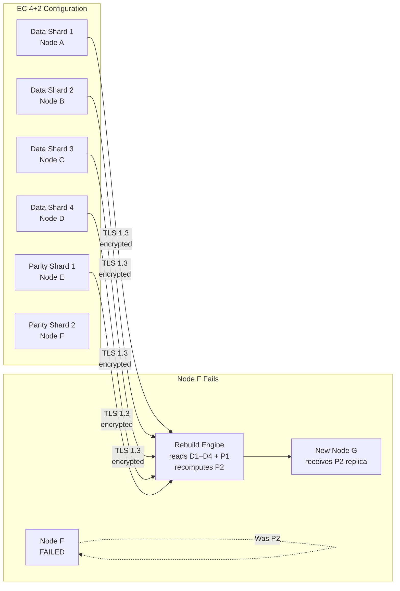

# Lesson 6: Security and Compliance in Hyperconverged Infrastructure

## 1. First-Principles Intuition & Invariants

Hyperconverged infrastructure (HCI) collapses the traditional three-tier data center model — separate SAN/NAS storage arrays, top-of-rack networking gear, and compute blade chassis — into a single software-defined appliance where commodity x86 nodes run a hypervisor, a distributed storage fabric, and a virtual networking stack simultaneously. The collapse eliminates inter-tier protocol translation overhead (Fibre Channel, iSCSI, NFS) but creates a new threat model: a single node participates in every security domain at once. A compromised hypervisor process can pivot across storage, compute, and network planes without crossing a physical boundary.

Understanding HCI security requires grounding in three architectural invariants:

**Invariant 1 — Shared-fate blast radius.** In a traditional three-tier architecture, a storage controller compromise affects only the storage plane. In HCI, every node hosts a storage daemon, a compute hypervisor, and a virtual switch. A kernel exploit that elevates privilege on one node can reach all three planes before any inter-device firewall fires. The blast radius of a single vulnerability is architecturally wider.

**Invariant 2 — The weakest-link security chain.** The effective security posture of an HCI cluster is bounded by its least-secure node. Formally, if each node $i$ has a security measure $C_i \in [0,1]$ where 1 is fully hardened, the cluster security $S$ satisfies:

$$S = \min_{i \in \{1,\ldots,n\}} C_i$$

This is not merely a motivational metaphor — it is a provable consequence of lateral movement in mesh-networked clusters. Any node with a weaker TLS cipher suite, an unpatched CVE, or a permissive firewall rule becomes the pivot point for the entire cluster. This invariant drives the operational requirement for uniform, automated patch baselines enforced by the cluster management plane (e.g., VMware vLCM, Nutanix LCM, or Red Hat RHACM).

**Invariant 3 — Defense in depth is compensating, not additive.** Layered controls do not multiply security; each layer compensates for the failure probability of adjacent layers. If encryption at rest has a misconfiguration probability $p_1$ and access control has a misconfiguration probability $p_2$, the probability that *both* fail simultaneously is $p_1 \cdot p_2$, assuming independence. Real layers are not independent — a misconfigured identity provider degrades both access control and audit logging simultaneously. This correlation means defense-in-depth architectures must analyze failure correlations, not just failure probabilities in isolation.

**Compliance as a constraint satisfaction problem.** Regulatory frameworks (NIST SP 800-53, PCI DSS 4.0, HIPAA Security Rule, ISO 27001) can be modeled as a conjunction of Boolean constraints over system state:

$$\text{Compliant} = \bigwedge_{j=1}^{m} R_j(\text{SystemState})$$

Where $R_j$ evaluates whether the current system configuration satisfies requirement $j$. Because HCI abstracts physical resources, compliance tools must operate at the virtualization layer — scanning VM configurations, storage policies, and virtual network ACLs — rather than querying physical device firmware. This shifts the compliance audit boundary from physical serial numbers to software-defined policy objects.

---

## 2. Core Architecture & Mechanics

### 2.1. The HCI Security Perimeter: Where the Boundary Lives

A classical data center has discrete security perimeters: the network firewall, the storage fabric ACLs, and the host OS. HCI replaces these with a **software-defined security plane** implemented inside the hypervisor kernel. The critical architectural consequence is that the hypervisor itself becomes the root of trust for every other control. If the hypervisor is compromised, there is no lower trusted layer to appeal to — unless the platform implements hardware roots of trust (TPM 2.0, Intel TXT, AMD SEV).

The diagram below shows the full HCI security boundary, including the hardware trust chain:



### 2.2. Hardware Trust Chain and Measured Boot

The security of the entire software stack depends on the integrity of the boot sequence. HCI nodes implement **Measured Boot** via a chain of trust rooted in firmware:

1. **UEFI Secure Boot** verifies the cryptographic signature of the bootloader using keys stored in the NVRAM `db` database. Any unsigned or incorrectly signed boot artifact halts execution.
2. **TPM 2.0 PCR Extension** records SHA-256 hashes of each boot stage into Platform Configuration Registers. PCR[0]–PCR[7] record firmware measurements; PCR[8]–PCR[15] record OS loader measurements. The TPM never erases these registers during a boot cycle — it only extends them, making retroactive forgery computationally infeasible.
3. **Remote Attestation** allows the cluster management plane to query a node's TPM quote — a cryptographically signed snapshot of the PCR bank — and compare it against a known-good golden measurement. Nodes failing attestation can be quarantined before workloads are scheduled onto them.

AMD SEV-SNP (Secure Encrypted Virtualization — Secure Nested Paging) extends this model to individual VMs: each VM gets a unique AES-128 memory encryption key managed by the AMD Secure Processor (PSP). The hypervisor can never read guest memory in plaintext, even with ring-0 access, because decryption only happens inside the CPU's memory controller. This defeats a class of attacks where a malicious hypervisor operator reads guest memory to extract credentials or keys.

### 2.3. Distributed Storage Security: vSAN/AOS/Ceph Encryption Architecture

HCI storage is not a traditional SAN; it is a distributed key-value or object store running as a userspace daemon on each node. The encryption architecture differs fundamentally from hardware-based disk encryption.

**Data Encryption at Rest (D@R)** in HCI storage engines operates at two layers:

- **Data encryption key (DEK):** A per-object or per-disk-group AES-256 key used to encrypt user data. In Ceph, DEKs are managed by the Ceph Key Management Service or delegated to Vault via the KMIP/KMS interface. In vSAN, the DEK is a per-disk-group key fetched from an external KMS at mount time.
- **Key encryption key (KEK):** Wraps the DEK using RSA-4096 or AES-256-GCM. The KEK never touches the HCI node's storage. Stored in an external KMIP-compliant server (e.g., Thales CipherTrust, HashiCorp Vault with KMIP secrets engine). The sequence during node boot is:

```
Node Boot
  → TPM Attestation passes
  → Node authenticates to KMS (mTLS client cert)
  → KMS returns DEK wrapped with KEK
  → Node unwraps DEK in memory
  → Storage daemon mounts encrypted disk groups
  → DEK resides only in kernel keyring (never on disk unencrypted)
```

**Data Encryption in Transit** between storage nodes uses TLS 1.3 with mutual authentication. The following Go snippet demonstrates how a storage replication client establishes an mTLS connection — the pattern used by Ceph Messenger v2 and vSAN encryption-in-transit:

```go
package storage

import (
    "crypto/tls"
    "crypto/x509"
    "fmt"
    "net"
    "os"
    "time"
)

// ReplicationDialer establishes an mTLS connection to a peer storage node.
// Certificate rotation is handled externally by the cluster cert manager.
type ReplicationDialer struct {
    CACertPath     string
    ClientCertPath string
    ClientKeyPath  string
    DialTimeout    time.Duration
}

func (d *ReplicationDialer) Dial(peerAddr string) (net.Conn, error) {
    caCert, err := os.ReadFile(d.CACertPath)
    if err != nil {
        return nil, fmt.Errorf("loading CA cert: %w", err)
    }

    certPool := x509.NewCertPool()
    if ok := certPool.AppendCertsFromPEM(caCert); !ok {
        return nil, fmt.Errorf("failed to parse CA certificate")
    }

    clientCert, err := tls.LoadX509KeyPair(d.ClientCertPath, d.ClientKeyPath)
    if err != nil {
        return nil, fmt.Errorf("loading client key pair: %w", err)
    }

    tlsCfg := &tls.Config{
        Certificates:             []tls.Certificate{clientCert},
        RootCAs:                  certPool,
        MinVersion:               tls.VersionTLS13,
        // Explicitly prohibit session resumption to avoid replay attacks
        // across rekeying boundaries in long-lived storage connections.
        SessionTicketsDisabled:   true,
        // CipherSuites is ignored for TLS 1.3; the runtime negotiates
        // TLS_AES_256_GCM_SHA384 or TLS_CHACHA20_POLY1305_SHA256.
    }

    dialer := &net.Dialer{Timeout: d.DialTimeout}
    conn, err := tls.DialWithDialer(dialer, "tcp", peerAddr, tlsCfg)
    if err != nil {
        return nil, fmt.Errorf("dialing peer %s: %w", peerAddr, err)
    }

    // Verify the peer presented a certificate from our cluster CA.
    // tls.Dial already verifies the chain; this additional check
    // confirms the peer's cert contains our expected OU.
    peerState := conn.ConnectionState()
    if len(peerState.PeerCertificates) == 0 {
        conn.Close()
        return nil, fmt.Errorf("peer %s presented no certificate", peerAddr)
    }

    return conn, nil
}
```

### 2.4. Network Security: Micro-segmentation and the East-West Threat Model

Traditional perimeter firewalls protect north-south traffic (entering and leaving the data center). HCI workloads generate massive east-west traffic — VM-to-VM communication that never crosses the physical network boundary. Without micro-segmentation, a compromised VM can reach any other VM on the same VLAN without restriction.

NSX-T (now VMware NSX) and Nutanix Flow implement **distributed stateful firewalling** at the vNIC level: each virtual network interface card has an independent firewall kernel module that enforces policy *before* packets enter the virtual switch fabric. This is architecturally significant because:

- Policy enforcement is co-located with packet generation — there is no "hop" to a centralized firewall appliance.
- Latency for intra-cluster security policy is sub-microsecond (kernel bypass path).
- Scale-out is automatic: adding a node adds firewall capacity proportionally.

The following diagram shows micro-segmentation policy enforcement in an HCI cluster with three tiers:



**Zero Trust Network Access (ZTNA) in HCI** extends micro-segmentation by requiring all inter-service communication to carry a cryptographic identity token (SPIFFE/SPIRE X.509 SVID or JWT-SVID). The service mesh sidecar (Envoy, Istio) intercepts all traffic at the application layer and verifies the identity of both the source and destination workload against a trust domain — independent of the network segment they reside on. This eliminates the assumption that "inside the data center means trusted."

### 2.5. Identity, Authentication, and RBAC

HCI management planes implement **Role-Based Access Control (RBAC)** layered on top of enterprise identity providers via SAML 2.0 or OIDC federation. The key architectural distinction from traditional infrastructure is that HCI has multiple RBAC surfaces:

- **Cluster management plane** (vCenter, Prism Central, Red Hat ACM): Controls VM lifecycle, cluster configuration, storage policies.
- **Hypervisor host** (ESXi host client, AHV host): Controls host-level operations; should be accessible only to automation service accounts, not human operators.
- **Storage namespace/pool**: Controls access to datastores and storage policies.
- **Network policy namespace**: Controls who can modify firewall rules.

Each surface requires independent RBAC policies. A common misconfiguration is granting broad `Administrator` rights at the cluster management plane level, which transitively grants hypervisor host access — violating least privilege for the storage and network planes.

The following Python snippet demonstrates programmatic enforcement of RBAC roles using the vSphere REST API (vSphere 7.0+), suitable for embedding in an infrastructure-as-code pipeline:

```python
"""
vsphere_rbac.py — Idempotent RBAC role assignment for HCI cluster
Requires: requests, vSphere 7.0+ REST API
"""
import logging
from dataclasses import dataclass
from typing import Optional
import requests
from requests.adapters import HTTPAdapter
from urllib3.util.retry import Retry

logger = logging.getLogger(__name__)


@dataclass(frozen=True)
class RoleAssignment:
    principal: str          # domain\\user or domain\\group
    role_name: str          # e.g., "ReadOnly", "VirtualMachinePowerUser"
    propagate: bool = True  # propagate to child objects


class VSphereRBACManager:
    """
    Manages RBAC role assignments on a vCenter Server using the REST API.
    Uses session-based authentication; credentials are never stored on the object.
    """

    def __init__(self, vcenter_host: str, verify_ssl: bool = True):
        self.base_url = f"https://{vcenter_host}/api"
        self.session = requests.Session()
        self.session.verify = verify_ssl

        retry_strategy = Retry(
            total=3,
            backoff_factor=1,
            status_forcelist=[429, 500, 502, 503, 504],
        )
        adapter = HTTPAdapter(max_retries=retry_strategy)
        self.session.mount("https://", adapter)
        self._auth_token: Optional[str] = None

    def authenticate(self, username: str, password: str) -> None:
        """Exchange credentials for a session token. Credentials are not retained."""
        response = self.session.post(
            f"{self.base_url}/session",
            auth=(username, password),
        )
        response.raise_for_status()
        self._auth_token = response.json()
        self.session.headers.update({"vmware-api-session-id": self._auth_token})
        logger.info("Authenticated to vCenter as %s", username)

    def _get_role_id(self, role_name: str) -> str:
        """Resolve a human-readable role name to its numeric identifier."""
        response = self.session.get(f"{self.base_url}/vcenter/authorization/roles")
        response.raise_for_status()
        for role in response.json():
            if role.get("name") == role_name:
                return role["role_id"]
        raise ValueError(f"Role '{role_name}' not found in vCenter")

    def assign_role(
        self,
        assignment: RoleAssignment,
        object_id: str,
        object_type: str = "ClusterComputeResource",
    ) -> None:
        """
        Idempotently assign a role to a principal on a managed object.
        Existing assignments for the same principal on the same object
        are updated rather than duplicated.
        """
        role_id = self._get_role_id(assignment.role_name)

        payload = {
            "grant_type": "PRINCIPAL",
            "principal": {
                "name": assignment.principal,
                "group": "\\" in assignment.principal and assignment.principal.count("\\") == 1,
            },
            "roles": [role_id],
            "propagate": assignment.propagate,
        }

        url = f"{self.base_url}/vcenter/authorization/global-permissions"
        response = self.session.post(url, json=payload)

        if response.status_code == 409:
            logger.info(
                "Role assignment already exists for %s; updating.", assignment.principal
            )
            # Idempotent update: delete existing and re-create
            self._revoke_role(assignment.principal, object_id)
            response = self.session.post(url, json=payload)

        response.raise_for_status()
        logger.info(
            "Assigned role '%s' to '%s' on object '%s'",
            assignment.role_name,
            assignment.principal,
            object_id,
        )

    def _revoke_role(self, principal: str, object_id: str) -> None:
        response = self.session.delete(
            f"{self.base_url}/vcenter/authorization/global-permissions",
            params={"principal": principal, "is_group": False},
        )
        response.raise_for_status()

    def close(self) -> None:
        """Terminate the vCenter session."""
        self.session.delete(f"{self.base_url}/session")
        self.session.close()
```

---

## 3. Compliance Frameworks and Their Mapping to HCI Controls

Compliance in HCI is not an abstract checklist — it maps directly to specific software-defined configuration objects that can be audited, version-controlled, and enforced by policy engines.

### 3.1. Framework-to-Control Mapping

| Framework | Key Control Domain | HCI Implementation | Audit Evidence |
|---|---|---|---|
| PCI DSS 4.0 §3.5 | Encryption of stored cardholder data | vSAN/AOS AES-256-XTS D@R + external KMS | KMS key access logs, storage policy objects |
| PCI DSS 4.0 §8.2 | Multi-factor authentication for all administrative access | vCenter/Prism SSO with MFA via SAML IdP | IdP authentication logs |
| HIPAA §164.312(a)(2)(iv) | Encryption/decryption of ePHI | Guest-level or hypervisor-level encryption | Encryption policy compliance reports |
| NIST SP 800-53 AC-6 | Least privilege | RBAC roles scoped to minimum required permissions | Role assignment audit exports |
| NIST SP 800-53 AU-2 | Audit events | Cluster-wide syslog forwarded to immutable SIEM | Syslog forwarding configuration, SIEM receipts |
| ISO 27001 A.12.3 | Information backup | VM-consistent snapshots with offsite replication | Backup job execution logs, RPO/RTO test results |
| CIS Benchmark for VMware ESXi | Host hardening | vSphere Hardening Guide baseline (CIS L1/L2) | vSphere Configuration Manager reports |

### 3.2. Automated Compliance Scanning

Manual compliance auditing does not scale to clusters of 50+ nodes. Production HCI environments use **Policy-as-Code** tools to continuously evaluate cluster state against compliance baselines. The following example uses Open Policy Agent (OPA) Rego to enforce a PCI DSS encryption-at-rest requirement on vSAN storage policies:

```rego
# pci_vsan_encryption.rego
# Enforces PCI DSS 4.0 §3.5: All storage policies applied to VMs in the
# "pci-workloads" namespace must have encryption enabled.
package hci.pci.storage

import future.keywords.if
import future.keywords.in

# Deny any storage policy assignment where encryption is disabled
deny[msg] {
    # Input is a vSphere storage policy object from the config scanner
    input.kind == "StoragePolicyAssignment"
    input.metadata.namespace == "pci-workloads"

    # The policy's capability set does not include encryption
    not encryption_enabled(input.spec.storagePolicyCapabilities)

    msg := sprintf(
        "StoragePolicy '%s' applied to VM '%s' in pci-workloads namespace does not enable encryption. PCI DSS 4.0 §3.5 violation.",
        [input.spec.policyName, input.metadata.vmName],
    )
}

encryption_enabled(capabilities) if {
    some cap in capabilities
    cap.id == "VSAN_ENCRYPTION"
    cap.value == true
}

# Warn if the Key Management Server endpoint is the default self-signed test KMS
warn[msg] {
    input.kind == "KeyManagementServer"
    input.spec.kmsCertificateIssuer == "VMware Certificate Authority"

    msg := "KMS is using internal VMware CA. PCI DSS requires a hardware-backed external KMS for cardholder data environments."
}
```

### 3.3. Audit Logging Architecture

Compliance frameworks universally require tamper-evident audit logs. HCI systems generate audit events from multiple planes that must be correlated in a SIEM:



The critical architectural requirement is **WORM (Write Once Read Many)** storage for log indices. If log storage is writable by the same identity used to generate logs, an attacker with cluster admin access can erase evidence. Best practice is to forward logs to a separate SIEM platform authenticated with write-only credentials that cannot be used to read or delete existing log records.

---

## 4. High-Performance Optimization and Failure Modes

### 4.1. CPU Scheduling and vCPU Contention

HCI systems run multiple workloads on shared CPU resources. The Linux Completely Fair Scheduler (CFS) used in KVM-based HCI (Nutanix AHV, Red Hat Virtualization) assigns each schedulable entity a `vruntime` — a virtual clock that advances faster for high-priority tasks and slower for low-priority tasks. The CFS red-black tree always schedules the entity with the smallest `vruntime` next, ensuring O(log n) scheduling decisions.

The critical security-performance interaction is **CPU side-channel vulnerability mitigation**. Spectre (CVE-2017-5753, CVE-2017-5715) and Meltdown (CVE-2017-5754) mitigations — retpoline, IBRS, STIBP, L1TF/MDS mitigations — impose measurable overhead on HCI workloads:

| Mitigation | Mechanism | Typical HCI Overhead |
|---|---|---|
| Retpoline | Replace indirect branches with return trampolines | 2–5% on branch-heavy workloads |
| IBRS/IBPB | Flush indirect branch predictor on VM entry/exit | 10–20% on high-VMEX-rate workloads |
| L1TF (Flushing) | Flush L1 data cache on every VM switch | 5–15% on memory-intensive VMs |
| MDS (VERW) | Execute VERW before VM entry | < 1% average, up to 5% on microservice workloads |
| PTI (KPTI) | Separate kernel/user page tables | 3–10% on syscall-heavy workloads |

Disabling these mitigations in an HCI environment to recover performance is a critical security error — it re-enables cross-VM information leakage through shared CPU microarchitectural state. The correct approach is to use CPU pinning and NUMA-aware scheduling to reduce VM co-residency on the same physical core when security domain separation is required (e.g., PCI DSS workloads co-resident with untrusted tenants).

The following C code illustrates how `perf_event_open` can be used to instrument VMCS exit rates (VM-entry/exit frequency), a key metric for diagnosing IBRS/IBPB overhead in production HCI clusters:

```c
/*
 * vmcs_exit_profiler.c
 * Measures VM-exit events using Linux perf_event_open(2).
 * Compile: gcc -O2 -o vmcs_exit_profiler vmcs_exit_profiler.c
 * Run as root or with CAP_PERFMON on a KVM hypervisor host.
 */
#include <stdio.h>
#include <stdlib.h>
#include <string.h>
#include <unistd.h>
#include <errno.h>
#include <sys/syscall.h>
#include <sys/ioctl.h>
#include <linux/perf_event.h>

/*
 * KVM VM-exit event: kvm:kvm_exit
 * PMU type for KVM tracepoints is PERF_TYPE_TRACEPOINT.
 * The event ID must be read from:
 *   /sys/kernel/tracing/events/kvm/kvm_exit/id
 */
static long
perf_event_open(struct perf_event_attr *hw_event, pid_t pid,
                int cpu, int group_fd, unsigned long flags)
{
    return syscall(SYS_perf_event_open, hw_event, pid, cpu, group_fd, flags);
}

static int read_tracepoint_id(const char *event_path)
{
    FILE *f = fopen(event_path, "r");
    if (!f) {
        perror("fopen tracepoint id");
        return -1;
    }
    int id = -1;
    fscanf(f, "%d", &id);
    fclose(f);
    return id;
}

int main(void)
{
    const char *tp_path = "/sys/kernel/tracing/events/kvm/kvm_exit/id";
    int tp_id = read_tracepoint_id(tp_path);
    if (tp_id < 0) {
        fprintf(stderr, "Could not read tracepoint ID from %s\n", tp_path);
        fprintf(stderr, "Ensure tracefs is mounted and you have CAP_PERFMON.\n");
        return EXIT_FAILURE;
    }

    struct perf_event_attr pe;
    memset(&pe, 0, sizeof(pe));
    pe.type           = PERF_TYPE_TRACEPOINT;
    pe.size           = sizeof(pe);
    pe.config         = (uint64_t)tp_id;
    pe.disabled       = 1;
    pe.exclude_kernel = 0;  /* VM-exits are kernel events */
    pe.exclude_hv     = 0;
    pe.exclude_user   = 1;

    /* -1 pid = all processes; 0 cpu = CPU 0 only */
    int fd = (int)perf_event_open(&pe, -1, 0, -1, 0);
    if (fd < 0) {
        fprintf(stderr, "perf_event_open failed: %s\n", strerror(errno));
        return EXIT_FAILURE;
    }

    ioctl(fd, PERF_EVENT_IOC_RESET, 0);
    ioctl(fd, PERF_EVENT_IOC_ENABLE, 0);

    sleep(5); /* Measurement window: 5 seconds */

    ioctl(fd, PERF_EVENT_IOC_DISABLE, 0);

    uint64_t count = 0;
    if (read(fd, &count, sizeof(count)) != sizeof(count)) {
        perror("read perf counter");
        close(fd);
        return EXIT_FAILURE;
    }

    close(fd);
    printf("KVM VM-exits on CPU 0 over 5s: %lu\n", count);
    printf("VM-exit rate: %.1f/sec\n", (double)count / 5.0);
    printf("Note: rates >100k/sec suggest IBRS overhead; consider IBRS_FW or\n");
    printf("      CPU pinning to reduce cross-domain co-residency.\n");

    return EXIT_SUCCESS;
}
```

### 4.2. Storage Fault Domains and the RAID-6 / Erasure Coding Tradeoff

HCI storage engines protect data through **erasure coding** rather than traditional RAID. Nutanix AOS and vSAN both support erasure coding (EC) schemes equivalent to RAID-5 (4+1) and RAID-6 (4+2 or 6+2). The security-relevant difference from RAID-6 is that erasure coding operates at the **object level** — each data object is independently encoded — rather than at the disk level.

For a (k, m) Reed-Solomon erasure code with k data shards and m parity shards:

- **Fault tolerance:** Up to m simultaneous node failures before data loss.
- **Storage overhead:** Total capacity = $k/(k+m)$ of raw capacity.
- **Rebuild I/O:** A node failure triggers partial object reconstruction using $k$ surviving shards, generating I/O proportional to the number of affected objects, not the entire disk.

The security implication: during a rebuild, decrypted shard data transits the network. If inter-node traffic encryption (TLS) is not enabled, a network tap during a node-failure rebuild event exposes partially decrypted data. This is a known gap in configurations that only encrypt data at rest but not in transit.



### 4.3. Failure Mode Analysis

HCI failure modes have security consequences beyond data availability:

**Split-brain and quorum loss.** HCI clusters use distributed consensus (Paxos or Raft variants) to elect a metadata leader and maintain cluster state. If the cluster partitions into two segments that both believe they are the majority (split-brain), both segments may accept conflicting writes to the same storage object. Modern HCI systems resolve this with a **witness node** (a lightweight tiebreaker VM requiring minimal resources) that holds a quorum vote without storing data. VMware vSAN Stretched Cluster uses a witness appliance deployed at a third site. The witness must itself be secured: an attacker who controls the witness controls quorum arbitration.

**Management plane single-point-of-failure.** vCenter or Prism Central outages do not stop running VMs (the data plane is decoupled from the management plane) but they halt all security policy changes, certificate rotations, and RBAC updates. Architectures requiring zero-downtime compliance (financial trading platforms, emergency services) must deploy the management plane in a highly available configuration (vCenter HA, Prism Central scale-out) with an independent authentication source (not a VM inside the cluster it manages).

**KMS unavailability.** If the external KMS is unreachable during node reboot, encrypted disk groups cannot mount. This is not a security failure — it is the encryption working correctly. But it means KMS high availability is a prerequisite for storage high availability in encrypted configurations. The KMS must be deployed outside the HCI cluster (never as a VM on the same cluster it protects) with its own HA architecture.

---

## 5. Operational Security Hardening Procedures

### 5.1. ESXi/AHV Host Hardening

The CIS VMware ESXi Benchmark (Level 1) provides 100+ controls. The highest-impact subset for HCI environments:

```bash
#!/usr/bin/env bash
# esxi_harden.sh — ESXi 8.x host hardening via esxcli
# Run from the ESXi shell or via SSH; intended for automation via vSphere
# Desired State Configuration or Ansible VMware modules.
# Source: CIS VMware ESXi 8 Benchmark v1.0 (2024)

set -euo pipefail

echo "[1] Disable SSH (management access via vSphere API
```
