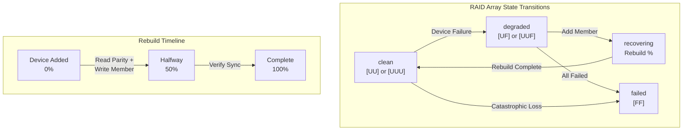

# Operational Verification Labs: Core Systems Infrastructure & Linux System Administration

## Introduction

This operational verification lab suite provides hands-on exercises for validating core infrastructure competencies in Linux system administration. Each lab isolates a single discipline—storage management, process resource allocation, network configuration, and service orchestration—and provides reproducible verification paths using production toolchain defaults.

The labs are designed for practitioners who manage multi-tenant environments, run distributed systems, or operate mission-critical infrastructure where understanding the mechanics beneath abstraction layers is non-negotiable. You will work with raw systemd interfaces, LVM metadata, block device semantics, and cgroup hierarchies to verify that your understanding matches behavior.

**Prerequisites:**
- Linux system with systemd (v250+)
- LVM2, mdadm, and iproute2 installed
- Sudo or root access
- At least two virtual block devices (or loop devices) available
- Basic understanding of partitioning, filesystems, and networking

**Time commitment:** 4–6 hours total; individual labs are 30–90 minutes.

---

## Lab 1: LVM Storage Lifecycle and Metadata Consistency

### Objective

Understand how LVM manages physical and logical volumes, verify metadata state machines, and validate recovery from partial failures. You will build a complete storage stack, inspect metadata at each layer, and trace how LVM maintains consistency across component failures.

### First Principles

LVM operates in three semantic layers:

1. **Physical Volumes (PVs):** Raw block devices (or partitions) that LVM recognizes and labels with PV headers.
2. **Volume Groups (VGs):** Pools of one or more PVs that act as allocation domains. VGs maintain metadata (copies stored on each PV) describing logical volumes.
3. **Logical Volumes (LVs):** Virtual block devices carved from VG free space. LVs can span multiple PVs and support snapshots, mirroring, and tiering.

LVM metadata is stored at the start of each PV (in the metadata area) and replicated across PVs in a VG. This redundancy allows recovery even if one PV fails, provided the metadata quorum survives. The `pvs`, `vgs`, and `lvs` commands query this metadata; the `vgcfgbackup` and `vgcfgrestore` tools can export and restore it explicitly.

### Lab Setup

**Step 1: Prepare virtual block devices**

```bash
# Create three 1 GiB loop devices
for i in {1..3}; do
  dd if=/dev/zero of=/tmp/pv_loop_$i bs=1M count=1024
  losetup /dev/loop$i /tmp/pv_loop_$i
done

lsblk | grep loop
```

**Step 2: Initialize physical volumes**

```bash
# Zero the first 4 MiB of each device to ensure clean state
for i in {1..3}; do
  dd if=/dev/zero of=/dev/loop$i bs=1M count=4
done

# Create PV headers
pvcreate /dev/loop1 /dev/loop2 /dev/loop3

# Verify PV initialization
pvs -o pv_name,pv_size,pv_free,pv_used
pvdisplay -m
```

**Step 3: Create and inspect volume group**

```bash
# Create a volume group spanning all three PVs
vgcreate vg_prod /dev/loop1 /dev/loop2 /dev/loop3

# Inspect VG metadata
vgs -o vg_name,vg_size,vg_free,pv_count
vgdisplay -m vg_prod

# Export metadata snapshot for reference
vgcfgbackup -f /tmp/vg_prod_backup.txt vg_prod
cat /tmp/vg_prod_backup.txt | head -40
```

**Expected output:** VG shows 3 GiB total capacity, three PVs listed. Metadata snapshot shows text-based VG configuration including PE layout and PV references.

### Exercise 1: Logical Volume Creation and Extent Mapping

**Objective:** Create LVs and understand how extents are allocated across PVs.

```bash
# Create three logical volumes with different sizes
lvcreate -n lv_app -L 500M vg_prod /dev/loop1
lvcreate -n lv_data -L 1G vg_prod /dev/loop2
lvcreate -n lv_cache -L 300M vg_prod /dev/loop3

# List logical volumes and their PE allocation
lvs -o lv_name,lv_size,seg_count
lvdisplay -m vg_prod

# Inspect extent mapping for a specific LV
lvdisplay -m vg_prod/lv_app
```

**Validation:** Each LV maps to specific physical extents (PEs). Record the PE count and distribution. For a 500 MiB LV with 4 MiB PEs, expect ~125 extents.

### Exercise 2: Metadata Redundancy and Recovery

**Objective:** Verify metadata replication and test recovery after simulated PV failure.

```bash
# Check metadata copies per PV
pvs -o pv_name,pv_mda_count,pv_mda_size,pv_mda_free

# Simulate corruption on one PV by zeroing metadata
pvchange -u /dev/loop2  # Update UUID or trigger metadata check
pvck /dev/loop1 /dev/loop2 /dev/loop3

# Export metadata from remaining good PVs
vgcfgbackup -f /tmp/vg_prod_recovery.txt vg_prod

# Attempt restore if metadata was corrupted
# (This is a dry-run; actual restore requires explicit confirmation)
```

**Validation:** Metadata check should pass. Backup file should contain complete VG definition. If one PV is corrupted, the remaining copies should allow full VG operation.

### Exercise 3: LVM Snapshot Creation and Consistency

**Objective:** Create a snapshot LV and verify copy-on-write behavior.

```bash
# Create a snapshot of lv_data
lvcreate -n lv_data_snap -L 200M -s vg_prod/lv_data

# List snapshots
lvs -o lv_name,origin,snap_percent,lv_size

# Write data to original LV and observe snapshot CoW
dd if=/dev/urandom of=/dev/vg_prod/lv_data bs=4K count=100 &
sleep 1
lvs -o lv_name,snap_percent
wait

# Verify snapshot size usage
lvs -o lv_name,snap_percent,lv_size vg_prod/lv_data_snap
```

**Validation:** Snapshot creation should succeed. As writes occur to the origin, snapshot percent should increase. Snapshot persists independently.

### Exercise 4: Metadata Backup and Scenario Recovery

**Objective:** Automate metadata backup and demonstrate recovery procedure.

**Create backup script:**

```bash
#!/bin/bash
# /usr/local/bin/lvm_backup_verify.sh

BACKUP_DIR="/var/backups/lvm"
mkdir -p "$BACKUP_DIR"

# Backup all VGs
vgcfgbackup -f "$BACKUP_DIR/vg_all_$(date +%Y%m%d_%H%M%S).txt"

# Verify backup integrity
for backup_file in "$BACKUP_DIR"/vg_all_*.txt; do
  echo "Verifying: $backup_file"
  if grep -q "volume_group" "$backup_file"; then
    echo "  ✓ Backup contains VG definitions"
  else
    echo "  ✗ Backup corrupted"
    exit 1
  fi
done

# List active LV structure
lvs -o lv_name,lv_size,vg_name --reportformat=json > "$BACKUP_DIR/lv_manifest.json"
echo "Manifest saved to $BACKUP_DIR/lv_manifest.json"
```

Run the backup script:

```bash
chmod +x /usr/local/bin/lvm_backup_verify.sh
/usr/local/bin/lvm_backup_verify.sh

# Verify backup contents
cat /var/backups/lvm/lv_manifest.json | jq '.report[0].lv' | head -20
```

### Verification Checklist

- [ ] Three PVs initialized with distinct PE counts
- [ ] VG metadata shows correct PE allocation across PVs
- [ ] Three LVs created and mapped to specific extents
- [ ] Metadata check passes on all PVs
- [ ] Snapshot creation and CoW behavior verified
- [ ] Metadata backup script runs and produces valid JSON manifest

### Cleanup

```bash
# Remove LVs
lvremove -y vg_prod/lv_app vg_prod/lv_data vg_prod/lv_cache vg_prod/lv_data_snap

# Remove VG
vgremove -y vg_prod

# Remove PVs
pvremove /dev/loop{1..3}

# Detach and remove loop devices
for i in {1..3}; do
  losetup -d /dev/loop$i
  rm /tmp/pv_loop_$i
done
```

---

## Lab 2: RAID and mdadm State Machines

### Objective

Build RAID arrays using mdadm, verify state transitions, observe recovery behavior, and validate resilience under failure conditions. You will trace how Linux manages redundancy and synchronization at the block device layer.

### First Principles

RAID (Redundant Array of Independent Disks) combines multiple block devices into a single logical unit with fault tolerance. The Linux Software RAID (md) driver manages RAID via:

- **RAID levels:** RAID1 (mirroring), RAID5 (striping + parity), RAID6 (dual parity), RAID10 (mirrored stripes).
- **State machines:** Arrays transition between `clean`, `degraded`, `recovering`, and `failed` states based on member device health.
- **Superblock:** Metadata stored on each member device describing array membership, version, and synchronization state.
- **Rebuild:** When a failed device is replaced, md automatically reconstructs missing data from parity/mirror.

mdadm is the primary tool for creating and managing md arrays. The `/proc/mdstat` file provides real-time state, and `/sys/block/md*/` contains detailed status.

### Lab Setup

**Step 1: Prepare RAID member devices**

```bash
# Create four 1 GiB loop devices
for i in {4..7}; do
  dd if=/dev/zero of=/tmp/raid_member_$i bs=1M count=1024
  losetup /dev/loop$i /tmp/raid_member_$i
done

# Verify loop devices
lsblk | grep "loop[4-7]"
```

**Step 2: Stop any existing md arrays**

```bash
# Ensure no active arrays
mdadm --stop --scan
cat /proc/mdstat
```

### Exercise 1: RAID1 Creation and Mirror Verification

**Objective:** Build a RAID1 array and verify bidirectional mirroring.

```bash
# Create RAID1 array with two members
mdadm --create /dev/md0 --level=1 --raid-devices=2 /dev/loop4 /dev/loop5

# Monitor array initialization
watch -n 1 'cat /proc/mdstat'
# (Press Ctrl+C to exit)

# Verify RAID1 status
mdadm --detail /dev/md0
cat /proc/mdstat

# Get detailed member status
mdadm --examine /dev/loop4
mdadm --examine /dev/loop5
```

**Expected output:** Array shows `[UU]` (both members up), `recovery` or `clean` state, and 100% sync progress.

### Exercise 2: Member Failure and Degraded Mode

**Objective:** Simulate device failure and observe degraded state behavior.

```bash
# Mark one member as faulty
mdadm /dev/md0 --fail /dev/loop4

# Verify degraded state
mdadm --detail /dev/md0
cat /proc/mdstat

# Attempt I/O and verify read availability
dd if=/dev/md0 of=/dev/null bs=1M count=100
echo "Read succeeded from degraded array"

# Check UU/UA/F markers
# U = up, A = available, F = failed
grep md0 /proc/mdstat
```

**Validation:** Array should show `[UF]` (one member down), continue to function, and allow reads/writes through the remaining member.

### Exercise 3: Device Replacement and Rebuild

**Objective:** Replace a failed device and trigger rebuild.

```bash
# Remove the failed device from array
mdadm /dev/md0 --remove /dev/loop4

# Verify reduction
mdadm --detail /dev/md0

# Add replacement device
mdadm /dev/md0 --add /dev/loop6

# Monitor rebuild progress
watch -n 2 'mdadm --detail /dev/md0 | grep -A 5 "Rebuild Status"'
# (Press Ctrl+C to exit)

# Alternative: poll /proc/mdstat
tail -f /proc/mdstat &
PID=$!
sleep 10
kill $PID
```

**Validation:** Rebuild should progress from 0% to 100%. Array transitions from `degraded` to `recovering` to `clean`.

### Exercise 4: RAID5 Array with Parity

**Objective:** Build RAID5 and verify fault tolerance properties.

```bash
# Create RAID5 array with three members
mdadm --create /dev/md1 --level=5 --raid-devices=3 /dev/loop4 /dev/loop5 /dev/loop6

# Monitor initialization
watch -n 1 'cat /proc/mdstat'

# Once initialization completes, inspect RAID5 specifics
mdadm --detail /dev/md1
cat /sys/block/md1/md/chunk_size
cat /sys/block/md1/md/raid_disks

# Calculate usable capacity
# RAID5 capacity = (n_disks - 1) * device_size
echo "RAID5 capacity: 2 * 1024 MiB = 2048 MiB"
```

**Expected output:** RAID5 shows three devices, `U` status for all, `recovery` state during initialization.

### Exercise 5: Superblock and Array Metadata

**Objective:** Inspect mdadm superblock structure and metadata consistency.

```bash
# Export superblock from member device
mdadm --examine-bitmap /dev/loop4
mdadm --examine /dev/loop4 --brief

# Dump detailed superblock
mdadm -E /dev/loop4

# Verify superblock is present on all members
for dev in /dev/loop{4,5,6}; do
  echo "=== $dev ==="
  mdadm --examine "$dev" | grep -E "Version|Raid Level|Raid Devices|Array UUID"
done

# Check array configuration against superblock consensus
mdadm --assemble --dry-run --verbose /dev/md1 /dev/loop4 /dev/loop5 /dev/loop6
```

**Validation:** All superblocks agree on array UUID, RAID level, device count, and member order.

### Exercise 6: Bitmap and Incremental Rebuild

**Objective:** Enable write-intent bitmap for faster recovery.

```bash
# Add bitmap to running RAID1 array
mdadm /dev/md0 --grow --bitmap=internal --bitmap-chunk=1024

# Verify bitmap enabled
mdadm --detail /dev/md0 | grep -i bitmap

# Simulate failure and recovery (with bitmap tracking)
mdadm /dev/md0 --fail /dev/loop5
mdadm /dev/md0 --remove /dev/loop5
mdadm /dev/md0 --add /dev/loop7

# Monitor rebuild with bitmap acceleration
watch -n 2 'mdadm --detail /dev/md0 | tail -10'
# (Press Ctrl+C to exit)
```

**Validation:** Rebuild completes faster because bitmap tracks only changed regions during downtime.

### State Machine Visualization



### Verification Checklist

- [ ] RAID1 created with two members in clean state
- [ ] Degraded mode verified; I/O continues on single member
- [ ] Failed device removed and replacement added
- [ ] Rebuild completes from 0% to 100%
- [ ] RAID5 array created with three members
- [ ] Superblock examined and validated on all devices
- [ ] Bitmap enabled and rebuild verified faster

### Cleanup

```bash
# Stop all md arrays
mdadm --stop /dev/md0 /dev/md1
mdadm --remove /dev/md0 /dev/md1

# Verify arrays stopped
cat /proc/mdstat

# Detach loop devices
for i in {4..7}; do
  losetup -d /dev/loop$i
  rm /tmp/raid_member_$i
done
```

---

## Lab 3: systemd Target State Machines and Service Orchestration

### Objective

Master systemd's target-based dependency model, transition between runlevels, and trace service startup/shutdown sequences. You will build custom targets and verify correct ordering of transitive dependencies.

### First Principles

systemd uses **targets** (goal states) instead of runlevels. Targets are pseudo-units that group services and define activation policies:

- **multi-user.target:** Traditional runlevel 3; services without GUI.
- **graphical.target:** Traditional runlevel 5; includes display manager and desktop.
- **emergency.target:** Minimal environment with root shell.
- **Wants vs. Requires:** Targets can *want* services (soft dependency) or *require* them (hard dependency).
- **Before/After:** Controls ordering within a target group.

The systemd dependency resolver linearizes this DAG before execution. Understanding the ordering guarantees is essential for predictable boot and shutdown sequences.

### Lab Setup

**Step 1: Inspect active target and default target**

```bash
# Get current target
systemctl get-default

# List all available targets
systemctl list-units --type=target --all

# Show current target and its dependencies
systemctl list-dependencies graphical.target | head -30
```

**Step 2: Create custom test services**

Create `/etc/systemd/system/test-app-1.service`:

```ini
[Unit]
Description=Test Application 1
After=network-online.target
Wants=network-online.target
PartOf=test-app.target

[Service]
Type=simple
ExecStart=/bin/bash -c 'echo "App 1 starting"; sleep infinity'
Restart=on-failure
RestartSec=5

[Install]
WantedBy=test-app.target
```

Create `/etc/systemd/system/test-app-2.service`:

```ini
[Unit]
Description=Test Application 2
After=test-app-1.service
Requires=test-app-1.service
PartOf=test-app.target

[Service]
Type=simple
ExecStart=/bin/bash -c 'echo "App 2 starting"; sleep infinity'
Restart=on-failure
RestartSec=5

[Install]
WantedBy=test-app.target
```

Create `/etc/systemd/system/test-app.target`:

```ini
[Unit]
Description=Test Application Stack Target
Wants=test-app-1.service test-app-2.service
```

### Exercise 1: Target Dependency Resolution

**Objective:** Understand how systemd resolves transitive dependencies.

```bash
# Reload daemon to recognize new units
systemctl daemon-reload

# List dependencies for custom target
systemctl list-dependencies test-app.target --no-pager

# Show reverse dependencies (what depends on a service)
systemctl list-dependencies test-app-1.service --reverse

# Export full dependency tree as text
systemctl list-dependencies graphical.target --all | wc -l
```

**Validation:** Dependency tree for test-app.target should show test-app-1 before test-app-2 due to After/Requires ordering.

### Exercise 2: Service Startup Sequence with Tracing

**Objective:** Start services and trace execution order via systemd journal.

```bash
# Clear journal to isolate this exercise
journalctl --vacuum-time=1s

# Start the target (which activates all dependent services)
systemctl start test-app.target

# Check service status
systemctl status test-app.target -n 20

# Trace startup order via journal
journalctl -u test-app-1.service -u test-app-2.service -n 20 --no-pager

# Show which services are active
systemctl list-units --type=service --state=active | grep test-app
```

**Expected output:** Journal should show test-app-1 starting before test-app-2. Status output shows both running.

### Exercise 3: Dependency Chain Failure Handling

**Objective:** Observe behavior when a dependency fails.

```bash
# Stop test-app-1 (which test-app-2 requires)
systemctl stop test-app-1.service

# Check test-app-2 status
systemctl status test-app-2.service

# Verify PartOf relationship (should stop both when target
```
