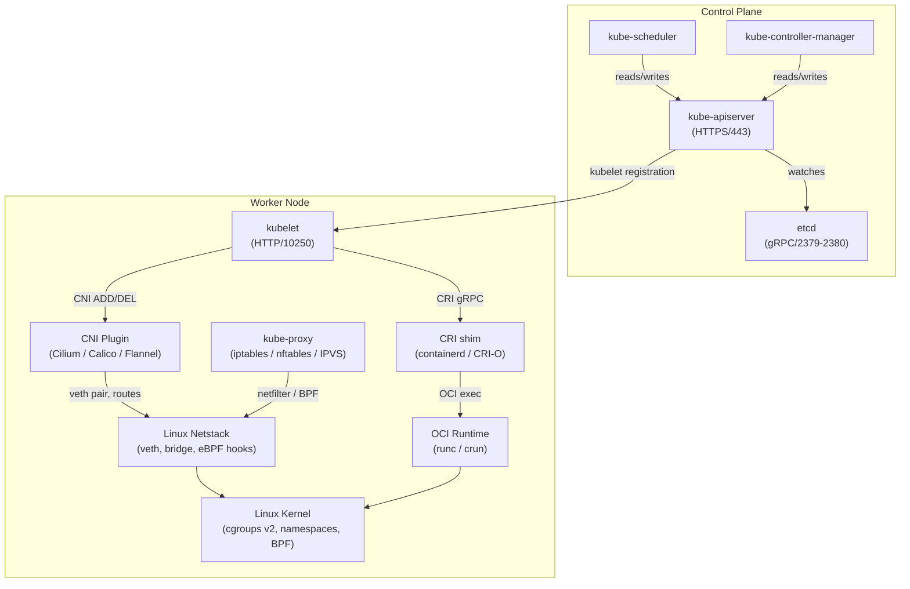
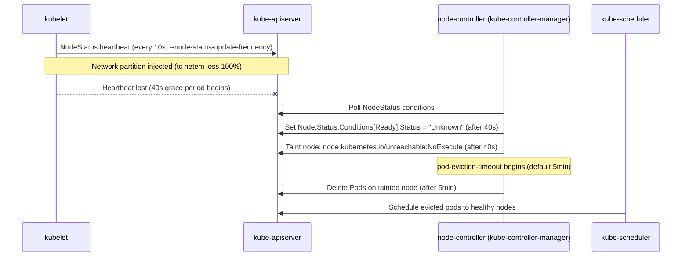
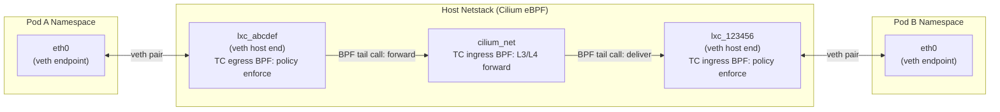
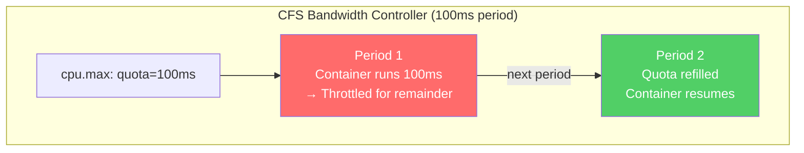

# Operational Verification Labs: Infrastructure

## Preface

This lab guide is designed for senior engineers operating Kubernetes clusters in production or staging environments. Each exercise is grounded in first principles: understanding *why* a diagnostic reveals what it does, not just what command to run. The progression moves from passive observation (live state inspection) through active load characterization (saturation profiling) to controlled fault injection and recovery analysis. Every command is production-safe unless explicitly marked as destructive.

---

## Environment Specification and Tool Dependencies

The following toolchain versions are required. Version floors matter because specific features (e.g., `etcdctl` endpoint health, `crictl` pod sandbox inspection, `bpftool` BTF support) were introduced at these releases.

| Tool | Minimum Version | Purpose |
|---|---|---|
| `kubectl` | 1.26 | Kubernetes API client; server-side apply, debug ephemeral containers |
| `iproute2` | 5.15 | Netlink-based interface and routing inspection (`ip`, `ss`, `tc`) |
| `etcdctl` | 3.5 | etcd cluster health, endpoint status, key inspection |
| `crictl` | 1.26 | CRI-agnostic container runtime inspection (containerd, CRI-O) |
| `helm` | 3.11 | Chart lifecycle management; `helm test` for release verification |
| `ss` | (ships with iproute2) | Socket statistics, replaces `netstat`; uses kernel netlink directly |
| `ethtool` | 5.16 | NIC driver and hardware offload configuration |
| `tcpdump` | 4.99 | Packet capture via libpcap/AF_PACKET |
| `perf` | kernel-matched | CPU PMU-based profiling; version must match running kernel |
| `strace` | 5.19 | `ptrace(2)`-based syscall tracing |
| `bpftool` | kernel-matched | BPF program and map inspection; requires BTF-enabled kernel (5.4+) |

**Kernel prerequisite:** BPF Type Format (BTF) must be enabled (`CONFIG_DEBUG_INFO_BTF=y`). Verify:

```bash
# A non-empty file confirms BTF is available
ls -lh /sys/kernel/btf/vmlinux
```

**KUBECONFIG and RBAC:** All `kubectl` commands assume a `kubeconfig` targeting the correct cluster context and a service account with at minimum `get`, `list`, `watch` on `nodes`, `pods`, `events`, and `exec` privileges on target namespaces.

```bash
# Confirm active context before any exercise
kubectl config current-context
kubectl auth can-i get nodes
kubectl auth can-i exec pods --namespace=default
```

---

## Architectural Context

Before executing any command, understand the layers being inspected. A Kubernetes node is a layered system. Each diagnostic tool operates at a specific layer; confusing layers leads to misdiagnosis.



---

## Exercise 1: Live State and Internal Subsystem Inspection

**Goal:** Establish a complete, authoritative snapshot of cluster state at the node, pod, network, and etcd layers. This is the first step in any incident triage—characterize the steady state before interpreting anomalies.

### 1.1 Node Layer Inspection

`kubectl get nodes -o wide` queries the kube-apiserver, which aggregates `NodeStatus` objects written by each kubelet. The kubelet reports conditions (`Ready`, `MemoryPressure`, `DiskPressure`, `PIDPressure`, `NetworkUnavailable`) based on its internal eviction manager and CNI plugin callbacks.

```bash
# Wide output: adds INTERNAL-IP, EXTERNAL-IP, OS-IMAGE, KERNEL-VERSION, CONTAINER-RUNTIME
kubectl get nodes -o wide

# Machine-readable: extract node name, kubelet version, and all condition types
kubectl get nodes -o json \
  | jq -r '.items[] | {
      name: .metadata.name,
      kubelet: .status.nodeInfo.kubeletVersion,
      kernel: .status.nodeInfo.kernelVersion,
      runtime: .status.nodeInfo.containerRuntimeVersion,
      conditions: [.status.conditions[] | {type: .type, status: .status, reason: .reason}]
    }'
```

**Interpreting `NotReady`:** A node in `NotReady` means the kubelet has not posted a heartbeat within `--node-monitor-grace-period` (default 40 s). This does not distinguish between:
- The node being unreachable (network partition, power loss)
- The kubelet process having crashed
- The CRI socket being unresponsive

Drill down with:

```bash
# Describe gives the full condition history and resource capacity
kubectl describe node <node-name>

# From the node itself — kubelet service status
systemctl status kubelet
journalctl -u kubelet -n 100 --no-pager

# CRI socket liveness (containerd)
systemctl status containerd
crictl info  # Calls CRI RuntimeService.Version
```

### 1.2 Pod and Container Layer Inspection

```bash
# All pods across all namespaces; Pending/CrashLoopBackOff/OOMKilled are signal states
kubectl get pods -A -o wide

# Full event stream for a crashing pod — reason codes are authoritative
kubectl describe pod <pod-name> -n <namespace>

# Retrieve previous container logs (post-OOMKill or crash)
kubectl logs <pod-name> -n <namespace> --previous

# CRI-level inspection — bypasses kubelet API, talks directly to containerd
crictl pods
crictl ps -a   # -a: include exited containers
crictl inspect <container-id>  # Full OCI state including cgroup paths
```

**CrashLoopBackOff first principles:** The kubelet applies an exponential backoff (10 s, 20 s, 40 s … up to 5 min) between container restart attempts. The root cause is always inside the container exit code or the OOM killer. `kubectl describe` surfaces `Exit Code` and `Reason`; exit code 137 = SIGKILL (OOM or manual), 1 = application error, 2 = misuse of shell built-ins.

### 1.3 Network Interface Inspection (Node Level)

`ip` from `iproute2` communicates with the kernel via Netlink sockets (AF_NETLINK, NETLINK_ROUTE), bypassing the legacy `ioctl` interface used by `ifconfig`. Statistics reported are from the kernel's per-device `rtnl_link_stats64` structure.

```bash
# Full statistics: RX/TX packets, bytes, errors, drops, carrier losses
ip -s -s link show eth0

# IP address configuration, including prefix length and broadcast
ip addr show eth0

# Routing table — critical for diagnosing pod-to-pod routing failures
ip route show table main
ip route show table all  # Includes policy routes added by CNI

# Neighbor (ARP) table — stale entries cause silent packet loss
ip neigh show dev eth0

# Display all network namespaces (each pod has one)
ip netns list

# Enter a pod's network namespace and inspect its interfaces
# Get the pod's cgroup/netns path via crictl
CONTAINER_ID=$(crictl ps | grep <pod-name> | awk '{print $1}')
PID=$(crictl inspect $CONTAINER_ID | jq -r '.info.pid')
nsenter --target $PID --net -- ip addr show
nsenter --target $PID --net -- ip route show
```

**MTU mismatch — a common silent failure:** If the host NIC MTU is 1500 and an overlay (VXLAN, Geneve) encapsulates with a 50-byte header, the effective pod MTU must be ≤1450. If the CNI sets the veth MTU to 1500, packets exceeding 1450 bytes will be silently fragmented or dropped by the underlay if `DF` is set. Verify:

```bash
# Check veth MTU for a specific pod interface
nsenter --target $PID --net -- ip link show eth0

# Check the outer interface MTU
ip link show flannel.1    # Flannel VXLAN
ip link show cilium_vxlan # Cilium VXLAN
ip link show tunl0        # Calico IPIP
```

### 1.4 etcd Cluster Inspection

etcd is a distributed key-value store implementing the Raft consensus protocol. The `etcdctl` tool communicates with the etcd gRPC API (port 2379 for client, 2380 for peer). All Kubernetes cluster state lives here; etcd health directly determines control plane availability.

```bash
# Environment setup — certificate paths from a kubeadm cluster
export ETCDCTL_API=3
export ETCDCTL_ENDPOINTS=https://127.0.0.1:2379
export ETCDCTL_CACERT=/etc/kubernetes/pki/etcd/ca.crt
export ETCDCTL_CERT=/etc/kubernetes/pki/etcd/server.crt
export ETCDCTL_KEY=/etc/kubernetes/pki/etcd/server.key

# Cluster membership: ID, name, peer URL, client URL, leader status
etcdctl member list -w table

# Endpoint health: checks /health on each member
etcdctl endpoint health --cluster -w table

# Endpoint status: Raft index, applied index, DB size, leader
etcdctl endpoint status --cluster -w table

# Alarm status — NOSPACE alarm prevents all writes
etcdctl alarm list
```

**Interpreting endpoint status:** The `RAFT INDEX` vs `APPLIED INDEX` delta indicates how far behind a follower is. A persistent gap (> a few hundred) suggests the follower is under I/O pressure or network lag. `DB SIZE` approaching the `--quota-backend-bytes` limit (default 2 GiB) triggers `NOSPACE` alarms that block all write operations to the Kubernetes API.

```bash
# Key count and DB size metrics
etcdctl get / --prefix --keys-only | wc -l

# Inspect a specific Kubernetes object in etcd (requires protobuf decode or --print-value-only)
etcdctl get /registry/pods/default/my-pod --print-value-only | strings | head -50

# Compact and defragment to reclaim space (run during maintenance windows)
rev=$(etcdctl endpoint status --write-out="json" | jq '.[] | .Status.header.revision' | sort -n | tail -1)
etcdctl compact $rev
etcdctl defrag --cluster
```

---

## Exercise 2: Benchmarking and Saturation Profiling

**Goal:** Characterize system performance under load using hardware performance counters and kernel profiling infrastructure. The objective is not to find a single bottleneck but to build a full-stack performance profile: CPU, memory bandwidth, I/O, and network.

**Why not `nginx` for benchmarking?** The original material used an nginx pod as the "benchmarking tool," which is a web server, not a benchmarking instrument. The correct approach uses purpose-built load generators and profiling agents.

### 2.1 Deploying a CPU-Bound Workload for Profiling

```bash
# Deploy a CPU-stress workload with explicit resource limits
kubectl apply -f - <<'EOF'
apiVersion: v1
kind: Pod
metadata:
  name: cpu-stress
  namespace: default
spec:
  containers:
  - name: stress
    image: progrium/stress:latest
    args:
      - "--cpu"
      - "4"       # 4 worker threads spinning on sqrt()
      - "--timeout"
      - "120s"
    resources:
      requests:
        cpu: "4"
        memory: "256Mi"
      limits:
        cpu: "4"
        memory: "256Mi"
  restartPolicy: Never
EOF
```

### 2.2 Kernel-Level CPU Profiling with `perf`

`perf` is the Linux kernel's built-in profiling subsystem. It accesses CPU Performance Monitoring Units (PMUs) via the `perf_event_open(2)` syscall. PMU counters are hardware registers in the CPU that count micro-architectural events (cache misses, branch mispredictions, retired instructions) with zero software overhead.

**Important:** `perf` must run on the *node*, not inside a container. Containers share the host kernel; the PMU is a kernel resource requiring `CAP_PERFMON` (kernel 5.8+) or `CAP_SYS_ADMIN`.

```bash
# SSH to the worker node running cpu-stress

# Verify CPU PMU availability
perf list | grep -E "cpu-cycles|cache-misses|instructions"

# Stat: count hardware events for 10 seconds across all CPUs
# This measures the actual CPU efficiency of the entire node
perf stat -a \
  -e cpu-cycles \
  -e instructions \
  -e cache-references \
  -e cache-misses \
  -e branch-instructions \
  -e branch-misses \
  sleep 10

# Interpret: Instructions Per Cycle (IPC) = instructions / cpu-cycles
# IPC < 1.0 on a modern OoO CPU often indicates memory-bound workload
# Cache miss rate = cache-misses / cache-references
# Branch misprediction rate = branch-misses / branch-instructions
```

Sample `perf stat` output interpretation:

```
 Performance counter stats for 'system wide':

     40,123,456,789      cpu-cycles
     38,201,345,678      instructions              #    0.95  insn per cycle
        456,789,012      cache-references
         89,123,456      cache-misses              #   19.51% of all cache refs
      9,801,234,567      branch-instructions
         12,345,678      branch-misses             #    0.13% of all branches

      10.001234567 seconds time elapsed
```

An IPC of 0.95 on a compute-bound workload suggests the CPU is spending significant time waiting for data from L2/L3 cache or DRAM, not executing instructions.

```bash
# Record a flame graph profile of the stress process
# Find the PID of the stress process from crictl
STRESS_PID=$(pgrep -f "stress --cpu")

# Record 30 seconds of call-graph data using frame pointers
perf record -F 999 -g --call-graph fp -p $STRESS_PID -o /tmp/perf.data sleep 30

# Generate report
perf report --stdio -i /tmp/perf.data | head -60

# Generate flamegraph (requires FlameGraph scripts from Brendan Gregg)
# https://github.com/brendangregg/FlameGraph
perf script -i /tmp/perf.data | \
  stackcollapse-perf.pl | \
  flamegraph.pl > /tmp/flamegraph.svg
```

### 2.3 Network Throughput Saturation

```bash
# Deploy iperf3 server
kubectl apply -f - <<'EOF'
apiVersion: v1
kind: Pod
metadata:
  name: iperf3-server
  namespace: default
  labels:
    app: iperf3-server
spec:
  containers:
  - name: iperf3
    image: networkstatic/iperf3:latest
    args: ["-s"]
    ports:
    - containerPort: 5201
---
apiVersion: v1
kind: Service
metadata:
  name: iperf3-server
  namespace: default
spec:
  selector:
    app: iperf3-server
  ports:
  - port: 5201
    targetPort: 5201
EOF

# Deploy iperf3 client on a DIFFERENT node (use nodeSelector or nodeAffinity)
kubectl apply -f - <<'EOF'
apiVersion: v1
kind: Pod
metadata:
  name: iperf3-client
  namespace: default
spec:
  affinity:
    podAntiAffinity:
      requiredDuringSchedulingIgnoredDuringExecution:
      - labelSelector:
          matchLabels:
            app: iperf3-server
        topologyKey: kubernetes.io/hostname
  containers:
  - name: iperf3
    image: networkstatic/iperf3:latest
    command: ["sleep", "3600"]
  restartPolicy: Never
EOF

# Run the throughput test: 8 parallel streams, 30 seconds, with bandwidth report every second
kubectl exec -it iperf3-client -- \
  iperf3 -c iperf3-server -P 8 -t 30 -i 1 --get-server-output
```

**Interpreting results:** Compare measured throughput against the NIC's rated line rate (`ethtool eth0 | grep Speed`). A shortfall indicates either:
1. CPU overhead from soft interrupts (`/proc/softirqs`, `mpstat -I ALL`)
2. Receive buffer exhaustion (`ss -s`, `/proc/net/snmp` → `InErrors`)
3. CNI overlay overhead (VXLAN/Geneve encapsulation reduces effective throughput by 5–15%)

```bash
# Check NIC speed and auto-negotiated duplex
ethtool eth0 | grep -E "Speed|Duplex|Link"

# Check NIC offload capabilities — TSO/GSO/GRO affect throughput dramatically
ethtool -k eth0 | grep -E "generic|tcp|scatter"

# Interrupt coalescing settings — affects latency vs throughput tradeoff
ethtool -c eth0

# Monitor soft interrupt distribution across CPUs during the test
watch -n 1 'cat /proc/softirqs | grep -E "^(NET_TX|NET_RX|TIMER)"'

# Socket statistics: total established connections, send/receive queue depths
ss -s
ss -tnp  # TCP sockets with process info
```

### 2.4 Memory Bandwidth and Pressure

```bash
# On the node: check NUMA topology and memory stats
numactl --hardware
cat /proc/meminfo

# Check cgroup v2 memory stats for a specific pod
# Get the pod's cgroup path
CONTAINER_ID=$(crictl ps | grep cpu-stress | awk '{print $1}')
CGROUP_PATH=$(crictl inspect $CONTAINER_ID | jq -r '.info.runtimeSpec.cgroupsPath')

# cgroup v2 memory stats (available on kernels 4.5+, default on most distros since 2021)
cat /sys/fs/cgroup/${CGROUP_PATH}/memory.stat
cat /sys/fs/cgroup/${CGROUP_PATH}/memory.current
cat /sys/fs/cgroup/${CGROUP_PATH}/memory.events  # OOM events
```

---

## Exercise 3: Fault Injection and Recovery Analysis

**Goal:** Deliberately introduce failures at the network, process, and storage layers, then verify that Kubernetes detection and remediation mechanisms respond correctly and within expected time bounds.

**Correction from original material:** The original exercise ran `kubectl exec -it node1 -- ethtool -p eth0`. This is incorrect on two levels: (1) `kubectl exec` targets pods, not nodes; (2) `ethtool -p` activates the physical LED blinking function on the NIC — it is an identification tool, not a fault injector. The exercises below use correct fault injection techniques.

### 3.1 Network Partition: Dropping Packets with `tc`

`tc` (Traffic Control) is part of `iproute2` and programs the Linux kernel's packet scheduler (qdisc layer). The `netem` (Network Emulator) qdisc can introduce loss, delay, corruption, and reordering at the kernel level, before packets reach any userspace socket.

```bash
# SSH to the worker node you want to isolate

# DESTRUCTIVE — this will cause pods to fail. Notify team before execution.
# Add netem qdisc with 100% packet loss on egress of eth0
tc qdisc add dev eth0 root netem loss 100%

# Verify the qdisc is active
tc qdisc show dev eth0

# From the control plane, observe detection latency:
# kubelet stops posting heartbeats → NodeCondition "Ready" → "Unknown"
# Default detection: node-monitor-grace-period = 40s
# Default eviction: pod-eviction-timeout = 5min (kube-controller-manager default)
watch -n 2 kubectl get nodes

# RECOVERY — remove the fault
tc qdisc del dev eth0 root
```

**What to observe and verify:**



### 3.2 Process Fault: Killing the kubelet

```bash
# SSH to target worker node
# DESTRUCTIVE — temporarily removes node from scheduling

# Find kubelet PID and send SIGKILL
sudo kill -9 $(pgrep kubelet)

# Kubelet is managed by systemd; it will restart automatically per the unit file
# Observe restart behavior
systemctl status kubelet
journalctl -u kubelet -f &

# From control plane: watch for node condition change
kubectl get nodes -w

# Verify kubelet restart time (systemd restart delay default: 10s for systemd-managed units)
systemctl show kubelet | grep -E "Restart|RestartSec"
```

### 3.3 Container OOM Fault Injection

This exercises the kernel's OOM killer behavior when a container exceeds its cgroup memory limit.

```bash
# Deploy a pod that will OOM itself
kubectl apply -f - <<'EOF'
apiVersion: v1
kind: Pod
metadata:
  name: oom-test
  namespace: default
spec:
  containers:
  - name: oom
    image: polinux/stress
    args:
      - "stress"
      - "--vm"
      - "1"
      - "--vm-bytes"
      - "300M"   # Exceeds the 200Mi limit below
      - "--vm-hang"
      - "0"
    resources:
      requests:
        memory: "100Mi"
      limits:
        memory: "200Mi"  # cgroup memory.limit_in_bytes = 200MiB
  restartPolicy: OnFailure
EOF

# Watch for OOMKilled status
kubectl get pod oom-test -w

# After OOM kill, inspect the exit code
kubectl describe pod oom-test | grep -E "Exit Code|Reason|Last State"
# Expected: Exit Code 137, Reason: OOMKilled

# Kernel audit: OOM kill events in dmesg (from the node)
dmesg | grep -E "oom_kill|Out of memory" | tail -20

# cgroup v2 OOM event counter
# (run on the node, using the container's cgroup path)
CONTAINER_ID=$(crictl ps -a | grep oom-test | awk '{print $1}')
CGROUP=$(crictl inspect $CONTAINER_ID | jq -r '.info.runtimeSpec.cgroupsPath' 2>/dev/null || echo "")
[ -n "$CGROUP" ] && cat /sys/fs/cgroup/${CGROUP}/memory.events
```

### 3.4 etcd Leader Election Failure Simulation

```bash
# On the etcd leader node, pause the etcd process (SIGSTOP suspends without killing)
# This forces a Raft leader election among the remaining members
# DESTRUCTIVE on single-node etcd; only do this on a 3+ node cluster

ETCD_PID=$(pgrep etcd)
sudo kill -STOP $ETCD_PID

# From any node, observe leader election
watch -n 1 'etcdctl endpoint status --cluster -w table 2>/dev/null'
# The LEADER column will shift to another member within ~1-2 election timeouts
# Default election timeout: 1000ms; heartbeat interval: 100ms

# Measure time to new leader election
time etcdctl put test-key test-value

# Resume the paused etcd
sudo kill -CONT $ETCD_PID

# Verify cluster re-converges
etcdctl endpoint status --cluster -w table
etcdctl alarm list  # Check for any alarms triggered during the partition
```

### 3.5 Event Analysis and Recovery Verification

```bash
# Kubernetes events are stored in etcd with a TTL (default 1h)
# They are the authoritative record of control plane actions

# All events, sorted by time (most recent last)
kubectl get events -A --sort-by='.lastTimestamp'

# Filter for Warning events only (Normal events are informational)
kubectl get events -A --field-selector type=Warning --sort-by='.lastTimestamp'

# Events related to the OOM pod
kubectl get events --field-selector involvedObject.name=oom-test -n default

# Full JSON for correlation with timestamps
kubectl get events -A -o json | jq -r '
  .items[]
  | select(.type == "Warning")
  | [.lastTimestamp, .involvedObject.kind, .involvedObject.name, .reason, .message]
  | @tsv
' | sort
```

---

## Exercise 4: Syscall and BPF Tracing

**Goal:** Use `strace` and `bpftool`/`bpftrace` to observe kernel-level behavior of running processes and understand eBPF program deployment in Kubernetes networking components.

### 4.1 Syscall Tracing with `strace`

`strace` uses the `ptrace(2)` syscall to intercept and decode every system call made by a target process. It has a non-trivial overhead (roughly 2–10x slowdown under heavy syscall load) due to the stop/inspect/resume cycle, so use it in production only on a single process and for short durations.

```bash
# Trace syscalls made by kubelet — filter for file and network operations
strace -p $(pgrep kubelet) -e trace=openat,read,write,connect,accept,epoll_wait \
  -f -T -tt 2>&1 | head -200
# -f: follow forks (threads)
# -T: show time spent in each syscall
# -tt: absolute timestamps with microseconds

# Trace a specific container process
CONTAINER_ID=$(crictl ps | grep <target-pod> | awk '{print $1}')
PID=$(crictl inspect $CONTAINER_ID | jq -r '.info.pid')
strace -p $PID -e trace=network -f -T -tt 2>&1 | head -100
```

### 4.2 eBPF Program Inspection with `bpftool`

eBPF programs are loaded into the kernel by CNI plugins (Cilium, Calico eBPF mode) and monitoring agents (Datadog, Falco, Prometheus node exporter). `bpftool` reads the kernel's BPF subsystem directly.

```bash
# List all loaded BPF programs with their type and tag (hash of instructions)
bpftool prog list

# Detailed info for a specific program (replace ID with actual)
bpftool prog show id <prog-id> -f

# Dump the BPF bytecode (eBPF instructions) for a program
bpftool prog dump xlated id <prog-id>

# Dump the JIT-compiled native code (requires kernel.unprivileged_bpf_disabled=0)
bpftool prog dump jited id <prog-id>

# List all BPF maps (hash tables, ring buffers, perf event arrays)
bpftool map list

# Inspect a specific map's contents (e.g., Cilium's connection tracking table)
bpftool map dump id <map-id> | head -40

# List BPF programs attached to a specific network interface (TC hooks)
bpftool net show dev eth0

# List cgroup BPF programs (used for pod-level network policy enforcement)
bpftool cgroup tree /sys/fs/cgroup
```

**Understanding Cilium's eBPF datapath:** When Cilium is the CNI, most packet forwarding and policy enforcement happens in eBPF programs attached to TC (Traffic Control) ingress/egress hooks on veth pairs and the host interface. There is no iptables involvement. `bpftool net show` reveals these attachments.



---

## Diagnostic Reference: Cheat Sheet and Verification Checklist

### Complete Command Reference

| Layer | Tool | Command | What It Reveals |
|---|---|---|---|
| Cluster | `kubectl` | `get nodes -o wide` | Node readiness, kubelet/runtime versions |
| Cluster | `kubectl` | `get pods -A -o wide` | Pod state, restart counts, host node placement |
| Cluster | `kubectl` | `describe pod <name>` | Full event history, resource limits, exit codes |
| Cluster | `kubectl` | `get events -A --sort-by=.lastTimestamp` | Control plane action log |
| Cluster | `kubectl` | `auth can-i exec pods` | RBAC permission verification |
| Container | `crictl` | `ps -a` | All containers including exited (bypasses kubelet) |
| Container | `crictl` | `inspect <id>` | OCI state, PID, cgroup path, mounts |
| Network | `ip` | `-s -s link show <dev>` | Per-interface RX/TX stats including errors/drops |
| Network | `ip` | `route show table all` | All routing tables including CNI policy routes |
| Network | `ip` | `neigh show` | ARP/NDP table; stale entries cause packet loss |
| Network | `ss` | `-s` | Socket summary; confirms connection counts |
| Network | `ss` | `-tnp` | TCP sockets with PIDs and state |
| Network | `ethtool` | `<dev>` | NIC speed, duplex, link state |
| Network | `ethtool` | `-k <dev>` | Hardware offload features (TSO, GRO, etc.) |
| Network | `tc` | `qdisc show dev <dev>` | Active qdiscs (netem, tbf, cake) |
| Network | `tcpdump` | `-i <dev> -nn -v` | Live packet capture for protocol analysis |
| etcd | `etcdctl` | `endpoint status --cluster -w table` | Raft index, DB size, leader |
| etcd | `etcdctl` | `endpoint health --cluster -w table` | Member health |
| etcd | `etcdctl` | `alarm list` | NOSPACE and CORRUPT alarms |
| CPU | `perf` | `stat -a -e cpu-cycles,instructions sleep 10` | Node-wide IPC and hardware event counts |
| CPU | `perf` | `record -g -F 999 -p <pid>` | Call-graph profiling for flame graph |
| Kernel | `strace` | `-p <pid> -e trace=network -T -tt` | Per-syscall timing for network operations |
| Kernel | `bpftool` | `prog list` | All loaded eBPF programs |
| Kernel | `bpftool` | `net show dev <dev>` | eBPF programs attached to TC hooks |
| Memory | `dmesg` | `\| grep oom_kill` | OOM kill events with cgroup path |

### Verification Checklist

A healthy cluster passes all of the following checks. Document the output of each for baseline comparison.

**Control Plane Health**
- [ ] All nodes report `Ready` with zero `Tainted` conditions: `kubectl get nodes`
- [ ] kube-apiserver, kube-scheduler, kube-controller-manager pods in `Running` state: `kubectl get pods -n kube-system`
- [ ] etcd quorum is intact (leader elected, all members healthy): `etcdctl endpoint status --cluster -w table`
- [ ] etcd DB size < 70% of `--quota-backend-bytes`: check `DB SIZE` column
- [ ] No etcd alarms: `etcdctl alarm list` returns empty

**Networking**
- [ ] No persistent errors or drops on node NICs: `ip -s -s link show eth0` — `errors` and `dropped` fields are zero or stable
- [ ] Pod-to-pod connectivity across nodes: deploy two pods on different nodes and `kubectl exec` ping between pod IPs
- [ ] DNS resolution works inside pods: `kubectl exec -it <pod> -- nslookup kubernetes.default.svc.cluster.local`
- [ ] CNI veth MTU ≤ host NIC MTU minus overlay header size: `nsenter --target <pid> --net -- ip link show eth0`

**Compute**
- [ ] Node CPU utilization is below 80% at steady state: `kubectl top nodes`
- [ ] No pods in `OOMKilled` or `CrashLoopBackOff`: `kubectl get pods -A | grep -vE "Running|Completed"`
- [ ] No pending pods due to resource pressure: `kubectl get pods -A | grep Pending`

**Security and RBAC**
- [ ] Service accounts are namespace-scoped with minimal permissions: audit with `kubectl auth can-i --list --as=system:serviceaccount:<ns>:<sa>`
- [ ] No anonymous API access: `kubectl auth can-i get pods --as=system:anonymous` returns `no`

---

## Appendix: Architecture of the Linux Kernel Scheduler and cgroup v2 Resource Isolation

Understanding *why* Kubernetes resource limits work requires understanding the Linux Completely Fair Scheduler (CFS) and cgroup v2.

### CFS and CPU Throttling

Kubernetes CPU limits map to the CFS bandwidth controller. When you set `limits.cpu: "1"`, the kubelet writes to `cpu.max` in the cgroup v2 hierarchy: `100000 100000` (100 ms quota per 100 ms period). If the container consumes all 100 ms of CPU time within the period, it is throttled (put to sleep) until the next period, even if other CPUs are idle.

```bash
# Read CFS quota settings for a container
CONTAINER_ID=$(crictl ps | grep <pod-name> | awk '{print $1}')
CGROUP=$(crictl inspect $CONTAINER_ID | jq -r '.info.runtimeSpec.cgroupsPath')
cat /sys/fs/cgroup/${CGROUP}/cpu.max
# Output: "100000 100000" means 100ms quota per 100ms period = 1 CPU

# Throttling statistics — nr_throttled is the key metric
cat /sys/fs/cgroup/${CGROUP}/cpu.stat
# Fields: usage_usec, user_usec, system_usec, nr_periods, nr_throttled, throttled_usec
```

A high `nr_throttled / nr_periods` ratio (> 5%) indicates the CPU limit is set too low for the workload's actual compute demand, causing latency spikes even on an otherwise idle node.



### Memory Limits and the OOM Killer

`limits.memory` maps to `memory.limit_in_bytes` (cgroup v1) or `memory.max` (cgroup v2). When a process attempts an allocation that would breach this limit, the kernel invokes the cgroup OOM killer, which selects the process with the highest `oom_score_adj` within the cgroup. Kubernetes sets `oom_score_adj` based on QoS class:

| QoS Class | Condition | `oom_score_adj` |
|---|---|---|
| Guaranteed | requests == limits for all resources | -997 (last to be killed) |
| Burstable | requests < limits, or only some resources specified | 2 to 999 (proportional to memory usage) |
| BestEffort | no requests or limits specified | 1000 (killed first) |

```bash
# Check OOM score adjustment for a container's processes
PID=$(crictl inspect $CONTAINER_ID | jq -r '.info.pid')
cat /proc/$PID/oom_score_adj

# Full OOM score (actual likelihood of being killed)
cat /proc/$PID/oom_score
```

---

> **Production Note:** Every fault injection exercise in this lab modifies kernel state or terminates processes. Run these exercises in a dedicated lab cluster, never against shared staging or production infrastructure. Use `kubectl drain <node> --ignore-daemonsets --delete-emptydir-data` before node-level fault injection to safely migrate workloads, and `kubectl uncordon <node>` after recovery verification.
