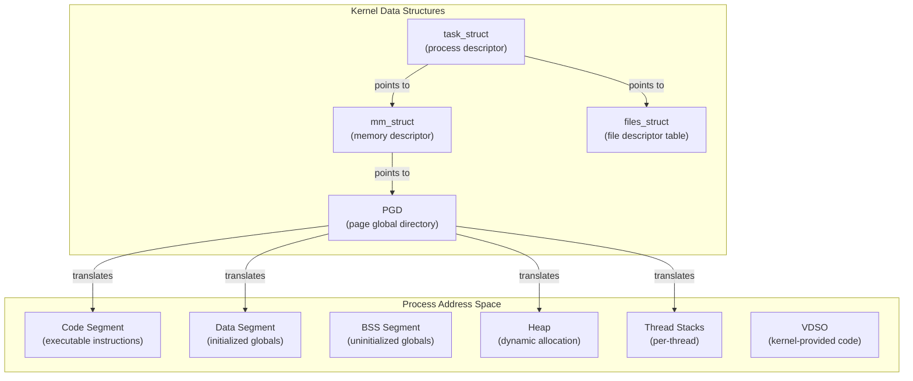
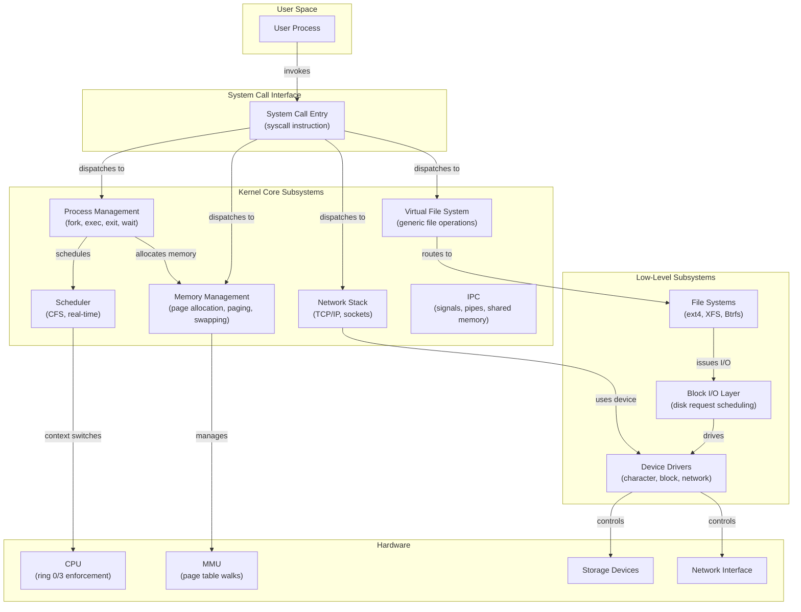
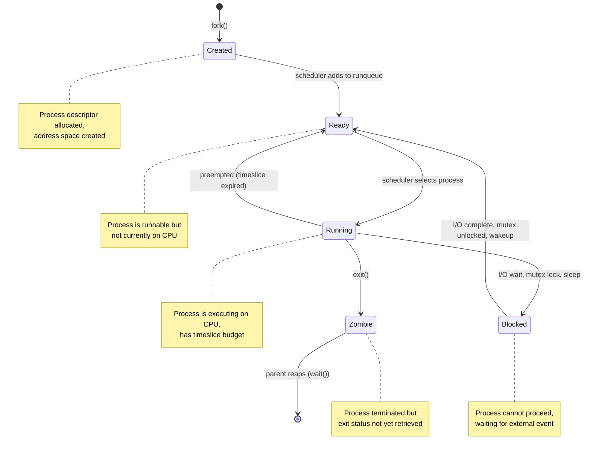

# Lesson 1: Foundations & Kernel/System Invariants

## Curriculum Roadmap

This lesson establishes the theoretical and architectural foundation for understanding modern operating systems and distributed infrastructure. We examine the irreducible guarantees that kernel designers must provide, the hardware-software interface contracts that enable these guarantees, and the fundamental trade-offs that constrain all system implementations. By the end of this lesson, you will understand why operating systems are structured the way they are, what invariants cannot be violated without breaking the system abstraction, and how hardware primitives enable software isolation.

## 1. First-Principles Problem Space & Execution Boundaries

### The Core Problem: Multiplexing Finite Resources

A general-purpose operating system solves a resource multiplexing problem: multiple mutually distrusting programs must share finite hardware resources (CPU cycles, memory, I/O channels) while maintaining the illusion that each program runs on a dedicated machine. This illusion requires three fundamental mechanisms:

1. **Virtualization**: Each program sees a private address space and appears to have exclusive CPU access
2. **Isolation**: A program cannot corrupt another program's state or violate system invariants
3. **Mediation**: The kernel controls all access to shared hardware resources

These mechanisms are not optional conveniences—they are *necessary conditions* for a multi-program system. Without virtualization, programs would need to coordinate their memory layout manually. Without isolation, any bug becomes a system-wide failure. Without mediation, programs could monopolize resources or interfere with hardware state.

### Execution Boundaries and Privilege Levels

Modern CPUs enforce execution boundaries through *protection rings*, a hierarchy of privilege levels that control what instructions can execute and what memory regions can be accessed. x86-64 defines four rings (0-3), though most systems use only two:

- **Ring 0 (Kernel mode)**: Unrestricted access to all CPU instructions, memory, and I/O ports. The kernel, device drivers, and hypervisor execute here.
- **Ring 3 (User mode)**: Restricted instruction set. Cannot execute privileged instructions (e.g., `lgdt`, `ltr`, `cli`), cannot access arbitrary physical memory, cannot manipulate page tables or interrupt state.

The CPU enforces these restrictions in hardware. Attempting to execute a privileged instruction in user mode triggers an exception, transferring control to a kernel-defined exception handler. This is not a software check—the CPU physically prevents the instruction from completing.

#### The Mode Transition Mechanism

Transitions between user and kernel mode occur through precisely defined entry points called *system call gates* (x86-64 `syscall`/`sysret`) or exception handlers. On x86-64, the `syscall` instruction:

1. Atomically switches from Ring 3 to Ring 0
2. Loads the kernel's code and stack segments
3. Saves the user-mode instruction pointer and stack pointer in model-specific registers (MSRs)
4. Jumps to a fixed kernel entry point loaded from the `IA32_LSTAR` MSR

This hardware mechanism ensures that user programs cannot arbitrarily jump into kernel code at attacker-chosen locations—they can only enter through controlled gates.

```c
// Linux kernel system call entry point (arch/x86/entry/entry_64.S, simplified)
ENTRY(entry_SYSCALL_64)
    swapgs                    // Swap GS register to access kernel per-CPU data
    movq    %rsp, PER_CPU_VAR(rsp_scratch)  // Save user stack pointer
    movq    PER_CPU_VAR(cpu_current_top_of_stack), %rsp  // Load kernel stack
    
    /* Construct pt_regs structure on kernel stack */
    pushq   $__USER_DS        // User data segment
    pushq   PER_CPU_VAR(rsp_scratch)  // User RSP
    pushq   %r11              // RFLAGS (saved by syscall instruction)
    pushq   $__USER_CS        // User code segment
    pushq   %rcx              // User RIP (return address)
    pushq   %rax              // System call number
    
    /* RAX now contains syscall number, arguments in RDI, RSI, RDX, R10, R8, R9 */
    call    do_syscall_64
    
    /* Return to user mode */
    movq    RCX(%rsp), %rcx   // Restore user RIP
    movq    R11(%rsp), %r11   // Restore RFLAGS
    movq    RSP(%rsp), %rsp   // Restore user RSP
    sysretq                   // Return to Ring 3
```

The cost of this transition is non-trivial: on modern CPUs, a null syscall (e.g., `getpid()`) takes 50-100ns, dominated by:

- TLB flush overhead (if Kernel Page-Table Isolation is enabled)
- Speculative execution pipeline flush
- Cache pollution from kernel code/data access

### Virtual Memory: The Address Space Abstraction

Each process operates within a *virtual address space*—a private, contiguous range of addresses (0 to 2^48-1 on x86-64 with 4-level paging) that the Memory Management Unit (MMU) translates to physical memory. The page table, a multi-level tree structure stored in physical memory, defines this translation:

```
Virtual Address (48 bits):
[47:39] [38:30] [29:21] [20:12] [11:0]
  PML4    PDPT     PD      PT    Offset

Physical Address = PageTable[PML4][PDPT][PD][PT].PhysicalFrameNumber || Offset
```

The kernel controls the page table. User programs cannot directly manipulate it—they request mappings through system calls (`mmap`, `munmap`, `mprotect`). This indirection enables critical guarantees:

- **Isolation**: Each process has a distinct page table. Process A cannot reference Process B's memory because the necessary translations are absent from A's page table.
- **Demand paging**: The kernel can mark pages as "not present," triggering a page fault when accessed. The kernel handles the fault (e.g., loading from disk) and resumes execution.
- **Protection**: Each page table entry includes permission bits (read, write, execute, user-accessible). The MMU enforces these in hardware.

```c
// Linux page table entry structure (simplified, x86-64)
typedef struct {
    unsigned long present    : 1;   // Page is in physical memory
    unsigned long rw         : 1;   // 1 = writable, 0 = read-only
    unsigned long user       : 1;   // 1 = user-accessible, 0 = kernel-only
    unsigned long pwt        : 1;   // Page write-through
    unsigned long pcd        : 1;   // Page cache disable
    unsigned long accessed   : 1;   // Set by CPU on access
    unsigned long dirty      : 1;   // Set by CPU on write
    unsigned long pse        : 1;   // Page size (0 = 4KB, 1 = large page)
    unsigned long global     : 1;   // Don't flush from TLB on context switch
    unsigned long _unused    : 3;
    unsigned long pfn        : 40;  // Physical frame number
    unsigned long _reserved  : 11;
    unsigned long nx         : 1;   // No-execute bit
} pte_t;
```

## 2. Fundamental System Guarantees & Non-Negotiable Invariants

An operating system must uphold a set of irreducible invariants. Violating these invariants breaks the system abstraction and leads to undefined behavior, data corruption, or security compromise.

### Memory Safety: The Spatial and Temporal Dimensions

Memory safety has two dimensions:

**Spatial safety**: A pointer dereference must access only memory within the bounds of the allocation it references. Violations include buffer overflows, out-of-bounds array access, and use-after-free (accessing freed memory while other allocations occupy the same address).

**Temporal safety**: A pointer must not outlive the allocation it references. Use-after-free is both a spatial and temporal violation—the pointer is spatially valid (points to a real address) but temporally invalid (the allocation no longer exists).

Modern CPUs provide hardware support for spatial safety through MMU permissions, but these operate at page granularity (4KB on x86-64). Finer-grained protection requires software techniques:

- **Stack canaries**: A random value placed between local variables and the return address. Buffer overflows corrupt the canary, detected before returning.
- **Address Space Layout Randomization (ASLR)**: Randomizing the base addresses of stack, heap, and libraries makes exploits non-deterministic.
- **Memory tagging** (ARMv8.5-A MTE): Each 16-byte granule of memory has a 4-bit tag. Pointers include a tag; the CPU checks tag equality on every dereference.

In practice, the kernel guarantees spatial safety for its own data structures, but user-space programs in unsafe languages (C, C++) must implement their own protections. Safe languages (Rust, Go) enforce memory safety through compile-time or runtime checks.

### Data Consistency: Atomicity and Ordering

Multi-core systems require mechanisms to ensure that concurrent memory operations produce consistent results. Consider two CPUs simultaneously incrementing a shared counter:

```c
// Thread A and Thread B both execute:
int temp = counter;
temp = temp + 1;
counter = temp;
```

Without synchronization, both threads might read `counter = 0`, increment to 1, and write back 1, losing one increment. The fundamental issue is that the increment is not *atomic*—it consists of multiple memory operations that can be interleaved.

Modern CPUs provide atomic read-modify-write instructions (`lock add`, `lock cmpxchg` on x86-64, `ldxr`/`stxr` on ARM) that guarantee atomicity. The `lock` prefix on x86-64 asserts the bus lock or cache-line lock, preventing other CPUs from accessing the memory location during the operation.

```c
// Atomic increment using GCC intrinsics
__atomic_add_fetch(&counter, 1, __ATOMIC_SEQ_CST);

// Compiled to (x86-64):
lock addl $1, counter(%rip)
```

Beyond atomicity, memory ordering defines when writes become visible to other CPUs. Modern CPUs reorder memory operations for performance unless instructed otherwise. The x86-64 Total Store Order (TSO) model guarantees:

- Loads are not reordered with earlier loads
- Stores are not reordered with earlier stores
- Stores are not reordered with earlier loads

But it allows loads to be reordered with later stores, requiring explicit memory barriers (e.g., `mfence`) to enforce ordering where needed.

### Process Isolation: The Security Boundary

Process isolation ensures that a compromised or malicious process cannot:

1. Read or write another process's memory
2. Intercept another process's I/O
3. Exhaust system resources (CPU, memory, disk) to the exclusion of other processes
4. Forge its identity to impersonate another process

The kernel enforces isolation through multiple mechanisms:

**Address space separation**: Each process has a distinct page table. The MMU prevents one process from accessing another's memory because the necessary translations are absent.

**Capability-based security**: System resources (files, sockets, devices) are represented by *file descriptors*, kernel-managed integers that index into a per-process file descriptor table. Process A cannot use Process B's file descriptors because they index into distinct tables.

**UID/GID-based access control**: Each process has an effective user ID (UID) and group ID (GID). The kernel checks these credentials against file permissions, socket ownership, and signal delivery permissions.

**Namespace isolation** (Linux): Processes can have distinct views of system resources. A process in a separate PID namespace cannot see or signal processes outside its namespace. A process in a separate mount namespace sees a different filesystem hierarchy.

```c
// Linux task_struct (simplified, include/linux/sched.h)
struct task_struct {
    pid_t pid;                          // Process ID
    struct mm_struct *mm;               // Memory descriptor (page tables)
    struct files_struct *files;         // Open file descriptors
    const struct cred *cred;            // Security credentials (UID, GID, capabilities)
    struct nsproxy *nsproxy;            // Namespace proxy (PID, mount, network, etc.)
    struct task_struct *parent;         // Parent process
    struct list_head children;          // Child processes
    struct list_head sibling;           // Sibling processes
    
    // Scheduling state
    int prio;                           // Dynamic priority
    int static_prio;                    // Static priority (nice value)
    unsigned int policy;                // Scheduling policy (SCHED_NORMAL, SCHED_FIFO, etc.)
    struct sched_entity se;             // Scheduler entity (CFS)
    struct sched_rt_entity rt;          // Real-time scheduling entity
    
    // CPU state
    struct thread_struct thread;        // CPU register context
    void *stack;                        // Kernel stack
};
```

### Liveness Guarantees: Forward Progress

A system must ensure *liveness*—every process capable of making progress eventually does so. Liveness is violated by:

**Deadlock**: Circular wait on resources. Process A holds lock L1 and waits for L2; Process B holds L2 and waits for L1. Neither can proceed.

**Livelock**: Processes repeatedly change state in response to each other but make no forward progress. Example: Two processes trying to be "polite" by repeatedly yielding to each other.

**Starvation**: A process is perpetually denied a resource it requests. Example: A low-priority process never runs because high-priority processes consume all CPU time.

The kernel prevents deadlock in its own locking by establishing a lock ordering: locks must be acquired in a fixed order (e.g., always acquire the process list lock before any individual process lock). This prevents cycles.

Starvation is prevented by the scheduler. Linux's Completely Fair Scheduler (CFS) guarantees that every runnable process receives a share of CPU time proportional to its weight, preventing indefinite starvation.

## 3. High-Level Process & Subsystem Architecture

### The Process Abstraction Hierarchy

A process is the kernel's unit of resource ownership and isolation. Within a process, execution proceeds in one or more *threads*, which share the process's address space but have independent execution state (register context, stack).



### Kernel Subsystem Interactions

The kernel is organized into subsystems that manage distinct resource classes. These subsystems interact through well-defined interfaces:



### Process Lifecycle State Machine

A process transitions through well-defined states during its lifetime:



### Scheduler Operation: The CFS Algorithm

Linux's Completely Fair Scheduler (CFS) models an "ideal multi-tasking CPU" where every process runs simultaneously at a fraction of CPU speed proportional to its weight. In practice, processes run sequentially, but CFS tracks each process's *virtual runtime*—the time it would have run on the ideal CPU—and schedules the process with the smallest virtual runtime.

```c
// Simplified CFS scheduler core (kernel/sched/fair.c)

// Each process has a scheduling entity embedded in its task_struct
struct sched_entity {
    u64 vruntime;              // Virtual runtime
    u64 exec_start;            // When process last started executing
    struct rb_node run_node;   // Red-black tree node for runqueue
};

// Per-CPU runqueue for SCHED_NORMAL processes
struct cfs_rq {
    struct rb_root_cached tasks_timeline;  // Red-black tree of runnable tasks
    struct sched_entity *curr;              // Currently running task
    u64 min_vruntime;                       // Minimum vruntime in tree (monotonic)
};

// Select next task to run
static struct sched_entity *pick_next_entity(struct cfs_rq *cfs_rq) {
    // Leftmost node in red-black tree has smallest vruntime
    struct rb_node *left = rb_first_cached(&cfs_rq->tasks_timeline);
    if (!left)
        return NULL;
    return rb_entry(left, struct sched_entity, run_node);
}

// Update vruntime when task runs
static void update_curr(struct cfs_rq *cfs_rq) {
    struct sched_entity *curr = cfs_rq->curr;
    u64 now = rq_clock_task(rq_of(cfs_rq));
    u64 delta_exec = now - curr->exec_start;
    
    curr->exec_start = now;
    curr->vruntime += calc_delta_fair(delta_exec, curr);  // Weighted by nice value
    cfs_rq->min_vruntime = max(cfs_rq->min_vruntime, curr->vruntime);
}

// Calculate weighted delta: higher weight -> slower vruntime growth
static u64 calc_delta_fair(u64 delta, struct sched_entity *se) {
    if (unlikely(se->load.weight != NICE_0_LOAD))
        delta = __calc_delta(delta, NICE_0_LOAD, &se->load);
    return delta;
}
```

The red-black tree provides O(log N) insertion, deletion, and minimum extraction. When a process's timeslice expires (typically 4-6ms on Linux), the scheduler:

1. Updates its `vruntime` by the time it ran (weighted by priority)
2. Removes it from the tree
3. Selects the process with the smallest `vruntime` (leftmost node)
4. Context-switches to the new process

This algorithm guarantees that every process receives CPU time proportional to its weight, preventing starvation while allowing priority-based differentiation.

### Context Switch Mechanics

A *context switch* transfers execution from one process to another. This requires saving the outgoing process's CPU state and restoring the incoming process's state:

```c
// Simplified context switch (arch/x86/kernel/process_64.c)
__switch_to(struct task_struct *prev, struct task_struct *next) {
    // 1. Switch kernel stack pointer (RSP)
    this_cpu_write(cpu_current_top_of_stack, task_top_of_stack(next));
    
    // 2. Switch page table (CR3 register)
    if (prev->mm != next->mm)
        load_cr3(next->mm->pgd);
    
    // 3. Save/restore general-purpose registers (done by assembly wrapper)
    //    RBX, RBP, R12-R15 saved on stack
    
    // 4. Switch floating-point state (FPU, SSE, AVX registers)
    switch_fpu_finish(next);
    
    // 5. Switch thread-local storage (FS/GS base registers)
    load_TLS(next, cpu);
    if (prev->fsbase != next->fsbase)
        wrmsrl(MSR_FS_BASE, next->fsbase);
    
    // 6. Update current task pointer
    this_cpu_write(current_task, next);
}
```

The cost of a context switch includes:

- **Direct cost**: Saving/restoring ~50 registers, updating page table pointer (50-100 cycles)
- **Indirect cost**: TLB flush (all address translations invalidated), cache pollution (incoming process's code/data evicts outgoing process's cache lines)

On modern CPUs, a full context switch costs 1-5μs, dominated by indirect costs.

### Memory Management: Page Allocation and Reclaim

The kernel manages physical memory through the *page allocator*, which organizes free pages into *freelists* indexed by allocation order (2^order contiguous pages). The *buddy allocator* algorithm merges adjacent free pages to form larger blocks, reducing fragmentation:

```c
// Allocate 2^order contiguous pages
struct page *alloc_pages(gfp_t gfp_mask, unsigned int order) {
    // Search freelists from requested order upward
    for (current_order = order; current_order <= MAX_ORDER; current_order++) {
        if (!list_empty(&free_list[current_order])) {
            struct page *page = list_first_entry(&free_list[current_order]);
            list_del(&page->lru);
            
            // Split higher-order blocks if necessary
            while (current_order > order) {
                current_order--;
                struct page *buddy = page + (1 << current_order);
                list_add(&buddy->lru, &free_list[current_order]);
            }
            return page;
        }
    }
    
    // No memory available at requested order
    return NULL;
}

// Free 2^order contiguous pages
void free_pages(struct page *page, unsigned int order) {
    // Try to merge with buddy blocks to form larger blocks
    while (order < MAX_ORDER - 1) {
        unsigned long buddy_idx = __find_buddy_index(page_to_pfn(page), order);
        struct page *buddy = page + (buddy_idx - page_to_pfn(page));
        
        if (!PageBuddy(buddy) || page_order(buddy) != order)
            break;  // Buddy not free or different order
        
        // Remove buddy from freelist and merge
        list_del(&buddy->lru);
        page = min(page, buddy);  // Lower address becomes merged block
        order++;
    }
    
    list_add(&page->lru, &free_list[order]);
}
```

When physical memory is exhausted, the kernel evicts pages to disk (*swapping*) or discards clean pages that can be reloaded later (*page cache eviction*). The kernel uses the Least Recently Used (LRU) algorithm approximation to select victims: pages are organized into active and inactive LRU lists, and the kernel scans the inactive list to find pages to evict.

### File System Abstraction: The VFS Layer

The Virtual File System (VFS) provides a unified interface to diverse file systems (ext4, XFS, NFS, procfs). Applications interact with abstract file operations (`open`, `read`, `write`, `close`) that the VFS dispatches to file-system-specific implementations:

```c
// VFS inode structure (simplified, include/linux/fs.h)
struct inode {
    umode_t i_mode;                     // File type and permissions
    uid_t i_uid;                        // Owner user ID
    gid_t i_gid;                        // Owner group ID
    loff_t i_size;                      // File size in bytes
    struct timespec64 i_atime;          // Last access time
    struct timespec64 i_mtime;          // Last modification time
    struct timespec64 i_ctime;          // Last status change time
    
    const struct inode_operations *i_op;  // Inode operations (create, lookup, link, etc.)
    const struct file_operations *i_fop;   // File operations (read, write, mmap, etc.)
    struct address_space *i_mapping;       // Page cache for this file
    
    struct super_block *i_sb;              // Superblock (file system instance)
    void *i_private;                       // File-system-specific data
};

// File operations (methods implemented by each file system)
struct file_operations {
    ssize_t (*read)(struct file *, char __user *, size_t, loff_t *);
    ssize_t (*write)(struct file *, const char __user *, size_t, loff_t *);
    int (*open)(struct inode *, struct file *);
    int (*release)(struct inode *, struct file *);
    int (*mmap)(struct file *, struct vm_area_struct *);
    // ... many more operations
};
```

When a user calls `read(fd, buf, count)`, the kernel:

1. Looks up the `struct file` corresponding to `fd` in the process's file descriptor table
2. Calls `file->f_op->read(file, buf, count, &file->f_pos)`, dispatching to the file-system-specific read implementation
3. The file system translates the logical file offset to physical disk blocks and reads them
4. Copies data from the kernel buffer to the user buffer (`buf`)

This layering allows diverse file systems to coexist without applications needing file-system-specific code.

---

## Summary

Modern operating systems uphold a set of irreducible invariants—memory safety, isolation, data consistency—through hardware-enforced mechanisms (privilege levels, virtual memory, atomic instructions) and software abstractions (system calls, scheduling, VFS). Understanding these invariants and the trade-offs they impose is essential for designing, optimizing, and troubleshooting infrastructure systems. The kernel's subsystems interact through well-defined interfaces, forming a layered architecture that manages complexity while providing predictable, reliable service to applications.
