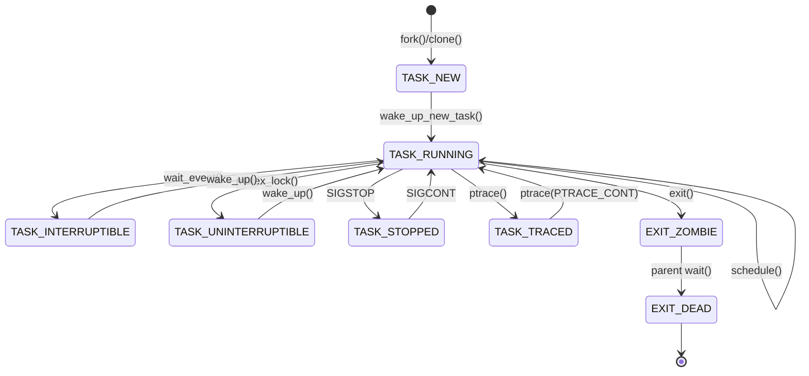

```markdown
# Lesson 2: Core Architecture & Memory/Execution Models

## 1. Process, Threading & Execution Lifecycles

### The Process Abstraction

A process is the fundamental unit of resource isolation and execution in Unix-like operating systems. At the kernel level, a process is represented by a `task_struct` (in Linux) containing all state required to manage program execution: memory mappings, open file descriptors, signal handlers, scheduling parameters, and processor context. Threads, often called lightweight processes (LWPs), share the same memory address space and most resources with their siblings, but maintain independent execution contexts (program counter, stack, registers).

The distinction is crucial: process creation via `fork()` duplicates the entire address space (copy-on-write optimization notwithstanding), while thread creation via `clone()` or `pthread_create()` shares the address space but allocates separate stacks and thread-local storage. This design trades isolation for efficiency—threads communicate through shared memory with minimal overhead, while processes require explicit inter-process communication (IPC) mechanisms.

### Process Control Block Architecture

The `task_struct` in Linux (typically 1.7KB on x86-64) serves as the process descriptor. Key fields include:

```c
struct task_struct {
    volatile long state;              // Process state: TASK_RUNNING, TASK_INTERRUPTIBLE, etc.
    void *stack;                      // Kernel stack pointer
    struct mm_struct *mm;             // Memory descriptor
    struct mm_struct *active_mm;      // Active address space (used by kernel threads)
    pid_t pid;                        // Process ID
    pid_t tgid;                       // Thread group ID
    struct task_struct *parent;       // Parent process
    struct list_head children;        // Child process list
    struct list_head sibling;         // Sibling list entry
    
    // Scheduling
    int prio, static_prio, normal_prio;
    unsigned int policy;
    struct sched_entity se;
    struct sched_rt_entity rt;
    
    // Filesystem context
    struct fs_struct *fs;
    struct files_struct *files;       // Open file descriptors
    struct nsproxy *nsproxy;          // Namespace proxy
    
    // Signal handling
    struct signal_struct *signal;
    struct sighand_struct *sighand;
    sigset_t blocked, real_blocked;
    
    // CPU context
    struct thread_struct thread;      // Arch-specific register state
};
```

The `mm_struct` encapsulates the virtual address space:

```c
struct mm_struct {
    pgd_t *pgd;                       // Page global directory (top-level page table)
    atomic_t mm_users;                // Address space users
    atomic_t mm_count;                // Primary reference count
    
    unsigned long start_code, end_code;
    unsigned long start_data, end_data;
    unsigned long start_brk, brk;     // Heap boundaries
    unsigned long start_stack;
    unsigned long arg_start, arg_end;
    unsigned long env_start, env_end;
    
    struct vm_area_struct *mmap;      // VMA list
    struct rb_root mm_rb;             // VMA red-black tree
    unsigned long mmap_base;          // Base of mmap region
    unsigned long task_size;          // User-space size limit
    
    spinlock_t page_table_lock;
    struct list_head mmlist;          // Global mmlist
};
```

### Execution Lifecycle States

A process transitions through well-defined states managed by the scheduler:



**State semantics:**

- **TASK_RUNNING**: On a CPU or in the run queue, eligible for scheduling
- **TASK_INTERRUPTIBLE**: Blocked waiting for an event, can be interrupted by signals
- **TASK_UNINTERRUPTIBLE**: Blocked in kernel code, uninterruptible (counted in load average)
- **TASK_STOPPED**: Stopped by job control signals (SIGSTOP, SIGTTIN, SIGTTOU)
- **TASK_TRACED**: Stopped by a debugger via `ptrace()`
- **EXIT_ZOMBIE**: Terminated but awaiting parent to collect exit status via `wait()`
- **EXIT_DEAD**: Final state after parent reaps the zombie

### Process Creation: fork() Implementation

Process creation via `fork()` is a multi-stage operation:

1. **Clone task_struct**: `dup_task_struct()` allocates and copies the parent's task structure
2. **Copy resources**: Depending on flags, duplicate or share file descriptors, signal handlers, memory maps
3. **Copy address space**: `dup_mm()` duplicates `mm_struct` and marks pages copy-on-write
4. **Allocate PID**: Obtain unique process identifier from PID namespace
5. **Initialize scheduling entity**: Set up CFS (Completely Fair Scheduler) or RT scheduling parameters
6. **Wake new task**: `wake_up_new_task()` places the child on the run queue

```c
// Simplified fork() kernel path (kernel/fork.c)
long do_fork(unsigned long clone_flags,
             unsigned long stack_start,
             unsigned long stack_size,
             int __user *parent_tidptr,
             int __user *child_tidptr)
{
    struct task_struct *p;
    struct pid *pid;
    int trace = 0;
    long nr;

    // Allocate and initialize task_struct
    p = copy_process(clone_flags, stack_start, stack_size,
                     parent_tidptr, child_tidptr, NULL, trace, NULL, NULL);

    if (IS_ERR(p))
        return PTR_ERR(p);

    // Get PID structure
    pid = get_task_pid(p, PIDTYPE_PID);
    nr = pid_vnr(pid);

    // Wake up the new process
    wake_up_new_task(p);

    // Return child PID to parent, 0 to child (in separate context)
    return nr;
}

static struct task_struct *copy_process(unsigned long clone_flags, ...)
{
    struct task_struct *p;
    
    // Duplicate task_struct
    p = dup_task_struct(current);
    
    // Copy/share memory descriptor
    if (clone_flags & CLONE_VM) {
        // Thread: share address space
        p->mm = current->mm;
        atomic_inc(&p->mm->mm_users);
    } else {
        // Process: duplicate address space
        p->mm = dup_mm(current);
    }
    
    // Copy/share file descriptor table
    if (clone_flags & CLONE_FILES)
        p->files = current->files;
    else
        p->files = dup_fd(current->files);
    
    // Copy/share signal handlers
    if (clone_flags & CLONE_SIGHAND)
        p->sighand = current->sighand;
    else
        copy_sighand(p, current);
    
    // Allocate PID
    p->pid = alloc_pid(p->nsproxy->pid_ns_for_children);
    
    // Initialize scheduling entity
    sched_fork(clone_flags, p);
    
    return p;
}
```

### Copy-on-Write Optimization

To avoid expensive full address space duplication, Linux marks all parent pages read-only and shares them with the child. When either process writes to a shared page, a page fault occurs:

```c
// arch/x86/mm/fault.c (simplified)
static noinline int do_wp_page(struct vm_fault *vmf)
{
    struct vm_area_struct *vma = vmf->vma;
    
    // Get the old page
    struct page *old_page = vmf->page;
    
    // If page has single reference, just make it writable
    if (page_mapcount(old_page) == 1 && PageLRU(old_page)) {
        wp_page_reuse(vmf);
        return VM_FAULT_WRITE;
    }
    
    // Allocate new page and copy contents
    struct page *new_page = alloc_page_vma(GFP_HIGHUSER_MOVABLE, vma, vmf->address);
    copy_user_highpage(new_page, old_page, vmf->address, vma);
    
    // Update page table to point to new page with write permission
    entry = mk_pte(new_page, vma->vm_page_prot);
    entry = maybe_mkwrite(pte_mkdirty(entry), vma);
    set_pte_at(vma->vm_mm, vmf->address, vmf->pte, entry);
    
    return VM_FAULT_WRITE;
}
```

### Context Switching

When the scheduler selects a new task, `context_switch()` performs the transition:

1. **Switch memory context**: Load new process's page table base (CR3 on x86-64) via `switch_mm()`
2. **Switch execution context**: Save/restore registers, stack pointer, instruction pointer via `switch_to()`

```c
// kernel/sched/core.c (simplified)
static __always_inline struct rq *
context_switch(struct rq *rq, struct task_struct *prev, struct task_struct *next)
{
    struct mm_struct *mm, *oldmm;
    
    prepare_task_switch(rq, prev, next);
    
    mm = next->mm;
    oldmm = prev->active_mm;
    
    //
