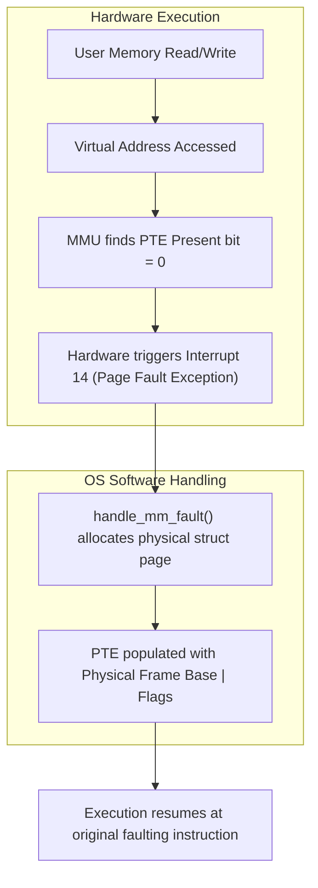

# Lesson 2: Core Architecture & Memory/Execution Models

## 1. First-Principles Intuition & Invariants

An operating system kernel's primary architectural responsibility is resource virtualization: transforming raw, physically constrained CPU cores, DRAM banks, and I/O buses into clean, isolated execution and memory spaces. Every modern operating system executes under a fundamental physical invariant:

> *No user-space instruction can directly access hardware registers, physical memory addresses, or interrupt lines without passing through the processor's hardware-enforced privilege rings (Ring 0 / Supervisor Mode).*

This isolation relies on two cooperative hardware-software mechanisms:
1. **The Execution Model**: Preemptive timesharing through timer interrupts, hardware context saving, and scheduling state machines that maintain the illusion of continuous, dedicated CPU ownership.
2. **The Memory Model**: Hardware-enforced virtual memory addressing mediated by the Memory Management Unit (MMU), multi-level page tables, and Translation Lookaside Buffers (TLB).

```mermaid
flowchart TD
    subgraph execution ["1. Execution & Context Switching"]
        USER_P["User Process\n(Ring 3 / CPL=3)"] -->|Syscall / Timer Interrupt| TRAP["Hardware Trap Handler\n(Saves Registers to Kernel Stack)"]
        TRAP --> RING0["Kernel Scheduler\n(Ring 0 / Supervisor)"]
        RING0 --> SCHED["schedule() State Evaluation\n(Select Next task_struct)"]
        SCHED --> CTX["context_switch()\n1. switch_mm() (Reload CR3/Page Table)\n2. switch_to() (Swap SP, IP, GPRs)"]
        CTX --> NEXT_P["Next Process Execution\n(Restore Context & iretq)"]
    end

    subgraph memory ["2. Virtual Memory Address Translation"]
        VA["Virtual Address\n(PGD -> P4D -> PUD -> PMD -> PTE)"] --> MMU["Hardware MMU Walk"]
        MMU -->|TLB Hit (1-2 cycles)| PA["Physical RAM Frame"]
        MMU -->|TLB Miss| WALK["Page Table Walk\n(Page Fault if Present=0)"]
        WALK --> PA
    end

    style execution fill:#1e293b,stroke:#38bdf8,color:#f8fafc
    style memory fill:#0f172a,stroke:#a855f7,color:#f8fafc
```

---

## 2. Process, Threading & Execution Lifecycles

### 2.1 The Process and Task Abstraction

In the Linux kernel, processes and threads are unified under the `struct task_struct` representation. A thread is simply a task that shares its virtual address space (`mm_struct`), file descriptor table (`files_struct`), and signal handlers (`sighand_struct`) with its parent process via flags passed to `clone()` (`CLONE_VM`, `CLONE_FS`, `CLONE_FILES`):

```c
// Simplified representation of task_struct memory and credential linkage
struct task_struct {
    volatile long state;               /* -1 unrunnable, 0 runnable, >0 stopped */
    void *stack;                       /* Kernel execution stack */
    pid_t pid;                         /* Thread ID (POSIX TID) */
    pid_t tgid;                        /* Thread Group ID (POSIX PID) */
    struct mm_struct *mm;              /* Virtual memory descriptor */
    struct mm_struct *active_mm;       /* Active page table (for kernel threads) */
    struct files_struct *files;        /* Open file descriptor table */
    struct signal_struct *signal;      /* Shared signal handlers */
    struct thread_struct thread;       /* CPU-specific hardware context (SP, IP) */
};
```

### 2.2 Process Creation: fork(), exec(), and Copy-on-Write (COW)

Spawning a new process via `fork()` avoids expensive full-memory cloning through hardware Copy-on-Write (COW):
1. `clone()` duplicates the parent's `task_struct` and page tables, but marks all writable page table entries (PTEs) in both parent and child as **Read-Only** (`Present=1, Writable=0`) with their reference counts incremented.
2. Execution proceeds immediately with near-zero allocation latency.
3. When either process attempts to write to a page, the MMU traps a **Page Fault** (`CR2` contains faulting address, error code bit 1 = write access).
4. The kernel's page fault handler (`do_wp_page()`) allocates a new physical frame, copies the 4KB data, updates the faulting process's PTE to point to the new frame with `Writable=1`, flushes the local TLB, and resumes execution.

### 2.3 Preemptive Context Switching Mechanics

When the scheduler switches from `prev` to `next`, `context_switch()` carries out two discrete transitions:
- `switch_mm()`: Replaces the virtual memory map by writing the physical address of the next process's top-level page table (PGD) into control register `CR3`. This invalidates non-global TLB entries.
- `switch_to()`: Swaps the kernel stack pointer (`RSP`), base pointer (`RBP`), and callee-saved registers. Loading `RSP` causes the subsequent `RET` instruction to pop the next task's instruction pointer (`RIP`), resuming its execution stream seamlessly.

---

## 3. Memory Architecture: Paging, Demand Faults & Address Spaces

Modern 64-bit architectures (x86-64 / ARM64) employ 4-level or 5-level hierarchical page tables to translate a 48-bit or 57-bit virtual address into a physical memory address:

```text
Virtual Address [47:0]:
[47:39] Page Global Directory (PGD) - 9 bits (512 entries)
[38:30] Page Upper Directory (PUD)   - 9 bits (512 entries)
[29:21] Page Middle Directory (PMD)  - 9 bits (512 entries)
[20:12] Page Table Entry (PTE)       - 9 bits (512 entries)
[11:0]  Physical Offset              - 12 bits (4096 bytes per page)
```

### 3.1 Demand Paging and Page Fault Handling

When a process requests memory via `mmap()` or `brk()`, the kernel merely creates or expands a Virtual Memory Area (`vm_area_struct`) without allocating physical DRAM. Physical memory is allocated on demand:



---

## 4. Summary & Verification Matrix

| Architectural Subsystem | Primary Abstraction | Key Kernel Data Structure | Hardware Enforcement Point |
|:---|:---|:---|:---|
| **Process State** | Thread / Task Execution | `struct task_struct` | Ring 0 / Ring 3 Privilege Levels |
| **Memory Isolation** | Virtual Address Space | `struct mm_struct` + Page Tables | MMU + CR3 Register |
| **Dynamic Allocation** | Memory Areas | `struct vm_area_struct` | Interrupt 14 (Page Fault) |
| **Context Transition** | Preemptive Switch | `switch_to()` + `switch_mm()` | Stack Pointer + TLB Invalidation |
