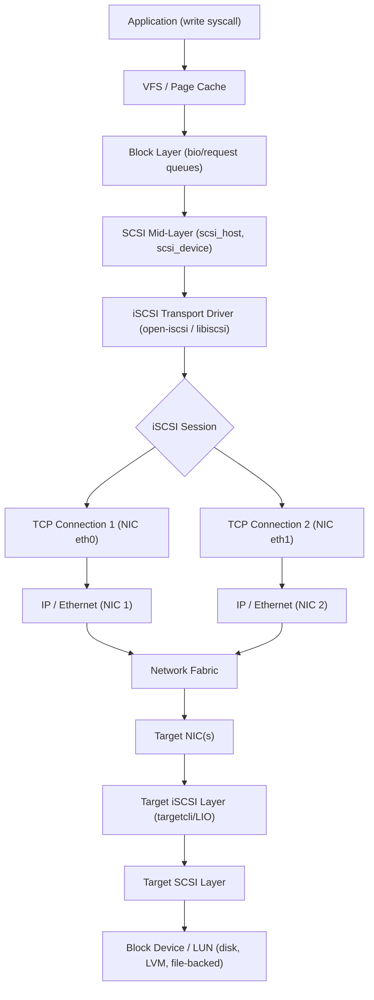

# Lesson 1: Protocol Architecture Fundamentals

## 1. First-Principles Intuition & Invariants

Storage and networking evolved along independent axes for most of computing history. SCSI — the Small Computer Systems Interface — emerged in the 1980s as a parallel bus protocol for attaching disks, tapes, and optical drives to workstations. It was fast, deterministic, and deeply coupled to physical proximity: the cable lengths were measured in meters, not kilometers. TCP/IP meanwhile grew into the universal transport fabric of the internet, designed from the beginning to tolerate arbitrary latency, packet loss, and geographic distance. For decades these two worlds remained separate. Fibre Channel SAN fabrics bridged them partially, delivering block storage over a dedicated transport with low latency and lossless semantics, but at the cost of proprietary hardware, specialized HBAs, and an operational model that demanded dedicated SAN engineers.

iSCSI — Internet SCSI — represents the architectural decision to discard the proprietary transport entirely and carry SCSI protocol data units (PDUs) over ordinary TCP connections. RFC 3720, published in April 2004, formalized this design after several years of IETF working group development led primarily by Cisco and IBM. The fundamental invariant of iSCSI is both elegant and consequential: a SCSI command is a command regardless of what carries it. The SCSI architecture model defines a layered stack in which the command set (READ, WRITE, INQUIRY, RESERVE) is entirely independent of the physical transport. Fibre Channel, SAS, USB Attached SCSI, and iSCSI are all transport mappings for the same SCSI command architecture. iSCSI maps that architecture onto TCP/IP, which means that any IP-routable network — a data center Ethernet fabric, a wide-area network, even the public internet with appropriate security — becomes a potential storage transport.

Understanding why this matters from first principles requires appreciating what TCP gives iSCSI for free and what it takes away. TCP provides reliable, ordered, byte-stream delivery. A SCSI command issued to a target will either complete with a confirmed response or the connection will fail — there is no silent discard. TCP's congestion control, flow control, and retransmission machinery handle the unreliable physical substrate completely transparently to the SCSI layer above. This is the core value exchange: iSCSI trades the deterministic, lossless, microsecond-latency guarantees of Fibre Channel for universal IP reachability, commodity hardware, and dramatically lower infrastructure cost. The tradeoff is not free — TCP's congestion window mechanics and head-of-line blocking within a stream introduce latency variance that FC avoids — but modern 10/25/100 GbE networks with DCQCN or similar congestion management have compressed that gap considerably in production environments.

The architectural layering of iSCSI sits atop a clean stack of abstractions. At the bottom lies the physical and data-link layer: typically an Ethernet NIC, though iSCSI can run over any IP transport. Above that sits IP routing and TCP, which handle all transport concerns. The iSCSI layer itself maps SCSI commands, data, and status messages into iSCSI PDUs and manages the session and connection state machine. Above iSCSI sits the SCSI transport layer, which the operating system's SCSI mid-layer interacts with through a host bus adapter (HBA) driver — in the software iSCSI case, this is a kernel driver like `open-iscsi` on Linux, which presents itself to the SCSI mid-layer identically to how a physical HBA driver would. Above the mid-layer sits the SCSI command set — disk, tape, medium changer — and above that, the block I/O subsystem and filesystems that applications ultimately read and write.

This layered invariance means that an application performing `write(2)` to a file on an ext4 filesystem mounted on an iSCSI-attached LUN is completely unaware of the network transit below it. The VFS layer, the page cache, the block layer, the SCSI mid-layer, the iSCSI driver, the TCP stack, and the NIC driver each handle their own concerns in strict separation. The iSCSI specification preserves this separation with discipline: it does not modify SCSI semantics, it does not define new commands, and it does not alter the SCSI architecture model. It is purely a transport mapping.

The naming system iSCSI introduced to identify nodes on the storage network is worth examining carefully because it carries real operational weight. Every iSCSI node — both initiators (clients) and targets (storage devices) — must have a globally unique name. The specification defines two primary name formats. The **iSCSI Qualified Name (IQN)** follows the structure `iqn.YYYY-MM.reversed-domain:arbitrary-string`, where the year and month denote when the organization registered the domain, the reversed domain is the organization's DNS domain in reversed notation, and the arbitrary string is an organization-defined identifier. A production target might carry a name like `iqn.2003-01.com.redhat:storage-node-01-lun0`. The **EUI (Extended Unique Identifier) format** uses IEEE EUI-64 identifiers in the form `eui.XXXXXXXXXXXXXXXX`, where the 64-bit value is typically derived from a NIC's MAC address or burned into storage hardware. A third format, NAA (Network Address Authority), appears in iSCSI contexts derived from Fibre Channel worlds.

IQNs are the dominant naming convention in software-defined and open-source iSCSI deployments. Their structure encodes organizational ownership without requiring a central registry — the DNS domain delegation system provides the uniqueness guarantee. The year-month component is not a creation date but a registration date: if Red Hat has owned `redhat.com` since 1993 but began issuing IQNs in 2003, the IQN prefix would reflect the 2003 registration. This is a practical artifact of the naming convention design, not a timestamp. Administrators who ignore IQN uniqueness requirements and deploy duplicate names across initiators in the same fabric will encounter session establishment failures or, worse, data corruption when two initiators present the same identity to a target that tracks initiator state.

The node role model in iSCSI is strict and binary. An **initiator** is the node that originates SCSI commands — it is the client. An **target** is the node that receives commands and owns the storage — it is the server. In a Linux environment, `open-iscsi` running on an application server is the initiator; `targetcli` or `tgt` running on a storage appliance is the target. This distinction is not merely semantic: the protocol's PDU types, the state machine transitions, the authentication roles, and the error recovery logic all differentiate initiator and target behaviors explicitly. A single physical machine can run both an initiator and a target simultaneously — this is common in hyperconverged infrastructure where a node exports storage to peers while also consuming storage from them — but the initiator and target instances are logically distinct nodes from the protocol's perspective, each with their own IQN.

The session and connection model is where iSCSI's transport architecture becomes non-obvious and deserves careful study. A **session** is the high-level association between an initiator and a target, identified by the ISID (Initiator Session Identifier) assigned by the initiator and the TSIH (Target Session Identifying Handle) assigned by the target. A session persists across individual TCP connections and survives transient network failures, provided the error recovery timers have not expired. Within a session, iSCSI supports one or more **connections**, each carried over an independent TCP stream. This many-connections-per-session model, called Multi-Connection per Session (MC/S), enables load distribution across multiple network interfaces or paths. Each connection in a session carries full PDUs; the session layer multiplexes command sequences across connections using the CmdSN (Command Sequence Number) ordering scheme to maintain global SCSI task ordering semantics.

The CmdSN is a 32-bit monotonically increasing counter maintained at the session level. Every command PDU carries the sender's current CmdSN, and the target uses it to enforce ordering. The ExpCmdSN and MaxCmdSN fields in target responses create a command window — analogous to TCP's receive window — that controls how many outstanding commands the initiator may issue. This window mechanism is fundamental to iSCSI's flow control at the SCSI layer, independent of TCP's own flow control. Understanding this dual-layer flow control is essential for diagnosing latency anomalies in production: a stalled iSCSI command queue may be caused by TCP congestion, by an exhausted iSCSI command window, or by target-side processing backpressure, and each requires a different diagnostic and remediation approach.

## 2. Core Architecture & Mechanics

The PDU is iSCSI's atomic unit of communication. Every operation — login, command, data transfer, status, error — is expressed as a PDU with a fixed 48-byte Basic Header Segment (BHS) followed by optional Additional Header Segments (AHS), Header Digest, Data Segment, and Data Digest fields. The BHS layout is worth examining at byte resolution because every field directly controls protocol behavior.

```text
iSCSI PDU Basic Header Segment (48 bytes)

Byte  0: Opcode[5:0] | I-bit | Reserved
Byte  1: Flags (opcode-specific, e.g. F-bit = Final)
Byte  2-3: Opcode-specific fields
Byte  4-7: TotalAHSLength[7:0] | DataSegmentLength[23:0]
Byte  8-15: LUN (Logical Unit Number, 8 bytes)
Byte  16-19: Initiator Task Tag (ITT)
Byte  20-23: Opcode-specific (e.g., Expected Data Transfer Length for SCSI Command PDU)
Byte  24-27: CmdSN (Command Sequence Number)
Byte  28-31: ExpStatSN or StatSN (depending on direction)
Byte  32-47: Opcode-specific (CDB for SCSI Command PDU, occupies bytes 32-47)
```

The Initiator Task Tag (ITT) deserves particular attention. It is a 32-bit value chosen by the initiator to uniquely identify an outstanding command within a session. All PDUs belonging to a single SCSI command exchange — the initial command PDU, any data-out PDUs, the R2T (Ready to Transfer) PDUs from the target, and the final response PDU — carry the same ITT. The initiator's driver maintains a task table indexed by ITT, and when a response arrives on any connection in the session, the ITT routes it back to the correct queued command regardless of which TCP connection carried it. This is the mechanical basis for MC/S: the connection is a transport detail; the ITT is the command identity.

The following diagram illustrates the full architectural stack from application syscall to wire, and the session/connection multiplexing structure:



The login phase is the protocol's handshake and authentication ceremony, and it is mechanically more complex than it first appears. When an initiator establishes a TCP connection to a target (default port 3260), it immediately enters the Login phase, which is subdivided into three stages: Security Negotiation, Operational Parameter Negotiation, and Full Feature Phase transition. The Login Request and Login Response PDUs carry a key-value text payload, encoded as null-terminated `Key=Value` pairs, through which the two nodes negotiate session parameters. These parameters include `MaxConnections` (the maximum number of TCP connections per session), `MaxRecvDataSegmentLength` (the maximum PDU data payload either side will receive), `MaxBurstLength` (the maximum amount of unsolicited SCSI write data), `FirstBurstLength` (the maximum unsolicited data before an R2T is required), `HeaderDigest` and `DataDigest` (CRC32C integrity protection options), and `ImmediateData` (whether the initiator may attach data directly to a command PDU without waiting for an R2T).

The security negotiation stage is where CHAP authentication occurs. iSCSI mandates support for CHAP (Challenge Handshake Authentication Protocol) as defined in RFC 1994, adapted for the iSCSI login context. The target sends a CHAP challenge; the initiator responds with an MD5 HMAC of the challenge concatenated with its shared secret. This unidirectional authentication verifies the initiator's identity to the target. Mutual CHAP adds a reverse challenge from initiator to target, preventing a rogue target from impersonating a legitimate storage array — a critical security control in multi-tenant environments. The CHAP exchange occurs within Login PDUs before any SCSI commands are permitted, and the transition to Full Feature Phase is gated on successful authentication completion.

The operational parameter negotiation stage that follows authentication is where the two nodes converge on a mutually compatible set of session parameters. The process is deterministic: the initiator proposes values, the target accepts, narrows, or rejects them according to rules defined in the RFC. For boolean parameters, `Yes` from both sides means `Yes`; if either says `No`, the result is `No`. For numeric parameters, the final value is typically the minimum of what both sides offered — `MaxRecvDataSegmentLength`, for instance, is set to the smaller of the initiator's and target's offered values, ensuring neither side sends a PDU the other cannot receive. For list parameters like `HeaderDigest`, the target selects from the initiator's offered list in preference order.

The write data flow mechanics expose iSCSI's most operationally significant design decision: the R2T (Ready to Transfer) mechanism. By default, when an initiator issues a SCSI WRITE command, it cannot immediately send all the data. It sends a SCSI Command PDU with the command descriptor block (CDB), optionally followed by an `ImmediateData` segment up to `FirstBurstLength` bytes. For the remaining data, the initiator waits for the target to issue R2T PDUs explicitly authorizing data transfer. Each R2T specifies a Buffer Offset and Desired Data Transfer Length, allowing the target to manage its receive buffer allocation precisely. The initiator responds to each R2T with one or more Data-Out PDUs carrying the specified data range. This flow-controlled write path prevents buffer overruns on the target but adds a full round-trip latency per R2T exchange, which at 100 microseconds of network RTT means 100 microseconds of write latency purely from the R2T handshake.

For read operations the flow is simpler: the initiator issues a SCSI Command PDU with a READ CDB, and the target immediately begins returning Data-In PDUs without any initiator authorization. The final Data-In PDU carries the status (SCSI response code and sense data if applicable) or is followed by a separate SCSI Response PDU depending on the status conditions.

The sequence number relationship between CmdSN, StatSN, ExpCmdSN, and ExpStatSN creates the protocol's ordering and acknowledgment fabric. CmdSN is per-session and increments for each non-immediate command. StatSN is per-connection and increments for each response. The initiator tracks ExpStatSN per connection; the target tracks ExpCmdSN per session. This dual-axis tracking — session-level command ordering, connection-level response ordering — is what makes it possible for responses to arrive on a different TCP connection than the command that caused them while still maintaining correct SCSI task ordering semantics.

Examining the actual packet structure on the wire clarifies how these fields interact. Using `tcpdump` to capture an iSCSI session on port 3260 and decoding with Wireshark or `tshark` reveals the PDU boundaries, the growing CmdSN, the R2T/Data-Out exchange sequence, and the login negotiation key-value pairs in plaintext. This is the fastest way to build intuition for the protocol's mechanics in a lab environment.

```bash
# Capture iSCSI traffic on the storage interface (replace eth1 with your iSCSI NIC)
sudo tcpdump -i eth1 -w /tmp/iscsi_capture.pcap port 3260

# Decode and display iSCSI PDUs with field-level detail
tshark -r /tmp/iscsi_capture.pcap -d tcp.port==3260,iscsi -V 2>/dev/null | \
  grep -E "(iSCSI|CmdSN|StatSN|Opcode|ITT|Login|CHAP)"
```

Verifying the initiator's IQN and session state through the `open-iscsi` toolchain is a foundational operational skill. The `iscsiadm` utility is the primary management interface for the Linux iSCSI initiator, and understanding its mode-subcommand structure is essential for every workflow from initial discovery to live session inspection.

```bash
# Display this initiator's IQN (read from /etc/iscsi/initiatorname.iscsi)
cat /etc/iscsi/initiatorname.iscsi

# Discover targets at a given portal using SendTargets (iSNS-free discovery)
sudo iscsiadm --mode discoverydb --type sendtargets --portal 192.168.100.10:3260 --discover

# List all known targets in the persistent database
sudo iscsiadm --mode node

# Log in to a specific target (creates a session)
sudo iscsiadm --mode node \
  --targetname iqn.2003-01.com.example:storage-node-01 \
  --portal 192.168.100.10:3260 \
  --login

# Display all active sessions with connection details
sudo iscsiadm --mode session --print 3

# Inspect a specific session's negotiated parameters
sudo iscsiadm --mode session -P 3 | \
  grep -E "(Target:|CurrentPortalIP|MaxXmitDataSegmentLength|MaxRecvDataSegmentLength|FirstBurstLength|MaxBurstLength|HeaderDigest|DataDigest)"
```

On the target side, `targetcli` on Linux systems running the LIO (Linux-IO) target subsystem exposes the full configuration hierarchy through an interactive shell with a filesystem-like navigation model. Examining the target configuration reveals how IQNs, LUNs, ACLs, and portal groups map to the iSCSI session model.

```bash
# Enter the targetcli interactive shell
sudo targetcli

# Within targetcli: display the full configuration tree
/> ls /

# Navigate to iSCSI targets and inspect a target's portal groups and ACLs
/> ls /iscsi/iqn.2003-01.com.example:storage-node-01/

# Display the initiator ACL (which initiator IQNs may connect)
/> ls /iscsi/iqn.2003-01.com.example:storage-node-01/tpg1/acls/
```

The kernel exposes real-time session and connection state through sysfs, which provides lower-level visibility than `iscsiadm` and is valuable for monitoring integrations and debugging:

```bash
# List all active iSCSI sessions via sysfs
ls /sys/class/iscsi_session/

# For session0: display session-level parameters
SESSION_PATH=$(ls -d /sys/class/iscsi_session/session*/  | head -1)
cat ${SESSION_PATH}/initiatorname
cat ${SESSION_PATH}/targetname
cat ${SESSION_PATH}/state          # LOGGED_IN, FAILED, etc.

# For the connection within session0:
CONN_PATH=$(ls -d /sys/class/iscsi_connection/connection*:0/ | head -1)
cat ${CONN_PATH}/persistent_address
cat ${CONN_PATH}/persistent_port
cat ${CONN_PATH}/state
```

## 3. High-Performance Optimization & Failure Modes

The gap between a functional iSCSI deployment and a high-performance one is largely determined by three factors: network interface configuration, iSCSI session parameter tuning, and the target's storage backend latency. Getting each wrong in isolation degrades throughput; getting them wrong in combination can reduce a 25 GbE network to performing worse than a Gigabit Ethernet link.

Jumbo frames are the first and most consequential network-level optimization. The default Ethernet MTU of 1500 bytes forces iSCSI to fragment a single 128 KB SCSI READ response into roughly 85 TCP segments, each carrying a full IP/TCP header overhead, each requiring its own ACK in some configurations. Raising the MTU to 9000 bytes (jumbo frames) reduces that same response to approximately 14 segments, cutting per-byte header overhead by 85% and reducing interrupt load on both initiator and target NICs proportionally. Jumbo frames must be configured end-to-end: both NIC MTUs, all intermediate switch ports on the storage VLAN, and the target interface must agree on 9000-byte MTU. A single hop in the path that silently drops frames larger than 1500 bytes, or silently fragments them without DF-bit negotiation, produces mysterious throughput floors that look like target I/O bottlenecks but are actually retransmission storms.

```bash
# Set jumbo frame MTU on the iSCSI storage NIC (non-persistent; use netplan/NetworkManager for persistence)
sudo ip link set eth1 mtu 9000

# Verify the MTU is active
ip link show eth1 | grep mtu

# Confirm end-to-end path MTU with PMTUD probe (DF bit set, ICMP-unreachable path must be clear)
ping -M do -s 8972 -c 4 192.168.100.10
# 8972 bytes of data + 28 bytes IP/ICMP header = 9000 bytes; adjust for your MTU
```

TCP send and receive socket buffers must be large enough to absorb in-flight data for the full bandwidth-delay product of the storage network path. For a 10 GbE link with 100 microseconds RTT, the BDP is approximately 125 KB. For a 25 GbE link at the same RTT, it reaches 312 KB. Linux's default socket buffers, typically 128 KB, are adequate for 10 GbE at short RTT but become the throughput bottleneck for higher bandwidth or longer paths. The iSCSI driver does not set socket buffer sizes independently of the system defaults, so tuning must occur at the sysctl level.

```bash
# Display current TCP buffer limits
sysctl net.core.rmem_max net.core.wmem_max net.ipv4.tcp_rmem net.ipv4.tcp_wmem

# Raise buffer limits for high-bandwidth iSCSI (apply persistently via /etc/sysctl.d/99-iscsi.conf)
sudo sysctl -w net.core.rmem_max=134217728
sudo sysctl -w net.core.wmem_max=134217728
sudo sysctl -w net.ipv4.tcp_rmem="4096 87380 134217728"
sudo sysctl -w net.ipv4.tcp_wmem="4096 65536 134217728"

# Confirm TCP buffer auto-tuning is active
sysctl net.ipv4.tcp_moderate_rcvbuf
```

NIC interrupt coalescing is a critical tuning point that creates a direct tradeoff between latency and CPU efficiency. By default, most high-speed NICs coalesce interrupts to deliver them in batches rather than immediately per packet. This dramatically reduces interrupt rate and CPU overhead at high throughput but introduces interrupt latency that directly increases SCSI command completion time. For latency-sensitive workloads — databases, real-time transactional systems — reducing the coalescing interval at the cost of higher CPU utilization is worthwhile. For throughput-oriented workloads — backup, bulk data movement — the default or higher coalescing settings are appropriate.

```bash
# View current interrupt coalescing settings for the iSCSI NIC
sudo ethtool -c eth1

# Reduce coalescing for lower latency (higher CPU cost)
sudo ethtool -C eth1 rx-usecs 10 tx-usecs 10

# For throughput workloads, use adaptive coalescing if the NIC supports it
sudo ethtool -C eth1 adaptive-rx on adaptive-tx on
```

The iSCSI session parameters negotiated during login directly govern the write data flow mechanics and have a large impact on write throughput. `MaxBurstLength` controls the maximum amount of data the initiator may send in a single burst in response to an R2T. `FirstBurstLength` controls the maximum unsolicited data attached to a command PDU before the initiator must wait for an R2T. Setting `FirstBurstLength` to match common I/O sizes eliminates R2T round trips for those operations entirely; for a database performing 128 KB sequential writes, setting `FirstBurstLength=131072` means those writes never incur an R2T penalty. Increasing `MaxBurstLength` to 16 MB reduces the number of R2T cycles required for large bulk writes. These values are configured in `/etc/iscsi/iscsi.conf` on Linux initiators and take effect for new sessions.

```bash
# View the current iscsid configuration
cat /etc/iscsi/iscsid.conf | grep -E "(MaxRecv|MaxXmit|FirstBurst|MaxBurst|HeaderDigest|DataDigest)"

# Key parameters to tune for performance (edit /etc/iscsi/iscsid.conf):
# node.conn[0].iscsi.MaxRecvDataSegmentLength = 262144    (256 KB, increase from 131072 default)
# node.session.iscsi.FirstBurstLength = 262144           (256 KB unsolicited write data)
# node.session.iscsi.MaxBurstLength = 16776192           (16 MB burst)
# node.session.iscsi.ImmediateData = Yes                 (attach data to command PDU)

# After editing iscsid.conf, restart the daemon and log sessions back in
sudo systemctl restart iscsid
sudo iscsiadm --mode node --targetname iqn.2003-01.com.example:storage-node-01 --portal 192.168.100.10 --logout
sudo iscsiadm --mode node --targetname iqn.2003-01.com.example:storage-node-01 --portal 192.168.100.10 --login
```

Header and data digests (`HeaderDigest=CRC32C`, `DataDigest=CRC32C`) provide end-to-end integrity protection at the PDU level, detecting bit corruption in transit that TCP's checksum — a 16-bit ones-complement sum — may miss. The CRC32C algorithm was chosen because modern CPUs implement it in a single instruction via the SSE4.2 `crc32` instruction, making the overhead negligible on contemporary hardware. On systems without hardware CRC32C acceleration, the software CRC computation can consume 5–10% of a CPU core at line rate on a 10 GbE link. The correct production posture is to enable data digest on untrusted or high-error-rate network paths and disable it on trusted, lossless data-center fabrics where the wire error rate makes it unlikely to ever trigger. The choice is symmetric — both sides must agree during login negotiation — and disabling digest on a high-speed path with reliable hardware is a reasonable performance optimization.

The failure modes of iSCSI sessions divide cleanly into two categories: recoverable failures handled by the iSCSI error recovery hierarchy, and unrecoverable failures that require session re-establishment. iSCSI defines three levels of error recovery, negotiated as `ErrorRecoveryLevel` during login. Level 0 performs no PDU-level recovery; a failed connection terminates the session. Level 1 recovers from individual PDU errors within a connection by requesting retransmission at the iSCSI layer, independent of TCP retransmission. Level 2 enables full connection recovery: if one TCP connection in a multi-connection session fails, the session persists and outstanding tasks on the failed connection can be reassigned to surviving connections. Most production deployments use Level 1 or Level 2.

Network partition is the failure mode that exposes iSCSI's most dangerous behavioral characteristic. When the TCP connection carrying a session is severed — NIC failure, switch port flap, cable pull — the initiator and target do not immediately know the session is dead. The TCP keepalive mechanism provides the fastest notification at the iSCSI transport layer, but Linux's default TCP keepalive interval is 7200 seconds. The iSCSI-layer replacement is the `NopOut`/`NopIn` ping mechanism: the initiator sends NopOut PDUs at a configurable interval, and if no NopIn response arrives within the timeout, the connection is declared failed. The critical parameters are `node.conn[0].timeo.noop_out_interval` and `node.conn[0].timeo.noop_out_timeout` in `iscsid.conf`. Lowering `noop_out_interval` to 5 seconds and `noop_out_timeout` to 5 seconds means a dead connection is detected in at most 10 seconds rather than two hours. This directly controls how long an application hangs waiting for I/O to complete on a failed path before the SCSI mid-layer escalates to error recovery.

```bash
# Monitor active iSCSI session health and error counters
sudo iscsiadm --mode session -P 3 | grep -E "(iSCSI Statistics|PDU.*sent|PDU.*received|digest.*err|timeout)"

# Check kernel-level SCSI error recovery activity for iSCSI-attached devices
dmesg | grep -E "(iscsi|scsi|session|connection)" | tail -40

# Identify which block device corresponds to an iSCSI session
# (session0 maps to a scsi_host, which maps to sd* devices)
ls -la /sys/class/iscsi_session/session0/device/target*/*/block/

# Monitor the SCSI command queue depth and error state for an iSCSI disk
cat /sys/block/sdb/device/queue_depth
cat /sys/block/sdb/device/state
```

The double-failure scenario — session failure during an in-flight write — exposes a subtlety in SCSI error semantics that iSCSI handles differently from local storage. When a SCSI WRITE command is issued and the session fails before the target confirms completion, the initiator cannot determine whether the write reached persistent storage. The SCSI architecture model defines this as a "task aborted" condition, and the correct recovery action is to allow the SCSI mid-layer to retry the command after session re-establishment. The LUN's block layer will queue the bio requests during the session-down interval, up to the queue's depth limit. If recovery takes longer than the filesystem's I/O timeout — typically 30 seconds for ext4, configurable via `/sys/block/sdb/device/timeout` — the VFS layer will begin returning EIO to applications, triggering application-level error handling. For clustered filesystems or databases with their own I/O retry logic, increasing the SCSI device timeout to 120 seconds gives iSCSI error recovery time to restore the session and complete the write before the application sees an error. This is not a workaround; it is the intended error recovery model for a network-attached block device.

The gap between a correct iSCSI deployment and a production-grade one is ultimately a matter of understanding the full stack from TCP socket buffers through SCSI error recovery timers, and tuning each layer's behavior to match the latency tolerance and reliability requirements of the workloads it serves. The subsequent lessons in this curriculum build directly on this protocol foundation, examining multipathing architectures, offload hardware, and integration with Linux block layer and virtual machine storage stacks where these fundamentals manifest as measurable performance and availability characteristics.
