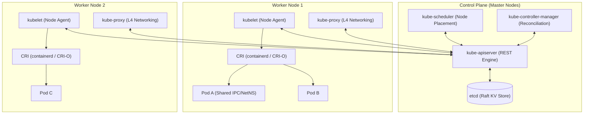

# Foundation: Kubernetes Distributed Systems Architecture

## 1. Conceptual Mental Model

### The Imperative vs. Declarative Paradigm Shift
In traditional systems administration, infrastructure is managed **imperatively**: an engineer or automation script executes a series of sequential commands (`systemctl start nginx`, `iptables -A INPUT...`, `mount /dev/sdb1...`). If step 3 fails due to a transient network timeout, the system enters an indeterminate intermediate state. Recovery requires writing complex error-handling logic for every permutation of failure.

**Kubernetes operates strictly on a Declarative State Machine Model.** 
You never command Kubernetes to "start three containers." Instead, you submit a declaration of your **Desired State** (e.g., *"There must always be 3 healthy replicas of Pod X running"*). 

The entire Kubernetes control plane is composed of autonomous, continuous, level-triggered **Reconciliation Loops** that obey a fundamental control equation:

$$\text{Current State} \xrightarrow[\Delta \ne 0]{\text{Observe}} \Delta = \text{Desired State} - \text{Current State} \xrightarrow{\text{Act}} \text{Converge}$$

```
The Level-Triggered Reconciliation Loop
=======================================

      +-----------------------------------------+
      |      Desired State (Stored in etcd)      |
      +-----------------------------------------+
                           |
                           v
        +-------------------------------------+
        |       kube-controller-manager       |
+-----> |                                     | <-----+
|       | 1. OBSERVE (via Informers / Watch)  |       |
|       | 2. COMPARE (Identify Delta)         |       |
|       | 3. ACT     (Issue API mutations)    |       |
|       +-------------------------------------+       |
|                          |                          |
|                          v                          |
|       +-------------------------------------+       |
|       |      kubelet / Node Container       |       |
|       |      Runtime (Current State)        |       |
|       +-------------------------------------+       |
|                          |                          |
+--------------------------+--------------------------+
                  State Changes / Events
```

If a physical server catches fire at 3:00 AM, the current state drops from 3 pods to 2. The Deployment controller detects $\Delta = 1$, selects a surviving node via the scheduler, and creates a replacement pod within seconds—without human intervention.

---

## 2. Essential Terminology & Taxonomy

| Component | In-Kernel & Distributed Architecture |
| :--- | :--- |
| **`etcd`** | A distributed, consistent, linearizable key-value store using the **Raft consensus algorithm**. Implements Multi-Version Concurrency Control (MVCC). All cluster state, secrets, and resource configurations reside here. |
| **`kube-apiserver`** | The stateless REST front-end of the control plane. It is the **only** component in the entire cluster permitted to talk directly to `etcd`. It validates schemas, authenticates requests, evaluates RBAC rules, and triggers admission webhooks. |
| **`kube-scheduler`** | Evaluates unscheduled pods (`spec.nodeName == ""`) and filters available nodes through **predicates** (taints, resources, affinity) and **priorities** (topology spreading, least requested resources) to assign optimal nodes. |
| **`kube-controller-manager`** | A monolithic binary hosting dozens of distinct reconciliation controllers (Node Controller, ReplicaSet Controller, EndpointSlice Controller, ServiceAccount Controller). |
| **`kubelet`** | The primary node agent. Listens to the API server for PodSpecs assigned to its node. Manages container lifecycles via the Container Runtime Interface (CRI), network plumbings via CNI, and persistent volume attachments via CSI. |
| **`kube-proxy`** | A network proxy running on each node. Manages Layer 4 transport load balancing for Kubernetes `Services` using Linux kernel `iptables` chains, IPVS hash tables, or eBPF socket maps. |
| **Pod** | The atomic unit of scheduling. A collection of one or more containers sharing an identical network namespace (`netns`), loopback interface (`lo`), IP address, IPC namespace, and shared storage volumes. |

---

## 3. High-Level Cluster Architecture



---

## 4. Common Misconceptions & Mental Traps

### Misconception 1: "A Pod is a virtual machine or a physical process."
* **Reality:** A Pod has no direct kernel-level representation. Linux has no `struct pod`. A Pod is an abstraction constructed by the container runtime using Linux **cgroups** (resource throttling) and **namespaces** (PID, Mount, Net, IPC, UTS). All containers in a Pod are distinct processes attached to the exact same Network Namespace created by a hidden "infra/pause" container.

### Misconception 2: "Kubernetes restarts nodes when containers crash."
* **Reality:** The `kubelet` manages local container restarts according to `restartPolicy: Always | OnFailure | Never`. The node operating system is completely untouched. If the container process exits with a non-zero code, `kubelet` applies an exponential backoff sleep (10s, 20s, 40s... up to 300s), presenting the status `CrashLoopBackOff`.

### Misconception 3: "kube-apiserver pushes commands to the kubelet."
* **Reality:** Kubernetes uses a **pull-based Watch mechanism** built on HTTP/2 streaming or WebSockets. The `kubelet` maintains a persistent streaming connection to `kube-apiserver` watching for changes where `metadata.nodeName == my-node`. The API server does not open network connections into worker nodes.

---

## 5. Socratic Discussion Starters

1. **CAP Theorem & etcd:** In a multi-master Kubernetes deployment with 3 control plane nodes, how does `etcd` handle a network partition that cuts 1 master node off from the other 2? Which property (Consistency or Availability) does Kubernetes prioritize, and what happens if you attempt to create a deployment while partitioned?
2. **IP Exhaustion & Subnetting:** Why does the default Kubernetes network model require every Pod to have a unique, routable IP address across all nodes without NAT? How does this dictate CIDR allocation when deploying a 5,000-node cluster?
3. **Reconciliation vs. Edge-Triggered Systems:** What are the architectural hazards of an edge-triggered system (which only reacts to discrete event notifications) compared to Kubernetes' level-triggered reconciliation (which periodically checks current vs desired state)?
