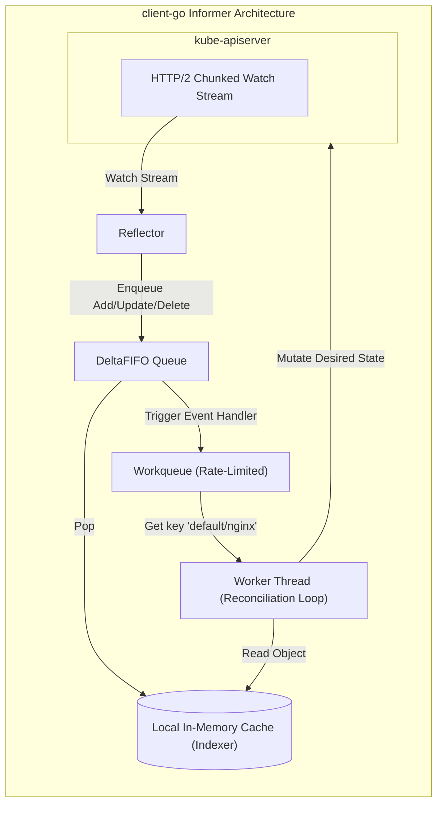
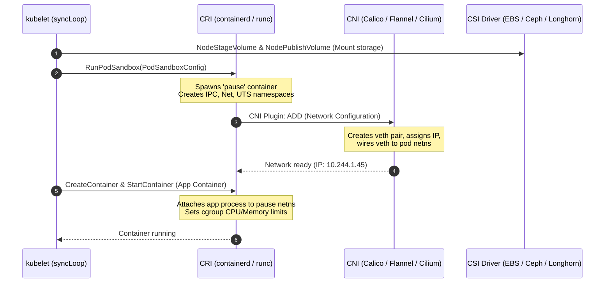

# In-Depth Technical Lesson: Kubernetes Control Plane, Controller Internals & Node Mechanics

## 1. The `kube-apiserver` Request Lifecycle

Every interaction with a Kubernetes cluster—whether via `kubectl`, an in-cluster controller, or a CI/CD pipeline—is an HTTP request processed by `kube-apiserver`. The API server is stateless and processes requests through an immutable, multi-stage pipeline:

```
               Incoming HTTPS Request (e.g., POST /api/v1/namespaces/default/pods)
                                                |
                                                v
               +----------------------------------------------------------------+
               | Stage 1: Authentication (Who are you?)                         |
               |   - X.509 Client Certificates                                  |
               |   - Bearer Tokens (ServiceAccount JWTs, OpenID Connect)        |
               |   - Webhook Token Authenticator                                |
               +----------------------------------------------------------------+
                                                |
                                                v
               +----------------------------------------------------------------+
               | Stage 2: Authorization (Can you do this?)                      |
               |   - Node Authorizer (Validates kubelet bounds)                  |
               |   - Role-Based Access Control (RBAC: Roles, ClusterRoles)      |
               |   - Webhook Authorizers                                        |
               +----------------------------------------------------------------+
                                                |
                                                v
               +----------------------------------------------------------------+
               | Stage 3: Mutating Admission Webhooks (Modify the Object)       |
               |   - Defaulting (Injects default fields)                        |
               |   - Mutating Webhooks (Sidecar injection: Envoy, Vault, Linkerd)
               +----------------------------------------------------------------+
                                                |
                                                v
               +----------------------------------------------------------------+
               | Stage 4: Object Schema Validation                              |
               |   - Validates JSON/YAML against registered OpenAPI v3 schemas  |
               +----------------------------------------------------------------+
                                                |
                                                v
               +----------------------------------------------------------------+
               | Stage 5: Validating Admission Webhooks (Final Safety Gate)     |
               |   - Policy Engines (OPA Gatekeeper, Kyverno)                   |
               |   - Validates immutability constraints (e.g., deny root pods)  |
               +----------------------------------------------------------------+
                                                |
                                                v
               +----------------------------------------------------------------+
               | Stage 6: Persistence to etcd (MVCC Commit)                     |
               |   - Linearizable write via gRPC transaction                    |
               +----------------------------------------------------------------+
```

### Mutating vs. Validating Admission Phase Ordering
Why are mutating and validating admission webhooks split into two distinct phases?
1. **Mutations must precede schema validation:** If a mutating webhook injects an Envoy sidecar container or mounts an identity token volume, the injected fields must be validated against the formal schema.
2. **Validating webhooks run last:** Validating admission webhooks are the final line of defense. They must evaluate the **fully realized, post-mutation object**. If a validating webhook approved an object and a subsequent mutating webhook modified it, policies could be easily bypassed.

---

## 2. Distributed Storage Mechanics: `etcd` & Multi-Version Concurrency Control (MVCC)

Kubernetes stores all cluster data in `etcd`, a strongly consistent key-value store governed by the **Raft consensus protocol**.

```
etcd Multi-Version Concurrency Control (MVCC) Engine
===================================================

Memory Index (B-Tree):
  Key: "/registry/pods/default/nginx" -> [Rev 102 (v1), Rev 145 (v2), Rev 210 (v3)]

Disk Storage (bbolt B+ Tree):
  Revision 102 -> { "spec": { "replicas": 1 } }
  Revision 145 -> { "spec": { "replicas": 2 } }
  Revision 210 -> { "spec": { "replicas": 3 } }
```

### MVCC Revisions and Optimistic Concurrency
* **Global 64-bit Revision Counter:** Every write transaction (Create, Update, Delete) increments a globally monotonic integer revision counter in `etcd`.
* **Non-Destructive Updates:** Updates do not overwrite existing bytes on disk. A new revision entry is appended to the underlying `bbolt` database file. This allows controllers to request historical snapshots or stream changes from a specific point in time (`resourceVersion`).
* **Optimistic Concurrency Control:** When a controller updates a resource, it submits the object's current `metadata.resourceVersion`. If another actor modified the object in `etcd` in the interim, the revision numbers mismatch and `etcd` rejects the transaction with an HTTP `409 Conflict`. The controller must re-read the object, re-apply its changes, and retry.

### Raft Quorum and Split-Brain Prevention
In an $N$-node `etcd` cluster, operations require a strict majority quorum:

$$Q = \left\lfloor \frac{N}{2} \right\rfloor + 1$$

* In a 3-node cluster, $Q = 2$. It can tolerate $1$ node failure.
* In a 5-node cluster, $Q = 3$. It can tolerate $2$ node failures.
* If a network partition splits a 3-node cluster into two partitions (Node A vs. Nodes B & C), Node A cannot achieve quorum ($1 < 2$) and drops into read-only mode, completely preventing split-brain state divergence.

---

## 3. Controller-Manager Architecture: Informers, Reflector & Workqueues

Controllers in the `kube-controller-manager` do not constantly poll the API server. Doing so would overwhelm `kube-apiserver` and `etcd` with $O(N)$ HTTP polling requests. Instead, controllers rely on the **Informer Pattern**:



### Component Breakdown
1. **Reflector:** Establishes a persistent, streaming HTTP GET request with `?watch=true`. It streams events (`ADDED`, `MODIFIED`, `DELETED`) from `kube-apiserver` and enqueues them into a `DeltaFIFO` buffer.
2. **DeltaFIFO:** A FIFO queue that collapses multiple updates to the same object into an ordered list of delta states.
3. **Indexer (Lister):** A thread-safe, local in-memory cache of objects (backed by a Go hash map). When a controller needs to inspect resources, it reads from the local `Indexer` at memory bus speed, incurring **zero** network calls to the API server.
4. **Rate-Limiting Workqueue:** Decouples event generation from processing. Holds only the object key (e.g., `"production/payment-service"`). If the controller fails to reconcile, the key is re-queued with exponential backoff.
5. **Level-Triggered SyncHandler:** The worker function fetches the key, inspects current state in the `Indexer`, computes the delta against desired state, and issues necessary mutations to `kube-apiserver`.

---

## 4. The Scheduler Pipeline: Predicates, Priorities & Binding

The `kube-scheduler` assigns unscheduled pods to nodes through two sequential cycles: the **Scheduling Cycle** (single-threaded) and the **Binding Cycle** (asynchronous).

```
Scheduling Cycle (Single-Threaded Node Evaluation)
==================================================

1. Queue Sort:
   Sorts Unschedulable, Backoff, and Active Pods by PriorityClass.

2. Pre-Filter & Filter (Predicates):
   Eliminates nodes that cannot host the Pod:
   - NodeResourcesFit: Does node have enough allocatable CPU & Memory?
   - NodeName: Does spec.nodeName match?
   - NodePorts: Is the requested HostPort already bound on this node?
   - PodTopologySpread / NodeAffinity: Do labels match?
   - TaintsAndTolerations: Can the pod tolerate node taints?

3. Pre-Score & Score (Priorities):
   Assigns a score from 0 to 100 to every surviving node:
   - NodeResourcesBalancedAllocation: Balances CPU vs Memory usage.
   - ImageLocality: Gives higher scores to nodes that already cached container images.
   - NodeAffinityScoring: Weights preferred node selector rules.

4. Reserve:
   Speculatively reserves node resources in local scheduler cache.

Binding Cycle (Asynchronous Execution)
======================================
5. Permit & Pre-Bind:
   Validates network/volume plugins and approval gates.

6. Bind:
   Sends an HTTP POST to /api/v1/namespaces/{ns}/pods/{name}/binding
   setting spec.nodeName = selectedNode in etcd.
```

---

## 5. Node Subsystem: `kubelet`, CRI, CNI & CSI

Once `spec.nodeName` is bound in `etcd`, the `kubelet` on that specific node detects the assignment and coordinates the creation of the Pod's execution environment.



### The Role of the "Pause" Container
In every Pod, the first container created is the hidden `pause` container (running `pause.c`, which simply calls `pause()` to sleep forever).
* The `pause` container creates and holds open the Linux **Network Namespace (`netns`)** and **IPC Namespace**.
* When your application containers start, they do not create new network namespaces; they join the `pause` container's network namespace using the `setns()` Linux syscall (`CLONE_NEWNET`).
* **Why this matters:** If your application container crashes and restarts, its network namespace, virtual ethernet adapter (`eth0`), and IP address remain completely intact because the `pause` container never exited.

---

## 6. Production YAML Manifest: Zero-Downtime Microservice

Here is an enterprise-grade Deployment manifest incorporating production best practices: non-root security context, read-only root filesystems, resource limits, readiness/liveness/startup probes, and anti-affinity.

```yaml
apiVersion: apps/v1
kind: Deployment
metadata:
  name: payment-gateway
  namespace: production
  labels:
    app.kubernetes.io/name: payment-gateway
    app.kubernetes.io/part-of: ecommerce
spec:
  replicas: 3
  revisionHistoryLimit: 5
  strategy:
    type: RollingUpdate
    rollingUpdate:
      maxSurge: 25%         # Spin up 1 new pod before tearing down old ones
      maxUnavailable: 0     # Ensure 100% capacity during deployments
  selector:
    matchLabels:
      app.kubernetes.io/name: payment-gateway
  template:
    metadata:
      labels:
        app.kubernetes.io/name: payment-gateway
    spec:
      # Spread replicas across distinct physical failure domains
      topologySpreadConstraints:
        - maxSkew: 1
          topologyKey: topology.kubernetes.io/zone
          whenUnsatisfiable: DoNotSchedule
          labelSelector:
            matchLabels:
              app.kubernetes.io/name: payment-gateway
      affinity:
        podAntiAffinity:
          preferredDuringSchedulingIgnoredDuringExecution:
            - weight: 100
              podAffinityTerm:
                labelSelector:
                  matchLabels:
                    app.kubernetes.io/name: payment-gateway
                topologyKey: kubernetes.io/hostname
      # Hardened Linux Security Context (CIS Benchmark Compliance)
      securityContext:
        runAsNonRoot: true
        runAsUser: 10001
        runAsGroup: 10001
        fsGroup: 10001
        seccompProfile:
          type: RuntimeDefault
      containers:
        - name: gateway
          image: internal-registry.company.com/payment-gateway:v2.4.1
          imagePullPolicy: IfNotPresent
          securityContext:
            allowPrivilegeEscalation: false
            readOnlyRootFilesystem: true
            capabilities:
              drop:
                - ALL
          resources:
            requests:
              cpu: "250m"
              memory: "256Mi"
            limits:
              cpu: "1000m"
              memory: "512Mi"
          # Startup probe prevents premature kills during slow JVM/Node boot
          startupProbe:
            httpGet:
              path: /healthz/startup
              port: 8080
            failureThreshold: 30
            periodSeconds: 2
          # Liveness probe restarts deadlocked containers
          livenessProbe:
            httpGet:
              path: /healthz/liveness
              port: 8080
            periodSeconds: 10
            failureThreshold: 3
          # Readiness probe removes unready pods from Service endpoints
          readinessProbe:
            httpGet:
              path: /healthz/ready
              port: 8080
            periodSeconds: 5
            failureThreshold: 2
          volumeMounts:
            - name: tmp-scratch
              mountPath: /tmp
      volumes:
        # Provide ephemeral writable memory space for readOnlyRootFilesystem
        - name: tmp-scratch
          emptyDir:
            medium: Memory
            sizeLimit: 64Mi
```

---

## 7. Critical Failure Domains & Production Debugging

### Diagnostic Decision Tree

```
                                  Pod Fails / Degraded
                                           |
                   +-----------------------+-----------------------+
                   |                                               |
         status: Pending                                status: Running / Degraded
                   |                                               |
          Run: kubectl describe                           Run: kubectl describe
                   |                                               |
         +---------+---------+                            +--------+--------+
         |                   |                            |                 |
  FailedScheduling    0/N nodes available          CrashLoopBackOff      OOMKilled
   (Taints / CPU)       (Volume attached)          (Exit Code > 0)    (Exit Code 137)
```

| Failure State | Root Cause Analysis | Remediation Command |
| :--- | :--- | :--- |
| **`CrashLoopBackOff`** | Container process terminated with exit code $\ne 0$ (e.g., missing environment variable, uncaught exception, database connection failure). | `kubectl logs <pod> --previous`<br/>`kubectl describe pod <pod>` |
| **`OOMKilled` (Exit 137)** | Container memory usage exceeded `resources.limits.memory`. Linux kernel cgroup OOM killer sent `SIGKILL` (signal 9 + 128 = 137). | Inspect memory profiles: `kubectl top pod <pod>`. Increase memory limits or optimize garbage collection. |
| **Node `NotReady` (PLEG Timeout)** | Pod Lifecycle Event Generator stalled. `containerd` is deadlocked by high I/O wait, kernel D-state threads, or disk exhaustion. | SSH to node: `journalctl -u containerd -u kubelet`. Check disk usage (`df -h`) and storage mount latency. |
| **`Pending` (Volume Attached Mismatch)** | Pod cannot schedule because its ReadWriteOnce (RWO) PersistentVolume is locked to another node. | Force volume detachment or inspect CSI node publish events: `kubectl get volumeattachment`. |

---

## 8. Key Takeaways

1. **Reconciliation is Invariant:** Kubernetes does not execute sequences; it reconciles current state to match desired state via autonomous, level-triggered loops.
2. **Single Source of Truth:** `etcd` manages all state using Raft linearizable quorum and MVCC revisions; `kube-apiserver` acts as its sole guardian.
3. **Decoupled Node Runtime:** Pods are Linux kernel cgroups and network namespaces anchored by an infra/pause container, orchestrated through standard CRI, CNI, and CSI interfaces.
4. **Resilience Through Health Checks:** Separation of startup, liveness, and readiness probes prevents cascading routing failures during deployments and auto-heals deadlocks.
