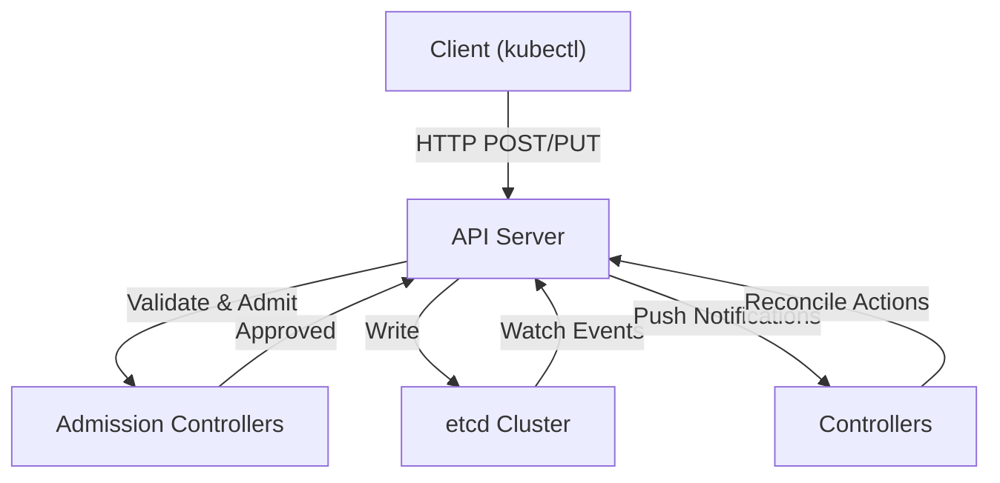
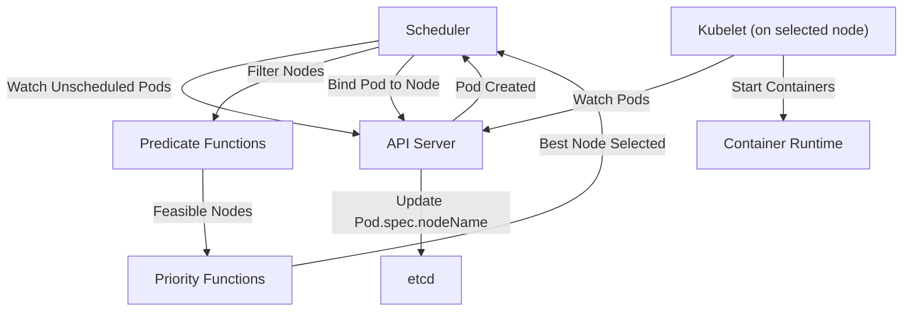
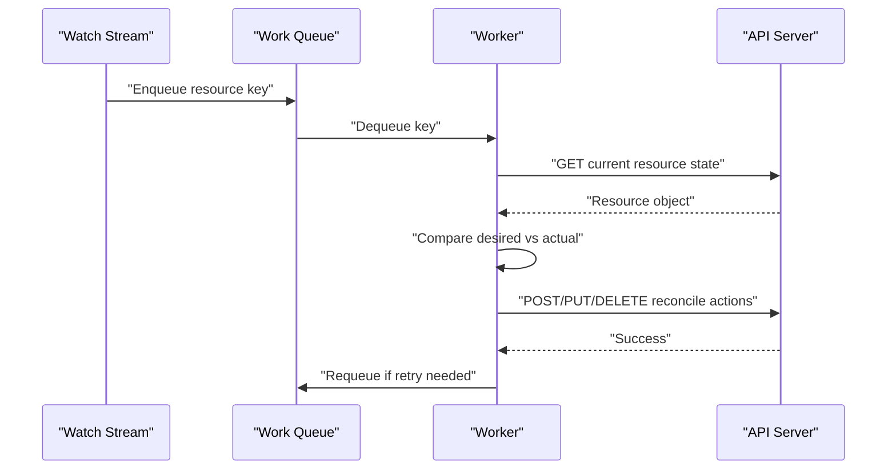
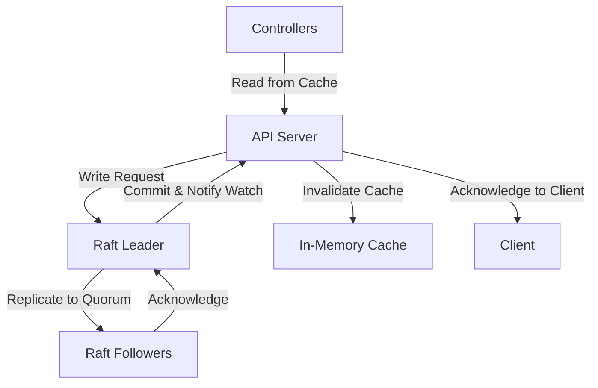

# Lesson 1: Control Plane Architecture

## 1. First-Principles Intuition & Invariants

The Kubernetes control plane represents one of the most sophisticated implementations of the declarative state reconciliation pattern in modern distributed systems. At its core, the control plane solves a fundamental problem that has plagued cluster orchestration since the earliest days of distributed computing: how can we continuously drive a large, dynamic collection of heterogeneous compute resources toward a desired configuration, while tolerating partial failures, network partitions, and concurrent modifications from multiple operators?

Traditional imperative orchestration systems—exemplified by early configuration management tools and deployment scripts—operated through explicit command sequences. An operator would issue a directive such as "start three instances of application X on these specific nodes," and the system would execute that command once. If a node failed after deployment, the system remained unaware unless explicitly queried. This approach fundamentally conflates intent with execution, creating brittle systems that cannot self-heal and requiring operators to maintain perfect mental models of current cluster state.

Kubernetes inverts this paradigm through a principle we call level-triggered reconciliation. Rather than processing imperative commands, the control plane continuously observes the actual state of the cluster—the running pods, their resource consumption, network endpoints, and storage bindings—and compares this reality against the desired state expressed in declarative manifests stored in etcd. When divergence is detected, specialized controllers calculate the minimal set of actions required to eliminate the discrepancy, execute those actions, and then return to observation. This process repeats indefinitely at frequencies measured in subseconds for critical workloads.

The architectural elegance emerges from decomposing the monolithic orchestration problem into a collection of independent, single-purpose control loops. Each controller implements the same fundamental algorithm: watch a subset of cluster resources, compute the delta between desired and actual state, act to close that delta, and repeat. The Deployment controller, for instance, observes Deployment objects and their associated ReplicaSets, creating new ReplicaSets during rollouts and scaling down old ones according to configured strategies. The controller neither knows nor cares about the existence of the ReplicaSet controller, which independently ensures that ReplicaSets have the correct number of running Pods. This decomposition follows the Unix philosophy of composing complex behaviors from simple, orthogonal primitives.

Three core invariants govern control plane correctness. First, the system exhibits eventual consistency: given sufficient time without new desired-state modifications and absent persistent failures, actual state converges to desired state. This property derives directly from the continuous reconciliation loop—controllers retry failed operations indefinitely, with exponential backoff to prevent resource exhaustion. Second, the control plane provides at-least-once semantics for state transitions. A controller may attempt to create a Pod multiple times if acknowledgments are lost, requiring all cluster operations to be idempotent. The API server enforces this through resource versioning: every modification must specify the expected `resourceVersion`, and concurrent modifications trigger optimistic concurrency failures that force retries. Third, the system maintains monotonically increasing global ordering through etcd's revision counter. Every cluster state change increments this counter, providing a total order across all resources that enables consistent watch streams and point-in-time snapshots.

The control plane's distributed nature introduces fundamental trade-offs governed by the CAP theorem. Kubernetes prioritizes availability and partition tolerance over strict consistency, accepting temporary divergence between desired and actual state during network splits. However, the system provides strong consistency guarantees for the desired state itself through etcd's Raft consensus protocol, ensuring that all control plane components observe identical resource definitions. This design choice reflects the reality that cluster state divergence is inevitable in distributed systems—nodes crash, networks partition, and processes hang—so the architecture must tolerate and recover from inconsistency rather than attempting to prevent it.

Understanding control plane architecture requires recognizing that Kubernetes implements a distributed database where etcd serves as the authoritative storage layer, the API server acts as the query execution engine and transaction coordinator, and controllers function as materialized view maintenance processes. When you submit a Deployment manifest, you write a row to a distributed database table that triggers cascading updates through downstream views maintained by various controllers. The Pod you eventually observe running on a node is the materialized result of this cascade, constructed through a chain of watch notifications, state comparisons, and incremental reconciliation steps.

## 2. Core Architecture & Mechanics

The Kubernetes control plane comprises four primary components that collectively implement the declarative reconciliation pattern: the API server (`kube-apiserver`), the scheduler (`kube-scheduler`), the controller manager (`kube-controller-manager`), and the persistent etcd cluster. Each component executes as an independent process, communicating exclusively through the API server's RESTful HTTP interface backed by etcd storage. This strict separation enables horizontal scaling of individual components and allows the control plane to survive partial component failures.

### API Server: The Central Coordination Point

The API server functions as the singular gateway to cluster state, mediating all interactions between clients, controllers, and the backing etcd cluster. When a client submits a resource manifest—whether through `kubectl`, the Go client library, or direct HTTP requests—the API server validates the resource against its OpenAPI schema, executes admission controllers that can mutate or reject the request, and finally commits the resource to etcd if all checks pass. This validation and admission pipeline enforces cluster-wide policies, injects default values, and maintains referential integrity across related resources. The API server exposes both synchronous CRUD operations for immediate resource manipulation and long-lived watch streams that push incremental updates to clients as cluster state evolves.

Watch mechanisms form the nervous system of the control plane. Rather than polling etcd repeatedly to detect changes—an approach that would generate massive load and introduce latency—controllers establish persistent HTTP connections to the API server using the watch protocol. When any watched resource changes, the API server immediately pushes a notification containing the resource's new state and the type of change (ADDED, MODIFIED, DELETED). This event-driven model enables subsecond reaction times while keeping network traffic and CPU utilization minimal. The API server maintains watch bookmarks—periodic notifications containing only the current resource version—to allow controllers to detect stale watches and re-establish connections without missing updates.



The API server implements optimistic concurrency control through resource versioning. Every resource stored in etcd carries a `resourceVersion` field—an opaque string representing etcd's internal revision number at the time of last modification. When a client attempts to update a resource, it must include the `resourceVersion` it last observed. If another client has modified the resource in the interim, the versions will not match, and the API server returns a 409 Conflict error. The client must then fetch the latest version, reapply its intended changes, and retry. This mechanism prevents lost updates without requiring distributed locks, which would create availability bottlenecks.

### Scheduler: Optimal Pod Placement

The scheduler watches for newly created Pods that lack a `nodeName` assignment and selects the optimal node for each Pod based on resource requirements, affinity rules, taints, and tolerations. The scheduling algorithm operates in two phases. First, the filtering phase eliminates nodes that cannot satisfy the Pod's constraints—insufficient CPU or memory, missing required labels, incompatible taints, or violated pod affinity rules. Second, the scoring phase ranks the remaining feasible nodes using a weighted sum of priority functions. These functions evaluate criteria such as resource balance (preferring nodes with even CPU and memory utilization), spreading (distributing pods across nodes and zones for fault tolerance), and affinity preferences (colocating related pods or separating interfering workloads).

Once the scheduler selects a node, it performs a binding operation—updating the Pod's `spec.nodeName` field in etcd through the API server. This binding is atomic and subject to the same optimistic concurrency checks as any other resource update. If the Pod has been modified or deleted since the scheduler last observed it, the binding fails and the scheduler abandons this scheduling attempt. The kubelet running on the assigned node watches for pods bound to its node name and begins the container startup sequence.



The scheduler supports custom priority functions and predicate plugins, allowing operators to implement organization-specific placement policies. A financial services company might implement a compliance plugin that ensures pods handling sensitive data only run on nodes in approved regions, while a machine learning platform might implement a GPU affinity plugin that collocates training pods on nodes with high-bandwidth interconnects.

### Controller Manager: The Reconciliation Engine

The controller manager runs multiple independent controllers in a single process, each implementing the watch-compare-act loop for a specific resource type. The Deployment controller reconciles Deployments and ReplicaSets, the Node controller monitors node health and evicts pods from failed nodes, the Service controller provisions load balancers and updates DNS records, and the Namespace controller ensures proper resource cleanup during namespace deletion. Running these controllers in a single process reduces operational overhead while maintaining logical separation—each controller owns a distinct reconciliation responsibility and operates independently.

Controllers implement the core reconciliation logic through a work queue pattern. When a watch event arrives, the controller extracts the affected resource's namespace and name, enqueues this key, and immediately returns to watching. A separate worker pool continuously dequeues keys, fetches the current state of the corresponding resource, compares it against the desired state, and executes the necessary actions to reconcile any differences. If reconciliation fails—perhaps because the API server is temporarily unavailable or a dependent resource doesn't exist yet—the controller requeues the key with exponential backoff, ensuring automatic retries without tight polling loops.



The Deployment controller illustrates this pattern. When a Deployment's replicas field changes from 3 to 5, the controller receives a MODIFIED event, enqueues the Deployment's key, and a worker eventually processes it. The worker fetches the Deployment and its owned ReplicaSets, identifies the active ReplicaSet, and compares its replica count (3) against the desired count (5). The worker then updates the ReplicaSet's replica field to 5 and returns. The ReplicaSet controller, watching ReplicaSets independently, receives a MODIFIED event for this ReplicaSet, compares its actual pod count against the new desired count, and creates two additional Pods. The scheduler assigns these Pods to nodes, kubelets start the containers, and the system reaches the desired state through this cascade of independent reconciliations.

### Etcd: The Source of Truth

Etcd provides the persistent, strongly consistent storage layer for all cluster state. Built on the Raft consensus algorithm, etcd guarantees that all reads return the most recent committed write and that writes are durably persisted across a quorum of replicas before acknowledgment. Kubernetes stores every resource—Pods, Services, ConfigMaps, Secrets, Custom Resources—as a key-value pair in etcd, using a hierarchical namespace structure. A Pod named `web-server` in namespace `production` resides at the key `/registry/pods/production/web-server`, allowing efficient prefix-based queries and watches.

Etcd implements multi-version concurrency control (MVCC), retaining a complete history of all key modifications up to a configurable retention period or event count. Every write operation increments a global revision counter, and each key-value pair carries both a `modRevision` (the revision at which this key was last modified) and a `version` (the number of times this key has been modified). This versioning enables consistent point-in-time snapshots, historical queries, and watch initialization at arbitrary past revisions. When a controller starts, it can request a watch beginning at revision R, receiving all events since that revision before transitioning to live updates, ensuring no missed changes during controller restarts.

The API server maintains a persistent watch on all etcd keys, caching resources in memory and serving most read requests from cache without contacting etcd. This caching layer reduces etcd load by orders of magnitude while maintaining strong consistency guarantees—when a write commits to etcd, the API server's watch receives the update and invalidates its cache before acknowledging the write to the client. This architecture allows Kubernetes to scale to thousands of nodes and hundreds of thousands of resources without overwhelming the etcd cluster.



Etcd clusters typically run three or five members for production deployments, providing tolerance for one or two simultaneous failures respectively. The cluster uses leader election to designate a single member as the Raft leader, which handles all writes and coordinates replication to followers. If the leader fails, followers detect the absence of heartbeats and initiate a new election, completing in subseconds under normal network conditions. This automated failover ensures the control plane remains available even when individual etcd members crash or experience network isolation.

## 3. etcd Deep Dive

Etcd's role as the authoritative data store makes it the most critical component in the control plane. Understanding its internals, operational characteristics, and failure modes is essential for operating production Kubernetes clusters.

### Raft Consensus Protocol

Raft provides etcd's consistency guarantees through a leader-based approach to distributed consensus. At any given time, one etcd member acts as the leader while others remain followers. Clients send write requests to the leader, which appends the proposed change to its local log and replicates the log entry to followers. Once a majority of members (including the leader) have appended the entry, the leader commits it by applying the change to its state machine and acknowledging the write to the client. This process ensures that committed writes are durable across failures—even if the leader immediately crashes after committing, at least one follower possesses the committed entry and will replicate it to new leaders.

Leaders maintain authority through periodic heartbeats sent to all followers. If a follower does not receive a heartbeat within the election timeout (typically 1000ms in Kubernetes clusters), it assumes the leader has failed and transitions to a candidate state. The candidate increments the term number, votes for itself, and requests votes from other members. If the candidate receives votes from a majority, it becomes the new leader and begins sending heartbeats. This election process typically completes within one or two election timeout periods, producing 1-2 seconds of write unavailability during leader failures in well-configured clusters.

Raft's safety guarantees rest on two critical invariants. First, the Election Safety property ensures that at most one leader exists per term. Second, the Leader Completeness property guarantees that if a log entry is committed in term T, then that entry appears in the logs of all leaders for terms greater than T. Together, these invariants prevent split-brain scenarios and ensure that committed data is never lost, even during complex failure sequences involving multiple crashed members and network partitions.

### Data Model and Storage Layout

Etcd stores data in a flat key-value space with byte string keys and byte string values. Kubernetes imposes structure through key naming conventions—all resources reside under the `/registry` prefix, with subpaths indicating resource type, namespace, and name. A Deployment named `nginx` in namespace `default` maps to `/registry/deployments/default/nginx`, with the value containing the serialized Deployment object in protobuf format.

The underlying storage engine is a modified BoltDB—a pure Go embedded key-value store using B+trees for indexing. BoltDB provides ACID transactions with serializable isolation, enabling etcd to implement atomic read-modify-write operations efficiently. The storage engine periodically compacts its database file to reclaim space from deleted keys and old revisions, though this compaction process can introduce temporary latency spikes as it rewrites large portions of the database.

Etcd implements MVCC by appending a revision number to each key internally. When you write to key `foo`, etcd actually creates a key-value pair with key `foo@revision_N` where N is the current global revision. Read operations specify a target revision and retrieve the latest version of each key that existed at or before that revision. This design enables consistent snapshot reads at any historical revision without blocking concurrent writes—readers and writers operate on different keys in the underlying BoltDB tree.

Watch operations leverage MVCC to provide reliable event streams. When a client establishes a watch starting at revision R, etcd scans its MVCC history for all key modifications between R and the current revision, sends those as historical events, then transitions to live event streaming. This atomic switch from historical to live events guarantees that clients never miss updates, even if they were disconnected for extended periods. However, if R falls outside the retained MVCC window (controlled by the `--auto-compaction-retention` flag), the watch fails and the client must perform a full list operation to rebuild state.

### Performance Characteristics and Limits

Etcd's performance profile shapes fundamental constraints on Kubernetes cluster scale. A well-tuned three-member etcd cluster on modern SSDs can sustain approximately 10,000 writes per second and hundreds of thousands of reads per second (most served from memory). However, write latency—the time from client request to committed acknowledgment—typically ranges from 10-50ms depending on network round-trip time and disk sync latency. This write latency directly impacts how quickly the control plane can reconcile state changes, as controllers must wait for each update to commit before proceeding.

The size of the etcd database limits cluster scale more than raw throughput. Kubernetes stores complete resource specifications in etcd, and large resources like ConfigMaps containing multi-megabyte configuration files contribute significantly to database size. Etcd begins experiencing degraded performance above 8GB of data, with 16GB representing a practical operational limit beyond which compaction becomes unacceptably slow. A typical production cluster with 5,000 pods, 1,000 services, and reasonable ConfigMap sizes consumes 1-2GB of etcd storage, suggesting an upper bound of roughly 10,000-20,000 concurrent pods per cluster before database size becomes problematic.

Watch load presents another scaling constraint. Each watch stream consumes memory in the API server and generates traffic as events flow. A cluster with 100 controllers each watching all pods generates 100 watch streams, and each pod creation or modification produces 100 event deliverments. This quadratic growth limits practical cluster sizes—clusters approaching 10,000 nodes or 100,000 pods often require careful tuning of watch selectors, list pagination, and event filtering to maintain acceptable API server resource usage.

### Backup and Disaster Recovery

Etcd snapshots provide the foundation for disaster recovery. The `etcdctl snapshot save` command generates a consistent point-in-time backup of the entire database, capturing all keys at a specific revision. These snapshots are self-contained and can be restored to a fresh etcd cluster, recreating all cluster state including Pods, Services, ConfigMaps, Secrets, and Custom Resources. Automated snapshot procedures should run hourly or more frequently for production clusters, with snapshots stored in durable object storage across multiple availability zones.

Restoring from snapshot requires stopping the existing etcd cluster (or creating a new cluster with different addresses), initializing members with the snapshot data, and starting the cluster. The restored cluster will have identical state to the snapshotted cluster at the moment of snapshot creation, but any changes made after the snapshot are lost. Workloads that were running at snapshot time will have stale Pod objects in etcd while the actual containers have terminated, requiring controllers to detect and reconcile these discrepancies—typically by deleting stale pods and creating replacements.

Disaster recovery procedures must account for the API server's certificate-based authentication model. If the etcd cluster is destroyed and restored with different member addresses or a different cluster ID, the API server's kubeconfig must be updated to reflect the new etcd endpoints. Similarly, if restoring to a new cluster with a new root CA, all TLS certificates must be regenerated, including the API server's serving certificate, kubelet client certificates, and controller manager service account keys. Organizations often maintain parallel control planes in separate failure domains to avoid depending solely on etcd restoration for disaster recovery.

### Operational Best Practices

Running etcd successfully in production requires attention to infrastructure details that Kubernetes abstracts away for application workloads. First, etcd must run on dedicated, high-performance storage. Sharing disk I/O with other processes introduces latency variability that can cause election timeouts and cluster instability. SSDs with consistent write latency under 10ms are essential—traditional spinning disks are too slow for production use.

Second, network latency between etcd members must remain low and stable. Cross-region etcd clusters are risky due to high latencies that approach or exceed election timeouts, making leader elections frequent and writes slow. Best practice deploys all etcd members within a single low-latency network (typically a single datacenter or availability zone), then uses Kubernetes federation or multi-cluster patterns to achieve geographic distribution at the application layer.

Third, monitoring etcd health requires tracking specific metrics that indicate impending failures. The `etcd_server_has_leader` metric should always equal 1; a value of 0 indicates no leader exists and writes are failing. The `etcd_disk_backend_commit_duration_seconds` histogram tracks fsync latency; consistent values above 50ms suggest disk performance issues. The `etcd_mvcc_db_total_size_in_bytes` gauge tracks database size; values approaching 8GB warrant investigation into oversized resources or insufficient compaction.

Fourth, etcd version upgrades must follow a conservative rollout process. Upgrade one member at a time, waiting for it to rejoin the cluster and synchronize before proceeding to the next member. Downgrading etcd versions is generally unsafe—Raft log formats can change between versions in ways that prevent older members from reading newer logs. Always take a snapshot before beginning an upgrade, and test the upgrade procedure in a non-production environment first.

## 4. Control Plane Failure Modes

Understanding how the control plane fails and degrades helps operators design resilient clusters and respond effectively during incidents.

### API Server Failures

API server failures typically manifest as increased latency or connection timeouts for kubectl commands and controller reconciliation loops. If a single API server instance fails in a multi-instance deployment, clients automatically fail over to healthy instances with minimal disruption—connections are reset and retried, appearing as brief latency spikes. If all API server instances fail simultaneously (rare but possible due to correlated bugs, network partitions, or resource exhaustion), the entire control plane becomes unavailable. Controllers cannot watch for changes or execute reconciliation actions, the scheduler cannot assign pods to nodes, and operators cannot interact with the cluster.

Critically, running workloads continue operating during API server outages. Containers that were running when the API server failed continue running—kubelets maintain local state and restart containers if they crash, Services continue forwarding traffic to their endpoints, and volumes remain mounted. However, no new pods can be scheduled, failed pods are not replaced, and configuration changes cannot be applied. This resilience derives from the control plane's level-triggered architecture—the desired state persists in etcd (which may remain available even if the API server is not), and once the API server recovers, controllers resume reconciliation from where they left off.

API server failures can stem from resource exhaustion, particularly memory. A sudden surge in watch connections or a controller with a bug that repeatedly lists all pods can exhaust API server memory, causing the process to crash or be killed by the OOM killer. Rate limiting and admission control provide defense mechanisms—the API server can reject or throttle requests when load exceeds configured thresholds, preventing cascading failures. The `--max-requests-inflight` and `--max-mutating-requests-inflight` flags control concurrent request limits, while the Priority and Fairness feature provides more sophisticated multi-tenant request queuing.

### Etcd Failures

Etcd failures are the most severe control plane failure mode because etcd holds the authoritative cluster state. If a single etcd member fails in a three-member cluster, the cluster continues operating normally—the remaining two members form a quorum, elect a leader if necessary, and process all reads and writes. The failed member can be restarted or replaced without data loss. If two members fail simultaneously, the cluster loses quorum and cannot commit writes. Read-only operations may still succeed (depending on consistency requirements), but any attempt to create, update, or delete resources will hang indefinitely waiting for quorum.

Quorum loss requires manual intervention to recover. If the failed members can be recovered (processes restarted, network restored), they rejoin automatically and the cluster resumes normal operation. If members are permanently lost (disk failures, terminated instances), the cluster must be rebuilt from the surviving member or restored from a snapshot. The `etcdctl member remove` and `etcdctl member add` commands allow reconstructing a healthy three-member cluster from a single surviving member, but this process requires downtime and careful execution to avoid data loss.

Network partitions can create split-brain scenarios where etcd members are divided into isolated groups. Raft's majority-quorum requirement prevents true split-brain (only one partition can contain a majority and thus elect a leader), but the minority partition becomes unavailable for writes. API servers connected to minority-partition members will fail all write operations, while API servers connected to the majority partition continue operating normally. This can create confusing failure modes where some kubectl commands succeed and others timeout, depending on which API server instance the load balancer selects.

Data corruption in etcd is rare but catastrophic. If the BoltDB database becomes corrupted due to disk failure, software bugs, or interrupted compaction, the affected etcd member may fail to start or exhibit erratic behavior. Recovery requires removing the corrupted member from the cluster and adding a new member, which will synchronize data from the leader. If all members are corrupted simultaneously (highly unlikely but possible with correlated storage failures), the only recovery path is restoring from snapshot, which may result in data loss depending on snapshot age.

### Controller Manager Failures

Controller manager failures disable the control plane's reconciliation capabilities but do not immediately impact running workloads. If the controller manager crashes or is stopped, existing pods continue running, services continue routing traffic, and the scheduler continues assigning new pods to nodes. However, the cluster cannot adapt to changes—if a pod crashes, it will not be restarted; if a deployment is scaled up, new pods will not be created; if a node fails, pods on that node will not be evicted and rescheduled.

The controller manager uses leader election to enable high availability. Multiple controller manager instances can run simultaneously, but only one actively executes reconciliation—the others remain on standby, ready to take over if the active instance fails. Leader election uses a Lease resource stored in etcd, with the active controller manager periodically renewing the lease. If the active instance crashes or becomes unreachable, other instances detect the expired lease and one of them acquires leadership, resuming reconciliation within seconds.

Bugs in specific controllers can create persistent reconciliation failures without affecting other controllers. A bug in the Deployment controller that causes it to crash on a specific Deployment object will not impact the Service controller or Node controller. However, the Deployment controller will repeatedly crash and restart, making that specific Deployment unable to reconcile. Controller manager logs typically contain stack traces and error messages that help identify which controller is failing and why.

Resource leaks in controllers can gradually degrade cluster performance. A controller that creates watches but never closes them will accumulate watch connections until the API server exhausts available connections or memory. A controller that enqueues work items but fails to dequeue them will grow its work queue until memory is exhausted. These failure modes develop gradually, making them harder to detect than sudden crashes, but they eventually result in controller manager restarts or cluster-wide unavailability.

### Scheduler Failures

Scheduler failures prevent new pods from being assigned to nodes, causing pods to remain in Pending state indefinitely. Existing pods are unaffected—they continue running regardless of scheduler availability. Like the controller manager, the scheduler uses leader election for high availability, allowing multiple scheduler instances to run with only one actively scheduling pods.

Scheduling failures can also occur without scheduler crashes. If no nodes satisfy a pod's constraints (resource requests exceed available capacity, required labels are missing, all nodes have incompatible taints), the pod remains unschedulable until cluster state changes. The scheduler emits Events explaining why scheduling failed, which are visible through `kubectl describe pod`. Common causes include insufficient CPU or memory, unsatisfiable affinity or anti-affinity rules, and nodes in an unschedulable state due to cordoning or resource pressure.

The scheduler can become a bottleneck in large clusters with high pod churn. Scheduling decisions require fetching and evaluating node state, running predicate and priority functions, and performing the binding operation. For clusters with hundreds of nodes and thousands of scheduling decisions per minute, the scheduler may struggle to keep up. Scheduler throughput can be increased by running multiple scheduler instances (each handling a subset of pods through sharding), optimizing priority functions, or using cached node information instead of fetching fresh state for each decision.

### Cascading Failures

Control plane components exhibit strong coupling through shared etcd storage and API server endpoints, creating pathways for cascading failures. A bug that causes one controller to create thousands of events per second can overwhelm the API server's event recording mechanism, slowing response times for all clients. Increased latency can cause controller watch timeouts, prompting controllers to re-establish watches and perform full list operations, further increasing API server load. This positive feedback loop can drive the entire control plane into an overloaded state where no operations complete successfully.

Etcd performance degradation triggers particularly severe cascades. If etcd write latency increases due to disk contention, the API server queues more concurrent requests waiting for etcd acknowledgments, consuming more memory. Increased memory pressure can trigger garbage collection pauses, causing request timeouts that prompt clients to retry, generating even more load. Eventually the API server exhausts memory and crashes, forcing all controllers to reconnect and re-establish watches, creating a synchronized thundering herd that may prevent the API server from recovering even after restart.

Mitigation strategies include aggressive rate limiting, circuit breakers that fail fast rather than queueing indefinitely, and resource quotas that limit the blast radius of misbehaving controllers or tenants. The API server's Priority and Fairness feature provides sophisticated request queuing that prioritizes critical control plane traffic over bulk operations, ensuring that controller heartbeats and leader election continue operating even when user-initiated list operations saturate available capacity.

## 5. Hands-On Implementation

To solidify understanding of control plane architecture, we will examine real API server interactions and implement a minimal controller that follows the standard watch-compare-act pattern.

### Observing API Server Operations

The API server exposes its HTTP/JSON interface directly, allowing inspection of the underlying protocol that tools like kubectl abstract. To observe a resource creation, update, and deletion cycle, use curl with appropriate authentication credentials.

First, extract the cluster's API server endpoint and credentials. For a cluster managed by kubeadm, these typically reside in `/etc/kubernetes/admin.conf`. Export the cluster certificate authority, client certificate, and client key to files:

```bash
kubectl config view --raw -o jsonpath='{.clusters[0].cluster.certificate-authority-data}' | base64 -d > ca.crt
kubectl config view --raw -o jsonpath='{.users[0].user.client-certificate-data}' | base64 -d > client.crt
kubectl config view --raw -o jsonpath='{.users[0].user.client-key-data}' | base64 -d > client.key
export APISERVER=$(kubectl config view -o jsonpath='{.clusters[0].cluster.server}')
```

Create a ConfigMap using the raw HTTP API:

```bash
curl --cacert ca.crt --cert client.crt --key client.key -X POST \
  "${APISERVER}/api/v1/namespaces/default/configmaps" \
  -H "Content-Type: application/json" \
  -d '{
    "apiVersion": "v1",
    "kind": "ConfigMap",
    "metadata": {
      "name": "example-config"
    },
    "data": {
      "key1": "value1"
    }
  }'
```

The API server responds with the complete ConfigMap object including generated fields like `uid`, `resourceVersion`, `creationTimestamp`, and `selfLink`. The `resourceVersion` field is an opaque string representing the etcd revision at which this resource was created—subsequent updates will increment this version.

Update the ConfigMap using a PUT request that includes the current resource version:

```bash
RESOURCE_VERSION=$(curl -s --cacert ca.crt --cert client.crt --key client.key \
  "${APISERVER}/api/v1/namespaces/default/configmaps/example-config" \
  | jq -r '.metadata.resourceVersion')

curl --cacert ca.crt --cert client.crt --key client.key -X PUT \
  "${APISERVER}/api/v1/namespaces/default/configmaps/example-config" \
  -H "Content-Type: application/json" \
  -d '{
    "apiVersion": "v1",
    "kind": "ConfigMap",
    "metadata": {
      "name": "example-config",
      "resourceVersion": "'"${RESOURCE_VERSION}"'"
    },
    "data": {
      "key1": "value1",
      "key2": "value2"
    }
  }'
```

If another client modified the ConfigMap between the GET and PUT operations, the API server returns HTTP 409 Conflict, forcing the client to refetch and retry. This optimistic concurrency control prevents lost updates without distributed locks.

Establish a watch stream to observe real-time changes:

```bash
curl --cacert ca.crt --cert client.crt --key client.key \
  "${APISERVER}/api/v1/namespaces/default/configmaps?watch=true" 
```

This connection remains open indefinitely, with the API server pushing JSON objects for each ConfigMap event. Create, update, or delete ConfigMaps in another terminal using kubectl, and observe the corresponding ADDED, MODIFIED, and DELETED events in the watch stream. Each event includes the complete resource state and the type of change, providing all information needed for controllers to reconcile state.

### Implementing a Custom Controller

We will implement a controller that watches ConfigMaps labeled with `example.com/backup: "true"` and copies them to a separate backup namespace. This demonstrates the core controller pattern: watch resources, detect desired state, act to reconcile.

The controller uses the official Kubernetes Go client library:

```go
package main

import (
    "context"
    "fmt"
    "time"

    corev1 "k8s.io/api/core/v1"
    metav1 "k8s.io/apimachinery/pkg/apis/meta/v1"
    "k8s.io/apimachinery/pkg/util/runtime"
    "k8s.io/apimachinery/pkg/util/wait"
    "k8s.io/client-go/informers"
    "k8s.io/client-go/kubernetes"
    "k8s.io/client-go/tools/cache"
    "k8s.io/client-go/tools/clientcmd"
    "k8s.io/client-go/util/workqueue"
    "k8s.io/klog/v2"
)

type Controller struct {
    clientset kubernetes.Interface
    informer  cache.SharedIndexInformer
    queue     workqueue.RateLimitingInterface
}

func NewController(clientset kubernetes.Interface, informerFactory informers.SharedInformerFactory) *Controller {
    informer := informerFactory.Core().V1().ConfigMaps().Informer()
    queue := workqueue.NewRateLimitingQueue(workqueue.DefaultControllerRateLimiter())

    c := &Controller{
        clientset: clientset,
        informer:  informer,
        queue:     queue,
    }

    informer.AddEventHandler(cache.ResourceEventHandlerFuncs{
        AddFunc: func(obj interface{}) {
            key, err := cache.MetaNamespaceKeyFunc(obj)
            if err == nil {
                queue.Add(key)
            }
        },
        UpdateFunc: func(oldObj, newObj interface{}) {
            key, err := cache.MetaNamespaceKeyFunc(newObj)
            if err == nil {
                queue.Add(key)
            }
        },
        DeleteFunc: func(obj interface{}) {
            key, err := cache.DeletionHandlingMetaNamespaceKeyFunc(obj)
            if err == nil {
                queue.Add(key)
            }
        },
    })

    return c
}

func (c *Controller) Run(ctx context.Context, workers int) error {
    defer runtime.HandleCrash()
    defer c.queue.ShutDown()

    klog.Info("Starting controller")

    go c.informer.Run(ctx.Done())

    if !cache.WaitForCacheSync(ctx.Done(), c.informer.HasSynced) {
        return fmt.Errorf("failed to wait for cache sync")
    }

    klog.Info("Cache synced, starting workers")

    for i := 0; i < workers; i++ {
        go wait.UntilWithContext(ctx, c.runWorker, time.Second)
    }

    <-ctx.Done()
    klog.Info("Shutting down controller")

    return nil
}

func (c *Controller) runWorker(ctx context.Context) {
    for c.processNextItem(ctx) {
    }
}

func (c *Controller) processNextItem(ctx context.Context) bool {
    key, shutdown := c.queue.Get()
    if shutdown {
        return false
    }
    defer c.queue.Done(key)

    err := c.syncHandler(ctx, key.(string))
    if err == nil {
        c.queue.Forget(key)
        return true
    }

    runtime.HandleError(fmt.Errorf("sync %q failed: %v", key, err))
    c.queue.AddRateLimited(key)

    return true
}

func (c *Controller) syncHandler(ctx context.Context, key string) error {
    namespace, name, err := cache.SplitMetaNamespaceKey(key)
    if err != nil {
        return err
    }

    configMap, err := c.clientset.CoreV1().ConfigMaps(namespace).Get(ctx, name, metav1.GetOptions{})
    if err != nil {
        return err
    }

    if configMap.Labels["example.com/backup"] != "true" {
        return nil
    }

    backupNamespace := "backup"
    _, err = c.clientset.CoreV1().Namespaces().Get(ctx, backupNamespace, metav1.GetOptions{})
    if err != nil {
        klog.Infof("Creating backup namespace")
        _, err = c.clientset.CoreV1().Namespaces().Create(ctx, &corev1.Namespace{
            ObjectMeta: metav1.ObjectMeta{
                Name: backupNamespace,
            },
        }, metav1.CreateOptions{})
        if err != nil {
            return err
        }
    }

    backupConfigMap := &corev1.ConfigMap{
        ObjectMeta: metav1.ObjectMeta{
            Name:      configMap.Name,
            Namespace: backupNamespace,
        },
        Data: configMap.Data,
    }

    existing, err := c.clientset.CoreV1().ConfigMaps(backupNamespace).Get(ctx, name, metav1.GetOptions{})
    if err == nil {
        backupConfigMap.ResourceVersion = existing.ResourceVersion
        _, err = c.clientset.CoreV1().ConfigMaps(backupNamespace).Update(ctx, backupConfigMap, metav1.UpdateOptions{})
        if err != nil {
            return err
        }
        klog.Infof("Updated backup ConfigMap %s/%s", backupNamespace, name)
    } else {
        _, err = c.clientset.CoreV1().ConfigMaps(backupNamespace).Create(ctx, backupConfigMap, metav1.CreateOptions{})
        if err != nil {
            return err
        }
        klog.Infof("Created backup ConfigMap %s/%s", backupNamespace, name)
    }

    return nil
}

func main() {
    kubeconfig := clientcmd.NewNonInteractiveDeferredLoadingClientConfig(
        clientcmd.NewDefaultClientConfigLoadingRules(),
        &clientcmd.ConfigOverrides{},
    )

    config, err := kubeconfig.ClientConfig()
    if err != nil {
        klog.Fatalf("Error building kubeconfig: %v", err)
    }

    clientset, err := kubernetes.NewForConfig(config)
    if err != nil {
        klog.Fatalf("Error building kubernetes clientset: %v", err)
    }

    informerFactory := informers.NewSharedInformerFactory(clientset, time.Minute)

    controller := NewController(clientset, informerFactory)

    ctx := context.Background()
    if err := controller.Run(ctx, 2); err != nil {
        klog.Fatalf("Error running controller: %v", err)
    }
}
```

This controller implements the standard Kubernetes controller pattern. The informer establishes a watch on ConfigMaps and maintains an in-memory cache of all ConfigMaps in the cluster. When a ConfigMap changes, the event handler extracts the namespace/name key and enqueues it. Worker goroutines continuously dequeue keys, fetch the current ConfigMap state, check for the backup label, and create or update the backup copy if needed.

The controller uses a rate-limiting work queue to prevent tight retry loops. If reconciliation fails due to a transient error, the key is requeued with exponential backoff—first retry after 5ms, then 10ms, 20ms, up to a maximum delay. This backoff prevents overwhelming the API server during outages while ensuring persistent retries until reconciliation succeeds.

To test the controller, create a ConfigMap with the backup label:

```bash
kubectl create configmap app-config \
  --from-literal=database=postgres \
  --from-literal=port=5432

kubectl label configmap app-config example.com/backup=true
```

The controller detects the labeled ConfigMap, creates the backup namespace if necessary, and copies the ConfigMap. Verify the backup exists:

```bash
kubectl get configmap app-config -n backup -o yaml
```

Update the original ConfigMap and observe the controller propagate changes to the backup:

```bash
kubectl patch configmap app-config --type merge -p '{"data":{"timeout":"30s"}}'
kubectl get configmap app-config -n backup -o yaml
```

The backup ConfigMap reflects the updated data within seconds, demonstrating the controller's continuous reconciliation behavior.

Delete the original ConfigMap and note that the backup persists—the controller only reconciles when the source ConfigMap exists. Implementing deletion synchronization would require adding a finalizer to the source ConfigMap, preventing its deletion until the controller has cleaned up the backup. This pattern ensures proper cleanup ordering in complex dependency graphs.
