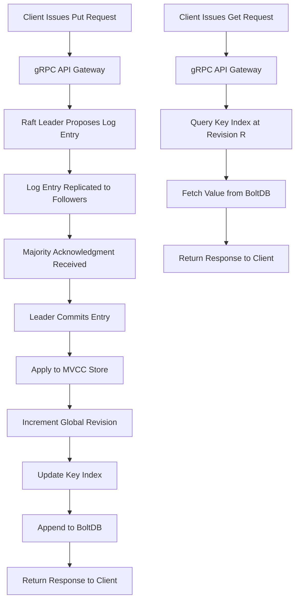
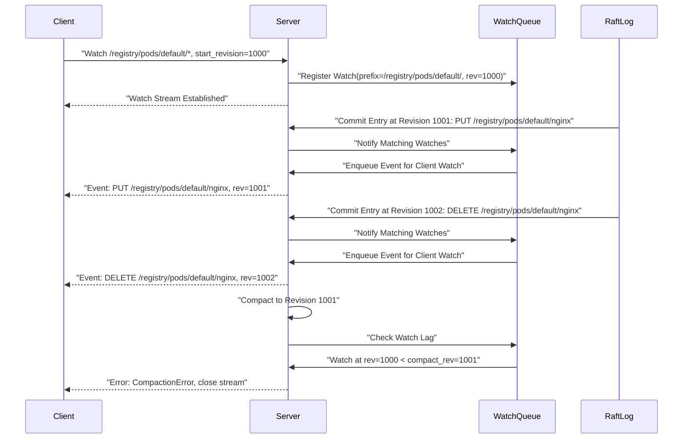

# Lesson 3: Etcd Data Model Operations

## First-Principles Intuition and Invariants

The etcd data model diverges fundamentally from traditional key-value stores like Redis or Memcached, where writes destructively overwrite previous values and ephemeral storage offers no historical record. Etcd instead implements a persistent, versioned, transactional key-value store grounded in the append-only semantics of a distributed log. Every mutation—whether a simple PUT, a conditional transaction, or a bulk DELETE—generates a new immutable revision in an ever-growing timeline. This design choice emerges directly from etcd's role as the source of truth for Kubernetes: the control plane must never lose sight of historical state, must detect concurrent modifications with precision, and must propagate changes to watchers with exactly-once delivery guarantees.

At the heart of this model lies Multi-Version Concurrency Control (MVCC), a technique borrowed from database systems like PostgreSQL and Oracle but adapted for the constraints of a distributed consensus system. MVCC allows etcd to serve strongly consistent reads without blocking writes, to implement optimistic concurrency through compare-and-swap primitives, and to maintain a temporal index over the entire keyspace history. Each key in etcd is not a single mutable cell but a logical entity associated with an ordered sequence of versions, each stamped with a global monotonically increasing revision number. When a client writes to a key, etcd does not overwrite the previous version in place. Instead, it appends a new version tagged with the next revision, preserving the old version until an explicit compaction operation discards it.

The revision number is the fundamental clock of the etcd timeline. It is a 64-bit integer that increments exactly once per committed Raft log entry, ensuring a strict total order across all operations in the cluster. Because etcd's consistency model is linearizable—meaning every operation appears to take effect atomically at some instant between its invocation and response—the revision number serves as both a logical timestamp and a durable checkpoint. Clients can request the state of the keyspace as of any historical revision, enabling time-travel queries for debugging, auditing, or reconstructing the sequence of events that led to a current state. Kubernetes leverages this heavily: every resource version in the API server is an etcd revision, and optimistic concurrency control for updates depends on clients supplying the expected revision to detect conflicting modifications.

The storage layer beneath MVCC is organized into two logical indices: the key index and the B+ tree store. The key index is an in-memory data structure mapping each key to a chronologically ordered list of revisions where that key was modified. This index is rebuilt on startup by scanning the persistent store, and it answers queries like "what is the latest revision for key `/registry/pods/default/nginx`?" or "list all revisions of this key between revision 1000 and 2000." The B+ tree store, implemented atop BoltDB—a pure Go embedded database using copy-on-write B+ trees—is the durable backend where the actual key-value pairs are serialized. BoltDB organizes data into pages and uses a single-writer, multiple-reader locking scheme, which means all write transactions serialize through a single bottleneck. This architectural constraint fundamentally shapes etcd's performance profile.

The tension between infinite retention and finite disk space is resolved through compaction, a background operation that discards historical revisions older than a specified watermark. Compaction is not garbage collection in the traditional sense but a deliberate, operator-controlled truncation of the MVCC timeline. When a compaction completes at revision R_c, all versions of all keys with revision numbers strictly less than R_c are irreversibly deleted, reclaiming space in both the BoltDB file and the in-memory key index. Kubernetes typically runs compaction automatically every few minutes, retaining only the last few thousand revisions to support short-term rollback and watch reconnection without unbounded storage growth.

Transactions in etcd are expressed through the Software Transactional Memory (STM) model, which layers optimistic concurrency atop the low-level compare-and-swap primitives exposed by the gRPC API. An STM transaction reads a snapshot of keys at a specific revision, computes new values, and attempts to commit by verifying that none of the read keys have been modified since the snapshot revision. If the verification succeeds, all writes are applied atomically as a single Raft log entry. If it fails, the transaction is retried with a fresh snapshot. This allows clients to implement complex multi-key invariants—such as atomically decrementing a resource quota while incrementing an allocation counter—without holding locks or blocking other operations.

The lease mechanism introduces temporal scoping to key-value pairs, enabling automatic expiration semantics essential for distributed coordination primitives like leader election and session management. A lease is a server-side object with a time-to-live (TTL) measured in seconds. Clients attach keys to a lease at write time, and if the lease expires—either due to TTL exhaustion or explicit revocation—all attached keys are deleted atomically. Crucially, lease expiration is consensus-driven: the Raft leader periodically proposes lease renewals based on wall-clock time, and followers apply those renewals deterministically, ensuring that all replicas agree on which leases are alive even in the presence of clock skew or network partitions.

Watch streams are the control plane's nervous system, enabling reactive updates without polling. A watch is a long-lived gRPC stream that delivers every revision affecting a key or key range, starting from a client-specified revision. Under the hood, the etcd server maintains a notification queue indexed by revision. When a new transaction commits at revision R, the server scans the queue for all watches whose start revision is less than or equal to R and whose key filters match the modified keys. The watch implementation is lockless and delta-driven, meaning only the keys actually modified are sent, not the entire keyspace. If a watch falls too far behind—specifically, if its next expected revision has been compacted—the server terminates the stream with a compaction error, forcing the client to re-list the keyspace and establish a new watch from the current revision.

Snapshots form the final pillar of operational resilience. A snapshot is a point-in-time copy of the entire BoltDB file, captured atomically without stopping the server. Kubernetes uses snapshots for disaster recovery, cluster migration, and bootstrapping new replicas. Because BoltDB uses copy-on-write semantics and MVCC, the snapshot process is non-blocking: it captures a consistent view of the database at a specific revision without interfering with ongoing writes.

## Core Operations and the gRPC API Surface

Etcd exposes its data model through a gRPC API organized into several service definitions, each corresponding to a distinct operational domain. The KV service handles basic key-value operations, the Watch service manages change streams, the Lease service controls key expiration, and the Transaction service enables atomic multi-key updates. This section dissects each operation class, examining the wire protocol, server-side execution model, and the invariants clients must respect.

### Put: Appending a New Revision

The Put operation writes a key-value pair to the store, appending a new revision to the MVCC timeline. The client sends a PutRequest containing the key, value, and optional parameters such as lease ID, previous key-value for conditional updates, and ignore_value or ignore_lease flags. The server processes the request by first validating permissions, then proposing a Raft log entry containing the mutation. Once Raft commits the entry, the server applies it to the MVCC store, incrementing the global revision counter and indexing the new version in the key index.

```go
// Client code demonstrating a simple Put operation
ctx, cancel := context.WithTimeout(context.Background(), 5*time.Second)
defer cancel()

resp, err := client.Put(ctx, "/registry/pods/default/nginx", `{"spec": {...}}`)
if err != nil {
    log.Fatalf("Put failed: %v", err)
}
fmt.Printf("Put succeeded at revision %d\n", resp.Header.Revision)
```

The PutResponse includes the new revision number and, if requested via the prev_kv option, the previous key-value pair. This allows clients to implement read-modify-write patterns without a separate Get call, reducing round-trip latency. The operation is linearizable: if a client receives a successful Put response, all subsequent reads from any replica are guaranteed to reflect that write.

### Get: Reading from the MVCC Timeline

The Get operation retrieves one or more key-value pairs, either at the latest revision or at a specific historical revision. Clients can query a single key, a range of keys using lexicographic ordering, or a prefix by specifying a range_end that is the lexicographically next key after the prefix. The server resolves the query by consulting the key index to find all matching keys at the specified revision, then fetching the corresponding values from the BoltDB store.

```go
// Reading the latest value for a single key
resp, err := client.Get(ctx, "/registry/pods/default/nginx")
if err != nil {
    log.Fatalf("Get failed: %v", err)
}
if resp.Count == 0 {
    fmt.Println("Key not found")
} else {
    fmt.Printf("Value: %s (revision %d)\n", resp.Kvs[0].Value, resp.Kvs[0].ModRevision)
}

// Reading all keys with a given prefix
resp, err = client.Get(ctx, "/registry/pods/", clientv3.WithPrefix())
for _, kv := range resp.Kvs {
    fmt.Printf("%s = %s\n", kv.Key, kv.Value)
}
```

The WithRev option allows time-travel queries by specifying a historical revision. The server will return the state of the keyspace as of that revision, provided the revision has not been compacted. This capability is essential for debugging distributed race conditions and reconstructing the sequence of state transitions that led to an observed failure.

Range queries respect lexicographic ordering of keys, which Kubernetes exploits by encoding hierarchical resource paths into flat byte strings. For example, all pod objects in the default namespace are stored under keys like `/registry/pods/default/<name>`, allowing efficient prefix scans. The limit and keys_only options control result pagination and reduce network overhead when clients need only key names, not full values.

### Delete: Marking Keys as Tombstones

The Delete operation removes one or more keys from the store by appending tombstone markers to the MVCC timeline. Like Put, Delete increments the global revision counter and generates a new Raft log entry. The deleted keys remain visible in historical queries until compaction discards their tombstones. The prev_kv option allows clients to retrieve the deleted value, enabling atomic take-and-delete patterns.

```go
// Deleting a single key and retrieving the previous value
resp, err := client.Delete(ctx, "/registry/pods/default/nginx", clientv3.WithPrevKV())
if err != nil {
    log.Fatalf("Delete failed: %v", err)
}
if resp.Deleted > 0 {
    fmt.Printf("Deleted %d key(s) at revision %d\n", resp.Deleted, resp.Header.Revision)
    if len(resp.PrevKvs) > 0 {
        fmt.Printf("Previous value: %s\n", resp.PrevKvs[0].Value)
    }
}
```

Range deletes follow the same semantics as range reads, using a range_end parameter to specify the upper bound. The operation returns the number of keys deleted and, if requested, their previous values. Because Delete is a write operation, it requires Raft consensus and is linearizable with respect to other writes.

### Transactions: Atomic Multi-Key Operations

The Transaction (Txn) operation provides atomic compare-and-swap semantics over multiple keys, enabling clients to implement complex invariants that span several key-value pairs. A transaction consists of three parts: a list of comparison predicates, a list of operations to execute if all predicates succeed (the "then" branch), and a list of operations to execute if any predicate fails (the "else" branch). The server evaluates all predicates against a consistent snapshot of the keyspace at a single revision, then applies the corresponding operation sequence atomically.

```go
// Atomic increment using compare-and-swap
key := "/counters/requests"
getResp, _ := client.Get(ctx, key)
var currentValue int64
if getResp.Count > 0 {
    currentValue = parseInt64(getResp.Kvs[0].Value)
}
newValue := currentValue + 1

txn := client.Txn(ctx).
    If(clientv3.Compare(clientv3.ModRevision(key), "=", getResp.Kvs[0].ModRevision)).
    Then(clientv3.OpPut(key, strconv.FormatInt(newValue, 10))).
    Else(clientv3.OpGet(key))

txnResp, err := txn.Commit()
if err != nil {
    log.Fatalf("Txn failed: %v", err)
}
if !txnResp.Succeeded {
    fmt.Println("Concurrent modification detected, retry required")
} else {
    fmt.Printf("Counter incremented to %d at revision %d\n", newValue, txnResp.Header.Revision)
}
```

Comparison predicates can test key existence, value equality, or revision numbers (ModRevision, CreateRevision, Version). The Version field tracks the number of times a specific key has been updated, distinct from the global revision counter. This allows clients to detect whether a key has been modified without knowing the exact revision numbers involved.

Transactions are the foundation of etcd's STM abstraction, which provides a higher-level interface resembling software transactional memory. The STM library automatically retries failed transactions with fresh snapshots, hiding the complexity of optimistic concurrency from application code. Kubernetes uses transactions internally to implement atomic resource updates, such as binding a pod to a node while simultaneously marking the node's available capacity as reduced.

### Watch: Streaming Change Notifications

The Watch operation establishes a long-lived gRPC stream that delivers every revision affecting a key or key range, starting from a client-specified revision. Watches are the mechanism by which Kubernetes controllers learn about resource changes without polling, enabling reactive control loops that respond to state transitions within milliseconds of their occurrence.

```go
// Watching all events for a specific key
watchChan := client.Watch(ctx, "/registry/pods/default/nginx")
for watchResp := range watchChan {
    if watchResp.Err() != nil {
        log.Fatalf("Watch error: %v", watchResp.Err())
    }
    for _, event := range watchResp.Events {
        switch event.Type {
        case mvccpb.PUT:
            fmt.Printf("PUT: %s = %s (revision %d)\n", event.Kv.Key, event.Kv.Value, event.Kv.ModRevision)
        case mvccpb.DELETE:
            fmt.Printf("DELETE: %s (revision %d)\n", event.Kv.Key, event.Kv.ModRevision)
        }
    }
}
```

The WithPrefix option enables watching all keys matching a given prefix, allowing controllers to observe entire resource collections. The WithRev option specifies the starting revision; if omitted, the watch begins at the next revision after the call is made. The WithPrevKV option includes the previous key-value in PUT and DELETE events, enabling clients to compute deltas without maintaining local state.

Watch streams are resilient to transient network failures and server failovers. The client library automatically reconnects and re-establishes the watch from the last successfully received revision. However, if the next expected revision has been compacted on the server, the watch stream terminates with a compaction error. Clients must handle this by re-listing the keyspace to rebuild their local state, then establishing a new watch from the current revision.

The watch implementation inside etcd maintains a per-stream notification queue and a global event buffer indexed by revision. When a transaction commits, the server scans all active watch streams to determine which ones are interested in the modified keys, then enqueues the corresponding events. The event buffer provides a small window of replay capability, allowing watches that momentarily fall behind to catch up without re-listing.

### Leases: Time-Bounded Key Lifetimes

The Lease service enables clients to attach time-to-live semantics to keys, implementing automatic expiration and session management. A lease is created with a TTL specified in seconds, and clients periodically renew the lease by sending keep-alive messages. If the lease expires—either because the client stops sending keep-alives or because the client explicitly revokes it—all keys attached to that lease are atomically deleted.

```go
// Creating a lease and attaching a key
leaseResp, err := client.Grant(ctx, 10) // 10-second TTL
if err != nil {
    log.Fatalf("Lease grant failed: %v", err)
}
leaseID := leaseResp.ID

// Keep the lease alive
keepAliveChan, err := client.KeepAlive(ctx, leaseID)
if err != nil {
    log.Fatalf("KeepAlive failed: %v", err)
}
go func() {
    for ka := range keepAliveChan {
        if ka == nil {
            fmt.Println("Lease expired")
            return
        }
        fmt.Printf("Lease %x kept alive, TTL %d\n", ka.ID, ka.TTL)
    }
}()

// Attach a key to the lease
_, err = client.Put(ctx, "/locks/resource", "holder-id", clientv3.WithLease(leaseID))
if err != nil {
    log.Fatalf("Put with lease failed: %v", err)
}
```

Lease expiration is consensus-driven, not wall-clock-driven. The Raft leader tracks lease TTLs and proposes lease expiry operations when the TTL elapses according to its local clock. Followers apply these operations deterministically from the Raft log, ensuring all replicas agree on which leases are alive. This design tolerates moderate clock skew but assumes clocks advance at roughly the same rate across replicas.

Leases underpin distributed locking and leader election in Kubernetes. A controller creates a lease, writes its identity to a well-known key with that lease attached, and continuously renews the lease. If the controller crashes or becomes partitioned, the lease expires and the key is deleted, allowing another controller to claim leadership.

## MVCC Compaction and History Management

The MVCC timeline grows indefinitely as revisions accumulate, consuming disk space and memory in the key index. Compaction resolves this by permanently discarding historical revisions older than a specified watermark. After compaction at revision R_c, all revisions strictly less than R_c are deleted, and the compacted space is reclaimed during the next BoltDB defragmentation.

```bash
# Manual compaction via etcdctl
etcdctl --endpoints=https://127.0.0.1:2379 compact 100000
# Compacts all revisions before revision 100000

# Automatic compaction enabled via server flags
etcd --auto-compaction-mode=periodic --auto-compaction-retention=5m
# Retains the last 5 minutes of history
```

Kubernetes typically runs auto-compaction with a retention period of 5 minutes, balancing history availability with storage efficiency. The periodic mode triggers compaction at regular intervals, while the revision mode compacts based on the number of revisions retained. Compaction is a cluster-wide operation applied uniformly across all replicas, ensuring consistent history pruning.

Compaction has two critical implications for clients. First, time-travel queries to revisions older than the compaction watermark fail with an error. Second, watch streams that fall behind the compaction point are terminated, forcing clients to re-list and re-establish their watches. Controllers must be designed to handle watch compaction errors gracefully, treating them as opportunities to resynchronize state rather than fatal failures.

Defragmentation is a separate operation that physically reclaims disk space after compaction. Compaction only marks revisions as deleted in the BoltDB freelist; defragmentation rewrites the database file to remove the deleted pages. Defragmentation requires a brief pause in write operations on the replica being defragmented, so it is typically performed offline or in a rolling fashion across cluster members.

## Snapshot and Restore Operations

Snapshots provide point-in-time backups of the entire etcd keyspace, enabling disaster recovery and cluster migration. A snapshot is a copy of the BoltDB file captured at a specific revision, including all keys, values, and MVCC metadata. Because BoltDB uses copy-on-write semantics, snapshots can be taken without stopping the server or blocking writes.

```bash
# Taking a snapshot
etcdctl --endpoints=https://127.0.0.1:2379 snapshot save backup.db

# Verifying snapshot integrity
etcdctl snapshot status backup.db

# Restoring from a snapshot to a new cluster
etcdctl snapshot restore backup.db \
  --name node1 \
  --initial-cluster node1=http://10.0.0.1:2380,node2=http://10.0.0.2:2380,node3=http://10.0.0.3:2380 \
  --initial-advertise-peer-urls http://10.0.0.1:2380 \
  --data-dir /var/lib/etcd-restored
```

Snapshot restore is destructive and intended for disaster recovery scenarios where the original cluster is lost. Restore creates a new cluster initialized with the snapshot data, discarding any state from the previous cluster. All members must be restored from the same snapshot to ensure consistency.

Kubernetes operators use snapshots for backup automation, typically scheduled hourly or daily. Snapshots are stored in durable external storage like S3 or GCS, providing durability independent of the etcd cluster. During cluster migration or upgrade, snapshots enable zero-downtime transitions by bootstrapping new cluster members with production data.

## Performance Characteristics and Operational Constraints

Etcd's performance is constrained by three primary factors: BoltDB's single-writer bottleneck, Raft consensus latency, and disk I/O bandwidth. Write throughput is limited to roughly 10,000 operations per second on typical hardware, with latency dominated by the time required to append to the Raft log and fsync the BoltDB write-ahead log. Read throughput is much higher, scaling linearly with the number of replicas, because reads can be served from any follower without consensus.

The size of individual values impacts performance non-linearly. Etcd recommends keeping values under 1.5 MB, with the practical sweet spot being a few kilobytes. Large values increase BoltDB page fragmentation, slow down compaction, and consume network bandwidth during replication. Kubernetes enforces a 1.5 MB limit on individual object sizes to prevent performance degradation.

Cluster size affects both availability and performance. A three-member cluster tolerates one failure, a five-member cluster tolerates two failures, and a seven-member cluster tolerates three failures. However, larger clusters incur higher Raft consensus overhead, as the leader must replicate log entries to a majority of members before committing. Most production Kubernetes deployments use three or five etcd members, balancing fault tolerance against write latency.

Disk I/O is the dominant performance bottleneck. Etcd requires low-latency, high-throughput storage to maintain stable write latencies. SSDs are strongly recommended, and cloud deployments should use provisioned IOPS volumes. Slow disks manifest as increased Raft proposal timeouts, watch stream lag, and higher compaction duration. Monitoring disk latency and fsync duration is critical for diagnosing performance issues.

Network latency between cluster members directly impacts write latency, as Raft requires a round-trip to a majority of replicas for every committed log entry. Cross-datacenter deployments should carefully consider the latency implications of geographic distribution, and single-region deployments should colocate etcd members within the same availability zone when possible.

## Diagram: MVCC Read and Write Flow



This diagram illustrates the divergent paths of write and read operations. Writes traverse the full Raft consensus pipeline, serializing through the leader and requiring majority acknowledgment before being applied to the MVCC store. Reads bypass consensus entirely, querying the local MVCC snapshot at a specified revision. This asymmetry enables high read throughput without sacrificing strong consistency.

## Diagram: Watch Stream Lifecycle



This sequence diagram captures the lifecycle of a watch stream, from establishment through event delivery to eventual compaction-induced termination. The watch queue acts as an intermediary, matching committed log entries to interested watch streams and enqueuing events for delivery. When compaction advances past a lagging watch's next expected revision, the server closes the stream, requiring the client to resynchronize.
