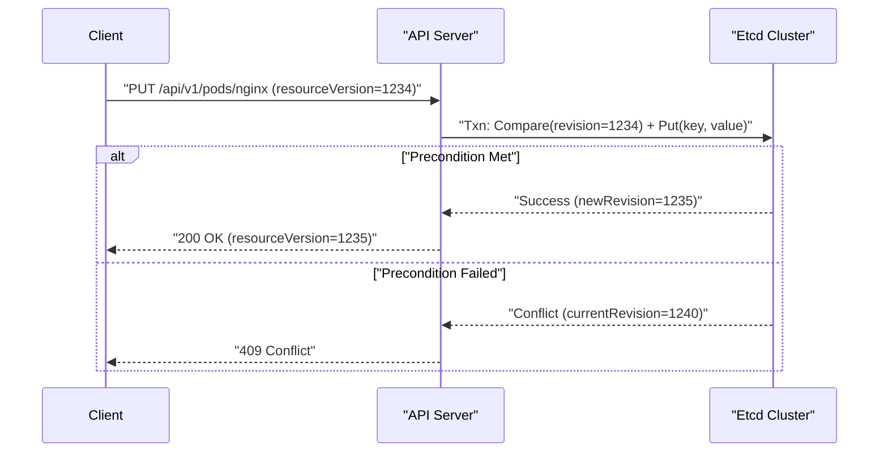

# Lesson 4: Control Plane Etcd Integration

## 1. First-Principles Intuition & Invariants

The Kubernetes API server presents a deceptively simple HTTP interface to the outside world, accepting RESTful mutations and serving resource listings as if it were a stateless web service. Beneath this façade lies a rigorously designed storage layer that bridges the gap between Kubernetes's declarative resource model and etcd's distributed consensus engine. This integration is not a simple database adapter pattern. Rather, it constitutes a vertically integrated consistency protocol that marshals optimistic concurrency control, multi-version state histories, and event stream delivery guarantees into a unified mechanism for managing cluster-wide distributed state.

Understanding the API server's etcd integration requires stepping back to examine the fundamental problem it solves. Kubernetes must maintain linearizable consistency across thousands of concurrent clients—kubectl commands, controllers reconciling desired state, admission webhooks validating mutations, and custom operators reacting to resource changes. Every operation must either commit atomically or fail deterministically, with no middle ground of partial writes or lost updates. The system must deliver a real-time event stream to watching clients, ensuring that no state transition escapes observation while simultaneously avoiding head-of-line blocking when slow consumers lag behind the event frontier.

The mathematical invariant at the heart of this design is etcd's monotonic revision counter, a cluster-wide 64-bit integer that increments with every committed transaction. This revision forms a total order over all state mutations, establishing a global logical clock that transcends individual keys or namespaces. When the API server writes a Pod resource to etcd, it does not simply overwrite a key. Instead, it executes a multi-version concurrency control transaction that preserves the prior revision's value in etcd's append-only B+ tree structure, allowing historical queries and watch initialization from arbitrary points in the revision timeline.



Optimistic concurrency control emerges naturally from this revision-centric model. Every Kubernetes resource carries a `resourceVersion` field in its metadata, an opaque string representation of the etcd revision at which that resource state was last observed. When a client attempts to update a resource, the API server translates the `resourceVersion` into an etcd compare-and-swap precondition, asserting that the current revision of the key matches the client's expected value. If another writer has committed an intervening mutation, etcd rejects the transaction with a precondition-failed error, and the client must retry with a fresh read. This pattern eliminates the need for distributed locks or two-phase commit protocols, achieving conflict-free convergence through retry loops grounded in deterministic total ordering.

The watch mechanism extends this revision-based consistency model into the temporal dimension. Rather than polling the API server for resource changes, clients establish long-lived HTTP connections and subscribe to an event stream anchored at a specific revision number. The API server queries etcd with a watch RPC starting from that revision, receiving a stream of events—PUT, DELETE, and periodic COMPACT markers—that it then filters according to the client's field selectors and namespace constraints before forwarding as JSON-serialized WatchEvent messages. The contract is strict: every resource mutation that occurs after the watch's starting revision must eventually propagate to the client, barring network failures or explicit cancellation. This guarantee enables controllers to maintain eventually consistent views of cluster state without risking missed events or duplicate deliveries.

```mermaid
graph TD
    A["Client Initiates Watch"] -->| "resourceVersion=5000" | B["API Server Watch Cache"]
    B -->| "Cache Hit" | C["Stream Events from Cache"]
    B -->| "Cache Miss" | D["Query Etcd from Revision 5000"]
    D -->| "Paginated Read" | E["Backfill Historical Events"]
    E --> F["Establish Live Watch Stream"]
    C --> F
    F -->| "Continuous Event Delivery" | G["Client Informer"]
```

The failure modes of this integration reveal the intricate coupling between etcd's consensus layer and Kubernetes's control plane semantics. When an etcd cluster loses quorum due to network partitions or node failures, the API server immediately transitions into a read-only mode for all write operations, rejecting POST, PUT, PATCH, and DELETE requests with HTTP 503 status codes. Read operations continue to function, but clients must tolerate potentially stale data as the API server serves cached values from its internal reflector stores. Watch streams remain active but stop delivering new events until quorum is restored, at which point they resume from their last acknowledged revision with no data loss. This degraded-but-deterministic behavior prevents split-brain scenarios where isolated API servers might accept conflicting writes, preserving the cluster's linearizable consistency invariant even as availability degrades.

Performance tuning this integration requires understanding the interplay between three caching layers: etcd's in-memory btree index, the API server's watch cache, and client-side informer reflector stores. The watch cache is particularly crucial—a bounded ring buffer that retains the most recent N revisions of resource events, allowing new watch streams to bootstrap from recent history without hitting etcd's disk-backed storage. When clients request watches from revisions older than the cache's retention window, the API server falls back to etcd pagination, a substantially slower code path that incurs disk I/O and serialization overhead. Operators must balance cache size against memory pressure, tuning the `--watch-cache-sizes` flag to match their cluster's mutation rate and watch reconnection patterns.

The guarantees provided by this architecture are both powerful and constrained. Linearizability holds only within the scope of a single etcd transaction, which in practice means single-resource mutations or carefully orchestrated multi-key operations using etcd's transactional API. Cross-resource atomicity—such as creating a Pod and its corresponding Service in a single atomic commit—is not supported. Clients must implement compensation logic or rely on admission webhooks to enforce multi-resource invariants. Watch events are delivered in revision order, but the API server makes no guarantees about batching or latency. A slow network between the API server and etcd can introduce delays that compound across the watch pipeline, causing clients to lag progressively behind the true cluster state.

This storage layer is the bedrock upon which all Kubernetes controller patterns are built. The reconciliation loops that drive the declarative infrastructure model depend absolutely on the determinism, ordering, and event delivery properties provided by the API server's etcd integration. When operators observe controllers thrashing in retry loops, watch streams falling behind, or stale cache errors disrupting workflows, the root cause often traces back to mismatched assumptions about these lower-level consistency primitives. Mastery of Kubernetes at scale demands fluency with this integration's guarantees, limitations, and failure characteristics.

## 2. Etcd Storage Backend Architecture

The API server's storage layer abstracts etcd through a pluggable backend interface, though in production clusters, etcd3 is the only implementation that sees widespread deployment. This abstraction layer translates Kubernetes's typed resource semantics into etcd's key-value model while managing serialization, versioning, and transactional boundaries.

Every Kubernetes resource maps to a single etcd key constructed from a deterministic naming scheme. The key format follows a hierarchical pattern: `/registry/{resource-type}/{namespace}/{name}`. For cluster-scoped resources like Nodes or ClusterRoles, the namespace component is omitted. This deterministic mapping enables efficient range queries—listing all Pods in a namespace translates to an etcd range scan over the prefix `/registry/pods/{namespace}/`, leveraging etcd's lexicographic key ordering.

The value stored at each key is a protobuf-encoded representation of the resource, not the JSON that clients interact with through the API. Protobuf provides denser encoding and faster serialization than JSON, reducing both network overhead between the API server and etcd and storage consumption in etcd's persistent database. The API server maintains schema definitions for every resource version, allowing it to decode protobuf values and transcode them to JSON for client responses. This dual-format approach creates an impedance mismatch that the storage layer must navigate carefully, particularly when handling custom resources where schema evolution is user-controlled.

Resource versioning introduces another layer of complexity. Kubernetes supports multiple API versions for the same resource kind—v1beta1, v1, v2alpha1—each with potentially different field sets and semantics. The API server stores resources in a single canonical internal version, converting between API versions on read and write. When a client submits a v1beta1 Pod, the API server converts it to the internal representation, validates it against admission controllers, and writes the internal version to etcd. On read, it converts back to the requested API version, applying field transformations and defaults appropriate to that version's schema. This conversion machinery is where many subtle bugs surface, particularly when deprecated fields are removed or when alpha features graduate to beta with breaking changes.

## 3. Optimistic Concurrency and Conflict Resolution

The `resourceVersion` field serves as the cornerstone of conflict detection in Kubernetes. This string-valued metadata field encodes the etcd revision at which the resource was last modified, providing a lightweight optimism token that clients can use to detect concurrent modifications without acquiring locks.

Consider a scenario where two controllers attempt to update the same Deployment simultaneously. Controller A reads the Deployment at revision 1000, computes a desired replica count of 5, and issues an update. Controller B reads the same Deployment at revision 1000, computes a replica count of 3, and issues its own update. Without coordination, one controller's changes would silently overwrite the other's, leading to non-deterministic outcomes. The `resourceVersion` mechanism prevents this race through compare-and-swap semantics.

When Controller A submits its update, the API server includes the original `resourceVersion` of 1000 in the etcd transaction precondition. If the Deployment's current revision is still 1000, etcd commits the write and returns a new revision, say 1001. Controller B's subsequent update, still carrying `resourceVersion` 1000, fails the precondition check because the current revision is now 1001. The API server returns a 409 Conflict error, signaling Controller B to re-read the Deployment, merge its changes with the new state, and retry. This retry loop continues until Controller B's update succeeds or a backoff limit is reached.

The retry logic is not automatic. Clients must explicitly handle 409 Conflict responses by re-executing their read-modify-write sequence. Client libraries like client-go provide helper functions such as `RetryOnConflict` that encapsulate this pattern, but the fundamental responsibility remains with the client. Poorly implemented retry logic can lead to livelock scenarios where two controllers perpetually preempt each other, or to data loss if clients naively retry without re-reading the latest state.

Optimistic concurrency scales horizontally because it avoids distributed lock coordination. etcd's consensus protocol ensures that each revision assignment is globally unique and totally ordered, so the API server need not maintain additional coordination state beyond forwarding preconditions to etcd. The cost is shifted to clients, which must tolerate retry overhead when contention is high. In practice, well-designed controllers exhibit low contention because they operate on disjoint resource sets or employ leader election to serialize writes.

## 4. Watch Streams and Event Ordering

The watch API is arguably the most sophisticated component of the API server's etcd integration. It transforms etcd's low-level watch primitive into a filtered, versioned event stream that controllers use to maintain in-memory caches of cluster state.

A watch begins when a client issues a GET request to a resource collection endpoint with the `watch=true` query parameter. The client may optionally specify a `resourceVersion` parameter to anchor the watch at a particular point in the revision history. If omitted, the watch starts from the current revision, delivering only future events. If set to "0", the watch delivers all existing resources as synthetic ADDED events before transitioning to live updates—a pattern known as list-and-watch.

The API server translates the watch request into an etcd watch RPC, specifying the key prefix corresponding to the requested resource type and namespace. etcd responds with a stream of watch events, each tagged with the revision at which the mutation occurred. The API server applies several transformations to this raw event stream before forwarding it to the client.

First, it filters events according to the client's field selectors and label selectors. A watch for Pods with `status.phase=Running` in the `default` namespace will discard events for Pods in other namespaces or with different phases. This server-side filtering reduces network bandwidth and client-side processing overhead, though it cannot eliminate all unnecessary work—the API server must still receive and decode every event from etcd to evaluate the filters.

Second, it decorates events with additional metadata. Each WatchEvent carries the resource's full state after the mutation, the event type (ADDED, MODIFIED, DELETED), and the `resourceVersion` at which the event occurred. Clients use this `resourceVersion` to checkpoint their watch position, allowing them to resume from that point if the connection drops.

Third, it manages watch bookmarks—synthetic events that carry only a `resourceVersion` without a resource payload. The API server emits bookmarks periodically to advance the client's known revision even when no mutations occur, preventing clients from falling too far behind and exceeding the watch cache's retention window. Clients must explicitly request bookmarks by setting the `allowWatchBookmarks` parameter, as not all clients are prepared to handle them.

The event ordering guarantee is strict within a single resource type and namespace, but relaxed across different types. A watch on Pods in the `default` namespace will receive events in the exact order they were committed to etcd, ensuring that a client never observes a later revision before an earlier one. Watches across multiple namespaces or resource types provide no cross-stream ordering guarantees—a client might observe a Deployment update before the corresponding ReplicaSet update, even if the ReplicaSet mutation occurred first at the etcd layer. Controllers must be designed to tolerate these reordering anomalies, typically by using informers with eventual consistency semantics.

## 5. Watch Cache and Performance Characteristics

The API server's watch cache is a critical optimization that decouples client watch performance from etcd's disk I/O characteristics. This in-memory ring buffer stores the most recent N events for each resource type, allowing new watch streams to initialize from recent history without querying etcd's backing store.

When a client initiates a watch from a `resourceVersion` that falls within the cache's retention window, the API server serves historical events directly from memory, achieving sub-millisecond latency. Once the backfill completes, the watch transitions to live mode, receiving events from the ongoing etcd watch stream. This two-phase initialization ensures that clients never miss events, even if they reconnect after brief network outages.

The cache size is tunable via the `--watch-cache-sizes` flag, which accepts a comma-separated list of resource type and capacity pairs. A configuration like `pods=1000,services=500` allocates space for 1000 Pod events and 500 Service events. Default sizes vary by resource type, with frequently mutated resources like Pods receiving larger allocations than relatively static resources like ConfigMaps. Operators must monitor cache hit rates and adjust sizes to match their cluster's mutation patterns—a cache miss forces an expensive etcd pagination query that can stall watch initialization for seconds or minutes in large clusters.

The cache's bounded size creates a failure mode where clients requesting watches from very old revisions—older than the cache's retention window—must fall back to etcd pagination. This pagination is fundamentally slower because etcd must traverse its on-disk B+ tree, reading leaf pages from persistent storage and deserializing protobuf values into memory. The API server mitigates this cost by paginating in chunks, streaming results back to the client incrementally rather than blocking until the entire backfill completes. Clients experience this as a series of watch events arriving in bursts, followed by a transition to live event delivery once the pagination completes.

Cache eviction follows a least-recently-used policy, but with a twist: events are evicted based on their revision age, not access recency. An event at revision 1000 will be evicted before an event at revision 2000, regardless of which revision clients are watching. This policy ensures that the cache maintains a contiguous window of recent history, preventing fragmentation that would render the cache useless for backfilling watches.

Memory consumption scales with both the number of cached events and the size of each resource payload. Large resources like ConfigMaps containing multi-megabyte data blobs can exhaust watch cache memory allocations quickly, forcing operators to either increase cache sizes or reduce retention windows. Some operators disable the watch cache entirely for specific resource types by setting their size to 0, trading latency for memory efficiency.

## 6. Failure Modes and Degraded Operation

The tight coupling between the API server and etcd creates several failure modes that operators must understand to maintain cluster availability during outages.

Etcd quorum loss is the most severe failure mode. When an etcd cluster loses majority consensus—due to network partitions, node crashes, or disk failures—the API server immediately detects the loss through failed heartbeat responses. It transitions all write operations into a failing state, returning HTTP 503 Service Unavailable errors to clients. This fail-stop behavior is deliberate: accepting writes without etcd consensus would violate linearizability, potentially creating split-brain scenarios where different API servers commit conflicting mutations.

Read operations continue to function during quorum loss, but with stale data guarantees. The API server serves reads from its internal watch cache, which contains the last successfully replicated state before the failure. Clients receive responses with a `resourceVersion` anchored at the pre-failure revision, and subsequent watches may not deliver new events until etcd recovers. This degraded mode allows read-only operations like `kubectl get` to continue functioning, but controllers that depend on write operations to reconcile desired state become effectively paused.

Watch streams exhibit graceful degradation during etcd unavailability. Existing watches remain connected and buffered events continue to drain, but no new events arrive from etcd. The API server does not forcibly disconnect watch clients; instead, it allows them to remain subscribed while transparently absorbing the etcd-side interruption. When etcd quorum is restored, the watch stream resumes from the last successfully delivered revision, with no data loss. Clients experience this as a temporary event delivery stall, followed by a burst of backfilled events once etcd recovers.

Network latency between the API server and etcd manifests as increased end-to-end latency for write operations and watch event delivery. A 50ms round-trip time to etcd translates directly into 50ms of added latency for every kubectl apply or controller update. Watch events experience compounded latency as they traverse the API server's filtering and serialization pipeline before reaching clients. In geographically distributed clusters where API servers and etcd nodes span multiple availability zones, this latency can degrade controller responsiveness significantly, particularly for high-frequency reconciliation loops.

Disk I/O saturation on etcd nodes creates cascading performance degradation throughout the control plane. When etcd's write-ahead log cannot flush to disk fast enough, write operations queue in memory, increasing commit latency and eventually triggering client-side timeout errors. The API server's watch cache provides some insulation from disk-bound etcd reads, but cache misses expose clients directly to the underlying storage performance. Operators must provision etcd nodes with SSD or NVMe storage and monitor disk I/O metrics closely to prevent this failure mode.

## 7. Transactional Semantics and Multi-Key Operations

While Kubernetes provides strong single-resource consistency, cross-resource atomicity is limited. The API server does not expose etcd's full transactional API to clients, restricting transactions to the compare-and-swap semantics embedded in `resourceVersion` preconditions.

etcd's transaction primitive supports arbitrary combinations of compare operations, put operations, and delete operations, all executed atomically within a single Raft log entry. The API server uses this capability internally for specific operations—such as namespace deletion, which transactionally removes all resources within the namespace—but does not expose a general-purpose transaction interface to clients.

This limitation stems from the tension between etcd's key-value model and Kubernetes's resource-oriented API. A transaction that atomically creates a Pod and a Service would require the API server to coordinate schema validation, admission webhook invocations, and default value injection across both resources, then construct an etcd transaction that commits both keys simultaneously. The complexity of this coordination, combined with the difficulty of exposing a usable API surface that respects Kubernetes's RESTful conventions, has prevented its implementation.

Clients needing multi-resource atomicity must implement compensation-based patterns. A controller creating a Pod and a Service will create the Pod first, then create the Service, handling rollback if the second operation fails. Alternatively, admission webhooks can enforce multi-resource invariants by rejecting mutations that would violate cross-resource constraints, though this approach only prevents invalid states rather than ensuring atomic transitions.

The StorageVersion API, introduced in Kubernetes 1.20, provides a narrow form of multi-key coordination by tracking which API versions are actively stored in etcd for each resource type. During API version migrations, the API server uses StorageVersion records to ensure that no clients are reading or writing deprecated versions before finalizing the migration. This coordination is coarse-grained and asynchronous, relying on eventual consistency rather than immediate atomicity.

## 8. Compaction and Historical Data Management

etcd's multi-version concurrency control requires periodic compaction to prevent unbounded storage growth. Every mutation creates a new revision, and etcd retains all historical revisions until explicitly compacted. Without compaction, the database would grow indefinitely, exhausting disk space and degrading query performance.

The API server configures etcd to compact revisions older than a specified retention window, typically 5 minutes. Compaction removes historical key-value pairs from etcd's B+ tree, reclaiming storage space and allowing etcd to defragment its database file. The compaction operation is non-blocking—it runs in the background while etcd continues to serve read and write requests.

Clients attempting to watch from revisions older than the last compacted revision receive an HTTP 410 Gone error, accompanied by a `ResourceExpired` status message. This error signals that the requested revision has been compacted and is no longer available in etcd's history. Clients must respond by restarting their watch from a more recent revision, typically by performing a fresh list operation to resynchronize their in-memory cache.

The API server's watch cache provides a buffer against compaction-induced watch failures. As long as the requested revision falls within the cache's retention window, the watch can initialize from cached events without hitting etcd. The cache's retention window is typically much longer than etcd's compaction window, giving clients ample time to reconnect after brief network outages without triggering expensive list operations.

Operators must balance compaction frequency against watch reconnection overhead. Aggressive compaction reduces etcd storage consumption but increases the likelihood of clients receiving 410 errors and resorting to full list operations. Conservative compaction improves client-side resilience but allows etcd's database to grow larger, consuming disk space and potentially degrading defragmentation effectiveness.

## 9. Schema Evolution and Storage Migration

Kubernetes's multi-version API support creates challenges for the storage layer. When a new API version is introduced—such as promoting a CustomResourceDefinition from v1beta1 to v1—the API server must continue serving both versions while maintaining a single stored representation in etcd.

The storage version is the canonical format used in etcd. When a client writes a resource using v1beta1, the API server converts it to the storage version, validates it, and commits the storage version to etcd. On read, the API server retrieves the storage version from etcd and converts it to the requested API version. This round-trip conversion ensures that clients can interoperate using different API versions without data loss, provided the conversions are well-defined.

Conversion functions must be bidirectional and lossless within each version's schema. A field present in v1 but absent in v1beta1 must have a defined behavior when converting from v1beta1 to v1: either it receives a default value, or the conversion is rejected as invalid. The API server's conversion webhooks allow custom resources to implement complex conversion logic, delegating the conversion to external services rather than hard-coding it in the API server binary.

Storage migration occurs when the storage version itself changes. An operator may decide to migrate all stored resources from v1beta1 to v1, requiring a rewrite of every key in etcd to update the stored representation. Kubernetes does not provide built-in tooling for this migration; operators must write custom scripts that iterate over all resources, read them in the old storage version, and write them back in the new storage version. This process is time-consuming and error-prone, particularly for large clusters with millions of resources.

The StorageVersion API tracks the current storage version for each resource type, but it does not automate migration. It serves as a coordination primitive that operators and controllers can use to detect when migration is safe—no client should be reading or writing the old storage version while migration is in progress. The Kubernetes project continues to refine this area, with proposals for declarative storage migration tooling that would automate the rewrite process.
