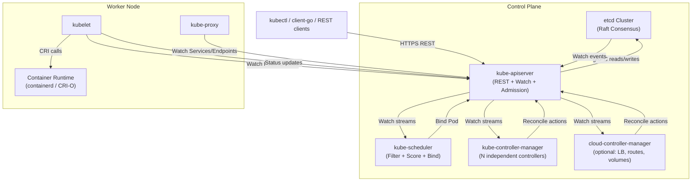
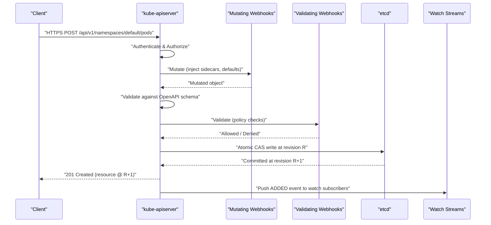
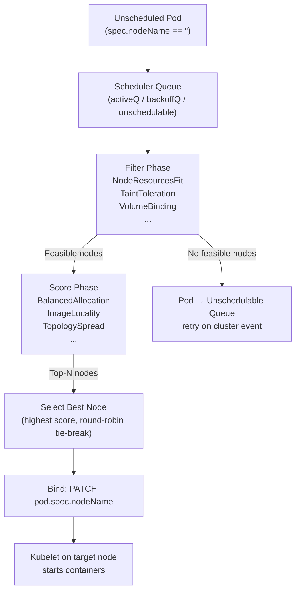
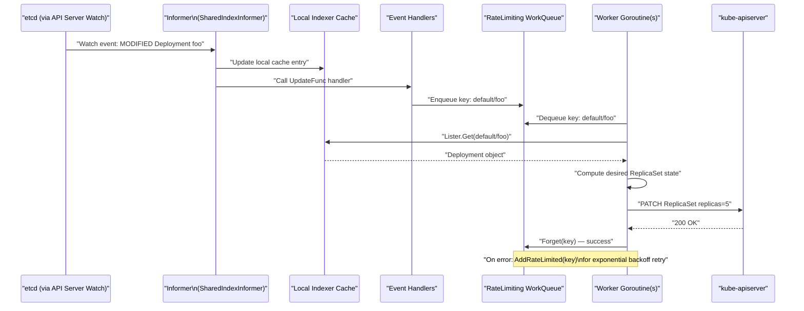
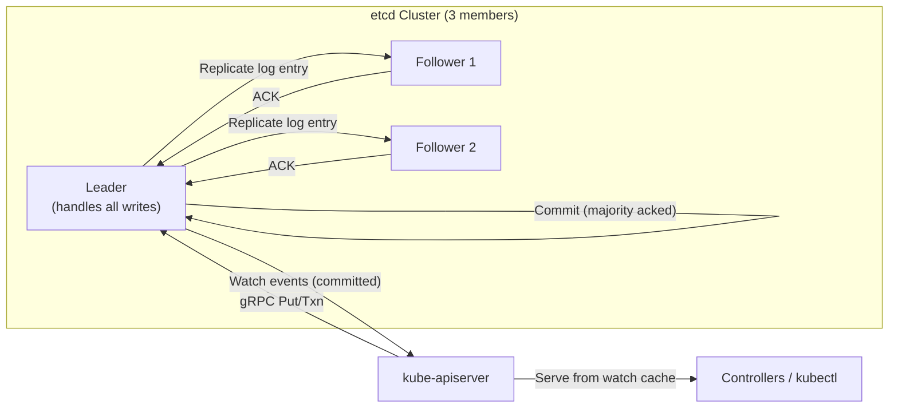

# Lesson 1: Control Plane Architecture

## 1. First-Principles Intuition & Invariants

The Kubernetes control plane represents one of the most sophisticated production deployments of the declarative state reconciliation pattern in distributed systems engineering. At its core, it solves a problem that has challenged cluster orchestration since the earliest days of grid computing: how to continuously drive a large, dynamic collection of heterogeneous compute resources toward a desired configuration while tolerating partial failures, network partitions, and concurrent modifications from multiple operators—without requiring any single coordinator to hold perfect knowledge of system state.

Traditional imperative orchestration systems—exemplified by early configuration management tools like CFEngine, early Puppet, and hand-rolled deployment scripts—operated through explicit command sequences. An operator would issue a directive such as "start three instances of application X on these specific nodes," and the system would execute that command exactly once. If a node failed after deployment, the system remained unaware unless explicitly queried. This approach fundamentally conflates *intent* with *execution*, creating brittle systems that cannot self-heal and requiring operators to maintain perfect mental models of current cluster state against an ever-drifting reality.

Kubernetes inverts this paradigm through **level-triggered reconciliation**. The term is borrowed from hardware interrupt design: an edge-triggered system fires once when a signal transitions; a level-triggered system fires continuously as long as the signal remains in a particular state. Edge-triggered orchestration executes a command and forgets; level-triggered orchestration continuously re-evaluates and re-applies intent. The control plane never issues a command and assumes success—it observes the gap between desired and actual state and acts to close it, forever.

The architectural elegance emerges from decomposing the monolithic orchestration problem into a collection of independent, single-purpose control loops. Each controller implements the same fundamental algorithm: watch a subset of cluster resources, compute the delta between desired and actual state, act to close that delta, and repeat. The Deployment controller, for instance, observes Deployment objects and their associated ReplicaSets, creating new ReplicaSets during rollouts and scaling down old ones according to configured strategies. It neither knows nor cares about the existence of the ReplicaSet controller, which independently ensures that ReplicaSets have the correct number of running Pods. This decomposition follows the Unix philosophy of composing complex behaviors from simple, orthogonal primitives, and it produces an architecture where the failure of any single controller degrades only its specific domain rather than the entire system.

### Core Invariants

Three invariants govern control plane correctness.

**Eventual consistency.** Given sufficient time without new desired-state modifications and absent persistent failures, actual state converges to desired state. This property derives directly from the continuous reconciliation loop—controllers retry failed operations indefinitely, with exponential backoff to prevent resource exhaustion. It does *not* guarantee that any single observation of cluster state reflects the most recent desired state, nor that convergence occurs within a bounded time window.

**At-least-once semantics for state transitions.** A controller may attempt to create a Pod multiple times if acknowledgments are lost, requiring all cluster operations to be idempotent. The API server enforces this through resource versioning: every modification must include the expected `resourceVersion`, and concurrent modifications trigger 409 Conflict responses that force client-side refetch-and-retry cycles. The underlying etcd write is a conditional transaction (`compare-and-swap` on the key's current revision), making duplicate writes safe.

**Monotonically increasing global revision ordering.** Every cluster state change increments etcd's global revision counter, providing a total order across all resource modifications. This total order enables consistent watch streams (a client can request all events since revision R, with no gaps), point-in-time snapshot reads, and the detection of stale caches.

The control plane's distributed nature introduces trade-offs governed by the CAP theorem. Kubernetes prioritizes availability and partition tolerance (AP) for the data plane, accepting temporary divergence between desired and actual state during network splits. However, it provides CP (consistency and partition tolerance) semantics for the desired state itself through etcd's Raft consensus protocol, ensuring all control plane components observe identical resource definitions. This two-tier consistency model reflects the reality that cluster state divergence is inevitable—nodes crash, networks partition, processes hang—so the architecture tolerates and recovers from inconsistency rather than attempting to prevent it.

A useful mental model: Kubernetes implements a distributed database where etcd serves as the authoritative storage layer, the API server acts as the query execution engine and transaction coordinator, and controllers function as materialized view maintenance processes. When you submit a Deployment manifest, you write a record to a distributed database that triggers cascading updates through downstream views maintained by various controllers. The Pod you eventually observe running on a node is the materialized result of this cascade, constructed through a chain of watch notifications, state comparisons, and incremental reconciliation steps.

---

## 2. Core Architecture & Mechanics

The control plane comprises four primary components: the API server (`kube-apiserver`), the scheduler (`kube-scheduler`), the controller manager (`kube-controller-manager`), and the persistent etcd cluster. Each executes as an independent process, communicating exclusively through the API server's RESTful HTTP interface backed by etcd storage. This strict separation enables horizontal scaling of individual components and allows the control plane to survive partial component failures.



### API Server: The Central Coordination Point

The API server is the singular gateway to cluster state, mediating all interactions between clients, controllers, and etcd. The request path for a mutating operation proceeds through several distinct phases:

1. **Authentication** — TLS client certificates, bearer tokens (service account JWTs, OIDC tokens), or webhook authenticators establish the caller's identity.
2. **Authorization** — RBAC or webhook authorizers check whether the authenticated identity may perform the requested verb on the target resource.
3. **Admission mutation** — `MutatingAdmissionWebhook` controllers (and built-in mutating plugins like `DefaultStorageClass`) may alter the resource object.
4. **Schema validation** — The object is validated against its OpenAPI v3 schema.
5. **Admission validation** — `ValidatingAdmissionWebhook` controllers (and built-in validators) may reject the object.
6. **etcd commit** — The resource is serialized (protobuf for internal storage, JSON/protobuf for responses) and written to etcd under a conditional transaction.
7. **Watch fanout** — The committed event is pushed to all active watch streams for matching resources.



**Watch mechanism internals.** Controllers establish persistent HTTP/1.1 or HTTP/2 connections to the API server using the `?watch=true` query parameter. The API server maintains an in-memory watch cache (`watchCache`) that buffers recent events in a ring buffer (default 100 events per resource type). When a watch is established with `?resourceVersion=R`, the API server replays buffered events from R onward, then transitions to live event delivery. This ensures zero-gap semantics: a controller that restarts can re-establish its watch from its last-seen `resourceVersion` and receive all events it missed while offline, as long as those events remain in the ring buffer.

**Optimistic concurrency.** Every resource carries a `metadata.resourceVersion` field—an opaque string encoding etcd's internal revision number. Update requests must supply the last-known `resourceVersion`. The API server translates this into a Txn operation on etcd: `IF key.ModRevision == expectedRevision THEN PUT key = newValue`. If the condition fails (another writer modified the resource), etcd returns a failure, and the API server returns HTTP 409 Conflict. Clients must refetch, reapply their changes to the new version, and retry. This mechanism prevents lost updates without distributed locks, which would create availability bottlenecks.

**Server-Side Apply (SSA).** Since Kubernetes 1.18 (GA in 1.22), Server-Side Apply provides a more sophisticated conflict detection mechanism than optimistic concurrency. Each field in a resource carries ownership metadata tracking which field manager last set it. When two controllers attempt to set conflicting fields, SSA returns an explicit conflict error identifying the owning manager. This solves the "last-write-wins" problem for multi-controller resource management and is the recommended approach for new controller implementations.

### Scheduler: Optimal Pod Placement

The scheduler watches for newly created Pods with no `spec.nodeName` assigned and selects the optimal node using a two-phase algorithm.

**Phase 1: Filtering (Predicates).** The scheduler evaluates every node against a set of filter plugins. Standard filters include:
- `NodeResourcesFit` — verifies the node has sufficient allocatable CPU, memory, and extended resources.
- `NodeAffinity` — enforces `spec.affinity.nodeAffinity` required rules.
- `PodTopologySpread` — enforces `topologySpreadConstraints`.
- `TaintToleration` — rejects nodes whose taints the pod does not tolerate.
- `VolumeBinding` — checks that required PersistentVolumeClaims can be satisfied on the node.
- `InterPodAffinity` — enforces required pod-to-pod affinity and anti-affinity.

Nodes failing any filter are removed from consideration. The result is a set of *feasible nodes*.

**Phase 2: Scoring (Priorities).** Each feasible node is scored by a set of score plugins. Scores are normalized to [0, 100] and summed with configurable weights. Standard score plugins include:
- `NodeResourcesBalancedAllocation` — prefers nodes where adding this pod produces balanced CPU/memory utilization.
- `NodeResourcesLeastAllocated` — prefers nodes with the most available resources (spread by default).
- `InterPodAffinityPriority` — scores nodes higher when preferred pod affinity rules are satisfied.
- `PodTopologySpread` — also contributes a score for preferred spread constraints.
- `ImageLocality` — prefers nodes that already have the pod's container images cached.

The node with the highest aggregate score wins. Ties are broken by round-robin among tied nodes to prevent thundering-herd placement.

**Binding.** The scheduler writes a `Binding` object to the API server (or directly patches `pod.spec.nodeName`), which commits to etcd under optimistic concurrency. The kubelet on the winning node watches for pods bound to its `spec.nodeName` and initiates container creation.



The scheduler uses an in-memory snapshot of cluster state rather than fetching fresh node information for each scheduling cycle, which is critical for throughput. The snapshot is updated asynchronously between scheduling cycles, trading a small degree of staleness for a dramatic reduction in API server load. For a 5,000-node cluster, re-fetching all node objects for each pod would generate untenable list traffic.

The scheduling framework (introduced in Kubernetes 1.15, GA in 1.19) replaced the legacy predicate/priority plugin system with an extension points-based architecture. Custom plugins register at specific extension points (`PreFilter`, `Filter`, `PostFilter`, `PreScore`, `Score`, `Reserve`, `Permit`, `PreBind`, `Bind`, `PostBind`, `Unreserve`), enabling fine-grained customization without forking the scheduler binary.

### Controller Manager: The Reconciliation Engine

The controller manager runs multiple independent controllers in a single process. Each implements the watch-compare-act loop for a specific resource type. The key controllers include:

| Controller | Watches | Reconciles |
|---|---|---|
| Deployment | Deployments, ReplicaSets | ReplicaSet creation/deletion, rollout strategy |
| ReplicaSet | ReplicaSets, Pods | Pod count matches desired replicas |
| StatefulSet | StatefulSets, Pods, PVCs | Ordered pod creation, PVC provisioning |
| DaemonSet | DaemonSets, Nodes, Pods | One pod per eligible node |
| Job | Jobs, Pods | Pod creation, completion tracking |
| Node | Nodes | Node condition monitoring, pod eviction |
| Endpoints/EndpointSlice | Services, Pods | Endpoint list maintenance |
| Namespace | Namespaces | Resource cleanup on deletion |
| ServiceAccount | ServiceAccounts | Default SA creation per namespace |
| PersistentVolume | PVs, PVCs | Volume binding and reclaim |

Controllers implement reconciliation through the **informer + work queue pattern**:



The `SharedIndexInformer` is a critical abstraction. Rather than each controller establishing its own watch stream to the API server—which would multiply watch connections proportionally to controller count—the informer factory creates a single watch stream per resource type, shared across all controllers watching that resource. The informer maintains a local in-memory index (backed by a thread-safe store) and distributes events to registered handler functions. This shared architecture reduces API server watch load from O(controllers × resource-types) to O(resource-types).

**Work queue semantics.** The `RateLimitingWorkQueue` provides three key properties: deduplication (enqueueing the same key multiple times before it is processed results in a single processing attempt), rate limiting (failed items are requeued with exponential backoff using a token-bucket rate limiter), and shutdown coordination (the queue drains cleanly when the controller shuts down). The default rate limiter applies exponential backoff starting at 5ms, doubling up to a 1000s maximum, with a per-item limit of 10 failures before the max delay applies.

**Leader election.** The controller manager uses a `Lease` resource in the `kube-system` namespace for leader election. The active controller manager continuously renews the `Lease` with a configurable `renewDeadline` (default 10s). Standby instances watch the `Lease` and acquire leadership if the renewal lapses beyond `leaseDuration` (default 15s). After acquiring leadership, a new leader waits `retryPeriod` (default 2s) before beginning reconciliation, providing a safety margin. The gap between leadership transition and reconciliation resumption is bounded by `leaseDuration + retryPeriod ≈ 17s` in the worst case.

### Etcd: The Source of Truth

Etcd provides persistent, strongly consistent storage for all cluster state. Built on Raft consensus, etcd guarantees linearizable reads (every read reflects the most recent committed write) and durable writes (committed entries survive the failure of a minority of members). Every Kubernetes resource—Pods, Services, ConfigMaps, Secrets, Custom Resources, Leases—is stored as a key-value pair under a hierarchical namespace. A Pod named `web-server` in namespace `production` resides at key `/registry/pods/production/web-server`, with the value containing the resource serialized in protobuf format (not JSON, for storage efficiency).



The API server does not read from etcd for most GET requests. It maintains a **watch cache** (`cacheStorage`): an in-memory representation of all resources, populated and kept current by a persistent watch on etcd. Controllers and kubectl queries are served from this cache, reducing etcd read load by orders of magnitude. Only requests specifying `resourceVersion=0` (get from cache) or `resourceVersion=""` (get from cache, return current) are served from cache; requests with an explicit `resourceVersion` or `watch=true` bypass the cache for consistency.

---

## 3. etcd Deep Dive

Etcd's role as authoritative data store makes it the most operationally critical component in the control plane. Its internals, performance profile, and failure modes directly constrain what is achievable at the Kubernetes layer.

### Raft Consensus Protocol

Raft provides consistency through a leader-based approach. At any time, one member is the leader; others are followers. The lifecycle of a write proceeds as follows:

1. A client sends a write to the leader (or is redirected by a follower).
2. The leader appends the entry to its local Raft log and broadcasts it to followers.
3. Followers append the entry and reply with acknowledgment.
4. Once a **quorum** (⌊N/2⌋ + 1 members) has acknowledged, the leader marks the entry as committed.
5. The leader applies the entry to its state machine (the MVCC key-value store) and responds to the client.
6. Followers learn of the commit on the next heartbeat and apply the entry locally.

Leaders maintain authority through periodic heartbeats (default 100ms `heartbeat-interval` in Kubernetes). If a follower receives no heartbeat within the `election-timeout` (default 1000ms), it transitions to candidate, increments its term, votes for itself, and solicits votes from peers. A candidate receiving votes from a majority becomes the new leader for that term.

Raft's safety rests on two invariants:
- **Election Safety**: at most one leader per term (a majority can only vote for one candidate per term).
- **Leader Completeness**: if an entry is committed in term T, every future leader's log contains that entry. This prevents committed data loss during leader transitions.

A five-member cluster tolerates two simultaneous failures. A three-member cluster tolerates one. The write latency for a committed operation is approximately `2 × RTT(leader, slowest-quorum-member) + disk-fsync-latency`. On modern NVMe SSDs within a single datacenter, this is typically 2–8ms. Cross-datacenter deployments with 50ms inter-site RTT produce 100ms+ commit latencies, which Kubernetes control plane components (with their 10-50ms timeouts in various client configurations) cannot reliably tolerate.

### Data Model and Storage Layout

Etcd stores data in a flat key-value space. The underlying storage engine is **bbolt** (a fork of BoltDB)—a pure Go embedded key-value store using B+trees for indexing. BoltDB provides ACID transactions with serializable isolation for the on-disk format. Etcd layers its MVCC model on top: each logical key-value pair is stored internally as `(key, revision) → value`, where `revision` is the global monotonic counter. Reading key `foo` at revision R retrieves the value from the highest-revision entry for `foo` with revision ≤ R.

Kubernetes serializes resources using **protobuf** (not JSON) for etcd storage. The on-wire format wraps the protobuf-encoded object with a magic prefix (`k8s\x00`) and a type discriminator, allowing the API server to decode objects without prior knowledge of their type. JSON is only used for HTTP API responses and is decoded/re-encoded by the API server.

MVCC enables several capabilities critical for Kubernetes:
- **Consistent list operations**: a `LIST /pods` returns all pods at a single revision, even if pods are being created and deleted concurrently.
- **Watch from arbitrary revision**: a controller restarting can request `watch?resourceVersion=1234` and receive every event since revision 1234.
- **Historical queries**: `etcdctl get --rev=N key` retrieves the value of a key at any retained revision.

MVCC history accumulates until **compaction** removes old revisions. The `--auto-compaction-mode` flag (periodic or revision) and `--auto-compaction-retention` control how much history is retained. Insufficient compaction causes unbounded database growth; over-aggressive compaction breaks watch clients that reconnect with stale `resourceVersions`, receiving a `410 Gone` error that forces a full relist.

The practical implication: when a controller receives a `410 Gone` on its watch stream, it must perform a full `LIST` to rebuild its local cache, then re-establish the watch from the returned `resourceVersion`. The `SharedIndexInformer` handles this automatically, but the full list can be expensive for large resource collections. The `--watch-cache-sizes` API server flag can increase per-resource watch cache buffers to reduce 410s.

### Performance Characteristics and Operational Limits

A well-tuned three-member etcd cluster on NVMe SSDs can sustain approximately:
- **10,000–20,000 writes/second** at p50 latencies of 2–5ms.
- **Hundreds of thousands of reads/second** served from memory (the bbolt B+tree is memory-mapped).
- **Write latency p99**: 20–50ms on SSDs, 200–500ms on spinning disks (which should not be used in production).

The **database size** is the primary cluster scale constraint. Etcd degrades noticeably above **8GB** due to compaction and defragmentation overhead. Kubernetes 1.26+ increased the default `--etcd-quota-backend-bytes` from 2GB to 8GB. A rough sizing model: each Kubernetes object occupies 1–10KB in etcd depending on annotations and data. A cluster with 100,000 objects at 5KB average consumes ~500MB, well within limits. Clusters exceeding 2,000 nodes often see etcd databases in the 2–4GB range from accumulated audit events, Events (which should be stored in a separate etcd cluster), and large ConfigMaps/Secrets.

**Watch load** scales as O(watch-streams × events/second). Each controller manager replica watching all pods with 100,000 pods and high churn generates significant fanout. The API server's watch cache serializes and delivers each event to every matching watch stream. Profiling API server memory in large clusters typically reveals watch serialization buffers as a top consumer; tuning `--watch-cache-sizes` and enabling watch bookmarks reduces overhead.

**Recommendation**: run a separate etcd cluster for Kubernetes Events (`--etcd-servers-overrides=/events#https://etcd-events:2379`). Events are extremely high-write, have no durability requirement, and their churn degrades the primary etcd cluster's performance for critical resources.

### Backup and Disaster Recovery

Etcd snapshots are the foundational disaster recovery primitive. The `etcdctl snapshot save` command serializes the entire bbolt database to a file at a consistent revision. This snapshot is self-contained: it contains all keys and their most-recent values at the snapshot revision, but not MVCC history prior to the last compaction.

```bash
# Production snapshot procedure (run against each member or the leader)
ETCDCTL_API=3 etcdctl \
  --endpoints=https://127.0.0.1:2379 \
  --cacert=/etc/etcd/pki/ca.crt \
  --cert=/etc/etcd/pki/server.crt \
  --key=/etc/etcd/pki/server.key \
  snapshot save /backup/etcd-snapshot-$(date +%Y%m%d-%H%M%S).db

# Verify snapshot integrity
ETCDCTL_API=3 etcdctl snapshot status /backup/etcd-snapshot-*.db --write-out=table
```

**Restoration procedure:**

```bash
# 1. Stop all etcd members and all API servers.
# 2. Restore snapshot to each member with unique member-specific parameters.
ETCDCTL_API=3 etcdctl snapshot restore /backup/etcd-snapshot.db \
  --name etcd-0 \
  --initial-cluster "etcd-0=https://10.0.0.1:2380,etcd-1=https://10.0.0.2:2380,etcd-2=https://10.0.0.3:2380" \
  --initial-cluster-token etcd-cluster-restored \
  --initial-advertise-peer-urls https://10.0.0.1:2380 \
  --data-dir /var/lib/etcd-restored

# 3. Update etcd configuration to use --data-dir=/var/lib/etcd-restored
# 4. Start etcd members. The cluster forms with identical state from the snapshot.
# 5. Start API servers.
```

After restoration, the control plane will observe stale Pod objects in etcd representing containers that were running at snapshot time but have since exited. Node controllers and kubelet status updates will detect these mismatches and trigger pod deletions and rescheduling. Expect several minutes of reconciliation churn after a restore.

**Recovery Time Objective (RTO)**: a well-prepared team with automation can restore from snapshot in 15–30 minutes. **Recovery Point Objective (RPO)**: equal to the age of the most recent snapshot. For hourly snapshots, this is up to 60 minutes of cluster state changes lost. Organizations with strict RPOs often run synchronous etcd replicas in a second datacenter (with the latency implications discussed above) or use Velero for application-layer backups that complement etcd snapshots.

### Operational Best Practices

**Dedicated, low-latency storage.** Etcd's write path requires an `fdatasync` call after each committed log entry. Any mechanism that introduces fsync latency variance (shared I/O paths, NFS, network-attached storage, overcommitted hypervisor hosts) causes election timeouts and cluster instability. The critical metric is `etcd_disk_wal_fsync_duration_seconds_bucket`—p99 above 50ms warrants immediate investigation. NVMe SSDs with dedicated I/O queues are the production standard.

**Low-latency intra-cluster networking.** Raft replication latency determines write latency. All etcd members should reside within a single low-latency L2 domain. The `etcd_network_peer_round_trip_time_seconds_bucket` metric tracks inter-member RTT; p99 above 10ms in a single datacenter indicates a network problem. Cross-AZ etcd clusters within the same region are feasible (5–15ms inter-AZ RTT is tolerable); cross-region etcd clusters are not recommended for production Kubernetes control planes.

**Key health metrics to monitor continuously:**

| Metric | Healthy Value | Action if Violated |
|---|---|---|
| `etcd_server_has_leader` | 1 | Immediate incident — cluster cannot accept writes |
| `etcd_server_leader_changes_seen_total` rate | < 1/hour | Investigate fsync latency and network stability |
| `etcd_disk_wal_fsync_duration_seconds` p99 | < 50ms | Inspect disk I/O; consider dedicated storage |
| `etcd_disk_backend_commit_duration_seconds` p99 | < 100ms | Inspect disk I/O; run defragmentation |
| `etcd_mvcc_db_total_size_in_bytes` | < 6GB | Audit large resources; run compaction + defrag |
| `etcd_server_quota_backend_bytes` fraction | < 0.75 | Increase quota or reduce database size |

**Defragmentation.** Compaction removes old MVCC revisions logically, but does not reclaim disk space—bbolt pages containing deleted data are marked free but not returned to the OS. `etcdctl defrag` rewrites the database file, reclaiming free pages. Defragmentation causes brief write unavailability (sub-second for healthy clusters) and should be run during low-traffic windows on one member at a time.

**Version upgrade discipline.** Upgrade one etcd member at a time, verifying cluster health (leader election completes, all members show `is_learner=false`) before proceeding. Etcd does not guarantee backward-compatible Raft log formats between major versions; never attempt to downgrade. Take a verified snapshot before beginning any upgrade.

---

## 4. Control Plane Failure Modes

Understanding failure modes and their blast radius is prerequisite to designing resilient clusters and responding effectively during incidents.

### API Server Failures

API server failures manifest as increased latency or connection timeouts for kubectl commands and controller reconciliation loops. In a multi-instance deployment (the standard for production), a single API server failure causes clients to reconnect to healthy instances, appearing as brief latency spikes. If all API server instances fail simultaneously—possible through correlated OOM kills, a shared network segment failure, or a certificate expiration—the control plane becomes fully unavailable.

Critically, **running workloads continue operating during API server outages**. Containers keep running, kubelets restart crashed containers using their local pod spec cache, kube-proxy continues forwarding traffic based on its last-known iptables/IPVS rules, and mounted volumes remain accessible. The duration of this graceful degradation is bounded: kubelet's node-status update interval and pod lifecycle eviction timers will eventually fire, but workloads can tolerate control plane unavailability measured in tens of minutes in many configurations.

API server memory exhaustion is the most common failure mode in large clusters. A controller bug that repeatedly lists all Pods without pagination, a surge in watch connections, or a large number of concurrent admission webhook calls can exhaust heap memory, triggering OOM kills. The API server's Priority and Fairness (APF) system (GA in Kubernetes 1.20) provides multi-tenant request queuing with configurable `PriorityLevelConfiguration` and `FlowSchema` resources. APF ensures that leader election requests and kubelet heartbeats (classified as `system` and `leader-election` priority levels) are never starved by bulk `LIST` operations from operators or controllers.

```bash
# Inspect current APF configuration
kubectl get flowschemas
kubectl get prioritylevelconfigurations

# Monitor APF queue depth and rejection rate
kubectl get --raw /metrics | grep apiserver_flowcontrol
```

**Rate limits.** The `--max-requests-inflight` (default 400) and `--max-mutating-requests-inflight` (default 200) flags set global concurrency limits. When these limits are reached, the API server returns HTTP 429. APF provides finer-grained control within these limits. In clusters with thousands of nodes, these limits typically need upward adjustment.

### Etcd Failures

Etcd failures are the most severe control plane failures because etcd holds the authoritative cluster state. Failure scenarios by severity:

**Single member failure (3-node cluster).** The two remaining members retain quorum. If the failed member was the leader, followers detect the missing heartbeat after `election-timeout` (1s), elect a new leader (another 1–2 election timeouts), and resume writes. Total write unavailability: 2–4 seconds. Recovery: restart the failed member; it re-synchronizes from the leader's log.

**Two-member failure (3-node cluster) / quorum loss.** The surviving member cannot commit writes. The API server queues write requests indefinitely. Existing reads from the API server's watch cache continue to succeed. Recovery options: (a) restore failed members from disk and restart them; (b) use `etcdctl member remove` + `etcdctl member add` to construct a new cluster from the surviving member (requires the `--force-new-cluster` flag on the surviving member—a destructive, one-time operation); (c) restore all three members from snapshot.

**Network partition.** Raft's majority requirement prevents split-brain: only the partition containing ≥ ⌊N/2⌋+1 members elects a leader and processes writes. API servers connected to minority-partition members fail all write operations while returning stale cached reads. This can produce confusing kubectl behavior where `kubectl get` succeeds (served from cache) but `kubectl apply` times out. The API server metrics `etcd_request_duration_seconds` and `etcd_server_has_leader` (read via the etcd health endpoint) diagnose this scenario.

**Data corruption.** bbolt database corruption due to disk failure or storage subsystem bugs is rare but not theoretical. Symptoms: etcd fails to start with `panic: cannot load bucket`, or exhibits erratic behavior with inconsistent reads. Recovery: remove the corrupted member from the cluster (`etcdctl member remove`), provision a new member (`etcdctl member add`), and start it with an empty data directory—it will stream a snapshot from the leader and rebuild its state. If all members are corrupted simultaneously (correlated storage failure), restore from snapshot is the only path.

### Controller Manager Failures

Controller manager crashes disable reconciliation but do not immediately impact running workloads. The impact is deferred: pods that crash are not restarted, failed nodes are not drained, deployments cannot roll out, and autoscaling cannot scale. The gap between controller manager failure and observable workload impact depends on the failure rate of pods and nodes—clusters with stable workloads may tolerate controller manager outages of 10–30 minutes before operators notice degradation.

Leader election ensures fast failover for multi-instance deployments. The `Lease` renewal failure is detected within `leaseDuration` (15s default), after which a standby instance acquires the lease and begins reconciliation. Bugs in specific controllers can create persistent reconciliation failures isolated to their domain. A nil-pointer dereference in the DaemonSet controller, for example, will produce repeated crashes of that controller's goroutine and restart cycles (the controller manager restarts crashed controller goroutines), but the Deployment controller, Job controller, and others continue operating normally.

**Work queue growth.** A controller whose reconciliation function consistently returns errors (e.g., due to an API server being temporarily unavailable) causes all in-flight work items to requeue with backoff. After recovery, the backoff queue drains and reconciliation catches up. However, if the work queue accumulates faster than it drains (a reconciliation that creates more work than it completes), the queue grows unboundedly until memory is exhausted. This failure mode is subtle and requires monitoring controller-specific queue depth metrics: `workqueue_depth{name="deployment"}`, `workqueue_adds_total`, `workqueue_queue_duration_seconds`.

### Scheduler Failures

Scheduler failures cause new pods to remain `Pending`. Existing pods are entirely unaffected. With leader election, a standby scheduler instance takes over within ~15 seconds. The impact of scheduler unavailability is proportional to pod creation rate—a stable cluster with no scale events may show no visible impact for many minutes.

**Scheduling throughput limits.** The scheduler processes pods serially within a single scheduling cycle (though multiple cycles run concurrently, bounded by `--parallelism`, default 16). For clusters scheduling 100+ pods/second (e.g., during large-scale rollouts or autoscaler-triggered scaling), the scheduler can fall behind, increasing time-to-schedule. The `scheduler_scheduling_attempt_duration_seconds` histogram and `scheduler_pending_pods` gauge expose this. Mitigation: increase `--parallelism`, use the `Coscheduling` scheduling plugin for gang-scheduling workloads, or run multiple scheduler instances with pod-level affinity sharding.

**Unschedulable pods.** A pod that cannot be scheduled is moved to the `unschedulableQ` and re-evaluated when cluster state changes (node added, pod deleted, resource reclaimed). The scheduler watches for these trigger events and moves affected pods back to the `activeQ`. Pods stuck in `unschedulableQ` for extended periods indicate a persistent constraint mismatch. `kubectl describe pod` → `Events` section reveals the specific filter that rejected all nodes.

### Cascading Failures

The control plane's shared dependencies—etcd storage and API server endpoints—create pathways for cascading failures that are qualitatively different from isolated component failures.

**Event storm → API server overload.** A misbehaving controller that creates thousands of `Event` objects per second can saturate the API server's event recording path, increasing response latency. Elevated latency causes watch connection timeouts, prompting controllers to re-establish watches and perform full list operations (`resourceVersion=""`), generating a list-storm that further increases API server load. This positive feedback loop can drive the entire control plane into a livelock state. Mitigation: APF rate limiting; running Events in a dedicated etcd cluster; controller-level rate limiting on event creation using `record.EventRecorder` with appropriate rate limits.

**etcd fsync degradation → API server OOM cascade.** If etcd write latency increases (disk contention, compaction), the API server accumulates in-flight requests waiting for etcd acknowledgments. Each in-flight request holds memory proportional to the request body. Memory pressure triggers Go GC pauses, which cause additional request timeouts, retries, and even more in-flight requests. Eventually the API server is OOM-killed, forcing all controllers to reconnect simultaneously. The reconnect storm (thousands of watch re-establishments + full list operations) may prevent the API server from recovering long enough to process requests before being OOM-killed again.

**Defense-in-depth.** Effective mitigation requires multiple independent mechanisms: APF to prioritize critical traffic, `PodDisruptionBudget`-analogous rate limits on controller reconciliation, liveness probes on control plane components tuned to restart before they become completely unresponsive rather than after, and horizontal scaling of the API server behind a load balancer to distribute reconnect storms across instances.

---

## 5. Advanced: The Scheduler Framework and Custom Plugins

The scheduler's plugin framework deserves deeper treatment because it is the primary extension point for placement policy in production clusters. The framework defines the lifecycle of a scheduling attempt as a sequence of **extension points**:

```mermaid
flowchart LR
    POD["Pod\nenters queue"]
    PF["PreFilter\n(compute pod metadata,\nreject fast)"]
    F["Filter\n(per-node: feasibility)"]
    PostF["PostFilter\n(preemption if no\nfeasible nodes)"]
    PreS["PreScore\n(compute shared state\nfor scoring)"]
    S["Score\n(per-node: 0–100)"]
    NBS["NormalizeScore\n(per-plugin normalization)"]
    R["Reserve\n(claim resources\noptimistically)"]
    PER["Permit\n(gang scheduling:\nwait / approve / deny)"]
    PB["PreBind\n(e.g., volume provisioning)"]
    B["Bind\n(write nodeName to API server)"]
    PostB["PostBind\n(telemetry, cleanup)"]
    UNRES["Unreserve\n(called on failure after Reserve)"]

    POD --> PF --> F --> PostF --> PreS --> S --> NBS --> R --> PER --> PB --> B --> PostB
    PER -->|"Wait timeout or Deny"| UNRES
```



A custom plugin implementing GPU topology-aware scheduling (e.g., for NVLink-connected GPU pairs) would register at the `Filter` extension point to reject nodes that lack the required GPU topology, and at the `Score` extension point to prefer nodes with fully connected NVLink meshes:

```go
package gpuplugin

import (
    "context"
    "fmt"

    v1 "k8s.io/api/core/v1"
    "k8s.io/apimachinery/pkg/runtime"
    "k8s.io/kubernetes/pkg/scheduler/framework"
)

const (
    Name                   = "GPUTopologyPlugin"
    nvlinkTopologyLabelKey = "gpu.vendor.com/nvlink-group"
    gpuResourceName        = "nvidia.com/gpu"
)

// GPUTopologyPlugin implements Filter and Score for NVLink-aware GPU placement.
type GPUTopologyPlugin struct {
    handle framework.Handle
}

var _ framework.FilterPlugin = &GPUTopologyPlugin{}
var _ framework.ScorePlugin = &GPUTopologyPlugin{}

func New(_ runtime.Object, h framework.Handle) (framework.Plugin, error) {
    return &GPUTopologyPlugin{handle: h}, nil
}

func (g *GPUTopologyPlugin) Name() string { return Name }

// Filter rejects nodes that cannot satisfy the pod's GPU request.
// If the pod requests > 1 GPU, the node must have an NVLink group label
// indicating a sufficient number of NVLink-connected GPUs.
func (g *GPUTopologyPlugin) Filter(
    ctx context.Context,
    state *framework.CycleState,
    pod *v1.Pod,
    nodeInfo *framework.NodeInfo,
) *framework.Status {
    requestedGPUs := gpuRequest(pod)
    if requestedGPUs <= 1 {
        return nil // single-GPU pods have no topology requirement
    }

    node := nodeInfo.Node()
    groupLabel, ok := node.Labels[nvlinkTopologyLabelKey]
    if !ok {
        return framework.NewStatus(
            framework.Unschedulable,
            fmt.Sprintf("node %s lacks NVLink topology label; required for %d GPU pods",
                node.Name, requestedGPUs),
        )
    }

    // The label value encodes the number of NVLink-connected GPUs in the group.
    // A production implementation would parse this more robustly.
    _ = groupLabel
    return nil
}

// Score rewards nodes that have NVLink groups matching the pod's GPU request exactly,
// avoiding fragmentation of large NVLink groups for small GPU requests.
func (g *GPUTopologyPlugin) Score(
    ctx context.Context,
    state *framework.CycleState,
    pod *v1.Pod,
    nodeName string,
) (int64, *framework.Status) {
    nodeInfo, err := g.handle.SnapshotSharedLister().NodeInfos().Get(nodeName)
    if err != nil {
        return 0, framework.AsStatus(err)
    }

    node := nodeInfo.Node()
    requestedGPUs := gpuRequest(pod)
    if requestedGPUs == 0 {
        return framework.MaxNodeScore, nil
    }

    groupLabel, ok := node.Labels[nvlinkTopologyLabelKey]
    if !ok {
        return 0, nil
    }

    // Perfect fit: score highest to prevent fragmenting larger groups.
    _ = groupLabel
    // A real implementation compares requestedGPUs against the group size.
    return framework.MaxNodeScore / 2, nil
}

func (g *GPUTopologyPlugin) ScoreExtensions() framework.ScoreExtensions { return nil }

func gpuRequest(pod *v1.Pod) int64 {
    var total int64
    for _, c := range pod.Spec.Containers {
        if qty, ok := c.Resources.Requests[gpuResourceName]; ok {
            total += qty.Value()
        }
    }
    return total
}
```

This plugin is registered in a custom scheduler binary alongside the default plugins, then deployed as a separate scheduler alongside the default `kube-scheduler`. Pods select the custom scheduler via `spec.schedulerName: gpu-topology-scheduler`.

---

## 6. Hands-On Implementation

### Observing Raw API Server Operations

The API server exposes its HTTP/JSON interface directly, allowing inspection of the underlying protocol that kubectl abstracts. Extract cluster credentials and endpoint:

```bash
# Extract credentials from active kubeconfig context
APISERVER=$(kubectl config view --minify -o jsonpath='{.clusters[0].cluster.server}')

kubectl config view --raw --minify \
  -o jsonpath='{.clusters[0].cluster.certificate-authority-data}' \
  | base64 -d > /tmp/ca.crt

kubectl config view --raw --minify \
  -o jsonpath='{.users[0].user.client-certificate-data}' \
  | base64 -d > /tmp/client.crt

kubectl config view --raw --minify \
  -o jsonpath='{.users[0].user.client-key-data}' \
  | base64 -d > /tmp/client.key
```

Create a ConfigMap via raw HTTP:

```bash
curl -s --cacert /tmp/ca.crt --cert /tmp/client.crt --key /tmp/client.key \
  -X POST "${APISERVER}/api/v1/namespaces/default/configmaps" \
  -H "Content-Type: application/json" \
  -d '{
    "apiVersion": "v1",
    "kind": "ConfigMap",
    "metadata": {"name": "example-config"},
    "data": {"key1": "value1"}
  }' | jq '{name: .metadata.name, uid: .metadata.uid, rv: .metadata.resourceVersion}'
```

The response includes `metadata.resourceVersion`—the etcd revision of this write. Update the resource with optimistic concurrency:

```bash
RV=$(curl -s --cacert /tmp/ca.crt --cert /tmp/client.crt --key /tmp/client.key \
  "${APISERVER}/api/v1/namespaces/default/configmaps/example-config" \
  | jq -r '.metadata.resourceVersion')

curl -s --cacert /tmp/ca.crt --cert /tmp/client.crt --key /tmp/client.key \
  -X PUT "${APISERVER}/api/v1/namespaces/default/configmaps/example-config" \
  -H "Content-Type: application/json" \
  -d "{
    \"apiVersion\": \"v1\",
    \"kind\": \"ConfigMap\",
    \"metadata\": {\"name\": \"example-config\", \"resourceVersion\": \"${RV}\"},
    \"data\": {\"key1\": \"value1\", \"key2\": \"value2\"}
  }" | jq '{rv: .metadata.resourceVersion}'
```

Establish a watch stream:

```bash
curl --cacert /tmp/ca.crt --cert /tmp/client.crt --key /tmp/client.key \
  "${APISERVER}/api/v1/namespaces/default/configmaps?watch=true&timeoutSeconds=60"
```

In a second terminal, create, modify, and delete ConfigMaps. The watch stream delivers `{"type":"ADDED",...}`, `{"type":"MODIFIED",...}`, `{"type":"DELETED",...}` JSON objects—exactly what controllers consume. Add `&fieldSelector=metadata.name%3Dexample-config` to filter events to a single resource.

Inspect live etcd state directly (requires etcdctl and cluster credentials):

```bash
ETCDCTL_API=3 etcdctl \
  --endpoints=https://127.0.0.1:2379 \
  --cacert=/etc/kubernetes/pki/etcd/ca.crt \
  --cert=/etc/kubernetes/pki/etcd/server.crt \
  --key=/etc/kubernetes/pki/etcd/server.key \
  get /registry/configmaps/default/example-config \
  --print-value-only | strings  # protobuf; use strings to extract readable fields

# List all keys for a resource type
ETCDCTL_API=3 etcdctl ... get /registry/pods --prefix --keys-only | head -20

# Check cluster health and leader identity
ETCDCTL_API=3 etcdctl ... endpoint health --cluster
ETCDCTL_API=3 etcdctl ... endpoint status --cluster --write-out=table
```

### Implementing a Production-Grade Custom Controller

The following controller watches ConfigMaps labeled `example.com/backup: "true"` and synchronizes them to a `backup` namespace. It demonstrates production patterns: proper error handling, deletion via finalizers, ownership references, structured logging, and metrics.

```go
package main

import (
	"context"
	"fmt"
	"time"

	corev1 "k8s.io/api/core/v1"
	apierrors "k8s.io/apimachinery/pkg/api/errors"
	metav1 "k8s.io/apimachinery/pkg/apis/meta/v1"
	"k8s.io/apimachinery/pkg/util/runtime"
	"k8s.io/apimachinery/pkg/util/wait"
	coreinformers "k8s.io/client-go/informers/core/v1"
	"k8s.io/client-go/kubernetes"
	corelisters "k8s.io/client-go/listers/core/v1"
	"k8s.io/client-go/tools/cache"
	"k8s.io/client-go/tools/clientcmd"
	"k8s.io/client-go/tools/record"
	"k8s.io/client-go/util/workqueue"
	"k8s.io/klog/v2"

	"k8s.io/client-go/informers"
)

const (
	backupLabelKey    = "example.com/backup"
	backupNamespace   = "backup"
	finalizer         = "example.com/backup-cleanup"
	controllerAgentID = "configmap-backup-controller"
	maxRetries        = 10
)

// Controller watches ConfigMaps cluster-wide and synchronizes those labeled
// example.com/backup=true into the "backup" namespace.
// It uses a finalizer on the source ConfigMap to synchronize deletion.
type Controller struct {
	clientset      kubernetes.Interface
	cmLister       corelisters.ConfigMapLister
	cmListerSynced cache.InformerSynced
	queue          workqueue.RateLimitingInterface
	recorder       record.EventRecorder
}

func NewController(
	clientset kubernetes.Interface,
	cmInformer coreinformers.ConfigMapInformer,
	recorder record.EventRecorder,
) *Controller {
	c := &Controller{
		clientset:      clientset,
		cmLister:       cmInformer.Lister(),
		cmListerSynced: cmInformer.Informer().HasSynced,
		queue: workqueue.NewRateLimitingQueueWithConfig(
			workqueue.NewItemExponentialFailureRateLimiter(5*time.Millisecond, 60*time.Second),
			workqueue.RateLimitingQueueConfig{Name: "configmap-backup"},
		),
		recorder: recorder,
	}

	cmInformer.Informer().AddEventHandler(cache.ResourceEventHandlerFuncs{
		AddFunc:    c.enqueue,
		UpdateFunc: func(_, newObj interface{}) { c.enqueue(newObj) },
		DeleteFunc: c.enqueue, // finalizer ensures we process deletion before it completes
	})

	return c
}

func (c *Controller) enqueue(obj interface{}) {
	key, err := cache.DeletionHandlingMetaNamespaceKeyFunc(obj)
	if err != nil {
		runtime.HandleError(fmt.Errorf("failed to get key for object %T: %w", obj, err))
		return
	}
	c.queue.Add(key)
}

func (c *Controller) Run(ctx context.Context, workers int) error {
	defer runtime.HandleCrash()
	defer c.queue.ShutDown()

	klog.Info("Starting configmap-backup controller")
	defer klog.Info("Shutting down configmap-backup controller")

	if !cache.WaitForNamedCacheSync(controllerAgentID, ctx.Done(), c.cmListerSynced) {
		return fmt.Errorf("timed out waiting for cache sync")
	}

	klog.InfoS("Caches synced, starting workers", "count", workers)
	for i := 0; i < workers; i++ {
		go wait.UntilWithContext(ctx, c.runWorker, time.Second)
	}

	<-ctx.Done()
	return nil
}

func (c *Controller) runWorker(ctx context.Context) {
	for c.processNext(ctx) {
	}
}

func (c *Controller) processNext(ctx context.Context) bool {
	key, shutdown := c.queue.Get()
	if shutdown {
		return false
	}
	defer c.queue.Done(key)

	err := c.syncConfigMap(ctx, key.(string))
	if err == nil {
		c.queue.Forget(key)
		return true
	}

	if c.queue.NumRequeues(key) < maxRetries {
		klog.ErrorS(err, "Failed to sync ConfigMap; will retry", "key", key,
			"retries", c.queue.NumRequeues(key))
		c.queue.AddRateLimited(key)
		return true
	}

	// Give up after maxRetries — log prominently and emit an event.
	runtime.HandleError(fmt.Errorf("dropping key %q after %d retries: %w", key, maxRetries, err))
	c.queue.Forget(key)
	return true
}

// syncConfigMap is the core reconciliation function. It is idempotent and
// safe to call concurrently for different keys.
func (c *Controller) syncConfigMap(ctx context.Context, key string) error {
	namespace, name, err := cache.SplitMetaNamespaceKey(key)
	if err != nil {
		return fmt.Errorf("invalid key %q: %w", key, err)
	}

	// Fetch from lister (in-memory cache) rather than live API server call.
	// This reduces API server load and is consistent with the informer event.
	source, err := c.cmLister.ConfigMaps(namespace).Get(name)
	if apierrors.IsNotFound(err) {
		// The object was deleted before we processed it and had no finalizer.
		// Nothing to do.
		return nil
	}
	if err != nil {
		return fmt.Errorf("failed to get ConfigMap %s: %w", key, err)
	}

	// --- Deletion path ---
	// If the source is marked for deletion, clean up the backup copy first,
	// then remove the finalizer to unblock deletion.
	if !source.DeletionTimestamp.IsZero() {
		return c.handleDeletion(ctx, source)
	}

	// --- Backup label check ---
	if source.Labels[backupLabelKey] != "true" {
		// If a backup exists for this ConfigMap (from a previous label state),
		// delete it to stay in sync.
		return c.deleteBackupIfExists(ctx, name)
	}

	// --- Add finalizer if not present ---
	if !containsString(source.Finalizers, finalizer) {
		return c.addFinalizer(ctx, source)
	}

	// --- Ensure backup namespace exists ---
	if err := c.ensureBackupNamespace(ctx); err != nil {
		return err
	}

	// --- Sync backup copy ---
	return c.syncBackup(ctx, source)
}

func (c *Controller) handleDeletion(ctx context.Context, source *corev1.ConfigMap) error {
	if !containsString(source.Finalizers, finalizer) {
		return nil // finalizer already removed; nothing to do
	}

	klog.InfoS("Deleting backup for ConfigMap being deleted",
		"namespace", source.Namespace, "name", source.Name)

	if err := c.deleteBackupIfExists(ctx, source.Name); err != nil {
		return fmt.Errorf("failed to delete backup during source deletion: %w", err)
	}

	// Remove the finalizer so the API server allows the deletion to proceed.
	patch := source.DeepCopy()
	patch.Finalizers = removeString(patch.Finalizers, finalizer)
	_, err := c.clientset.CoreV1().ConfigMaps(source.Namespace).Update(ctx, patch, metav1.UpdateOptions{})
	return err
}

func (c *Controller) addFinalizer(ctx context.Context, source *corev1.ConfigMap) error {
	patch := source.DeepCopy()
	patch.Finalizers = append(patch.Finalizers, finalizer)
	_, err := c.clientset.CoreV1().ConfigMaps(source.Namespace).Update(ctx, patch, metav1.UpdateOptions{})
	if err != nil {
		return fmt.Errorf("failed to add finalizer to %s/%s: %w", source.Namespace, source.Name, err)
	}
	klog.InfoS("Added finalizer", "namespace", source.Namespace, "name", source.Name)
	return nil
}

func (c *Controller) ensureBackupNamespace(ctx context.Context) error {
	_, err := c.clientset.CoreV1().Namespaces().Get(ctx, backupNamespace, metav1.GetOptions{})
	if apierrors.IsNotFound(err) {
		_, createErr := c.clientset.CoreV1().Namespaces().Create(ctx, &corev1.Namespace{
			ObjectMeta: metav1.ObjectMeta{
				Name: backupNamespace,
				Labels: map[string]string{
					"app.kubernetes.io/managed-by": controllerAgentID,
				},
			},
		}, metav1.CreateOptions{})
		// Tolerate a race where another worker created the namespace concurrently.
		if createErr != nil && !apierrors.IsAlreadyExists(createErr) {
			return fmt.Errorf("failed to create backup namespace: %w", createErr)
		}
		return nil
	}
	return err
}

func (c *Controller) syncBackup(ctx context.Context, source *corev1.ConfigMap) error {
	desired := &corev1.ConfigMap{
		ObjectMeta: metav1.ObjectMeta{
			Name:      source.Name,
			Namespace: backupNamespace,
			Labels: map[string]string{
				"app.kubernetes.io/managed-by":    controllerAgentID,
				"example.com/backup-source-ns":    source.Namespace,
				"example.com/backup-source-name":  source.Name,
			},
			Annotations: map[string]string{
				"example.com/backup-source-uid": string(source.UID),
			},
		},
		Data:       source.Data,
		BinaryData: source.BinaryData,
	}

	existing, err := c.clientset.CoreV1().ConfigMaps(backupNamespace).Get(ctx, source.Name, metav1.GetOptions{})
	if apierrors.IsNotFound(err) {
		_, createErr := c.clientset.CoreV1().ConfigMaps(backupNamespace).Create(ctx, desired, metav1.CreateOptions{})
		if createErr != nil && !apierrors.IsAlreadyExists(createErr) {
			return fmt.Errorf("failed to create backup ConfigMap: %w", createErr)
		}
		c.recorder.Eventf(source, corev1.EventTypeNormal, "BackupCreated",
			"Created backup ConfigMap %s/%s", backupNamespace, source.Name)
		klog.InfoS("Created backup ConfigMap", "source", klog.KObj(source))
		return nil
	}
	if err != nil {
		return fmt.Errorf("failed to get backup ConfigMap: %w", err)
	}

	// Only update if content has changed, to avoid spurious modifications.
	if configMapDataEqual(existing, desired) {
		return nil
	}

	update := existing.DeepCopy()
	update.Data = desired.Data
	update.BinaryData = desired.BinaryData
	update.Labels = desired.Labels
	update.Annotations = desired.Annotations

	_, err = c.clientset.CoreV1().ConfigMaps(backupNamespace).Update(ctx, update, metav1.UpdateOptions{})
	if err != nil {
		return fmt.Errorf("failed to update backup ConfigMap: %w", err)
	}
	c.recorder.Eventf(source, corev1.EventTypeNormal, "BackupUpdated",
		"Updated backup ConfigMap %s/%s", backupNamespace, source.Name)
	klog.InfoS("Updated backup ConfigMap", "source", klog.KObj(source))
	return nil
}

func (c *Controller) deleteBackupIfExists(ctx context.Context, name string) error {
	err := c.clientset.CoreV1().ConfigMaps(backupNamespace).Delete(ctx, name, metav1.DeleteOptions{})
	if err != nil && !apierrors.IsNotFound(err) {
		return fmt.Errorf("failed to delete backup ConfigMap %s/%s: %w", backupNamespace, name, err)
	}
	if err == nil {
		klog.InfoS("Deleted backup ConfigMap", "namespace", backupNamespace, "name", name)
	}
	return nil
}

// configMapDataEqual compares only data and binaryData fields for change detection.
func configMapDataEqual(a, b *corev1.ConfigMap) bool {
	if len(a.Data) != len(b.Data) || len(a.BinaryData) != len(b.BinaryData) {
		return false
	}
	for k, v := range b.Data {
		if a.Data[k] != v {
			return false
		}
	}
	for k, v := range b.BinaryData {
		av := a.BinaryData[k]
		if len(av) != len(v) {
			return false
		}
		for i := range v {
			if av[i] != v[i] {
				return false
			}
		}
	}
	return true
}

func containsString(slice []string, s string) bool {
	for _, item := range slice {
		if item == s {
			return true
		}
	}
	return false
}

func removeString(slice []string, s string) []string {
	result := make([]string, 0, len(slice))
	for _, item := range slice {
		if item != s {
			result = append(result, item)
		}
	}
	return result
}

func main() {
	klog.InitFlags(nil)

	loadingRules := clientcmd.NewDefaultClientConfigLoadingRules()
	configOverrides := &clientcmd.ConfigOverrides{}
	kubeConfig := clientcmd.NewNonInteractiveDeferredLoadingClientConfig(loadingRules, configOverrides)

	config, err := kubeConfig.ClientConfig()
	if err != nil {
		klog.Fatalf("Error building kubeconfig: %v", err)
	}
	// Tune client-side rate limits for a controller workload.
	// Default (5 QPS, 10 burst) is too conservative for active controllers.
	config.QPS = 50
	config.Burst = 100

	clientset, err := kubernetes.NewForConfig(config)
	if err != nil {
		klog.Fatalf("Error building Kubernetes clientset: %v", err)
	}

	// Use a filtered informer factory to watch only ConfigMaps with the backup label.
	// This reduces watch traffic and local cache size compared to watching all ConfigMaps.
	factory := informers.NewSharedInformerFactoryWithOptions(
		clientset,
		10*time.Minute, // resync period: re-enqueue all objects for drift correction
		informers.WithTweakListOptions(func(opts *metav1.ListOptions) {
			opts.LabelSelector = backupLabelKey + "=true"
		}),
	)

	eventBroadcaster := record.NewBroadcaster()
	eventBroadcaster.StartLogging(klog.Infof)
	eventBroadcaster.StartRecordingToSink(
		&typedcorev1.EventSinkImpl{Interface: clientset.CoreV1().Events("")},
	)
	recorder := eventBroadcaster.NewRecorder(
		scheme.Scheme,
		corev1.EventSource{Component: controllerAgentID},
	)

	controller := NewController(clientset, factory.Core().V1().ConfigMaps(), recorder)

	ctx, cancel := context.WithCancel(context.Background())
	defer cancel()

	factory.Start(ctx.Done())

	if err := controller.Run(ctx, 4); err != nil {
		klog.Fatalf("Error running controller: %v", err)
	}
}
```

**Key production patterns demonstrated:**

- **Finalizer-based deletion synchronization.** The controller adds a finalizer to source ConfigMaps. The Kubernetes API server blocks deletion of objects with non-empty `Finalizers` slices. When a deletion is initiated (`DeletionTimestamp` is set), the controller detects it, removes the backup copy, then removes the finalizer—allowing the deletion to complete. Without finalizers, source ConfigMap deletion races with backup cleanup, potentially leaving orphaned backup objects.

- **Lister (cache) vs. live GET.** `syncConfigMap` reads from the lister (the informer's local index) rather than issuing a live GET to the API server. This is correct: the informer cache is consistent with the watch event that triggered the reconciliation, and using the cache avoids a live API call per reconciliation. The exception is when the controller needs the absolute latest resource version for an update—in that case, re-fetch from the API server.

- **Idempotent reconciliation.** `syncBackup` checks whether the backup already matches the desired state before updating. This prevents spurious MODIFIED events (which would re-trigger the controller) and reduces API server write load.

- **Label-filtered informer.** The informer factory uses `LabelSelector` to watch only ConfigMaps with `example.com/backup=true`. This reduces local cache memory and watch event volume. The trade-off: ConfigMaps that gain the label after informer startup will be missed unless the labelSelector includes them from creation. For label-based controllers, consider watching all ConfigMaps and filtering in the event handler instead, which correctly handles label additions and removals.

- **Resync period.** The 10-minute resync period causes the informer to re-enqueue all cached objects periodically. This provides a reconciliation sweep that corrects drift caused by missed events, failed operations, or manual out-of-band changes—a form of periodic full reconciliation in addition to event-driven reconciliation.

### Testing the Controller

```bash
# Build and run the controller (requires cluster access via ~/.kube/config)
go run ./cmd/controller/

# In a second terminal: create a ConfigMap with the backup label
kubectl create configmap app-config \
  --from-literal=database=postgres \
  --from-literal=port=5432

kubectl label configmap app-config example.com/backup=true

# Verify backup was created in the backup namespace
kubectl get configmap app-config -n backup -o yaml

# Verify finalizer was added to the source
kubectl get configmap app-config -o jsonpath='{.metadata.finalizers}'
# Output: ["example.com/backup-cleanup"]

# Update source and observe propagation
kubectl patch configmap app-config --type=merge -p '{"data":{"timeout":"30s"}}'
kubectl get configmap app-config -n backup -o jsonpath='{.data.timeout}'
# Output: 30s

# Delete source: controller removes backup first, then allows deletion to complete
kubectl delete configmap app-config
kubectl get configmap app-config -n backup
# Error from server (NotFound): configmaps "app-config" not found

# Observe controller events
kubectl get events --field-selector reason=BackupCreated
kubectl get events --field-selector reason=BackupUpdated
```

---

## 7. Summary and Architectural Takeaways

The Kubernetes control plane instantiates a set of principles that generalize beyond container orchestration:

**Level-triggered reconciliation scales to complexity.** By evaluating the gap between desired and actual state at each reconciliation cycle rather than processing event sequences, controllers remain correct regardless of how many events were missed, in what order they arrived, or whether the controller restarted mid-operation. Edge-triggered systems require perfect event delivery and ordering; level-triggered systems merely require eventual observation.

**Decomposition into independent controllers isolates blast radius.** The failure, bug, or performance degradation of any single controller affects only its domain. The Deployment controller crashing does not impact Service routing, Node health monitoring, or volume binding. This independence also enables independent development and deployment velocity for each controller.

**etcd is the single source of truth, and its performance envelope defines cluster limits.** The 10–50ms write latency of a healthy etcd cluster, its 8GB practical database size limit, and its watch fanout characteristics set hard boundaries on cluster scale and control plane reaction times. These are not Kubernetes limitations but physics: distributed consensus requires round-trips and disk durability.

**The API server watch cache is the key to control plane scalability.** Without the in-memory cache, every controller list/get operation would hit etcd directly, saturating it at modest cluster sizes. The watch cache architecture—a persistent etcd watch feeding an in-memory index that serves client requests—is the design that makes thousands of nodes feasible.

**Optimistic concurrency without distributed locks is correct at scale.** The `resourceVersion`-based compare-and-swap pattern allows multiple controllers and operators to modify cluster state concurrently without requiring lock acquisition, which would serialize all writes through etcd and reduce throughput by an order of magnitude. The cost is client-side retry logic, which every well-written controller already implements.
