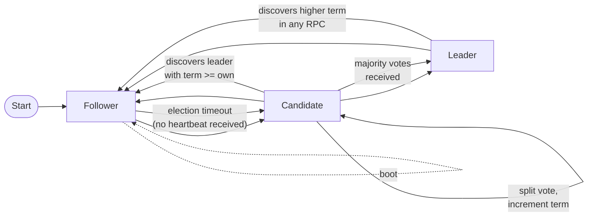
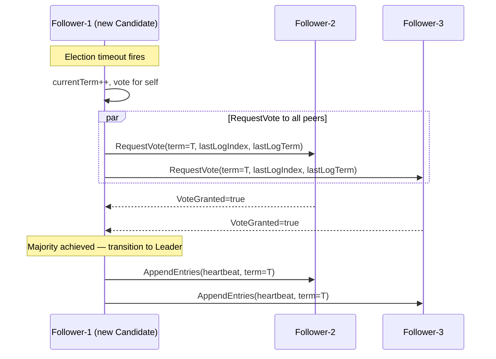
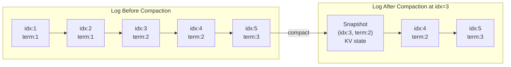
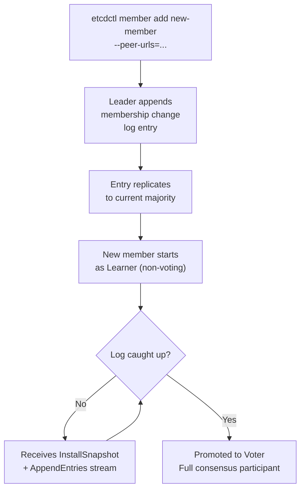
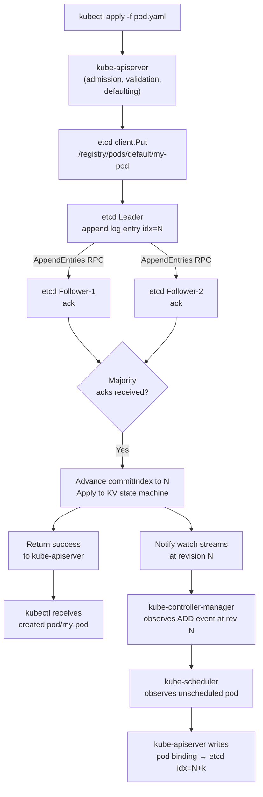
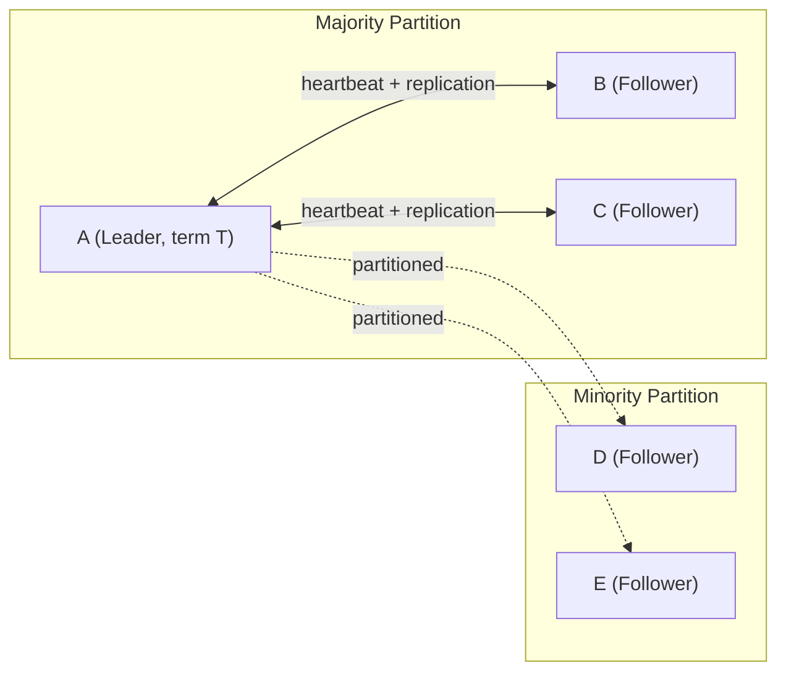

# Lesson 2: Etcd Raft Consensus

## 1. First-Principles Intuition & Invariants

Distributed consensus addresses one of computer science's deepest problems: how do independent processes, each holding only partial knowledge and subject to arbitrary message delays, agree on a single sequential ordering of state mutations? The challenge sharpens when you add the requirements that agreement must survive network partitions and process crashes while maintaining **linearizable semantics**—every read must reflect the most recent committed write as though all operations executed atomically on a single logical timeline. That last clause is not a convenience; it is the foundational contract that makes a distributed key-value store useful as a system-of-record for orchestration infrastructure like Kubernetes.

### The Quorum Foundation

The classical solution traces back to Leslie Lamport's Paxos algorithm, described in the 1989 DEC Systems Research Center technical report "The Part-Time Parliament" and formally published in *ACM Transactions on Computer Systems* in 1998. Paxos established that consensus can be achieved through a **majority quorum mechanism**: given *N* replicas, any write acknowledged by *Q = ⌊N/2⌋ + 1* replicas becomes durable, because any subsequent quorum of readers must intersect with at least one node that witnessed the write. This **quorum intersection property** is the mathematical bedrock that prevents split-brain: two disjoint subsets can never simultaneously form independent majorities, so they can never independently accept conflicting state transitions.

To see why the intersection guarantee holds, consider *N = 5* and *Q = 3*. The two possible majority sets {A,B,C} and {C,D,E} share node C. Any subsequent read quorum must therefore include at least one node that participated in the write quorum. This is not an engineering choice—it is a combinatorial inevitability. The safe cluster sizing formula follows immediately: even-numbered clusters waste a node. A four-member cluster requires *Q = 3*, tolerating exactly one failure, identical to a three-member cluster. Adding a fourth member buys zero additional fault tolerance. Production Kubernetes control planes therefore standardize on odd-numbered etcd clusters—three members for development and five for high-availability production—because adding the *N*th member where *N* is even yields redundancy without improving availability.

| Cluster Size | Quorum Required | Failures Tolerated |
|:---:|:---:|:---:|
| 1 | 1 | 0 |
| 3 | 2 | 1 |
| 5 | 3 | 2 |
| 7 | 4 | 3 |

Despite Paxos's theoretical elegance, it proved notoriously difficult to implement correctly. Its original presentation conflated safety properties with liveness optimizations, left critical sub-problems (membership changes, log compaction) entirely underspecified, and required nodes to simultaneously participate in multiple overlapping consensus rounds—each identified by a ballot number—with complex bookkeeping of promises and proposals. Production systems attempting to operationalize Paxos encountered subtle edge cases around leadership flapping, partial log replication during failures, and re-election under concurrent proposal conflicts.

### Why Raft Exists

Diego Ongaro and John Ousterhout addressed these problems in their 2014 USENIX ATC paper "In Search of an Understandable Consensus Algorithm." Raft deliberately elevated **understandability as a first-class design goal**, decomposing consensus into three orthogonal, independently reasoned subproblems:

1. **Leader election** — select exactly one leader per term.
2. **Log replication** — the leader serializes all mutations; followers replicate.
3. **Safety** — once an entry is committed, no future leader may contradict it.

Rather than Paxos's symmetric peer model—where any node can simultaneously participate in overlapping consensus rounds—Raft enforces a **strong leader model**. All client writes flow through a single elected leader that serializes mutations into a replicated log. This constraint simplifies global reasoning dramatically: at any given term (Raft's logical clock), at most one leader can exist, and that leader holds the authoritative view of committed state. The price paid is reduced write throughput during leader elections, an acceptable tradeoff for systems where correctness dominates throughput requirements.

### The Log Matching Property

The core safety invariant Raft maintains can be stated formally:

> **Log Matching Property:** If two log entries in different replicas share the same index *i* and term *t*, then the two logs are identical in all entries at indices 1 through *i*.

This property emerges from two invariants enforced structurally, not by policy:

1. A leader **never overwrites or deletes** entries in its own log; it only appends.
2. Every `AppendEntries` RPC includes `(prevLogIndex, prevLogTerm)`—the index and term of the entry immediately preceding the new entries. A follower rejects the RPC unless its local log contains an entry at `prevLogIndex` with exactly `prevLogTerm`.

The second invariant creates an inductive verification chain. If the check passes at index *i*, and you inductively trust the log at index *i*, then appending the entry at *i+1* is safe. The base case is the empty log. Any divergence introduced by a failed leader in a previous term will cause rejection at the exact point of divergence, and the leader will walk backward to find the common prefix, then replay forward from there. This is not a heuristic; it is a constructive proof that log histories can only converge, never fork, once an entry is committed.

### Failure Model and Liveness

Raft operates under the **crash-stop** failure model: nodes either execute correctly or halt permanently, with no Byzantine behavior (no node sends malicious or corrupt messages). Network integrity is delegated to lower layers—TCP checksums and TLS mutual authentication. The network is assumed to be **asynchronous**: messages may be delayed, reordered, or dropped indefinitely, but not silently corrupted.

Under these assumptions, Raft guarantees two orthogonal properties:

- **Safety (always):** No two nodes ever commit different values at the same log index. This holds unconditionally, even under arbitrary partitions.
- **Liveness (eventually):** The cluster makes progress as long as a majority quorum remains reachable and the network eventually delivers messages within bounded time (i.e., partial synchrony in the Dwork-Lynch-Stockmeyer sense). Raft does **not** guarantee progress under sustained asymmetric partitions, but it does guarantee that an isolated minority will never commit writes that conflict with the majority's state.

This distinction matters operationally. During a network partition, clients connected to the minority partition will experience timeouts or explicit rejections on linearizable reads. They will never receive stale committed data. The minority simply becomes unavailable, which is exactly what the CAP theorem predicts for a CP system like etcd.

---

## 2. Core Architecture & Mechanics

### State Machine Overview

Every etcd node exists in exactly one of three states at any instant: **follower**, **candidate**, or **leader**. The cluster starts with all nodes as followers. Time is divided into **terms**, each identified by a monotonically increasing integer that serves as a logical clock. Terms are the mechanism for detecting stale authority: any RPC carrying a term older than the receiver's current term is rejected outright; any RPC carrying a newer term causes the receiver to update its term and unconditionally revert to follower state.



### Election Mechanics

Followers are passive; they respond only to RPCs from leaders and candidates. Each follower maintains a **randomized election timeout**—typically 150–300 ms in etcd's default configuration. Randomization is not cosmetic: it breaks the symmetry that would cause all followers to become candidates simultaneously. The expected time before the first follower fires is half the minimum timeout. With a 150–300 ms range, the first candidate typically fires within ~75 ms, well inside a single heartbeat interval.

When the timeout fires:

1. The follower increments its `currentTerm`, transitions to candidate, and votes for itself.
2. It sends `RequestVote` RPCs in parallel to all other members.
3. Each recipient grants its vote for the first candidate that requests it in a given term, **provided the candidate's log is at least as up-to-date** as the voter's log.

Log up-to-dateness is compared with a two-step lexicographic order: first compare the term of the last entry (higher term wins); if equal, compare log length (longer wins). This ordering—critical to safety—ensures that any candidate that wins a majority election necessarily holds all entries committed in prior terms. A candidate missing committed entries would have a "less up-to-date" log and would lose votes to any candidate that holds them.

Three election outcomes are possible:

- **Win:** Candidate receives votes from ⌊N/2⌋+1 members. It transitions to leader and immediately sends empty `AppendEntries` heartbeats to prevent new elections.
- **Lose to a valid leader:** Candidate receives an `AppendEntries` from a node with `term >= candidateTerm`. It reverts to follower.
- **Split vote:** No candidate wins a majority before the election timeout fires again. Each candidate increments its term and restarts. Randomized timeouts make repeated splits exponentially unlikely.



### Log Replication

Once elected, the leader serializes all client writes. The replication protocol proceeds as follows:

1. The leader appends the client command as a new log entry `{index: i, term: T, command: cmd}` to its local log.
2. It sends `AppendEntries` RPCs to all followers **in parallel**, carrying the new entry along with `(prevLogIndex, prevLogTerm)` and the leader's current `commitIndex`.
3. Each follower performs consistency checks (see §2.1 below) and, if accepted, appends the entry and acknowledges.
4. Once the leader observes acknowledgment from a majority (itself plus ⌊N/2⌋ followers), it **advances its commitIndex** to the new entry's index and applies the entry to the state machine.
5. The updated `commitIndex` is piggybacked on subsequent `AppendEntries` heartbeats, allowing followers to advance their own `commitIndex` and apply entries asynchronously.

This two-phase protocol—**replication then commitment**—is the crux of durability. An entry is not committed until it is safely replicated on a majority. Once committed, the Log Matching Property guarantees it will survive any future leadership change.

#### Consistency Checks (AppendEntries)

A follower that receives `AppendEntries(term, leaderId, prevLogIndex, prevLogTerm, entries[], leaderCommit)` applies this logic:

```
if term < currentTerm:
    return Reject(currentTerm)                        # stale leader
if log[prevLogIndex].term != prevLogTerm:
    return Reject(currentTerm)                        # log inconsistency
# Overwrite any conflicting entries starting at prevLogIndex+1
log.truncate_from(prevLogIndex + 1)
log.append(entries)
if leaderCommit > commitIndex:
    commitIndex = min(leaderCommit, index_of_last_new_entry)
return Accept(currentTerm)
```

On rejection, the leader decrements `nextIndex[follower]` and retries. The original Raft paper describes linear backtracking; etcd's production implementation uses an **optimization** where the follower returns the conflicting term and the first index it stores for that term, allowing the leader to skip backward an entire term at a time rather than one entry at a time—critical for performance during large log divergences.

```mermaid
sequenceDiagram
    participant L as Leader
    participant Fa as Follower-A (up to date)
    participant Fb as Follower-B (lagging)

    L->>Fa: AppendEntries(prevIdx=9, prevTerm=3, entries=[10])
    Fa-->>L: Accept

    L->>Fb: AppendEntries(prevIdx=9, prevTerm=3, entries=[10])
    Fb-->>L: Reject(conflictTerm=2, conflictIndex=7)

    L->>Fb: AppendEntries(prevIdx=6, prevTerm=2, entries=[7,8,9,10])
    Fb-->>L: Accept

    Note over L: Entry 10 replicated on majority; advance commitIndex
    L->>Fa: AppendEntries(heartbeat, leaderCommit=10)
    L->>Fb: AppendEntries(heartbeat, leaderCommit=10)
```

### Commit Safety Across Leadership Changes

The most subtle safety constraint in Raft is this: **a leader may not commit entries from previous terms by counting replicas alone**. Consider the following scenario adapted directly from Figure 8 of the Ongaro/Ousterhout paper:

```
Term:   1   2   3   4
S1:    [1] [2] [4]      <- new leader at term 4
S2:    [1] [2]
S3:    [1] [2] [3]      <- was briefly leader at term 3
S4:    [1]
S5:    [1]
```

If S1 (leader at term 4) replicates the term-3 entry from S3 onto a majority before S3's entry at term 3 is ever committed—and then S1 crashes—a subsequent leader might overwrite that entry. Raft resolves this by requiring leaders to **only directly commit entries from their own current term**. Once a current-term entry is committed, the Log Matching Property guarantees that all prior entries are implicitly committed as well (they are a prefix of a committed log). Leaders apply the "commit only current-term entries" rule by ensuring the new entry they append immediately after election (a no-op entry, not a client command) achieves quorum before servicing writes.

---

## 3. Etcd's Production Raft: Beyond the Academic Specification

Etcd's Raft implementation (`go.etcd.io/etcd/raft`) extends the academic specification with several production-essential features.

### Log Compaction via Snapshots

An unrestricted log grows without bound. When the log exceeds a configurable threshold (default: 10,000 entries, tunable via `--snapshot-count`), etcd captures a **snapshot**—a serialized image of the entire key-value store at a specific log index—and discards all log entries preceding that index.



Followers that have fallen so far behind that the leader has already discarded the entries they need cannot be caught up via normal `AppendEntries`. Instead, the leader sends an `InstallSnapshot` RPC, transferring the full snapshot. The follower discards its entire local log and state machine, installs the snapshot, and resumes normal replication from the snapshot's index + 1. This is a potentially large transfer (gigabytes for large clusters), which motivates sizing etcd appropriately and monitoring lag with `etcd_server_slow_apply_total` and `etcd_network_peer_round_trip_time_seconds`.

### Membership Changes

Adding or removing etcd members while the cluster is live creates a window where **two independent majorities** could simultaneously elect separate leaders, violating safety. Raft's original paper describes a **joint consensus** approach:

1. The leader proposes a joint configuration entry `C_{old,new}` that requires a majority in **both** the old and new member sets.
2. Once `C_{old,new}` is committed under joint consensus, the leader proposes `C_{new}`.
3. Once `C_{new}` commits, the old configuration is discarded.

Etcd currently uses a simplified **single-server membership change** protocol derived from the Raft thesis: add or remove one member at a time. This avoids the joint consensus complexity but requires that membership changes are serialized. The etcdctl member add and member remove commands orchestrate this process; the new member begins as a **learner** (non-voting replica) until it catches up with the leader's log, at which point it is promoted to a full voter. This learner state prevents a lagging new member from disrupting quorum before it is ready.



### Read Consistency Levels

Pure Raft requires reads to pass through the leader and obtain a quorum acknowledgment, guaranteeing that the leader's term has not been superseded before it returns data. This is correct but potentially a bottleneck for read-heavy workloads. Etcd exposes three read consistency modes, selectable per request:

| Mode | Mechanism | Guarantee | Use Case |
|---|---|---|---|
| `linearizable` (default) | Leader confirms leadership via ReadIndex heartbeat | Linearizable | All Kubernetes control-plane reads |
| `serializable` | Follower reads from local state | Stale (monotonic) | Metrics, low-latency dashboards |
| Leader lease-based | Leader uses clock-based lease to skip heartbeat round | Approximately linearizable | High-throughput reads (risk: clock skew) |

The **ReadIndex** mechanism used for linearizable reads is worth understanding precisely. When the leader receives a read request, it:

1. Records the current `commitIndex` as `readIndex`.
2. Sends heartbeats to a majority of followers to confirm it is still the current leader.
3. Once responses arrive from a majority, it waits until its `applyIndex >= readIndex`.
4. Only then does it service the read from its local state machine.

This avoids a full Raft round-trip for reads while still guaranteeing that the response reflects at least all writes committed as of the moment the read was initiated. Kubernetes's API server uses this mode for all Get and List requests that require `resourceVersion` consistency.

---

## 4. Kubernetes Integration: From API Write to Committed Raft Entry

The path of a single Kubernetes API operation through etcd's Raft machinery is worth tracing end-to-end, as it illuminates both the correctness guarantees and the performance characteristics of the control plane.



Several details deserve emphasis:

**Revision semantics.** Every committed Raft log entry increments etcd's global `revision` counter. This revision maps directly to `resourceVersion` in Kubernetes objects. Watch clients subscribe with a `startRevision`, and etcd delivers every committed change at or after that revision in strict order. This is not a polling mechanism—it is a push-based notification system backed by the Raft commit log. Controllers are guaranteed to observe changes in commit order, never out of order, never duplicated (within a session), because the underlying log is totally ordered.

**Write path latency.** A write to etcd under normal conditions completes in roughly the following time budget on a well-tuned cluster:

```
API server validation:   ~1–5 ms
etcd leader append:      ~0.1 ms (local disk fsync: ~1–5 ms with fdatasync)
AppendEntries RPC RTT:   ~1–3 ms (intra-datacenter)
Follower disk fsync:     ~1–5 ms
Total end-to-end:        ~5–20 ms p50 on SSDs
```

This budget makes it clear why etcd requires low-latency storage. The `--heartbeat-interval` (default 100 ms) and `--election-timeout` (default 1000 ms) must be tuned relative to actual disk and network latency. The etcd documentation recommends the election timeout be at least 10× the heartbeat interval and roughly 5× the 99th-percentile round-trip time between peers.

**Watch stream ordering and the `resourceVersion` guarantee.** When kube-apiserver starts a watch with `resourceVersion=X`, etcd sends all events with revision > X in order. If the watch is interrupted and the client reconnects with the last-seen `resourceVersion`, it receives exactly the missed events—no gaps, no duplicates—as long as the events have not been compacted from etcd's watch event buffer. This property is what allows Kubernetes controllers to be **level-triggered but edge-driven**: they respond to individual change events but always reconcile to the latest observed state, tolerating missed events by re-listing when the watch returns a `410 Gone` (compacted revision).

---

## 5. Network Partitions: Safety and Liveness in Practice

Consider a five-member etcd cluster {A, B, C, D, E} with A as the current leader at term *T*. A network partition isolates {D, E} from {A, B, C}.



**Majority partition behavior.** A, B, C form a quorum of 3 out of 5. A continues as leader at term *T*, replicating entries and committing writes. All Kubernetes control-plane operations proceed normally.

**Minority partition behavior.** D and E stop receiving heartbeats. Their election timeouts fire. D becomes a candidate at term *T+1* and solicits votes from E. E votes for D. D becomes "leader" at *T+1* with two votes—which is **not** a majority of the five-member cluster. D cannot commit any entries because it cannot replicate to a quorum. Any client that connects to D or E for a **linearizable** read will receive a timeout or explicit rejection—the ReadIndex heartbeat round will never complete because D cannot reach a majority. Clients using **serializable** reads from D or E may receive stale data, which is the documented tradeoff for that consistency level.

**Partition heal.** When connectivity is restored, A (or its successor) sends `AppendEntries` to D and E with `term >= T+1`. D and E discover a higher or equal term, revert to followers, and synchronize their logs. Any entries D "appended" in its aborted leadership are **uncommitted** and will be overwritten by the majority's log. This is safe precisely because the minority could never achieve quorum commitment.

The critical safety invariant holds throughout: **no two nodes ever commit different values at the same log index**, because commitment requires a majority, and no two disjoint majorities exist in a correctly sized odd-member cluster.

---

## 6. Operational Reference: Sizing, Tuning, and Monitoring

### Deployment Sizing

```yaml
# etcd static pod manifest fragment (kubeadm-managed control plane)
# /etc/kubernetes/manifests/etcd.yaml
spec:
  containers:
  - name: etcd
    image: registry.k8s.io/etcd:3.5.9-0
    command:
    - etcd
    - --name=etcd-node-1
    - --data-dir=/var/lib/etcd
    - --listen-client-urls=https://0.0.0.0:2379
    - --advertise-client-urls=https://10.0.0.1:2379
    - --listen-peer-urls=https://0.0.0.0:2380
    - --initial-advertise-peer-urls=https://10.0.0.1:2380
    - --initial-cluster=etcd-node-1=https://10.0.0.1:2380,etcd-node-2=https://10.0.0.2:2380,etcd-node-3=https://10.0.0.3:2380
    - --initial-cluster-state=existing
    # Heartbeat and election timing — tune to actual p99 disk+network latency
    - --heartbeat-interval=100          # ms; default 100
    - --election-timeout=1000           # ms; must be >= 10x heartbeat-interval
    # Snapshot and compaction
    - --snapshot-count=10000            # entries before triggering snapshot
    - --auto-compaction-mode=periodic
    - --auto-compaction-retention=1h    # discard watch events older than 1h
    # Storage quota — prevents unbounded growth; default 2 GiB
    - --quota-backend-bytes=8589934592  # 8 GiB for large clusters
```

### Key Performance Indicators

Etcd exposes a Prometheus metrics endpoint on port 2381 (or the configured metrics port). The following metrics are the most operationally relevant:

| Metric | Meaning | Alert Threshold |
|---|---|---|
| `etcd_server_leader_changes_seen_total` | Cumulative leader elections | Rate > 1/hour indicates instability |
| `etcd_server_proposals_failed_total` | Failed Raft proposals | Any sustained increase |
| `etcd_disk_wal_fsync_duration_seconds` | WAL fsync latency | p99 > 10 ms (indicates slow disk) |
| `etcd_disk_backend_commit_duration_seconds` | BoltDB commit latency | p99 > 25 ms |
| `etcd_network_peer_round_trip_time_seconds` | Inter-peer RTT | p99 > 150 ms (risks election instability) |
| `etcd_mvcc_db_total_size_in_bytes` | BoltDB file size | > 80% of `--quota-backend-bytes` |
| `etcd_server_slow_apply_total` | Slow apply operations | Any non-zero sustained rate |

### Backup and Disaster Recovery

Etcd's snapshot mechanism is also the backup mechanism. A consistent snapshot captures the entire key-value store at a specific Raft index:

```bash
# Take a snapshot (runs against a healthy member)
ETCDCTL_API=3 etcdctl \
  --endpoints=https://10.0.0.1:2379 \
  --cacert=/etc/kubernetes/pki/etcd/ca.crt \
  --cert=/etc/kubernetes/pki/etcd/healthcheck-client.crt \
  --key=/etc/kubernetes/pki/etcd/healthcheck-client.key \
  snapshot save /backup/etcd-$(date +%Y%m%d%H%M%S).db

# Verify snapshot integrity
etcdctl snapshot status /backup/etcd-20240101120000.db --write-out=table

# Restore to a new cluster (all members must be restored from same snapshot)
etcdctl snapshot restore /backup/etcd-20240101120000.db \
  --name=etcd-node-1 \
  --initial-cluster=etcd-node-1=https://10.0.0.1:2380,etcd-node-2=https://10.0.0.2:2380,etcd-node-3=https://10.0.0.3:2380 \
  --initial-cluster-token=etcd-cluster-restored \
  --initial-advertise-peer-urls=https://10.0.0.1:2380 \
  --data-dir=/var/lib/etcd-restored
```

A restore operation creates a **new Raft log** starting from the snapshot index. All members restored from the same snapshot will begin at the same commit index and form a coherent cluster. Data written after the snapshot timestamp is irrecoverably lost; this defines the **Recovery Point Objective (RPO)** as the interval between successive snapshots.

---

## 7. Summary of Invariants

The properties described throughout this lesson can be consolidated into a reference set of invariants that hold for any correctly operating etcd/Raft cluster:

1. **Election Safety:** At most one leader is elected per term.
2. **Leader Append-Only:** A leader never overwrites or deletes entries in its log; it only appends.
3. **Log Matching:** If two logs contain an entry with the same index and term, they are identical for all preceding entries.
4. **Leader Completeness:** If a log entry is committed in a given term, it is present in the logs of all leaders elected in higher terms.
5. **State Machine Safety:** If a node has applied a log entry at index *i* to its state machine, no other node will ever apply a different log entry at index *i*.

Invariants 1–4 are enforced by the Raft protocol mechanics. Invariant 5 follows from invariants 1–4 combined with the requirement that state machine application is deterministic. Because etcd's state machine (the MVCC key-value store) is deterministic—the same sequence of commands always produces the same state—and because the Log Matching Property guarantees all nodes apply the same sequence, all nodes that have applied up to index *i* hold identical state at that index. This is the guarantee that makes Kubernetes's declarative model work: every controller observing committed state observes the same ground truth, and the control-plane converges correctly regardless of which API server or etcd member services a given request.
