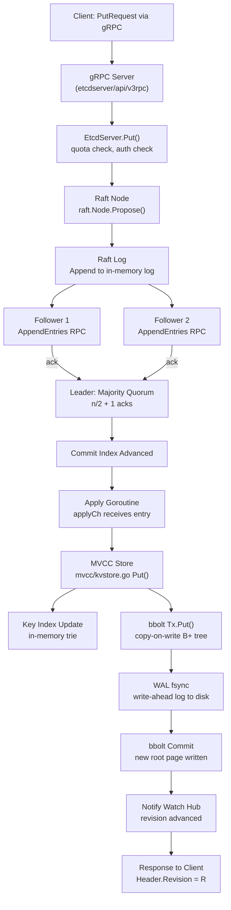
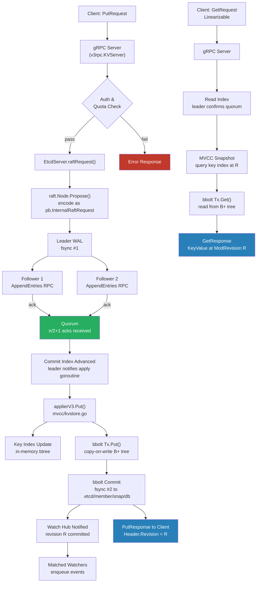
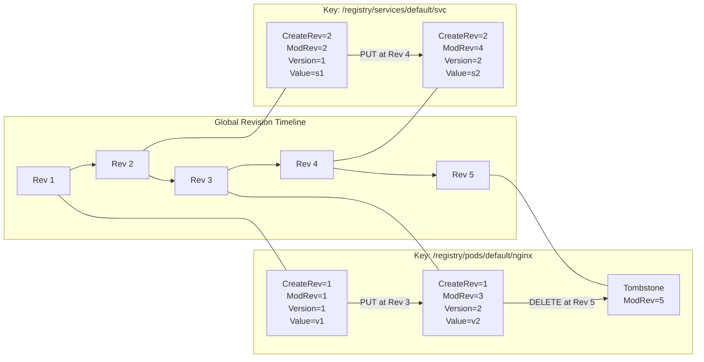
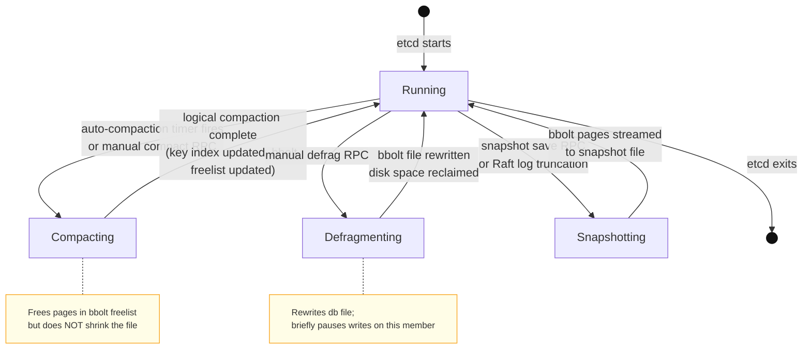

# Lesson 3: Etcd Data Model and Operations

## First-Principles Intuition and Invariants

The etcd data model diverges fundamentally from traditional key-value stores like Redis or Memcached, where writes destructively overwrite previous values and ephemeral storage offers no historical record. Etcd instead implements a persistent, versioned, transactional key-value store grounded in the append-only semantics of a distributed log. Every mutation—whether a simple PUT, a conditional transaction, or a bulk DELETE—generates a new immutable revision in an ever-growing timeline. This design choice emerges directly from etcd's role as the source of truth for Kubernetes: the control plane must never lose sight of historical state, must detect concurrent modifications with precision, and must propagate changes to watchers with exactly-once delivery guarantees.

At the heart of this model lies Multi-Version Concurrency Control (MVCC), a technique with deep roots in database systems like PostgreSQL and Oracle, adapted here for the constraints of a distributed consensus system. MVCC allows etcd to serve strongly consistent reads without blocking writers, to implement optimistic concurrency through compare-and-swap primitives, and to maintain a temporal index over the entire keyspace history. Each key in etcd is not a single mutable cell but a logical entity associated with an ordered sequence of versions, each stamped with a global monotonically increasing revision number. When a client writes to a key, etcd does not overwrite the previous version in place. Instead, it appends a new version tagged with the next revision, preserving the old version until an explicit compaction operation discards it.

The revision number is the fundamental clock of the etcd timeline. It is a 64-bit signed integer that increments exactly once per committed Raft log entry—not once per individual key modified within a batch transaction—ensuring a strict total order across all operations in the cluster. A single transaction modifying ten keys advances the revision counter by exactly one. Because etcd's consistency model is linearizable—meaning every operation appears to take effect atomically at some instant between its invocation and response, as defined by Herlihy and Wing (1990)—the revision number serves as both a logical timestamp and a durable checkpoint. Clients can request the state of the keyspace as of any historical revision, enabling time-travel queries for debugging, auditing, or reconstructing the sequence of events that led to a current state. Kubernetes exploits this directly: the `resourceVersion` field on every Kubernetes API object is an etcd revision, and optimistic concurrency control for updates depends on clients supplying the expected revision to detect conflicting modifications. If two controllers attempt to update the same resource simultaneously, only one will supply a matching revision; the other will receive a `409 Conflict` and must retry.

The storage layer beneath MVCC is organized into two logical indices: the **key index** and the **B+ tree store**. The key index is an in-memory trie-like structure (implemented as a B-tree in the etcd source, in `mvcc/index.go`) that maps each key to a chronologically ordered list of `(main revision, sub revision)` tuples where that key was modified. The `main` revision is the global cluster-wide counter; the `sub` revision disambiguates multiple operations within a single Raft log entry applied in one batch, so they can share a main revision while still being individually addressable. This index is rebuilt on startup by scanning the persistent store, and it answers queries like "what is the latest revision for key `/registry/pods/default/nginx`?" or "enumerate all revisions of this key between revision 1000 and 2000."

The B+ tree store is implemented atop **bbolt** (formerly BoltDB)—a pure Go embedded database using copy-on-write (CoW) B+ trees—and is the durable backend where actual key-value pairs are serialized. Bbolt organizes data into fixed-size pages (default 4096 bytes) and uses a single-writer, multiple-reader locking scheme based on a file-level lock (`flock`). This means all write transactions serialize through a single OS-level bottleneck. The implication is severe and worth internalizing: regardless of how many cores the etcd host has, only one write can be in progress at any instant. This architectural constraint fundamentally shapes etcd's performance profile and is the primary reason etcd is not horizontally scalable for writes in the same way that distributed databases like CockroachDB are. Reading is concurrent and lock-free because CoW page semantics allow readers to traverse the B+ tree while a writer atomically swings the root pointer to a new page tree.

The tension between infinite retention and finite disk space is resolved through **compaction**, a background operation that discards historical revisions older than a specified watermark. Compaction is not garbage collection in the traditional sense but a deliberate, operator-controlled truncation of the MVCC timeline. When a compaction completes at revision `R_c`, all versions of all keys with main revision numbers strictly less than `R_c` are irreversibly deleted from both the bbolt B+ tree and the in-memory key index. The disk space freed by this deletion is not immediately reclaimed at the OS level; bbolt places the freed pages on an internal freelist for reuse by future writes. Physical disk reclamation requires a separate **defragmentation** operation. Kubernetes typically runs auto-compaction every five minutes, retaining a configurable window of history long enough to support watch reconnection and short-term debugging without unbounded storage growth.

Transactions in etcd are expressed through a low-level compare-and-swap (CAS) primitive exposed by the gRPC `KV.Txn` RPC, and a higher-level **Software Transactional Memory (STM)** abstraction layered atop it in the client library. An STM transaction reads a snapshot of keys at a specific revision, computes new values, and attempts to commit by verifying that none of the read keys have been modified since the snapshot revision—a classic optimistic concurrency protocol. If verification succeeds, all writes are applied atomically as a single Raft log entry, advancing the global revision by exactly one. If it fails, the transaction retries with a fresh snapshot. This allows clients to implement complex multi-key invariants—such as atomically decrementing a resource quota while incrementing an allocation counter—without holding server-side locks or blocking other operations. The critical point is that STM conflicts are detected and resolved entirely by the client; the server only ever sees a single atomic `Txn` RPC, not a multi-step protocol.

The lease mechanism introduces temporal scoping to key-value pairs, enabling automatic expiration semantics essential for distributed coordination primitives like leader election and service registration. A lease is a server-side object with a time-to-live (TTL) measured in seconds. Clients attach keys to a lease at write time by passing the `LeaseID` in the `PutRequest`. If the lease expires—either due to TTL exhaustion or explicit revocation—all attached keys are deleted atomically in a single internally generated Raft log entry. Crucially, lease expiration is **consensus-driven, not wall-clock-driven**. The Raft leader tracks per-lease TTLs and proposes lease expiry entries when it determines the TTL has elapsed based on its own monotonic clock. Followers apply those expiry operations deterministically from the Raft log, ensuring all replicas agree on which leases are alive even in the presence of moderate clock skew or network partitions. The practical implication is that lease expiration can be delayed by up to one Raft heartbeat interval beyond the nominal TTL, and operators must size TTLs conservatively to account for this.

Watch streams are the control plane's nervous system, enabling reactive updates without polling. A watch is a long-lived gRPC server-streaming RPC that delivers every revision affecting a key or key range, starting from a client-specified revision. Under the hood, the etcd server maintains a **watch hub** (a concurrent, revision-indexed notification structure in `mvcc/watchable_store.go`) that holds registered watchers sorted by their next expected revision. When a transaction commits at revision `R`, the server's apply path notifies the watch hub synchronously, which scans for all watchers whose key filters match the modified keys and whose start revision is ≤ `R`. Matched events are pushed into per-watcher FIFO queues, which are drained asynchronously onto the gRPC stream by a dedicated goroutine. This design ensures that the commit path is not blocked by slow consumers. If a watcher's queue fills because the consumer is too slow, events are buffered up to a configurable limit; beyond that, the watch stream is closed and the client must resynchronize. If the client's next expected revision has been compacted, the stream is closed immediately with a `ErrCompacted` error, forcing the client to re-list and re-watch from the current revision.

Snapshots form the final pillar of operational resilience. A snapshot is a point-in-time, byte-for-byte copy of the entire bbolt file, captured atomically without stopping the server. Because bbolt uses CoW page semantics, the snapshot process borrows the current root B+ tree pointer and streams out the pages it references, while concurrent writers allocate new pages without disturbing the snapshot's view. The resulting file contains a complete, self-consistent image of the etcd keyspace at a specific revision, including all MVCC metadata, lease state, and cluster membership information.

## Internal Architecture: From Wire to Storage

Understanding how a single `Put` traverses the full stack from client to disk clarifies both the performance characteristics and the failure modes of etcd.



Several details are worth emphasizing:

1. **The proposal and application are decoupled.** `EtcdServer.Put()` proposes the entry to Raft and blocks waiting for the apply goroutine to signal completion. The apply goroutine drains committed entries from the `applyCh` channel and applies them to the MVCC store sequentially. This serial application path is intentional: it ensures the MVCC store always reflects a prefix of the committed Raft log, never a permutation.

2. **Two fsyncs per write, not one.** When bbolt commits a write transaction, it performs an fsync to the WAL (write-ahead log) *and* an fsync when the new root page is written. This double-fsync pattern is what makes etcd durable—both the intent and the completion are persisted—but it is also why disk latency is the dominant performance variable. On NVMe drives achieving sub-100µs fsync latency, etcd comfortably sustains thousands of writes per second. On network-attached storage with 10ms fsync latency, throughput collapses to under 100 ops/sec.

3. **Reads bypass Raft entirely.** A linearizable read in etcd uses a **read index** mechanism: before serving a read, the leader asks for confirmation from a quorum that it is still the leader (by sending a heartbeat and waiting for acknowledgment), then reads from its local MVCC snapshot at the confirmed commit index. Serializable reads are even cheaper: they are served from the local snapshot with no quorum interaction, but they may return stale data if the reader is a follower that has not yet applied recent entries. The etcd client by default requests linearizable reads (`WithSerializable()` opts into serializable mode).

## Core Operations and the gRPC API Surface

Etcd exposes its data model through a gRPC API defined in `etcd/api/etcdserverpb/rpc.proto`. The `KV` service handles basic key-value operations; the `Watch` service manages change streams; the `Lease` service controls key expiration; and `Maintenance` covers snapshots, defragmentation, and cluster health. Each service maps to a distinct operational domain and carries distinct consistency guarantees.

### Put: Appending a New Revision

The `Put` RPC writes a key-value pair, appending a new revision to the MVCC timeline. The `PutRequest` contains the key (bytes), value (bytes), optional `LeaseID`, a `prev_kv` bool requesting the previous key-value in the response, and `ignore_value`/`ignore_lease` flags that allow updating only the lease without changing the value or vice versa. The `PutResponse` returns a `ResponseHeader` containing the cluster's current revision at the moment the response was generated, the cluster ID, member ID, and Raft term—metadata sufficient for clients to perform causality tracking.

```go
package main

import (
    "context"
    "fmt"
    "log"
    "time"

    clientv3 "go.etcd.io/etcd/client/v3"
)

func main() {
    cli, err := clientv3.New(clientv3.Config{
        Endpoints:   []string{"https://127.0.0.1:2379"},
        DialTimeout: 5 * time.Second,
        TLS:         tlsConfig(), // production: always use mTLS
    })
    if err != nil {
        log.Fatalf("failed to create etcd client: %v", err)
    }
    defer cli.Close()

    ctx, cancel := context.WithTimeout(context.Background(), 5*time.Second)
    defer cancel()

    // Basic put: returns the cluster revision at which this write landed.
    putResp, err := cli.Put(ctx, "/registry/pods/default/nginx", `{"kind":"Pod","apiVersion":"v1"}`)
    if err != nil {
        log.Fatalf("Put failed: %v", err)
    }
    fmt.Printf("Put at cluster revision %d\n", putResp.Header.Revision)

    // Put with prev_kv: retrieve the displaced value atomically,
    // avoiding a separate Get round-trip.
    putResp2, err := cli.Put(ctx,
        "/registry/pods/default/nginx",
        `{"kind":"Pod","apiVersion":"v1","metadata":{"generation":2}}`,
        clientv3.WithPrevKV(),
    )
    if err != nil {
        log.Fatalf("Put with prev_kv failed: %v", err)
    }
    if putResp2.PrevKv != nil {
        fmt.Printf("Displaced value at ModRevision=%d: %s\n",
            putResp2.PrevKv.ModRevision,
            putResp2.PrevKv.Value,
        )
    }
}
```

The operation is fully linearizable: once the client receives a successful `PutResponse`, any subsequent read from any cluster member (using linearizable mode) is guaranteed to reflect the written value. The global revision in the response header is a lower bound on all future revisions seen by any client—no future read can return a cluster-wide revision number less than this value.

### Get: Reading from the MVCC Timeline

The `Get` RPC retrieves one or more key-value pairs, either at the latest revision or at a specific historical revision. Clients can query a single key, a lexicographic range by supplying a `range_end`, or a prefix by computing `range_end = key[:-1] + (key[-1]+1)` (the lexicographic successor of the prefix boundary). The `clientv3.WithPrefix()` option automates this computation. Range queries respect strict byte-level lexicographic ordering; Kubernetes exploits this by encoding resource paths as hierarchical byte strings, enabling O(log N) prefix scans over entire namespaces.

```go
// Linearizable read of a single key.
getResp, err := cli.Get(ctx, "/registry/pods/default/nginx")
if err != nil {
    log.Fatalf("Get failed: %v", err)
}
if getResp.Count == 0 {
    fmt.Println("Key not found")
} else {
    kv := getResp.Kvs[0]
    fmt.Printf("Key: %s\nValue: %s\nCreateRevision: %d\nModRevision: %d\nVersion: %d\n",
        kv.Key, kv.Value, kv.CreateRevision, kv.ModRevision, kv.Version)
    // kv.Version: number of times this key has been written since creation.
    // Distinct from the global revision; resets to 1 when a key is recreated
    // after deletion.
}

// Prefix scan: all pods in the default namespace.
// WithKeysOnly avoids fetching values when only key enumeration is needed,
// substantially reducing network transfer for large namespaces.
prefixResp, err := cli.Get(ctx,
    "/registry/pods/default/",
    clientv3.WithPrefix(),
    clientv3.WithKeysOnly(),
    clientv3.WithLimit(500), // pagination: returns at most 500 keys per call
)
if err != nil {
    log.Fatalf("Prefix Get failed: %v", err)
}
fmt.Printf("Found %d pods (more=%v)\n", prefixResp.Count, prefixResp.More)

// Time-travel read: reconstruct keyspace state at a historical revision.
// Fails with ErrCompacted if revision < current compaction watermark.
historicalResp, err := cli.Get(ctx,
    "/registry/pods/default/nginx",
    clientv3.WithRev(putResp.Header.Revision),
)
if err != nil {
    // Handle rpctypes.ErrCompacted: compaction has advanced past this revision.
    log.Printf("Historical read failed (possibly compacted): %v", err)
}
_ = historicalResp
```

Each `KeyValue` in the response carries four distinct version fields that clients frequently confuse:

| Field | Meaning | Resets? |
|---|---|---|
| `ClusterID` | Identifies the etcd cluster (in the header) | On cluster formation |
| `CreateRevision` | Global revision when this key was first created | On key recreation after deletion |
| `ModRevision` | Global revision of this key's most recent write | Never (monotone) |
| `Version` | Write count for this key since creation | On key recreation after deletion |

`ModRevision` is the field Kubernetes uses as `resourceVersion`. `Version` is useful for detecting write frequency independent of absolute revision numbers. `CreateRevision` enables clients to distinguish a freshly created key from one with a long history.

### Delete: Tombstone Semantics and Range Deletes

The `Delete` RPC removes one or more keys by appending tombstone markers to the MVCC timeline. Tombstones are first-class MVCC entries: they carry the global revision of deletion and cause the key to appear absent in reads at any revision ≥ their tombstone revision. The key remains visible in reads at revisions strictly before the tombstone and continues to occupy space in the key index and B+ tree until the next compaction at or beyond the tombstone's revision. This distinction between logical deletion and physical reclamation is essential for understanding why compaction-related disk usage can be non-obvious.

```go
// Atomic delete-and-read: retrieve the value being deleted without a prior Get.
delResp, err := cli.Delete(ctx,
    "/registry/pods/default/nginx",
    clientv3.WithPrevKV(),
)
if err != nil {
    log.Fatalf("Delete failed: %v", err)
}
fmt.Printf("Deleted %d key(s) at revision %d\n", delResp.Deleted, delResp.Header.Revision)
for _, kv := range delResp.PrevKvs {
    fmt.Printf("  Deleted key=%s modRev=%d\n", kv.Key, kv.ModRevision)
}

// Range delete: remove all pods in a namespace atomically.
// This generates a single Raft log entry covering all matched keys.
nsDelResp, err := cli.Delete(ctx,
    "/registry/pods/default/",
    clientv3.WithPrefix(),
)
if err != nil {
    log.Fatalf("Namespace delete failed: %v", err)
}
fmt.Printf("Deleted %d pods from default namespace\n", nsDelResp.Deleted)
```

A range delete is atomic: it generates exactly one Raft log entry and advances the revision counter by exactly one, regardless of how many keys it matches. This atomicity is critical for Kubernetes namespace deletion, which must remove all resources in a namespace without leaving partial state visible to other controllers.

### Transactions: The CAS Primitive and STM Abstraction

The `Txn` RPC is etcd's most expressive primitive. It executes a conditional, atomic, multi-key operation in a single Raft log entry. The structure follows an `IF / THEN / ELSE` pattern:

- **IF**: a conjunction of comparison predicates. Each predicate tests one of `{Version, CreateRevision, ModRevision, Value}` of a named key against a provided value using one of `{=, !=, <, >}`.
- **THEN**: a list of `RequestOp` (Put, Get, Delete, nested Txn) executed if all predicates are true.
- **ELSE**: a list of `RequestOp` executed if any predicate is false.

The entire THEN or ELSE branch executes atomically as a single Raft entry. Nesting is supported (a THEN branch may itself contain a Txn), enabling complex decision trees.

```go
// Production pattern: atomic compare-and-swap for a Kubernetes-style
// optimistic update. The controller reads the current resource, modifies it
// in memory, then writes only if no concurrent modification has occurred.
func atomicUpdate(ctx context.Context, cli *clientv3.Client, key, newValue string) error {
    for attempts := 0; attempts < 5; attempts++ {
        getResp, err := cli.Get(ctx, key)
        if err != nil {
            return fmt.Errorf("get failed: %w", err)
        }

        var cmp clientv3.Cmp
        var ops []clientv3.Op

        if getResp.Count == 0 {
            // Key does not exist: create only if still absent (CreateRevision == 0).
            cmp = clientv3.Compare(clientv3.CreateRevision(key), "=", 0)
            ops = []clientv3.Op{clientv3.OpPut(key, newValue)}
        } else {
            // Key exists: update only if ModRevision matches what we read.
            cmp = clientv3.Compare(
                clientv3.ModRevision(key), "=", getResp.Kvs[0].ModRevision,
            )
            ops = []clientv3.Op{clientv3.OpPut(key, newValue)}
        }

        txnResp, err := cli.Txn(ctx).
            If(cmp).
            Then(ops...).
            Else(clientv3.OpGet(key)). // return current value for diagnostics
            Commit()
        if err != nil {
            return fmt.Errorf("txn failed: %w", err)
        }
        if txnResp.Succeeded {
            fmt.Printf("Updated %q at revision %d\n", key, txnResp.Header.Revision)
            return nil
        }
        // Conflict: another writer modified the key; retry with fresh snapshot.
        log.Printf("Conflict on attempt %d for key %q, retrying", attempts+1, key)
        time.Sleep(time.Duration(attempts*attempts) * time.Millisecond) // exponential backoff
    }
    return fmt.Errorf("too many conflicts updating %q", key)
}

// Multi-key atomic invariant: atomically transfer a quota allocation
// from a pool counter to a consumer counter.
func transferQuota(ctx context.Context, cli *clientv3.Client, poolKey, consumerKey string, amount int64) error {
    // STM retries automatically on conflict, hiding the CAS retry loop.
    _, err := concurrency.NewSTM(cli, func(s concurrency.STM) error {
        poolVal := parseInt64(s.Get(poolKey))
        if poolVal < amount {
            return fmt.Errorf("insufficient quota: have %d, need %d", poolVal, amount)
        }
        consumerVal := parseInt64(s.Get(consumerKey))
        s.Put(poolKey, formatInt64(poolVal-amount))
        s.Put(consumerKey, formatInt64(consumerVal+amount))
        return nil
    })
    return err
}
```

The STM implementation in `go.etcd.io/etcd/client/v3/concurrency` offers three isolation levels:
- `SerializableSnapshot`: reads always return the snapshot taken at the start of the transaction; highest performance, potential for phantom reads.
- `Serializable`: reads that have already been executed in this transaction return their cached value; new reads hit the server.
- `RepeatableReads` and `ReadCommitted`: progressively weaker isolation, rarely appropriate for distributed coordination.

For Kubernetes-style workloads, `SerializableSnapshot` is the standard choice because controllers typically read a small, well-defined set of keys and write a correlated set, with conflicts being infrequent in practice.

### Watch: Streaming Change Notifications

The `Watch` RPC establishes a long-lived gRPC server-streaming call that delivers `WatchResponse` messages containing one or more `Event` objects for each committed revision that matches the watch's key filter. Watch is the mechanism by which all Kubernetes informers and controllers receive state changes without polling, enabling reactive control loops that respond within milliseconds of a mutation.

```go
// Watching all events on a prefix, starting from a known revision.
// This pattern is used after a List to avoid missing events that occurred
// between the List's revision and the watch establishment.
func watchPods(ctx context.Context, cli *clientv3.Client, listRevision int64) {
    watchCh := cli.Watch(
        ctx,
        "/registry/pods/default/",
        clientv3.WithPrefix(),
        clientv3.WithRev(listRevision+1), // start from the revision after the list
        clientv3.WithPrevKV(),            // include previous value in events (enables delta computation)
        clientv3.WithProgressNotify(),    // periodic empty events to confirm watch is alive
    )

    for {
        select {
        case <-ctx.Done():
            return
        case resp, ok := <-watchCh:
            if !ok {
                // Channel closed: context cancelled or unrecoverable error.
                return
            }
            if err := resp.Err(); err != nil {
                // ErrCompacted: our starting revision has been garbage-collected.
                // Must re-List the full keyspace and establish a new watch.
                if errors.Is(err, rpctypes.ErrCompacted) {
                    log.Printf("Watch compacted at rev %d, must re-list", resp.CompactRevision)
                    // Caller is responsible for triggering a re-list+re-watch.
                    return
                }
                log.Printf("Watch error: %v", err)
                return
            }

            for _, event := range resp.Events {
                switch event.Type {
                case mvccpb.PUT:
                    if event.IsCreate() {
                        fmt.Printf("CREATE pod %s at rev %d\n",
                            event.Kv.Key, event.Kv.ModRevision)
                    } else {
                        fmt.Printf("UPDATE pod %s: rev %d->%d\n",
                            event.Kv.Key,
                            event.PrevKv.ModRevision,
                            event.Kv.ModRevision,
                        )
                    }
                case mvccpb.DELETE:
                    fmt.Printf("DELETE pod %s at rev %d\n",
                        event.Kv.Key, event.Kv.ModRevision)
                }
            }
        }
    }
}
```

`event.IsCreate()` returns true when `event.Kv.CreateRevision == event.Kv.ModRevision`—the key's creation revision equals its modification revision, meaning this is the first write to this key (or the first write after a delete, which resets `CreateRevision`). This is the canonical way to distinguish create events from update events, as the `event.Type` for both is `mvccpb.PUT`.

**Progress notifications** (`WithProgressNotify`) cause the server to periodically send empty `WatchResponse` messages with an updated `Header.Revision`. These serve two purposes: confirming that the watch stream is live and not silently stalled behind a network partition, and advancing the client's known revision even when no mutations are occurring on the watched keys.

The watch server inside etcd uses two distinct data structures: a **synced group** for watches whose next expected revision equals the current commit index (up-to-date), and an **unsynced group** for watches lagging behind. When a revision is committed, the server moves watchers from unsynced to synced as it replays historical events, and delivers new events directly to already-synced watchers. This two-tier structure amortizes the replay cost of catch-up watches over multiple commits rather than blocking new event delivery.

### Leases: Time-Bounded Key Lifetimes

A lease is a server-side object with an integer ID, a requested TTL, and a granted TTL (the server may grant a longer TTL than requested based on cluster configuration). Clients attach keys to a lease at write time and maintain the lease through periodic `KeepAlive` heartbeats. The server batches keep-alive requests across all clients into periodic Raft proposals, reducing write amplification. If the leader does not receive a keep-alive before the lease TTL elapses—accounting for Raft proposal latency—it proposes a lease expiry entry that atomically deletes all attached keys.

```go
// Distributed leader election using leases: a standard pattern for
// Kubernetes controller manager, scheduler, and custom controllers.
func runLeaderElection(ctx context.Context, cli *clientv3.Client, identity string) {
    session, err := concurrency.NewSession(cli, concurrency.WithTTL(15))
    if err != nil {
        log.Fatalf("Session creation failed: %v", err)
    }
    defer session.Close()

    election := concurrency.NewElection(session, "/elections/my-controller")

    // Campaign blocks until this instance acquires leadership.
    // Internally: writes identity to /elections/my-controller/<leaseID>
    // only if no key with a smaller create revision exists.
    if err := election.Campaign(ctx, identity); err != nil {
        log.Fatalf("Campaign failed: %v", err)
    }
    defer election.Resign(ctx)

    fmt.Printf("Acquired leadership as %s\n", identity)

    // Observe leadership: watch the election key to detect leadership changes.
    observeCh := election.Observe(ctx)
    go func() {
        for resp := range observeCh {
            fmt.Printf("Current leader: %s\n", resp.Kvs[0].Value)
        }
    }()

    // Perform leader duties until context is cancelled or session expires.
    for {
        select {
        case <-ctx.Done():
            return
        case <-session.Done():
            log.Println("Session expired: lost leadership")
            return
        default:
            // ... leader work ...
            time.Sleep(100 * time.Millisecond)
        }
    }
}
```

The `concurrency.NewSession` creates a lease with the specified TTL and spawns a background goroutine to send `KeepAlive` RPCs at `TTL/3` intervals—fast enough that two consecutive network failures still leave the third keep-alive within the TTL window. `session.Done()` returns a channel that is closed when the session's lease expires, providing a clean signal for voluntary leadership relinquishment.

The `LeaseTimeToLive` RPC allows clients to query the remaining TTL and the keys attached to any lease, which is essential for operational debugging. The `LeaseList` RPC enumerates all active leases in the cluster.

## MVCC Compaction and History Management

The MVCC timeline grows indefinitely as revisions accumulate, consuming both disk space (in bbolt) and memory (in the key index). Compaction permanently discards historical revisions. The operation proceeds in two phases: the **logical phase** marks tombstones in the key index and removes superseded key versions from the bbolt B+ tree, and the **reclamation phase** runs bbolt's internal freelist update to make the freed pages available for reuse. Physical disk reclamation requires a subsequent defragmentation.

```bash
# Manual compaction: compact all revisions strictly less than 100000.
# After this, Get with WithRev(<100000) will fail with ErrCompacted.
etcdctl \
    --endpoints=https://127.0.0.1:2379 \
    --cacert=/etc/etcd/ca.crt \
    --cert=/etc/etcd/client.crt \
    --key=/etc/etcd/client.key \
    compact 100000

# Check the current revision to know what to compact to:
etcdctl endpoint status --write-out=json | \
    jq '.[0].Status.header.revision'

# Automatic compaction: retain the last 5 minutes of history.
# Mode 'periodic' computes the target revision as the revision that was current
# 5 minutes ago, then compacts to that revision.
etcd \
    --auto-compaction-mode=periodic \
    --auto-compaction-retention=5m

# Mode 'revision' retains the last N revisions rather than a time window.
etcd \
    --auto-compaction-mode=revision \
    --auto-compaction-retention=10000
```

**Defragmentation** is a separate operation that rewrites the bbolt file, eliminating fragmentation from compacted pages:

```bash
# Defragment a specific cluster member. This pauses writes on that member
# for the duration of the rewrite; always defragment one member at a time
# in a production cluster to avoid losing quorum availability.
etcdctl \
    --endpoints=https://10.0.0.1:2379 \
    --cacert=/etc/etcd/ca.crt \
    --cert=/etc/etcd/client.crt \
    --key=/etc/etcd/client.key \
    defrag

# Check database size before and after:
etcdctl endpoint status --write-out=table
```

Two compaction modes have distinct operational tradeoffs:

| Mode | Retention Unit | Behavior | Best For |
|---|---|---|---|
| `periodic` | Time window | Tracks the revision that was current `retention` ago; compacts on that schedule | Clusters with variable write rates |
| `revision` | Revision count | Retains the last N revisions regardless of elapsed time | Clusters with predictable write patterns |

Compaction has two critical implications for clients. First, time-travel queries to revisions older than the compaction watermark fail with `ErrCompacted`—the server returns the compaction revision in the error, allowing clients to adapt. Second, watch streams whose next expected revision falls below the compaction watermark are closed with `ErrCompacted`, including the `CompactRevision` field so clients know from what revision they must re-list. Controllers must treat `ErrCompacted` not as a fatal error but as a resynchronization trigger: re-list the full keyspace at the current revision, rebuild local state, then establish a new watch from that revision.

## Snapshot and Restore Operations

Snapshots provide byte-exact, point-in-time backups of the entire etcd keyspace. A snapshot captures the full bbolt file at a specific cluster revision, including MVCC history from the latest compaction forward, all active leases, cluster membership, and the Raft commit index. Because bbolt uses CoW page semantics, `etcdctl snapshot save` can stream out the pages without pausing writes.

```bash
# Save a snapshot from a healthy member.
# Best practice: snapshot from a follower to avoid adding load to the leader.
etcdctl \
    --endpoints=https://10.0.0.3:2379 \
    --cacert=/etc/etcd/ca.crt \
    --cert=/etc/etcd/client.crt \
    --key=/etc/etcd/client.key \
    snapshot save /backups/etcd-$(date +%Y%m%d-%H%M%S).db

# Verify snapshot integrity: checks CRC, revision, and total key count.
etcdctl snapshot status /backups/etcd-20240101-120000.db --write-out=table
# Output: Hash, Revision, Total Keys, Total Size

# Restore a three-member cluster from a snapshot.
# CAUTION: This operation discards all state not in the snapshot.
# All three members MUST be restored from the SAME snapshot file.

for i in 1 2 3; do
  etcdctl snapshot restore /backups/etcd-20240101-120000.db \
    --name "node${i}" \
    --initial-cluster "node1=https://10.0.0.1:2380,node2=https://10.0.0.2:2380,node3=https://10.0.0.3:2380" \
    --initial-cluster-token "etcd-restored-cluster-$(date +%s)" \
    --initial-advertise-peer-urls "https://10.0.0.${i}:2380" \
    --data-dir "/var/lib/etcd-node${i}"
done
```

The `--initial-cluster-token` must be unique and consistent across all restored members. Using a new token prevents the restored cluster from accidentally forming quorum with any surviving member from the original cluster that might still be reachable on the network. Restoring members with different snapshot files would result in a split-brain cluster with divergent histories; the restore process detects snapshot hash mismatches but cannot prevent misuse across separate invocations.

A complete production backup automation script:

```bash
#!/usr/bin/env bash
# etcd-backup.sh: snapshot, verify, upload to S3, prune old backups.
set -euo pipefail

ETCD_ENDPOINT="https://127.0.0.1:2379"
CACERT="/etc/etcd/ca.crt"
CERT="/etc/etcd/client.crt"
KEY="/etc/etcd/client.key"
BACKUP_DIR="/tmp/etcd-backups"
S3_BUCKET="s3://my-company-etcd-backups"
RETENTION_DAYS=30

mkdir -p "${BACKUP_DIR}"
SNAPSHOT_FILE="${BACKUP_DIR}/etcd-$(date +%Y%m%d-%H%M%S).db"

etcdctl \
    --endpoints="${ETCD_ENDPOINT}" \
    --cacert="${CACERT}" --cert="${CERT}" --key="${KEY}" \
    snapshot save "${SNAPSHOT_FILE}"

# Verify before uploading; abort if the CRC check fails.
etcdctl snapshot status "${SNAPSHOT_FILE}" --write-out=json | \
    jq -e '.hash != 0' > /dev/null

aws s3 cp "${SNAPSHOT_FILE}" "${S3_BUCKET}/"
rm -f "${SNAPSHOT_FILE}"

# Prune S3 objects older than RETENTION_DAYS.
aws s3 ls "${S3_BUCKET}/" | \
    awk -v cutoff="$(date -d "-${RETENTION_DAYS} days" +%Y-%m-%d)" \
    '$1 < cutoff {print $4}' | \
    xargs -I{} aws s3 rm "${S3_BUCKET}/{}"

echo "Backup complete: ${SNAPSHOT_FILE##*/}"
```

## Performance Characteristics and Operational Constraints

Etcd's performance is bounded by three primary physical constraints: bbolt's single-writer serialization, Raft consensus round-trip latency, and storage fsync latency. Write throughput on commodity hardware with NVMe storage typically reaches 10,000–20,000 operations per second for small values (< 1 KB), with p99 write latency under 10 ms. These numbers degrade non-linearly with value size, cluster geographic distribution, and storage latency. The Kubernetes project documents hard limits: etcd should not be expected to sustain more than 8,000 write ops/sec in production, and individual objects should not exceed 1.5 MB.

The relationship between storage latency and write throughput deserves a precise model. Each committed Raft entry requires at minimum two fsyncs: one to the WAL and one to the bbolt page file. The maximum sustainable write throughput is therefore bounded by `1 / (2 × fsync_latency)`. On hardware with 1 ms fsync latency, the theoretical maximum is 500 writes/sec per pipeline stage—though batching and pipelining in Raft's implementation raise this in practice by grouping multiple proposals into a single fsync.

Cluster size affects both availability and write performance:

| Members | Fault Tolerance | Write Quorum | Latency Impact |
|---|---|---|---|
| 1 | 0 failures | 1 | Baseline |
| 3 | 1 failure | 2 | +1 RTT to fastest follower |
| 5 | 2 failures | 3 | +1 RTT to second-fastest follower |
| 7 | 3 failures | 4 | +1 RTT to third-fastest follower |

Write latency for a 3-member cluster is approximately `max(leader_fsync, follower_1_fsync + network_RTT)`, because the leader can pipeline its own fsync with the follower replication. For a 5-member cluster, the leader must wait for two followers to acknowledge, so the latency is bounded by the second-fastest follower's round-trip time plus fsync. This is why etcd deployments beyond 5 members are rare: the latency cost of coordinating a 7-member quorum outweighs the marginal availability improvement for most production workloads.

Memory usage is dominated by the in-memory key index. For a Kubernetes cluster with 10,000 objects, each key averaging 50 bytes, with a 1,000-revision MVCC history per key, the key index holds approximately 500 MB of `(key, revision list)` entries. The bbolt B+ tree itself consumes additional resident memory for its page cache (the OS page cache is bbolt's primary caching mechanism). Total etcd memory usage for a large Kubernetes cluster (10,000+ objects) typically falls in the 2–8 GB range depending on write rate and compaction frequency.

Disk space planning follows from the write rate and compaction retention window. A cluster sustaining 1,000 writes/sec with an average value size of 2 KB and a 5-minute compaction retention accumulates `1000 × 2048 × 300 = 614 MB` of MVCC history before compaction discards it. Accounting for key index overhead and bbolt internal fragmentation, a 10 GB data directory is a reasonable floor for a busy production Kubernetes etcd cluster, with 50+ GB recommended for high-write-rate environments.

Monitoring the following metrics (exposed via etcd's Prometheus endpoint at `/metrics`) is essential for proactive capacity management:

```
etcd_mvcc_db_total_size_in_bytes          # current bbolt file size
etcd_mvcc_db_total_size_in_use_bytes      # bytes actually in use (after logical compaction)
etcd_mvcc_put_total                       # cumulative put operations
etcd_mvcc_delete_total                    # cumulative delete operations
etcd_server_proposals_failed_total        # failed Raft proposals (indicates overload)
etcd_disk_wal_fsync_duration_seconds      # WAL fsync latency histogram
etcd_disk_backend_commit_duration_seconds # bbolt commit duration histogram
etcd_network_peer_round_trip_time_seconds # inter-member network RTT
etcd_server_quota_backend_bytes           # configured backend size quota
```

When `etcd_mvcc_db_total_size_in_bytes` approaches `etcd_server_quota_backend_bytes`, etcd will reject all write operations with a `mvcc: database space exceeded` error. At this point, only compaction and defragmentation can restore write availability. The default quota is 2 GB; production clusters should set `--quota-backend-bytes` to 8 GB and monitor usage proactively.

## Architecture Diagrams

### MVCC Read and Write Flow



### Key-Value Versioning Model



### Watch Stream Lifecycle

```mermaid
sequenceDiagram
    participant Client
    participant WatchServer
    participant WatchHub
    participant RaftApply

    Client->>WatchServer: "Watch(prefix=/registry/pods/, start_rev=1000)"
    WatchServer->>WatchHub: "Register watcher\n(prefix, next_rev=1000)"
    WatchServer-->>Client: "WatchResponse(created=true)"

    Note over RaftApply: Commit at Rev 1001:\nPUT /registry/pods/default/nginx

    RaftApply->>WatchHub: "Notify(rev=1001, PUT /registry/pods/default/nginx)"
    WatchHub->>WatchServer: "Event for watcher(next_rev=1000)\n→ advance to 1002"
    WatchServer-->>Client: "WatchResponse(events=[PUT key=.../nginx, rev=1001])"

    Note over RaftApply: Commit at Rev 1002:\nDELETE /registry/pods/default/nginx

    RaftApply->>WatchHub: "Notify(rev=1002, DELETE /registry/pods/default/nginx)"
    WatchHub->>WatchServer: "Event for watcher(next_rev=1002)\n→ advance to 1003"
    WatchServer-->>Client: "WatchResponse(events=[DELETE key=.../nginx, rev=1002])"

    Note over WatchHub: Auto-compaction triggers:\ncompact to rev=1003

    WatchHub->>WatchHub: "Check lagging watchers:\nnext_rev=1003 >= compact_rev=1003 ✓"
    Note over Client: Client is up-to-date; no error.

    Note over Client: Client disconnects for 10 minutes.\nAuto-compaction runs to rev=2000.

    Client->>WatchServer: "Watch(prefix=/registry/pods/, start_rev=1003)"
    WatchHub->>WatchHub: "start_rev=1003 < compact_rev=2000 ✗"
    WatchServer-->>Client: "WatchResponse(canceled=true,\ncompact_revision=2000)"
    Note over Client: Client must re-List at current revision,\nthen Watch from new revision.
```

### Compaction and Defragmentation State Machine



## Key Architectural Invariants: A Reference

The following invariants hold unconditionally in a correctly operating etcd cluster and form the basis for reasoning about correctness in distributed systems built on top of etcd:

**Revision Monotonicity.** The global revision counter is strictly monotonically increasing. No two distinct committed Raft log entries share a revision number, and no revision is ever reused or decremented, even after leader changes or network partitions. A client that receives a response with `Header.Revision = R` can safely assume that all future responses from any member of the cluster will have `Header.Revision >= R`.

**Linearizability of Writes.** Every successful write operation (Put, Delete, Txn) completes at a unique revision and is immediately visible to all subsequent linearizable reads from any cluster member. There is no replication lag for linearizable reads: they use the Read Index mechanism to confirm that the leader has not been superseded before serving from its local state.

**Atomicity of Transactions.** The THEN or ELSE branch of a Txn executes in its entirety or not at all, in a single Raft log entry, advancing the revision by exactly one. Partial application is impossible.

**Lease Consensus.** Lease expiration is determined by Raft consensus, not by wall-clock time on individual members. A lease is alive if and only if the most recently committed Raft log entry that concerns that lease grants it living status. Clock skew between members does not cause split-brain on lease liveness.

**Tombstone Preservation Until Compaction.** A deleted key remains logically absent but physically present in the MVCC store until compaction at a revision >= the tombstone's revision. Time-travel reads at revisions strictly before the tombstone reveal the key's historical values.

**Watch Exactly-Once Delivery.** A watch stream delivers each event exactly once, in revision order, with no gaps, provided the stream is not terminated by a compaction error. If a gap would occur (due to compaction), the stream is explicitly terminated with `ErrCompacted` rather than silently skipping events.

These invariants are not merely implementation details—they are the contracts on which the entire Kubernetes control plane's correctness depends. Every controller that handles `ErrCompacted` gracefully, every informer that uses `resourceVersion` for conditional list-and-watch, and every admission webhook that relies on optimistic locking is implicitly relying on these properties being upheld.
