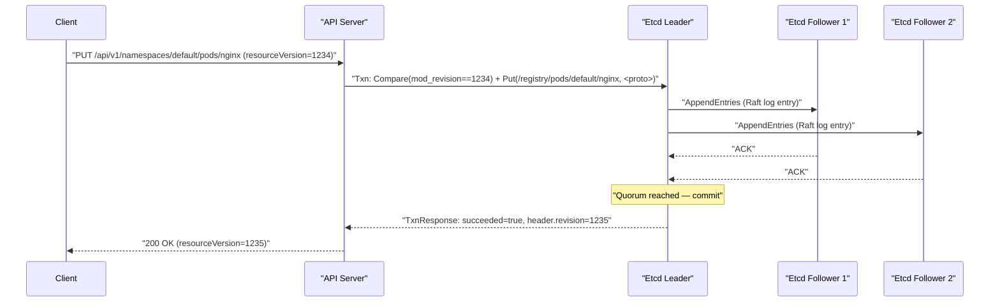
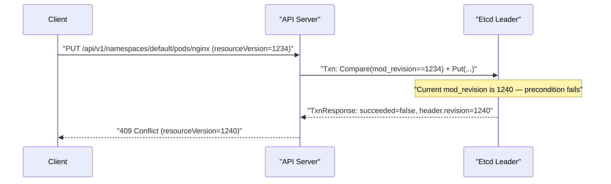
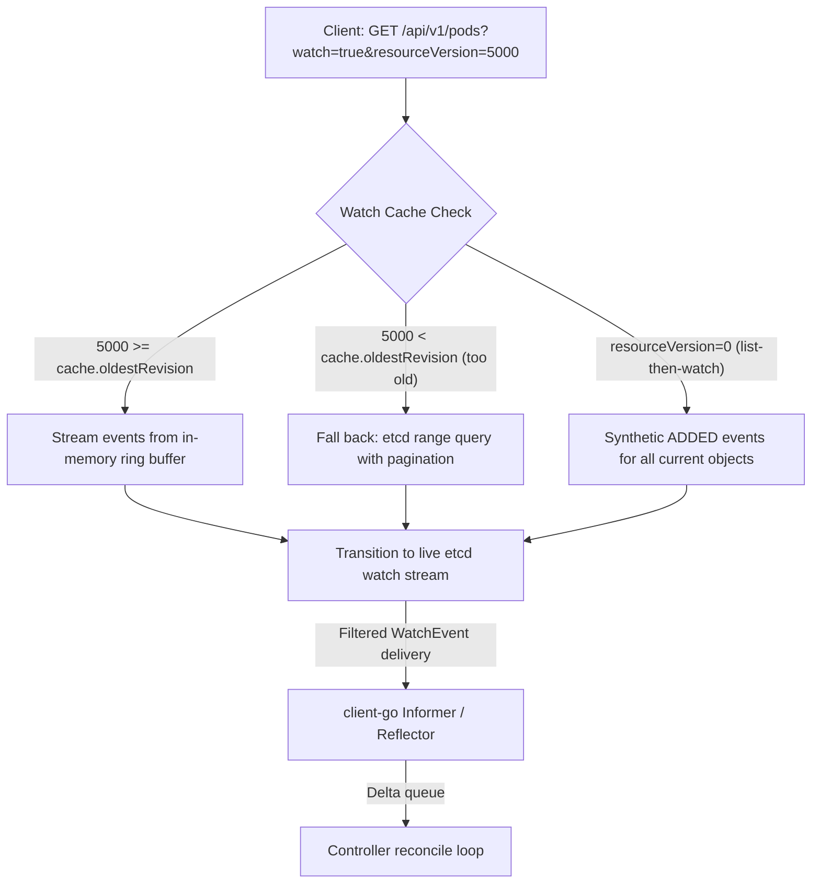
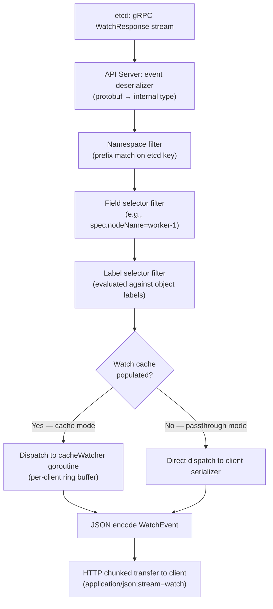
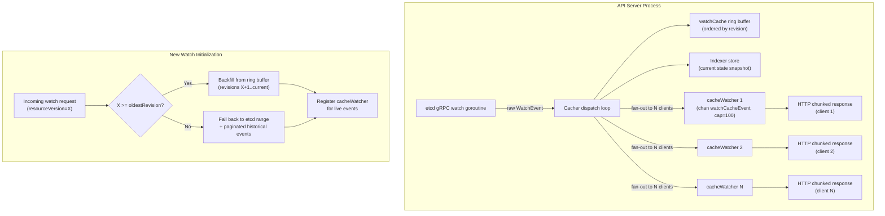
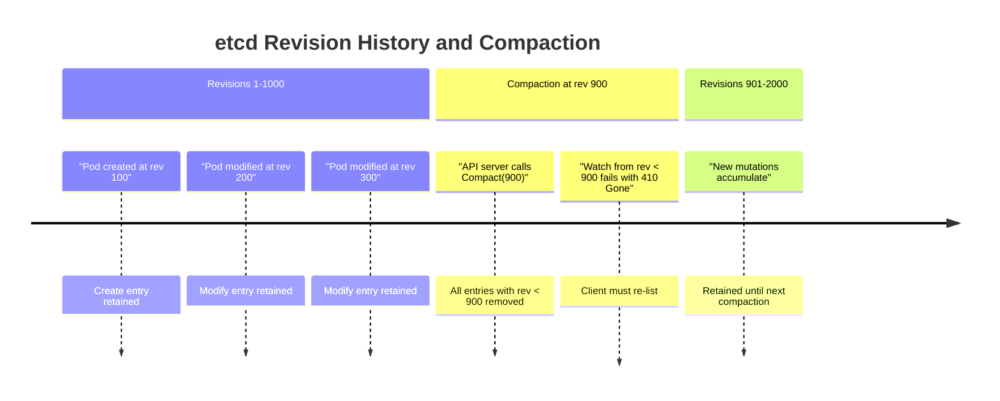

# Lesson 4: Control Plane — Etcd Integration

## 1. First-Principles Intuition and Invariants

The Kubernetes API server presents a deceptively simple HTTP interface to the outside world, accepting RESTful mutations and serving resource listings as if it were a stateless web service. Beneath this façade lies a rigorously designed storage layer that bridges the gap between Kubernetes's declarative resource model and etcd's distributed consensus engine. This integration is not a simple database adapter pattern. It constitutes a vertically integrated consistency protocol that marshals optimistic concurrency control, multi-version state histories, and event stream delivery guarantees into a unified mechanism for managing cluster-wide distributed state.

Understanding the API server's etcd integration requires stepping back to examine the fundamental problem it solves. Kubernetes must maintain linearizable consistency across thousands of concurrent clients—`kubectl` commands, controllers reconciling desired state, admission webhooks validating mutations, and custom operators reacting to resource changes. Every operation must either commit atomically or fail deterministically, with no middle ground of partial writes or lost updates. The system must deliver a real-time event stream to watching clients, ensuring that no state transition escapes observation while simultaneously avoiding head-of-line blocking when slow consumers lag behind the event frontier.

The mathematical invariant at the heart of this design is etcd's monotonic **cluster revision counter**: a cluster-wide 64-bit integer that increments by exactly one with every committed transaction, regardless of how many keys that transaction touches. This revision forms a **total order** over all state mutations, establishing a global logical clock that transcends individual keys or namespaces. When the API server writes a Pod resource to etcd, it does not simply overwrite a key. It executes a multi-version concurrency control (MVCC) transaction that preserves the prior revision's value in etcd's append-only B+ tree structure, allowing historical queries and watch initialization from arbitrary points in the revision timeline.

Etcd's consistency model is **linearizable** for all single-key and transactional reads and writes: every operation appears to take effect instantaneously at some point between its invocation and its response, and that point is visible to all subsequent operations. This is a stronger guarantee than sequential consistency or causal consistency; it eliminates all anomalies that could arise from reads returning stale data after a completed write. Kubernetes relies on this property unconditionally. Any weakening—such as serializability without real-time ordering, or eventual consistency—would invalidate the correctness arguments underlying controller reconciliation loops.

Etcd achieves linearizability via the **Raft consensus algorithm**. All writes are proposed to a leader node, which replicates the log entry to a quorum of followers before acknowledging success. A quorum of `⌊N/2⌋ + 1` nodes must acknowledge each log entry before it is considered committed. For a three-node cluster, any two nodes constitute a quorum; for a five-node cluster, any three. This quorum requirement means that at most `⌊N/2⌋` nodes can fail simultaneously without halting write availability. Network partitions are handled conservatively: a partitioned minority cannot elect a new leader (they lack a quorum of votes), so only one partition—the majority—can commit new entries at any time. The API server surfaces this consensus boundary directly to clients through 503 errors during quorum loss.





Optimistic concurrency control emerges naturally from this revision-centric model. Every Kubernetes resource carries a `resourceVersion` field in its `ObjectMeta`, which is an opaque string representation of the etcd `mod_revision` of that specific key at the time of the last write. It is critical to understand the distinction: the `resourceVersion` on a resource reflects the `mod_revision` of that individual key, not the global cluster revision. The global cluster revision is tracked separately and advances with every transaction touching any key. When a client attempts to update a resource, the API server translates the `resourceVersion` into an etcd `Compare(MOD, key, =, expected_revision)` precondition. If another writer has committed an intervening mutation to that key, etcd rejects the transaction with a failed precondition, and the client must retry with a fresh read. This eliminates the need for distributed locks or two-phase commit protocols, achieving conflict-free convergence through retry loops grounded in deterministic total ordering.

The watch mechanism extends this revision-based consistency model into the temporal dimension. Rather than polling for resource changes, clients establish long-lived HTTP connections and subscribe to an event stream anchored at a specific revision number. The API server queries etcd with a watch RPC starting from that revision, receiving a stream of events—`PUT`, `DELETE`, and periodic `COMPACT` markers—that it filters according to the client's field selectors and namespace constraints before forwarding as JSON-serialized `WatchEvent` messages. The contract is strict: every resource mutation that occurs after the watch's starting revision must eventually propagate to the client, barring network failures or explicit cancellation. This guarantee enables controllers to maintain eventually consistent in-memory views of cluster state without risking missed events or duplicate deliveries.



The failure modes of this integration reveal the intricate coupling between etcd's consensus layer and Kubernetes's control plane semantics. When an etcd cluster loses quorum, the API server immediately transitions into a fail-stop mode for all write operations, returning HTTP 503. Read operations continue from the API server's watch cache with the caveat that served data may be stale relative to any uncommitted in-flight writes at failure time. Watch streams remain active but stop delivering new events until quorum is restored. Upon recovery, they resume from the last acknowledged revision. This degraded-but-deterministic behavior prevents split-brain scenarios where isolated API servers might accept conflicting writes, preserving the cluster's linearizability invariant even as availability degrades.

Performance tuning this integration requires understanding the interplay among three distinct caching layers: etcd's in-memory MVCC index (the **treeIndex**), the API server's **watch cache**, and client-side **informer reflector stores**. The watch cache is a bounded ring buffer retaining the most recent N revision-ordered events per resource type, allowing new watch streams to bootstrap from recent history without hitting etcd's disk-backed storage. When clients request watches from revisions older than the cache's retention window, the API server falls back to etcd pagination—a substantially slower code path that incurs disk I/O and serialization overhead on the etcd nodes. Operators must balance cache size against memory pressure, tuning `--watch-cache-sizes` to match the cluster's mutation rate and watch reconnection patterns.

The guarantees are both powerful and constrained. Linearizability holds only within the scope of a single etcd transaction, which in practice means single-resource mutations or carefully orchestrated multi-key operations using etcd's transactional API. Cross-resource atomicity—creating a Pod and its corresponding Service in a single atomic commit—is not supported through the public API. Clients must implement compensation logic or rely on admission webhooks to enforce multi-resource invariants. Watch events are delivered in revision order within a resource type, but the API server makes no cross-resource ordering guarantees. A slow network path between the API server and etcd can introduce compounding delays across the watch pipeline, causing clients to lag progressively behind the true cluster state.

---

## 2. Etcd Storage Backend Architecture

The API server's storage layer abstracts etcd through a pluggable `storage.Interface` defined in `k8s.io/apiserver/pkg/storage`. In production clusters, **etcd3** is the only implementation in widespread use. The etcd2 backend was removed in Kubernetes 1.13. This abstraction translates Kubernetes's typed resource semantics into etcd's flat key-value model while managing serialization, versioning, and transactional boundaries.

### Key Space Layout

Every Kubernetes resource maps to a single etcd key constructed by a deterministic naming scheme. The key format is hierarchical:

```
/registry/{resource-type}/{namespace}/{name}
```

For cluster-scoped resources such as `Node`, `ClusterRole`, or `Namespace` itself, the namespace path component is omitted:

```
/registry/{resource-type}/{name}
```

Representative examples from a live cluster:

```
/registry/pods/default/nginx-7d8b9c6f4-xk2p1
/registry/deployments/kube-system/coredns
/registry/nodes/ip-10-0-1-25.ec2.internal
/registry/clusterroles/cluster-admin
/registry/namespaces/kube-system
/registry/secrets/default/my-secret
/registry/serviceaccounts/default/default
```

This deterministic mapping enables efficient **range scans**. Listing all Pods in a namespace translates to an etcd range query over the prefix `/registry/pods/{namespace}/`, leveraging etcd's lexicographic key ordering. A full list of all Pods across all namespaces scans the prefix `/registry/pods/`. The etcd client library's `WithPrefix()` option constructs these range scans by computing the prefix's lexicographic successor as the upper bound.

Custom Resource Definitions use the following scheme, where the plural resource name is lowercased:

```
/registry/{group}/{plural-resource}/{namespace}/{name}
# e.g.:
/registry/apps.example.com/frobulators/production/my-frobulator
```

### Wire Format: Protobuf Encoding

The value stored at each key is **not** JSON but a protobuf-encoded `runtime.Unknown` envelope wrapping the resource's protobuf representation. The envelope carries a magic prefix (`k8s\x00`) followed by a protobuf-encoded `Unknown` message that embeds the TypeMeta (API version and kind) and the actual protobuf payload.

```
+------------------+-------------------------------+
| Magic prefix     | Protobuf-encoded Unknown msg  |
| "k8s\x00"        | (TypeMeta + serialized object)|
+------------------+-------------------------------+
```

Protobuf encoding provides two critical advantages over JSON: it is roughly 3–10x more compact for typical Kubernetes objects, and it deserializes 5–10x faster. This matters because the API server decodes every resource it reads from etcd, and in large clusters this decoding CPU cost is non-trivial. JSON is used exclusively for the API server's external HTTP interface, Custom Resources (which lack generated protobuf schemas), and certain internal diagnostics paths.

The API server maintains codec registries keyed by `GroupVersionKind`. When reading from etcd, it selects the appropriate protobuf codec for the internal storage version, decodes the bytes, and then re-encodes to the client-requested API version as JSON for the HTTP response. Custom Resources use JSON throughout because their schemas are runtime-defined and cannot have pre-compiled protobuf descriptors.

### API Version Conversion Pipeline

Kubernetes supports multiple coexisting API versions for the same resource kind (e.g., `apps/v1`, `apps/v1beta2`). The API server stores resources in a single **internal storage version** per resource group. The conversion pipeline operates as follows:


Conversion functions must be **round-trip lossless**: converting a resource from v1 to v1beta1 and back to v1 must yield an identical object. The API server's conversion machinery enforces this by running round-trip tests during code generation. Fields present in a newer version but absent in an older version must either have defined default behavior during down-conversion, or the conversion must be explicitly declared as lossy and version-gated.

---

## 3. Optimistic Concurrency Control and Conflict Resolution

### The `resourceVersion` Semantics

The `resourceVersion` field in `ObjectMeta` is an opaque string from the client's perspective, but its content is precisely the decimal string representation of the etcd `mod_revision` for that specific key. The API server encodes it opaquely to retain the freedom to change the encoding without breaking clients. Clients are explicitly forbidden from parsing or computing on this value; they must treat it as a black box that is valid only for use as an `If-Match` precondition in subsequent writes.

Concretely, the API server constructs the etcd compare operation as:

```
Compare(CompareModRevision, key, Equal, strconv.ParseInt(resourceVersion))
```

If the compare succeeds, the `Put` operation within the same transaction executes atomically. If it fails, the transaction returns `succeeded=false` with the current header revision, and the API server translates this into an HTTP 409 Conflict with a `Status` object carrying `reason: Conflict`.

### Conflict Resolution in Controllers

The canonical pattern for handling conflicts in a controller is the `RetryOnConflict` helper from `k8s.io/client-go/util/retry`:

```go
package main

import (
    "context"
    "fmt"

    appsv1 "k8s.io/api/apps/v1"
    metav1 "k8s.io/apimachinery/pkg/apis/meta/v1"
    "k8s.io/apimachinery/pkg/util/retry"
    "k8s.io/client-go/kubernetes"
    "k8s.io/client-go/tools/clientcmd"
)

// scaleDeployment demonstrates a conflict-safe scale operation using RetryOnConflict.
// Each iteration re-fetches the latest Deployment state before applying the mutation,
// ensuring the update always applies to the most recently committed revision.
func scaleDeployment(ctx context.Context, client kubernetes.Interface, namespace, name string, replicas int32) error {
    return retry.RetryOnConflict(retry.DefaultRetry, func() error {
        // Re-read on every attempt to get the current resourceVersion.
        deploy, err := client.AppsV1().Deployments(namespace).Get(ctx, name, metav1.GetOptions{})
        if err != nil {
            return fmt.Errorf("fetching deployment: %w", err)
        }

        // Apply the desired mutation to the freshly fetched object.
        deploy.Spec.Replicas = &replicas

        // The Update call sends the full object including the current resourceVersion.
        // If another writer has modified the Deployment since our Get, the API server
        // returns 409 Conflict and RetryOnConflict retries the entire closure.
        _, err = client.AppsV1().Deployments(namespace).Update(ctx, deploy, metav1.UpdateOptions{})
        return err
    })
}
```

`retry.DefaultRetry` uses exponential backoff starting at 10ms, with a 1.6x multiplier, capped at 15 seconds, and a maximum of 5 attempts. This is intentionally conservative—a controller that cannot converge within 5 retries is likely experiencing sustained contention, which indicates a design problem rather than transient noise.

### Server-Side Apply and Strategic Merge Patch

Kubernetes 1.18 promoted **Server-Side Apply** (SSA) to stable as an alternative to client-side optimistic locking for update-heavy scenarios. SSA encodes field ownership in the resource's `managedFields` metadata. When two controllers attempt to modify disjoint fields of the same resource, SSA commits both changes without conflict. When they attempt to modify the same field, the more recent owner wins, and the previous owner receives a conflict error listing the specific fields in dispute.

SSA uses a `PATCH` request with `Content-Type: application/apply-patch+yaml` and an `fieldManager` query parameter identifying the caller. Internally, the API server maintains a field ownership map serialized in `managedFields`, which records which manager last applied each field path. This eliminates the coarse-grained all-or-nothing conflict detection of `resourceVersion` checks for scenarios where fine-grained field ownership is well-defined.

```go
// Server-Side Apply patch using the typed client.
// The fieldManager name must be stable and unique per controller.
func applyDeploymentReplicas(ctx context.Context, client kubernetes.Interface,
    namespace, name string, replicas int32) error {

    patch := &appsv1.Deployment{
        TypeMeta: metav1.TypeMeta{
            APIVersion: "apps/v1",
            Kind:       "Deployment",
        },
        ObjectMeta: metav1.ObjectMeta{
            Name:      name,
            Namespace: namespace,
        },
        Spec: appsv1.DeploymentSpec{
            Replicas: &replicas,
        },
    }

    // Force=true causes the applying manager to take ownership of fields
    // currently owned by another manager, overriding their ownership.
    // Use with caution in multi-controller scenarios.
    force := true
    _, err := client.AppsV1().Deployments(namespace).Apply(
        ctx, patch,
        metav1.ApplyOptions{FieldManager: "replica-scaler-controller", Force: force},
    )
    return err
}
```

### Livelock and Contention Avoidance

Naive retry loops without re-reading the latest state can cause **livelock**: two controllers continuously overwriting each other's changes at different resourceVersions, each triggering a retry in the other. The invariant that prevents livelock is: **every retry must begin with a fresh GET to incorporate all concurrent mutations before reapplying the desired transformation.** Simply re-sending the same body with the new `resourceVersion` is incorrect—it ignores intervening changes and will thrash indefinitely if the two controllers have conflicting objectives.

Well-designed controllers avoid contention structurally through **leader election** (serializing writes from a single active instance) and **ownership segmentation** (each controller operates on a disjoint subset of resources, identified by label selectors or namespace assignment).

---

## 4. Watch Streams and Event Ordering

### Initiating a Watch

A watch begins with a GET request to a resource collection URL with `watch=true`. The `resourceVersion` parameter controls the watch's starting point with precise semantics:

| `resourceVersion` value | Behavior |
|---|---|
| Omitted | Start from the current revision; no historical events delivered |
| `"0"` | Serve existing objects as synthetic `ADDED` events, then live events; may read from cache; revision not guaranteed to be the current etcd revision |
| Any specific value `"N"` | Deliver all events with revision `> N`; must start from at least revision N+1 |

The `"0"` case is the standard **list-and-watch** bootstrap pattern used by informers. The API server may serve the initial list from its watch cache rather than etcd, which means the client might receive a list anchored at a revision slightly older than the current etcd head. This is safe because the subsequent watch stream delivers all events after that anchor revision, ensuring no gaps.

### The Watch Event Pipeline

The raw watch pipeline from etcd to the client involves several transformation stages:



The critical subtlety in stage D is that **field selector filtering is performed in the API server, not in etcd**. etcd has no concept of JSON or protobuf field paths; it stores opaque byte values. The API server receives every event from etcd for a given key prefix, decodes the value, and then evaluates the field selector. This means a watch for `spec.nodeName=worker-1` still causes the API server to decode every Pod mutation in the namespace—it simply discards the ones that don't match before forwarding. For high-churn environments this CPU overhead can be significant.

### WatchEvent Structure

The JSON representation of a watch event over HTTP looks like:

```json
{
  "type": "MODIFIED",
  "object": {
    "apiVersion": "v1",
    "kind": "Pod",
    "metadata": {
      "name": "nginx-7d8b9c",
      "namespace": "default",
      "resourceVersion": "1235",
      "uid": "abc123"
    },
    "spec": { "...": "..." },
    "status": { "phase": "Running" }
  }
}
```

The event types are `ADDED`, `MODIFIED`, `DELETED`, `BOOKMARK`, and `ERROR`. The `DELETED` event carries the last known state of the object before deletion, allowing controllers to perform cleanup based on the deleted object's fields. The `BOOKMARK` event carries only `metadata.resourceVersion` and no other fields; it advances the client's known position in the event stream without representing a mutation. `ERROR` events carry a `Status` object and indicate a non-recoverable condition such as a `410 Gone` (compaction overtook the watch starting revision).

### Event Ordering Guarantees

Within a single resource type and namespace, the API server guarantees **strict revision ordering**: events are delivered in monotonically increasing `resourceVersion` order, and no revision is skipped or repeated under normal operation. This is a direct consequence of etcd's total ordering of its revision counter.

Across resource types or across namespaces, no cross-stream ordering guarantee exists. A watch on `Deployments` and a watch on `ReplicaSets` in the same namespace may deliver events in any interleaving relative to each other, even if the underlying etcd revisions are known. Controllers that depend on cross-resource causality—such as a controller that must observe a Deployment before its ReplicaSet—must be designed with eventual consistency semantics, using re-reads to confirm state rather than relying on event delivery order.

The `informer` abstraction in `client-go` internalizes these ordering constraints. Each informer maintains a per-resource `DeltaFIFO` queue that sequences events by resource and handles REPLACED events (synthetic full re-syncs) correctly. The `SharedInformerFactory` multiplexes multiple controllers onto a single watch stream per resource type, reducing load on the API server.

```go
package main

import (
    "context"
    "fmt"
    "time"

    corev1 "k8s.io/api/core/v1"
    "k8s.io/apimachinery/pkg/fields"
    "k8s.io/client-go/informers"
    "k8s.io/client-go/kubernetes"
    "k8s.io/client-go/tools/cache"
    "k8s.io/client-go/tools/clientcmd"
)

func main() {
    config, _ := clientcmd.BuildConfigFromFlags("", clientcmd.RecommendedHomeFile)
    client, _ := kubernetes.NewForConfig(config)

    // SharedInformerFactory multiplexes all informers onto single API server watches.
    // The resync period triggers periodic full re-list to catch missed events after
    // prolonged disconnections. Setting it to 0 disables periodic resync.
    factory := informers.NewSharedInformerFactory(client, 30*time.Second)

    podInformer := factory.Core().V1().Pods().Informer()

    podInformer.AddEventHandler(cache.ResourceEventHandlerFuncs{
        AddFunc: func(obj interface{}) {
            pod := obj.(*corev1.Pod)
            fmt.Printf("ADDED: %s/%s at rv=%s\n",
                pod.Namespace, pod.Name, pod.ResourceVersion)
        },
        UpdateFunc: func(oldObj, newObj interface{}) {
            oldPod := oldObj.(*corev1.Pod)
            newPod := newObj.(*corev1.Pod)
            // UpdateFunc fires when the resourceVersion changes — always re-read
            // from newObj; oldObj is the previous cached state.
            fmt.Printf("MODIFIED: %s/%s rv: %s -> %s\n",
                newPod.Namespace, newPod.Name,
                oldPod.ResourceVersion, newPod.ResourceVersion)
        },
        DeleteFunc: func(obj interface{}) {
            // obj may be a cache.DeletedFinalStateUnknown if the informer missed
            // the DELETE event and detected deletion via a re-list (tombstone).
            pod, ok := obj.(*corev1.Pod)
            if !ok {
                tombstone, _ := obj.(cache.DeletedFinalStateUnknown)
                pod = tombstone.Obj.(*corev1.Pod)
            }
            fmt.Printf("DELETED: %s/%s\n", pod.Namespace, pod.Name)
        },
    })

    ctx := context.Background()
    factory.Start(ctx.Done())
    factory.WaitForCacheSync(ctx.Done())

    <-ctx.Done()
}
```

The `DeletedFinalStateUnknown` tombstone case is crucial for correctness. If the informer's watch connection drops and the object is deleted before the informer reconnects and re-lists, the informer synthesizes a deletion event from the re-list diff but cannot supply the last-known state directly. It wraps the last cached state in a tombstone, and controllers must handle both cases.

---

## 5. Watch Cache Architecture and Performance Characteristics

### Internal Structure

The API server's watch cache (`k8s.io/apiserver/pkg/storage/cacher`) is not a simple ring buffer of events. It is a composite data structure with two distinct components:

1. **`watchCache` ring buffer**: A fixed-capacity circular array of `watchCacheEvent` structs, each containing the `WatchEvent` type, the full object, the previous object state, and the etcd revision. Events are appended in revision order. When the buffer is full, the oldest event is overwritten.

2. **`cacheWatcher` per-client dispatch**: For each active watch client, the cacher maintains a `cacheWatcher` instance with its own input channel and goroutine. When a new event arrives from etcd, it is dispatched to all registered `cacheWatcher` instances that pass the catcher's filter. Each `cacheWatcher` goroutine drains its channel and serializes events to the client's HTTP connection.

The cacher also maintains a **`Indexer` store** (a map from key to current object state) that enables `Get` and `List` operations to be served entirely from memory without hitting etcd for reads. This is the most important optimization for read-heavy clusters: a `kubectl get pods -n default` in a cluster with the watch cache enabled does not issue an etcd range query; it reads directly from the cacher's in-memory store.



### Slow Consumer Back-Pressure

Each `cacheWatcher`'s input channel has a fixed buffer capacity (default 100 events). If a client consumes events slower than they are produced—due to a slow network, high serialization load, or a blocked controller—the channel fills up. When the cacher attempts to dispatch a new event to a full channel, it **drops the cacheWatcher** and sends an `ERROR` event to the client, forcing it to reconnect and re-initialize its watch. This prevents a single slow consumer from blocking event delivery to all other clients (head-of-line blocking).

This behavior has an important operational implication: watch clients that consistently fall behind—due to complex event handlers, network jitter, or processing latency—will experience repeated forced reconnections, each triggering a fresh list-then-watch cycle. At scale, this creates a feedback loop where disconnected clients flood the API server with list requests at the same time. This is the **thundering herd** anti-pattern for watch reconnections, and it is a primary motivation for using `AllowWatchBookmarks=true` with exponential backoff on reconnect.

### Cache Size Tuning

The `--watch-cache-sizes` flag syntax is:

```
--watch-cache-sizes=pods=1500,deployments=500,configmaps=200
```

Default sizes (as of Kubernetes 1.28) are resource-type-specific, with Pods defaulting to 1000, Nodes to 1000, and most other types to 100. The right sizing strategy depends on two cluster-specific measurements:

- **Mutation rate** (events/second per resource type): If Pods mutate at 50/second and you want 60 seconds of retention, the cache needs capacity for 3,000 events.
- **Watch reconnection window**: The maximum duration a client might be disconnected and still expect to reconnect without a full re-list. Multiply by the mutation rate to get the minimum cache size.

A simple heuristic: set the cache size to `mutation_rate_per_second × reconnection_window_seconds × 1.5` (the 1.5 factor provides headroom for burst mutations). Monitor the `apiserver_watch_cache_events_dispatched_total` and `apiserver_watch_cache_capacity` metrics to detect cache pressure.

### Read-From-Cache vs. Read-Through

By default, `List` operations are served from the cacher's in-memory `Indexer` with `resourceVersion: ""` semantics (returns the current cached state, not guaranteed to be the latest etcd state). To force a linearizable read that bypasses the cache and queries etcd directly, clients can set `resourceVersion: ""` with `resourceVersionMatch: Exact` or use `resourceVersion: "0"` with `resourceVersionMatch: NotOlderThan`. Note these semantics were clarified and stabilized in Kubernetes 1.19 (KEP-1181).

The performance difference is dramatic: a cached list of 10,000 Pods completes in single-digit milliseconds; a direct etcd range scan for the same query may take hundreds of milliseconds in a loaded cluster.

---

## 6. Failure Modes and Degraded Operation

### Etcd Quorum Loss

Quorum loss is the most severe single failure mode in a Kubernetes cluster, because it simultaneously halts all control plane write activity. The API server detects quorum loss through etcd client timeout errors on write RPCs (the etcd client's default dial timeout is 5 seconds; operation timeouts are configurable). Upon detecting persistent failures, the API server surfaces HTTP 503 to write clients. It does not perform write-side failover because there is no safer destination to fail over to—any other path would bypass Raft consensus.

The specific behavior per operation type during quorum loss:

| Operation | Behavior during quorum loss |
|---|---|
| GET (single resource) | Served from watch cache; may be stale |
| LIST | Served from watch cache; may be stale |
| POST / PUT / PATCH / DELETE | 503 Service Unavailable |
| WATCH (existing) | Remains connected; no new events |
| WATCH (new) | Established from cache; no live events |

Cluster recovery after quorum loss requires careful sequencing. If etcd data was lost (not just partitioned), **restoring from an etcd snapshot** is the correct procedure. Kubernetes ships the `etcdctl snapshot restore` command for this purpose. After restoring, the API server must be restarted to clear its watch cache and reload state from the restored etcd.

### Stale Read Behavior

When serving reads from the watch cache during quorum loss, the API server includes a `resourceVersion` in List responses that reflects the last revision successfully replicated before the failure. Clients that specify `resourceVersionMatch: Exact` or write operations that depend on specific `resourceVersion` preconditions will fail because the API server cannot guarantee it is returning state at exactly that revision from an isolated cache. Clients using `resourceVersionMatch: NotOlderThan` (the default for most informers) will receive cache-served responses without error, potentially missing mutations that were in-flight when quorum was lost.

### Network Latency Impact

Network latency between the API server and etcd propagates into every write operation with a fixed one-way multiplier. For a synchronous `kubectl apply`:

```
latency(apply) ≈ latency(admission webhooks) + 2 × RTT(apiserver→etcd) + disk_fsync(etcd)
```

The factor of 2 arises from the etcd client's request-response round trip (proposal to leader, leader commits to Raft log and responds). In practice, etcd's Raft implementation batches multiple log entries into a single fsync, so the disk penalty is amortized across concurrent writes. The network RTT, however, is not amortized for sequential writes—each write waits for the previous one's response before the next can be issued from most controllers.

For clusters spanning multiple availability zones, intra-zone etcd members experience sub-millisecond RTT while cross-zone members experience 1–5ms RTT depending on the cloud provider. Best practice is to co-locate the etcd leader with the API server or place both within the same availability zone, and to use a five-node etcd cluster (tolerating two failures) rather than three-node when spanning three zones.

### Disk I/O Saturation Cascade

etcd serializes all write operations through a WAL (Write-Ahead Log) that must be fsynced to disk before acknowledging a commit. When disk I/O throughput is saturated:

1. fsync latency increases, extending per-write commit time.
2. Raft heartbeat responses slow, triggering follower election timeouts.
3. If a follower times out and starts an election, the resulting leader churn adds further latency as the new leader establishes authority.
4. The API server's etcd client begins timing out writes, surfacing 503 errors to control plane components.
5. Controllers enter retry loops, increasing the write rate and further saturating disk I/O.

This cascade is self-reinforcing once started. The mitigation is to provision etcd nodes with dedicated NVMe SSDs and to place the etcd WAL on a dedicated volume separate from etcd's data directory, allowing WAL fsyncs to proceed independently of compaction I/O. Monitor `etcd_disk_wal_fsync_duration_seconds` and `etcd_disk_backend_commit_duration_seconds`; sustained p99 values above 25ms are a leading indicator of impending saturation.

---

## 7. Transactional Semantics and Multi-Key Operations

### etcd's Native Transaction API

etcd exposes a `Txn` RPC that accepts a list of `Compare` predicates and two branches of operations (`Success` and `Failure`), all executed atomically as a single Raft log entry:

```go
// Example of the etcd client Txn API (used internally by the API server).
// This illustrates the structure; application code should use Kubernetes API primitives.
import clientv3 "go.etcd.io/etcd/client/v3"

txnResp, err := etcdClient.Txn(ctx).
    If(
        // Compare mod_revision of pod key
        clientv3.Compare(clientv3.ModRevision("/registry/pods/default/nginx"), "=", 1234),
    ).
    Then(
        // Atomically update the pod
        clientv3.OpPut("/registry/pods/default/nginx", encodedPodProto),
    ).
    Else(
        // On conflict, return current state for retry
        clientv3.OpGet("/registry/pods/default/nginx"),
    ).
    Commit()
```

The API server uses this `Txn` primitive for every resource write, encoding the `resourceVersion` precondition as a `ModRevision` compare. The `Success` branch contains the `Put` or `Delete` operation for the resource. The `Failure` branch contains a `Get` to retrieve the current state, which the API server uses to construct the 409 Conflict response body.

### Internal Multi-Key Operations

While the public Kubernetes API exposes only single-resource atomicity, the API server uses etcd's transactional API internally for specific coordinated operations:

**Namespace deletion**: When a Namespace is deleted, the API server uses a background garbage collection loop (not a single atomic transaction) that iterates over all resources in the namespace and issues individual deletions. This is explicitly *not* atomic at the etcd level—the namespace enters a `Terminating` phase, and resources are deleted progressively. The namespace finalizer is only removed after all resources are confirmed deleted. This design choice sacrifices atomicity for operability: a truly atomic namespace deletion would require a single etcd transaction touching potentially thousands of keys, which would exhaust etcd's transaction size limits (etcd enforces a default 1.5MB limit per request).

**StorageVersion records**: Maintained using CAS operations to track which API server instances have migrated to a new storage version.

**Lease objects**: The API server uses etcd's native lease/TTL mechanism (through the `coordination.k8s.io/v1 Lease` resource) for leader election and node heartbeats.

### Compensation Patterns for Multi-Resource Atomicity

Since the API server does not expose general cross-resource transactions, controllers requiring multi-resource consistency must implement one of several patterns:

**Two-phase creation with owner references**: Create the primary resource first, then create dependent resources with `ownerReferences` pointing to the primary. If the primary is deleted before dependents are created, the garbage collector cleans up orphaned dependents. If a dependent fails to create, the controller retry loop creates it on the next reconciliation pass.

**Finalizer-based commit protocol**: Before creating external resources, add a finalizer to the primary resource. The finalizer prevents deletion until the controller explicitly removes it. This creates a durable intent record: even if the controller crashes mid-operation, it re-reads the resource's finalizers and determines pending work on restart.

**Admission webhook invariant enforcement**: A validating webhook can reject a mutation that would create an inconsistent state across resources, but it cannot atomically create missing resources. It is a guard against invalid transitions, not a mechanism for atomic creation.

### The StorageVersion API

The `StorageVersion` API (`internal.apiserver.k8s.io/v1alpha1`), introduced in Kubernetes 1.20 and promoted to beta in 1.26, provides a narrow coordination primitive for API version migrations. Each resource type has an associated `StorageVersion` object that lists which API server instances have encoded that resource type in the current storage version and which are still using an older version.

```yaml
apiVersion: internal.apiserver.k8s.io/v1alpha1
kind: StorageVersion
metadata:
  name: pods
status:
  storageVersions:
  - apiServerID: apiserver-1
    decodableVersions: ["v1"]
    encodingVersion: "v1"
  - apiServerID: apiserver-2
    decodableVersions: ["v1", "v1beta1"]
    encodingVersion: "v1beta1"
  commonEncodingVersion: null   # null means not all servers agree on a version
```

When `commonEncodingVersion` is non-null, all API server instances agree on the storage version, and migration tooling can safely rewrite all stored objects in that version. When null, some instances may still read or write in an older version, so migration must wait. This is a coarse asynchronous coordination mechanism, not an atomic migration—it tells operators when it is safe to begin migration, not when migration is complete.

---

## 8. Compaction, Defragmentation, and Historical Data Management

### MVCC Revision Accumulation

etcd's MVCC model retains every historical key-value pair until explicitly compacted. Each key in etcd's B+ tree (`bbolt` database) may have multiple **generations**: the creation revision, every modification revision, and optionally a deletion tombstone revision. Without compaction, the bbolt database file grows without bound as mutations accumulate.

Consider a Pod that is created, modified 100 times (by kubelet status updates), and deleted:

- 1 creation entry at revision R₀
- 100 modification entries at revisions R₁..R₁₀₀
- 1 deletion tombstone at revision R₁₀₁

Compacting to revision R₁₀₁ removes all 101 historical entries, retaining only the tombstone. Compacting to R₁₀₂ removes the tombstone as well (since the key was deleted at R₁₀₁ < R₁₀₂). Without compaction, these 102 entries persist indefinitely.

The API server configures periodic compaction via its `--etcd-compaction-interval` flag (default: 5 minutes). Each compaction operation determines the **compact revision** as the current revision minus a configurable history window. The etcd `Compact(rev)` RPC removes all historical entries with revision < rev.



### The 410 Gone Error and Client Recovery

A client attempting to watch from a revision that has been compacted receives:

```json
{
  "type": "ERROR",
  "object": {
    "apiVersion": "v1",
    "kind": "Status",
    "code": 410,
    "reason": "Expired",
    "message": "The resourceVersion for the provided watch is too old."
  }
}
```

The correct client response is to perform a full **list-then-watch** restart:

1. Issue `GET /api/v1/pods?limit=500` (paginated list) to resynchronize the in-memory cache.
2. Record the `resourceVersion` from the list response's `ListMeta`.
3. Issue `GET /api/v1/pods?watch=true&resourceVersion={rv}&allowWatchBookmarks=true`.

The `client-go` `Reflector` implements this recovery automatically. It detects `410 Gone` errors from either the list or watch operation and re-executes the full list-then-watch sequence with exponential backoff. This automatic recovery is the primary reason production Kubernetes deployments tolerate aggressive etcd compaction without manual intervention.

### Defragmentation

Compaction removes historical data from etcd's logical index but does not reclaim physical disk space in the bbolt database file. bbolt manages space with an internal free-page list; compacted pages are added to this list and reused by future writes. However, if the database was significantly larger in the past and has since shrunk (due to resource deletions), the file will not shrink unless explicitly defragmented.

Defragmentation (`etcdctl defrag`) rewrites the entire bbolt database into a new file, reclaiming free pages. It is a blocking operation that holds the etcd write lock for its duration—typically 10–30 seconds for a multi-gigabyte database. During defragmentation, the affected etcd member stops serving write requests. For a three-node cluster, defragmenting one member at a time preserves availability because the other two members maintain quorum.

Best practice: schedule defragmentation during low-traffic windows, monitor `etcd_mvcc_db_total_size_in_bytes` and `etcd_mvcc_db_total_size_in_use_in_bytes`, and trigger defragmentation when the ratio of `in_use` to `total` falls below 0.5 (indicating more than 50% of the file is free space).

### Balancing Compaction Frequency

Aggressive compaction (short retention window) minimizes database size and defragmentation frequency but increases the probability of clients receiving `410 Gone` errors. Conservative compaction (long retention window) reduces `410 Gone` errors but increases database size and defragmentation overhead.

A practical strategy for production clusters:

- Keep the compaction window at 5–10 minutes (the default).
- Size the API server's watch cache to cover the maximum expected client reconnection duration (typically 60–120 seconds for well-behaved controllers).
- As long as the watch cache can serve reconnection backfills, clients will never reach etcd's compaction boundary during brief network outages.
- For clusters with extremely high mutation rates (>1000 events/second), consider reducing the compaction window to 2–3 minutes and increasing watch cache sizes proportionally to compensate.

---

## 9. Schema Evolution and Storage Migration

### Storage Version Selection

The **storage version** for a resource type is selected at API server startup based on the registered version priority of the resource group. For built-in types, this is hard-coded in the API server binary (e.g., Pods are always stored as `v1`). For Custom Resource Definitions, the storage version is selected by the `x-kubernetes-preserve-unknown-fields` and `versions[*].storage: true` fields in the CRD spec—exactly one version must have `storage: true`.

The API server's conversion pipeline (described in Section 2) handles reads and writes in any registered version, converting through the internal representation. The key invariant is that the conversion from any registered version to the storage version must be **lossless**: no information present in the client-submitted version may be silently dropped during the conversion to the stored representation.

### Conversion Webhooks for Custom Resources

For CRDs, conversion between versions is implemented via a **conversion webhook**: an HTTPS endpoint that the API server calls when a client requests a version different from the stored version.

```yaml
apiVersion: apiextensions.k8s.io/v1
kind: CustomResourceDefinition
metadata:
  name: frobulators.apps.example.com
spec:
  group: apps.example.com
  versions:
  - name: v1
    served: true
    storage: true  # This is the canonical stored version
  - name: v1beta1
    served: true
    storage: false
  conversion:
    strategy: Webhook
    webhook:
      clientConfig:
        service:
          name: frobulator-conversion-webhook
          namespace: kube-system
          path: /convert
      conversionReviewVersions: ["v1", "v1beta1"]
```

The conversion webhook receives a `ConversionReview` object containing an array of objects to convert, the desired output version, and the input object(s) in their current version. It must return all objects converted to the requested version. The webhook is invoked on every read that requests a version different from the stored version, so it must be highly available and low-latency to avoid degrading API server performance.

A minimal conversion webhook implementation in Go:

```go
package main

import (
    "encoding/json"
    "fmt"
    "net/http"

    apiextensionsv1 "k8s.io/apiextensions-apiserver/pkg/apis/apiextensions/v1"
    metav1 "k8s.io/apimachinery/pkg/apis/meta/v1"
    "k8s.io/apimachinery/pkg/apis/meta/v1/unstructured"
    "k8s.io/apimachinery/pkg/runtime"
)

func convertHandler(w http.ResponseWriter, r *http.Request) {
    var review apiextensionsv1.ConversionReview
    if err := json.NewDecoder(r.Body).Decode(&review); err != nil {
        http.Error(w, err.Error(), http.StatusBadRequest)
        return
    }

    review.Response = convertObjects(review.Request)
    review.Response.UID = review.Request.UID

    if err := json.NewEncoder(w).Encode(review); err != nil {
        http.Error(w, err.Error(), http.StatusInternalServerError)
    }
}

func convertObjects(req *apiextensionsv1.ConversionRequest) *apiextensionsv1.ConversionResponse {
    convertedObjects := make([]runtime.RawExtension, 0, len(req.Objects))

    for _, rawObj := range req.Objects {
        obj := &unstructured.Unstructured{}
        if err := obj.UnmarshalJSON(rawObj.Raw); err != nil {
            return &apiextensionsv1.ConversionResponse{
                Result: metav1.Status{
                    Status:  metav1.StatusFailure,
                    Message: fmt.Sprintf("failed to unmarshal: %v", err),
                },
            }
        }

        // Apply version-specific field transformations.
        switch req.DesiredAPIVersion {
        case "apps.example.com/v1":
            convertToV1(obj)
        case "apps.example.com/v1beta1":
            convertToV1beta1(obj)
        }

        raw, _ := obj.MarshalJSON()
        convertedObjects = append(convertedObjects, runtime.RawExtension{Raw: raw})
    }

    return &apiextensionsv1.ConversionResponse{
        ConvertedObjects: convertedObjects,
        Result:           metav1.Status{Status: metav1.StatusSuccess},
    }
}

func convertToV1(obj *unstructured.Unstructured) {
    obj.SetAPIVersion("apps.example.com/v1")
    // Example: rename a field that changed between versions.
    if oldField, ok, _ := unstructured.NestedString(obj.Object, "spec", "oldFieldName"); ok {
        _ = unstructured.SetNestedField(obj.Object, oldField, "spec", "newFieldName")
        unstructured.RemoveNestedField(obj.Object, "spec", "oldFieldName")
    }
}

func convertToV1beta1(obj *unstructured.Unstructured) {
    obj.SetAPIVersion("apps.example.com/v1beta1")
    if newField, ok, _ := unstructured.NestedString(obj.Object, "spec", "newFieldName"); ok {
        _ = unstructured.SetNestedField(obj.Object, newField, "spec", "oldFieldName")
        unstructured.RemoveNestedField(obj.Object, "spec", "newFieldName")
    }
}

func main() {
    http.HandleFunc("/convert", convertHandler)
    // TLS is required; the API server verifies the webhook's certificate.
    if err := http.ListenAndServeTLS(":8443", "/tls/tls.crt", "/tls/tls.key", nil); err != nil {
        panic(err)
    }
}
```

### Storage Migration Procedure

Migrating all stored objects from one storage version to another requires rewriting every key in etcd. The **StorageMigration** project (a subproject of sig-api-machinery) provides the `StorageVersionMigration` CRD and controller to automate this, but it is not included in the core Kubernetes distribution. The migration process:

1. Confirm all API server instances report the new storage version as `encodingVersion` in `StorageVersion.status.storageVersions`. All instances must be capable of encoding in the new version before migration begins.
2. For each resource of the type being migrated, perform a no-op update: `GET` the resource (which causes the API server to decode it in the old storage version) and `PUT` it back (which causes the API server to encode it in the new storage version). The update need not change any fields.
3. After all resources have been rewritten, verify that no resources in etcd carry the old storage version prefix by scanning etcd keys directly with `etcdctl get /registry/{resource}/ --prefix --keys-only`.
4. Update the CRD spec to remove the old version from `served: true`, preventing clients from using the deprecated version.

The no-op update pattern exploits the API server's decode-then-re-encode path: even a `PUT` with an identical spec will store the resource in the current storage version because the API server always encodes with the current storage version on write, regardless of the version it decoded from etcd.

A production-grade migration script using `kubectl` and `jq`:

```bash
#!/usr/bin/env bash
# migrate_crd.sh: Re-encode all Frobulator resources in the current storage version.
# Usage: ./migrate_crd.sh <namespace>
set -euo pipefail

NAMESPACE="${1:-default}"
RESOURCE_TYPE="frobulators.apps.example.com"

echo "Starting migration of ${RESOURCE_TYPE} in namespace ${NAMESPACE}..."

# Paginate through all resources using the continue token.
CONTINUE=""
while true; do
    if [[ -z "${CONTINUE}" ]]; then
        RESPONSE=$(kubectl get "${RESOURCE_TYPE}" -n "${NAMESPACE}" \
            -o json --limit=100)
    else
        RESPONSE=$(kubectl get "${RESOURCE_TYPE}" -n "${NAMESPACE}" \
            -o json --limit=100 --continue="${CONTINUE}")
    fi

    NAMES=$(echo "${RESPONSE}" | jq -r '.items[].metadata.name')

    for NAME in ${NAMES}; do
        # A null-patch triggers a re-encode without changing any fields.
        # Using merge patch with empty object is safe and idempotent.
        kubectl patch "${RESOURCE_TYPE}" "${NAME}" -n "${NAMESPACE}" \
            --type=merge -p '{}' \
            --subresource='' \
            > /dev/null
        echo "  Migrated: ${NAME}"
    done

    CONTINUE=$(echo "${RESPONSE}" | jq -r '.metadata.continue // empty')
    if [[ -z "${CONTINUE}" ]]; then
        break
    fi
done

echo "Migration complete."
```

This script uses `kubectl patch --type=merge -p '{}'`—a merge patch with an empty document—to trigger the read-modify-write cycle without changing object state. The API server decodes from the old stored version and re-encodes in the current storage version, transparently upgrading the stored representation.

---

## 10. Operational Observability and Diagnostic Techniques

### Key Metrics

The API server exposes Prometheus metrics that directly instrument the etcd integration path. The most operationally relevant:

| Metric | Description | Alert Threshold |
|---|---|---|
| `etcd_request_duration_seconds` | End-to-end latency for etcd operations, labeled by operation type | p99 > 100ms |
| `apiserver_watch_cache_events_dispatched_total` | Total events dispatched from the watch cache | Rate drop → cache issue |
| `apiserver_watch_cache_capacity` | Current configured capacity per resource type | Gauge; baseline it |
| `apiserver_watch_events_dropped_total` | Watch events dropped due to slow consumers | Any value > 0 |
| `etcd_mvcc_db_total_size_in_bytes` | Total bbolt database file size | > 6GB → defrag |
| `etcd_mvcc_db_total_size_in_use_in_bytes` | Actually used bytes in bbolt database | Compare with total |
| `etcd_disk_wal_fsync_duration_seconds` | WAL fsync latency | p99 > 10ms |
| `etcd_disk_backend_commit_duration_seconds` | Backend commit duration | p99 > 25ms |
| `etcd_server_leader_changes_seen_total` | Cumulative leader elections | Rate > 1/hour → instability |

### Inspecting etcd Directly

For debugging, `etcdctl` provides direct access to the stored key-value data. All commands require `--endpoints`, `--cacert`, `--cert`, and `--key` flags pointing to the etcd PKI credentials (typically found in `/etc/kubernetes/pki/etcd/` on kubeadm clusters):

```bash
# List all keys in the registry for a specific resource type.
etcdctl get /registry/pods/ --prefix --keys-only \
  --endpoints=https://127.0.0.1:2379 \
  --cacert=/etc/kubernetes/pki/etcd/ca.crt \
  --cert=/etc/kubernetes/pki/etcd/peer.crt \
  --key=/etc/kubernetes/pki/etcd/peer.key

# Retrieve and decode a specific resource's raw stored value.
# The output is binary protobuf; pipe through auger (https://github.com/jpbetz/auger)
# for human-readable decoding.
etcdctl get /registry/pods/default/nginx --print-value-only \
  --endpoints=https://127.0.0.1:2379 \
  --cacert=/etc/kubernetes/pki/etcd/ca.crt \
  --cert=/etc/kubernetes/pki/etcd/peer.crt \
  --key=/etc/kubernetes/pki/etcd/peer.key \
  | auger decode

# Check the current cluster revision and compacted revision.
etcdctl endpoint status --write-out=table \
  --endpoints=https://127.0.0.1:2379 \
  --cacert=/etc/kubernetes/pki/etcd/ca.crt \
  --cert=/etc/kubernetes/pki/etcd/peer.crt \
  --key=/etc/kubernetes/pki/etcd/peer.key
```

The `auger` tool (from the Kubernetes project) can decode the protobuf-encoded values stored in etcd into human-readable output, including both built-in types and CRD instances. It is indispensable for debugging storage-layer issues where the API server's decoding layer is itself suspect.

### Tracing Write Latency

The API server exposes distributed tracing via OpenTelemetry (enabled with `--feature-gates=APIServerTracing=true` and an OTLP endpoint configured via `--tracing-config-file`). Traces span from HTTP request receipt through admission webhooks, through etcd write, and back to HTTP response. The etcd write span (`etcd.Put`, `etcd.Txn`) is particularly useful for isolating whether latency originates from admission webhook processing or from the consensus layer. In Jaeger or Tempo, filtering for high-latency `etcd.Txn` spans immediately pinpoints disk or network bottlenecks.

---

## Summary of Architectural Invariants

The entire Kubernetes control plane's correctness rests on a small set of invariants provided by this integration. Violating any of these at the operational level will produce subtle, difficult-to-diagnose consistency failures:

1. **Total ordering**: etcd's global revision counter establishes a total order over all mutations. All consistency guarantees in the API server's watch streams, caching, and conflict detection derive from this total order. Any operation that bypasses etcd (direct bbolt manipulation, etcd data restoration without restarting the API server) may violate this order.

2. **Monotonic resourceVersion**: A resource's `resourceVersion` never decreases. After a successful update, the new `resourceVersion` is always strictly greater than the old one. Any controller logic that compares `resourceVersion` values numerically to determine recency relies on this invariant.

3. **Watch completeness**: Every mutation committed to etcd at revision R > W will eventually be delivered to a watch stream anchored at W, absent network failure or explicit compaction of R. No mutation is silently lost in the event pipeline. If a controller observes a resource in state S at revision R and no subsequent watch event arrives, the state remains S.

4. **Fail-stop on quorum loss**: The API server never accepts writes without etcd quorum, regardless of local cache state. This prevents divergent write histories across API server replicas and is non-negotiable for linearizability.

5. **Compaction boundary is always older than the watch cache**: By design, the API server's watch cache retention window should always exceed etcd's compaction window. This ensures that well-behaved clients can always reinitialize watches from the cache after brief reconnections without reaching compacted revisions. When this relationship inverts (cache smaller than compaction window), the system is misconfigured and 410 errors will proliferate.
