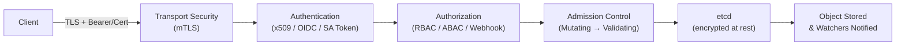
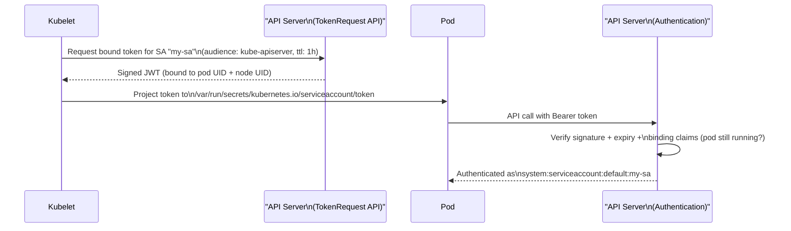
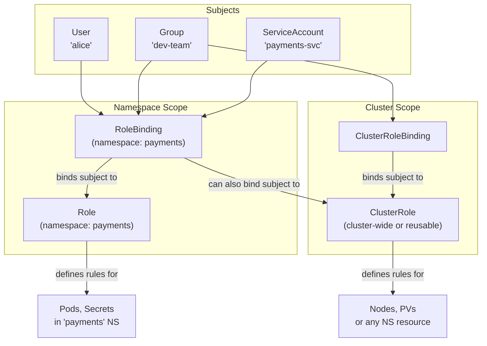
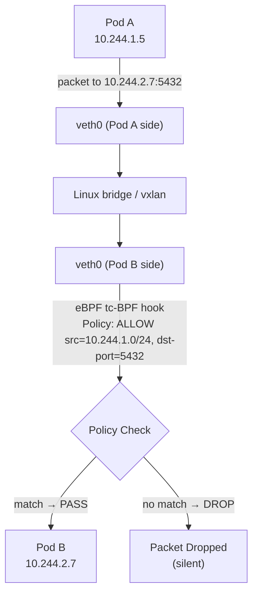
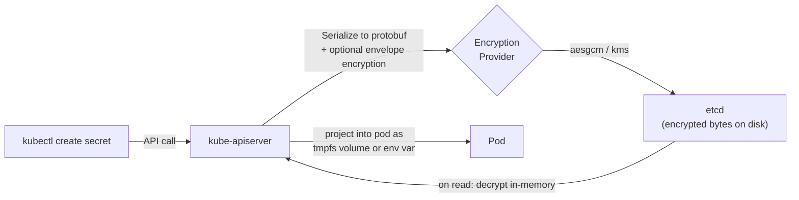
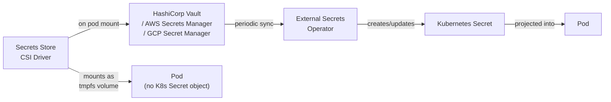
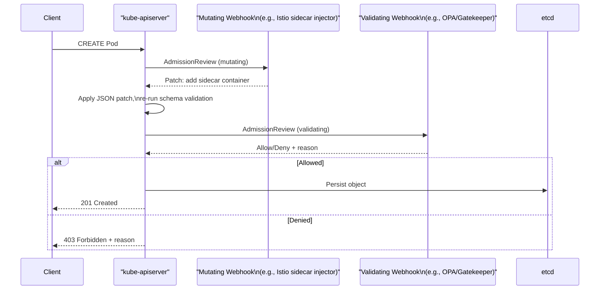

# Lesson 5: Kubernetes Security and Authentication

Kubernetes security is not a layer bolted on top of the cluster—it is woven into every API call, every scheduling decision, and every packet traversal. Understanding it requires tracing a request from the moment a client contacts the API server through admission, authorization, persistence in etcd, and eventual enforcement at the node. This lesson dissects that entire chain at an architectural level.

---

## 1. The Request Lifecycle: Security at Every Layer

Every interaction with a Kubernetes cluster flows through the API server (`kube-apiserver`). The server enforces a strict, ordered pipeline before any state change reaches etcd.



A request that fails at **any** stage is rejected with a 401, 403, or 400 respectively. There is no bypass path. The stages are:

1. **Transport Security** — The API server terminates TLS. Clients that present a client certificate skip the subsequent token-based authentication chain entirely; the Subject and Organization fields of the certificate *are* the identity.
2. **Authentication** — Determines *who* is making the request. Produces a `UserInfo` struct containing username, UID, groups, and extra fields.
3. **Authorization** — Determines *what* the authenticated identity is allowed to do. RBAC is the dominant mode in production clusters.
4. **Admission Control** — Mutating webhooks can alter the object (e.g., inject sidecars). Validating webhooks can reject objects that violate policy (e.g., OPA/Gatekeeper). Built-in controllers like `LimitRanger` and `ResourceQuota` also run here.
5. **etcd persistence** — Objects are serialized to protobuf and optionally encrypted before writing. etcd itself uses Raft consensus; a write is not acknowledged until a quorum of etcd members confirm it.

---

## 2. Authentication: Proving Identity

Kubernetes does not have a built-in user database. Human user identities are always external. The API server supports multiple authenticator plugins that run in a configured order; the first one to return a non-error result wins.

### 2.1 X.509 Client Certificates

The simplest and most fundamental mechanism. The API server is started with `--client-ca-file`, pointing to a CA bundle. Any client presenting a certificate signed by that CA is authenticated. The CN field maps to the username; the O fields map to group membership.

```bash
# Generate a private key and CSR for a developer named "alice" in group "dev-team"
openssl genrsa -out alice.key 4096

openssl req -new -key alice.key \
  -subj "/CN=alice/O=dev-team/O=system:authenticated" \
  -out alice.csr

# Sign with the cluster CA (requires access to ca.crt and ca.key)
openssl x509 -req -in alice.csr \
  -CA /etc/kubernetes/pki/ca.crt \
  -CAkey /etc/kubernetes/pki/ca.key \
  -CAcreateserial \
  -out alice.crt \
  -days 365 \
  -sha256
```

Kubernetes 1.18+ provides a `CertificateSigningRequest` API so the control plane CA can sign certificates without manual CA key access:

```yaml
apiVersion: certificates.k8s.io/v1
kind: CertificateSigningRequest
metadata:
  name: alice
spec:
  request: <base64-encoded CSR>
  signerName: kubernetes.io/kube-apiserver-client
  expirationSeconds: 86400  # 24 hours
  usages:
    - client auth
```

```bash
kubectl certificate approve alice
kubectl get csr alice -o jsonpath='{.status.certificate}' | base64 -d > alice.crt
```

**Critical limitation:** Kubernetes has no native certificate revocation (no CRL, no OCSP). The only revocation mechanisms are rotating the entire cluster CA (destructive) or using short-lived certificates (the `expirationSeconds` field above) so that compromise windows are bounded. This is why production systems pair certificates with an external OIDC provider that supports token revocation.

### 2.2 Service Account Tokens

Service Accounts are Kubernetes-native identities for workloads running inside the cluster. Every pod is associated with a Service Account, and the API server automatically projects a signed JWT into the pod at a well-known path.



Since Kubernetes 1.21, **projected service account tokens** (the `BoundServiceAccountTokenVolume` feature) are the default. These are:
- **Audience-bound**: the token is only valid for the intended audience (e.g., `kube-apiserver`, or an external service like Vault).
- **Time-limited**: default TTL of 1 hour; kubelet rotates before expiry.
- **Object-bound**: the token contains `pod.uid` and `node.uid` claims. The API server rejects the token if the pod is no longer running.

This replaces the legacy auto-mounted secret-based tokens, which were static (no expiry) and not object-bound.

### 2.3 OIDC Authentication

For human users in production, OpenID Connect (OIDC) is the correct mechanism. An external Identity Provider (IdP) — Dex, Okta, Google Workspace, Keycloak — issues JWTs. The API server validates them without contacting the IdP on each request (it verifies the signature using the IdP's public JWKS endpoint, cached locally).

```
kube-apiserver flags:
  --oidc-issuer-url=https://accounts.google.com
  --oidc-client-id=my-k8s-cluster
  --oidc-username-claim=email
  --oidc-groups-claim=groups
  --oidc-ca-file=/etc/kubernetes/oidc-ca.crt
```

The JWT claims are mapped directly to the Kubernetes `UserInfo`:
- `--oidc-username-claim` → `UserInfo.Username`
- `--oidc-groups-claim` → `UserInfo.Groups`

This is stateless validation: the API server verifies the JWT signature against the IdP's public keys, checks `exp` and `iss` claims, and constructs the user identity — no network round-trip to the IdP per request.

---

## 3. Authorization: RBAC in Depth

RBAC is the production-standard authorization mode. It is enabled by passing `--authorization-mode=Node,RBAC` to `kube-apiserver`. The `Node` authorizer precedes RBAC and handles the special case of kubelets authorizing themselves to read only the objects relevant to their own node. RBAC handles everything else.

### 3.1 The RBAC Object Model



**Key architectural distinction:** A `ClusterRoleBinding` grants cluster-wide access. A `RoleBinding` grants access only within its namespace — even if it references a `ClusterRole`. This allows administrators to define reusable `ClusterRole` templates (e.g., `pod-reader`) and instantiate them per namespace via `RoleBinding`, avoiding role duplication.

### 3.2 Rule Anatomy

Each rule in a `Role` or `ClusterRole` is an allow rule — RBAC is a whitelist-only model. There are no deny rules. The authorizer performs a logical OR across all rules bound to a subject: if any rule grants the requested (verb, resource, name) tuple, the request is allowed.

```yaml
apiVersion: rbac.authorization.k8s.io/v1
kind: ClusterRole
metadata:
  name: payments-operator
rules:
  # Rule 1: Full control over Deployments and StatefulSets in any namespace
  - apiGroups: ["apps"]
    resources: ["deployments", "statefulsets"]
    verbs: ["get", "list", "watch", "create", "update", "patch", "delete"]

  # Rule 2: Read-only access to Secrets (note: no 'create' or 'delete')
  - apiGroups: [""]   # core API group
    resources: ["secrets"]
    verbs: ["get", "list", "watch"]

  # Rule 3: Narrow access to a specific ConfigMap by name
  - apiGroups: [""]
    resources: ["configmaps"]
    resourceNames: ["payments-config"]
    verbs: ["get", "watch"]

  # Rule 4: Access to subresources (exec into pods)
  - apiGroups: [""]
    resources: ["pods/exec", "pods/log"]
    verbs: ["create", "get"]

  # Rule 5: Non-resource URL access (health endpoints)
  - nonResourceURLs: ["/healthz", "/readyz", "/metrics"]
    verbs: ["get"]
```

**`apiGroups`** corresponds to the API group path in the URL: `""` is the core group (`/api/v1`), `"apps"` is `/apis/apps/v1`, `"batch"` is `/apis/batch/v1`, etc.

**`resourceNames`** narrows a rule to specific named instances. This is powerful for locking service accounts to exactly the secrets they need, but it cannot be used with `list` or `watch` (those verbs don't operate on a named resource).

### 3.3 Aggregated ClusterRoles

ClusterRoles support label-based aggregation. The built-in `admin`, `edit`, and `view` ClusterRoles are themselves aggregated. Any ClusterRole labeled with the right key is automatically merged into the aggregate, allowing operators and CRD authors to extend existing roles without modifying them:

```yaml
apiVersion: rbac.authorization.k8s.io/v1
kind: ClusterRole
metadata:
  name: cert-manager-view
  labels:
    # Automatically merged into the built-in 'view' ClusterRole
    rbac.authorization.k8s.io/aggregate-to-view: "true"
rules:
  - apiGroups: ["cert-manager.io"]
    resources: ["certificates", "certificaterequests", "issuers"]
    verbs: ["get", "list", "watch"]
```

### 3.4 Auditing RBAC: Who Can Do What?

```bash
# Who can delete secrets in the payments namespace?
kubectl auth can-i delete secrets -n payments --list

# Can the payments-svc service account read configmaps?
kubectl auth can-i get configmaps \
  --as=system:serviceaccount:payments:payments-svc \
  -n payments

# Full impersonation audit: list all subjects that can exec into pods cluster-wide
kubectl get clusterrolebindings,rolebindings -A \
  -o json | jq -r '
    .items[] |
    .metadata.namespace as $ns |
    .roleRef.name as $role |
    .subjects[]? |
    "\(.kind)/\(.name) → \($role) [ns: \($ns // "cluster")]"
  '
```

---

## 4. Network Policies: Traffic Enforcement at the Kernel Level

A `NetworkPolicy` is a Kubernetes API object that expresses *intent*. The enforcement is entirely delegated to the CNI plugin (Calico, Cilium, Weave, Antrea). **Flannel, for example, does not enforce NetworkPolicy at all.** Choosing a CNI that supports NetworkPolicy is a prerequisite for this feature to have any effect.

### 4.1 How CNI Plugins Enforce Policy

The two dominant mechanisms are:

- **iptables/nftables** (Calico in iptables mode, Weave): The CNI agent on each node programs `iptables` rules in the `FORWARD` chain. For every pod with an applicable policy, it installs rules that match source/destination IP sets (implemented as `ipset` groups, refreshed as pods come and go) and either ACCEPT or DROP packets.

- **eBPF** (Cilium, Calico in eBPF mode): XDP and tc-BPF programs are attached to the veth interfaces of pods. Policy evaluation happens in the kernel at the point of packet ingress/egress, before the packet enters the network stack proper. This eliminates the iptables traversal overhead and scales to larger cluster sizes.



### 4.2 Default-Deny Posture

A pod with **no** `NetworkPolicy` selecting it is fully open — all ingress and egress is allowed. The correct production baseline is explicit default-deny policies in every namespace, then additive allow rules:

```yaml
# Default deny ALL ingress in a namespace
apiVersion: networking.k8s.io/v1
kind: NetworkPolicy
metadata:
  name: default-deny-ingress
  namespace: payments
spec:
  podSelector: {}      # selects ALL pods in namespace
  policyTypes:
    - Ingress
---
# Default deny ALL egress in a namespace
apiVersion: networking.k8s.io/v1
kind: NetworkPolicy
metadata:
  name: default-deny-egress
  namespace: payments
spec:
  podSelector: {}
  policyTypes:
    - Egress
```

After these are applied, all traffic is blocked. Add specific allow rules:

```yaml
apiVersion: networking.k8s.io/v1
kind: NetworkPolicy
metadata:
  name: allow-payments-db
  namespace: payments
spec:
  podSelector:
    matchLabels:
      app: payments-api   # applies to pods labeled app=payments-api
  policyTypes:
    - Egress
    - Ingress
  egress:
    # Allow egress to PostgreSQL pods in the same namespace
    - to:
        - podSelector:
            matchLabels:
              app: postgres
      ports:
        - protocol: TCP
          port: 5432
    # Allow DNS resolution (without this, all DNS queries are dropped)
    - to:
        - namespaceSelector:
            matchLabels:
              kubernetes.io/metadata.name: kube-system
      ports:
        - protocol: UDP
          port: 53
        - protocol: TCP
          port: 53
  ingress:
    # Allow ingress from the ingress controller namespace only
    - from:
        - namespaceSelector:
            matchLabels:
              kubernetes.io/metadata.name: ingress-nginx
      ports:
        - protocol: TCP
          port: 8080
```

**DNS is a common footgun.** Egress default-deny blocks UDP 53 to `kube-dns`. Every NetworkPolicy that restricts egress must explicitly allow DNS to `kube-system` or pods will silently fail to resolve names.

### 4.3 Policy Evaluation Semantics

NetworkPolicy `from`/`to` rules within the same `ingress`/`egress` rule are **AND**ed (must all match). Separate rule entries in the list are **OR**ed (any match grants access). This is a critical distinction:

```yaml
# AND semantics: pod must be in BOTH the matching namespace AND have the label
ingress:
  - from:
      - namespaceSelector:
          matchLabels:
            env: production
        podSelector:          # same list element → AND
          matchLabels:
            role: frontend

# OR semantics: pod from production namespace OR any pod with role=frontend
ingress:
  - from:
      - namespaceSelector:   # separate list element → OR
          matchLabels:
            env: production
      - podSelector:
          matchLabels:
            role: frontend
```

---

## 5. Secrets Management: Architecture and Threat Model

### 5.1 How Secrets Are Stored

Kubernetes `Secret` objects are stored in etcd. By default, they are base64-encoded, **not encrypted**. Base64 is encoding, not encryption — anyone with etcd read access reads the plaintext value.



### 5.2 Encryption at Rest

Enable envelope encryption by configuring an `EncryptionConfiguration` for `kube-apiserver`:

```yaml
# /etc/kubernetes/encryption-config.yaml
apiVersion: apiserver.config.k8s.io/v1
kind: EncryptionConfiguration
resources:
  - resources:
      - secrets
      - configmaps   # encrypt configmaps too if they carry sensitive data
    providers:
      # First provider is used for all new writes
      - aescbc:
          keys:
            - name: key1
              secret: <base64-encoded 32-byte key>  # AES-256
      # Fallback for reading older data encrypted with a previous key
      - aescbc:
          keys:
            - name: key0
              secret: <base64-encoded 32-byte previous key>
      # Always include 'identity' last to allow reading unencrypted data
      # during a migration; remove it once all secrets are re-encrypted
      - identity: {}
```

Pass to `kube-apiserver` with `--encryption-provider-config=/etc/kubernetes/encryption-config.yaml`. After enabling, existing secrets are **not** retroactively encrypted. Force re-encryption:

```bash
kubectl get secrets --all-namespaces -o json | \
  kubectl replace -f -
```

**KMS provider** (via `kms` provider in the config) delegates key management to an external KMS (AWS KMS, GCP Cloud KMS, HashiCorp Vault). The API server holds only an encrypted data encryption key (DEK); the actual plaintext DEK is obtained from the KMS on startup and cached in memory. This is the envelope encryption pattern: secrets are encrypted with the DEK, and the DEK is wrapped by the KMS key (KEK). Rotating the KEK does not require re-encrypting all data.

### 5.3 Projecting Secrets into Pods

Secrets are delivered to pods either as environment variables or as volumes (backed by `tmpfs`). Volume projection is strongly preferred:

```yaml
apiVersion: v1
kind: Pod
metadata:
  name: payments-api
spec:
  serviceAccountName: payments-svc
  volumes:
    - name: db-credentials
      secret:
        secretName: postgres-credentials
        defaultMode: 0400   # read-only for owner; no group/other access
        items:
          - key: password
            path: db-password  # only project this key, not the whole secret
  containers:
    - name: api
      image: payments-api:v1.2.3
      volumeMounts:
        - name: db-credentials
          mountPath: /run/secrets/db
          readOnly: true
      # Avoid env vars for secrets: they appear in /proc/<pid>/environ,
      # child process dumps, and kubectl describe output.
      # env:
      #   - name: DB_PASSWORD
      #     valueFrom:
      #       secretKeyRef:
      #         name: postgres-credentials
      #         key: password
```

Secrets mounted as volumes are stored in `tmpfs` on the node — they never touch disk. They are updated in-place (with up to `--sync-period` latency, default 1 minute) when the Secret object changes, without requiring a pod restart.

### 5.4 External Secret Stores

For production systems, the Kubernetes `Secret` API is often a sync target, not a source of truth. Tools like **External Secrets Operator (ESO)** or **Secrets Store CSI Driver** pull from authoritative external stores:



The CSI driver approach avoids materializing secrets as Kubernetes `Secret` objects at all — the secret is fetched from Vault at pod startup and mounted directly into the container's filesystem. This reduces the attack surface (no RBAC path to `kubectl get secret` revealing the value).

---

## 6. Pod Security: Standards and Admission

The deprecated `PodSecurityPolicy` (removed in 1.25) has been replaced by **Pod Security Admission (PSA)**, a built-in admission controller that enforces the [Pod Security Standards](https://kubernetes.io/docs/concepts/security/pod-security-standards/).

### 6.1 Pod Security Standards

Three profiles, applied at the namespace level via labels:

| Profile | Description |
|---|---|
| `privileged` | Unrestricted. Allows all capabilities, host namespaces, hostPath volumes. |
| `baseline` | Prevents known privilege escalations. Disallows `hostPID`, `hostIPC`, `hostNetwork`, privileged containers, and dangerous capabilities. |
| `restricted` | Hardened. Requires `runAsNonRoot`, drops all capabilities, requires `seccompProfile`, disallows privilege escalation. |

```yaml
# Apply 'restricted' enforcement with 'baseline' warnings on a namespace
apiVersion: v1
kind: Namespace
metadata:
  name: payments
  labels:
    pod-security.kubernetes.io/enforce: restricted
    pod-security.kubernetes.io/enforce-version: v1.30
    pod-security.kubernetes.io/warn: restricted
    pod-security.kubernetes.io/warn-version: v1.30
    pod-security.kubernetes.io/audit: restricted
    pod-security.kubernetes.io/audit-version: v1.30
```

### 6.2 A Hardened Pod Spec

```yaml
apiVersion: v1
kind: Pod
metadata:
  name: hardened-workload
  namespace: payments
spec:
  securityContext:
    runAsNonRoot: true
    runAsUser: 10001
    runAsGroup: 10001
    fsGroup: 10001
    seccompProfile:
      type: RuntimeDefault   # or Localhost with a custom profile
  automountServiceAccountToken: false  # disable unless the pod needs API access
  containers:
    - name: app
      image: myapp:v1.0.0@sha256:<digest>  # pin by digest, not tag
      securityContext:
        allowPrivilegeEscalation: false
        readOnlyRootFilesystem: true
        capabilities:
          drop: ["ALL"]
          add: []          # add only what is strictly required
      resources:
        requests:
          cpu: "100m"
          memory: "128Mi"
        limits:
          cpu: "500m"
          memory: "256Mi"
      volumeMounts:
        - name: tmp
          mountPath: /tmp   # writable tmpfs for applications that need /tmp
  volumes:
    - name: tmp
      emptyDir:
        medium: Memory
```

---

## 7. Admission Controllers: Mutating and Validating Webhooks

Admission controllers are the extensibility point for policy enforcement beyond what RBAC provides. They operate on the object *before* it is persisted, making them the right place to enforce organizational policy.



A minimal validating webhook server in Go (the webhook must handle the `AdmissionReview` API):

```go
package main

import (
    "encoding/json"
    "fmt"
    "net/http"

    admissionv1 "k8s.io/api/admission/v1"
    corev1 "k8s.io/api/core/v1"
    metav1 "k8s.io/apimachinery/pkg/apis/meta/v1"
)

// validate rejects pods that do not pin their image by digest.
func validate(w http.ResponseWriter, r *http.Request) {
    var review admissionv1.AdmissionReview
    if err := json.NewDecoder(r.Body).Decode(&review); err != nil {
        http.Error(w, err.Error(), http.StatusBadRequest)
        return
    }

    var pod corev1.Pod
    if err := json.Unmarshal(review.Request.Object.Raw, &pod); err != nil {
        http.Error(w, err.Error(), http.StatusBadRequest)
        return
    }

    allowed := true
    var reason string
    for _, c := range pod.Spec.Containers {
        // Require images to be pinned by SHA256 digest
        if !containsDigest(c.Image) {
            allowed = false
            reason = fmt.Sprintf("container %q image %q must be pinned by digest", c.Name, c.Image)
            break
        }
    }

    response := admissionv1.AdmissionReview{
        TypeMeta: review.TypeMeta,
        Response: &admissionv1.AdmissionResponse{
            UID:     review.Request.UID,
            Allowed: allowed,
        },
    }
    if !allowed {
        response.Response.Result = &metav1.Status{
            Code:    403,
            Message: reason,
        }
    }

    w.Header().Set("Content-Type", "application/json")
    json.NewEncoder(w).Encode(response)
}

func containsDigest(image string) bool {
    // A digest reference contains '@sha256:'
    for i := 0; i < len(image)-7; i++ {
        if image[i:i+8] == "@sha256:" {
            return true
        }
    }
    return false
}

func main() {
    http.HandleFunc("/validate", validate)
    // TLS is required; the API server verifies the webhook's certificate
    http.ListenAndServeTLS(":8443", "/tls/tls.crt", "/tls/tls.key", nil)
}
```

---

## 8. Audit Logging

Audit logging records every request to the API server, providing a forensic trail. The audit policy controls the verbosity per resource and verb:

```yaml
# /etc/kubernetes/audit-policy.yaml
apiVersion: audit.k8s.io/v1
kind: Policy
rules:
  # Log all requests at the Metadata level (record who, what, when — not the body)
  - level: Metadata
    omitStages: ["RequestReceived"]

  # Log full request and response bodies for Secrets (high-value target)
  - level: RequestResponse
    resources:
      - group: ""
        resources: ["secrets"]

  # Log mutations to RBAC objects at RequestResponse level
  - level: RequestResponse
    verbs: ["create", "update", "patch", "delete"]
    resources:
      - group: "rbac.authorization.k8s.io"
        resources: ["roles", "clusterroles", "rolebindings", "clusterrolebindings"]

  # Suppress noisy read-only health check calls
  - level: None
    users: ["system:kube-proxy"]
    verbs: ["watch"]
    resources:
      - group: ""
        resources: ["endpoints", "services"]

  - level: None
    nonResourceURLs:
      - "/healthz*"
      - "/readyz*"
      - "/livez*"
```

Pass `--audit-policy-file` and `--audit-log-path` to `kube-apiserver`. Audit log entries are JSON objects containing the `user`, `sourceIPs`, `verb`, `resource`, `namespace`, `requestURI`, and optionally the full request/response object.

---

## 9. Failure Modes and Hardening Checklist

### 9.1 RBAC Failure Modes

**Wildcard rules** (`resources: ["*"]`, `verbs: ["*"]`) are the most common misconfiguration. A service account with `* / * / *` on the core API group is effectively cluster-admin within its namespace.

**Cluster-admin proliferation:** Binding users to the built-in `cluster-admin` ClusterRole should require a formal approval process. Audit with:
```bash
kubectl get clusterrolebindings -o json | \
  jq -r '.items[] | select(.roleRef.name == "cluster-admin") | 
    .subjects[]? | "\(.kind)/\(.name)"'
```

**Service account token leakage:** Leaked projected tokens expire (default 1 hour), but they are valid until expiry. The node and pod UID binding means a token from a deleted pod is rejected — but only if the pod UID is checked. The `BoundServiceAccountTokenVolume` feature ensures this check happens.

### 9.2 Network Policy Failure Modes

- **Missing DNS egress rule:** Covered in §4.2. This breaks virtually all workloads silently.
- **Wrong AND/OR semantics:** Covered in §4.3. A `namespaceSelector` and `podSelector` in the same `from` element is AND; in separate elements is OR.
- **Non-enforcing CNI:** If the CNI plugin does not support NetworkPolicy, the policies are accepted by the API server (they are valid objects) but never enforced. Verify CNI capability before relying on NetworkPolicy for isolation.
- **NodePort bypasses:** NetworkPolicy operates at the pod level (L3/L4). Traffic entering via a NodePort bypasses pod-level ingress rules because the source IP is rewritten to the node IP by kube-proxy's SNAT rule. Use `externalTrafficPolicy: Local` or Cilium's `hostFirewall` to handle this.

### 9.3 Secrets Failure Modes

- **Environment variable exposure:** Env vars are visible in `/proc/<pid>/environ`, process listings, and `kubectl describe pod` output. Use volume mounts.
- **Image pull secrets in public registries:** Storing image pull secrets as `kubernetes.io/dockerconfigjson` Secrets means any user with `get secrets` in the namespace can retrieve the registry credential.
- **etcd without encryption at rest:** Default installations do not encrypt secrets. Any party with etcd access (direct disk, `etcdctl`, snapshot) reads all secrets in plaintext.

### 9.4 Production Hardening Checklist

```
Control Plane
  ✓ Enable encryption at rest for Secrets (AES-GCM or KMS provider)
  ✓ Enable audit logging with RequestResponse for RBAC and Secret mutations
  ✓ Restrict etcd access to kube-apiserver only (mTLS between components)
  ✓ Rotate cluster CA and node certificates on a defined schedule

Authentication
  ✓ No long-lived static tokens; use OIDC or short-lived certificate-based auth
  ✓ Disable anonymous authentication (--anonymous-auth=false)
  ✓ Enable Node authorizer alongside RBAC
  ✓ Require MFA at the OIDC IdP level

RBAC
  ✓ Audit and minimize cluster-admin bindings
  ✓ No wildcard rules in production roles
  ✓ Disable automountServiceAccountToken on pods/service accounts that do not need API access
  ✓ Namespace isolation: use Namespace-scoped RoleBindings, not ClusterRoleBindings, where possible

Network
  ✓ Default-deny ingress and egress NetworkPolicy in every namespace
  ✓ Explicit DNS egress allow rule in every restricted namespace
  ✓ Confirm CNI supports NetworkPolicy enforcement
  ✓ Use Cilium NetworkPolicy (or equivalent) for L7 policy if needed

Pods
  ✓ Pod Security Standard: enforce 'restricted' on production namespaces
  ✓ All container images pinned by SHA256 digest
  ✓ readOnlyRootFilesystem: true on all containers
  ✓ Drop ALL capabilities; add only what is required
  ✓ seccompProfile: RuntimeDefault or custom Localhost profile

Secrets
  ✓ Use External Secrets Operator or Secrets Store CSI Driver for external secret sync
  ✓ Prefer volume mounts over environment variables for secrets
  ✓ Restrict Secret read access via RBAC resourceNames where feasible
```

---

## Summary

Kubernetes security is a defense-in-depth stack. Authentication establishes identity using certificates, projected service account tokens, or OIDC JWTs. RBAC is a whitelist-only authorization model: allow rules at the (apiGroup, resource, verb) tuple level, with no deny semantics, that makes over-permissive wildcards the dominant misconfiguration risk. NetworkPolicy is an *intent* API — its enforcement entirely depends on the CNI plugin, operates at L3/L4 by default, and silently drops traffic with no ACK to the sender. Secrets require explicit encryption-at-rest configuration; without it, base64 in etcd is the same as plaintext. Pod Security Admission, hardened pod security contexts, and validating admission webhooks together close the gap between what RBAC permits and what the cluster should allow to run. Audit logging provides the forensic foundation for detecting misconfiguration and intrusion after the fact.
