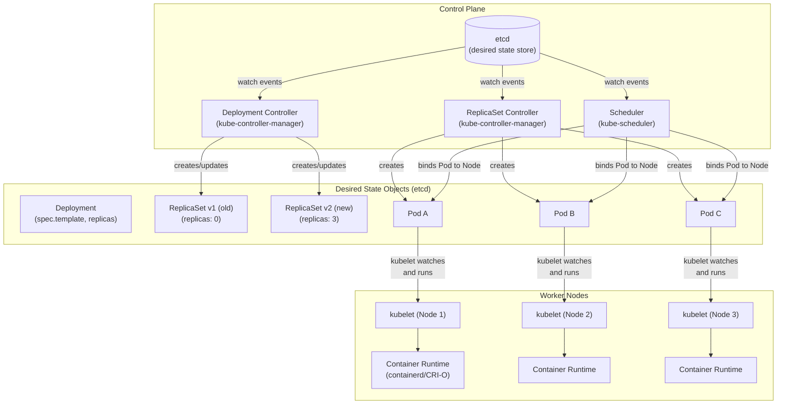
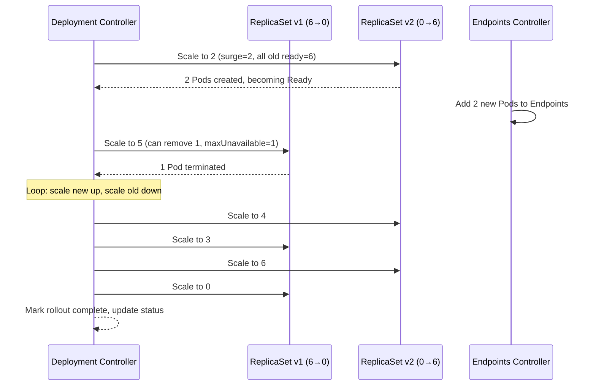
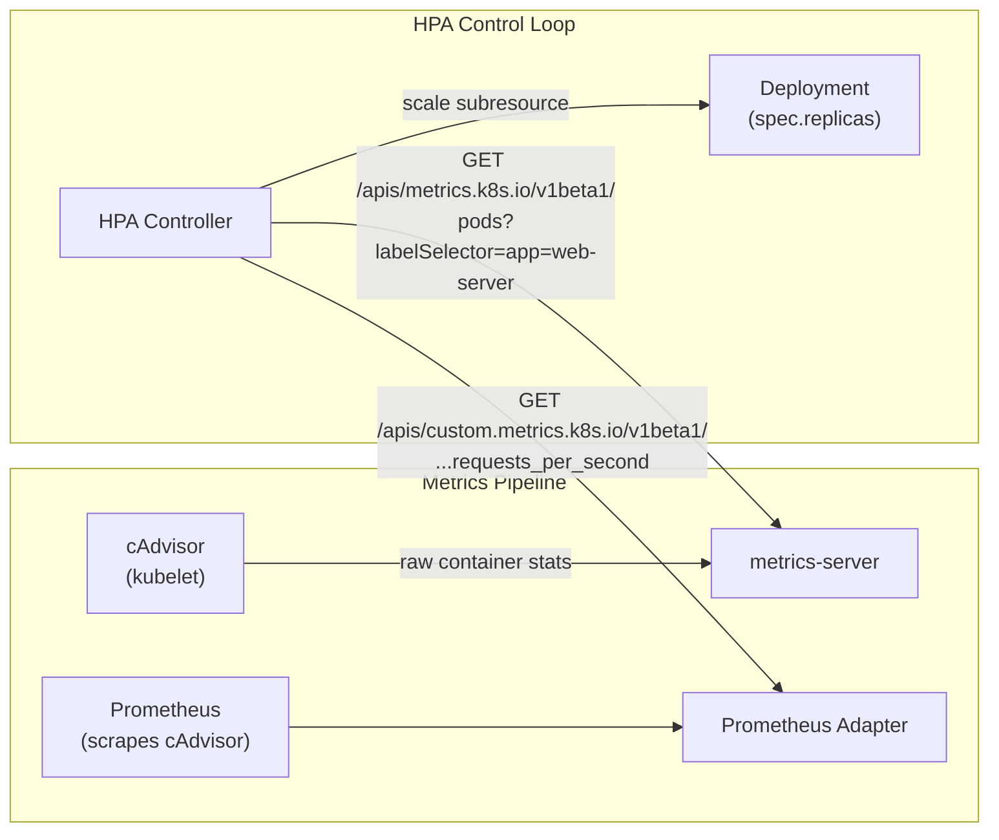
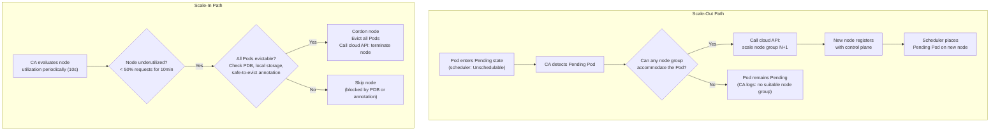

# Lesson 6: Kubernetes Deployment and Scaling

## 1. First-Principles Intuition & Invariants

Kubernetes is a **control-plane-driven reconciliation engine**. Every object in Kubernetes — a Deployment, a ReplicaSet, a Pod — is a *desired state declaration* stored in etcd. The control plane's sole purpose is to continuously drive the *observed* cluster state toward the *desired* state. This is not polling in the traditional sense; it is an **event-driven, level-triggered** reconciliation loop, meaning the system reacts to state change events but always reconciles against the full desired state, not just the delta.

The formal invariant is:

> **desired_state(t) = f(spec)** and **reconcile(observed_state, desired_state) → Δ_actions**

This invariant must hold continuously across all controllers. The practical consequence is that Kubernetes controllers are *idempotent*: applying the same desired state multiple times must produce no additional side effects. This is why `kubectl apply` is safe to run repeatedly.

The object ownership hierarchy for a Deployment breaks down as follows:

```
Deployment  → owns →  ReplicaSet(s)  → owns →  Pod(s)
```

A Deployment does *not* directly manage Pods. It manages ReplicaSets. Each rollout (i.e., any change to the Pod template spec) creates a new ReplicaSet, and the Deployment controller orchestrates the transition between the old and new ReplicaSet. The old ReplicaSet is scaled down (but not deleted by default, enabling rollback), and the new one is scaled up. This layered ownership is the mechanical foundation of rolling updates and rollbacks.



---

## 2. Core Architecture & Mechanics

### 2.1 The etcd Watch Mechanism

Every Kubernetes controller uses the **List-Watch** pattern against the API server. A controller first Lists all objects of a given type (e.g., all Deployments) to build an initial in-memory cache, then opens a long-lived HTTP/2 streaming Watch request to receive incremental events (`ADDED`, `MODIFIED`, `DELETED`). These events are funneled into a work queue; the controller pops items from the queue and runs the reconciliation logic.

This design means the control plane does not poll. It reacts. If a Pod dies, the kubelet updates the Pod's status in etcd, the API server emits a `MODIFIED` event, the ReplicaSet controller receives it, detects that `observed_replicas < desired_replicas`, and enqueues a create-Pod action — all within milliseconds under normal conditions.

### 2.2 Deployment Controller Reconciliation Loop

The Deployment controller (part of `kube-controller-manager`) implements the following core logic on each reconciliation:

1. Fetch all ReplicaSets whose `ownerReferences` point to this Deployment.
2. Find the "new" ReplicaSet: the one whose Pod template hash matches the Deployment's current `.spec.template`.
3. Scale the new ReplicaSet up and old ReplicaSets down according to the `.spec.strategy` field.
4. Update the Deployment's `.status` subresource with `availableReplicas`, `readyReplicas`, `updatedReplicas`, and `conditions`.

The Pod template hash is a deterministic hash of the entire `.spec.template` struct, computed using `fnv32a` and stored as the label `pod-template-hash`. This label is automatically added to every Pod created by a ReplicaSet, which is how the ReplicaSet's label selector identifies its owned Pods.

### 2.3 ReplicaSet Label Selector Mechanics

A ReplicaSet selects Pods using a `.spec.selector` (a `LabelSelector`), which supports both `matchLabels` (equality-based) and `matchExpressions` (set-based) semantics. The selector is immutable after creation — this is a deliberate constraint to prevent ownership confusion.

```yaml
# A ReplicaSet selector — immutable after creation
selector:
  matchLabels:
    app: web-server
    pod-template-hash: "7d6b8c9f4"  # injected by Deployment controller
  matchExpressions:
    - key: environment
      operator: In
      values: ["production", "staging"]
```

The ReplicaSet controller continuously reconciles: `len(matchingPods) == spec.replicas`. If `len(matchingPods) > spec.replicas`, it deletes the excess Pods, preferring to delete Pods in the following priority order: unscheduled > not-ready > older-revision > highest ordinal index (for stability).

### 2.4 Production-Grade Deployment Manifest

The following manifest demonstrates the full set of production-critical fields with their architectural rationale:

```yaml
apiVersion: apps/v1
kind: Deployment
metadata:
  name: web-server
  namespace: production
  labels:
    app: web-server
    version: "2.1.4"
  annotations:
    # Stored in ReplicaSet annotations for rollback; not spec.
    kubernetes.io/change-cause: "Bump to v2.1.4: fix memory leak in request handler"
spec:
  replicas: 6

  # revisionHistoryLimit: how many old ReplicaSets to retain for rollback.
  # Default is 10. Setting to 3 reduces etcd storage pressure.
  revisionHistoryLimit: 3

  # progressDeadlineSeconds: if the rollout does not make progress
  # within this window, the Deployment is marked as "Failed".
  # This surfaces stalled rollouts to operators and automation.
  progressDeadlineSeconds: 300

  selector:
    matchLabels:
      app: web-server

  strategy:
    type: RollingUpdate
    rollingUpdate:
      # maxUnavailable: max Pods that can be unavailable during update.
      # As a percentage, this is floored. 25% of 6 = 1 (floor).
      maxUnavailable: 1
      # maxSurge: max Pods that can be created above desired count.
      # As a percentage, this is ceiled. 25% of 6 = 2 (ceil).
      maxSurge: 2

  template:
    metadata:
      labels:
        app: web-server
        version: "2.1.4"
    spec:
      # terminationGracePeriodSeconds: time kubelet waits after sending
      # SIGTERM before sending SIGKILL. Must exceed your app's shutdown time.
      terminationGracePeriodSeconds: 60

      # topologySpreadConstraints: enforce Pod spreading across failure domains.
      # This prevents all replicas from landing on one AZ or node.
      topologySpreadConstraints:
        - maxSkew: 1
          topologyKey: topology.kubernetes.io/zone
          whenUnsatisfiable: DoNotSchedule
          labelSelector:
            matchLabels:
              app: web-server
        - maxSkew: 1
          topologyKey: kubernetes.io/hostname
          whenUnsatisfiable: DoNotSchedule
          labelSelector:
            matchLabels:
              app: web-server

      containers:
        - name: web-server
          image: registry.example.com/web-server:2.1.4
          # Never use `latest` in production. The tag must be immutable and
          # the pull policy must be IfNotPresent to avoid uncontrolled updates.
          imagePullPolicy: IfNotPresent
          ports:
            - name: http
              containerPort: 8080
              protocol: TCP

          # Resource requests: what the scheduler uses for bin-packing.
          # Resource limits: enforced by the kernel cgroup subsystem.
          # CPU is compressible (throttled at limit); memory is not (OOM killed).
          resources:
            requests:
              cpu: "250m"
              memory: "256Mi"
            limits:
              cpu: "1000m"
              memory: "512Mi"

          # readinessProbe: gates traffic routing. A Pod is NOT added to
          # Service Endpoints until this probe succeeds. This is the primary
          # mechanism for zero-downtime deployments.
          readinessProbe:
            httpGet:
              path: /healthz/ready
              port: 8080
            initialDelaySeconds: 10
            periodSeconds: 5
            failureThreshold: 3
            successThreshold: 1

          # livenessProbe: triggers a container restart if it fails.
          # Set a generous failureThreshold to avoid killing pods under GC pressure.
          livenessProbe:
            httpGet:
              path: /healthz/live
              port: 8080
            initialDelaySeconds: 30
            periodSeconds: 10
            failureThreshold: 5

          # startupProbe: disables liveness/readiness during slow startup.
          # failureThreshold * periodSeconds = max startup time (100 * 3s = 300s).
          startupProbe:
            httpGet:
              path: /healthz/live
              port: 8080
            failureThreshold: 100
            periodSeconds: 3

          env:
            - name: POD_NAME
              valueFrom:
                fieldRef:
                  fieldPath: metadata.name
            - name: POD_NAMESPACE
              valueFrom:
                fieldRef:
                  fieldPath: metadata.namespace
            - name: DB_PASSWORD
              valueFrom:
                secretKeyRef:
                  name: db-credentials
                  key: password

          lifecycle:
            # preStop hook: executes before SIGTERM is sent.
            # A sleep here gives the load balancer time to drain connections
            # before the app begins shutting down. This is essential for
            # zero-downtime rolling updates in most cloud environments.
            preStop:
              exec:
                command: ["/bin/sh", "-c", "sleep 5"]

      # Pod Disruption Budget is a *separate* object, referenced here for context.
      # It limits voluntary disruptions (node drains, cluster upgrades).
```

### 2.5 Rolling Update State Machine

The Deployment controller implements a precise state machine during a rollout. With `maxUnavailable: 1` and `maxSurge: 2` on a 6-replica Deployment:



At each step, the invariant `(total_ready >= desired - maxUnavailable)` and `(total_pods <= desired + maxSurge)` is enforced before the next scaling action is taken.

### 2.6 Pod Scheduling Deep Dive

The scheduler is a separate control-plane process (`kube-scheduler`) that watches for Pods with an empty `.spec.nodeName`. It runs a two-phase algorithm for each unscheduled Pod:

**Phase 1 — Filtering (hard constraints):** Eliminates nodes that cannot run the Pod. Filters include: `NodeResourcesFit` (sufficient CPU/memory), `NodeAffinity`, `PodAffinity`/`PodAntiAffinity`, `TaintToleration`, `NodePorts`, and `VolumeBinding`. Any node failing a filter is excluded.

**Phase 2 — Scoring (soft preferences):** Remaining nodes are scored by multiple plugins and weights are summed. Key scoring plugins include `LeastAllocated` (prefer nodes with the most free resources), `BalancedAllocation` (prefer balanced CPU/memory usage), `NodeAffinity` (prefer nodes matching affinity expressions), and `InterPodAffinity`. The node with the highest aggregate score wins, with ties broken by random selection.

The scheduler writes the selected node name to the Pod's `.spec.nodeName` via a *binding* subresource. The kubelet on that node watches for Pods bound to itself and begins the container lifecycle.

---

## 3. Rolling Updates, Rollbacks, and Failure Modes

### 3.1 Rollback Mechanics

When you execute `kubectl rollout undo deployment/web-server`, the Deployment controller does *not* re-create a new ReplicaSet. It finds the previous ReplicaSet (the one with the highest revision number before the current one), sets its `spec.replicas` to the desired count, and sets the current ReplicaSet's `spec.replicas` to 0. The rolled-back ReplicaSet's annotation `deployment.kubernetes.io/revision` is bumped to become the new current revision.

```bash
# View rollout history (requires --record or change-cause annotation)
kubectl rollout history deployment/web-server

# Roll back to the previous revision
kubectl rollout undo deployment/web-server

# Roll back to a specific revision
kubectl rollout undo deployment/web-server --to-revision=3

# Pause a rollout mid-flight (e.g., to canary test)
kubectl rollout pause deployment/web-server

# Resume after verification
kubectl rollout resume deployment/web-server

# Block CI/CD pipelines until the rollout completes or times out
kubectl rollout status deployment/web-server --timeout=5m
```

### 3.2 Failure Modes and Their Root Causes

**Image Pull Failure (`ErrImagePull` / `ImagePullBackOff`):** The kubelet cannot pull the container image. Root causes: invalid image tag, missing registry credentials (`imagePullSecrets`), or network policy blocking egress to the registry. The backoff is exponential, capped at 5 minutes. A rolling update stalls when the new ReplicaSet cannot get Pods to Ready state within `progressDeadlineSeconds`.

**OOMKilled:** The container's memory consumption exceeded `.resources.limits.memory`. The kernel's OOM killer terminates the process with exit code 137 (`128 + SIGKILL`). This is *not* a Kubernetes bug — it is the cgroup memory controller enforcing the declared limit. Resolution: increase the memory limit, fix the memory leak, or implement backpressure to reduce per-request memory allocation.

**CrashLoopBackOff:** The container starts, fails (non-zero exit), and kubelet restarts it with an exponential backoff (10s, 20s, 40s, 80s, 160s, capped at 300s). This is distinct from `OOMKilled`. Common causes: missing environment variables or secrets, failed dependency connections at startup, or uncaught exceptions during initialization. The `startupProbe` does *not* prevent `CrashLoopBackOff` — it only delays the liveness probe.

**Pending Pod (Unschedulable):** The scheduler cannot find a qualifying node. Diagnosed via `kubectl describe pod <name>` — the Events section will show which filter rejected which nodes. Common causes: insufficient cluster capacity (add nodes or increase node size), overly strict affinity/anti-affinity rules, missing tolerations for node taints, or PVC binding failure.

**Stalled Rolling Update (`ProgressDeadlineExceeded`):** The Deployment's `.status.conditions` will contain a condition of type `Progressing` with reason `ProgressDeadlineExceeded`. This surfaces when new Pods cannot become Ready (e.g., readiness probe failing), leaving the rollout in a partial state. Automated systems (ArgoCD, Flux) treat this as a failed deployment.

```bash
# Inspect Deployment conditions for stall diagnosis
kubectl get deployment web-server -o jsonpath='{.status.conditions}' | jq .
```

### 3.3 Pod Disruption Budgets

A PodDisruptionBudget (PDB) is a cluster-level policy that limits *voluntary* disruptions — node drains (`kubectl drain`), cluster autoscaler scale-downs, or evictions triggered by `PodDisruptionPolicy`. It does not protect against involuntary disruptions (node hardware failure, kernel panic).

```yaml
apiVersion: policy/v1
kind: PodDisruptionBudget
metadata:
  name: web-server-pdb
  namespace: production
spec:
  # minAvailable and maxUnavailable are mutually exclusive.
  # minAvailable: 4 means at most 2 of 6 replicas can be unavailable at once.
  # Using a percentage is safer when replica count changes frequently.
  minAvailable: "67%"
  selector:
    matchLabels:
      app: web-server
```

A PDB blocks `kubectl drain` from evicting a Pod if doing so would violate the budget. The drain operation will hang until the budget is satisfiable. This is the correct behavior — it prevents operators from accidentally draining all nodes hosting a stateful service.

---

## 4. Horizontal Pod Autoscaling (HPA)

### 4.1 Architecture

HPA is implemented as a separate control loop running in `kube-controller-manager`, sampling metrics on a configurable interval (default 15 seconds, controlled by `--horizontal-pod-autoscaler-sync-period`). It does *not* directly watch Pod metrics — it queries the **Metrics API** (`metrics.k8s.io`), which is served by `metrics-server` (for CPU/memory) or by a custom/external metrics adapter (Prometheus Adapter, KEDA, Datadog Cluster Agent).



### 4.2 Scaling Algorithm

The HPA controller computes the desired replica count using the following formula for each metric:

```
desiredReplicas = ceil(currentReplicas × (currentMetricValue / desiredMetricValue))
```

For multiple metrics, the desired replica count is computed independently for each metric and the **maximum** is taken (scale-out is aggressive, scale-in requires all metrics to agree). A tolerance band of ±10% (configurable via `--horizontal-pod-autoscaler-tolerance`) prevents flapping: if `currentMetricValue / desiredMetricValue` is within [0.9, 1.1], no scaling action is taken.

Scale-down is additionally gated by a stabilization window (default: 300 seconds for scale-down, 0 for scale-up) to prevent thrashing on bursty workloads. During the stabilization window, the HPA tracks the maximum recommended replica count and only scales down when the recommendation has been consistently low for the full window duration.

```yaml
apiVersion: autoscaling/v2
kind: HorizontalPodAutoscaler
metadata:
  name: web-server-hpa
  namespace: production
spec:
  scaleTargetRef:
    apiVersion: apps/v1
    kind: Deployment
    name: web-server
  minReplicas: 3
  maxReplicas: 50

  metrics:
    # CPU utilization: percentage of the container's CPU *request* (not limit).
    # Target 60% to leave headroom before throttling begins.
    - type: Resource
      resource:
        name: cpu
        target:
          type: Utilization
          averageUtilization: 60

    # Memory utilization: useful for memory-bound workloads.
    # Note: memory-based HPA can cause OOM kill races during scale-out.
    - type: Resource
      resource:
        name: memory
        target:
          type: AverageValue
          averageValue: 400Mi

    # Custom metric: requests per second from Prometheus Adapter.
    # This is often a better signal than CPU for I/O-bound services.
    - type: Pods
      pods:
        metric:
          name: http_requests_per_second
        target:
          type: AverageValue
          averageValue: "1000"

  behavior:
    # Scale-out: fast response to load spikes.
    scaleUp:
      stabilizationWindowSeconds: 0
      policies:
        # Can add up to 4 pods OR 100% of current count per 60s, whichever is larger.
        - type: Pods
          value: 4
          periodSeconds: 60
        - type: Percent
          value: 100
          periodSeconds: 60
      selectPolicy: Max

    # Scale-in: conservative to avoid premature capacity reduction.
    scaleDown:
      stabilizationWindowSeconds: 300
      policies:
        # Remove at most 10% of pods per 60s.
        - type: Percent
          value: 10
          periodSeconds: 60
      selectPolicy: Min
```

### 4.3 HPA + VPA Interaction Warning

The **Vertical Pod Autoscaler (VPA)** adjusts container resource requests in-place (or by eviction + restart). Running HPA on CPU/memory *and* VPA on the same Deployment simultaneously causes a **control loop conflict**: HPA scales out because CPU utilization is high; VPA increases the CPU request, lowering the utilization percentage; HPA scales back in; VPA detects under-provisioning; cycle repeats. The safe configuration is:

- Use HPA on CPU/memory *or* VPA on CPU/memory — not both simultaneously.
- Use HPA on *custom metrics* (RPS, queue depth) together with VPA on CPU/memory — these operate on orthogonal signals and are safe to combine.

---

## 5. Cluster Autoscaler and Node-Level Scaling

The Cluster Autoscaler (CA) operates at a different layer than HPA. HPA adjusts the number of Pods; CA adjusts the number of Nodes. CA is not a Kubernetes core component — it is a separate deployment that integrates with cloud provider APIs (AWS Auto Scaling Groups, GCP Managed Instance Groups, Azure VMSS).



**Critical Interaction — CA + PDB:** A node cannot be drained during CA scale-in if doing so would violate a PDB. This can cause nodes to remain in the cluster indefinitely if PDB `minAvailable` equals `replicas`. The standard pattern is `minAvailable: N-1` or a percentage below 100%.

**Node Registration Latency:** A new cloud VM typically takes 60–120 seconds to boot, install the kubelet, and register with the API server. During this window, Pending Pods remain unscheduled. For latency-sensitive workloads, pre-warming nodes with pause pods or using **Karpenter** (AWS-native, pod-first node provisioner with sub-60s provisioning) is preferable.

---

## 6. Advanced Scaling Patterns

### 6.1 KEDA: Event-Driven Autoscaling

KEDA (Kubernetes Event-Driven Autoscaling) extends the HPA machinery with a custom metrics adapter and a ScaledObject CRD. It can scale deployments to *zero* replicas (which vanilla HPA cannot do — HPA minimum is 1), making it suitable for event-driven architectures.

```yaml
apiVersion: keda.sh/v1alpha1
kind: ScaledObject
metadata:
  name: worker-scaledobject
  namespace: production
spec:
  scaleTargetRef:
    name: queue-worker
  # pollingInterval: how often KEDA polls the scaler (seconds).
  pollingInterval: 15
  # cooldownPeriod: how long to wait after last event before scaling to 0.
  cooldownPeriod: 300
  minReplicaCount: 0
  maxReplicaCount: 100
  triggers:
    - type: rabbitmq
      metadata:
        host: amqp://rabbitmq.production.svc.cluster.local
        queueName: job-queue
        # Scale 1 replica per 50 messages in the queue.
        queueLength: "50"
```

### 6.2 Topology-Aware Routing

For large multi-zone clusters, the `EndpointSlice` controller and kube-proxy support topology-aware routing (formerly "topology-aware hints"). When enabled, kube-proxy on each node preferentially routes Service traffic to Pods in the same availability zone, reducing cross-zone data transfer costs and latency.

```yaml
apiVersion: v1
kind: Service
metadata:
  name: web-server
  annotations:
    # As of Kubernetes 1.27, the preferred annotation is:
    service.kubernetes.io/topology-mode: "auto"
spec:
  selector:
    app: web-server
  ports:
    - port: 80
      targetPort: 8080
```

The `auto` mode enables topology hints when the Pods are "sufficiently balanced" across zones (the threshold is based on the number of endpoints per zone proportional to node capacity). If the distribution is imbalanced, topology hints are disabled and routing falls back to cluster-wide.

### 6.3 Canary Deployments with Argo Rollouts

Kubernetes core Deployments only support `RollingUpdate` and `Recreate`. Fine-grained traffic splitting for canary deployments requires either: (a) separate Deployments with weighted Service routing via a mesh (Istio, Linkerd), or (b) a progressive delivery controller like **Argo Rollouts**.

```yaml
apiVersion: argoproj.io/v1alpha1
kind: Rollout
metadata:
  name: web-server-rollout
spec:
  replicas: 10
  strategy:
    canary:
      steps:
        # Step 1: Route 10% of traffic to canary, pause for manual verification.
        - setWeight: 10
        - pause: {}
        # Step 2: Automated analysis via Prometheus metrics.
        - analysis:
            templates:
              - templateName: success-rate
        # Step 3: Increase to 50%, wait 5 minutes.
        - setWeight: 50
        - pause:
            duration: 5m
        # Step 4: Full rollout.
        - setWeight: 100
      canaryService: web-server-canary
      stableService: web-server-stable
      trafficRouting:
        istio:
          virtualService:
            name: web-server-vsvc
```

---

## 7. Observability and Operational Runbook

### 7.1 Key Deployment Metrics

Instrument your monitoring stack against these Kubernetes API server metrics (exposed via `kube-state-metrics`) and runtime metrics:

| Metric | Source | Alert Condition |
|---|---|---|
| `kube_deployment_status_replicas_unavailable` | kube-state-metrics | > 0 for > 5 min |
| `kube_deployment_status_observed_generation` != `kube_deployment_metadata_generation` | kube-state-metrics | Mismatch for > 2 min (controller not reconciling) |
| `kube_pod_container_status_restarts_total` | kube-state-metrics | Rate > 0.1/min (CrashLoopBackOff indicator) |
| `kube_horizontalpodautoscaler_status_condition{condition="ScalingLimited"}` | kube-state-metrics | == 1 (HPA at max/min boundary) |
| `container_oom_events_total` | cAdvisor | Any increment |
| `scheduler_pending_pods` | kube-scheduler | > 0 for > 5 min (capacity exhaustion) |

### 7.2 Diagnostic Command Reference

```bash
# Full deployment status and event timeline
kubectl describe deployment web-server -n production

# Watch the rollout in real time
kubectl rollout status deployment/web-server -n production --watch

# Inspect the ReplicaSets owned by this Deployment (note revision annotations)
kubectl get replicasets -n production -l app=web-server \
  -o custom-columns='NAME:.metadata.name,DESIRED:.spec.replicas,READY:.status.readyReplicas,REVISION:.metadata.annotations.deployment\.kubernetes\.io/revision'

# Find why a Pod is Pending
kubectl describe pod <pending-pod-name> -n production | grep -A 10 "Events:"

# Fetch HPA status including current metric values
kubectl describe hpa web-server-hpa -n production

# Directly query the Metrics API (requires metrics-server)
kubectl top pods -n production --sort-by=cpu

# Force an immediate HPA evaluation (useful in testing)
kubectl patch hpa web-server-hpa -n production \
  --type=merge -p '{"spec":{"minReplicas":1}}'

# Simulate a node drain to test PDB enforcement
kubectl drain <node-name> --ignore-daemonsets --delete-emptydir-data --dry-run=client
```

### 7.3 Zero-Downtime Deployment Checklist

For a Deployment to achieve true zero-downtime updates, the following conditions must all hold simultaneously:

1. **readinessProbe is configured and correct.** New Pods must not receive traffic until they are genuinely ready to serve requests.
2. **preStop hook with sleep.** Cloud load balancers and kube-proxy are eventually consistent. Without a preStop sleep (typically 5–15 seconds), in-flight connections to terminating Pods will be dropped.
3. **terminationGracePeriodSeconds > preStop sleep + app shutdown time.** The app must have time to drain connections after receiving SIGTERM.
4. **maxUnavailable is acceptable for your SLA.** Setting `maxUnavailable: 0` with `maxSurge: 1` ensures zero capacity reduction during rollout at the cost of slightly longer rollout time.
5. **PDB is configured.** Protects against concurrent voluntary disruptions during the rollout.
6. **minReadySeconds is set.** Kubernetes will not proceed to the next rollout step until a newly Ready Pod has been Ready for `minReadySeconds` (default: 0). Setting this to 30–60 seconds catches applications that pass the readiness probe but crash shortly after.

```yaml
# Add to spec:
spec:
  minReadySeconds: 30
  progressDeadlineSeconds: 600
```
