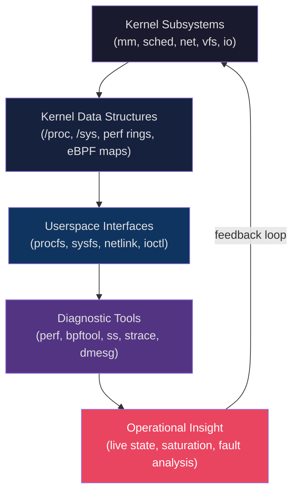
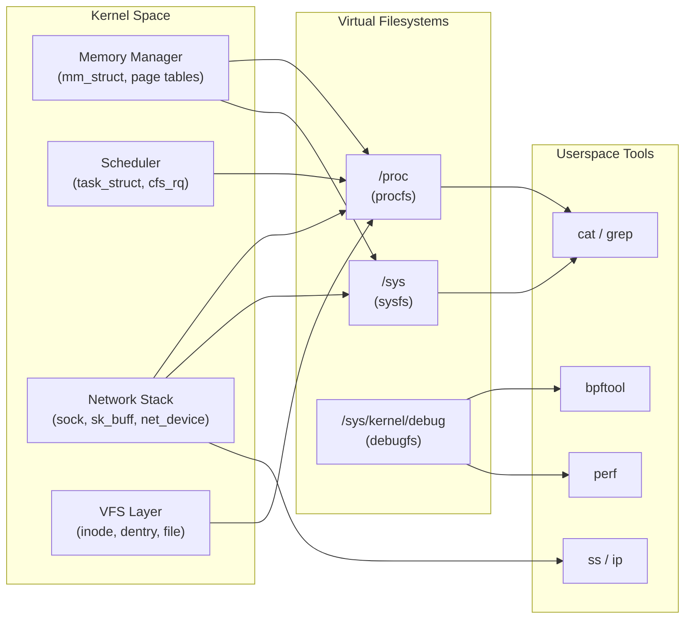
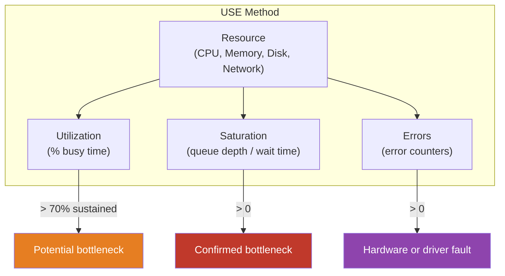
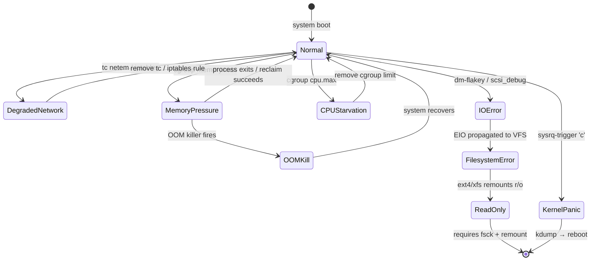

# Operational Verification Labs: Core Linux Kernel Subsystems

## Preface: Architecture and Philosophy

This lab series treats the Linux kernel not as a black box to be operated, but as a system to be reasoned about from first principles. Every diagnostic tool used here reads from well-defined kernel data structures — VFS files under `/proc` and `/sys`, perf event ring buffers, eBPF maps, netlink sockets — and understanding *why* a command works is as important as knowing *what* it outputs.

The exercises follow a deliberate progression: first, build a mental model of live kernel state; second, stress that state to saturation; third, inject faults and observe recovery invariants. This mirrors the diagnostic loop used in production incident response.



---

## Environment Setup

### Kernel Version and Architecture Requirements

These labs require Linux 5.10 or later. Many eBPF-based exercises require 5.15+ for full BTF (BPF Type Format) support, which enables CO-RE (Compile Once – Run Everywhere) programs. Confirm your kernel version and configuration:

```bash
uname -r
# Check required kernel config options
zcat /proc/config.gz 2>/dev/null || cat /boot/config-$(uname -r) | grep -E \
  "CONFIG_DEBUG_INFO_BTF|CONFIG_BPF_SYSCALL|CONFIG_PERF_EVENTS|CONFIG_FTRACE|CONFIG_KPROBES"
```

Expected output for a lab-capable kernel:

```
CONFIG_DEBUG_INFO_BTF=y
CONFIG_BPF_SYSCALL=y
CONFIG_PERF_EVENTS=y
CONFIG_FTRACE=y
CONFIG_KPROBES=y
```

### Required Tools Reference

| Tool | Package | Kernel Interface Used |
|---|---|---|
| `bpftool` | `linux-tools-$(uname -r)` | `BPF_OBJ_GET`, `/sys/fs/bpf` |
| `perf` | `linux-tools-$(uname -r)` | `perf_event_open(2)` syscall |
| `strace` | `strace` | `ptrace(2)` |
| `ss` | `iproute2` | Netlink `SOCK_DIAG` |
| `tcpdump` | `tcpdump` | `AF_PACKET` raw socket / libpcap |
| `fio` | `fio` | `io_uring` / `libaio` |
| `stress-ng` | `stress-ng` | Various syscalls |
| `sar`/`iostat`/`vmstat` | `sysstat` | `/proc/stat`, `/proc/diskstats` |
| `dmesg` | `util-linux` | `klogctl(3)` / `/dev/kmsg` |
| `sysctl` | `procps` | `/proc/sys` sysfs tree |

### Lab Setup Script

```bash
#!/usr/bin/env bash
# setup_lab.sh — Idempotent environment setup for Core Operational Verification Labs
# Tested on Ubuntu 22.04 LTS / Debian 12 (kernel 5.15+)

set -euo pipefail

KERNEL_VER=$(uname -r)
LOG_DIR="/tmp/lab_output"
MIN_KERNEL_MAJOR=5
MIN_KERNEL_MINOR=10

check_kernel_version() {
    local major minor
    major=$(uname -r | cut -d. -f1)
    minor=$(uname -r | cut -d. -f2)
    if (( major < MIN_KERNEL_MAJOR || (major == MIN_KERNEL_MAJOR && minor < MIN_KERNEL_MINOR) )); then
        echo "ERROR: Kernel ${major}.${minor} is below the required ${MIN_KERNEL_MAJOR}.${MIN_KERNEL_MINOR}" >&2
        exit 1
    fi
    echo "Kernel ${major}.${minor} OK"
}

install_packages() {
    apt-get update -qq
    apt-get install -y --no-install-recommends \
        iproute2 \
        tcpdump \
        strace \
        "linux-tools-${KERNEL_VER}" \
        "linux-tools-common" \
        sysstat \
        ltrace \
        fio \
        stress-ng \
        iperf3 \
        bpftrace \
        bpfcc-tools \
        numactl \
        linux-cpupower \
        crash \
        kdump-tools
}

configure_kernel_params() {
    # printk levels: console_loglevel=7 (debug), default_message_loglevel=4 (warning)
    # min_tty_loglevel=1 (alert), default_console_loglevel=3 (err)
    cat > /etc/sysctl.d/99-lab.conf <<'EOF'
# Enable detailed kernel logging for lab diagnostics
kernel.printk = 7 4 1 3

# Allow perf_event_open without CAP_PERFMON (lab convenience; revert in production)
kernel.perf_event_paranoid = -1

# Enable SysRq for fault injection exercises
kernel.sysrq = 1

# Allow process core dumps with full filename
kernel.core_pattern = /tmp/lab_output/core.%e.%p.%t

# Disable ASLR for deterministic strace analysis (re-enable after: sysctl -w kernel.randomize_va_space=2)
# kernel.randomize_va_space = 0  # Uncomment only for Exercise 4 tracing
EOF
    sysctl --system
}

setup_output_dir() {
    mkdir -p "${LOG_DIR}"/{perf,traces,crashes,benchmarks}
    chmod 1777 "${LOG_DIR}"
}

check_kernel_version
install_packages
configure_kernel_params
setup_output_dir

echo "Lab environment ready. Output directory: ${LOG_DIR}"
echo "Verify eBPF availability: bpftool prog list"
```

> **Security note**: `kernel.perf_event_paranoid = -1` and `kernel.sysrq = 1` are intentional for lab use. The former allows unprivileged `perf` access; the latter enables SysRq fault injection. Both should be reverted (`perf_event_paranoid=3`, `sysrq=0`) on production systems.

---

## Exercise 1: Live State and Internal Subsystem Inspection

The kernel exposes its internal state through a layered set of virtual filesystems. Understanding what backs each file is critical to interpreting its output correctly.



### 1.1 Kernel Memory Subsystem Inspection

`/proc/meminfo` is populated by the kernel's `meminfo_proc_show()` function in `fs/proc/meminfo.c`. Each field maps directly to a counter maintained by the memory management subsystem. Understanding the relationships between fields prevents misdiagnosis.

```bash
# Parse /proc/meminfo into human-readable units with field annotations
awk '
/MemTotal/      { printf "Total RAM:        %8.1f GiB\n", $2/1024/1024 }
/MemFree/       { printf "Free (unused):    %8.1f GiB\n", $2/1024/1024 }
/MemAvailable/  { printf "Available:        %8.1f GiB\n", $2/1024/1024 }
/^Buffers/      { printf "Buffers (blkdev): %8.1f MiB\n", $2/1024 }
/^Cached/       { printf "Page cache:       %8.1f MiB\n", $2/1024 }
/SwapCached/    { printf "Swap cached:      %8.1f MiB\n", $2/1024 }
/AnonPages/     { printf "Anonymous pages:  %8.1f MiB\n", $2/1024 }
/Mapped/        { printf "Mapped (mmap):    %8.1f MiB\n", $2/1024 }
/Shmem\b/       { printf "Shared memory:    %8.1f MiB\n", $2/1024 }
/Slab\b/        { printf "Slab total:       %8.1f MiB\n", $2/1024 }
/SReclaimable/  { printf "Slab reclaimable: %8.1f MiB\n", $2/1024 }
/SUnreclaim/    { printf "Slab unreclaimable:%7.1f MiB\n", $2/1024 }
/HugePages_Total/ { printf "HugePages total:  %8d pages\n", $2 }
/Hugepagesize/  { printf "HugePage size:    %8.1f MiB\n", $2/1024 }
' /proc/meminfo
```

**Key invariants to understand**:
- `MemAvailable` ≠ `MemFree`. Available is an estimate of how much memory can be reclaimed for new allocations without swapping, computed by the kernel (`mm/page_alloc.c: si_mem_available()`). It accounts for reclaimable slab and clean page cache.
- `Buffers` are page cache entries backing block device metadata (inodes, directory entries read via raw block I/O), not filesystem data.
- `SUnreclaim` (unreclaimable slab) is a leading indicator of kernel memory leaks in long-running systems.

Inspect slab allocator state, which tracks per-object kernel heap allocations:

```bash
# /proc/slabinfo columns: name, active_objs, num_objs, objsize, objperslab, pagesperslab
# Sort by memory consumption (objsize × num_objs)
awk 'NR > 2 && /^[^#]/ {
    mem_kb = ($3 * $4) / 1024
    printf "%8.1f KiB  %s\n", mem_kb, $1
}' /proc/slabinfo | sort -rn | head -20

# Alternatively, use slabtop for live monitoring
slabtop --once --sort=c   # sort by cache size
```

Inspect huge page usage and NUMA topology:

```bash
# NUMA memory distribution (requires numactl)
numactl --hardware

# THP (Transparent Huge Page) state
cat /sys/kernel/mm/transparent_hugepage/enabled
cat /sys/kernel/mm/transparent_hugepage/defrag

# Per-NUMA node memory stats
for node in /sys/devices/system/node/node*/meminfo; do
    echo "=== ${node} ==="
    cat "${node}"
done
```

### 1.2 Scheduler and Process Inspection

The kernel scheduler exposes per-process statistics through `/proc/<PID>/stat` and `/proc/<PID>/schedstat`. Each `task_struct` in the kernel maps to a directory under `/proc/`.

```bash
# Decode /proc/<PID>/stat fields (comm, state, ppid, utime, stime, priority, nice, num_threads)
# Field definitions from proc(5) man page and fs/proc/array.c
PID=$(pgrep -n sshd || echo 1)   # use sshd or init as a stable target

awk -v pid="${PID}" '{
    split($0, f, " ")
    printf "PID:          %s\n", f[1]
    printf "Command:      %s\n", f[2]
    printf "State:        %s\n", f[3]   # R=running, S=sleeping, D=uninterruptible, Z=zombie
    printf "PPID:         %s\n", f[4]
    printf "User ticks:   %s\n", f[14]  # utime in clock ticks (divide by sysconf(CLK_TCK)=100)
    printf "Kernel ticks: %s\n", f[15]  # stime
    printf "Priority:     %s\n", f[18]  # kernel internal priority
    printf "Nice:         %s\n", f[19]
    printf "Threads:      %s\n", f[20]
    printf "RSS pages:    %s\n", f[24]  # resident set size in pages
    printf "Processor:    %s\n", f[39]  # last CPU executed on
}' /proc/${PID}/stat

# Scheduler statistics: run_delay (total nanoseconds waiting on runqueue)
cat /proc/${PID}/schedstat
# Output: <cpu_time_ns> <run_delay_ns> <timeslices_run>
```

Inspect process virtual memory layout. The `/proc/<PID>/maps` entries correspond directly to `vm_area_struct` (VMA) records in the kernel, chained together in an augmented red-black tree under `mm_struct.mm_rb`:

```bash
# Annotated VMA inspection
PID=$(pgrep -n bash)
awk '{
    split($1, range, "-")
    start = strtonum("0x" range[1])
    end   = strtonum("0x" range[2])
    size_kb = (end - start) / 1024
    printf "%12.1f KiB  %s  %s\n", size_kb, $2, $NF
}' /proc/${PID}/maps | sort -rn | head -20

# Inspect memory usage with smaps for per-VMA RSS/PSS (proportional set size)
# PSS distributes shared pages proportionally across all mapping processes
awk '/^[0-9a-f]/{vma=$0} /^Rss/{rss=$2} /^Pss/{pss=$2; printf "%s  RSS=%s PSS=%s\n", vma, rss, pss}' \
    /proc/${PID}/smaps | head -30
```

Inspect all threads of a multi-threaded process:

```bash
# List all threads (each thread has a task_struct; threads share mm_struct)
PID=$(pgrep -n mysqld 2>/dev/null || pgrep -n python3 2>/dev/null || echo $$)
ls /proc/${PID}/task/   # each subdirectory is a thread (TID)

# Per-thread CPU time
for tid in /proc/${PID}/task/*/stat; do
    awk '{printf "TID=%-6s state=%-2s utime=%-6s stime=%-6s\n", $1, $3, $14, $15}' "${tid}"
done
```

### 1.3 Network Subsystem Inspection

The Linux network stack exposes socket state through the `SOCK_DIAG` netlink family, which `ss` queries. `ip` uses `RTM_GETLINK`, `RTM_GETADDR`, and `RTM_GETROUTE` netlink message types from the `NETLINK_ROUTE` family.

```bash
# Comprehensive socket inventory with process ownership
ss -tulpnH | awk '{
    printf "proto=%-5s state=%-12s local=%-25s remote=%-25s process=%s\n",
           $1, $2, $5, $6, $7
}' | column -t

# TCP socket state histogram — diagnose TIME_WAIT accumulation or SYN_RECV floods
ss -tan | awk 'NR>1 {states[$1]++} END {for (s in states) printf "%6d  %s\n", states[s], s}' \
    | sort -rn

# Network interface statistics at the driver level
# /proc/net/dev is populated by net/core/net-procfs.c
awk 'NR>2 {
    printf "%-12s RX_bytes=%-12s RX_drop=%-8s TX_bytes=%-12s TX_drop=%-8s\n",
           $1, $2, $5, $10, $13
}' /proc/net/dev

# Inspect ARP cache (neighbor table)
ip neigh show

# Routing table with nexthop details
ip route show table all | grep -v "^local\|^broadcast\|^multicast" | head -30

# Conntrack table (requires nf_conntrack module)
# Shows active tracked connections with state, timeout, and NAT translations
if [[ -f /proc/net/nf_conntrack ]]; then
    wc -l /proc/net/nf_conntrack
    cat /proc/sys/net/netfilter/nf_conntrack_count
    cat /proc/sys/net/netfilter/nf_conntrack_max
fi
```

For real-time packet inspection with minimal overhead, use BPF-accelerated capture:

```bash
# Capture only TCP SYN packets (flags & 0x02 == 0x02) on any interface
# BPF filter is compiled and injected into the kernel, avoiding per-packet copy
tcpdump -i any -n --immediate-mode \
    'tcp[tcpflags] & tcp-syn != 0' -c 100 -w /tmp/lab_output/traces/syn_capture.pcap

# Inspect captured file
tcpdump -r /tmp/lab_output/traces/syn_capture.pcap -n
```

### 1.4 Kernel Ring Buffer and Event Log Analysis

The kernel ring buffer is managed by `printk()` and stored in a circular buffer (`log_buf`) in `kernel/printk/printk.c`. `/dev/kmsg` exposes records with priority, timestamp, and sequence number. `dmesg` reads this via `klogctl(3)`.

```bash
# Structured kernel log with ISO timestamps and facility/severity
dmesg --time-format iso --level warn,err,crit,alert,emerg

# Monitor for specific subsystem events in real time
dmesg -w --level 0,1,2,3,4 | grep --line-buffered -E \
    "oom_kill|segfault|BUG:|WARNING:|kernel panic|I/O error|EXT4-fs error|XFS.*error"

# Audit recent hardware errors (MCE — Machine Check Exceptions)
dmesg | grep -i "mce\|hardware error\|EDAC\|corrected\|uncorrected"

# Count kernel messages by subsystem prefix
dmesg | awk -F'[][]' '{print $4}' | awk '{print $1}' | sort | uniq -c | sort -rn | head -20

# Inspect structured log entries from /dev/kmsg directly
# Format: priority,seq,timestamp_us,flags;message
head -50 /dev/kmsg 2>/dev/null || echo "Requires root"
```

### 1.5 System-Wide Performance Metrics

Understanding what `vmstat`, `iostat`, and `sar` actually measure prevents misinterpretation of their output.

```bash
# vmstat field semantics:
# procs: r=runnable (waiting for CPU), b=blocked (uninterruptible sleep, usually I/O)
# memory: swpd=swap used, free, buff, cache
# swap: si=swap-in KB/s, so=swap-out KB/s
# io: bi=blocks-in/s (reads), bo=blocks-out/s (writes)
# system: in=interrupts/s, cs=context-switches/s
# cpu: us/sy/id/wa/st (user/kernel/idle/iowait/stolen by hypervisor)

echo "=== vmstat: 1-second intervals, 10 samples ==="
vmstat -t 1 10   # -t adds timestamp

# iostat extended metrics:
# r/s, w/s: reads/writes per second
# rkB/s, wkB/s: throughput in KB/s
# r_await, w_await: average latency in ms (includes queue time)
# aqu-sz: average queue depth
# %util: device saturation (100% = device is fully busy)
echo "=== iostat: extended, 2-second intervals ==="
iostat -xz 2 5   # -z omits devices with no activity

# sar CPU breakdown with all CPU states
echo "=== sar: CPU utilization ==="
sar -u ALL 1 5   # ALL shows iowait, steal, irq, softirq separately

# sar IRQ rate (diagnose interrupt storms)
sar -I ALL 1 3 | head -30

# sar network device utilization
sar -n DEV 1 3
```

```mermaid
sequenceDiagram
    participant App as Application
    participant Kernel as Kernel Scheduler
    participant CPU as CPU Core
    participant Disk as Block Device

    App->>Kernel: read(fd) syscall
    Kernel->>Kernel: check page cache (hit?)
    alt Page Cache Miss
        Kernel->>Disk: submit_bio() I/O request
        Kernel->>Kernel: task state = D (uninterruptible)
        Note over Kernel: Contributes to vmstat 'b' counter
        Disk-->>Kernel: bio completion interrupt
        Kernel->>Kernel: task state = S (sleeping)
        Kernel->>CPU: schedule() — wake task
    else Page Cache Hit
        Kernel-->>App: return data from page cache
        Note over App,Kernel: No I/O wait; pure CPU cost
    end
    CPU->>App: execute — contributes to 'us' or 'sy'
```

---

## Exercise 2: Benchmarking and Saturation Profiling

Saturation occurs when a resource demand exceeds its capacity, causing queuing. The USE Method (Utilization, Saturation, Errors) by Brendan Gregg provides a systematic framework: for every resource, check utilization (time busy), saturation (queued work), and errors.



### 2.1 CPU Subsystem: Saturation and PMU Profiling

`perf` uses the `perf_event_open(2)` syscall to program the CPU's Performance Monitoring Unit (PMU). Hardware performance counters are physical registers in the CPU that count micro-architectural events without software overhead.

```bash
# Establish a CPU performance baseline before load
perf stat -e \
    cycles,instructions,\
    cache-references,cache-misses,\
    branch-instructions,branch-misses,\
    context-switches,cpu-migrations,\
    page-faults,minor-faults,major-faults \
    -- sleep 5 2>&1 | tee /tmp/lab_output/perf/baseline.txt

echo "IPC (Instructions Per Cycle) = instructions / cycles"
echo "Values < 1.0 indicate stall-bound execution (memory or branch mispredictions)"
```

Apply CPU load and profile simultaneously:

```bash
# Start load generator: 4 workers, mixed CPU workloads, 60 seconds
stress-ng --cpu 4 --cpu-method all --metrics-brief --timeout 60s &
STRESS_PID=$!

# Wait for load to stabilize
sleep 2

# Profile with hardware counters while under load
perf stat -e \
    cycles,instructions,\
    LLC-loads,LLC-load-misses,\
    dTLB-loads,dTLB-load-misses,\
    iTLB-loads,iTLB-load-misses \
    -I 1000 --pid=${STRESS_PID} -- sleep 30 \
    2>&1 | tee /tmp/lab_output/perf/cpu_saturation.txt

# Collect a CPU flame graph (requires perf with DWARF unwinding or frame pointers)
perf record -F 999 -g --call-graph dwarf -o /tmp/lab_output/perf/perf.data \
    --pid=${STRESS_PID} -- sleep 15

# Generate a perf report (text mode; use flamegraph.pl for SVG)
perf report --no-browser -i /tmp/lab_output/perf/perf.data \
    --stdio --percent-limit 1 | head -60

wait ${STRESS_PID}
```

Inspect scheduler latency using tracepoints:

```bash
# Measure scheduler wakeup latency using perf sched
# This instruments sched:sched_wakeup and sched:sched_switch tracepoints
perf sched record -o /tmp/lab_output/perf/sched.data -- sleep 10 &
stress-ng --cpu 8 --timeout 10s
wait

perf sched latency -i /tmp/lab_output/perf/sched.data 2>/dev/null | head -30
# Output shows per-task: max_latency, avg_latency, number_of_schedules
```

### 2.2 Memory Subsystem: Pressure and Reclaim Behavior

Memory saturation is subtle: the OOM killer is a last resort, and the real saturation signal is *reclaim pressure* (kswapd CPU usage, elevated `pgscand`/`pgsteal` counters).

```bash
# Capture memory reclaim counters before load
grep -E "^pg(pgfault|pgmajfault|pgscan|pgsteal|pgrefill|kswapd)" \
    /proc/vmstat > /tmp/lab_output/vmstat_before.txt

# Apply memory pressure: 4 stressors, each allocating 512 MiB, with mmap strategy
stress-ng --vm 4 --vm-bytes 512M --vm-method mmap --timeout 60s &
STRESS_PID=$!

# Monitor memory reclaim in real time
watch -n 1 'awk "
/MemAvailable/ {avail=\$2}
/SwapFree/     {swapfree=\$2}
/SwapTotal/    {swaptotal=\$2}
END {
    printf \"Available: %.1f GiB   Swap used: %.0f MiB\\n\",
           avail/1024/1024, (swaptotal-swapfree)/1024
}" /proc/meminfo; \
grep -E "pgscand|kswapd_steal|pgmajfault" /proc/vmstat' &
WATCH_PID=$!

sleep 55
kill ${WATCH_PID} 2>/dev/null
wait ${STRESS_PID}

# Compare reclaim counters after load
grep -E "^pg(pgfault|pgmajfault|pgscan|pgsteal|pgrefill|kswapd)" \
    /proc/vmstat > /tmp/lab_output/vmstat_after.txt

echo "=== Delta: memory reclaim events during load ==="
paste /tmp/lab_output/vmstat_before.txt /tmp/lab_output/vmstat_after.txt | \
    awk '{printf "%-20s before=%8s  after=%8s  delta=%8d\n", $1, $2, $4, $4-$2}'
```

Inspect kernel memory compaction (required for huge page allocation under fragmentation):

```bash
# /proc/vmstat compaction counters
grep compact /proc/vmstat
# compact_migrate_scanned: pages scanned for migration
# compact_free_scanned:    free pages scanned
# compact_isolated:        pages isolated for compaction
# compact_stall:           direct compaction stalls (latency events)
# compact_fail/success:    compaction outcome
```

### 2.3 Network Throughput and Latency Benchmarking

```bash
# Start iperf3 server in background
iperf3 --server --daemon --logfile /tmp/lab_output/benchmarks/iperf3_server.log
sleep 1

# Throughput test: TCP, 4 parallel streams, 30 seconds, with per-interval JSON output
iperf3 --client 127.0.0.1 \
    --parallel 4 \
    --time 30 \
    --interval 1 \
    --json \
    --logfile /tmp/lab_output/benchmarks/iperf3_tcp.json

# Latency test: UDP, 1000-byte datagrams, check for jitter and loss
iperf3 --client 127.0.0.1 \
    --udp \
    --bandwidth 100M \
    --time 10 \
    --length 1000 \
    --json \
    --logfile /tmp/lab_output/benchmarks/iperf3_udp.json

# Parse throughput from JSON result
python3 -c "
import json
with open('/tmp/lab_output/benchmarks/iperf3_tcp.json') as f:
    d = json.load(f)
end = d['end']['sum_received']
print(f'TCP Throughput: {end[\"bits_per_second\"]/1e9:.2f} Gbps')
print(f'Retransmits:    {d[\"end\"][\"sum_sent\"][\"retransmits\"]}')
"

# Monitor TCP retransmits and congestion events during the benchmark
watch -n 1 'ss -tin | grep -E "retrans|cwnd|ssthresh|rtt" | head -10'

# Capture socket-level statistics for diagnosed interfaces
ip -s -s link show
```

Inspect the network driver's transmit queue depth (saturation indicator):

```bash
# TXQ length saturation shows as drops in /proc/net/dev
# or as 'overruns' in ip -s link show

# Increase txqueuelen if TX drops are observed under load
# ip link set dev eth0 txqueuelen 10000

# View socket send/receive buffer utilization
ss -tmn | awk '{print $3, $4, $5}' | \
    awk -F: 'NF==3 {printf "recv_q=%s send_q=%s\n", $2, $3}' | \
    sort -t= -k2 -rn | head -10
```

### 2.4 Storage I/O: Queue Depth, Latency, and Throughput

`fio` exercises the kernel's I/O path: system call → VFS → block layer → I/O scheduler → device driver → hardware. Direct I/O (`--direct=1`) bypasses the page cache, measuring raw block device performance. Buffered I/O tests page cache and writeback behavior.

```bash
# Identify target device (use a test file, not raw device, unless on dedicated test disk)
TEST_FILE="/tmp/lab_output/benchmarks/fio_test_file"
DEVICE=$(df /tmp | tail -1 | awk '{print $1}' | sed 's|/dev/||')

# Baseline: sequential read throughput (saturates bandwidth, not IOPS)
fio \
    --name=seq_read \
    --filename="${TEST_FILE}" \
    --size=2G \
    --ioengine=libaio \
    --direct=1 \
    --iodepth=32 \
    --bs=1M \
    --rw=read \
    --numjobs=1 \
    --runtime=30 \
    --time_based \
    --output-format=json \
    --output=/tmp/lab_output/benchmarks/fio_seq_read.json
echo "Sequential read:"
python3 -c "
import json
with open('/tmp/lab_output/benchmarks/fio_seq_read.json') as f:
    d = json.load(f)
job = d['jobs'][0]
bw = job['read']['bw_mean'] / 1024
lat = job['read']['lat_ns']['mean'] / 1e6
print(f'  Throughput: {bw:.1f} MiB/s   Avg latency: {lat:.2f} ms')
"

# Random 4K reads: measures IOPS capability (storage latency-bound workload)
fio \
    --name=rand_read_4k \
    --filename="${TEST_FILE}" \
    --size=2G \
    --ioengine=libaio \
    --direct=1 \
    --iodepth=64 \
    --bs=4k \
    --rw=randread \
    --numjobs=4 \
    --runtime=30 \
    --time_based \
    --group_reporting \
    --output-format=json \
    --output=/tmp/lab_output/benchmarks/fio_rand_read.json
echo "Random 4K read:"
python3 -c "
import json
with open('/tmp/lab_output/benchmarks/fio_rand_read.json') as f:
    d = json.load(f)
job = d['jobs'][0]
iops = job['read']['iops_mean']
lat_p99 = job['read']['clat_ns']['percentile']['99.000000'] / 1e6
lat_p999 = job['read']['clat_ns']['percentile']['99.900000'] / 1e6
print(f'  IOPS: {iops:.0f}   p99 latency: {lat_p99:.2f} ms   p99.9 latency: {lat_p999:.2f} ms')
"

# Monitor I/O scheduler queue depth and latency during fio run
iostat -xz 1 30 | tee /tmp/lab_output/benchmarks/iostat_during_fio.txt &
IOSTAT_PID=$!

# Mixed read/write (70/30) with sync writes: simulates database I/O pattern
fio \
    --name=mixed_rw \
    --filename="${TEST_FILE}" \
    --size=2G \
    --ioengine=libaio \
    --direct=1 \
    --iodepth=32 \
    --bs=4k \
    --rw=randrw \
    --rwmixread=70 \
    --numjobs=4 \
    --runtime=30 \
    --time_based \
    --group_reporting \
    2>&1 | tee /tmp/lab_output/benchmarks/fio_mixed.txt

wait ${IOSTAT_PID}

# Inspect I/O scheduler for the target device
cat /sys/block/${DEVICE}/queue/scheduler 2>/dev/null || echo "Cannot determine scheduler"
# Common schedulers: none (NVMe default), mq-deadline (SATA/SAS), bfq (desktop)

# View I/O queue depth limits
cat /sys/block/${DEVICE}/queue/nr_requests 2>/dev/null
cat /sys/block/${DEVICE}/queue/max_sectors_kb 2>/dev/null

# Cleanup test file
rm -f "${TEST_FILE}"
```

---

## Exercise 3: Fault Injection and Recovery Analysis

Fault injection tests the system's ability to detect, isolate, and recover from failure modes. Linux provides several controlled injection mechanisms: `tc netem`, `iptables`, `cgroups` resource limits, `libfaketime`, and the kernel's own `CONFIG_FAULT_INJECTION` framework.



### 3.1 Controlled Network Fault Injection

`tc netem` (Network Emulator) operates at the queueing discipline (qdisc) layer of the kernel's packet scheduler. It injects faults *after* routing, before transmission — affecting outbound packets on the specified interface. This is architecturally different from `iptables`, which operates in Netfilter hooks and can drop packets in both directions.

```bash
# Save current qdisc configuration
tc qdisc show dev lo > /tmp/lab_output/traces/tc_before.txt

IFACE="lo"   # Use loopback for safe, self-contained testing

# Inject packet loss (5%) with Markov correlation (not uniform random — burst-realistic)
sudo tc qdisc add dev ${IFACE} root netem \
    loss 5% 25%  # 5% base loss, 25% correlation between consecutive losses

# Verify qdisc is in place
tc qdisc show dev ${IFACE}

# Test: measure RTT with ping under fault condition
ping -c 50 -i 0.1 127.0.0.1 2>&1 | tail -5

# Upgrade to network delay + jitter + packet reordering
sudo tc qdisc change dev ${IFACE} root netem \
    delay 50ms 10ms distribution normal \  # 50ms ± 10ms, normal distribution
    loss 1% \
    reorder 5% 50%                         # 5% packets reordered, 50% correlation

# Observe TCP behavior: RTT estimation, retransmit timer, congestion window
ss -tin dst 127.0.0.1 2>/dev/null | grep -E "rtt|retrans|cwnd"

# Inject packet corruption (bit flips in payload — tests application CRC/checksum handling)
sudo tc qdisc change dev ${IFACE} root netem corrupt 0.1%

# Full partition: drop all ICMP traffic (test keep-alive and timeout behavior)
sudo iptables -A OUTPUT -p icmp -j DROP
ping -c 5 -W 2 127.0.0.1 || echo "ICMP partition confirmed"
sudo iptables -D OUTPUT -p icmp -j DROP

# Restore original qdisc
sudo tc qdisc del dev ${IFACE} root
tc qdisc show dev ${IFACE}
echo "Network faults cleared"
```

Observe TCP retransmission behavior with `ss` during fault injection:

```bash
# In one terminal: establish a TCP connection under delay
nc -l -p 9999 &
nc 127.0.0.1 9999 &

# Apply 200ms delay to trigger RTO (Retransmission Timeout) expiry
sudo tc qdisc add dev lo root netem delay 200ms

# Observe RTT estimation (SRTT) and retransmit counters
watch -n 0.5 'ss -tin sport = :9999 or dport = :9999 2>/dev/null | grep -v "^Netid"'

# Clean up
sudo tc qdisc del dev lo root
pkill nc
```

### 3.2 cgroup v2 Memory Fault Injection

Using cgroups v2 to inject memory exhaustion is safer and more controllable than writing to `/dev/zero` in a loop, because it confines the fault to a specific cgroup and allows monitoring via standard cgroup interfaces.

```bash
# Verify cgroup v2 is mounted
mount | grep cgroup2
# If not mounted: mount -t cgroup2 none /sys/fs/cgroup

CGROUP_PATH="/sys/fs/cgroup/lab_memtest"
sudo mkdir -p "${CGROUP_PATH}"

# Move current shell into the cgroup (optional; targets a child process instead)
# echo $$ | sudo tee "${CGROUP_PATH}/cgroup.procs"

# Allow the cgroup to use the memory controller
echo "+memory" | sudo tee /sys/fs/cgroup/cgroup.subtree_control

# Set memory limit: 256 MiB hard limit, 128 MiB soft limit (memory.low = reclaim-resistant)
echo $((256 * 1024 * 1024)) | sudo tee "${CGROUP_PATH}/memory.max"
echo $((128 * 1024 * 1024)) | sudo tee "${CGROUP_PATH}/memory.high"
echo $((64  * 1024 * 1024)) | sudo tee "${CGROUP_PATH}/memory.low"

# Launch a memory-hungry process inside the cgroup
# This Python script allocates 512 MiB — will be OOM killed by cgroup limit
sudo bash -c "
    echo \$\$ > ${CGROUP_PATH}/cgroup.procs
    python3 -c '
import time
pages = []
try:
    for i in range(512):
        pages.append(bytearray(1024 * 1024))  # 1 MiB per step
        print(f\"Allocated {i+1} MiB\", flush=True)
        time.sleep(0.05)
except MemoryError:
    print(\"MemoryError: allocation failed\")
time.sleep(5)
' 2>&1" &

CHILD_PID=$!

# Monitor cgroup memory stats
while kill -0 ${CHILD_PID} 2>/dev/null; do
    echo "--- $(date +%T) ---"
    cat "${CGROUP_PATH}/memory.current" | awk '{printf "current: %.1f MiB\n", $1/1024/1024}'
    cat "${CGROUP_PATH}/memory.events" | grep -E "oom|oom_kill|max"
    sleep 1
done
wait ${CHILD_PID}

# Check for OOM kill event
echo "=== OOM events ==="
cat "${CGROUP_PATH}/memory.events"

# Confirm via kernel log
dmesg | grep -A 20 "oom_kill_process\|Killed process" | tail -25

# Cleanup
sudo rmdir "${CGROUP_PATH}"
```

The `/proc/vmstat` counters that change during OOM events:

```bash
# OOM-related vmstat counters
grep -E "^(oom_kill|pgmajfault|pgfault|allocstall)" /proc/vmstat
# allocstall_dma/dma32/normal/movable: direct reclaim stalls (high latency allocations)
# oom_kill: total OOM kills since boot
```

### 3.3 Process Signal and State Transitions

```bash
# Demonstrate full signal delivery and state transition sequence

# Launch a background process that catches SIGTERM but exits on SIGKILL
cat > /tmp/lab_output/signal_target.py << 'EOF'
#!/usr/bin/env python3
import signal, time, sys, os

def handler(signum, frame):
    print(f"[{os.getpid()}] Received signal {signum} ({signal.Signals(signum).name})", flush=True)
    if signum == signal.SIGTERM:
        print(f"[{os.getpid()}] Ignoring SIGTERM (graceful shutdown simulation)", flush=True)
    elif signum == signal.SIGINT:
        print(f"[{os.getpid()}] Exiting on SIGINT", flush=True)
        sys.exit(0)

signal.signal(signal.SIGTERM, handler)
signal.signal(signal.SIGINT, handler)
signal.signal(signal.SIGHUP, handler)
signal.signal(signal.SIGUSR1, handler)

print(f"[{os.getpid()}] Running. Send signals to PID {os.getpid()}", flush=True)
while True:
    time.sleep(1)
    print(f"[{os.getpid()}] alive", flush=True)
EOF

python3 /tmp/lab_output/signal_target.py &
TARGET_PID=$!
sleep 2

# Inspect signal mask of the running process (SigBlk, SigIgn, SigCgt are hex bitmasks)
echo "=== Signal disposition for PID ${TARGET_PID} ==="
grep -E "^Sig(Blk|Pnd|Ign|Cgt)" /proc/${TARGET_PID}/status

# Send SIGTERM — will be caught and ignored
echo "Sending SIGTERM..."
kill -SIGTERM ${TARGET_PID}
sleep 1
kill -0 ${TARGET_PID} 2>/dev/null && echo "Process still alive (SIGTERM caught)"

# Send SIGUSR1 — user-defined signal
kill -SIGUSR1 ${TARGET_PID}
sleep 1

# SIGSTOP suspends the process (cannot be caught or ignored; task state = T)
kill -SIGSTOP ${TARGET_PID}
echo "Process state after SIGSTOP:"
awk '/^State/{print}' /proc/${TARGET_PID}/status

# Resume with SIGCONT
kill -SIGCONT ${TARGET_PID}
echo "Process state after SIGCONT:"
awk '/^State/{print}' /proc/${TARGET_PID}/status

# SIGKILL — cannot be caught, blocked, or ignored; kernel delivers directly
kill -SIGKILL ${TARGET_PID}
sleep 1
kill -0 ${TARGET_PID} 2>/dev/null || echo "Process terminated by SIGKILL"
```

### 3.4 Kernel Fault Injection via `/proc/sysrq-trigger`

SysRq triggers invoke kernel functions directly, bypassing userspace. The key `c` calls `panic()`. This is for dedicated lab VMs only — it will immediately halt the system.

```bash
# Verify SysRq is enabled (set in lab setup)
cat /proc/sys/kernel/sysrq   # should be 1 (all SysRq enabled)

# Safe SysRq operations (no crash/reboot)

# 'm' — dump memory info to kernel log
echo m > /proc/sysrq-trigger
dmesg | tail -20

# 't' — dump all threads' backtrace (useful for diagnosing hangs)
echo t > /proc/sysrq-trigger
dmesg | tail -50

# 'p' — dump current CPU register state
echo p > /proc/sysrq-trigger
dmesg | tail -10

# 'q' — dump per-CPU hrtimer queues (diagnose timer starvation)
echo q > /proc/sysrq-trigger

# Configure kdump before triggering panic (so crash dump is captured)
# Verify kdump is active
systemctl status kdump 2>/dev/null || kdump-config status 2>/dev/null

# Check crash kernel reserved memory
grep "^crashkernel\|Crash kernel" /proc/iomem | head -3
dmesg | grep "Reserving.*for crashkernel\|crash kernel" | head -3

# If kdump is configured, the following will:
# 1. Trigger panic via sysrq
# 2. Second kernel boots from crashkernel= reserved memory
# 3. vmcore is written to /var/crash/
# 4. System reboots into primary kernel
# ONLY EXECUTE IN A DISPOSABLE VM:
# echo c > /proc/sysrq-trigger

# After reboot, analyze the vmcore
# crash /usr/lib/debug/boot/vmlinux-$(uname -r) /var/crash/$(date +%Y*)/vmcore
```

Analyze a pre-existing crash dump (if available):

```bash
# crash utility: kernel debugger for vmcore analysis
# Requires vmlinux with debug symbols (linux-image-*-dbg or separate debug package)
VMCORE=$(ls /var/crash/*/vmcore 2>/dev/null | head -1)
VMLINUX="/usr/lib/debug/boot/vmlinux-$(uname -r)"

if [[ -f "${VMCORE}" && -f "${VMLINUX}" ]]; then
    crash "${VMLINUX}" "${VMCORE}" <<'CRASH_CMDS'
sys
bt
ps
files
vm
log
quit
CRASH_CMDS
fi
```

### 3.5 eBPF-Based Fault Observation

eBPF allows attaching probes to arbitrary kernel functions without modifying kernel source or loading kernel modules. The verifier ensures program safety at load time, preventing infinite loops and invalid memory access.

```bash
# Verify eBPF and BTF support
bpftool feature probe | grep -E "bpf_prog_type|map_type|helper" | grep -c "is available"

# Trace OOM killer invocations using bpftrace (requires kernel 4.9+ with BPF support)
# This attaches a kprobe to oom_kill_process()
sudo bpftrace -e '
kprobe:oom_kill_process {
    printf("[%s] OOM kill: victim=%s (pid=%d) adj=%d\n",
           strftime("%H:%M:%S", nsecs / 1e9),
           str(((struct task_struct *)arg1)->comm),
           ((struct task_struct *)arg1)->pid,
           ((struct task_struct *)arg1)->signal->oom_score_adj);
}
' &
BPFTRACE_PID=$!

# Trace page fault rate per process
sudo bpftrace -e '
tracepoint:exceptions:page_fault_user {
    @faults[comm] = count();
}
interval:s:5 {
    print(@faults);
    clear(@faults);
}
' &

sleep 30
kill ${BPFTRACE_PID} 2>/dev/null
```

```bash
# Trace block I/O latency distribution using bpftrace
# Histograms are computed in-kernel — only the aggregated result is transferred to userspace
sudo bpftrace -e '
tracepoint:block:block_rq_issue {
    @start[args->sector] = nsecs;
}
tracepoint:block:block_rq_complete {
    if (@start[args->sector]) {
        @latency_us = hist((nsecs - @start[args->sector]) / 1000);
        delete(@start[args->sector]);
    }
}
interval:s:10 {
    printf("Block I/O latency histogram (microseconds):\n");
    print(@latency_us);
    clear(@latency_us);
}
' --timeout 30
```

---

## Exercise 4: Advanced Tracing with `strace` and `perf`

### 4.1 System Call Tracing with strace

`strace` uses `ptrace(PTRACE_SYSCALL)` to intercept syscalls. This introduces significant overhead (often 50-100x slowdown) because each syscall requires two context switches into the tracer. It is diagnostic, not production-safe.

```bash
# Trace a process's system calls, counting by type, with time spent
strace -c -S calls ls -la /etc/ 2>&1

# Trace with absolute timestamps, relative timing, and string length 256
strace -ttt -T -s 256 cat /proc/cpuinfo 2>&1 | head -40

# Trace only file-related syscalls for a running process
strace -e trace=file,desc -p $(pgrep -n sshd) 2>&1 | head -20

# Trace network syscalls with full socket address output
strace -e trace=network -s 128 curl -s https://example.com > /dev/null 2>&1 | head -30

# Trace memory allocation syscalls (mmap, brk, munmap)
strace -e trace=memory -p $$ 2>&1 &
python3 -c "import ctypes; x = bytearray(10*1024*1024); del x"
```

### 4.2 Dynamic Tracing with `perf probe`

`perf probe` creates dynamic tracepoints at arbitrary kernel function entry/exit points using kprobes, without recompiling the kernel:

```bash
# List available probe points in a kernel function
perf probe --list 2>/dev/null | head -20

# Add a probe on the do_sys_open (vfs_open in newer kernels) kernel function
# This traces every file open() system call at the kernel level
sudo perf probe --add 'do_sys_openat2 filename:string' 2>/dev/null || \
sudo perf probe --add 'do_filp_open pathname:string'

# Record events from the new probe
sudo perf record -e probe:do_sys_openat2 -aR -- sleep 10 &
# Generate some file open events
find /etc -name "*.conf" -exec cat {} + > /dev/null &
wait

sudo perf script | awk '{print $NF}' | sort | uniq -c | sort -rn | head -20

# Clean up probe
sudo perf probe --del 'do_sys_openat2'
```

### 4.3 `perf` Hardware Event Profiling

```bash
# Profile cache behavior of a specific workload
# Large sequential scan: should be cache-friendly
perf stat -e L1-dcache-loads,L1-dcache-load-misses,LLC-loads,LLC-load-misses \
    -- python3 -c "
import struct, random
size = 50 * 1024 * 1024  # 50 MiB
data = bytearray(size)
# Sequential access (cache-friendly)
s = sum(data[i] for i in range(0, size, 64))
print(f'Sequential sum: {s}')
" 2>&1

# Large random access: should show high LLC miss rate
perf stat -e L1-dcache-loads,L1-dcache-load-misses,LLC-loads,LLC-load-misses \
    -- python3 -c "
import random
size = 50 * 1024 * 1024
data = bytearray(size)
indices = list(range(0, size, 64))
random.shuffle(indices)
# Random access (cache-hostile)
s = sum(data[i] for i in indices)
print(f'Random sum: {s}')
" 2>&1
# Observe: LLC miss rate is dramatically higher for random access
```

---

## Diagnostic Reference: Commands, Kernel Interfaces, and Interpretation

### `/proc` and `/sys` Interface Map

```mermaid
flowchart TD
    subgraph sub_proc_filesystem__procfs ["/proc filesystem (procfs)"]
        PM["/proc/meminfo\nkernel: mm/page_alloc.c"]
        PS["/proc/stat\nkernel: kernel/stat.c"]
        PV["/proc/vmstat\nkernel: mm/vmstat.c"]
        PD["/proc/diskstats\nkernel: block/genhd.c"]
        PN["/proc/net/*\nkernel: net/core/net-procfs.c"]
        PP["/proc/<PID>/stat\nkernel: fs/proc/array.c"]
        PSL["/proc/slabinfo\nkernel: mm/slab_common.c"]
    end

    subgraph sub_sys_filesystem__sysfs ["/sys filesystem (sysfs)"]
        SB["/sys/block/<dev>/queue/\nI/O scheduler, queue depth"]
        SC["/sys/fs/cgroup/\ncgroup v2 controllers"]
        SK["/sys/kernel/mm/\nTHP, NUMA policies"]
        SD["/sys/devices/system/cpu/\nCPU topology, freq scaling"]
    end

    subgraph sub_tools ["Tools"]
        T1["vmstat / sar\nreads /proc/stat, /proc/vmstat"]
        T2["iostat\nreads /proc/diskstats"]
        T3["ss\nnetlink SOCK_DIAG"]
        T4["top / htop\nreads /proc/<PID>/stat"]
        T5["slabtop\nreads /proc/slabinfo"]
    end

    PM --> T1
    PS --> T1
    PV --> T1
    PD --> T2
    PN --> T3
    PP --> T4
    PSL --> T5
    SB --> T2
```



### Diagnostic Cheat Sheet

| Symptom | First Tool | Key Metric | Root Cause Signal |
|---|---|---|---|
| High load average, low CPU% | `vmstat 1` | `b` column | Processes blocked on I/O (D state) |
| High load average, high CPU% | `perf top` | `%cpu` by function | CPU-bound: check `IPC < 1.0` |
| Free memory low, no swap | `cat /proc/meminfo` | `MemAvailable` | High slab or unreclaimable cache |
| Free memory low, swap active | `vmstat 1` | `si`, `so` columns | `so > 0` means active swap-out (severe) |
| Disk latency high | `iostat -x` | `r_await`, `w_await` | Queue saturation if `aqu-sz > nr_requests` |
| Network drops | `ip -s link show` | `RX/TX dropped` | Soft IRQ budget exceeded (check `sar -n SOFT`) |
| OOM kill events | `dmesg` | `oom_kill_process` | Check OOM score (`/proc/<PID>/oom_score`) |
| Application hang | `strace -p <PID>` | Last syscall blocked | Often futex (lock contention) or poll (I/O wait) |
| Kernel BUG/WARNING | `dmesg` | Stack trace | Submit to kernel bugzilla with full trace |
| High soft IRQ | `sar -n SOFT` | `%soft` per CPU | NIC interrupt affinity misconfigured |

### Verification Checklist

Before concluding any diagnostic exercise, verify:

1. **Baseline established** — pre-fault counters captured from `/proc/vmstat`, `/proc/net/dev`, and `perf stat` for comparison.
2. **Fault is isolated** — `tc`, `iptables`, or `cgroup` changes are confirmed with `tc qdisc show`, `iptables -L -n`, or `cat memory.events`.
3. **Kernel log clean** — `dmesg` checked for unexpected `BUG:`, `WARNING:`, `EXT4-fs error`, or `XFS: corruption` messages.
4. **Fault reversed** — all `tc`, `iptables`, `cgroup`, and `sysctl` changes are explicitly reverted. Use cleanup script below.
5. **Counters delta analyzed** — not just current values, but delta (after − before) attributed to the fault injection.

### Lab Cleanup Script

```bash
#!/usr/bin/env bash
# cleanup_lab.sh — Revert all lab-induced changes

set -x

# Remove tc netem qdiscs
for iface in lo eth0 ens3 enp0s3; do
    tc qdisc del dev ${iface} root 2>/dev/null || true
done

# Remove iptables rules added during labs
iptables -F OUTPUT 2>/dev/null || true
iptables -F INPUT  2>/dev/null || true
ip6tables -F OUTPUT 2>/dev/null || true

# Remove cgroup test directories
for cg in /sys/fs/cgroup/lab_*; do
    [[ -d "${cg}" ]] && rmdir "${cg}" 2>/dev/null || true
done

# Restore safe kernel parameters
sysctl -w kernel.perf_event_paranoid=3
sysctl -w kernel.sysrq=0
sysctl -w kernel.randomize_va_space=2

# Kill any background lab processes
pkill -f stress-ng   2>/dev/null || true
pkill -f iperf3      2>/dev/null || true
pkill -f bpftrace    2>/dev/null || true
pkill -f fio         2>/dev/null || true

# Remove perf probes
perf probe --del '*' 2>/dev/null || true

# Remove test files
rm -f /tmp/lab_output/benchmarks/fio_test_file
rm -f /tmp/lab_output/signal_target.py

echo "Lab environment cleaned."
set +x
```

---

## Further Reading and Kernel Source References

| Topic | Kernel Source File | Documentation |
|---|---|---|
| procfs memory info | `fs/proc/meminfo.c` | `Documentation/filesystems/proc.rst` |
| vmstat counters | `mm/vmstat.c` | `Documentation/admin-guide/sysctl/vm.rst` |
| CFS scheduler | `kernel/sched/fair.c` | `Documentation/scheduler/sched-design-CFS.rst` |
| OOM killer | `mm/oom_kill.c` | `Documentation/admin-guide/mm/oom.rst` |
| cgroup v2 memory | `mm/memcontrol.c` | `Documentation/admin-guide/cgroup-v2.rst` |
| tc netem | `net/sched/sch_netem.c` | `man 8 tc-netem` |
| perf_event_open | `kernel/events/core.c` | `man 2 perf_event_open` |
| eBPF verifier | `kernel/bpf/verifier.c` | `Documentation/bpf/verifier.rst` |
| SysRq | `drivers/tty/sysrq.c` | `Documentation/admin-guide/sysrq.rst` |
| Block layer | `block/blk-core.c` | `Documentation/block/` |

The source of truth for any behavior observed in these labs is always the kernel source at [elixir.bootlin.com](https://elixir.bootlin.com/linux/latest/source) cross-referenced with `Documentation/` in the kernel tree.
