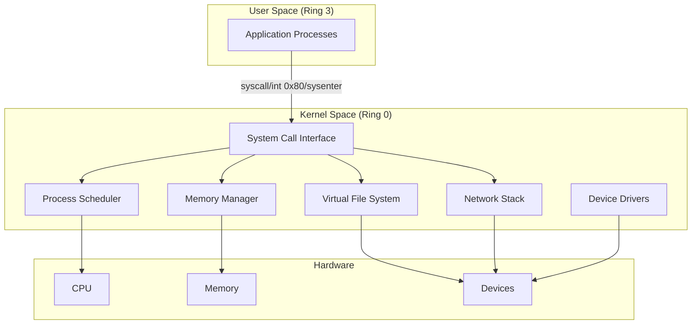
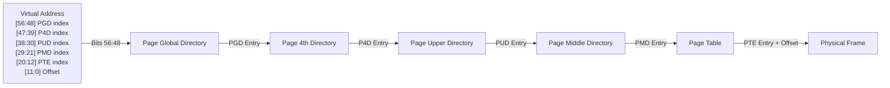
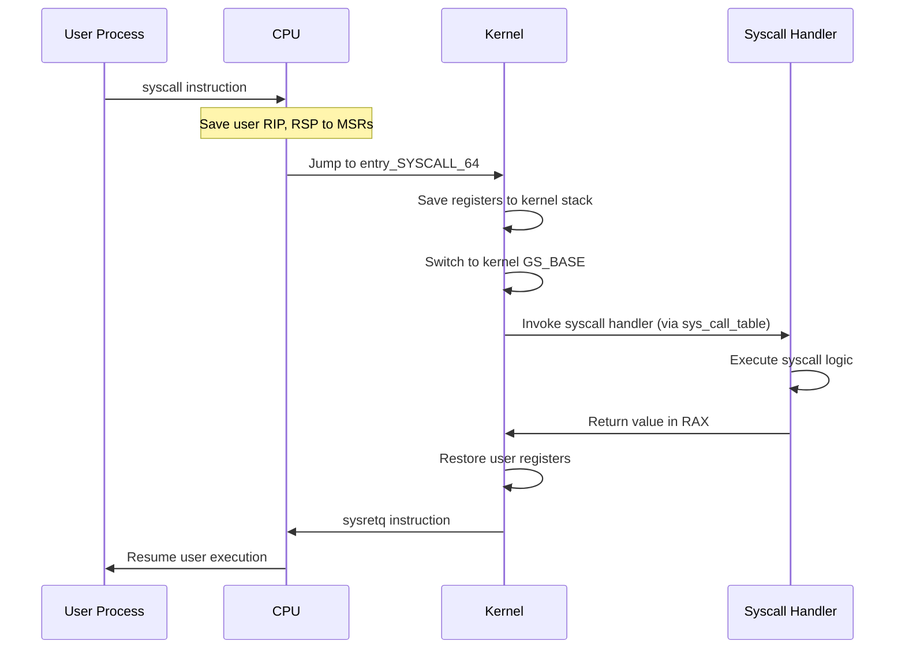
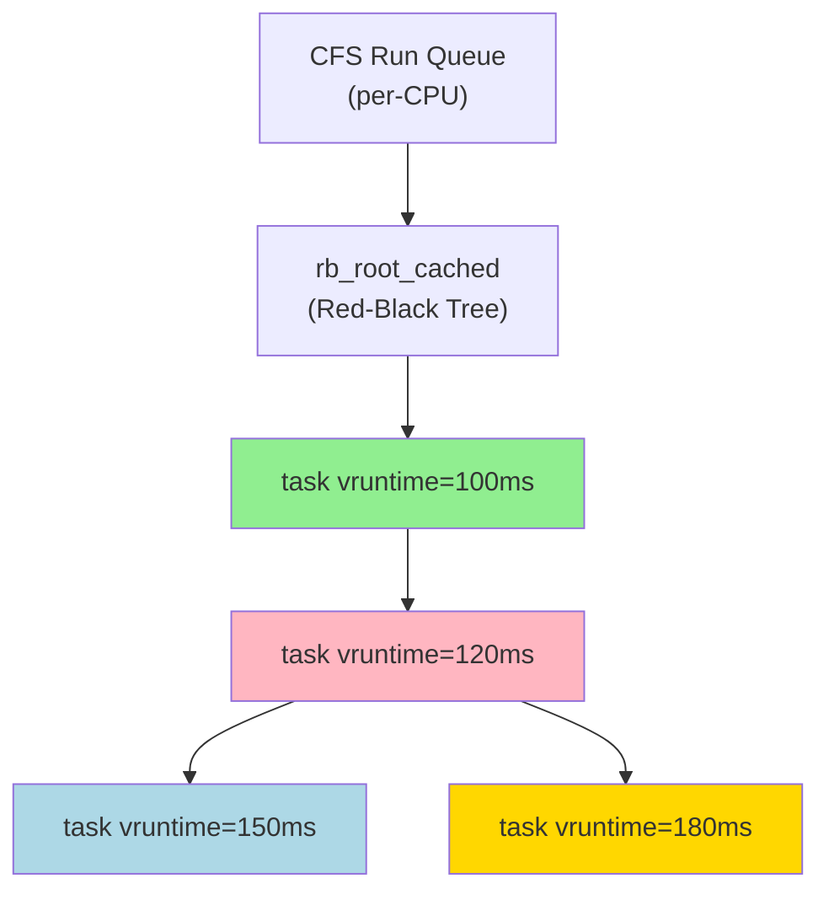
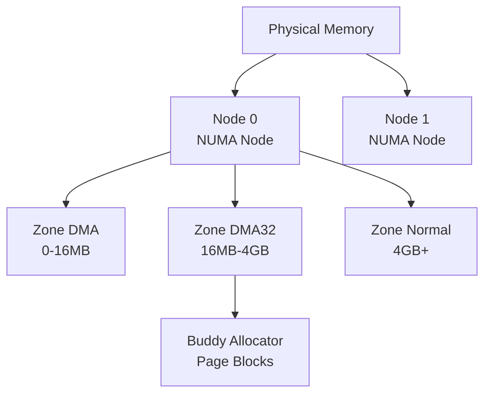
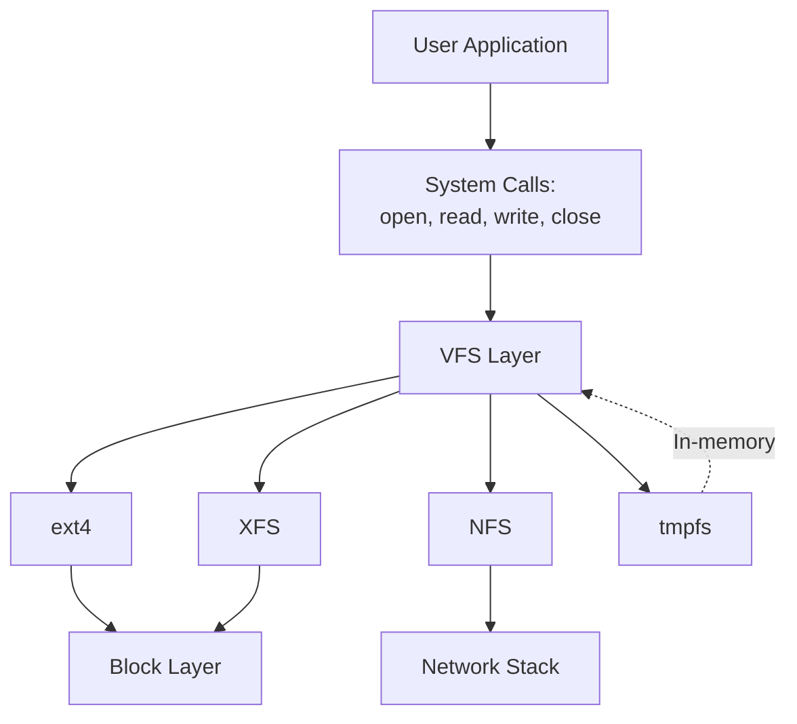
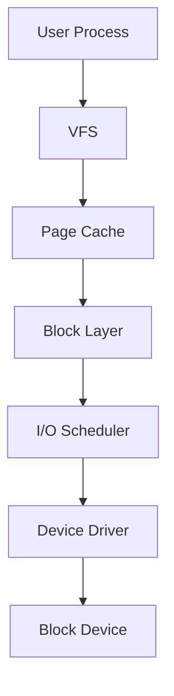

# Lesson 1: Linux Kernel Architecture

## 1. First-Principles Intuition & Invariants

The Linux kernel is a monolithic kernel implementing a Unix-like operating system interface. Its design embodies three architectural invariants: **isolation** (userspace cannot directly access kernel memory or I/O ports), **abstraction** (hardware diversity is hidden behind uniform interfaces), and **efficiency** (the kernel runs in a single address space to minimize context-switch overhead).

### Monolithic Architecture and Address Space Organization

Linux employs a monolithic kernel design where core subsystems—process scheduler, memory manager, filesystem, network stack, device drivers—execute in a single privileged address space. This contrasts with microkernel architectures (e.g., Minix, L4) where drivers and filesystems run as separate user-space processes.



The monolithic design yields performance advantages: function calls between subsystems are direct (no message-passing overhead), and shared kernel data structures avoid serialization costs. The tradeoff is increased complexity—a bug in any driver can corrupt the entire kernel. Modern Linux mitigates this through:

- **Loadable kernel modules (LKMs)**: Drivers loaded dynamically, reducing static kernel size
- **Kernel address space layout randomization (KASLR)**: Randomizes kernel base address to hinder exploits
- **Control Flow Integrity (CFI)**: Validates indirect function calls to prevent hijacking

### Process Model and the Task Struct

Every execution context in Linux is represented by a `task_struct`, a ~10 KB structure defined in `include/linux/sched.h`. This structure contains:

- **Scheduling state**: `state` (TASK_RUNNING, TASK_INTERRUPTIBLE, TASK_UNINTERRUPTIBLE, TASK_STOPPED, TASK_ZOMBIE), `prio` (static priority), `se.vruntime` (virtual runtime for CFS)
- **Memory descriptors**: Pointer to `mm_struct` containing page tables, VMAs (virtual memory areas)
- **Filesystem context**: Current working directory, root directory, open file descriptors (`files_struct`)
- **Signal handling**: Pending signals, signal handlers (`sighand_struct`)
- **Namespaces and cgroups**: Isolation and resource limits

```c
// Simplified task_struct (actual structure is ~800 lines)
struct task_struct {
    volatile long state;           // Process state
    void *stack;                   // Kernel stack pointer
    
    struct mm_struct *mm;          // Memory descriptor
    struct mm_struct *active_mm;   // Active memory descriptor (for kernel threads)
    
    pid_t pid;                     // Process ID
    pid_t tgid;                    // Thread group ID
    struct task_struct *parent;    // Parent process
    struct list_head children;     // List of child processes
    struct list_head sibling;      // Sibling processes
    
    struct sched_entity se;        // Scheduling entity (CFS)
    unsigned int policy;           // Scheduling policy
    int prio, static_prio, normal_prio;
    
    struct files_struct *files;    // Open file descriptors
    struct fs_struct *fs;          // Filesystem context
    struct signal_struct *signal;  // Signal handling
    struct sighand_struct *sighand;
    
    struct cred *cred;             // Credentials (UIDs, GIDs, capabilities)
    struct nsproxy *nsproxy;       // Namespace proxies
};
```

Process creation follows a **copy-on-write (COW) fork model**:

1. `fork()` system call duplicates `task_struct` and sets `mm_struct` to share parent's page tables with write-protection
2. Parent and child execute identical code with identical memory views
3. On first write, page fault triggers page duplication (copy-on-write)
4. `exec()` discards COW pages and loads new executable

This model is efficient: forking a 1 GB process copies only the ~10 KB `task_struct` and page table pointers (~4 MB for 4-level page tables), not the entire address space.

### Virtual Memory and Multi-Level Page Tables

Linux implements a **five-level page table** (on x86-64 with 5-level paging enabled) to map 57-bit virtual addresses to physical addresses:



Each level is a 512-entry array (9 bits of address). A PGD entry points to a P4D, a P4D entry points to a PUD, and so on. Page table entries (PTEs) contain:

- **Physical frame number** (bits 51:12 on x86-64)
- **Present bit** (P): Page is in physical memory
- **Read/Write bit** (R/W): Page is writable
- **User/Supervisor bit** (U/S): Page is accessible from userspace
- **Accessed bit** (A): Page has been read
- **Dirty bit** (D): Page has been written
- **No-Execute bit** (NX): Page is not executable (requires CPU support)

**Demand paging** populates page tables lazily:

1. Process accesses unmapped virtual address
2. CPU raises page fault (interrupt 14 on x86)
3. Kernel's page fault handler (`do_page_fault`) checks if address is valid (within a VMA)
4. If valid, allocates physical frame, updates PTE, resumes execution
5. If invalid, sends SIGSEGV to process

**Huge pages** (2 MB or 1 GB on x86-64) reduce TLB misses by mapping larger regions with fewer page table entries. A 2 MB huge page skips the PTE level, mapping directly from PMD to physical frame.

### System Call Interface and Context Switching

System calls transition from user mode (ring 3) to kernel mode (ring 0). On x86-64, this uses the `syscall` instruction (fast path) or `int 0x80` (legacy):



The kernel maintains a **system call table** (`sys_call_table`) indexed by system call number. On x86-64, the syscall number is passed in `%rax`, and arguments in `%rdi`, `%rsi`, `%rdx`, `%r10`, `%r8`, `%r9`.

Context switches occur during:

- **Voluntary preemption**: Process calls `schedule()` (e.g., waiting for I/O)
- **Involuntary preemption**: Timer interrupt fires, scheduler decides to switch

The context switch (`__switch_to` in `arch/x86/kernel/process_64.c`) saves:

1. CPU registers (general-purpose, segment, FPU/SIMD state)
2. Stack pointer (kernel stack for returning process)
3. Page table base (CR3 register on x86-64)
4. Thread-local storage (FS/GS segment bases)

On x86-64 with PCID (Process-Context Identifiers), TLB entries are tagged with PCID to avoid flushing TLB on context switch, reducing overhead by 30-50%.

### Kernel Synchronization Primitives

The kernel protects shared data structures with synchronization primitives:

**Spinlocks** (busy-wait locks for short critical sections):

```c
spinlock_t my_lock = __SPIN_LOCK_UNLOCKED(my_lock);

spin_lock(&my_lock);
// Critical section - interrupts still enabled on preemptible kernels
spin_unlock(&my_lock);

// Disable interrupts on local CPU (prevents deadlock if interrupt handler needs same lock)
spin_lock_irqsave(&my_lock, flags);
// Critical section
spin_unlock_irqrestore(&my_lock, flags);
```

Spinlocks use atomic test-and-set (`xchg` on x86). On SMP systems, spinlocks include memory barriers to ensure visibility of writes across CPUs.

**Mutexes** (sleepable locks for longer critical sections):

```c
struct mutex my_mutex;
mutex_init(&my_mutex);

mutex_lock(&my_mutex);
// Critical section - process may sleep
mutex_unlock(&my_mutex);
```

Mutexes implement **priority inheritance**: if high-priority task blocks on mutex held by low-priority task, low-priority task temporarily inherits high priority to avoid priority inversion.

**RCU (Read-Copy-Update)**: Lock-free synchronization for read-heavy workloads:

```c
struct data {
    int value;
    struct rcu_head rcu;
};

struct data *global_ptr;

// Reader (lockless)
rcu_read_lock();
struct data *ptr = rcu_dereference(global_ptr);
int val = ptr->value;
rcu_read_unlock();

// Writer (updates pointer atomically)
struct data *new_data = kmalloc(sizeof(*new_data), GFP_KERNEL);
new_data->value = 42;
rcu_assign_pointer(global_ptr, new_data);
synchronize_rcu();  // Wait for all readers to finish
kfree(old_data);
```

RCU allows readers to proceed without locks, memory barriers, or atomic operations. Writers create new versions and wait for a grace period (all CPUs have passed through quiescent state) before freeing old data.

### Security Model and Capabilities

Linux enforces access control through **discretionary access control (DAC)** and **mandatory access control (MAC)**:

**DAC** (traditional Unix permissions):
- Each process has real UID/GID and effective UID/GID
- Each file has owner, group, and permission bits (rwx for owner, group, others)
- Superuser (UID 0) bypasses most checks

**Capabilities** subdivide root privileges into 41 distinct capabilities (as of Linux 5.15):

```c
// Example capabilities
CAP_NET_ADMIN      // Configure network interfaces, routing
CAP_SYS_ADMIN      // Mount filesystems, swapon/swapoff
CAP_SYS_MODULE     // Load/unload kernel modules
CAP_SYS_RAWIO      // Access I/O ports, physical memory
CAP_DAC_OVERRIDE   // Bypass file permission checks
CAP_KILL           // Send signals to processes with different UID
```

Capabilities are stored in the task's credentials (`struct cred`) as bitmasks:

```c
struct cred {
    kuid_t uid, euid, suid, fsuid;
    kgid_t gid, egid, sgid, fsgid;
    kernel_cap_t cap_inheritable;  // Passed to execve
    kernel_cap_t cap_permitted;    // Maximum set
    kernel_cap_t cap_effective;    // Currently active
    kernel_cap_t cap_bset;         // Capability bounding set
    kernel_cap_t cap_ambient;      // Ambient capabilities (inherited by children)
};
```

**SELinux and AppArmor** provide MAC by labeling subjects (processes) and objects (files, sockets) and enforcing policy rules. SELinux uses type enforcement (TE), where each domain has a defined set of allowed operations on types. AppArmor uses path-based profiles.

## 2. Core Architecture & Mechanics

### Process Scheduling: Completely Fair Scheduler (CFS)

The CFS, introduced in Linux 2.6.23, models an "ideal multitasking CPU" where each task receives `1/n` of CPU time instantaneously. In reality, CFS tracks virtual runtime and schedules the task with the smallest `vruntime`:

```
vruntime_i(t) = physical_runtime_i(t) × (NICE_0_LOAD / weight_i)
```

Where `weight_i` is derived from the task's nice value (-20 to +19):

```c
// From kernel/sched/core.c
const int sched_prio_to_weight[40] = {
 /* -20 */ 88761, 71755, 56483, 46273, 36291,
 /* -15 */ 29154, 23254, 18705, 14949, 11916,
 /* -10 */  9548,  7620,  6100,  4904,  3906,
 /*  -5 */  3121,  2501,  1991,  1586,  1277,
 /*   0 */  1024,   820,   655,   526,   423,
 /*   5 */   335,   272,   215,   172,   137,
 /*  10 */   110,    87,    70,    56,    45,
 /*  15 */    36,    29,    23,    18,    15,
};
```

A nice 0 task has weight 1024. A nice +10 task has weight 110, receiving approximately `110/1024 ≈ 10.7%` of CPU time relative to nice 0.

CFS maintains a red-black tree of runnable tasks, ordered by `vruntime`:



Scheduler operations:

1. **Enqueue**: `enqueue_task_fair()` inserts task into rb-tree in O(log n)
2. **Pick next**: `pick_next_task_fair()` returns leftmost node (smallest `vruntime`) in O(1)
3. **Dequeue**: `dequeue_task_fair()` removes task from rb-tree in O(log n)

CFS updates `vruntime` in `update_curr()` called from timer interrupt:

```c
static void update_curr(struct cfs_rq *cfs_rq) {
    struct sched_entity *curr = cfs_rq->curr;
    u64 now = rq_clock_task(rq_of(cfs_rq));
    u64 delta_exec = now - curr->exec_start;
    
    curr->exec_start = now;
    curr->sum_exec_runtime += delta_exec;
    curr->vruntime += calc_delta_fair(delta_exec, curr);
}
```

**Group scheduling** extends CFS to hierarchical cgroups. Each cgroup has a `sched_entity` competing in the parent's rb-tree, and its own rb-tree of child tasks/groups. This provides proportional CPU shares across containers.

**Real-time scheduling** uses fixed-priority preemptive policies:

- **SCHED_FIFO**: Run until voluntary yield or higher-priority task awakens
- **SCHED_RR**: SCHED_FIFO with round-robin time slicing (default 100ms)
- **SCHED_DEADLINE**: Earliest Deadline First (EDF) for sporadic tasks with deadlines

SCHED_DEADLINE guarantees schedulability if:

```
Σ (runtime_i / period_i) ≤ 1
```

### Memory Management: Physical and Virtual

#### Physical Memory Model

Linux divides physical memory into nodes (NUMA), zones, and pages:



**Zones** segregate memory by hardware constraints:

- **ZONE_DMA**: ISA devices requiring <16MB addresses (x86)
- **ZONE_DMA32**: Devices requiring <4GB addresses (x86-64)
- **ZONE_NORMAL**: Directly mapped kernel memory (3GB-~896GB on x86-64)
- **ZONE_HIGHMEM**: Memory above direct map (obsolete on 64-bit)
- **ZONE_MOVABLE**: Movable pages for memory hotplug and hugepage allocation

**Buddy allocator** manages free pages in power-of-2 blocks (order 0 to MAX_ORDER-1, typically 11):

```c
struct zone {
    struct free_area free_area[MAX_ORDER];
};

struct free_area {
    struct list_head free_list[MIGRATE_TYPES];
    unsigned long nr_free;
};
```

Allocation algorithm:

1. Request order-k block
2. Find free block of order ≥ k
3. If order-m block found (m > k), split into two order-(m-1) blocks recursively
4. Coalesce buddy blocks on free: if both buddies at order-k are free, merge into order-(k+1)

Buddy blocks have addresses differing only in bit `k`. For example, frames 4-7 (order-2) split into buddies 4-5 and 6-7 (order-1).

**Slab allocator** (SLUB is the default implementation) manages kernel object caches:

```c
struct kmem_cache *task_cache = kmem_cache_create(
    "task_struct",
    sizeof(struct task_struct),
    __alignof__(struct task_struct),
    SLAB_HWCACHE_ALIGN | SLAB_PANIC,
    NULL
);

struct task_struct *task = kmem_cache_alloc(task_cache, GFP_KERNEL);
kmem_cache_free(task_cache, task);
```

SLUB organizes memory into per-CPU slabs (pages), reducing lock contention. Each slab contains multiple objects of the same size.

#### Virtual Memory Areas (VMAs)

A process's address space is divided into VMAs, each representing a contiguous range with uniform properties:

```c
struct vm_area_struct {
    unsigned long vm_start;        // Start address (inclusive)
    unsigned long vm_end;          // End address (exclusive)
    struct mm_struct *vm_mm;       // Back pointer to mm_struct
    pgprot_t vm_page_prot;         // Page protection flags
    unsigned long vm_flags;        // VMA flags (VM_READ, VM_WRITE, VM_EXEC, VM_SHARED)
    struct rb_node vm_rb;          // Red-black tree node
    struct vm_area_struct *vm_next;// Linked list of VMAs
    struct file *vm_file;          // Mapped file (NULL for anonymous)
    unsigned long vm_pgoff;        // Offset in file (in pages)
    const struct vm_operations_struct *vm_ops;
};
```

VMAs are stored in both a linked list (for sequential traversal) and a red-black tree (for fast lookup):

```
User Address Space (0x0000000000000000 - 0x00007FFFFFFFFFFF on x86-64)
├─ VMA [0x400000 - 0x401000]  .text (executable)
├─ VMA [0x600000 - 0x601000]  .data (read-write)
├─ VMA [0x601000 - 0x602000]  .bss (read-write)
├─ VMA [0x7f0000000000 - 0x7f0000001000]  heap (anonymous, expandable)
├─ VMA [0x7ffff7a00000 - 0x7ffff7c00000]  libc.so (shared library)
└─ VMA [0x7ffffffde000 - 0x7ffffffff000]  stack (grows down)
```

**Page fault handling**:

```c
// Simplified page fault handler (arch/x86/mm/fault.c)
dotraplinkage void do_page_fault(struct pt_regs *regs, unsigned long error_code) {
    unsigned long address = read_cr2();  // Faulting address from CR2
    struct vm_area_struct *vma = find_vma(current->mm, address);
    
    if (!vma || address < vma->vm_start) {
        // No VMA covers this address - SIGSEGV
        bad_area(regs, error_code, address);
        return;
    }
    
    if (error_code & X86_PF_WRITE) {
        if (!(vma->vm_flags & VM_WRITE)) {
            // Write to read-only VMA - SIGSEGV
            bad_area_access_error(regs, error_code, address);
            return;
        }
    }
    
    // Valid access - allocate page or copy-on-write
    handle_mm_fault(vma, address, flags, regs);
}
```

**Copy-on-write (COW)**:

1. After `fork()`, parent and child share page tables with PTEs marked read-only
2. Write attempt triggers page fault with error_code indicating write to read-only page
3. Kernel checks `page_mapcount()`: if page is shared, allocate new page and copy contents
4. Update PTE to point to new page with write permission
5. If page is no longer shared (mapcount=1), just flip write bit without copying

#### Memory Reclaim and OOM Killer

When free memory falls below watermarks, the kernel invokes **kswapd** daemon or direct reclaim:

1. **Page cache eviction**: Drop clean file-backed pages (can be re-read from disk)
2. **Anonymous page swapping**: Write dirty anonymous pages to swap, free physical frames
3. **Slab shrinking**: Call registered shrinkers to free cached objects (dentries, inodes)

The **Out-Of-Memory (OOM) killer** selects a process to terminate when reclaim fails:

```c
// Simplified OOM score calculation (mm/oom_kill.c)
unsigned long oom_badness(struct task_struct *p, unsigned long totalpages) {
    long points;
    
    // Base score: percent of memory used
    points = get_mm_rss(p->mm) + get_mm_counter(p->mm, MM_SWAPENTS);
    points = points * 1000 / totalpages;
    
    // Adjust for oom_score_adj (-1000 to +1000)
    points += p->signal->oom_score_adj;
    
    return points < 0 ? 0 : points;
}
```

Processes with higher memory usage and higher `oom_score_adj` are killed first. Setting `oom_score_adj` to -1000 makes a process OOM-unkillable (except PID 1).

### Virtual File System (VFS) Layer

VFS abstracts filesystem implementations behind a uniform interface:



Core VFS data structures:

```c
struct super_block {
    dev_t s_dev;                           // Device identifier
    unsigned long s_blocksize;             // Block size
    loff_t s_maxbytes;                     // Max file size
    struct file_system_type *s_type;       // Filesystem type
    const struct super_operations *s_op;   // Superblock operations
    struct dentry *s_root;                 // Root dentry
    struct list_head s_inodes;             // All inodes
};

struct inode {
    umode_t i_mode;                        // File type and permissions
    uid_t i_uid;                           // Owner UID
    gid_t i_gid;                           // Owner GID
    loff_t i_size;                         // File size in bytes
    struct timespec64 i_atime, i_mtime, i_ctime;
    unsigned long i_ino;                   // Inode number
    const struct inode_operations *i_op;   // Inode operations
    const struct file_operations *i_fop;   // Default file operations
    struct address_space *i_mapping;       // Page cache
    union {
        struct block_device *i_bdev;       // Block device
        struct cdev *i_cdev;               // Character device
    };
};

struct dentry {
    struct qstr d_name;                    // Filename
    struct inode *d_inode;                 // Associated inode
    struct dentry *d_parent;               // Parent dentry
    struct list_head d_child;              // Child dentries
    struct list_head d_subdirs;            // Subdirectories
    struct hlist_bl_node d_hash;           // Hash table linkage
};

struct file {
    struct path f_path;                    // Dentry and vfsmount
    const struct file_operations *f_op;    // File operations
    loff_t f_pos;                          // File position
    unsigned int f_flags;                  // O_RDONLY, O_WRONLY, O_NONBLOCK, etc.
    fmode_t f_mode;                        // FMODE_READ, FMODE_WRITE
    struct address_space *f_mapping;       // Page cache
};
```

**Dentry cache (dcache)** stores recent path lookups:

```
/home/user/file.txt
├─ dentry "/" -> inode (root filesystem)
├─ dentry "home" -> inode (home directory)
├─ dentry "user" -> inode (user directory)
└─ dentry "file.txt" -> inode (file)
```

Path resolution (`path_lookupat()`) walks dcache, falling back to filesystem `lookup` operations on cache miss.

**Page cache** stores file contents in memory:

```c
struct address_space {
    struct inode *host;                    // Owner inode
    struct xarray i_pages;                 // Radix tree of pages
    unsigned long nrpages;                 // Number of pages
    const struct address_space_operations *a_ops;
};
```

Read path:

1. `read()` system call invokes `vfs_read()` → `__vfs_read()` → `file->f_op->read_iter()`
2. Generic `generic_file_read_iter()` checks page cache via `find_get_page()`
3. On miss, calls `a_ops->readpage()` to read from disk into page cache
4. Copy data from page cache to user buffer

Write path:

1. `write()` invokes `vfs_write()` → `file->f_op->write_iter()`
2. Generic `generic_perform_write()` marks pages dirty in page cache
3. Writeback daemon `flush-*` periodically calls `a_ops->writepage()` to sync to disk

**mmap** maps files or devices directly into address space:

```c
void *addr = mmap(NULL, size, PROT_READ | PROT_WRITE, MAP_SHARED, fd, offset);
```

1. `mmap()` creates VMA with `vm_file` pointing to open file
2. `vm_ops->fault` (e.g., `filemap_fault()`) handles page faults by reading pages into cache
3. Process reads/writes memory directly, bypassing read/write system calls

### Device Drivers and I/O

Linux organizes devices into character devices (sequential access, e.g., serial ports), block devices (random access, e.g., disks), and network devices.

#### Character Devices

Character devices are accessed via device files (e.g., `/dev/tty`, `/dev/null`):

```c
static const struct file_operations my_fops = {
    .owner = THIS_MODULE,
    .open = my_open,
    .release = my_release,
    .read = my_read,
    .write = my_write,
    .unlocked_ioctl = my_ioctl,
};

static int __init my_init(void) {
    major = register_chrdev(0, "mydev", &my_fops);  // Allocate major number
    dev_class = class_create(THIS_MODULE, "mydev");
    device_create(dev_class, NULL, MKDEV(major, 0), NULL, "mydev");
}
```

#### Block Devices and I/O Scheduling

Block devices use the block layer for I/O buffering and scheduling:



**I/O schedulers** reorder and merge requests to optimize disk access:

- **noop**: No reordering (for SSDs with internal scheduling)
- **deadline**: Per-read and per-write FIFO queues with deadlines to prevent starvation
- **CFQ (Completely Fair Queuing)**: Per-process queues, round-robin service
- **mq-deadline**: Multi-queue variant of deadline for NVMe devices
- **BFQ (Budget Fair Queuing)**: Low-latency scheduler for interactive workloads
- **kyber**: Multi-queue scheduler with separate read/write queues and latency targets

**Multi-queue block layer (blk-mq)** parallelizes I/O submission and completion across CPU cores:

```c
struct blk_mq_queue_data {
    struct request_queue *q;
    struct request *rq;
};

static int nvme_queue_rq(struct blk_mq_hw_ctx *hctx, const struct blk_mq_queue_data *bd) {
    struct nvme_queue *nvmeq = hctx->driver_data;
    struct request *req = bd->rq;
    
    // Build NVMe command from request
    struct nvme_command cmd = nvme_build_cmd(req);
    
    // Submit to hardware queue
    nvme_submit_cmd(nvmeq, &cmd);
    return BLK_STS_OK;
}
```

Each CPU core has a software queue; hardware queues map to device submission queues (NVMe supports up to 64K queues).

#### Direct Memory Access (DMA)

DMA allows devices to transfer data to/from memory without CPU involvement:

```c
dma_addr_t dma_handle;
void *cpu_addr = dma_alloc_coherent(dev, size, &dma_handle, GFP_KERNEL);

// Program device with DMA address
writel(dma_handle, device_reg_addr);
writel(size, device_reg_size);
writel(DMA_START, device_reg_ctrl);

// Wait for completion (interrupt or polling)
wait_for_completion(&dma_done);

dma_free_coherent(dev, size, cpu_addr, dma_handle);
```

**IOMMU (Input-Output Memory Management Unit)** provides address translation and protection for DMA:

- **Intel VT-d**: Virtualizes device memory access, preventing malicious devices from accessing arbitrary physical memory
- **AMD-Vi**: AMD equivalent
- **SMMU**: ARM System MMU

## 3. High-Performance Optimization & Failure Modes

### Concurrency Scalability

#### Lock Contention and Scalability Limits

Amdahl's Law quantifies scalability limits imposed by serialization:

```
Speedup = 1 / (S + (1-S)/N)
```

Where `S` is the serial fraction and `N` is the number of cores. If 5% of execution is serial, maximum speedup is 20× regardless of core count.

**Lock-free data structures** eliminate locks using atomic operations:

```c
// Lock-free stack (Treiber stack)
struct node {
    void *data;
    struct node *next;
};

void push(struct node **head, struct node *new_node) {
    do {
        new_node->next = atomic_load(head);
    } while (!atomic_compare_exchange_strong(head, &new_node->next, new_node));
}

struct node *pop(struct node **head) {
    struct node *old_head;
    do {
        old_head = atomic_load(head);
        if (!old_head) return NULL;
    } while (!atomic_compare_exchange_strong(head, &old_head, old_head->next));
    return old_head;
}
```

The kernel uses lock-free algorithms in:

- **Per-CPU counters**: Each CPU maintains a local counter; global reads sum all CPUs
- **Seqlock**: Writers increment sequence counter, readers retry if counter changed during read
- **RCU (Read-Copy-Update)**: Described earlier

#### CPU Cache Coherence and False Sharing

Modern CPUs use MESI cache coherence protocol:

- **Modified**: Cache line is modified and exclusive to this CPU
- **Exclusive**: Cache line is unmodified and exclusive to this CPU
- **Shared**: Cache line is unmodified and present in multiple CPU caches
- **Invalid**: Cache line is invalid

**False sharing** occurs when two threads access different variables on the same cache line (typically 64 bytes):

```c
struct {
    int counter_a;  // CPU 0 writes this
    int counter_b;  // CPU 1 writes this (same cache line!)
} shared;
```

Each write by CPU 0 invalidates the cache line in CPU 1, forcing CPU 1 to reload. Solution: pad variables to separate cache lines:

```c
struct {
    int counter_a;
    char pad[60];   // Pad to 64 bytes
    int counter_b;
} __attribute__((aligned(64))) shared;
```

The kernel uses `____cacheline_aligned` to avoid false sharing in hot paths.

#### NUMA Awareness

On NUMA (Non-Uniform Memory Access) systems, memory access latency depends on locality:

```
CPU 0 (Node 0)     CPU 1 (Node 1)
     |                  |
   Local RAM          Local RAM
     |                  |
     +------ QPI -------+
     
Access latency:
- Local:  ~60ns
- Remote: ~120ns
```

The kernel's NUMA policy (controlled by `numactl` or `mbind()` syscall):

- **MPOL_DEFAULT**: Allocate on node where page fault occurs
- **MPOL_BIND**: Restrict allocation to specific nodes
- **MPOL_INTERLEAVE**: Interleave pages across nodes (for large allocations)
- **MPOL_PREFERRED**: Prefer specific node, fall back to others

CFS uses **NUMA balancing**: periodically unmaps pages and observes page fault patterns to migrate tasks and memory to co-located nodes.

### Resource Scaling and Kernel Limits

| Resource | 32-bit Limit | 64-bit Limit | Kernel Symbol |
|----------|--------------|--------------|---------------|
| Maximum processes | 32,768 | 4,194,304 | PID_MAX_LIMIT |
| Open files (per process) | Configurable | Configurable | RLIMIT_NOFILE |
| Virtual address space | 3 GB (user) | 128 TB (user) | TASK_SIZE |
| Physical memory | 64 GB (PAE) | 64 PB | MAX_PHYSMEM_BITS |
| Filesystem size (ext4) | 16 TB | 1 EB | N/A |

**File descriptor limits**:

```bash
# Soft limit (ulimit -n)
ulimit -n 4096

# Hard limit (requires root)
ulimit -Hn 1048576

# System-wide limit
sysctl fs.file-max=2097152
```

**Memory overcommit** allows processes to allocate more virtual memory than physical RAM + swap:

```bash
# Overcommit modes (vm.overcommit_memory)
# 0: Heuristic (default) - reject obviously excessive allocations
# 1: Always allow - risk OOM at access time
# 2: Strict accounting - reject if allocation exceeds CommitLimit

sysctl vm.overcommit_memory=2
sysctl vm.overcommit_ratio=80  # Percent of RAM allocatable (+ swap)
```

### Latency Optimization

#### Real-Time Preemption (PREEMPT_RT)

The PREEMPT_RT patch converts spinlocks to mutexes and makes most kernel code preemptible:

```c
// Standard kernel: spinlock disables preemption
spin_lock(&lock);
// Non-preemptible critical section
spin_unlock(&lock);

// PREEMPT_RT: spinlock is a mutex
spin_lock(&lock);
// Preemptible critical section (higher-priority task can preempt)
spin_unlock(&lock);
```

Real-time guarantees require:

- **Bounded interrupt latency**: Interrupt handlers run as kernel threads
- **Bounded scheduling latency**: High-priority tasks preempt lower-priority tasks within microseconds
- **Bounded critical section duration**: No unbounded locks or loops in critical paths

**Cyclictest** measures scheduling latency:

```bash
cyclictest -p 80 -m -n -t 4 -l 1000000
# Max latencies < 100μs indicate good real-time behavior
```

#### BPF (Berkeley Packet Filter) and XDP (eXpress Data Path)

BPF allows userspace to inject verified programs into the kernel:

```c
// XDP program: drop packets with specific IP
SEC("xdp")
int xdp_drop_ip(struct xdp_md *ctx) {
    void *data_end = (void *)(long)ctx->data_end;
    void *data = (void *)(long)ctx->data;
    
    struct ethhdr *eth = data;
    if ((void *)(eth + 1) > data_end)
        return XDP_PASS;
    
    if (eth->h_proto != htons(ETH_P_IP))
        return XDP_PASS;
    
    struct iphdr *ip = (void *)(eth + 1);
    if ((void *)(ip + 1) > data_end)
        return XDP_PASS;
    
    if (ip->saddr == htonl(0xC0A80001))  // 192.168.0.1
        return XDP_DROP;
    
    return XDP_PASS;
}
```

XDP runs before the network stack allocates an `skb` (socket buffer), achieving 10-20M packets/second per core. BPF verifier ensures programs:

- Terminate (no loops without bounded iteration)
- Access memory safely (all pointer dereferences checked)
- Do not leak kernel data

### Failure Modes and Mitigations

#### Kernel Panics and Oops

**Kernel panic**: Unrecoverable error forcing reboot:

```c
panic("Unable to mount root fs on %s", root_device_name);
```

**Kernel oops**: Recoverable error (e.g., NULL dereference in driver):

```
BUG: unable to handle kernel NULL pointer dereference at 0000000000000008
IP: [<ffffffffa0123456>] my_driver_read+0x12/0x50 [mydriver]
```

Oops logs include:

- **Backtrace**: Call stack leading to error
- **Registers**: CPU register state
- **Code**: Disassembly around faulting instruction

**Kdump** configures a secondary kernel to boot on panic and dump memory for post-mortem analysis:

```bash
# Reserve memory for crash kernel
crashkernel=256M@64M

# Load crash kernel
kexec -p /boot/vmlinuz --initrd=/boot/initramfs.img --append="root=/dev/sda1"
```

#### Deadlocks

**AB-BA deadlock**:

```c
// Thread 1
spin_lock(&lock_a);
spin_lock(&lock_b);  // Waits if thread 2 holds lock_b

// Thread 2
spin_lock(&lock_b);
spin_lock(&lock_a);  // Waits if thread 1 holds lock_a
```

**Lockdep** (Lock Dependency validator) detects potential deadlocks at runtime by tracking lock ordering:

```bash
# Enable Lockdep
CONFIG_PROVE_LOCKING=y
CONFIG_LOCK_STAT=y

# Lockdep report on detected deadlock
=============================================
WARNING: possible circular locking dependency detected
 lock_a --> lock_b
 lock_b --> lock_a
```

**Mitigation**: Establish global lock ordering and use `spin_lock_nested()` for exceptions.

#### Memory Leaks

**Kmemleak** tracks memory allocations and detects leaks:

```bash
# Enable Kmemleak
CONFIG_DEBUG_KMEMLEAK=y

# Trigger scan
echo scan > /sys/kernel/debug/kmemleak

# Report leaks
cat /sys/kernel/debug/kmemleak
```

**KASAN (Kernel Address Sanitizer)** detects use-after-free and out-of-bounds accesses:

```bash
# Enable KASAN
CONFIG_KASAN=y

# KASAN report
BUG: KASAN: use-after-free in my_function+0x123/0x456
```

#### Live Patching

**Kernel Live Patching (KLP)** applies security fixes without rebooting:

```c
// Original function
int vulnerable_function(int arg) {
    // Vulnerable code
    return arg;
}

// Patched function
int patched_function(int arg) {
    // Fixed code
    if (arg < 0) return -EINVAL;
    return arg;
}

// Live patch module
static struct klp_func funcs[] = {
    {
        .old_name = "vulnerable_function",
        .new_func = patched_function,
    }, { }
};
```

KLP uses **ftrace** trampolines to redirect function calls. Consistency model ensures patches apply only when affected functions are not on any call stack.

### Security Hardening

#### Kernel Exploit Mitigations

**KASLR (Kernel Address Space Layout Randomization)**:

```bash
# Boot parameter
kaslr

# Randomizes kernel base address (16 bits of entropy on x86-64)
# Kernel base: 0xffffffff80000000 + random_offset
```

**SMEP (Supervisor Mode Execution Prevention)**: CPU prevents kernel from executing userspace code (defense against ret2usr attacks).

**SMAP (Supervisor Mode Access Prevention)**: CPU prevents kernel from accessing userspace memory without explicit `stac`/`clac` instructions (defense against kernel pointer derefs).

**Control Flow Integrity (CFI)**: Validates indirect calls against whitelisted targets:

```c
// Without CFI: attacker overwrites function pointer
void (*fptr)(void) = legitimate_function;
fptr = attacker_gadget;  // ROP gadget
fptr();  // Executes attacker code

// With CFI: indirect call validated
fptr();  // Panics if fptr not in whitelist
```

**Seccomp (Secure Computing Mode)**: Restricts system calls available to process:

```c
// Allow only read, write, exit
struct sock_filter filter[] = {
    BPF_STMT(BPF_LD | BPF_W | BPF_ABS, offsetof(struct seccomp_data, nr)),
    BPF_JUMP(BPF_JMP | BPF_JEQ | BPF_K, __NR_read, 0, 1),
    BPF_STMT(BPF_RET | BPF_K, SECCOMP_RET_ALLOW),
    BPF_JUMP(BPF_JMP | BPF_JEQ | BPF_K, __NR_write, 0, 1),
    BPF_STMT(BPF_RET | BPF_K, SECCOMP_RET_ALLOW),
    BPF_JUMP(BPF_JMP | BPF_JEQ | BPF_K, __NR_exit, 0, 1),
    BPF_STMT(BPF_RET | BPF_K, SECCOMP_RET_ALLOW),
    BPF_STMT(BPF_RET | BPF_K, SECCOMP_RET_KILL),
};

prctl(PR_SET_SECCOMP, SECCOMP_MODE_FILTER, &prog);
```

#### Audit Subsystem

Linux Audit logs security-relevant events:

```bash
# Enable auditing
auditctl -w /etc/passwd -p wa -k passwd_changes
auditctl -a exit,always -F arch=b64 -S execve -k exec_commands

# View logs
ausearch -k passwd_changes
ausearch -k exec_commands
```

Audit rules are evaluated in the kernel before syscall execution, providing mandatory logging.

### Performance Analysis Tools

**perf**: CPU profiling and tracing:

```bash
# Profile CPU hotspots (10 seconds)
perf record -g -a -- sleep 10
perf report

# Trace page faults
perf trace -e page-faults

# Count cache misses
perf stat -e cache-misses,cache-references ./myapp
```

**eBPF tracing** (bpftrace, BCC):

```bash
# Trace syscall latency
bpftrace -e 'tracepoint:raw_syscalls:sys_enter { @start[tid] = nsecs; }
             tracepoint:raw_syscalls:sys_exit /@start[tid]/ {
               @latency = hist(nsecs - @start[tid]);
               delete(@start[tid]);
             }'

# Count block I/O by process
bpftrace -e 'tracepoint:block:block_rq_issue { @[comm] = count(); }'
```

**ftrace**: Function and event tracing:

```bash
# Enable function tracer
echo function > /sys/kernel/debug/tracing/current_tracer
echo 1 > /sys/kernel/debug/tracing/tracing_on
cat /sys/kernel/debug/tracing/trace

# Trace specific function
echo do_page_fault > /sys/kernel/debug/tracing/set_ftrace_filter
```

**SystemTap**: Scriptable kernel probing:

```stap
# Trace file opens
probe syscall.open {
  printf("%s opened %s\n", execname(), filename);
}
```

Linux kernel architecture represents decades of evolution toward a robust, performant, and scalable operating system foundation. Its design balances monolithic efficiency with modular extensibility, providing abstractions that enable diverse workloads from embedded systems to hyperscale datacenters. Mastery of its internal mechanisms—process scheduling, memory management, synchronization primitives, and I/O subsystems—is essential for systems programmers, performance engineers, and security researchers.
