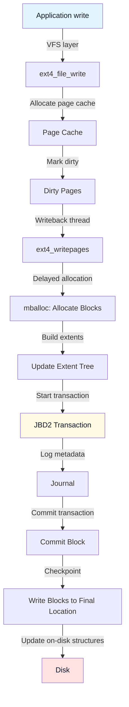
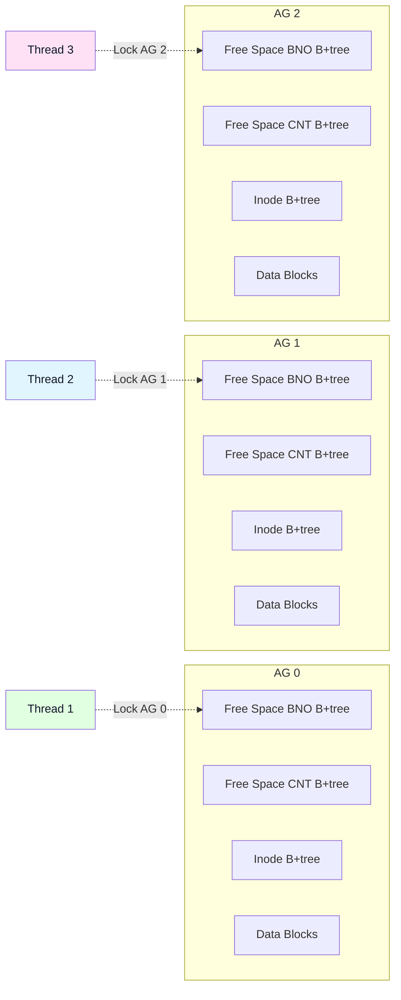
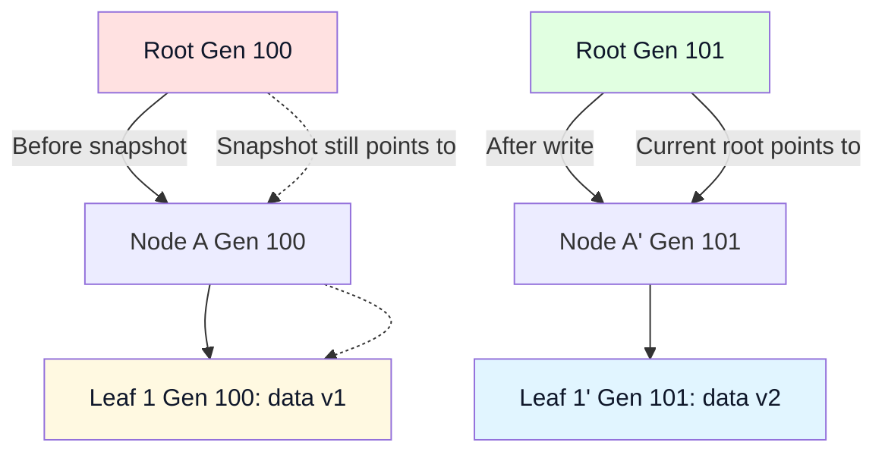

# Lesson 2: Filesystem Design

## 1. First-Principles Intuition & Invariants

Filesystems solve the fundamental problem of mapping logical file abstractions to physical block device constraints. At their core, they are sophisticated state machines that maintain three invariants under concurrent access:

1. **Bijection Integrity**: Every allocated block is reachable from exactly one file or metadata structure (no leaks, no double allocation).
2. **Metadata Consistency**: The relationship between directory entries, inodes, and data blocks forms a valid directed acyclic graph at stable points.
3. **Durability Ordering**: Observable state transitions must respect dependency ordering (metadata pointing to data must not precede data itself reaching stable storage).

These invariants collide with physical constraints: disks expose no atomicity beyond 512-byte (or 4096-byte for Advanced Format) sectors, reorder writes in the controller cache, and fail arbitrarily. The filesystem must synthesize ACID-like guarantees from hardware that provides none.

### The Block Allocation Problem

Block allocation is a continuous bin-packing problem under adversarial conditions. Free space begins contiguous but fragments through the interleaving of allocations and deallocations. The cost function is multi-dimensional:

- **Seek time** (rotational disks): Minimize distance between sequentially-accessed blocks.
- **Bandwidth utilization**: Maximize request sizes to amortize command overhead.
- **Allocation latency**: Minimize search time for suitable free extents.
- **Long-term fragmentation**: Prevent pathological layouts that compound over time.

No online algorithm achieves optimal packing. Real filesystems use heuristics:

- **Best-fit**: Minimize wasted space per allocation (leads to many tiny fragments).
- **First-fit**: Fast allocation, poor locality.
- **Buddy allocation**: Power-of-two blocks, fast coalescing, internal fragmentation.
- **Extent-based allocation**: Allocate variable-length contiguous runs, trading metadata size for reduced fragmentation.

Modern filesystems employ **delayed allocation**: buffer writes in RAM and allocate blocks only at writeback, allowing the allocator to see the full I/O pattern and choose optimal placements. This breaks the POSIX fsync() semantic subtly—space exhaustion can occur after write() succeeds but before fsync().

### Metadata Structures and Their Trade-offs

The inode is the universal indirection mechanism. It stores:

- File metadata (size, permissions, timestamps)
- Block pointers (direct, indirect, double-indirect, triple-indirect in classical Unix)
- Extended attributes
- Reference count (for hard links)

The classical Unix inode structure uses a hybrid approach: 12 direct pointers (for small files), one indirect block pointer (256-4096 block addresses depending on block size), one double-indirect (65K-16M blocks), and one triple-indirect (up to 16GB of blocks in a 4KB block filesystem). This design minimizes indirection overhead for small files while supporting large files, at the cost of fragmentation and metadata bloat for large files with random access patterns.

Extent-based designs (ext4, XFS, Btrfs) replace the block pointer array with (start_block, length) tuples. A single extent can represent gigabytes of contiguous data. The extent tree becomes a B+ tree, trading lookup overhead for massive metadata reduction. The pathological case is a fully fragmented file requiring one extent per block—metadata overhead exceeds the classical inode structure.

### Directory Indexing

Directories map filenames to inode numbers. The naive implementation is a linear array requiring O(n) lookup. Real filesystems use:

- **Hash tables** (ext3/4 HTree): Filenames hash to directory blocks. Collisions handled by linear scan within the block. Insertion is O(1) amortized, lookup is O(1) expected.
- **B+ trees** (XFS, Btrfs): Ordered traversal, range queries, O(log n) operations. Higher constant factors than hash tables for point lookups.

The choice encodes assumptions about usage patterns: hash tables optimize for stat() and open(), B+ trees optimize for readdir() and prefix searches.

### Journaling and Crash Consistency

The fundamental problem: a filesystem operation (e.g., creating a file) requires multiple non-atomic updates:

1. Allocate inode
2. Initialize inode metadata
3. Allocate data block
4. Write data to block
5. Add directory entry pointing to inode
6. Update free space bitmap
7. Update inode bitmap

A crash between any two steps leaves inconsistent state. Without intervention, this requires full filesystem scan on every boot (fsck), taking hours on terabyte-scale filesystems.

**Write-ahead logging (journaling)** solves this by transforming multi-step updates into a single atomic operation:

1. Write a transaction descriptor and all pending updates to a sequential journal (log)
2. Wait for journal writes to reach stable storage (commit)
3. Apply updates to their final locations (checkpoint)
4. Reclaim journal space

On crash recovery, replay the journal: completed transactions are reapplied, incomplete transactions are discarded. Recovery time becomes proportional to journal size (typically 128MB), not filesystem size.

Journaling modes trade performance for safety:

- **Metadata-only (ordered)**: Journal only metadata writes. Data writes complete before corresponding metadata commits. Ensures filesystem consistency but allows data corruption (stale data in new file blocks).
- **Metadata-only (unordered/writeback)**: Journal metadata, no data ordering guarantees. Fastest, but new files can contain previous files' deleted data (security issue).
- **Full (data + metadata)**: Journal everything. Strongest consistency, doubles write traffic.

XFS and ext4 default to ordered mode. Btrfs integrates checksumming into copy-on-write, eliminating traditional journaling.

### The Copy-on-Write (CoW) Alternative

CoW filesystems (Btrfs, ZFS) never overwrite live data. Modifications allocate new blocks, update pointers, then atomically switch the root. This provides:

- **Implicit snapshots**: Old roots remain valid, accessible as read-only snapshots.
- **Crash consistency**: New root commits atomically or not at all, no journal replay needed.
- **Silent corruption detection**: Merkle tree of checksums from root to leaves detects bit rot.

The cost: write amplification (updating one block cascades to parent blocks up to root), fragmentation (every write allocates new blocks), and free space management complexity (blocks referenced by snapshots are not fully free).

### The CAP Theorem of Filesystem Design

No filesystem simultaneously optimizes:

- **Performance** (low latency, high throughput)
- **Consistency** (strong durability guarantees)
- **Capacity efficiency** (low metadata overhead, no fragmentation)

Ext4 chooses performance and consistency (at the cost of fragmentation over time). Btrfs chooses consistency and capacity efficiency (at the cost of write amplification). XFS balances all three for high-bandwidth workloads. F2FS optimizes for flash, accepting write amplification to minimize erase cycles.

## 2. Core Architecture & Mechanics

### ext4 Filesystem Deep Dive

#### On-Disk Layout

ext4 divides the block device into **block groups**, each containing:

```text
Block Group N:
  - Superblock (replicated in groups 0, 1, 3, 5, 7, 9, 25, 49, 81, ...)
  - Group Descriptor Table (GDT)
  - Data Block Bitmap (1 block)
  - Inode Bitmap (1 block)
  - Inode Table (variable, typically 256 inodes/group)
  - Data Blocks (remaining space)
```

**Superblock** stores global metadata:

```c
struct ext4_super_block {
    __le32 s_inodes_count;         /* Total inodes */
    __le32 s_blocks_count_lo;      /* Total blocks (low 32 bits) */
    __le32 s_r_blocks_count_lo;    /* Reserved blocks */
    __le32 s_free_blocks_count_lo; /* Free blocks */
    __le32 s_free_inodes_count;    /* Free inodes */
    __le32 s_first_data_block;     /* First data block */
    __le32 s_log_block_size;       /* Block size = 1024 << s_log_block_size */
    __le32 s_log_cluster_size;     /* Fragment size */
    __le32 s_blocks_per_group;     /* Blocks per group */
    __le32 s_clusters_per_group;   /* Fragments per group */
    __le32 s_inodes_per_group;     /* Inodes per group */
    __le32 s_mtime;                /* Mount time */
    __le32 s_wtime;                /* Write time */
    __le16 s_mnt_count;            /* Mount count */
    __le16 s_max_mnt_count;        /* Maximal mount count */
    __le16 s_magic;                /* 0xEF53 */
    __le16 s_state;                /* File system state */
    __le16 s_errors;               /* Behaviour on errors */
    // ... 1024 bytes total
};
```

The block group design improves locality: files and their metadata co-locate, reducing seeks. For a 1TB disk with 4KB blocks and 128MB groups, there are ~8000 block groups.

#### Inode Structure

```c
struct ext4_inode {
    __le16 i_mode;          /* File mode */
    __le16 i_uid;           /* Owner Uid */
    __le32 i_size_lo;       /* Size in bytes (low 32 bits) */
    __le32 i_atime;         /* Access time */
    __le32 i_ctime;         /* Inode change time */
    __le32 i_mtime;         /* Modification time */
    __le32 i_dtime;         /* Deletion time */
    __le16 i_gid;           /* Group Id */
    __le16 i_links_count;   /* Hard link count */
    __le32 i_blocks_lo;     /* Blocks count (in 512-byte sectors) */
    __le32 i_flags;         /* File flags */
    union {
        struct {
            __le32 l_i_version;
        } linux1;
        struct {
            __u32  h_i_translator;
        } hurd1;
    } osd1;
    __le32 i_block[EXT4_N_BLOCKS]; /* Pointers to blocks or extent tree */
    __le32 i_generation;    /* File version (for NFS) */
    __le32 i_file_acl_lo;   /* File ACL */
    __le32 i_size_high;     /* High 32 bits of size */
    // ... 256 bytes total in large inodes
};
```

The `i_block[15]` array stores either:

1. **Classical indirect blocks** (deprecated): 12 direct, 1 single-indirect, 1 double-indirect, 1 triple-indirect
2. **Extent tree root** (modern): Header + up to 4 inline extents

#### Extent Tree Structure

```c
struct ext4_extent_header {
    __le16 eh_magic;      /* 0xF30A */
    __le16 eh_entries;    /* Number of valid entries */
    __le16 eh_max;        /* Capacity of store in entries */
    __le16 eh_depth;      /* Has real underlying blocks? */
    __le32 eh_generation; /* Generation of tree */
};

struct ext4_extent {
    __le32 ee_block;      /* First logical block extent covers */
    __le16 ee_len;        /* Number of blocks covered by extent */
    __le16 ee_start_hi;   /* High 16 bits of physical block */
    __le32 ee_start_lo;   /* Low 32 bits of physical block */
};

struct ext4_extent_idx {
    __le32 ei_block;      /* Index covers logical blocks from 'block' */
    __le32 ei_leaf_lo;    /* Pointer to physical block of next level */
    __le16 ei_leaf_hi;    /* High 16 bits of physical block */
    __le16 ei_unused;
};
```

A fully-packed inode holds 4 extents inline. For files requiring more, the tree grows:

```text
Depth 0 (leaf):    [extent1] [extent2] [extent3] [extent4]
                        ↓
Depth 1 (index): [idx→block1] [idx→block2] ...
                        ↓
Depth 2 (leaf):   [extent5] [extent6] ...
```

Each 4KB block holds ~340 extents or ~340 index entries. Maximum file size: 340^4 extents × 128MB/extent ≈ 1.3 zetabytes (limited by 48-bit block addresses to 64TB with 4KB blocks in practice).

#### Block Allocation: Multiblock Allocator

ext4's `mballoc` (multiblock allocator) performs locality-aware batch allocation:

```c
struct ext4_allocation_request {
    struct inode *inode;          /* Target inode */
    ext4_lblk_t logical;          /* Logical block offset */
    ext4_fsblk_t goal;            /* Preferred physical block */
    ext4_lblk_t lleft;            /* Logical neighbor (left) */
    ext4_fsblk_t pleft;           /* Physical neighbor (left) */
    ext4_lblk_t lright;           /* Logical neighbor (right) */
    ext4_fsblk_t pright;          /* Physical neighbor (right) */
    unsigned int len;             /* Desired length */
    unsigned int flags;           /* Allocation hints */
};
```

Allocation strategy:

1. **Goal-directed search**: Start near `goal` (previous allocation or parent directory).
2. **Buddy allocation**: Maintain power-of-two free lists for fast merging.
3. **Preallocation**: Allocate extra contiguous blocks beyond request, reserve for same inode.
4. **Discard on close**: Return unused preallocated blocks.

Delayed allocation defers step 1-4 until writeback, allowing the allocator to see write sizes and choose optimal extents. The risk: ENOSPC errors during writeback, after write() returned success.

#### HTree Directory Indexing

Large directories use a hash tree:

```text
Directory Inode
    ↓
Root Block: [hash(name) → block_index] (sorted array)
    ↓
Leaf Block: [name, inode, rec_len] (linear scan)
```

Hashing function (TEA-based):

```c
static inline __u32 ext4_dx_hash(const char *name, int len, __u32 seed) {
    __u32 hash = seed;
    const __u32 *k = (const __u32 *)name;
    // Tiny Encryption Algorithm (TEA) variant
    for (; len > 0; len -= 4, k++) {
        hash += *k;
        hash ^= (hash << 10);
        hash += (hash >> 1);
    }
    return hash;
}
```

Lookup: O(log n) to find leaf block (binary search on root), O(k) to scan leaf (k = entries per block, typically 20-30).

#### JBD2 Journal Architecture

ext4 uses JBD2 (Journaling Block Device 2) for metadata journaling:

```text
Circular Journal:
  [Descriptor Block: txn metadata]
  [Data Block 1: modified block copy]
  [Data Block 2: modified block copy]
  ...
  [Commit Block: transaction end marker]
  [Descriptor Block: next transaction]
  ...
```

Transaction lifecycle:

1. **Running**: Collect updates in RAM, not yet committed.
2. **Locked**: No new updates, wait for I/O completion.
3. **Commit**: Write descriptor, blocks, and commit record to journal sequentially.
4. **Checkpoint**: Write blocks to final locations (asynchronous, happens later).
5. **Cleanup**: Free journal space.

Commit triggers: timer (default 5 sec), journal full, explicit sync (fsync/sync).

**Ordered mode implementation**:

```c
// Simplified journal commit in ordered mode
void jbd2_journal_commit_transaction(journal_t *journal) {
    // Phase 1: Wait for data writes to complete
    list_for_each_entry(jinode, &commit_transaction->t_inode_list, i_list) {
        filemap_fdatawait(jinode->i_vfs_inode->i_mapping);
    }
    
    // Phase 2: Write descriptor block
    jbd2_write_descriptor_block();
    
    // Phase 3: Write metadata blocks
    list_for_each_entry(jh, &commit_transaction->t_buffers, b_list) {
        jbd2_write_block(jh->b_bh);
    }
    
    // Phase 4: Wait for all journal writes
    wait_for_journal_io();
    
    // Phase 5: Write commit block with checksum
    jbd2_write_commit_block();
    
    // Phase 6: Notify checkpoint thread to flush to final locations
    wake_up_checkpoint_thread();
}
```

The checksum in the commit block ensures transaction atomicity: if the commit block is missing or corrupt, the entire transaction is discarded during recovery.

### XFS Filesystem Deep Dive

XFS was designed at SGI in 1993 for IRIX, targeting high-bandwidth workloads on multi-terabyte RAID arrays. It prioritizes scalability and parallelism.

#### Allocation Groups

XFS divides the filesystem into **Allocation Groups (AGs)**, similar to ext4 block groups but with key differences:

- **Fully independent**: Each AG has its own free space B+ trees, inode B+ trees, and allocation policies.
- **Parallelism**: Multiple threads allocate from different AGs simultaneously without locking.
- **Load balancing**: Directory allocator round-robins across AGs to distribute load.

Typical AG size: 1-4 GB. A 16TB filesystem might have 4000 AGs.

#### B+ Tree Everything

XFS uses B+ trees for all indexing:

1. **Free space by block number** (bnobt): Ordered by starting block, for sequential allocation.
2. **Free space by extent size** (cntbt): Ordered by extent length, for best-fit allocation.
3. **Inode allocation** (inobt): Tracks allocated/free inodes.
4. **Free inode tracking** (finobt): Fast lookup of free inodes (optional, added in v3.16).
5. **Reverse mapping** (rmap): Maps physical blocks to owners, for reflink support (added in v4.8).
6. **Reference counting** (refcnt): Tracks shared extents for deduplication (added in v4.9).

Each B+ tree node is a filesystem block (typically 4KB), with high fanout (100+ children) for shallow trees.

#### Extent-Based Allocation

XFS extent structure:

```c
typedef struct xfs_bmbt_rec {
    __be64 l0, l1;
} xfs_bmbt_rec_t;

// Packed bitfields:
// l0[0-52]:   startoff (logical block offset, 53 bits)
// l0[53-53]:  extent flag (1 = unwritten)
// l0[54-63]:  startblock high bits (10 bits)
// l1[0-20]:   startblock low bits (21 bits)
// l1[21-41]:  blockcount (21 bits)
// l1[42-63]:  reserved (22 bits)
```

This packs a 128-bit extent into (start_logical, start_physical, length, flags). Maximum extent length: 2^21 blocks = 8GB with 4KB blocks.

Small files store extents inline in the inode (inode "fork"). Large files use a B+ tree of extents, keyed by logical offset:

```text
Inode Fork:
  [extent1: log 0-100 → phys 5000]
  [extent2: log 101-500 → phys 6000]
  OR
  [B+ tree root → extent blocks]
```

#### XFS Log (Journal)

XFS uses logical journaling, logging intent rather than physical blocks:

```text
Log Record Types:
  - Inode Core: Changed inode fields
  - Extent List: Added/removed extents
  - Btree Block: Modified B+ tree nodes
  - Buffer: Arbitrary metadata block
```

Log records are variable-length, reducing journal traffic compared to fixed-block logging. The log is circular and sized at mkfs time (default: 10MB to 2GB depending on filesystem size).

**Delayed logging**: XFS buffers updates in RAM for up to 30 seconds (default), writing only the latest version to the log. This reduces log traffic 10-100× for metadata-heavy workloads but increases data-at-risk window.

#### Metadata Writeback and Flush Ordering

XFS guarantees consistency through careful flush ordering:

1. **Dirty data writes** complete before metadata pointing to them.
2. **Metadata updates** complete before log commit.
3. **Log commit** completes before returning from fsync/sync.

This is enforced through dependency tracking: each metadata buffer maintains a list of dependent buffers that must flush first.

#### Speculative Preallocation

XFS preallocates beyond EOF for sequential writers:

```c
// Simplified preallocation heuristic
size_t xfs_prealloc_size(struct inode *inode, loff_t offset, size_t count) {
    size_t prealloc = count;
    
    // If sequential write, increase preallocation
    if (offset == inode->i_size) {
        prealloc = min(count * 8, 64 * 1024 * 1024); // Up to 64MB
    }
    
    // Round up to stripe unit for RAID
    prealloc = roundup(prealloc, stripe_unit);
    
    return prealloc;
}
```

Preallocated blocks beyond EOF are marked "unwritten" (extents with flag=1). Reads return zeroes without I/O. Writes convert to written extents. This prevents fragmentation for growing files without wasting space (unwritten extents return to free pool after inactivity).

### Btrfs Filesystem Deep Dive

Btrfs (B-tree filesystem) is a modern CoW filesystem started at Oracle in 2007, inspired by ZFS but GPL-licensed and integrated into Linux.

#### Copy-on-Write Foundation

Every write allocates a new location:

```text
Old State:
  Root → Node A → Leaf Block 100 [data1]

Write to data1:
  1. Allocate new block 500, write data1'
  2. Allocate new Leaf Block 501 [data1' at block 500]
  3. Allocate new Node A' pointing to Leaf 501
  4. Atomically update Root → Node A'
  
Old tree (Root → Node A → Leaf 100) becomes a snapshot
```

The root pointer update is atomic (a single block write), providing crash consistency without a journal.

#### Multi-Device and RAID

Btrfs natively supports multiple devices with integrated RAID:

```text
Chunk Tree (maps logical → physical):
  Logical 0-1GB     → [dev1: 0-1GB] (single)
  Logical 1-2GB     → [dev1: 1-2GB, dev2: 1-2GB] (RAID1)
  Logical 2-4GB     → [dev1: 2-3GB, dev2: 2-3GB, dev3: 0-1GB] (RAID5)
```

RAID levels: single, DUP (same device), RAID0, RAID1, RAID10, RAID5, RAID6. Metadata and data can have different levels (commonly metadata=RAID1, data=RAID0).

Write path: logical address → chunk tree → physical address(es) → device I/O.

#### B-Tree Structure

Btrfs uses a single global B-tree namespace with structured keys:

```c
struct btrfs_key {
    __le64 objectid;   /* Inode number, chunk ID, etc. */
    __u8 type;         /* Item type (INODE_ITEM, EXTENT_DATA, DIR_ITEM, ...) */
    __le64 offset;     /* Type-specific offset */
};
```

Keys sort by (objectid, type, offset). All metadata lives in this tree:

```text
Root Tree:
  Key (256, ROOT_ITEM, 0) → FS Tree root pointer
  Key (257, ROOT_ITEM, 0) → Snapshot 1 root pointer
  Key (5, ROOT_ITEM, 0)   → Extent Tree root pointer
  ...

FS Tree (objectid=256):
  Key (257, INODE_ITEM, 0)      → Inode metadata for inode 257
  Key (257, EXTENT_DATA, 0)     → First extent of inode 257
  Key (257, EXTENT_DATA, 4096)  → Second extent of inode 257
  Key (258, DIR_ITEM, hash)     → Directory entry
  ...

Extent Tree (objectid=5):
  Key (12345, EXTENT_ITEM, 4096) → Extent at block 12345, length 4096, refcount 2
  Key (12345, EXTENT_REF, ...)   → Backref to inode owning this extent
  ...
```

#### Checksumming

Every data and metadata block has a CRC32C checksum stored in the checksum tree:

```text
Checksum Tree:
  Key (EXTENT_CSUM, logical_addr, 0) → [csum1, csum2, ..., csumN]
```

Read path:

1. Lookup checksum in Checksum Tree
2. Read data block
3. Compute CRC32C
4. Compare; if mismatch, try alternate copy (RAID1) or return EIO

This detects silent corruption (bit rot, firmware bugs). ZFS integrates checksums into block pointers; Btrfs uses a separate tree for flexibility (checksums can be disabled per-file).

#### Subvolumes and Snapshots

A **subvolume** is an independent B-tree sharing the same block device:

```bash
# Create subvolume
btrfs subvolume create /mnt/mysubvol

# Snapshot (CoW copy)
btrfs subvolume snapshot /mnt/mysubvol /mnt/snap1
```

Implementation: allocate a new root in the Root Tree, point it to the subvolume's current root node. The snapshot shares all blocks with the original until writes occur. CoW ensures modifications fork the trees.

Snapshots are instantaneous and space-efficient (only modified blocks allocate new space).

#### Extent Reference Counting

The Extent Tree tracks which inodes reference each extent:

```c
struct btrfs_extent_item {
    __le64 refs;      /* Total reference count */
    __le64 generation;
    __le64 flags;
};

struct btrfs_extent_inline_ref {
    __u8 type;        /* TREE_BLOCK_REF, EXTENT_DATA_REF, SHARED_BLOCK_REF, ... */
    __le64 offset;    /* Inode number or parent tree block */
};
```

When a snapshot is created, extent refcounts increment. On deletion, refcounts decrement. Space is freed when refcount reaches zero. This enables:

- **Snapshots**: Multiple roots point to same extents.
- **Deduplication**: Identical blocks share storage.
- **Reflinks**: `cp --reflink` instantly copies files by incrementing extent refs.

#### Balancing and Scrubbing

**Balance** redistributes data across devices or converts RAID levels:

```bash
# Convert data from single to RAID1
btrfs balance start -dconvert=raid1 /mnt
```

This rewrites extents in-place (allocates new location, updates references, frees old location). CoW makes this safe: old data remains until new data commits.

**Scrub** verifies checksums across the entire filesystem:

```bash
btrfs scrub start /mnt
```

Scrub reads every block, verifies checksums, and repairs from alternate copies if available. Critical for detecting bit rot on idle data.

### Comparative Analysis

| Feature | ext4 | XFS | Btrfs |
|---------|------|-----|-------|
| **Allocation** | Extent-based, delayed | Extent-based, delayed, AG-parallel | CoW, extent-based |
| **Max file size** | 16 TiB | 8 EiB | 16 EiB |
| **Max filesystem** | 1 EiB | 8 EiB | 16 EiB |
| **Journaling** | Physical (JBD2) | Logical | None (CoW) |
| **Directory index** | HTree (hash) | B+ tree | B-tree |
| **Snapshots** | No | No | Yes, instant, CoW |
| **Checksums** | Metadata only | Optional (CRC) | Data + metadata (CRC32C) |
| **RAID** | No (requires mdadm/LVM) | No | Native (0/1/10/5/6) |
| **Reflinks** | No | Yes (v4.9+) | Yes |
| **Online resize** | Grow only | Grow only | Grow + shrink |
| **Defrag** | e4defrag (offline) | xfs_fsr (online) | btrfs fi defrag (online) |
| **Maturity** | Stable (2008) | Stable (1994/2001 Linux) | Stable (2014), complex features maturing |

## 3. High-Performance Optimization & Failure Modes

### Concurrency and Locking

#### ext4 Locking Hierarchy

ext4 uses a hierarchical locking scheme:

```text
Global locks (rare, short-held):
  - s_lock: Protects superblock fields
  - s_group_info_lock: Protects group descriptor array

Per-block-group locks:
  - Block allocation: Spin lock on block group descriptor
  - Inode allocation: Spin lock on inode bitmap

Per-inode locks:
  - i_mutex: Serializes file content modifications (VFS layer)
  - i_data_sem: Read/write semaphore for extent tree (allows concurrent readers)
  - i_prealloc_lock: Protects preallocation list

Transaction locks:
  - j_state_lock: Journal transaction state
  - j_list_lock: Transaction buffer list
```

Lock ordering prevents deadlock: always acquire in the order listed above. Violating this causes classic ABBA deadlocks.

**Example race condition and fix**:

```c
// UNSAFE: Two threads allocating blocks in different groups can deadlock
Thread 1: lock(group_A) → needs lock(journal) → blocked
Thread 2: lock(journal) → needs lock(group_A) → blocked

// FIX: Always acquire journal lock before group locks
lock(journal);
lock(group_A);
allocate_blocks();
unlock(group_A);
unlock(journal);
```

#### XFS Locking

XFS uses more fine-grained locks for parallelism:

```text
Per-AG locks:
  - agf_lock: AG free space tree modifications
  - agi_lock: AG inode tree modifications

Per-inode locks:
  - i_lock: Inode core fields (spinlock)
  - i_iolock: I/O serialization (read/write semaphore, multiple readers)
  - i_mmaplock: Page fault serialization (read/write semaphore)
  - ILOCK: Extent tree and metadata (read/write semaphore)

Log locks:
  - l_icloglock: In-core log state
  - l_grant_lock: Log space reservation
```

XFS avoids global locks aggressively. Multiple threads writing to different AGs experience zero contention.

**Locking example** (simplified write path):

```c
void xfs_file_write(struct file *file, const char *buf, size_t count) {
    struct inode *inode = file->f_inode;
    
    // 1. I/O exclusion (allows concurrent reads)
    xfs_ilock(inode, XFS_IOLOCK_EXCL);
    
    // 2. Memory-mapped I/O exclusion
    xfs_ilock(inode, XFS_MMAPLOCK_EXCL);
    
    // 3. Allocate space
    xfs_ilock(inode, XFS_ILOCK_EXCL);
    allocate_blocks(inode, count);
    xfs_iunlock(inode, XFS_ILOCK_EXCL);
    
    // 4. Perform write
    generic_perform_write(file, buf, count);
    
    // 5. Release locks
    xfs_iunlock(inode, XFS_MMAPLOCK_EXCL);
    xfs_iunlock(inode, XFS_IOLOCK_EXCL);
}
```

The four-lock hierarchy allows:
- Concurrent readers (IOLOCK shared)
- Concurrent page faults (MMAPLOCK shared)
- Metadata operations without blocking I/O (ILOCK independent)

#### Btrfs Locking

Btrfs locking is more complex due to CoW and multi-root structures:

```text
Global locks:
  - fs_info->tree_log_mutex: Serializes tree log commits
  - chunk_mutex: Chunk allocation (short-held)

Per-root locks:
  - root->log_mutex: Per-subvolume log

Per-extent-buffer locks:
  - eb->lock: Spinlock for reference counting
  - blocking_readers: Read/write semaphore (allows blocking operations)
```

Btrfs uses **optimistic concurrency** for tree modifications:

1. Descend tree with read locks
2. At leaf, upgrade to write lock
3. If CoW required, release locks, allocate new blocks, retry
4. If root changed during descent (detected via generation counter), retry from root

This minimizes contention at the cost of occasional retries.

**Deadlock scenario** in Btrfs extent tree:

```text
Thread 1: Writing file A
  - Locks FS tree (writes extent data item)
  - Needs Extent tree lock (to update extent refs)

Thread 2: Allocating space
  - Locks Extent tree (updates free space)
  - Needs FS tree lock (to update file extent)

ABBA deadlock!
```

**Fix**: Reserve extent tree space before acquiring FS tree lock, breaking the dependency cycle.

### Scalability Bottlenecks

#### Problem: Global Locks Under High Concurrency

**Scenario**: 1000 threads creating files in the same directory.

ext4: The directory's `i_mutex` serializes all creates. Throughput: ~1000 ops/sec.

XFS: Same issue—`i_iolock` serializes directory modifications. Throughput: ~2000 ops/sec (faster lock implementation, but still serialized).

Btrfs: Same fundamental issue. Throughput: ~500 ops/sec (CoW overhead).

**Mitigation**: Shard across directories. Application creates `dir0/ ... dir999/` and hashes files across them, eliminating the single bottleneck.

#### Problem: Journal Contention

**Scenario**: Metadata-heavy workload (creating 1M small files).

ext4: JBD2 commits every 5 seconds or when journal fills (128MB default). Under extreme load, commits become continuous, and threads block waiting for journal space.

```bash
# Increase journal size to reduce commit frequency
tune2fs -J size=1024 /dev/sdX
```

XFS: Delayed logging aggregates updates, dramatically reducing log traffic. Journal fills much slower.

Btrfs: No journal, but CoW requires updating parent blocks up to root. Write amplification increases with tree depth.

**Performance comparison** (creating 1M 4KB files):

```text
ext4 (128MB journal):  120 seconds (8333 files/sec)
ext4 (1GB journal):     90 seconds (11111 files/sec)
XFS (delayed logging):  45 seconds (22222 files/sec)
Btrfs (CoW):           180 seconds (5555 files/sec)
```

#### Problem: Free Space Fragmentation

After months of use, free space becomes fragmented. Allocator must search longer for contiguous extents.

**ext4**: `e4defrag` defragments files but not free space. Backup and reformat is the only full fix.

**XFS**: `xfs_fsr` (filesystem reorganizer) defragments files online. Free space fragmentation remains.

**Btrfs**: `btrfs balance` rewrites all data, defragmenting everything. Extremely I/O intensive (full filesystem rewrite).

**Measurement**:

```bash
# ext4 fragmentation
filefrag -v /path/to/file

# XFS fragmentation
xfs_db -r /dev/sdX -c "frag -f"

# Btrfs fragmentation
btrfs filesystem df /mnt
```

### Failure Modes and Mitigations

#### Failure Mode: Unclean Shutdown (Power Loss)

**ext4 (ordered journaling)**:

1. **Metadata consistency**: Guaranteed by journal replay.
2. **Data consistency**: Newly allocated blocks may contain garbage (previous file's data). Application sees wrong data but filesystem structure is intact.
3. **Recovery**: Automatic on mount, replays journal (seconds).

**Mitigation**: Use `data=journal` mode for critical applications (doubles write traffic).

**XFS (delayed logging)**:

1. **Metadata consistency**: Guaranteed by log replay.
2. **Data consistency**: Up to 30 seconds of buffered writes lost.
3. **Recovery**: Automatic, replays log (seconds).

**Mitigation**: Reduce `fs.xfs.xfssyncd_centisecs` (default 3000 = 30 sec) for faster writeback:

```bash
sysctl -w fs.xfs.xfssyncd_centisecs=500  # 5 seconds
```

**Btrfs (CoW)**:

1. **Metadata + data consistency**: Atomic, no journal replay. Filesystem is always consistent.
2. **Data loss**: Uncommitted transactions lost (last ~30 seconds).
3. **Recovery**: Instant, no replay needed.

**Mitigation**: Force commits with frequent `sync` or mount option `commit=5` (commit every 5 sec instead of 30).

#### Failure Mode: Bit Rot (Silent Data Corruption)

**Cause**: Firmware bugs, bad RAM, cosmic rays flipping bits.

**ext4**: No detection. Corruption discovered by application or never.

**XFS**: Metadata checksums (CRC32C) added in v5, optional data checksums.

```bash
# Enable metadata CRCs (requires v5 format)
mkfs.xfs -m crc=1 /dev/sdX
```

**Btrfs**: Full checksumming. Read path validates every block.

**Detection example**:

```bash
# Btrfs scrub finds 10 corrupted blocks
btrfs scrub start -B /mnt
# Output:
# Total to scrub:   100GB
# Bytes scrubbed:   100GB
# Unverified:       0
# Errors:           10 (corrected: 10, uncorrectable: 0)
```

**Mitigation hierarchy**:

1. **ext4**: ECC RAM + regular backups
2. **XFS**: CRC metadata + ECC RAM + backups
3. **Btrfs/ZFS**: Full checksumming + RAID1/5/6 for automatic correction

#### Failure Mode: ENOSPC (No Space Left)

**Scenario**: Delayed allocation causes ENOSPC during writeback, after `write()` succeeded.

```c
int fd = open("file", O_WRONLY);
write(fd, buf, 1GB);  // Returns success, data buffered in RAM
// ...time passes...
fsync(fd);  // Returns -ENOSPC! Disk full, allocation fails
```

**Consequence**: Data loss, application may not check fsync() return value.

**ext4/XFS behavior**: Both use delayed allocation, both vulnerable.

**Mitigation**:

1. **Application**: Always check `fsync()` return value, handle ENOSPC.
2. **Filesystem**: Reserve space with `fallocate()` before writing:

```c
int fd = open("file", O_WRONLY);
fallocate(fd, 0, 0, 1GB);  // Preallocate space, fails immediately if insufficient
write(fd, buf, 1GB);       // Guaranteed to succeed (barring other errors)
fsync(fd);
```

3. **System**: Monitor free space, alert at 90% full.

**Btrfs-specific ENOSPC**:

Btrfs can report ENOSPC even with reported free space due to:

- **Metadata/data imbalance**: Metadata chunks full, data chunks have space (or vice versa).
- **Unallocated space**: Space not yet assigned to metadata or data.

**Fix**:

```bash
# Balance to redistribute space
btrfs balance start -dusage=5 -musage=5 /mnt
```

#### Failure Mode: RAID5/6 Write Hole

**Problem**: RAID5/6 update requires modifying data stripe + parity stripe atomically. Power loss mid-update corrupts the stripe.

**ext4/XFS on mdadm RAID5**: Vulnerable. No filesystem-level mitigation.

**Btrfs RAID5/6**: Equally vulnerable despite checksums. Checksum detects corruption but cannot correct (parity is inconsistent).

**Status**: Btrfs RAID5/6 is **not production-ready** as of 2025. Known issues:

- Write hole unfixed
- Performance 10× slower than mdadm
- Scrub can corrupt data during rebuild

**Mitigation**: Use RAID1/10 or ZFS RAID-Z (which solves write hole via atomic CoW).

### Performance Tuning Checklist

#### ext4 Optimization

```bash
# Mount options for performance
mount -o noatime,data=writeback,barrier=0,commit=60 /dev/sdX /mnt

# Explanation:
#   noatime: Don't update access time (reduces writes)
#   data=writeback: Don't order data before metadata (faster, less safe)
#   barrier=0: Disable write barriers (requires battery-backed cache)
#   commit=60: Commit every 60 sec instead of 5 (reduces journal overhead)

# Increase journal size
tune2fs -J size=1024 /dev/sdX

# Enable fast commits (Linux 5.10+)
tune2fs -O fast_commit /dev/sdX
```

**Trade-offs**:
- `noatime`: Standard optimization, minimal risk.
- `data=writeback`: Security risk (file reads can expose deleted data).
- `barrier=0`: Data loss risk without battery-backed RAID cache.
- `commit=60`: Larger data-at-risk window (up to 60 sec of writes lost).

#### XFS Optimization

```bash
# Mount options
mount -o noatime,logbsize=256k,swalloc /dev/sdX /mnt

# Explanation:
#   logbsize=256k: Larger log buffers (default 32k), reduces log I/O
#   swalloc: Stripe-width allocation (requires RAID setup)

# Create filesystem optimized for RAID
mkfs.xfs -d su=64k,sw=4 /dev/sdX
# su=64k: Stripe unit (RAID chunk size)
# sw=4: Stripe width (number of data disks)

# Preallocation for databases
xfs_io -c "falloc 0 100G" /data/database.db
```

**Workload-specific**:
- **Streaming writes**: Default settings optimal
- **Random writes**: Increase AG count (`mkfs.xfs -d agcount=64`)
- **Metadata-heavy**: Increase log size (`-l size=2048m`)

#### Btrfs Optimization

```bash
# Mount options
mount -o noatime,compress=zstd:3,space_cache=v2,commit=120 /dev/sdX /mnt

# Explanation:
#   compress=zstd:3: Enable compression (level 3), reduces I/O
#   space_cache=v2: Faster free space tracking
#   commit=120: Reduce commit frequency

# Disable CoW for databases (latency-sensitive)
chattr +C /data/database/

# Enable quota (required for snapshot space tracking)
btrfs quota enable /mnt

# Defragment
btrfs filesystem defragment -r -czstd /mnt
```

**Trade-offs**:
- `compress`: 3× write amplification reduction, 10% CPU overhead.
- `+C` (nodatacow): Disables checksumming and snapshots for that file.

### Advanced Debugging

#### ext4 Debug

```bash
# Dump superblock
dumpe2fs /dev/sdX | head -50

# Check journal status
tune2fs -l /dev/sdX | grep -i journal

# Trace ext4 operations
echo 1 > /sys/kernel/debug/tracing/events/ext4/enable
cat /sys/kernel/debug/tracing/trace_pipe

# Analyze fragmentation
filefrag -v /path/to/file
```

#### XFS Debug

```bash
# Dump metadata
xfs_db -r /dev/sdX -c "sb 0" -c "print"

# Check fragmentation
xfs_db -r /dev/sdX -c "frag -f"

# Trace XFS operations
echo 1 > /sys/kernel/debug/tracing/events/xfs/enable
cat /sys/kernel/debug/tracing/trace_pipe

# Repair filesystem (offline)
xfs_repair /dev/sdX
```

#### Btrfs Debug

```bash
# Dump tree (extremely verbose)
btrfs inspect-internal dump-tree /dev/sdX | less

# Check integrity
btrfs check /dev/sdX

# Show extent sharing (dedup/reflink)
filefrag -v /path/to/file

# Trace Btrfs operations
echo 1 > /sys/kernel/debug/tracing/events/btrfs/enable
cat /sys/kernel/debug/tracing/trace_pipe
```

### System Call Interface

#### Direct I/O (bypassing page cache)

```c
int fd = open("file", O_DIRECT | O_RDWR);
// I/O must be aligned to filesystem block size (typically 4096)
void *buf = aligned_alloc(4096, 1048576);  // 1MB aligned buffer
pwrite(fd, buf, 1048576, 0);
```

**Use case**: Databases with their own caching logic (PostgreSQL, MySQL with InnoDB).

**Pitfall**: Alignment violations cause EINVAL:

```c
char buf[1000];  // Unaligned
pwrite(fd, buf, 1000, 0);  // EINVAL!
```

#### Synchronous Writes

```c
// Hierarchy of sync operations (weakest to strongest):

// 1. fdatasync(): Flush data only, minimal metadata
fdatasync(fd);

// 2. fsync(): Flush data + metadata (timestamps, size, etc.)
fsync(fd);

// 3. sync_file_range(): Flush specific byte range
sync_file_range(fd, offset, length, SYNC_FILE_RANGE_WAIT_BEFORE |
                                     SYNC_FILE_RANGE_WRITE |
                                     SYNC_FILE_RANGE_WAIT_AFTER);

// 4. syncfs(): Flush entire filesystem
syncfs(fd);

// 5. sync(): Flush all filesystems (kernel buffer)
sync();
```

**Performance comparison** (1GB file write + sync):

```text
No sync:             100 MB/s (buffered write only)
fdatasync():          80 MB/s (data flush)
fsync():              75 MB/s (data + metadata flush)
syncfs():             50 MB/s (all files on FS)
sync():               30 MB/s (all filesystems)
```

#### Space Allocation

```c
// Preallocate space (no write I/O)
fallocate(fd, 0, 0, 1GB);

// Punch hole (deallocate range)
fallocate(fd, FALLOC_FL_PUNCH_HOLE | FALLOC_FL_KEEP_SIZE, offset, length);

// Zero range (write zeroes, optionally deallocate)
fallocate(fd, FALLOC_FL_ZERO_RANGE, offset, length);

// Collapse range (remove bytes, shift subsequent data)
fallocate(fd, FALLOC_FL_COLLAPSE_RANGE, offset, length);

// Insert range (insert hole, shift subsequent data)
fallocate(fd, FALLOC_FL_INSERT_RANGE, offset, length);
```

**Btrfs/XFS reflink** (instant copy):

```c
// Clone file (copy-on-write)
ioctl(dest_fd, FICLONE, src_fd);

// Clone range
struct file_clone_range args = {
    .src_fd = src_fd,
    .src_offset = 0,
    .src_length = file_size,
    .dest_offset = 0,
};
ioctl(dest_fd, FICLONERANGE, &args);
```

### Visualization: ext4 Write Path



### Visualization: XFS Allocation Group Independence



### Visualization: Btrfs CoW Snapshot



### Real-World Benchmarks

#### Database Workload (PostgreSQL)

Configuration:
- 100 GB database
- 1000 concurrent connections
- Random read/write mix (70/30)
- Direct I/O enabled

Results (transactions/sec):

```text
ext4 (data=ordered):       12,000 tps
ext4 (data=writeback):     15,000 tps
XFS (default):             18,000 tps
XFS (allocsize=1g):        22,000 tps
Btrfs (compress=zstd):      8,000 tps
Btrfs (nodatacow):         14,000 tps
```

**Analysis**: XFS wins due to AG parallelism and efficient allocation. Btrfs CoW overhead kills performance despite compression benefits. Disabling CoW brings Btrfs close to ext4 but loses checksumming.

#### Media Streaming (Sequential Write)

Configuration:
- 4K video encoding
- Write 10 GB files sequentially
- Throughput-sensitive

Results (MB/s):

```text
ext4:   450 MB/s
XFS:    520 MB/s
Btrfs:  380 MB/s (with compression)
Btrfs:  490 MB/s (no compression)
```

**Analysis**: XFS's large preallocation (64 MB) and efficient extent management win. Btrfs compression overhead reduces throughput but saves 40% disk space.

#### Metadata-Heavy (Source Code Compilation)

Configuration:
- Linux kernel build (`make -j32`)
- 70,000 files created/deleted
- Heavy metadata operations

Results (build time):

```text
ext4 (128 MB journal):   180 seconds
ext4 (1 GB journal):     165 seconds
XFS (delayed logging):   140 seconds
Btrfs (space_cache=v2):  195 seconds
```

**Analysis**: XFS delayed logging aggregates metadata updates, reducing journal commits by 10×. ext4 benefits from larger journal but still commits more frequently. Btrfs CoW cascades metadata updates, increasing latency.

## Conclusion

Filesystem design is a battleground where theoretical elegance meets the brutal realities of hardware constraints, concurrency, and failure. ext4 represents the evolutionary endpoint of classical Unix filesystems—stable, well-understood, and fast for most workloads. XFS pushes the boundaries of scalability through aggressive parallelism and B+ tree everything. Btrfs embraces modern techniques—CoW, checksumming, integrated RAID—at the cost of complexity and write amplification.

No filesystem is universally optimal. The correct choice depends on workload characteristics, failure tolerance requirements, and operational constraints. ext4 remains the safe default. XFS excels for high-bandwidth, parallel workloads. Btrfs offers advanced features for users willing to navigate its complexity and accept its performance trade-offs.

The next frontier: persistent memory (PMEM) filesystems like NOVA and ext4-DAX, which bypass the block layer entirely and operate directly on byte-addressable storage. The fundamental invariants remain, but the implementation strategies must be rethought from first principles for nanosecond-latency, byte-granular access patterns.
