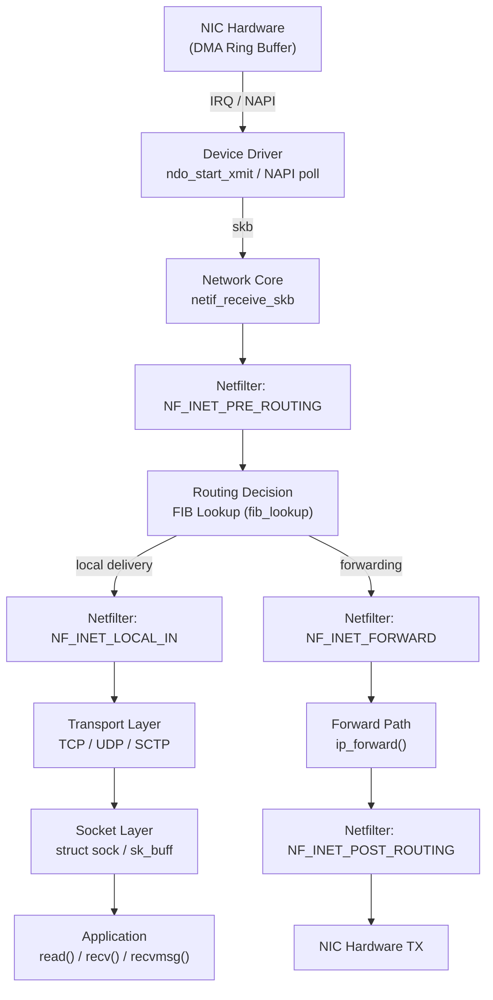
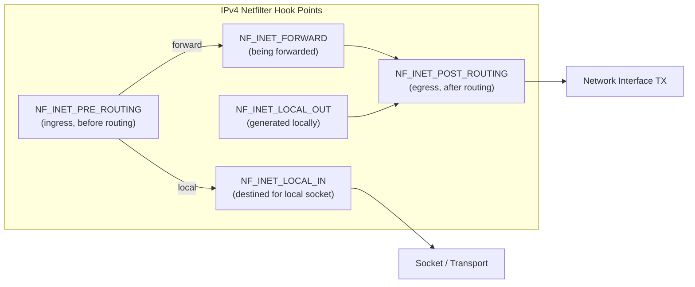
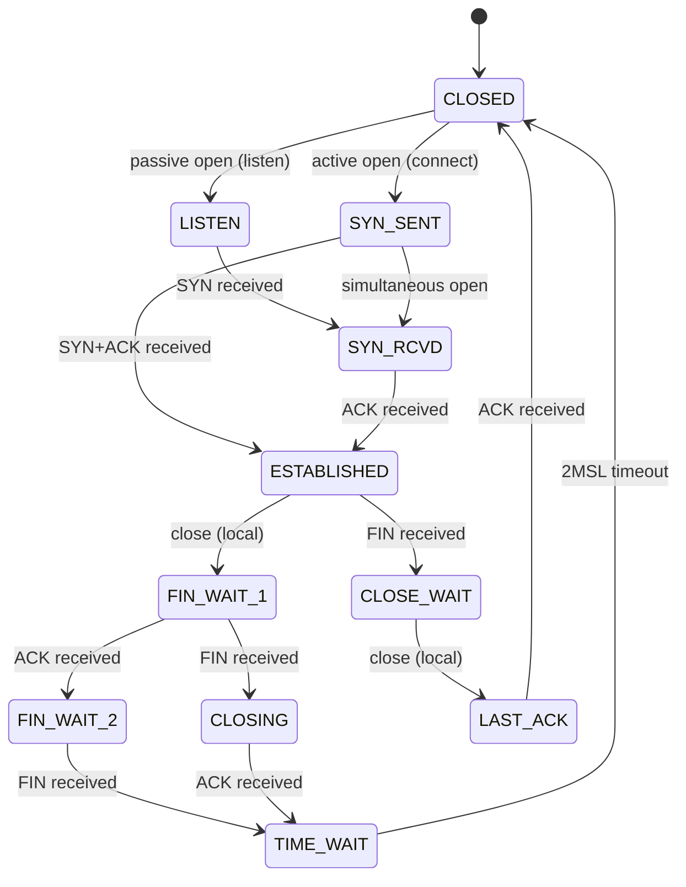
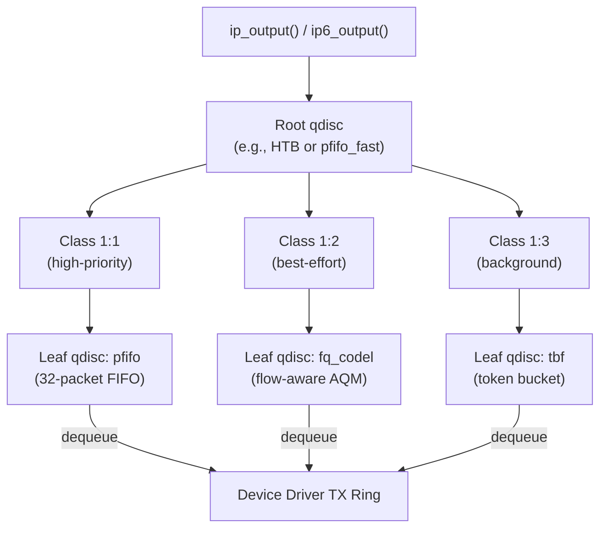
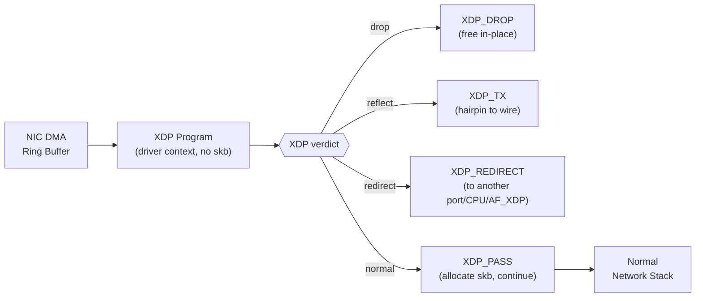
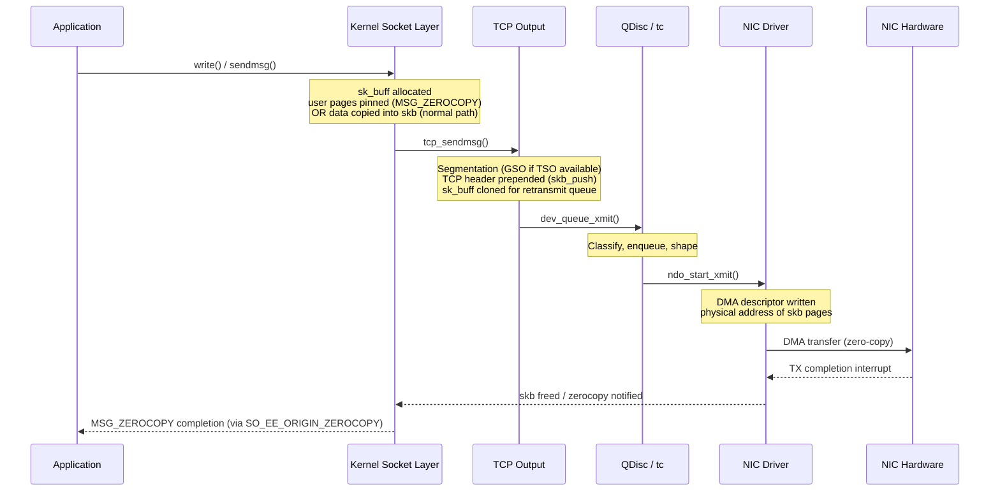
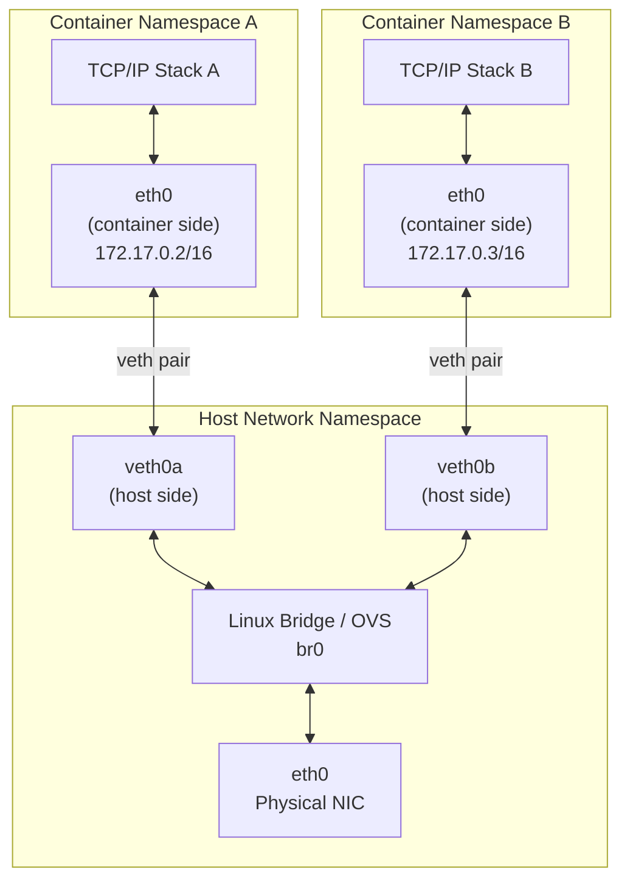

# Lesson 3: The Linux Networking Stack

## 1. First-Principles Invariants

Every networking stack, regardless of OS, must satisfy a small set of mathematical invariants. The Linux implementation is best understood as a set of engineering decisions made in service of these invariants.

**Invariant 1: Message Integrity.** A transmitted byte stream must arrive identical to what was sent, in order, without duplication, and without corruption. TCP enforces this through a 32-bit sequence number space, per-segment checksums (CRC-16 over the pseudo-header + segment), cumulative acknowledgment, and retransmission on timeout or triple-duplicate ACK. The sequence number space wraps around at 2³² bytes; on a 10 Gbps link, wrap-around occurs in roughly 3.4 seconds. PAWS (Protection Against Wrapped Sequences, RFC 1323) uses the TCP timestamp option to disambiguate reordered segments from earlier incarnations of the same connection—this is not optional on modern hardware.

**Invariant 2: Address Resolution.** A logical network address (IPv4/IPv6) must be resolved to a hardware address (MAC) before a frame can be transmitted on a shared medium. IPv4 uses ARP (RFC 826), a broadcast-based protocol that caches `<IP → MAC>` pairs in a kernel neighbor table (`struct neighbour`, managed by the neighbor subsystem in `net/core/neighbour.c`). IPv6 replaces ARP entirely with the Neighbor Discovery Protocol (NDP, RFC 4861), which uses ICMPv6 Neighbor Solicitation and Advertisement messages sent to solicited-node multicast addresses rather than layer-2 broadcasts—a critical scalability improvement. Both protocols are subject to cache poisoning attacks; Linux mitigates this with `arp_validate` and RFC 7113 RA guard.

**Invariant 3: Routing Correctness.** Each packet must be forwarded along a path that terminates at its destination within bounded time. The kernel maintains a Forwarding Information Base (FIB), implemented as a compressed LC-trie (Patricia trie) in `net/ipv4/fib_trie.c`. Lookup complexity is O(W) where W is the address width (32 for IPv4, 128 for IPv6), not O(n) in the number of routes. The route cache was removed in Linux 3.6 because under adversarial traffic it caused unbounded memory growth; modern kernels do per-packet FIB lookups, which the trie structure makes fast enough in practice.

**Invariant 4: Resource Fairness Under Load.** No single flow or application may monopolize kernel memory, CPU time, or queue depth. This is enforced at multiple layers: socket send/receive buffer limits (`SO_SNDBUF`/`SO_RCVBUF`), traffic control queuing disciplines (qdiscs), TCP congestion control algorithms (CUBIC, BBR), and the kernel's memory pressure notification system (`sk_mem_charge`/`sk_mem_uncharge`). When the system-wide socket memory ceiling (`net.ipv4.tcp_mem`) is exceeded, the kernel enters "memory pressure" mode and reduces per-socket buffer allocation, causing back-pressure that propagates to applications.

---

## 2. Architectural Overview

The Linux networking stack maps the IETF conceptual model onto kernel subsystems with a strict layering discipline. Data flowing upward from hardware passes through the following stages:



Each arrow represents a hand-off of a `struct sk_buff`—the kernel's universal packet descriptor. No data is copied at these transitions; only the pointer advances.

---

## 3. The Socket Buffer: `struct sk_buff`

The `sk_buff` (socket buffer, defined in `include/linux/skbuff.h`) is the most important data structure in the networking stack. It represents a single packet or fragment at every layer. Its design reflects two decades of performance optimization.

```c
/* Simplified excerpt — Linux 6.x */
struct sk_buff {
    /* --- Packet data pointers (no copies between layers) --- */
    unsigned char   *head;    /* start of allocated buffer         */
    unsigned char   *data;    /* start of current layer payload    */
    unsigned char   *tail;    /* end of current layer payload      */
    unsigned char   *end;     /* end of allocated buffer           */

    /* --- Length fields --- */
    unsigned int    len;      /* total length: data + frags        */
    unsigned int    data_len; /* length of paged (frag) data       */

    /* --- Routing & device metadata --- */
    struct net_device   *dev;
    struct dst_entry    *dst;     /* routing cache entry            */

    /* --- Protocol identification --- */
    __be16          protocol;    /* Ethernet type (ETH_P_IP, etc.) */
    __u16           transport_header;
    __u16           network_header;
    __u16           mac_header;

    /* --- Timestamps, marks, priority --- */
    ktime_t         tstamp;
    __u32           mark;
    __u16           queue_mapping;

    /* --- Checksum offload state --- */
    __u8            ip_summed;   /* CHECKSUM_NONE/PARTIAL/COMPLETE */
    __wsum          csum;

    /* --- Fragment list for GSO/GRO --- */
    skb_frag_t      frags[MAX_SKB_FRAGS];
    __u8            nr_frags;
};
```

The layering protocol is achieved by advancing the `data` pointer on ingress (stripping headers) and retreating it on egress (prepending headers). This is the `skb_pull()`/`skb_push()` interface. No memory allocation or copy occurs at layer boundaries for the common path.

For large sends, the kernel avoids copying application data into `sk_buff` body pages entirely. Instead, `sendfile()` and `MSG_ZEROCOPY` attach references to user pages or file-backed pages into the `frags[]` array. The NIC's scatter-gather DMA engine reads directly from those pages.

---

## 4. Device Driver and NAPI

Historically, each arriving packet triggered a hardware interrupt, which invoked a bottom-half handler to process the packet. Under high packet rates, the system spent more time handling interrupts than doing useful work—the "interrupt livelock" problem documented by Mogul & Ramakrishnan (1997). NAPI (New API, introduced in Linux 2.6) resolves this with a hybrid interrupt/polling model.

**NAPI operation:**

1. The first packet arrival triggers a hardware interrupt. The driver's interrupt handler calls `napi_schedule()`, which enqueues a `struct napi_struct` onto the per-CPU `softnet_data.poll_list` and raises `NET_RX_SOFTIRQ`.
2. The driver **disables further hardware interrupts** for that queue.
3. The softirq handler `net_rx_action()` calls the driver's `.poll()` callback in a loop, draining up to `netdev_budget` (default 300) packets from the DMA ring before yielding.
4. If the ring is drained before the budget is exhausted, the driver re-enables hardware interrupts and exits poll mode.

```c
/* Minimal NAPI-compliant driver poll callback */
static int mydrv_poll(struct napi_struct *napi, int budget)
{
    struct mydrv_priv *priv = container_of(napi, struct mydrv_priv, napi);
    int work_done = 0;

    while (work_done < budget) {
        struct sk_buff *skb = mydrv_rx_one_packet(priv);
        if (!skb)
            break;

        /* Hand off to network core — no copy, just pointer */
        napi_gro_receive(napi, skb);
        work_done++;
    }

    if (work_done < budget) {
        /* Ring drained: exit poll mode, re-enable IRQ */
        napi_complete_done(napi, work_done);
        mydrv_enable_irq(priv);
    }

    return work_done;
}
```

GRO (Generic Receive Offload) in `napi_gro_receive()` coalesces multiple small TCP segments arriving in the same NAPI poll cycle into a single large `sk_buff` before passing it up the stack. This reduces the per-packet overhead in the IP and TCP layers and is the receive-side analog of TSO.

---

## 5. Netfilter Hook Architecture

Netfilter provides five hook points in the IPv4 (and separately IPv6) packet path. Each hook point is a prioritized list of registered callbacks. The kernel invokes them in priority order; any callback may return `NF_ACCEPT`, `NF_DROP`, `NF_STOLEN`, `NF_QUEUE`, or `NF_REPEAT`.



`iptables`, `nftables`, and `eBPF tc/XDP` all attach to these hooks (or below them). The API changed in Linux 4.13: `nf_register_hook()` was deprecated in favor of `nf_register_net_hook()`, which scopes the hook to a network namespace. The old function still exists as a wrapper for the init namespace but should not be used in new code.

The registration structure:

```c
static struct nf_hook_ops my_nf_ops = {
    .hook     = my_hook_fn,
    .pf       = NFPROTO_IPV4,
    .hooknum  = NF_INET_PRE_ROUTING,
    .priority = NF_IP_PRI_FIRST,   /* -2147483648 — runs before conntrack */
};

/* Register scoped to a specific network namespace */
nf_register_net_hook(net, &my_nf_ops);
```

---

## 6. The TCP State Machine

TCP is a finite state machine with 11 defined states (RFC 793 + RFC 1122 clarifications). The kernel tracks per-connection state in `struct tcp_sock` (which embeds `struct inet_connection_sock`, which embeds `struct sock`).



TIME_WAIT lasts 2×MSL (Maximum Segment Lifetime), set to 60 seconds in Linux (`TCP_TIMEWAIT_LEN = 60 * HZ`). Its purpose is twofold: allow the final ACK to be retransmitted if lost, and prevent delayed segments from a prior connection being accepted by a new one. `net.ipv4.tcp_tw_reuse = 1` permits reuse of TIME_WAIT sockets for new outgoing connections when timestamps are in use—safe because PAWS distinguishes old segments. `tcp_tw_recycle` was removed in Linux 4.12 because it broke connections through NAT.

The critical fast-path in TCP receive is `tcp_rcv_established()` in `net/ipv4/tcp_input.c`. It handles the common case (in-order segment, window not exceeded, no urgent data) in roughly 40–60 ns on modern hardware. The slow path, `tcp_data_queue()`, handles out-of-order segments, SACK processing, and buffer management.

---

## 7. Congestion Control: Architecture and Algorithms

Linux implements a pluggable congestion control framework. Each algorithm registers a `struct tcp_congestion_ops`:

```c
struct tcp_congestion_ops {
    /* Required */
    void     (*ssthresh)(struct sock *sk);          /* reduce cwnd    */
    void     (*cong_avoid)(struct sock *sk,
                           u32 ack, u32 acked);     /* increase cwnd  */
    /* Optional */
    u32      (*undo_cwnd)(struct sock *sk);         /* undo reduction */
    void     (*pkts_acked)(struct sock *sk,
                           const struct ack_sample *sample);
    void     (*cwnd_event)(struct sock *sk,
                           enum tcp_ca_event event);
    void     (*init)(struct sock *sk);
    void     (*release)(struct sock *sk);
    char     name[TCP_CA_NAME_MAX];
    struct module *owner;
};
```

**CUBIC** (default since Linux 2.6.19): uses a cubic function of time since the last congestion event to set `cwnd`, making it RTT-independent and fair among flows with different RTTs. The growth function is `W(t) = C(t - K)³ + W_max`, where K is computed so that `W(0) = W_max/2`.

**BBR (Bottleneck Bandwidth and RTT)**: rather than reacting to loss, BBR estimates the bottleneck bandwidth (BtlBw) and minimum RTT (RTprop) using a Kalman-style filter, then sets the sending rate to `BtlBw × RTprop`. BBR v1 (Linux 4.9) has known issues with fairness against CUBIC flows; BBR v3 is in active upstream development. BBR is strictly a rate-based algorithm and does not use `ssthresh` in the traditional sense.

---

## 8. The Traffic Control (tc) Subsystem

Traffic control implements per-interface packet scheduling. The `qdisc` (queuing discipline) sits between the IP output path and the device driver's TX ring. The architecture is a tree of qdiscs and classes:



**fq_codel** (Fair Queue Controlled Delay, RFC 8290) is the recommended default leaf qdisc for most deployments. It combines per-flow fair queuing (eliminating head-of-line blocking between flows) with the CoDel AQM algorithm, which signals congestion based on sojourn time exceeding a target (5 ms by default) rather than queue depth. This eliminates bufferbloat—the pathological case where large buffers cause high, stable latency without packet loss.

Configuring a bandwidth hierarchy with `tc`:

```bash
# Create HTB root qdisc on eth0
tc qdisc add dev eth0 root handle 1: htb default 30

# Root class: 1 Gbps ceiling
tc class add dev eth0 parent 1: classid 1:1 htb rate 1gbit

# High-priority class: guaranteed 500 Mbps, can burst to 800 Mbps
tc class add dev eth0 parent 1:1 classid 1:10 htb \
    rate 500mbit ceil 800mbit prio 1

# Best-effort class: guaranteed 400 Mbps
tc class add dev eth0 parent 1:1 classid 1:20 htb \
    rate 400mbit ceil 1gbit prio 2

# Background class: 100 Mbps
tc class add dev eth0 parent 1:1 classid 1:30 htb \
    rate 100mbit ceil 200mbit prio 3

# Attach fq_codel to each leaf
tc qdisc add dev eth0 parent 1:10 handle 10: fq_codel
tc qdisc add dev eth0 parent 1:20 handle 20: fq_codel
tc qdisc add dev eth0 parent 1:30 handle 30: fq_codel

# Classify DSCP CS5 (voice) to high-priority class
tc filter add dev eth0 parent 1: protocol ip prio 1 \
    u32 match ip dsfield 0xa0 0xe0 flowid 1:10
```

---

## 9. eBPF and XDP: Programmable Fast Path

Extended Berkeley Packet Filter (eBPF) allows user-supplied programs to run in a kernel-verified sandbox at multiple hook points. For networking, the two most performance-critical attachment points are:

**XDP (eXpress Data Path):** runs eBPF programs inside the device driver's NAPI poll loop, before `sk_buff` allocation. This is the fastest possible position in the stack—on a supported NIC with native XDP, it operates below the kernel networking stack entirely.



XDP_DROP eliminates the most expensive DDoS mitigation cost: allocating an `sk_buff` only to immediately free it. A single core running XDP drop can process 20–30 Mpps on a 100G NIC—orders of magnitude beyond iptables.

A minimal XDP program in C (compiled with clang + libbpf):

```c
#include <linux/bpf.h>
#include <linux/if_ether.h>
#include <linux/ip.h>
#include <linux/udp.h>
#include <bpf/bpf_helpers.h>
#include <bpf/bpf_endian.h>

/* Map: blocked source IPs → 1 */
struct {
    __uint(type, BPF_MAP_TYPE_HASH);
    __uint(max_entries, 1 << 16);
    __type(key,   __u32);  /* IPv4 src addr */
    __type(value, __u8);
} blocklist SEC(".maps");

SEC("xdp")
int xdp_drop_blocked(struct xdp_md *ctx)
{
    void *data     = (void *)(long)ctx->data;
    void *data_end = (void *)(long)ctx->data_end;

    struct ethhdr *eth = data;
    if ((void *)(eth + 1) > data_end)
        return XDP_PASS;

    if (bpf_ntohs(eth->h_proto) != ETH_P_IP)
        return XDP_PASS;

    struct iphdr *ip = (void *)(eth + 1);
    if ((void *)(ip + 1) > data_end)
        return XDP_PASS;

    __u32 src = ip->saddr;
    __u8  *blocked = bpf_map_lookup_elem(&blocklist, &src);
    if (blocked)
        return XDP_DROP;

    return XDP_PASS;
}

char _license[] SEC("license") = "GPL";
```

**tc BPF (cls_bpf / BPF_PROG_TYPE_SCHED_CLS):** runs after `sk_buff` allocation, at the tc ingress or egress hook. It has full access to the `sk_buff` context including socket metadata and can modify packet headers, redirect flows, and implement policy routing. This is the attachment point used by Cilium for Kubernetes network policy enforcement.

---

## 10. Memory Architecture: `sk_buff` Lifecycle and Zero-Copy

Understanding where memory allocations and copies occur is essential for performance analysis.



The `MSG_ZEROCOPY` path (Linux 4.14+) pins user pages and passes their physical addresses directly to the DMA engine. The application must not modify those pages until it receives a completion notification via `recvmsg()` on the error queue. For small messages (< ~1 KB), the per-page pinning overhead exceeds the copy cost—use zero-copy only for large, sustained transfers.

For receive-side zero-copy, `AF_XDP` sockets with `XDP_ZEROCOPY` flag allow the NIC to DMA frames directly into application-owned memory mapped via `mmap()`. The application communicates with the kernel via two pairs of SPSC (single-producer, single-consumer) lockless ring buffers: UMEM fill/completion rings for memory management and RX/TX rings for packet I/O.

```python
# AF_XDP socket setup (using xdp-tools / libxdp Python bindings)
# This demonstrates the UMEM registration and ring structure concept
import ctypes, mmap, socket

FRAME_SIZE    = 4096
FRAME_COUNT   = 1024
UMEM_SIZE     = FRAME_SIZE * FRAME_COUNT

# 1. Allocate aligned UMEM
umem_area = mmap.mmap(-1, UMEM_SIZE,
                      mmap.MAP_SHARED | mmap.MAP_ANONYMOUS,
                      mmap.PROT_READ  | mmap.PROT_WRITE)

# 2. Register UMEM with kernel via XDP_UMEM_REG setsockopt
# 3. Create fill ring and completion ring (kernel writes DMA completions here)
# 4. Bind AF_XDP socket to ifindex + queue_id via bind(sockaddr_xdp)
# 5. Enqueue UMEM frame addresses into fill ring
# 6. Poll socket for RX completions — no copies, NIC DMA'd directly into umem_area
```

---

## 11. Receive Side Scaling, Flow Steering, and Multi-Queue

Modern 10/25/100G NICs expose multiple hardware TX and RX queue pairs, each associated with a DMA ring and a hardware interrupt. Without multi-queue, all interrupts land on CPU 0, creating a single-core bottleneck.

**RSS (Receive Side Scaling):** the NIC computes a Toeplitz hash over the packet's (src IP, dst IP, src port, dst port) 4-tuple and uses it to select an RX queue. The hash-to-queue mapping is stored in an indirection table (RETA) that the driver exposes via `ethtool -X`. Linux then uses `irqbalance` or manual `/proc/irq/N/smp_affinity` to pin each RX queue interrupt to a distinct CPU core.

**RPS (Receive Packet Steering):** software RSS for drivers that do not support hardware multi-queue. The kernel recomputes the flow hash in software and routes the packet to the target CPU's input queue via inter-processor interrupt (IPI). Enabled per-interface via `/sys/class/net/eth0/queues/rx-0/rps_cpus`.

**RFS (Receive Flow Steering):** extends RPS to steer packets toward the CPU where the application thread consuming that socket is currently running, reducing cache misses. The kernel maintains a global flow-to-CPU mapping table (`rps_sock_flow_table`) updated on `recvmsg()`. Configured via `/proc/sys/net/core/rps_sock_flow_entries`.

**XPS (Transmit Packet Steering):** maps TX queues to CPUs so that a CPU's outgoing traffic uses a TX queue whose completion interrupts are also handled by that CPU, eliminating cross-CPU cache traffic in the TX path.

```bash
# Pin RSS queue interrupts to specific CPUs (8-queue NIC on 8-core system)
for i in $(seq 0 7); do
    irq=$(grep "eth0-TxRx-$i" /proc/interrupts | awk '{print $1}' | tr -d ':')
    echo $((1 << i)) > /proc/irq/${irq}/smp_affinity
done

# Enable RFS with 32768 flow table entries
echo 32768 > /proc/sys/net/core/rps_sock_flow_entries
for rx_queue in /sys/class/net/eth0/queues/rx-*/rps_flow_cnt; do
    echo 4096 > "$rx_queue"
done
```

---

## 12. Performance Failure Modes and Mitigations

### 12.1 Buffer Bloat

Default socket buffer sizes are often auto-tuned (`net.ipv4.tcp_rmem`/`tcp_wmem`) to values that fill the BDP (Bandwidth-Delay Product) of the path. On high-BDP paths (10 Gbps LAN, 10 ms RTT), this results in multi-MB buffers, which can induce 100+ ms of queuing latency for competing flows. The correct mitigation is not to reduce buffers (which would throttle throughput) but to use AQM: deploy `fq_codel` or `cake` as the egress qdisc on bottleneck interfaces.

### 12.2 Interrupt Coalescing Misconfiguration

Interrupt coalescing (`ethtool -C eth0 rx-usecs 50 tx-usecs 50`) batches interrupts to reduce per-packet CPU overhead. Setting `rx-usecs` too high increases latency for latency-sensitive workloads (e.g., RPC). Setting it too low causes interrupt storms. The kernel's adaptive coalescing mode (`adaptive-rx on`) dynamically adjusts coalescing based on observed traffic patterns and is appropriate for mixed workloads.

### 12.3 Socket Memory Exhaustion

```bash
# Inspect system-wide TCP memory pressure
cat /proc/net/sockstat
# Output includes:
# TCP: inuse 1234 orphan 56 tw 789 alloc 1234 mem 45678
# 'mem' is in units of PAGE_SIZE; compare against tcp_mem[2] (hard limit)

# Tune TCP memory limits (values in pages: 4KB each)
# Format: low  pressure  max
sysctl -w net.ipv4.tcp_mem="94500 125000 187500"

# Per-socket limits (bytes)
sysctl -w net.ipv4.tcp_rmem="4096 87380 16777216"
sysctl -w net.ipv4.tcp_wmem="4096 65536 16777216"
```

When `mem` approaches `tcp_mem[2]`, the kernel enters global TCP memory pressure: `sk_stream_wait_memory()` blocks `sendmsg()` callers. Orphaned sockets (closed by application but not yet fully drained) consume memory without an owning file descriptor; `net.ipv4.tcp_max_orphans` caps their count. Exceeding it causes the kernel to send RST and immediately destroy the socket.

### 12.4 TIME_WAIT Socket Accumulation

A server that initiates active closes accumulates TIME_WAIT sockets. Each consumes a `struct tcp_timewait_sock` (168 bytes on x86-64). With 60-second TTL and 100 K connections/second close rate, steady-state accumulation is 6 million sockets—roughly 1 GB. Mitigations in order of preference:

1. Ensure the client initiates the close (HTTP keep-alive, gRPC).
2. Enable `net.ipv4.tcp_tw_reuse = 1` (safe with timestamps).
3. Use `SO_LINGER` with `l_linger = 0` to send RST on close—breaks protocol correctness, use only for internal services where both sides are controlled.

### 12.5 SYN Flood and SYN Cookies

A SYN flood exhausts the kernel's half-open connection queue (`net.ipv4.tcp_max_syn_backlog`). Linux defends with SYN cookies (RFC 4938): when the queue is full, the kernel encodes connection parameters into the ISN (Initial Sequence Number) cryptographically and sends a SYN-ACK without allocating a `struct request_sock`. If the client's ACK arrives with the correct cookie, the connection is reconstructed. SYN cookies are incompatible with TCP options that require state in the `request_sock` (e.g., SACK, window scaling)—Linux degrades gracefully by omitting those options when cookies are active.

```bash
# Monitor SYN cookie usage
watch -n1 'netstat -s | grep -i cookie'
# Output: N SYN cookies sent, M SYN cookies received

# Tune
sysctl -w net.ipv4.tcp_syncookies=1          # enable (usually default)
sysctl -w net.ipv4.tcp_max_syn_backlog=4096  # half-open queue depth
sysctl -w net.ipv4.tcp_synack_retries=2      # reduce SYN-ACK retries under attack
```

---

## 13. Network Namespaces and Virtual Networking

Network namespaces (introduced in Linux 2.6.24, generalized in 2.6.29) provide complete isolation of the network stack. Each namespace has its own interfaces, routing table, ARP table, netfilter rules, and sockets. This is the foundation of container networking.



A `veth` pair is a point-to-point virtual Ethernet cable: packets written to one end appear on the other. The kernel implements it in `drivers/net/veth.c`; the transmit path of one end calls `netif_rx()` on the peer end directly—there is no serialization through a qdisc on the loopback path, which is why `veth` can achieve near-zero latency for intra-host container communication when both ends share the same CPU cache.

```bash
# Create an isolated network namespace and wire it to the host
ip netns add container_a

# Create veth pair
ip link add veth_host type veth peer name veth_ctr

# Move one end into the namespace
ip link set veth_ctr netns container_a

# Configure addressing
ip link set veth_host up
ip addr add 10.0.0.1/24 dev veth_host

ip netns exec container_a ip link set veth_ctr up
ip netns exec container_a ip addr add 10.0.0.2/24 dev veth_ctr
