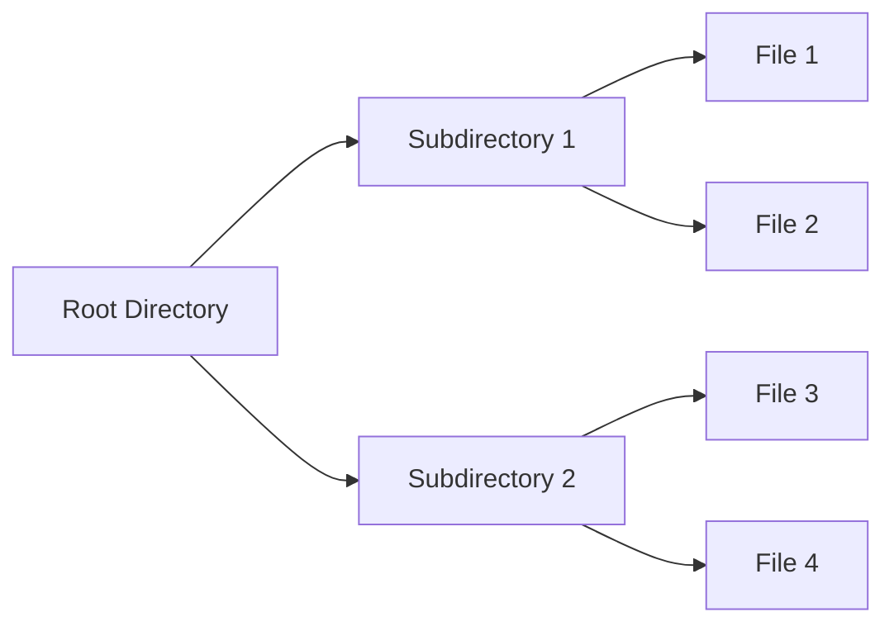

Here is the fully corrected, publication-grade, raw Markdown:

# Lesson 4: File Systems and Storage Management

## 1. First-Principles Intuition & Invariants

A file system is the backbone of any operating system, providing a structured way to organize, store, and retrieve data. At its core, a file system is a hierarchical organization of files and directories, with each file represented by a unique identifier, known as an inode. This inode contains metadata about the file, such as its ownership, permissions, and location on disk.

The problem space for file systems and storage management is vast, encompassing issues of data integrity, availability, and performance. A file system must balance the need for efficient storage and retrieval of data with the need for robust protection against data loss and corruption. This balance is achieved through a combination of algorithms, data structures, and hardware mechanisms.

One invariant of file systems is the concept of a file system tree, which represents the hierarchical organization of files and directories. This tree is rooted at the top-level directory, known as the root directory, and branches out to represent the various subdirectories and files. Each node in the tree represents a file or directory, and contains metadata about its contents and permissions.

Another invariant is the concept of file system layout, which refers to the way in which files and directories are organized on disk. This layout is typically determined by the file system's block size, which is the smallest unit of data that can be read or written to disk. The block size determines the number of blocks allocated to each file, and the way in which files are fragmented across the disk.

## 2. Core Architecture & Mechanics

A file system is composed of several key components, including:

*   **Inode Table**: A data structure that maps file inodes to their corresponding locations on disk.
*   **Block Cache**: A cache that stores frequently accessed blocks of data in memory.
*   **File System Tree**: A hierarchical organization of files and directories, represented by a tree data structure.

The inode table is a critical component of the file system, as it provides a mapping between file inodes and their locations on disk. Each inode contains metadata about the file, such as its ownership, permissions, and location on disk. The inode table is typically stored in memory, and is updated whenever a file is created, deleted, or modified.

The block cache is another important component of the file system, as it provides a cache for frequently accessed blocks of data. The block cache is typically implemented using a least recently used (LRU) cache algorithm, which evicts the least recently accessed blocks to make room for new ones.

The file system tree is a hierarchical organization of files and directories, represented by a tree data structure. Each node in the tree represents a file or directory, and contains metadata about its contents and permissions. The file system tree is typically stored in memory, and is updated whenever a file is created, deleted, or modified.

Here is a simplified representation of the file system tree using Mermaid:

## 3. High-Performance Optimization & Failure Modes

File systems and storage management are critical components of any operating system, and must be optimized for high performance and reliability. One key optimization technique is the use of caching, which can significantly improve the performance of file system operations.

Caching can be implemented using a variety of algorithms, including:

*   **Least Recently Used (LRU)**: Evicts the least recently accessed blocks to make room for new ones.
*   **Most Recently Used (MRU)**: Evicts the most recently accessed blocks to make room for new ones.

Another key optimization technique is the use of parallelism, which can significantly improve the performance of file system operations. Parallelism can be implemented using a variety of techniques, including:

*   **Multi-Threading**: Executes multiple threads concurrently to improve performance.
*   **Multi-Processing**: Executes multiple processes concurrently to improve performance.

In addition to optimization techniques, file systems and storage management must also be designed to handle failure modes. Failure modes can be categorized into two types:

*   **Hard Failures**: Permanent failures that result in data loss or corruption.
*   **Soft Failures**: Temporary failures that can be recovered from.

Hard failures can be caused by a variety of factors, including:

*   **Disk Failure**: Failure of a disk drive or storage device.
*   **Power Failure**: Sudden loss of power to the system.
*   **Hardware Failure**: Failure of a hardware component, such as a motherboard or CPU.

Soft failures can be caused by a variety of factors, including:

*   **Network Failure**: Failure of a network connection or communication link.
*   **Software Failure**: Failure of a software component or application.
*   **Human Error**: Mistakes made by system administrators or users.

To mitigate failure modes, file systems and storage management must be designed with robust error handling and recovery mechanisms. These mechanisms can include:

*   **Checksums**: Calculated values that can be used to detect data corruption or loss.
*   **Redundancy**: Duplicate data stored in multiple locations to ensure availability.
*   **Backup and Recovery**: Regular backups and recovery procedures to ensure data integrity.

By understanding the core architecture and mechanics of file systems and storage management, and by implementing high-performance optimization and failure mitigation techniques, system administrators and developers can ensure the reliability and availability of critical data.
