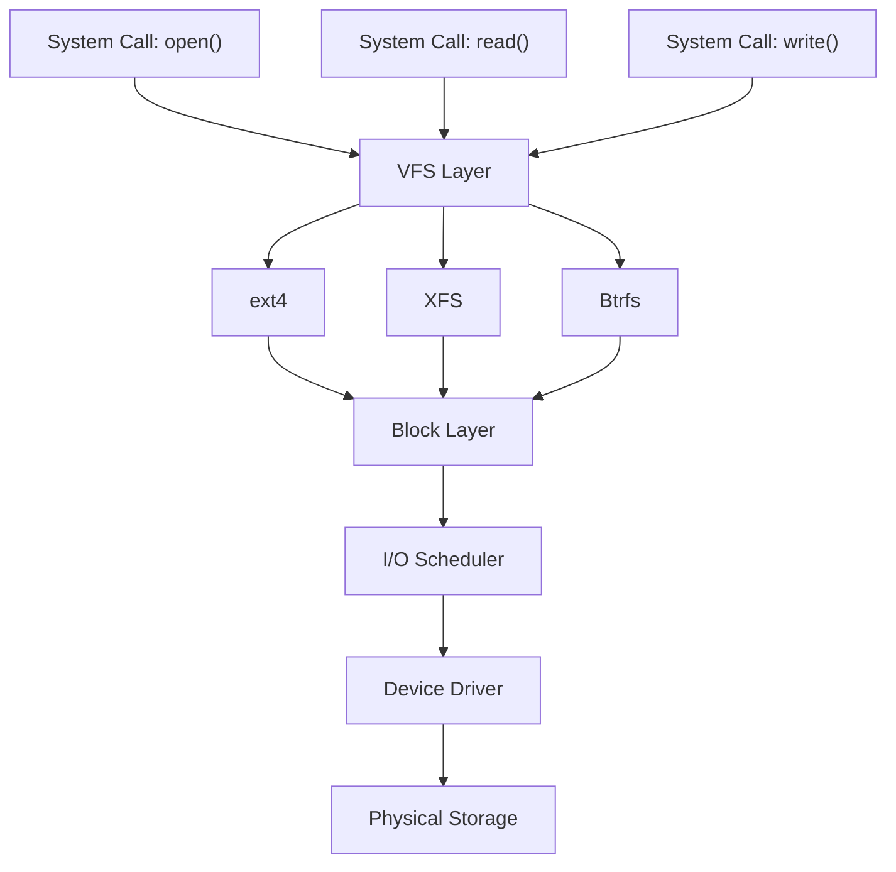
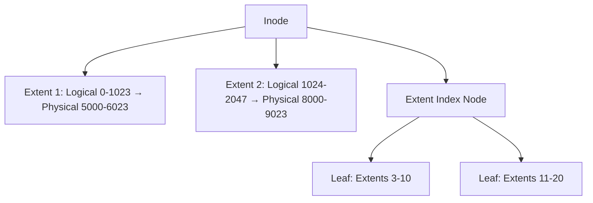
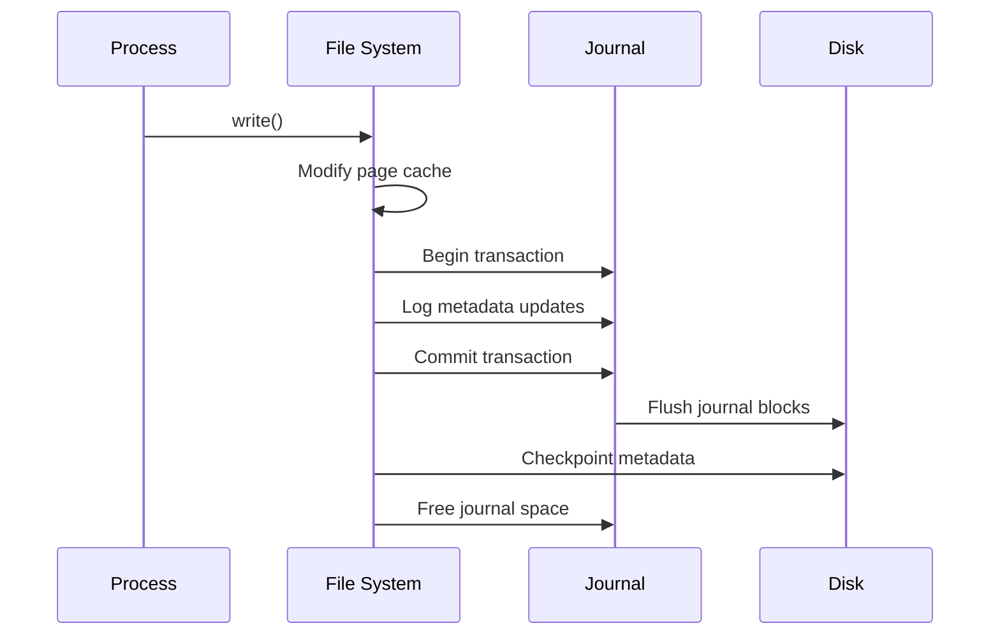
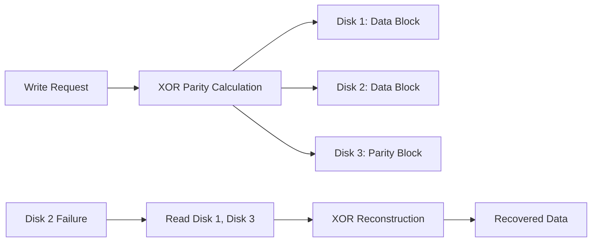
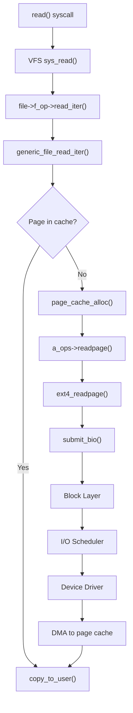

# Lesson 4: File Systems and Storage Management

## 1. First-Principles Intuition & Invariants

A file system transforms the raw, linear address space of a block device into a structured namespace for persistent data. At the hardware level, storage devices expose an array of fixed-size blocks (typically 512 bytes or 4 KiB sectors). The file system's fundamental task is to impose structure on this flat address space: mapping human-readable pathnames to block ranges, maintaining consistency across crashes, and mediating concurrent access.

The core abstraction is the **inode** (index node), borrowed from the original UNIX File System. An inode is an on-disk data structure that represents a file's metadata and location. Unlike the pathname (which is merely a namespace entry), the inode is the file's true identity. Multiple directory entries can reference the same inode (hard links), and the inode persists until its reference count reaches zero. This separation of name and identity is a foundational invariant: **pathnames are ephemeral namespace entries; inodes are the persistent file objects**.

### Fundamental Invariants

1. **Durability After fsync**: Once `fsync()` returns successfully, all prior writes to that file descriptor must survive a system crash. This requires write-ahead logging or copy-on-write mechanisms to ensure atomic updates.

2. **Directory Consistency**: A directory entry pointing to an inode must never reference a non-existent or recycled inode. This requires careful ordering of metadata writes and, in modern file systems, journaling or atomic commit protocols.

3. **Block Allocation Invariant**: A block can belong to at most one file (or metadata structure) at any time. Violations result in catastrophic corruption where unrelated files share storage.

4. **Hierarchical Namespace**: The file system tree is a directed acyclic graph (DAG) for hard links, but a strict tree when considering directories. Every directory has exactly one parent (except the root), preventing cycles that would make pathname resolution undecidable.

### Problem Space Constraints

File systems operate under harsh constraints:

- **Crash Consistency**: The system can lose power at any instant. Any sequence of incomplete writes must leave the file system in a recoverable state.
- **Performance**: Mechanical disks have seek times of 5–15 ms, requiring spatial locality and aggressive caching. Modern NVMe SSDs reduce latency to microseconds but introduce wear leveling concerns.
- **Concurrency**: Multiple processes and threads access the file system simultaneously. Lock contention in metadata structures (inode table, block allocator) becomes a scalability bottleneck.



## 2. Core Architecture & Mechanics

### On-Disk Layout: ext4 Dissection

The ext4 file system organizes the block device into **block groups**, each containing a redundant copy of critical metadata. A typical block group (with 4 KiB blocks and 128 MiB groups) contains:

1. **Superblock**: File system parameters (block size, inode count, feature flags). Replicated in multiple block groups for recovery.
2. **Group Descriptors**: Pointers to inode tables, block bitmaps, and inode bitmaps for each group.
3. **Block Bitmap**: One bit per block indicating allocation status (2^15 blocks = 128 MiB per group with 4 KiB blocks).
4. **Inode Bitmap**: One bit per inode indicating allocation status.
5. **Inode Table**: Array of inodes (typically 256 bytes each in ext4).
6. **Data Blocks**: The bulk of the block group, storing file contents and directory data.

### Inode Structure: Metadata and Block Mapping

An ext4 inode (256 bytes) contains:

- **File type and permissions** (16 bits)
- **Owner UID/GID** (32 bits each)
- **Timestamps**: atime (access), mtime (modification), ctime (inode change), crtime (creation) — all 64-bit nanosecond precision
- **Size** (64 bits for large file support)
- **Link count** (hard link reference count)
- **Block count** (number of 512-byte sectors allocated)
- **Extent tree root** (60 bytes)

#### Block Mapping: Extents vs. Indirect Blocks

Traditional UNIX file systems used **indirect block pointers**: the inode stored 12 direct block pointers, one single-indirect pointer (pointing to a block of pointers), one double-indirect, and one triple-indirect. This scheme allowed files up to ~4 TiB (with 4 KiB blocks) but required multiple disk seeks for large files.

ext4 uses **extents**: a compact representation where each extent describes a contiguous range of blocks. An extent is a (logical_block, physical_block, length) tuple, packed into 12 bytes. The inode stores up to 4 extents inline; larger files require an extent tree (a B-tree indexed by logical block number).



**Why extents?** Large files are often allocated contiguously. A 1 GiB file allocated in a single contiguous region requires one 12-byte extent, versus 256K pointers (1 MiB of metadata) with indirect blocks.

### Directory Implementation

Directories are special files containing a list of (name, inode) pairs. Small directories use a linear array; large directories use an **HTree** (hash tree) for O(log n) lookup. ext4's directory entry format:

```c
struct ext4_dir_entry_2 {
    __le32  inode;           // Inode number (0 if unused)
    __le16  rec_len;         // Directory entry length
    __u8    name_len;        // Filename length
    __u8    file_type;       // File type (regular, directory, symlink, etc.)
    char    name[EXT4_NAME_LEN];  // Filename (up to 255 bytes)
};
```

The `rec_len` field allows variable-length entries and efficient deletion (marking inode as 0 and coalescing space).

### The Page Cache: Bridging Memory and Storage

Linux unifies file and memory management through the **page cache**: a set of in-memory pages (4 KiB by default) indexed by (inode, offset). When a process calls `read()`, the kernel first checks the page cache. On a miss, it allocates a page, issues a block I/O request, and blocks the process. On a hit, it copies data from the cache to userspace without disk access.

The page cache uses an **LRU (Least Recently Used)** eviction policy, implemented as two lists: active and inactive. Pages are promoted to active on repeated access and demoted to inactive over time. Under memory pressure, the kernel reclaims inactive pages.

**Writeback**: Dirty pages (modified in the page cache) are flushed to disk asynchronously by kernel threads (`pdflush`/`writeback`). This amortizes disk I/O but requires careful ordering: metadata must be written before data to maintain consistency.

### Journaling: Crash Consistency Guarantees

ext4 uses a **write-ahead log (journal)** to ensure crash consistency. Before modifying file system structures on disk, the file system writes a transaction to the journal:

1. **Journal Write**: Log the intended changes (metadata blocks) to the journal.
2. **Journal Commit**: Write a commit block, marking the transaction as complete.
3. **Checkpoint**: Write the actual changes to their final locations on disk.
4. **Journal Discard**: Free the journal space.

On crash recovery, the file system replays any committed transactions in the journal, ensuring metadata consistency.

**Journaling Modes**:

- **Data=journal**: Log both metadata and data (safest, slowest).
- **Data=ordered** (default): Log metadata, ensure data writes complete before metadata commits.
- **Data=writeback**: Log metadata only, no ordering guarantees for data (fastest, risks stale data after crash).



### Modern File Systems: Copy-on-Write and B-Trees

Btrfs and ZFS take a radically different approach: **copy-on-write (CoW)**. Instead of overwriting blocks in-place, they allocate new blocks for modifications and atomically update pointers. This eliminates the need for a traditional journal and enables features like snapshots and integrity checking.

**B-tree-based layout**: Btrfs organizes all metadata (inodes, directory entries, extent maps) in a single B-tree, allowing efficient range queries and defragmentation. Each tree node is a 4 KiB page containing (key, value) pairs, sorted by a 136-bit key encoding (objectid, type, offset).

**Checksumming**: Every data and metadata block has a CRC32C checksum stored in the extent tree. On read, the checksum is verified; mismatches trigger repair from RAID mirrors or parity.

## 3. High-Performance Optimization & Failure Modes

### Caching Strategies Beyond LRU

**2Q (Two Queue) Algorithm**: Maintains a FIFO queue for pages seen once and an LRU queue for pages accessed multiple times. This prevents sequential scans from evicting hot pages.

**ARC (Adaptive Replacement Cache)**: Used by ZFS, ARC dynamically balances between recency (LRU) and frequency (LFU) by maintaining four lists: recently used once, recently used multiple times, ghost entries for evicted LRU, and ghost entries for evicted LFU.

**Read-ahead**: The kernel detects sequential access patterns and prefetches subsequent pages. ext4's multi-block allocator also tries to allocate contiguous blocks to maximize sequential throughput.

### Parallelism and Scalability

**Per-CPU Data Structures**: Modern file systems avoid global locks by using per-CPU counters for block allocation and per-directory locks for namespace operations.

**RCU (Read-Copy-Update)**: The VFS layer uses RCU for directory entry cache (dcache) lookups, allowing lock-free reads while updates happen concurrently.

**Extent Status Tree**: ext4 maintains an in-memory rbtree of extent states (delayed allocation, unwritten, cached) to track block mapping without holding inode locks.

### I/O Scheduling and Block Layer

**CFQ (Completely Fair Queuing)**: Allocates I/O bandwidth fairly among processes, preventing starvation. Each process has a priority-based time slice.

**Deadline Scheduler**: Ensures I/O requests complete within a deadline (typically 500 ms for reads), preventing indefinite starvation from continuous writes.

**mq-deadline and BFQ**: Modern multi-queue schedulers for NVMe devices, exploiting hardware parallelism with per-CPU submission queues.

```c
// Example: Direct I/O bypassing page cache
#include <fcntl.h>
#include <unistd.h>
#include <stdlib.h>

int main() {
    int fd = open("/dev/sda1", O_RDONLY | O_DIRECT);
    void *buf;
    posix_memalign(&buf, 4096, 4096);  // Aligned buffer required
    
    ssize_t bytes = pread(fd, buf, 4096, 0);  // Read block 0
    
    free(buf);
    close(fd);
    return 0;
}
```

**O_DIRECT**: Bypasses the page cache, used by databases (PostgreSQL, MySQL) to manage their own buffer pools. Requires aligned buffers and I/O sizes.

### Failure Modes and Mitigation

#### Silent Data Corruption

**Cause**: Bit flips in memory, firmware bugs, disk media degradation.

**Detection**: ZFS and Btrfs checksums. ext4 only checksums metadata by default; data checksumming requires `inode_checksum` feature.

**Mitigation**: RAID 1/10 (mirroring) or RAID 5/6 (parity). ZFS's `scrub` command periodically verifies all checksums and repairs from redundant copies.

#### Metadata Corruption

**Cause**: Incomplete writes during crash, bad RAM, kernel bugs.

**Detection**: `e2fsck` (ext4), `xfs_repair` (XFS), `btrfs check` verify internal consistency (inode link counts, block bitmaps, directory structure).

**Mitigation**: Journaling ensures atomic metadata updates. File system snapshots (Btrfs, ZFS) allow rollback to known-good state.

#### Disk Failure and RAID

**RAID 0**: Striping for performance, no redundancy. One disk failure loses all data.

**RAID 1**: Mirroring. Tolerates failure of N-1 disks (for N mirrors).

**RAID 5**: Block-level striping with distributed parity. Tolerates one disk failure. Write penalty: each write requires reading old data/parity, computing new parity, and writing new data/parity (4 I/O operations).

**RAID 6**: Dual parity, tolerates two disk failures. Higher write penalty.

**RAID 10**: Mirrored stripes (RAID 1+0). Best performance and redundancy, but 50% capacity overhead.



#### Write Amplification in SSDs

**Cause**: SSDs erase in large blocks (256 KiB) but write in small pages (4 KiB). Overwriting a page requires reading the entire block, modifying it in memory, and writing to a new location (garbage collection).

**Mitigation**: Over-provisioning (keeping 20-30% of SSD capacity unallocated), TRIM/DISCARD commands (notifying SSD of deleted blocks), and aligning file system partitions to erase block boundaries.

#### Quota and Resource Exhaustion

**inode exhaustion**: ext4 allocates a fixed number of inodes at `mkfs` time (one per 16 KiB by default). Creating millions of small files can exhaust inodes while space remains.

**Mitigation**: XFS and Btrfs dynamically allocate inodes. ext4 can be formatted with more inodes (`-i` option) or use extent-based inode tables (ext4's `inline_data` feature for tiny files).

### Advanced Techniques

#### Online Defragmentation

Fragmentation reduces sequential I/O performance. ext4's `e4defrag` relocates file extents to contiguous regions without unmounting. Btrfs's `btrfs filesystem defragment` rewrites fragmented files using CoW.

#### Deduplication

ZFS and Btrfs support block-level deduplication: identical blocks are stored once, with multiple references. Requires substantial RAM for dedup tables (1 GiB per 1 TiB of unique data in ZFS).

#### Compression

Btrfs and ZFS support transparent compression (LZ4, Zstd). Trades CPU for reduced I/O and increased effective capacity. LZ4 compresses at ~500 MB/s per core, suitable for most workloads.

```python
# Python example: using os.sync() to ensure durability
import os

def atomic_write(filepath, data):
    """Write data to file with crash-safe guarantees."""
    temp_path = filepath + ".tmp"
    
    # Write to temporary file
    with open(temp_path, 'wb') as f:
        f.write(data)
        f.flush()
        os.fsync(f.fileno())  # Force write to disk
    
    # Sync directory to persist rename
    dir_fd = os.open(os.path.dirname(filepath), os.O_RDONLY)
    os.rename(temp_path, filepath)  # Atomic rename
    os.fsync(dir_fd)
    os.close(dir_fd)
```

#### Snapshot and Cloning

CoW file systems enable instant snapshots: creating a new root pointer to the current B-tree without copying data. Subsequent writes trigger CoW, diverging the snapshot from the live file system. Snapshots enable:

- **Backup**: Consistent point-in-time backup without downtime.
- **Rollback**: Revert to previous state after failed updates.
- **Cloning**: Instant VM or container provisioning by cloning a template snapshot.

### Real-World Case Study: MySQL on ext4 vs. XFS

**Workload**: High-concurrency OLTP (online transaction processing) with 16 KiB InnoDB pages.

**ext4 issues**:
- Delayed allocation can cause stalls during large sequential writes.
- Single-threaded journaling becomes a bottleneck beyond ~10K IOPS.

**XFS advantages**:
- Scalable B-tree extent allocation with per-allocation group locks.
- Parallel journaling (log striping) for high-throughput workloads.
- Efficient handling of large files (InnoDB tablespaces).

**Configuration**: Disable barriers if battery-backed RAID controller ensures write ordering. Use `noatime` mount option to skip access time updates (eliminates metadata write on every read).

```bash
# Mount options for MySQL on XFS
mount -o noatime,nodiratime,logbsize=256k,logbufs=8 /dev/mapper/vg-mysql /var/lib/mysql
```

### Kernel File System Call Path



Understanding this call stack is critical for performance debugging: `perf` traces reveal whether latency is in VFS locking, page cache misses, I/O scheduler queuing, or device seek time.

## 4. Hands-On Exercises

### Exercise 1: Inode Inspection and Hard Links

```bash
# Create a file and inspect its inode
echo "data" > file1.txt
stat file1.txt  # Note the inode number and link count

# Create a hard link
ln file1.txt file2.txt
stat file1.txt  # Link count is now 2

# Both filenames reference the same inode
ls -li file*.txt

# Deleting one name doesn't delete the data
rm file1.txt
cat file2.txt  # Data still accessible

# The inode is freed only when link count reaches 0
rm file2.txt
```

### Exercise 2: Journaling and Crash Consistency

```bash
# Create ext4 with external journal for observation
truncate -s 1G disk.img
truncate -s 128M journal.img
mkfs.ext4 -J device=journal.img disk.img

# Mount and write data
mkdir mnt
mount -o loop,journal_dev=journal.img disk.img mnt
dd if=/dev/zero of=mnt/testfile bs=1M count=100

# Observe journal with debugfs
debugfs -R "logdump" journal.img | less
```

### Exercise 3: Measuring File System Performance

```bash
# Sequential write throughput
dd if=/dev/zero of=/mnt/test bs=1M count=1024 oflag=direct
# Note: O_DIRECT bypasses page cache for accurate measurement

# Random IOPS with fio
fio --name=randwrite --ioengine=libaio --iodepth=32 --rw=randwrite \
    --bs=4k --direct=1 --size=1G --numjobs=4 --runtime=60 --group_reporting

# Metadata performance (file creation)
time for i in {1..10000}; do touch /mnt/file$i; done
```

### Exercise 4: Debugging with strace and perf

```bash
# Trace system calls for file operations
strace -e trace=open,read,write,fsync cp largefile /mnt/

# Profile file system CPU usage
perf record -e 'syscalls:sys_enter_*' -a sleep 10
perf report
```

This lesson has covered file systems from first principles through production optimization. Mastery requires hands-on experimentation: format file systems, measure performance, induce failures, and study kernel source code (`fs/ext4/`, `fs/xfs/`, `fs/btrfs/` in the Linux tree). File systems are where theory meets hardware constraints, and deep understanding enables building reliable, high-performance storage systems.
