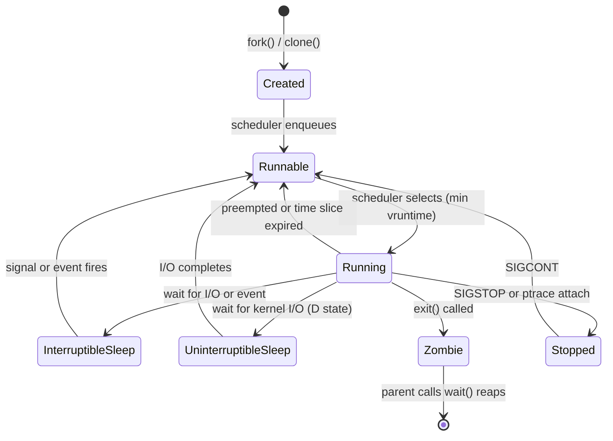
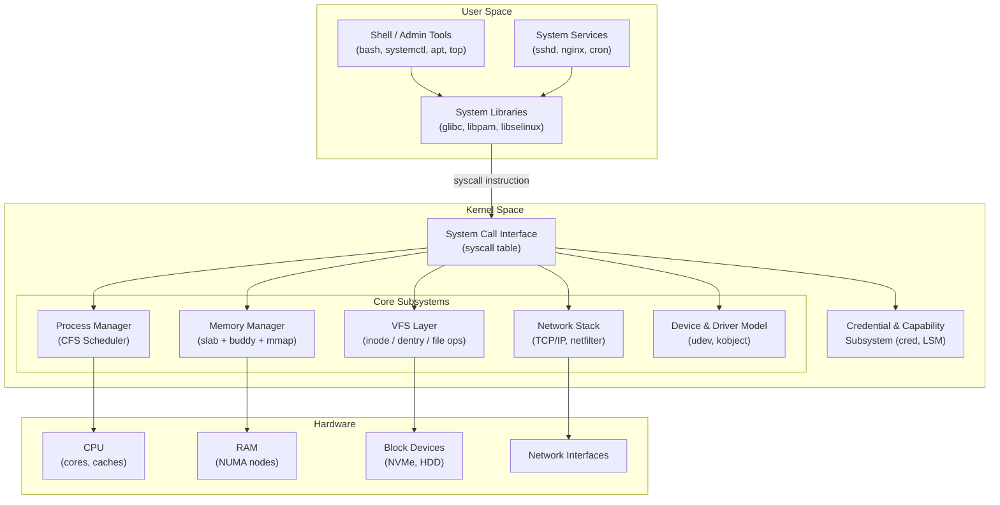
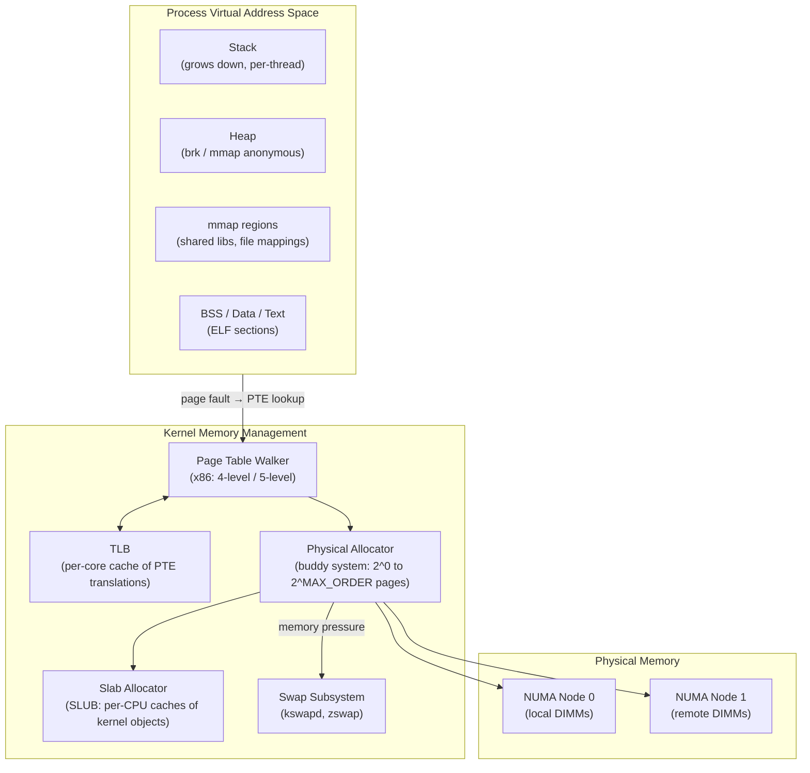
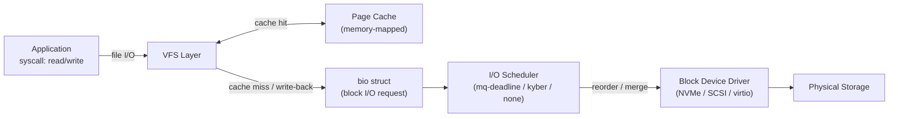
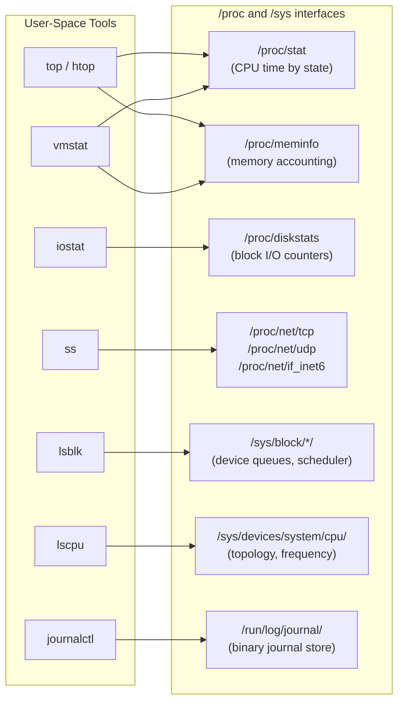

# Lesson 5: System Administration

## 1. First-Principles Intuition & Invariants

Linux system administration is not a collection of memorized commands — it is the applied practice of reasoning about a deterministic state machine. The operating system maintains invariants: the kernel namespace isolation model guarantees that process trees have bounded visibility; the POSIX permission model guarantees that every file access check reduces to a UID/GID comparison against an inode's `st_uid`, `st_gid`, and `st_mode` bitmask; the virtual filesystem (VFS) layer guarantees that every I/O call, regardless of the underlying filesystem type, passes through a uniform `file_operations` dispatch table. A system administrator who understands these invariants can reason about failures in unfamiliar contexts without consulting documentation.

### The Kernel as a Resource Arbitrator

The Linux kernel is best understood as a *privileged arbitrator* that sits between hardware and user-space processes. It never trusts user-space requests — every system call crosses the privilege boundary (ring 3 → ring 0 on x86_64 via the `syscall` instruction), and the kernel validates every argument. When a process calls `open(2)`, the kernel does not simply hand over a file handle; it traverses the VFS path resolution cache (`dcache`), checks the inode's permission bits against the calling process's credentials (`struct cred`), allocates a `struct file` object, and returns a file descriptor index into the process's `struct files_struct` table. This chain of operations is the invariant: access is *always* mediated, never bypassed.

### The Scheduler Invariant: Fairness Through Virtual Time

The Completely Fair Scheduler (CFS), introduced in Linux 2.6.23, is built on a single invariant: every runnable task should receive CPU time proportional to its weight (derived from its `nice` value), and no task should ever starve. CFS achieves this by tracking `vruntime` — a monotonically increasing counter that accumulates faster for lower-priority tasks and slower for higher-priority tasks. The scheduler always selects the task with the smallest `vruntime` from a per-CPU red-black tree (`struct rb_root_cached`), where the leftmost node is cached for O(1) access. When a task sleeps and wakes, its `vruntime` is set to `min_vruntime` (the current minimum across all runnable tasks) to prevent it from monopolizing the CPU upon waking.

The key `task_struct` fields governing scheduling:

```c
// From include/linux/sched.h (simplified)
struct task_struct {
    volatile long           state;        // TASK_RUNNING, TASK_INTERRUPTIBLE, etc.
    int                     prio;         // effective dynamic priority (0–139)
    int                     static_prio;  // nice-derived static priority
    int                     normal_prio;  // priority without RT boost
    unsigned int            rt_priority;  // RT priority (1–99, 0 = not RT)
    const struct sched_class *sched_class; // CFS, RT, deadline, idle
    struct sched_entity     se;           // CFS scheduling entity
    struct sched_rt_entity  rt;           // RT scheduling entity
    struct sched_dl_entity  dl;           // deadline scheduling entity
    pid_t                   pid;
    pid_t                   tgid;         // thread group ID (== PID of main thread)
    struct task_struct      *real_parent;
    struct task_struct      *parent;
    struct list_head        children;
    struct list_head        sibling;
    struct mm_struct        *mm;          // NULL for kernel threads
    struct files_struct     *files;       // open file descriptors
    struct nsproxy          *nsproxy;     // namespace proxy
    struct cred __rcu       *real_cred;   // objective credentials
    struct cred __rcu       *cred;        // subjective (effective) credentials
};

struct sched_entity {
    struct load_weight      load;
    struct rb_node          run_node;     // position in the CFS rb-tree
    u64                     vruntime;     // virtual runtime (ns, weighted)
    u64                     sum_exec_runtime;
};
```

The `nice` range is −20 (highest priority) to +19 (lowest). The CFS weight for `nice=0` is 1024 (`NICE_0_LOAD`). The weight for any nice value follows the progression `weight = prio_to_weight[nice + 20]`, where each step corresponds to roughly a 10% CPU share difference (the table values follow a geometric series with ratio ~1.25).

### Package Management: Dependency Resolution as Constraint Satisfaction

Package management is fundamentally a constraint satisfaction problem (CSP). Given a universe of packages `P`, each with version ranges and dependency/conflict declarations, the resolver must find an assignment of concrete versions to packages such that all constraints are satisfied simultaneously. This is NP-complete in the general case (reducible from 3-SAT), which is why solvers like `libsolv` (used by DNF/Zypper), the DPLL-based solver in Apt's `libapt-pkg`, and the SAT-based solver in Nix employ sophisticated algorithms to avoid exponential blowup in practice.

The APT resolver represents the package universe as a directed graph where nodes are `(package, version)` pairs and edges are typed relationships: `Depends`, `Recommends`, `Suggests`, `Conflicts`, `Breaks`, `Replaces`. The resolver applies a modified DPLL algorithm with unit propagation and backjumping. When you run `apt install nginx`, the resolver:

1. Marks `nginx` as a "must-install" unit.
2. Propagates `nginx`'s `Depends` edges, adding their targets to the solution set.
3. For any `Conflicts` or `Breaks` edges encountered, backtracks and tries alternative versions.
4. Returns the minimal set of packages satisfying all constraints, or reports the conflict chain.

### User and Group Model: Identity as Kernel-Space Integer Pairs

The Linux security model at the POSIX layer reduces identity to two integers: UID and GID (and supplementary GIDs, stored in `struct group_info` within `struct cred`). The kernel does not know usernames — those are a user-space convention resolved by `getpwuid(3)` via NSS (Name Service Switch, configured in `/etc/nsswitch.conf`). The kernel's access check for a file open is:

```
if (euid == 0) → grant (traditional root bypass, partially modified by capabilities)
if (euid == file.st_uid) → apply owner bits
if (egid == file.st_gid || egid ∈ supplementary_gids) → apply group bits
else → apply other bits
```

Linux capabilities (`CAP_NET_ADMIN`, `CAP_SYS_PTRACE`, etc.) decompose the monolithic root privilege into 41 distinct capabilities (as of Linux 5.x), allowing fine-grained privilege assignment without full UID 0.

---

## 2. Core Architecture & Mechanics

### 2.1 Process Lifecycle and the Task Tree

Every process in Linux is a `task_struct`. The process tree is rooted at PID 1 (`systemd` or `init`), and every new process is created via `fork(2)` (which clones the parent's `task_struct`) followed optionally by `execve(2)` (which replaces the process image). `clone(2)` is the generalized primitive underlying both `fork` and `pthread_create`, accepting flags that control which namespaces and resources are shared between parent and child.



A process in the `D` (uninterruptible sleep) state is waiting for kernel I/O that cannot be interrupted by a signal. High `D`-state counts indicate storage subsystem bottlenecks or NFS hangs.

### 2.2 The `/proc` Filesystem as the Kernel's Live State Export

`/proc` is a pseudo-filesystem (`procfs`) that exports the kernel's internal `task_struct` data as readable files. It is not stored on disk — reads trigger kernel callbacks that serialize in-memory structures on the fly. Key paths:

| Path | Kernel Source | Description |
|---|---|---|
| `/proc/[pid]/stat` | `task_struct` | PID, state, ppid, pgrp, session, vruntime, priority |
| `/proc/[pid]/status` | `task_struct`, `mm_struct` | Human-readable memory, UID, GID, capabilities |
| `/proc/[pid]/maps` | `mm_struct→mmap` | Virtual memory area (VMA) map |
| `/proc/[pid]/fd/` | `files_struct→fdt` | Symlinks to open file descriptors |
| `/proc/[pid]/ns/` | `nsproxy` | Namespace memberships |
| `/proc/meminfo` | `zone` structs | System-wide memory accounting |
| `/proc/net/tcp` | TCP socket hash tables | Connection table |
| `/proc/sys/` | `sysctl` tree | Tunable kernel parameters |

Reading `/proc/[pid]/maps` for a running process is the correct way to understand its virtual address space without attaching a debugger:

```bash
# Read the VMA layout of PID 1 (systemd)
cat /proc/1/maps
# Output columns: addr_start-addr_end perms offset dev inode pathname
# 7f8b4c000000-7f8b4c021000 r--p 00000000 fd:01 123456 /usr/lib/libc.so.6
# perms: r=read, w=write, x=execute, p=private(CoW), s=shared
```

### 2.3 Package Management Internals

#### APT (Debian/Ubuntu)

APT's on-disk state is split across several directories:

```
/var/lib/apt/lists/          # Fetched package indices (compressed)
/var/lib/dpkg/info/          # Per-package maintainer scripts (.preinst, .postinst, .prerm, .postrm)
/var/lib/dpkg/status         # Installed package database (plain text)
/var/cache/apt/archives/     # Downloaded .deb files
/etc/apt/sources.list.d/     # Repository definitions
/etc/apt/preferences.d/      # Pinning rules (priority overrides)
```

The `dpkg` database in `/var/lib/dpkg/status` is a plain-text stanza format. APT is a higher-level layer on top of `dpkg`; `dpkg` performs the actual installation (unpacking, running maintainer scripts, registering files). The separation means that `dpkg --configure -a` can repair a system where APT was interrupted mid-install.

#### RPM/DNF (Red Hat/Fedora/CentOS Stream)

RPM stores its package database in an SQLite database at `/var/lib/rpm/rpmdb.sqlite` (RPM 4.16+, replacing the legacy Berkeley DB format). DNF uses `libsolv` as its SAT solver. DNF's transaction logic:

```
dnf install nginx
  │
  ├─ Query repos (metalink → mirrorlist → repomd.xml → primary.xml.zst)
  ├─ libsolv: build SAT problem from universe
  ├─ Solve: find minimal install set
  ├─ Download RPMs (with GPG signature verification)
  ├─ RPM transaction: scriptlet pre-install
  ├─ RPM: unpack file payload (CPIO archive inside RPM)
  ├─ RPM transaction: scriptlet post-install
  └─ Update rpmdb.sqlite
```

#### Production Package Management

```bash
# --- APT: Safe, auditable upgrade workflow ---

# 1. Refresh package indices without modifying installed packages
sudo apt-get update

# 2. Show what would change before committing
apt-get --simulate upgrade

# 3. Apply only security updates (using unattended-upgrades origins filter)
sudo unattended-upgrade --dry-run --debug

# 4. Full upgrade (handles changing dependencies, unlike 'upgrade')
sudo apt-get full-upgrade

# 5. Pin a specific package version to prevent accidental upgrades
# /etc/apt/preferences.d/nginx-pin
cat << 'EOF' | sudo tee /etc/apt/preferences.d/nginx-pin
Package: nginx
Pin: version 1.24.*
Pin-Priority: 1001
EOF

# 6. Verify package integrity post-install
dpkg --verify nginx
# Output: ?? missing/changed files

# --- DNF: Production workflow ---
sudo dnf check-update          # check without installing
sudo dnf updateinfo list sec   # list pending security advisories
sudo dnf upgrade --advisory=RHSA-2024:1234  # apply a specific advisory
sudo dnf history                # transaction history
sudo dnf history undo 15        # rollback transaction 15
rpm -V nginx                   # verify installed RPM file checksums
```

### 2.4 User and Group Management — Internals

The `/etc/passwd` format is a colon-delimited flat file. Modern systems have moved password hashes to `/etc/shadow` (readable only by root) to prevent offline dictionary attacks against world-readable `/etc/passwd`.

```
# /etc/passwd fields:
# username:x:UID:GID:GECOS:home:shell
# 'x' means: check /etc/shadow for the hash
www-data:x:33:33:www-data:/var/www:/usr/sbin/nologin

# /etc/shadow fields:
# username:hash:lastchange:min:max:warn:inactive:expire:reserved
www-data:!:19700:0:99999:7:::
# '!' prefix = account locked (no password login possible)
# '$6$...' = SHA-512 hash (id=6), '$y$...' = yescrypt (modern default)
```

The `useradd` command writes to `/etc/passwd`, `/etc/shadow`, `/etc/group`, and `/etc/gshadow` atomically by creating shadow copies (`.pwd.lock` lock file + write to temp file + `rename(2)` for atomicity).

```bash
# Create a system service account (no login shell, no home dir creation)
sudo useradd \
  --system \
  --no-create-home \
  --shell /usr/sbin/nologin \
  --comment "Application service account" \
  --user-group \
  appuser

# Create a human user with specific UID (useful for NFS UID consistency)
sudo useradd \
  --uid 2001 \
  --gid users \
  --groups sudo,docker \
  --create-home \
  --shell /bin/bash \
  --comment "Jane Smith" \
  jsmith

# Lock an account without deleting it (e.g., employee on leave)
sudo passwd --lock jsmith
sudo usermod --expiredate 2025-01-01 jsmith  # set account expiry

# Inspect effective credentials of a running process
# (without sudo — demonstrates /proc as a capability)
cat /proc/$(pgrep nginx | head -1)/status | grep -E '^(Uid|Gid|Groups|Cap)'
# CapEff: 0000000000000400  → decode with:
capsh --decode=0000000000000400
# = cap_net_bind_service (bind to ports < 1024 without root)
```

### 2.5 Filesystem Permissions: Beyond the Basics

The standard `rwx` bits are three 3-bit fields in the lower 9 bits of `st_mode`. Three additional bits sit above them:

| Bit | Octal | Name | Effect |
|---|---|---|---|
| 12 | 4000 | SUID | On exec: set eUID to file owner's UID |
| 11 | 2000 | SGID | On exec: set eGID to file owner's GID; on directory: new files inherit directory GID |
| 10 | 1000 | Sticky | On directory: only file owner, dir owner, or root can delete/rename files |

```bash
# SUID on /usr/bin/passwd allows unprivileged users to write /etc/shadow
ls -l /usr/bin/passwd
# -rwsr-xr-x 1 root root 68208 ... /usr/bin/passwd
#    ^ 's' in owner execute position = SUID set

# SGID on a shared project directory
sudo mkdir /srv/project
sudo chown root:devteam /srv/project
sudo chmod 2775 /srv/project  # SGID + rwxrwxr-x
# All files created here will have group=devteam regardless of creator's primary group

# ACLs extend the rwx model for fine-grained per-user/group rules
sudo setfacl -m u:jsmith:rwx /srv/project
sudo setfacl -m g:contractors:r-x /srv/project
sudo setfacl -d -m u:jsmith:rwx /srv/project  # default ACL (inherited by new files)
getfacl /srv/project
```

### 2.6 System Architecture Diagram



---

## 3. High-Performance Optimization & Failure Modes

### 3.1 CPU Scheduling Optimization

#### CFS Tuning

CFS exposes tunable parameters via `sysctl` under `/proc/sys/kernel/`:

| Sysctl | Default | Effect |
|---|---|---|
| `sched_latency_ns` | 6,000,000 | Target scheduling latency period (ns). CFS aims to let all runnable tasks run once per this period. |
| `sched_min_granularity_ns` | 750,000 | Minimum time a task runs before it can be preempted. Prevents excessive context switching. |
| `sched_wakeup_granularity_ns` | 1,000,000 | A waking task must have a vruntime this much smaller than the current task to trigger preemption. |
| `sched_migration_cost_ns` | 500,000 | Estimated cost of migrating a task between CPU caches. Affects load balancer aggressiveness. |

For latency-sensitive workloads (HFT, real-time audio), reduce `sched_latency_ns` and consider assigning `SCHED_FIFO` or `SCHED_RR` policy via `chrt(1)`:

```bash
# Run a process with SCHED_FIFO priority 50 (preempts all CFS tasks)
# WARNING: a SCHED_FIFO task that spins will starve all other non-RT tasks
sudo chrt --fifo 50 /usr/bin/my_realtime_app

# Check the scheduling policy of a running process
chrt --pid $(pgrep nginx | head -1)

# Pin a process to specific CPU cores (CPU affinity)
# Isolate cores 2-3 from the general scheduler first via isolcpus= kernel cmdline
sudo taskset --cpu-list 2,3 --pid $(pgrep nginx | head -1)

# NUMA-aware process placement (critical on multi-socket systems)
numactl --cpunodebind=0 --membind=0 /usr/bin/my_app
# Without NUMA binding, a process on socket 0 may allocate memory on socket 1
# (remote NUMA access latency is typically 2–3× higher than local)
```

#### Identifying Scheduler Bottlenecks

```bash
# perf sched: measure per-task scheduling statistics
sudo perf sched record -- sleep 10
sudo perf sched latency | head -30
# Columns: Task, Runtime(ms), Switches, Avg delay(ms), Max delay(ms)

# Check for involuntary context switches (preemption pressure)
# High nivcsw relative to nvcsw = CPU contention
cat /proc/$(pgrep nginx | head -1)/status | grep -E 'voluntary|nonvoluntary'
# voluntary_ctxt_switches:    1234   (task blocked on I/O, lock, etc.)
# nonvoluntary_ctxt_switches:  567   (task preempted by scheduler — means CPU pressure)

# Runqueue depth per CPU (high values = CPU is overloaded)
sar -q 1 5
# runq-sz: average runqueue length
# ldavg-1/5/15: load average (number of runnable + D-state tasks)
```

### 3.2 Memory Management and the OOM Killer

#### Virtual Memory Hierarchy



#### Memory Pressure and the OOM Killer

When the kernel cannot satisfy a memory allocation after kswapd has reclaimed all reclaimable pages, it invokes the OOM killer. The OOM killer selects a victim process by computing an `oom_score` for each process:

```
oom_score ≈ (resident_set_size / total_physical_ram) × 1000 + oom_score_adj
```

`oom_score_adj` ranges from -1000 (never kill) to +1000 (kill first). System administrators can protect critical processes:

```bash
# Protect sshd from OOM killing (preserve remote access during OOM events)
echo -1000 | sudo tee /proc/$(pgrep -x sshd | head -1)/oom_score_adj

# Make a process a preferred OOM victim (e.g., a batch job)
echo 500 | sudo tee /proc/$(pgrep batch_job | head -1)/oom_score_adj

# Persist OOM settings via systemd unit
# In /etc/systemd/system/sshd.service.d/oom.conf:
# [Service]
# OOMScoreAdjust=-900

# Diagnose OOM events from kernel ring buffer
dmesg | grep -A 20 "Out of memory:"
# Provides: oom_score, RSS, page tables, swap usage for each candidate

# Monitor memory pressure without triggering OOM
# /proc/meminfo key fields:
awk '/^(MemTotal|MemFree|MemAvailable|Buffers|Cached|SwapTotal|SwapFree|Dirty|Writeback|SReclaimable)/' /proc/meminfo
# MemAvailable: kernel's estimate of how much memory is *actually* available
# (accounts for reclaimable page cache — more accurate than MemFree alone)
```

#### Huge Pages

TLB pressure is a significant overhead on systems with large working sets. The kernel's standard page size is 4 KiB; a 10 GiB working set requires ~2.6M TLB entries. Huge pages (2 MiB on x86_64) reduce this to ~5,000 entries.

```bash
# Transparent Huge Pages (THP): kernel-managed, automatic
cat /sys/kernel/mm/transparent_hugepage/enabled
# [always] madvise never
# 'always' = good for throughput workloads (databases)
# 'madvise' = application opts in with madvise(MADV_HUGEPAGE)
# 'never' = disable (some JVMs/Redis see THP fragmentation overhead)

# Explicit huge pages (pre-allocated, locked in RAM — best for latency)
echo 1024 | sudo tee /proc/sys/vm/nr_hugepages  # allocate 1024 × 2MiB = 2 GiB
# Applications use these via MAP_HUGETLB flag in mmap(2) or via hugetlbfs mount

# Check huge page allocation success
grep -E 'HugePages_(Total|Free|Rsvd|Surp)|Hugepagesize' /proc/meminfo
```

### 3.3 I/O Scheduling and Storage Performance

The Linux block layer sits between the VFS and block device drivers. The I/O scheduler (now called "block layer elevator") operates on this layer.



Modern Linux (5.x+) uses the multi-queue block layer (blk-mq). The legacy single-queue schedulers (CFQ, Deadline, NOOP) were replaced:

| Scheduler | Use Case | Mechanism |
|---|---|---|
| `none` | NVMe SSDs, RAM-backed devices | No reordering; submit immediately. Best for devices with internal queuing (NCQ). |
| `mq-deadline` | HDDs, mixed read/write workloads | Deadline queues prevent starvation; read requests get priority over writes. |
| `kyber` | Low-latency SSDs | Token-bucket per I/O class (read/write/discard); targets configurable latency percentiles. |
| `bfq` | Desktop/interactive use | Per-process I/O bandwidth proportional fairness; prevents single process from saturating disk. |

```bash
# Check and change the I/O scheduler for a device
cat /sys/block/sda/queue/scheduler
# none mq-deadline [kyber] bfq  → current is kyber

echo mq-deadline | sudo tee /sys/block/sda/queue/scheduler

# Tune mq-deadline: adjust read/write expiry (ms)
echo 500  | sudo tee /sys/block/sda/queue/iosched/read_expire   # default 500ms
echo 5000 | sudo tee /sys/block/sda/queue/iosched/write_expire  # default 5000ms
echo 1    | sudo tee /sys/block/sda/queue/iosched/writes_starved # writes per read dispatch batch

# Measure I/O latency distribution (not just throughput)
sudo iostat -x -d 1 5 /dev/sda
# Key columns: r_await (avg read latency ms), w_await (avg write latency ms)
# %util: % time device had I/O queued — 100% = saturated

# Deeper I/O profiling with blktrace
sudo blktrace -d /dev/sda -o /tmp/trace -- sleep 10
sudo blkparse -i /tmp/trace -d /tmp/trace.bin
sudo btt -i /tmp/trace.bin
# btt reports: D2C (dispatch-to-completion), Q2C (queue-to-completion) latencies
```

### 3.4 Networking: Kernel Bypass and Tuning

```bash
# --- TCP/IP stack tuning for high-connection-count servers ---

# Increase socket backlog and connection tracking table
echo 65536 | sudo tee /proc/sys/net/core/somaxconn
echo 65536 | sudo tee /proc/sys/net/ipv4/tcp_max_syn_backlog

# Increase ephemeral port range (default 32768–60999 = ~28k ports)
echo "1024 65535" | sudo tee /proc/sys/net/ipv4/ip_local_port_range

# Enable TCP Fast Open (saves one RTT for repeat connections)
echo 3 | sudo tee /proc/sys/net/ipv4/tcp_fastopen  # 1=client, 2=server, 3=both

# TCP receive/send buffer auto-tuning
# (min, default, max) in bytes
echo "4096 87380 134217728" | sudo tee /proc/sys/net/ipv4/tcp_rmem
echo "4096 65536 134217728" | sudo tee /proc/sys/net/ipv4/tcp_wmem

# Enable TCP BBR congestion control (Google's bottleneck bandwidth and RTT algorithm)
# BBR measures delivery rate + RTT rather than relying on loss as a congestion signal
echo bbr | sudo tee /proc/sys/net/ipv4/tcp_congestion_control
# Verify: sysctl net.ipv4.tcp_available_congestion_control

# Monitor TCP connection state distribution
ss -s
# Outputs: total, estab, closed, orphaned, timewait, etc.

# Detailed socket inspection (replacement for netstat)
ss -tnp state established
# -t: TCP, -n: numeric, -p: show process, state: filter
```

### 3.5 Systemd and Service Management

`systemd` is the de facto init system and service manager on modern Linux distributions. Understanding its unit file model is essential for production system administration.

```ini
# /etc/systemd/system/myapp.service
# Production-hardened unit file

[Unit]
Description=My Application Server
Documentation=https://internal.wiki/myapp
After=network-online.target postgresql.service
Requires=network-online.target
# 'After' controls ordering; 'Requires' adds a hard dependency

[Service]
Type=notify
# notify: app signals readiness via sd_notify(3); systemd waits before marking active
# simple: systemd considers the service started when the main process forks
# forking: legacy daemonizing behavior

User=appuser
Group=appuser
WorkingDirectory=/opt/myapp

# Security hardening
NoNewPrivileges=yes          # prevents privilege escalation via SUID/capabilities
PrivateTmp=yes               # private /tmp and /var/tmp (not shared with other services)
ProtectSystem=strict         # mount /usr, /boot, /etc read-only
ProtectHome=yes              # /home, /root inaccessible
ReadWritePaths=/var/lib/myapp /var/log/myapp
CapabilityBoundingSet=CAP_NET_BIND_SERVICE  # only capability the process may ever acquire
AmbientCapabilities=CAP_NET_BIND_SERVICE    # grant it without being root

# Resource limits (prevent runaway resource consumption)
LimitNOFILE=65536            # open file descriptors
LimitNPROC=4096              # max processes/threads
MemoryMax=4G                 # cgroup memory hard limit
CPUQuota=200%                # max 2 cores worth of CPU (cgroups v2)
IOWeight=50                  # relative I/O weight (default 100)

ExecStartPre=/usr/bin/myapp --check-config
ExecStart=/usr/bin/myapp --config /etc/myapp/config.toml
ExecReload=/bin/kill -HUP $MAINPID  # signal for config reload
Restart=on-failure
RestartSec=5s
StartLimitIntervalSec=60s
StartLimitBurst=3            # allow 3 restarts per 60s before entering failed state

# Stdout/stderr go to journald
StandardOutput=journal
StandardError=journal
SyslogIdentifier=myapp

[Install]
WantedBy=multi-user.target
```

```bash
# Service management workflow
sudo systemctl daemon-reload          # reload unit files after editing
sudo systemctl enable --now myapp     # enable at boot + start immediately
sudo systemctl status myapp           # show state, cgroup, last log lines
sudo systemctl restart myapp
sudo systemctl kill --signal=SIGUSR1 myapp  # send arbitrary signal

# Inspect logs (journald binary log store, indexed for fast querying)
journalctl -u myapp --since "1 hour ago" --until "now"
journalctl -u myapp -n 100 -f         # follow last 100 lines
journalctl -u myapp -p err            # priority: emerg/alert/crit/err/warning/notice/info/debug
journalctl -u myapp --output=json-pretty | head -50

# Analyze boot performance
systemd-analyze blame                 # time each unit took to start
systemd-analyze critical-chain        # critical path of the boot dependency graph
```

### 3.6 System Monitoring: Peeling Back the Layers

The standard monitoring tools read from `/proc` and `/sys`. Understanding their data sources prevents misinterpretation.

```bash
# --- CPU analysis ---

# top / htop: reads /proc/stat (aggregate) and /proc/[pid]/stat (per-process)
# CPU% in top = (utime + stime delta) / (elapsed_ticks * num_cores) × 100
# 'wa' (iowait) = time the CPU was idle *while* at least one task was in D state
# High iowait = storage bottleneck, NOT CPU bottleneck; CPU is free, just waiting

# mpstat: per-CPU breakdown (from /proc/stat)
mpstat -P ALL 1 5

# --- Memory analysis ---

# /proc/meminfo interpretation
# MemAvailable ≠ MemFree
# MemAvailable = MemFree + reclaimable page cache + reclaimable slab
# A system with MemFree=100MB but MemAvailable=8GB is NOT memory-pressured

# smem: accurate per-process memory accounting (reports PSS: Proportional Set Size)
# PSS = USS (unique pages) + (shared pages / number of sharers)
# More accurate than RSS (Resident Set Size), which double-counts shared libs
smem --sort=pss --percent | head -20

# --- Disk I/O analysis ---

# iostat -x: extended statistics from /proc/diskstats
iostat -x 1 | awk 'NR>6 {print}'
# r_await/w_await: avg latency including queue time
# aqu-sz (avgqu-sz in older versions): avg request queue depth
# %util: saturation indicator (can exceed 100% with NCQ on SSDs)

# iotop: real-time per-process I/O (uses kernel accounting: taskstats via netlink)
sudo iotop -ao        # -a: accumulate, -o: only show active processes

# --- Network analysis ---

# ss: reads /proc/net/tcp[6] and /proc/net/udp[6]
ss -tnp | awk '{print $1, $4, $5, $6}' | column -t  # state, local, peer, process

# nstat: network statistics (replaces netstat -s)
nstat -az | grep -E 'TcpRetrans|TcpAttemptFails|TcpEstabResets'
# TcpRetransSegs: segments retransmitted (packet loss indicator)
# TcpAttemptFails: half-open connection failures (SYN flood indicator)

# bpftrace: eBPF-based tracing for custom metrics without kernel recompilation
# Count syscalls by process name (requires Linux 4.9+, bpftrace installed)
sudo bpftrace -e 'tracepoint:raw_syscalls:sys_enter { @[comm] = count(); } interval:s:5 { print(@); clear(@); }'
```

### 3.7 Failure Modes: A Diagnostic Taxonomy

System failures partition into four causal categories. Each has a distinct diagnostic approach.

```mermaid
graph TD
    FAIL["System Failure / Degradation"]

    FAIL --> CPU_P["CPU Pressure\n(high load average,\nhigh %usr or %sys)"]
    FAIL --> MEM_P["Memory Pressure\n(high swap usage,\nOOM kills, page faults)"]
    FAIL --> IO_P["I/O Bottleneck\n(high iowait, high r_await/w_await,\nhigh %util on device)"]
    FAIL --> NET_P["Network Issue\n(retransmits, packet loss,\nconnection timeouts)"]

    CPU_P --> CPU_D1["Check: top/htop\n→ identify hot processes"]
    CPU_P --> CPU_D2["Check: perf top\n→ identify hot kernel/user functions"]
    CPU_P --> CPU_D3["Check: mpstat -P ALL\n→ single-core saturation?"]

    MEM_P --> MEM_D1["Check: /proc/meminfo\nMemAvailable, Dirty, Writeback"]
    MEM_P --> MEM_D2["Check: dmesg | grep oom\n→ OOM kill log"]
    MEM_P --> MEM_D3["Check: smem --sort=pss\n→ per-process RSS/PSS/USS"]

    IO_P --> IO_D1["Check: iostat -x 1\n→ await, %util, aqu-sz"]
    IO_P --> IO_D2["Check: iotop -ao\n→ per-process I/O consumers"]
    IO_P --> IO_D3["Check: blktrace + btt\n→ latency breakdown D2C"]

    NET_P --> NET_D1["Check: ss -s\n→ connection state counts"]
    NET_P --> NET_D2["Check: nstat -az\n→ TCP retransmit counters"]
    NET_P --> NET_D3["Check: tcpdump / Wireshark\n→ packet-level capture"]
```



#### The OOM Killer Triggering Unexpectedly

A common failure scenario: OOM kills occur even though `free -m` shows available memory. The root cause is typically memory *overcommit*. Linux, by default, allocates virtual memory optimistically (`vm.overcommit_memory=0`, heuristic overcommit). A process that `malloc`'s 10 GiB and then writes to all of it may trigger OOM even if free memory appeared sufficient at allocation time, because the kernel deferred physical page assignment until the write.

```bash
# Check overcommit policy
sysctl vm.overcommit_memory
# 0 = heuristic (default): allow overcommit unless obviously excessive
# 1 = always overcommit (useful for applications that mmap large but sparse buffers)
# 2 = strict: total committed memory ≤ swap + (vm.overcommit_ratio% of RAM)

sysctl vm.overcommit_ratio   # default 50 (50% of RAM)

# CommitLimit = swap + (overcommit_ratio/100) * total_ram
# Committed_AS in /proc/meminfo = total committed virtual memory
grep -E 'CommitLimit|Committed_AS' /proc/meminfo
```

#### Kernel Panics

A kernel panic is the kernel's self-preservation mechanism when it detects an unrecoverable error (NULL pointer dereference in kernel code, corrupted kernel data structures, hardware errors reported via MCE). The panic handler:

1. Disables preemption on all CPUs (via IPI).
2. Prints the oops/BUG message, register state, and stack trace to the console.
3. Optionally writes a crashdump via `kdump` (a secondary kernel loaded at boot into reserved memory).
4. Reboots or hangs, depending on `kernel.panic` sysctl.

```bash
# Configure automatic reboot after panic (critical for unattended servers)
sysctl -w kernel.panic=10          # reboot 10 seconds after panic
sysctl -w kernel.panic_on_oops=1   # treat oops (recoverable kernel bugs) as panics

# Set up kdump for post-mortem analysis
# 1. Reserve memory at boot: add 'crashkernel=256M' to kernel cmdline in /etc/default/grub
# 2. Install kdump: 
sudo systemctl enable --now kdump

# 3. After a panic, the crashdump is at /var/crash/
# Analyze with crash(8):
sudo crash /usr/lib/debug/lib/modules/$(uname -r)/vmlinux /var/crash/*/vmcore
# Inside crash: 'bt' for backtrace, 'ps' for process list at time of panic, 'log' for dmesg
```

---

## 4. Production-Grade Reference Implementations

### 4.1 Automated System Health Check Script

```bash
#!/usr/bin/env bash
# system_health.sh — Production system health reporter
# Outputs structured data suitable for ingestion by monitoring systems
# Usage: ./system_health.sh [--json] [--warn-threshold <load_pct>]
set -euo pipefail

HOSTNAME=$(hostname -f)
TIMESTAMP=$(date -u +"%Y-%m-%dT%H:%M:%SZ")
WARN_THRESHOLD=${WARN_THRESHOLD:-80}  # percent
OUTPUT_JSON=false

usage() { echo "Usage: $0 [--json] [--warn-threshold N]"; exit 1; }

while [[ $# -gt 0 ]]; do
    case $1 in
        --json) OUTPUT_JSON=true ;;
        --warn-threshold) WARN_THRESHOLD="$2"; shift ;;
        *) usage ;;
    esac
    shift
done

# --- Data collection from /proc (no external tools required) ---

# CPU: parse /proc/stat for CPU time deltas
read_cpu_stats() {
    awk '/^cpu / {print $2,$3,$4,$5,$6,$7,$8}' /proc/stat
}

cpu_before=$(read_cpu_stats)
sleep 1
cpu_after=$(read_cpu_stats)

calc_cpu_pct() {
    local b=($1) a=($2)
    local idle_before=$((b[3] + b[4]))
    local idle_after=$((a[3] + a[4]))
    local total_before=0 total_after=0
    for v in "${b[@]}"; do total_before=$((total_before + v)); done
    for v in "${a[@]}"; do total_after=$((total_after + v)); done
    local delta_idle=$((idle_after - idle_before))
    local delta_total=$((total_after - total_before))
    echo $(( (delta_total - delta_idle) * 100 / delta_total ))
}

CPU_PCT=$(calc_cpu_pct "$cpu_before" "$cpu_after")
LOAD_AVG=$(awk '{print $1}' /proc/loadavg)
CPU_COUNT=$(nproc)
LOAD_PCT=$(echo "$LOAD_AVG $CPU_COUNT" | awk '{printf "%d", ($1/$2)*100}')

# Memory: parse /proc/meminfo
parse_meminfo() { awk -v key="$1" '$1 == key":" {print $2}' /proc/meminfo; }
MEM_TOTAL=$(parse_meminfo MemTotal)
MEM_AVAIL=$(parse_meminfo MemAvailable)
SWAP_TOTAL=$(parse_meminfo SwapTotal)
SWAP_FREE=$(parse_meminfo SwapFree)
MEM_USED_PCT=$(( (MEM_TOTAL - MEM_AVAIL) * 100 / MEM_TOTAL ))
SWAP_USED_PCT=0
[[ $SWAP_TOTAL -gt 0 ]] && SWAP_USED_PCT=$(( (SWAP_TOTAL - SWAP_FREE) * 100 / SWAP_TOTAL ))

# Disk: df for all mounted real filesystems
DISK_DATA=$(df -P -x tmpfs -x devtmpfs -x squashfs --output=pcent,target \
    | awk 'NR>1 {gsub(/%/,"",$1); print $1, $2}')

# Check for recent OOM kills
OOM_COUNT=$(dmesg --time-format iso 2>/dev/null \
    | grep -c "Out of memory:" || true)

# --- Thresholds and status ---
STATUS="ok"
ALERTS=()

[[ $CPU_PCT -gt $WARN_THRESHOLD ]] && { STATUS="warn"; ALERTS+=("cpu:${CPU_PCT}%"); }
[[ $MEM_USED_PCT -gt $WARN_THRESHOLD ]] && { STATUS="warn"; ALERTS+=("mem:${MEM_USED_PCT}%"); }
[[ $SWAP_USED_PCT -gt 50 ]] && { STATUS="warn"; ALERTS+=("swap:${SWAP_USED_PCT}%"); }
[[ $OOM_COUNT -gt 0 ]] && { STATUS="critical"; ALERTS+=("oom_kills:${OOM_COUNT}"); }

while IFS=' ' read -r pct mount; do
    [[ $pct -gt $WARN_THRESHOLD ]] && { STATUS="warn"; ALERTS+=("disk:${mount}:${pct}%"); }
done <<< "$DISK_DATA"

# --- Output ---
if $OUTPUT_JSON; then
    printf '{"hostname":"%s","timestamp":"%s","status":"%s","cpu_pct":%d,"load_pct":%d,"mem_used_pct":%d,"swap_used_pct":%d,"oom_count":%d,"alerts":[%s]}\n' \
        "$HOSTNAME" "$TIMESTAMP" "$STATUS" "$CPU_PCT" "$LOAD_PCT" \
        "$MEM_USED_PCT" "$SWAP_USED_PCT" "$OOM_COUNT" \
        "$(printf '"%s",' "${ALERTS[@]:-}" | sed 's/,$//')"
else
    printf "%-20s %s\n" "Host:" "$HOSTNAME"
    printf "%-20s %s\n" "Time:" "$TIMESTAMP"
    printf "%-20s %s\n" "Status:" "$STATUS"
    printf "%-20s %d%% (load: %s, %d cores)\n" "CPU:" "$CPU_PCT" "$LOAD_AVG" "$CPU_COUNT"
    printf "%-20s %d%% (%d MiB / %d MiB)\n" "Memory:" "$MEM_USED_PCT" \
        "$(( (MEM_TOTAL - MEM_AVAIL) / 1024 ))" "$(( MEM_TOTAL / 1024 ))"
    printf "%-20s %d%%\n" "Swap:" "$SWAP_USED_PCT"
    printf "%-20s %d\n" "OOM kills (boot):" "$OOM_COUNT"
    if [[ ${#ALERTS[@]} -gt 0 ]]; then
        printf "%-20s %s\n" "Alerts:" "${ALERTS[*]}"
    fi
fi
```

### 4.2 User Provisioning Script with Auditability

```bash
#!/usr/bin/env bash
# provision_user.sh — Idempotent user provisioning with audit log
# Usage: sudo ./provision_user.sh <username> <uid> <groups_csv> <pubkey_file>
set -euo pipefail

AUDIT_LOG="/var/log/user_provisioning.log"
SKEL_DIR="/etc/skel"
MIN_UID=2000

log_audit() {
    local level="$1" msg="$2"
    printf '%s [%s] [%s] %s\n' \
        "$(date -u +"%Y-%m-%dT%H:%M:%SZ")" "$level" "$(logname 2>/dev/null || echo system)" "$msg" \
        | tee -a "$AUDIT_LOG"
}

[[ $EUID -ne 0 ]] && { echo "Must run as root"; exit 1; }
[[ $# -ne 4 ]] && { echo "Usage: $0 <username> <uid> <groups_csv> <pubkey_file>"; exit 1; }

USERNAME="$1"
TARGET_UID="$2"
GROUPS_CSV="$3"
PUBKEY_FILE="$4"

# Input validation
[[ "$USERNAME" =~ ^[a-z_][a-z0-9_-]{0,31}$ ]] || { echo "Invalid username: $USERNAME"; exit 1; }
[[ "$TARGET_UID" =~ ^[0-9]+$ ]] && [[ $TARGET_UID -ge $MIN_UID ]] \
    || { echo "UID must be numeric and >= $MIN_UID"; exit 1; }
[[ -f "$PUBKEY_FILE" ]] || { echo "Public key file not found: $PUBKEY_FILE"; exit 1; }

# Validate the SSH public key format before use
ssh-keygen -l -f "$PUBKEY_FILE" > /dev/null 2>&1 \
    || { echo "Invalid SSH public key format"; exit 1; }

log_audit INFO "Provisioning user: $USERNAME (UID $TARGET_UID, groups: $GROUPS_CSV)"

# Idempotent user creation
if id "$USERNAME" &>/dev/null; then
    EXISTING_UID=$(id -u "$USERNAME")
    if [[ "$EXISTING_UID" -ne "$TARGET_UID" ]]; then
        log_audit ERROR "User $USERNAME exists with UID $EXISTING_UID, expected $TARGET_UID"
        exit 1
    fi
    log_audit INFO "User $USERNAME already exists, skipping creation"
else
    useradd \
        --uid "$TARGET_UID" \
        --user-group \
        --create-home \
        --skel "$SKEL_DIR" \
        --shell /bin/bash \
        "$USERNAME"
    log_audit INFO "Created user $USERNAME"
fi

# Add to supplementary groups (idempotent)
IFS=',' read -ra GROUPS_ARRAY <<< "$GROUPS_CSV"
for grp in "${GROUPS_ARRAY[@]}"; do
    grp=$(echo "$grp" | tr -d ' ')
    if getent group "$grp" > /dev/null; then
        usermod --append --groups "$grp" "$USERNAME"
        log_audit INFO "Added $USERNAME to group $grp"
    else
        log_audit WARN "Group $grp does not exist, skipping"
    fi
done

# Deploy SSH authorized key
SSH_DIR="/home/${USERNAME}/.ssh"
AUTH_KEYS="${SSH_DIR}/authorized_keys"

install -d -m 0700 -o "$USERNAME" -g "$USERNAME" "$SSH_DIR"
install -m 0600 -o "$USERNAME" -g "$USERNAME" "$PUBKEY_FILE" "$AUTH_KEYS"

log_audit INFO "Deployed SSH public key to $AUTH_KEYS"

# Force password change on first login
passwd --expire "$USERNAME"
log_audit INFO "Set password expiry (force change on first login) for $USERNAME"

log_audit INFO "Provisioning complete for $USERNAME"
```

### 4.3 Kernel Parameter Hardening (`sysctl.d`)

```ini
# /etc/sysctl.d/99-hardening.conf
# Production kernel parameter hardening
# Apply with: sysctl --system

# --- Network: IP stack hardening ---
# Disable IP source routing (prevents route manipulation attacks)
net.ipv4.conf.all.accept_source_route = 0
net.ipv4.conf.default.accept_source_route = 0
net.ipv6.conf.all.accept_source_route = 0

# Disable ICMP redirect acceptance (prevents MITM via forged ICMP redirects)
net.ipv4.conf.all.accept_redirects = 0
net.ipv4.conf.default.accept_redirects = 0
net.ipv6.conf.all.accept_redirects = 0

# Enable SYN flood protection (SYN cookies)
net.ipv4.tcp_syncookies = 1

# Ignore ICMP broadcast messages (prevents smurf amplification)
net.ipv4.icmp_echo_ignore_broadcasts = 1

# Log martian packets (source-routed, impossible source addresses)
net.ipv4.conf.all.log_martians = 1

# Reverse path filter: drop packets whose source address is unreachable via
# the interface they arrived on (prevents IP spoofing)
net.ipv4.conf.all.rp_filter = 1
net.ipv4.conf.default.rp_filter = 1

# --- Memory: security ---
# Restrict /proc/[pid]/maps to process owner (prevents ASLR bypass)
kernel.maps_protect = 1  # Note: removed in later kernels; use hidepid on procfs

# Disable core dumps for SUID programs (prevents secrets leaking to disk)
fs.suid_dumpable = 0

# Restrict ptrace to parent-child only (prevents lateral process inspection)
# 0=disabled, 1=restricted to parent, 2=admin only, 3=disabled entirely
kernel.yama.ptrace_scope = 1

# Randomize virtual address space (ASLR)
# 0=disabled, 1=conservative (stack+mmap), 2=full (heap too)
kernel.randomize_va_space = 2

# --- Kernel: information leakage ---
# Restrict kernel pointer exposure in /proc (requires CAP_SYSLOG to see real addresses)
kernel.kptr_restrict = 2

# Restrict dmesg to privileged users
kernel.dmesg_restrict = 1

# --- File system ---
# Restrict hard links to file owner (prevents TOCTOU privilege escalation)
fs.protected_hardlinks = 1
# Restrict symlink following in sticky directories to symlink owner
fs.protected_symlinks = 1

# Increase inotify limits for systems running many file watchers (IDEs, containers)
fs.inotify.max_user_watches = 524288
fs.inotify.max_user_instances = 512

# --- Performance: production server tuning ---
# Virtual memory dirty page writeback tuning
# (reduce dirty_ratio to avoid large writeback stalls)
vm.dirty_ratio = 10            # start synchronous writeback when 10% of RAM is dirty
vm.dirty_background_ratio = 5  # start background writeback at 5%
vm.swappiness = 10             # reduce tendency to swap anonymous memory (0=never swap, 100=aggressive)
vm.vfs_cache_pressure = 50     # reduce tendency to reclaim inode/dentry cache (default 100)
```

---

## 5. The `/proc` and `sysfs` Mental Model

The relationship between user-space tools and kernel data sources is not incidental — it is the designed interface. Every monitoring decision should start with the question: *what kernel data structure is this tool reading, and is that the right one for my question?*



The fundamental rule: `/proc` exports volatile, ephemeral kernel state (computed on-read with no disk backing). `/sys` exports hardware topology and driver parameters (also in-memory, but organized around the kernel's device model). Neither is a database. Reading them is instantaneous but the values are snapshots — rate metrics (CPU %, I/O throughput) must be computed as deltas over time, which is exactly what `iostat`, `vmstat`, and `sar` do internally.

---

## Summary

Linux system administration reduces to three invariant-preserving disciplines:

**Resource arbitration** — the kernel is a deterministic state machine that arbitrates CPU (via CFS and the vruntime invariant), memory (via the buddy/slab allocator and the OOM killer), I/O (via the blk-mq layer and I/O schedulers), and network (via the netfilter/tc subsystems). Every performance problem is a violation of an expected resource allocation invariant.

**Identity and access control** — every kernel access check reduces to integer comparisons (UID, GID, capabilities bitmask) against the calling process's `struct cred`. The NSS layer, PAM, and tools like `useradd` are user-space conventions that populate and manipulate the flat files (`/etc/passwd`, `/etc/shadow`) that back this integer-based model. ACLs and LSMs (SELinux, AppArmor) extend this model with additional policy layers evaluated after the standard POSIX check.

**Observability** — `/proc` and `/sys` are the kernel's live state export interface. Every monitoring tool is ultimately a reader of these pseudo-filesystems. Rate metrics require temporal deltas; point-in-time reads give instantaneous snapshots. eBPF (via `bpftrace`, `bcc`) provides the ability to instrument arbitrary kernel and user-space code paths with minimal overhead, filling the gap between coarse `/proc` counters and intrusive full-system profilers.

Mastering these three disciplines — with the ability to reason from the kernel's data structures upward to observed behavior — is what distinguishes a reactive system administrator from one who can predict, prevent, and diagnose failures before they become incidents.
