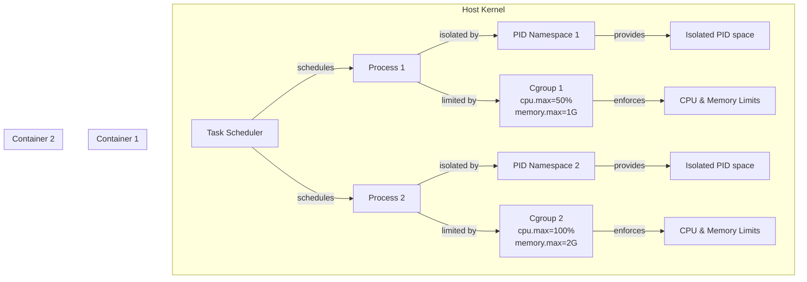
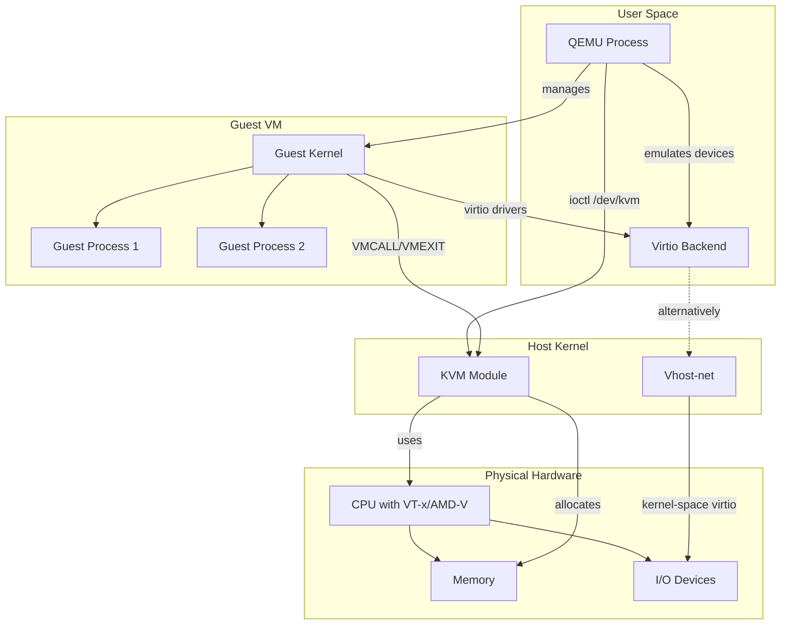
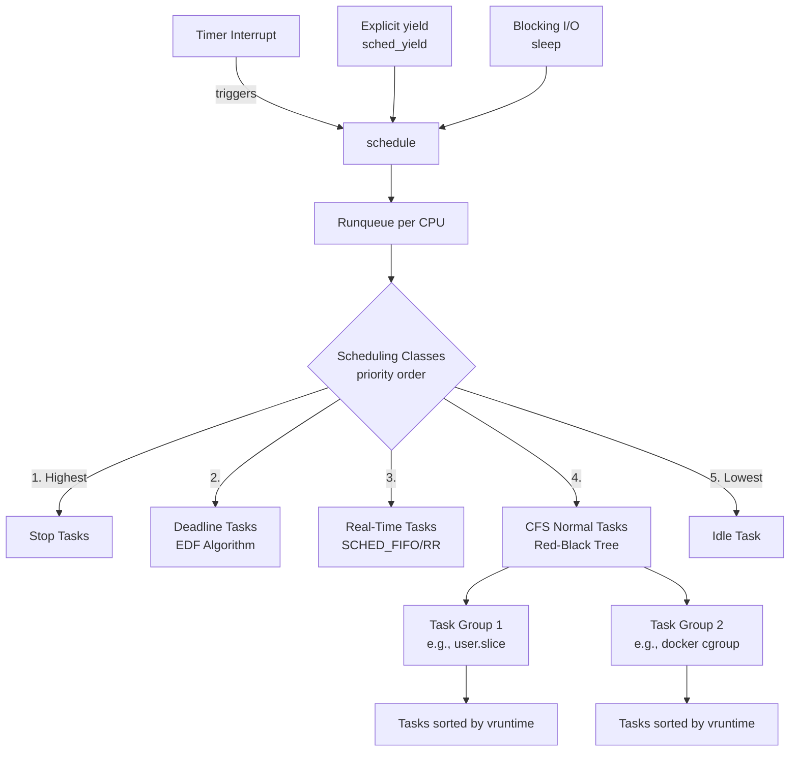

# Lesson 6: Advanced Topics in Linux Systems Engineering

## 1. First-Principles Invariants and Architectural Foundations

Modern computing infrastructure rests on abstractions provided by the Linux kernel: process isolation, resource accounting, hardware virtualization, and scheduling fairness. These are not independent features but emergent properties of fundamental kernel subsystems designed around isolation, multiplexing, and protection. This lesson examines containerization, virtualization, and performance tuning through the lens of kernel internals, memory management, CPU scheduling, and I/O subsystems.

**Containerization** is an operating system-level virtualization technique that multiplexes a single kernel across isolated user-space environments. It achieves isolation through Linux namespaces (introduced in kernel 2.4.19 for mount namespaces, extended through 3.8 for user namespaces) and resource control through cgroups (merged in 2.6.24). Containers do not emulate hardware; they share the host kernel, trading isolation depth for efficiency. The invariant: all processes see the same kernel, but perceive different views of global resources (PIDs, network stacks, filesystem hierarchies).

**Virtualization** introduces a hypervisor layer that emulates or paravirtualizes hardware, enabling multiple guest kernels to execute on a single physical machine. Full virtualization (KVM, Xen HVM) relies on hardware extensions (Intel VT-x/VT-d, AMD-V/AMD-Vi) to trap privileged instructions and emulate physical devices. Paravirtualization (Xen PV) modifies guest kernels to issue hypercalls instead of privileged instructions. The invariant: guest kernels execute in a lower privilege ring (ring 1 or non-root mode), and all hardware access is mediated by the hypervisor.

**Performance tuning** requires understanding the kernel's resource allocation policies: the Completely Fair Scheduler (CFS) for CPU time distribution, the page cache and buddy allocator for memory, and the I/O scheduler (CFQ, deadline, BFQ, or mq-deadline) for disk access. Tuning is the practice of aligning kernel heuristics with workload characteristics—trading latency for throughput, fairness for priority, or memory for speed.

Three foundational kernel mechanisms underpin these topics:

1. **Virtual memory and address spaces**: Each process or VM operates in its own virtual address space, isolated via page tables. The Memory Management Unit (MMU) translates virtual to physical addresses, enforcing protection. Containers share the kernel's physical memory via the same page tables (with namespace-isolated views); VMs have distinct page tables managed by the hypervisor.

2. **Privilege rings and mode transitions**: x86 defines four privilege levels (rings 0–3); Linux uses ring 0 for kernel mode and ring 3 for user mode. System calls (via `syscall`/`sysenter`) and hardware interrupts trigger transitions. Virtualization adds a new dimension: VT-x introduces VMX root/non-root modes; guest kernels run in non-root ring 0, and the hypervisor in root ring 0.

3. **Scheduling and time-slicing**: The kernel scheduler multiplexes CPU time across tasks (threads). CFS uses a red-black tree keyed by virtual runtime (`vruntime`), ensuring O(log n) insertion and O(1) selection of the next task. Preemption (voluntary or forced) ensures responsiveness; `CONFIG_PREEMPT` kernels allow preemption at any kernel code path, while `CONFIG_PREEMPT_VOLUNTARY` inserts explicit preemption points.

## 2. Core Architecture and Kernel Mechanisms

### 2.1. Containerization: Namespaces and Control Groups

Linux namespaces partition global kernel resources into isolated instances. A process in a namespace sees only the resources within that namespace; sibling namespaces are invisible. Namespace types:

- **Mount (`CLONE_NEWNS`)**: Isolates filesystem mount points. Each mount namespace has its own view of the VFS hierarchy. Processes can mount or unmount filesystems without affecting other namespaces. Introduced in 2.4.19 (2002).
- **PID (`CLONE_NEWPID`)**: Isolates process IDs. PID 1 in a PID namespace is the init process for that namespace; it reaps orphaned children. PIDs are hierarchical: a parent namespace can see child namespace PIDs (translated), but not vice versa. Introduced in 2.6.24 (2008).
- **Network (`CLONE_NEWNET`)**: Isolates network stack—interfaces, routing tables, firewall rules, sockets. Virtual Ethernet pairs (`veth`) bridge namespaces. Introduced in 2.6.24.
- **IPC (`CLONE_NEWIPC`)**: Isolates System V IPC objects (message queues, semaphores, shared memory segments) and POSIX message queues. Introduced in 2.6.19 (2006).
- **UTS (`CLONE_NEWUTS`)**: Isolates hostname and NIS domain name (`uname -n`). Introduced in 2.6.19.
- **User (`CLONE_NEWUSER`)**: Isolates user and group IDs. A process can have UID 0 (root) inside a user namespace but non-zero outside. UID/GID mappings are configured via `/proc/[pid]/uid_map` and `/proc/[pid]/gid_map`. Introduced in 3.8 (2013), enabling unprivileged containers.
- **Cgroup (`CLONE_NEWCGROUP`)**: Isolates cgroup hierarchy view. Introduced in 4.6 (2016).
- **Time (`CLONE_NEWTIME`)**: Isolates `CLOCK_MONOTONIC` and `CLOCK_BOOTTIME` clocks, enabling clock offsets per namespace (useful for checkpoint/restore). Introduced in 5.6 (2020).

Namespace creation uses the `clone` or `unshare` system calls:

```c
#define _GNU_SOURCE
#include <sched.h>
#include <stdio.h>
#include <stdlib.h>
#include <sys/wait.h>
#include <unistd.h>

static int child_func(void *arg) {
    printf("Child PID (inside namespace): %d\n", getpid());
    printf("Child PPID (inside namespace): %d\n", getppid());
    sleep(2);
    return 0;
}

#define STACK_SIZE (1024 * 1024)
static char child_stack[STACK_SIZE];

int main() {
    pid_t child_pid;
    
    // Create new PID and mount namespaces
    child_pid = clone(child_func, 
                     child_stack + STACK_SIZE,  // Stack grows downward
                     CLONE_NEWPID | CLONE_NEWNS | SIGCHLD,
                     NULL);
    
    if (child_pid == -1) {
        perror("clone");
        exit(EXIT_FAILURE);
    }
    
    printf("Parent: created child with PID %d\n", child_pid);
    waitpid(child_pid, NULL, 0);
    
    return 0;
}
```

**Control groups (cgroups)** provide resource accounting, limitation, and prioritization. Cgroups v1 (merged 2.6.24) organized controllers (cpu, memory, blkio, etc.) in separate hierarchies; cgroups v2 (stabilized in 4.5, 2016) unifies controllers into a single hierarchy. Each cgroup is a directory under `/sys/fs/cgroup/` (v2) or `/sys/fs/cgroup/<controller>/` (v1).

Key controllers:

- **cpu**: Limits CPU time via CFS bandwidth control (`cpu.cfs_period_us`, `cpu.cfs_quota_us`). A quota of 50,000 µs and period of 100,000 µs limits the cgroup to 50% CPU.
- **cpuset**: Pins processes to specific CPUs or NUMA nodes (`cpuset.cpus`, `cpuset.mems`).
- **memory**: Limits RAM and swap usage (`memory.limit_in_bytes` in v1, `memory.max` in v2). The OOM killer terminates processes when limits are exceeded and memory cannot be reclaimed.
- **blkio** (v1) / **io** (v2): Limits I/O bandwidth and IOPS per block device (`blkio.throttle.read_bps_device`).
- **pids**: Limits the number of processes in a cgroup (`pids.max`), preventing fork bombs.

Cgroup hierarchy example (v2):

```text
/sys/fs/cgroup/
├── cgroup.controllers       (available controllers: cpu, memory, io, pids)
├── cgroup.subtree_control   (enabled controllers for children: +cpu +memory)
├── user.slice/
│   ├── memory.max           (e.g., 2G)
│   ├── cpu.max              (e.g., 100000 200000 → 50% CPU)
│   └── cgroup.procs         (PIDs in this cgroup)
└── system.slice/
    └── docker.service/
        ├── memory.max
        └── <container-id>/
            ├── memory.current   (current usage)
            └── cgroup.procs
```

**Architectural interaction**:



**Namespace and cgroup lifecycle**: Namespaces are reference-counted kernel objects; they persist as long as a process or bind-mounted reference exists. Cgroups persist until all processes exit and the directory is removed. Systemd manages cgroups for services, creating a hierarchy under `system.slice` and `user.slice`.

### 2.2. Virtualization: KVM, QEMU, and Hardware Assistance

**KVM (Kernel-based Virtual Machine)** is a Type-1 hypervisor implemented as a loadable kernel module (`kvm.ko`, `kvm-intel.ko`, `kvm-amd.ko`). It exposes `/dev/kvm`, a character device that user-space VMMs (QEMU, Firecracker, crosvm) use to create and manage VMs. KVM leverages hardware virtualization extensions:

- **Intel VT-x**: Introduces VMX (Virtual Machine Extensions) with two modes—VMX root (host) and VMX non-root (guest). The VMCS (Virtual Machine Control Structure) stores guest and host state. `VMLAUNCH`/`VMRESUME` enters the guest; VM exits return control to the host.
- **AMD-V (SVM)**: Uses VMCB (Virtual Machine Control Block) and `VMRUN`/`VMEXIT` instructions.
- **Intel VT-d / AMD-Vi (IOMMU)**: Enables DMA remapping and interrupt remapping for device passthrough. The IOMMU translates guest physical addresses (GPA) to host physical addresses (HPA), isolating devices per VM.

**Nested page tables** (Intel EPT, AMD RVI/NPT) eliminate the need for shadow page tables by adding a second level of address translation: guest virtual address (GVA) → guest physical address (GPA) → host physical address (HPA). The MMU walks both page tables in hardware, achieving near-native performance.

**QEMU (Quick Emulator)** is a user-space VMM. Without KVM, QEMU emulates CPU instructions via binary translation (TCG). With KVM, QEMU uses `ioctl` calls on `/dev/kvm` to execute guest code directly on the CPU. QEMU emulates devices (virtio-net, virtio-blk, virtio-scsi) using paravirtualized drivers in the guest for performance.

**Virtio** is a standardized I/O paravirtualization framework. Instead of emulating hardware (e.g., Intel e1000 NIC), virtio exposes a simple ring buffer interface (virtqueues) for guest-host communication. The guest driver enqueues I/O requests; the host (QEMU or vhost-net kernel module) dequeues and processes them. Virtio reduces VM exits and context switches.

**Architecture of KVM-based virtualization**:



**VM lifecycle and memory management**:

1. **VM creation**: QEMU opens `/dev/kvm`, calls `KVM_CREATE_VM` ioctl to obtain a VM file descriptor.
2. **vCPU creation**: `KVM_CREATE_VCPU` creates a virtual CPU. Each vCPU is a kernel thread scheduled by the host's CFS.
3. **Memory setup**: QEMU allocates guest physical memory (via `mmap`) and registers it with KVM (`KVM_SET_USER_MEMORY_REGION`). KVM populates EPT/NPT tables.
4. **Execution**: QEMU calls `KVM_RUN` ioctl. KVM executes `VMLAUNCH`/`VMRESUME`; the guest runs until a VM exit (I/O, interrupt, hypercall).
5. **VM exit handling**: QEMU or KVM handles the exit reason (e.g., MMIO access → QEMU emulates device; hypercall → KVM services it).

**Nested virtualization**: KVM supports running VMs inside VMs (L1 guest runs L2 guest). Requires hardware support (Intel VT-x with VMCS shadowing, AMD-V with nested page table support). Enabled via `kvm-intel.nested=1` or `kvm-amd.nested=1` module parameters.

**Device passthrough (VFIO)**: The VFIO (Virtual Function I/O) framework assigns physical devices (GPUs, NICs) to VMs. The IOMMU isolates the device's DMA; the guest accesses it via MMIO. VFIO groups devices by IOMMU group; all devices in a group must be assigned to the same VM or isolated from the host.

Example: Assigning a PCIe NIC to a VM:

```bash
# Unbind NIC from host driver
echo "0000:01:00.0" > /sys/bus/pci/devices/0000:01:00.0/driver/unbind

# Bind to vfio-pci
echo "8086 10fb" > /sys/bus/pci/drivers/vfio-pci/new_id

# Launch QEMU with device passthrough
qemu-system-x86_64 \
    -enable-kvm \
    -m 4G \
    -device vfio-pci,host=01:00.0 \
    -drive file=vm.qcow2,format=qcow2
```

**Security considerations**: VM escapes (CVE-2019-14835, CVE-2018-12904) exploit bugs in KVM or device emulation. Mitigations include minimizing the attack surface (use virtio, not full device emulation), enabling IOMMU, and running QEMU with seccomp filters and reduced privileges (libvirt uses `qemu` user, not root).

### 2.3. CPU Scheduling: Completely Fair Scheduler (CFS)

The **Completely Fair Scheduler (CFS)**, introduced in 2.6.23 (2007), replaced the O(1) scheduler. CFS models an "ideal multitasking CPU" where each task receives `1/n` CPU time (for `n` runnable tasks) simultaneously. In reality, tasks time-slice; CFS tracks unfairness and prioritizes tasks that received less CPU time.

**Key concepts**:

- **Virtual runtime (`vruntime`)**: Time a task has executed, weighted by priority. Calculated as `vruntime += delta_exec * (NICE_0_LOAD / task_weight)`. Lower-priority tasks accumulate `vruntime` faster, so they fall behind higher-priority tasks.
- **Red-black tree**: Runnable tasks are stored in a self-balancing red-black tree, keyed by `vruntime`. The leftmost node (smallest `vruntime`) is the next task to run. Insertion and deletion are O(log n).
- **Scheduling period**: Target latency for all tasks to run once (default 6 ms for ≤8 tasks, scaled linearly for more). Minimum granularity ensures each task runs for at least 0.75 ms.
- **Niceness and priority**: Nice values (-20 to +19) map to weights. Nice 0 has weight 1024; each nice level is ~1.25× the previous. Priority 120 (nice 0) is default; real-time tasks use priorities 0–99.

**CFS algorithm** (simplified):

1. Select task with smallest `vruntime` from the red-black tree.
2. Run task for a time slice (ideal runtime = scheduling period / nr_running).
3. Update `vruntime`: `vruntime += delta_exec * (NICE_0_LOAD / task_weight)`.
4. Reinsert task into the tree (if still runnable).
5. Repeat.

**CFS code example** (creating a high-priority task in C):

```c
#define _GNU_SOURCE
#include <sched.h>
#include <stdio.h>
#include <stdlib.h>
#include <unistd.h>
#include <sys/resource.h>

int main() {
    pid_t pid = getpid();
    
    // Set nice value to -10 (higher priority than default 0)
    if (setpriority(PRIO_PROCESS, pid, -10) == -1) {
        perror("setpriority");
        exit(EXIT_FAILURE);
    }
    
    // Verify
    int nice_val = getpriority(PRIO_PROCESS, pid);
    printf("Nice value: %d\n", nice_val);
    
    // CPU-bound work
    while (1) {
        // Busy loop
    }
    
    return 0;
}
```

**CPU affinity and NUMA**: `sched_setaffinity` pins a task to specific CPUs. NUMA-aware scheduling (via `sched_domain` hierarchies) keeps tasks and memory on the same NUMA node to reduce latency.

```c
#define _GNU_SOURCE
#include <sched.h>
#include <stdio.h>
#include <stdlib.h>

int main() {
    cpu_set_t cpuset;
    CPU_ZERO(&cpuset);
    CPU_SET(0, &cpuset);  // Pin to CPU 0
    CPU_SET(1, &cpuset);  // Also allow CPU 1
    
    if (sched_setaffinity(0, sizeof(cpuset), &cpuset) == -1) {
        perror("sched_setaffinity");
        exit(EXIT_FAILURE);
    }
    
    printf("Task pinned to CPUs 0 and 1\n");
    while (1);  // Busy loop
    return 0;
}
```

**Scheduling classes**: CFS is one of five scheduling classes (in priority order):

1. **stop_sched_class**: Highest priority, used for per-CPU stop tasks (e.g., CPU hotplug).
2. **dl_sched_class**: Deadline scheduler (EDF-based), for real-time tasks with deadlines.
3. **rt_sched_class**: Real-time scheduler (SCHED_FIFO, SCHED_RR), for time-critical tasks.
4. **fair_sched_class**: CFS (SCHED_NORMAL, SCHED_BATCH, SCHED_IDLE), for normal tasks.
5. **idle_sched_class**: Runs when no other tasks are runnable.

**Real-time scheduling** (SCHED_FIFO, SCHED_RR):

```c
#define _GNU_SOURCE
#include <sched.h>
#include <stdio.h>
#include <stdlib.h>
#include <pthread.h>

void* rt_thread(void *arg) {
    printf("Real-time thread running\n");
    while (1);  // Busy loop
    return NULL;
}

int main() {
    pthread_t thread;
    pthread_attr_t attr;
    struct sched_param param;
    
    pthread_attr_init(&attr);
    pthread_attr_setschedpolicy(&attr, SCHED_FIFO);
    param.sched_priority = 50;  // Priority 1-99
    pthread_attr_setschedparam(&attr, &param);
    pthread_attr_setinheritsched(&attr, PTHREAD_EXPLICIT_SCHED);
    
    if (pthread_create(&thread, &attr, rt_thread, NULL) != 0) {
        perror("pthread_create");
        exit(EXIT_FAILURE);
    }
    
    pthread_join(thread, NULL);
    return 0;
}
```

**CFS group scheduling**: Tasks are grouped into entities (e.g., per-user or per-cgroup). CFS schedules groups fairly, then schedules tasks within each group. Prevents a user with 1000 tasks from monopolizing CPU over a user with 1 task.

**Preemption models** (`CONFIG_PREEMPT_*`):

- **PREEMPT_NONE**: No forced preemption; kernel code runs to completion. Lowest overhead, highest latency.
- **PREEMPT_VOLUNTARY**: Explicit preemption points (`cond_resched()`). Balanced latency and overhead.
- **PREEMPT**: Full preemption; kernel can be preempted at almost any point. Lowest latency, highest overhead.
- **PREEMPT_RT**: Real-time preemption patch (out-of-tree, merging into mainline). Converts spinlocks to mutexes, enables preemption in interrupt handlers. Achieves sub-millisecond latencies.

**Scheduler architecture**:



## 3. High-Performance Optimization, Profiling, and Failure Modes

### 3.1. Performance Profiling and Observability

**`perf` (Linux Performance Events)**: Hardware and software performance counters. Samples CPU events (cycles, instructions, cache misses, branch mispredictions) and software events (context switches, page faults).

```bash
# Record CPU cycles for a command
perf record -e cycles -g ./my_program

# Analyze the report with call graph
perf report --stdio

# Top-like interface showing live hotspots
perf top
```

`perf` uses hardware Performance Monitoring Units (PMUs). On x86, Intel's PMU provides fixed counters (instructions retired, CPU cycles, reference cycles) and programmable counters (L1/L2/L3 cache misses, TLB misses, branch mispredictions).

**Flamegraphs**: Visualize `perf` call stacks as hierarchical flamegraphs (Brendan Gregg). Wide bars indicate functions consuming the most CPU time.

```bash
perf record -F 99 -a -g -- sleep 30
perf script | stackcollapse-perf.pl | flamegraph.pl > flame.svg
```

**`bpftrace` and eBPF (extended Berkeley Packet Filter)**: Attach probes to kernel functions, system calls, and user-space functions. eBPF programs run in a safe sandbox, verified by the kernel to prevent crashes.

```bash
# Trace open system calls with file path and latency
bpftrace -e 'tracepoint:syscalls:sys_enter_openat { 
    @start[tid] = nsecs; 
}
tracepoint:syscalls:sys_exit_openat /@start[tid]/ { 
    $duration_us = (nsecs - @start[tid]) / 1000;
    printf("openat(%s) = %d, latency: %d µs\n", 
           str(args->filename), args->ret, $duration_us);
    delete(@start[tid]);
}'
```

**`ftrace`**: Built-in kernel tracer. Traces function calls, latencies, and events. Available via `/sys/kernel/debug/tracing/`.

```bash
# Trace all scheduler events
echo 1 > /sys/kernel/debug/tracing/events/sched/enable
cat /sys/kernel/debug/tracing/trace_pipe
```

**`sysstat` suite**: `sar`, `iostat`, `mpstat`, `pidstat`. Collect historical system metrics (CPU, memory, disk, network).

```bash
# CPU usage per core, 1-second intervals
mpstat -P ALL 1

# Disk I/O statistics, extended format
iostat -x 1

# Per-process CPU and memory usage
pidstat 1
```

**Tracing tools summary**:

| Tool | Use Case | Overhead | Kernel Access |
|------|----------|----------|---------------|
| `perf` | CPU profiling, PMC events | Low (sampling) | Yes |
| `bpftrace` | Dynamic tracing, custom probes | Very low | Yes |
| `ftrace` | Kernel function tracing | Medium | Yes |
| `strace` | System call tracing | High (per-syscall) | No |
| `gdb` | Interactive debugging | High | No |

### 3.2. Memory Management and OOM Killer

The **Out-of-Memory (OOM) killer** terminates processes when the system exhausts memory and cannot reclaim pages. The kernel computes an `oom_score` for each process based on memory usage, runtime, and `oom_score_adj` (user-tunable via `/proc/[pid]/oom_score_adj`).

**OOM killer heuristic**:

```text
oom_score = (total_vm_pages * 1000) / total_memory_pages
            + oom_score_adj
```

Processes with higher scores are killed first. Root processes and kernel threads have penalties. The `oom_score_adj` ranges from -1000 (never kill) to +1000 (always kill first).

**Preventing OOM** for critical processes:

```bash
# Make a process immune to OOM killer
echo -1000 > /proc/$(pidof my_critical_process)/oom_score_adj
```

**Cgroup memory limits** trigger the OOM killer when the cgroup's memory usage exceeds `memory.max`. The killer only considers processes within that cgroup.

**Huge pages**: Standard pages are 4 KiB (x86). Huge pages (2 MiB or 1 GiB) reduce TLB misses and page table overhead for memory-intensive applications (databases, VMs).

```bash
# Allocate 1024 huge pages (2 MiB each = 2 GiB total)
echo 1024 > /proc/sys/vm/nr_hugepages

# Verify
cat /proc/meminfo | grep Huge
```

Transparent Huge Pages (THP) automatically promote 4 KiB pages to 2 MiB pages. Enabled by default, but can cause latency spikes during compaction.

```bash
# Disable THP
echo never > /sys/kernel/mm/transparent_hugepage/enabled
```

**NUMA (Non-Uniform Memory Access)**: Multi-socket systems where each CPU has local memory; accessing remote memory is slower. The kernel's NUMA balancing migrates pages and tasks to reduce remote accesses.

```bash
# Show NUMA topology
numactl --hardware

# Run a process on NUMA node 0 with memory allocated from node 0
numactl --cpunodebind=0 --membind=0 ./my_program
```

### 3.3. I/O Scheduling and Disk Optimization

The **I/O scheduler** merges and reorders block I/O requests to minimize disk seeks and maximize throughput. Linux provides multiple schedulers:

- **noop / none**: No reordering. Suitable for SSDs and NVMe (no seek time).
- **deadline**: Imposes read and write deadlines to prevent starvation. Good for real-time workloads.
- **CFQ (Completely Fair Queuing)**: Per-process I/O queues, fair time-slicing. Legacy, removed in 5.0.
- **BFQ (Budget Fair Queuing)**: CFQ successor, proportional I/O bandwidth. Good for desktops and latency-sensitive workloads.
- **mq-deadline / kyber**: Multi-queue schedulers for NVMe and high-IOPS devices.

```bash
# Check current scheduler for a block device
cat /sys/block/sda/queue/scheduler

# Set scheduler to deadline
echo deadline > /sys/block/sda/queue/scheduler
```

**Direct I/O (`O_DIRECT`)**: Bypasses the page cache, performing synchronous I/O to disk. Used by databases to avoid double-buffering (kernel page cache + application buffer pool).

```c
#define _GNU_SOURCE
#include <fcntl.h>
#include <unistd.h>
#include <stdlib.h>
#include <stdio.h>
#include <sys/stat.h>

int main() {
    int fd;
    void *buf;
    size_t buf_size = 4096;
    
    // Allocate aligned buffer (required for O_DIRECT)
    if (posix_memalign(&buf, 512, buf_size) != 0) {
        perror("posix_memalign");
        exit(EXIT_FAILURE);
    }
    
    fd = open("testfile", O_RDONLY | O_DIRECT);
    if (fd == -1) {
        perror("open");
        exit(EXIT_FAILURE);
    }
    
    if (read(fd, buf, buf_size) == -1) {
        perror("read");
        exit(EXIT_FAILURE);
    }
    
    close(fd);
    free(buf);
    return 0;
}
```

**Asynchronous I/O (`io_uring`)**: Modern async I/O interface (5.1+, 2019). Uses shared ring buffers (submission queue and completion queue) for zero-copy, low-latency I/O. Replaces the older `aio` API.

```c
#include <liburing.h>
#include <fcntl.h>
#include <stdio.h>
#include <string.h>

int main() {
    struct io_uring ring;
    struct io_uring_sqe *sqe;
    struct io_uring_cqe *cqe;
    int fd;
    char buf[4096];
    
    io_uring_queue_init(8, &ring, 0);
    
    fd = open("testfile", O_RDONLY);
    if (fd < 0) {
        perror("open");
        return 1;
    }
    
    // Get submission queue entry
    sqe = io_uring_get_sqe(&ring);
    io_uring_prep_read(sqe, fd, buf, sizeof(buf), 0);
    
    // Submit
    io_uring_submit(&ring);
    
    // Wait for completion
    io_uring_wait_cqe(&ring, &cqe);
    if (cqe->res < 0) {
        fprintf(stderr, "read error: %s\n", strerror(-cqe->res));
    } else {
        printf("Read %d bytes\n", cqe->res);
    }
    
    io_uring_cqe_seen(&ring, cqe);
    io_uring_queue_exit(&ring);
    close(fd);
    return 0;
}
```

### 3.4. Network Stack Tuning

**TCP buffer sizing**: Kernel buffers (send and receive) are auto-tuned by default. Explicit tuning via `sysctl`:

```bash
# Increase TCP receive buffer (min, default, max in bytes)
sysctl -w net.ipv4.tcp_rmem="4096 131072 16777216"

# Increase TCP send buffer
sysctl -w net.ipv4.tcp_wmem="4096 65536 16777216"
```

**TCP congestion control algorithms**: BBR (Bottleneck Bandwidth and RTT) outperforms CUBIC on high-latency, lossy networks.

```bash
# Enable BBR
echo "tcp_bbr" > /etc/modules-load.d/bbr.conf
sysctl -w net.ipv4.tcp_congestion_control=bbr
```

**Interrupt coalescing and NAPI**: Network Interface Cards (NICs) batch interrupts to reduce CPU overhead. The kernel's NAPI (New API) framework polls the NIC during high load instead of relying on interrupts.

**Receive Side Scaling (RSS) and XPS (Transmit Packet Steering)**: Distribute RX/TX processing across multiple CPUs using NIC hardware queues. Configured via `ethtool`:

```bash
# Show RSS configuration
ethtool -x eth0

# Show interrupt affinity
cat /proc/interrupts | grep eth0
```

**XDP (eXpress Data Path)**: eBPF programs attached to the NIC driver, processing packets before they enter the kernel stack. Enables programmable packet filtering, load balancing, and DDoS mitigation at line rate.

### 3.5. Failure Modes and Mitigations

**Resource exhaustion**:

- **CPU saturation**: Tasks accumulate in the runqueue, increasing wait time. Mitigations: cgroup CPU limits, nice levels, or offloading to additional hosts.
- **Memory exhaustion**: OOM killer terminates processes. Mitigations: increase swap, set memory limits, or use memory-mapped files for large datasets.
- **Disk I/O saturation**: Queues fill, latencies spike. Mitigations: I/O scheduling, rate limiting (blkio cgroup), or faster storage (NVMe, RAID).
- **Network saturation**: Packet loss, retransmissions. Mitigations: QoS (tc), rate limiting, or scale-out.

**Thundering herd**: Many processes wake simultaneously (e.g., `accept()` on a shared socket). Mitigations: `EPOLLEXCLUSIVE`, `SO_REUSEPORT`, or leader-follower pattern.

**Context switch storms**: Excessive context switches (e.g., lock contention). Mitigations: batch processing, work stealing, or lock-free data structures.

**Cache thrashing**: Poor cache locality, high miss rates. Mitigations: NUMA awareness, thread pinning, or data structure alignment.

**Kernel bugs and panics**: Kernel oops or panic halts the system. Mitigations: kdump (crash dump), serial console logging, or watchdog timers (automatic reboot).

**Security vulnerabilities**:

- **Spectre/Meltdown**: Speculative execution side-channel attacks. Mitigations: retpoline, IBRS (Indirect Branch Restricted Speculation), PTI (Page Table Isolation). Performance cost: 5–30%.
- **Container escapes**: Exploiting kernel vulnerabilities from a container to gain host access. Mitigations: seccomp filters, AppArmor/SELinux, user namespaces, and minimal container images.
- **VM escapes**: Exploiting hypervisor or device emulation bugs. Mitigations: minimize attack surface (virtio, not full emulation), IOMMU isolation, and regular patching.

**Example: Setting up seccomp for a container**:

```c
#include <seccomp.h>
#include <unistd.h>
#include <stdio.h>

int main() {
    scmp_filter_ctx ctx;
    
    // Default: deny all syscalls
    ctx = seccomp_init(SCMP_ACT_KILL);
    if (ctx == NULL) {
        perror("seccomp_init");
        return 1;
    }
    
    // Allow essential syscalls
    seccomp_rule_add(ctx, SCMP_ACT_ALLOW, SCMP_SYS(read), 0);
    seccomp_rule_add(ctx, SCMP_ACT_ALLOW, SCMP_SYS(write), 0);
    seccomp_rule_add(ctx, SCMP_ACT_ALLOW, SCMP_SYS(exit_group), 0);
    
    // Load the filter
    if (seccomp_load(ctx) < 0) {
        perror("seccomp_load");
        seccomp_release(ctx);
        return 1;
    }
    
    printf("Seccomp filter loaded. Attempting dangerous syscall...\n");
    
    // This will be killed by seccomp
    execve("/bin/sh", NULL, NULL);
    
    return 0;
}
```

Compile with: `gcc -o seccomp_test seccomp_test.c -lseccomp`

## 4. Production Patterns and Best Practices

**Containerization best practices**:

1. **Minimize container images**: Use distroless or Alpine Linux base images. Fewer packages reduce attack surface and image size.
2. **Non-root user**: Run containers as non-root. Use user namespaces to map container root to unprivileged host UID.
3. **Read-only root filesystem**: Mount the container's root filesystem as read-only (`--read-only` in Docker). Use tmpfs for writable paths.
4. **Resource limits**: Set CPU and memory limits via cgroups to prevent resource starvation.
5. **Security profiles**: Apply seccomp, AppArmor, or SELinux profiles. Default Docker seccomp profile blocks ~60 dangerous syscalls.

**Virtualization best practices**:

1. **Paravirtualized drivers**: Use virtio for network, block, and serial devices. Avoid full device emulation (e.g., Intel e1000).
2. **CPU pinning**: Pin vCPUs to physical CPUs to avoid migration overhead and cache thrashing.
3. **NUMA awareness**: Align VM memory and vCPUs to the same NUMA node.
4. **Balloon driver**: Enable memory ballooning for dynamic memory allocation between VMs.
5. **SR-IOV**: Use Single Root I/O Virtualization for near-native NIC performance. Requires VT-d/AMD-Vi.

**Performance tuning checklist**:

1. **Profile first**: Use `perf`, `bpftrace`, or `flamegraphs` to identify bottlenecks.
2. **Tune scheduler**: Adjust niceness, use cgroups, or pin tasks to CPUs.
3. **Optimize memory**: Use huge pages, tune swappiness, or enable NUMA balancing.
4. **Optimize I/O**: Choose the right I/O scheduler, use `io_uring`, or enable Direct I/O for databases.
5. **Optimize network**: Tune TCP buffers, enable BBR, or use XDP for packet processing.
6. **Monitor continuously**: Use `sar`, `Prometheus`, or `Grafana` for historical metrics.

## 5. Summary

This lesson examined Linux containerization, virtualization, and performance tuning through the lens of kernel internals. Containerization isolates processes via namespaces and limits resources via cgroups, sharing the host kernel for efficiency. Virtualization introduces a hypervisor layer (KVM + QEMU) that emulates or paravirtualizes hardware, enabling multiple guest kernels to coexist. Performance tuning aligns the kernel's scheduling, memory management, and I/O policies with workload characteristics.

Key architectural invariants:

- **Isolation via address spaces**: Virtual memory and page tables isolate processes and VMs.
- **Multiplexing via scheduling**: CFS multiplexes CPU time fairly across tasks using virtual runtime and red-black trees.
- **Resource control via cgroups**: Hierarchical resource limits enforce policies per-process, per-container, or per-VM.
- **Hardware assistance for virtualization**: VT-x/AMD-V, EPT/NPT, and IOMMU enable near-native VM performance and security.

Mastery of these topics requires understanding the kernel's abstractions, measuring system behavior with profiling tools, and iteratively tuning based on workload characteristics. The Linux kernel provides a rich set of mechanisms—from namespaces to eBPF—that enable fine-grained control over system resources, making it the foundation of modern cloud infrastructure.
