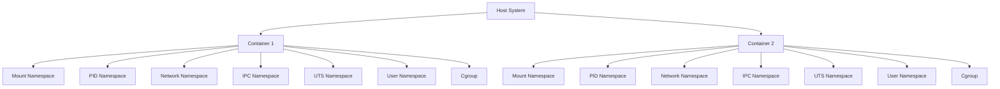
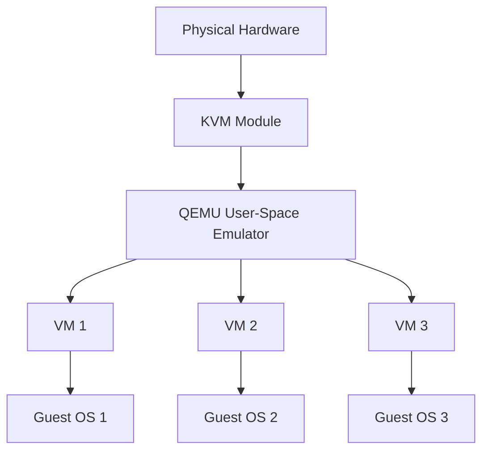

# Lesson 6: Advanced Topics

## 1. First-Principles Intuition & Invariants

In the realm of modern computing infrastructure, the Linux operating system stands as a cornerstone, providing a robust foundation for containerization, virtualization, and performance tuning. This lesson delves into the advanced topics that underpin these capabilities, establishing a deep theoretical grounding in the principles that govern their operation. Understanding these principles is crucial for senior software engineers, systems programmers, and domain architects who seek to optimize and secure complex systems.

Containerization, virtualization, and performance tuning are not merely tools or techniques; they are manifestations of fundamental computing paradigms. Containerization leverages the Linux kernel's namespaces and control groups (cgroups) to isolate processes while sharing the host kernel, enabling efficient resource utilization and application portability. Virtualization, on the other hand, introduces a layer of abstraction that allows multiple operating systems to run on a single physical machine, each with its own virtual hardware. Performance tuning, whether at the kernel level or application level, is an ongoing process that seeks to optimize resource allocation and execution efficiency, ensuring that systems operate at peak performance under varying loads.

At the heart of these advanced topics lies the Linux kernel, a complex and sophisticated piece of software that manages system resources and provides abstractions for application development. The kernel's design is governed by a set of invariants and principles that ensure stability, security, and performance. These invariants include the separation of user and kernel space, the use of page tables for virtual memory management, and the implementation of scheduling algorithms that prioritize fairness and responsiveness. Understanding these invariants is essential for mastering the advanced topics covered in this lesson.

## 2. Core Architecture & Mechanics

### Containerization: Linux Namespaces and Control Groups

Containerization is a powerful paradigm that allows applications to run in isolated environments, sharing the host kernel while maintaining process isolation. This isolation is achieved through the use of Linux namespaces, which provide a mechanism for isolating global system resources such as process IDs, network interfaces, and mount points. Each container is assigned its own namespace, effectively creating a sandboxed environment that is isolated from other containers and the host system.

The Linux kernel supports six types of namespaces: Mount (`CLONE_NEWNS`), Process ID (`CLONE_NEWPID`), Network (`CLONE_NEWNET`), Inter-Process Communication (`CLONE_NEWIPC`), UTS (`CLONE_NEWUTS`), and User (`CLONE_NEWUSER`). These namespaces are created using the `clone` system call, which allows a process to create a new process with specified namespace flags. For example, the `CLONE_NEWPID` flag creates a new PID namespace, isolating the process IDs within the container from those on the host.

Control groups (cgroups) are another critical component of containerization, providing a mechanism for limiting and allocating system resources such as CPU, memory, and disk I/O. Cgroups are organized in a hierarchical tree structure, with each node representing a cgroup that can have child cgroups. This hierarchical structure allows for fine-grained resource management, enabling administrators to allocate resources based on specific policies and constraints.

The interaction between namespaces and cgroups is illustrated in the following diagram:



In this diagram, each container is associated with its own set of namespaces and a cgroup, enabling isolation and resource management.

### Virtualization: Hypervisors and Virtual Machines

Virtualization is a technology that allows multiple operating systems to run on a single physical machine, each with its own virtual hardware. This is achieved through the use of a hypervisor, a software layer that abstracts the physical hardware and provides a virtual machine (VM) environment for each guest operating system. The hypervisor manages the allocation of system resources to each VM, ensuring that they operate independently and securely.

There are two primary types of hypervisors: Type 1 (bare-metal) and Type 2 (hosted). Type 1 hypervisors run directly on the physical hardware, providing a thin layer of abstraction between the hardware and the VMs. This type of hypervisor is typically used in data centers and cloud environments, where performance and resource efficiency are critical. Type 2 hypervisors, on the other hand, run on top of a host operating system, providing a more flexible and user-friendly environment for development and testing.

The Linux kernel supports both Type 1 and Type 2 virtualization through the KVM (Kernel-based Virtual Machine) module. KVM is a full virtualization solution that provides hardware-assisted virtualization for x86, ARM, and other architectures. KVM operates in conjunction with the QEMU user-space emulator, which provides a virtual machine monitor (VMM) that manages the allocation of system resources to each VM.

The architecture of a KVM-based virtualization environment is illustrated in the following diagram:



In this diagram, the KVM module provides hardware-assisted virtualization, while the QEMU user-space emulator manages the allocation of system resources to each VM.

### Performance Tuning: Scheduling and Resource Management

Performance tuning is an essential aspect of system administration, enabling administrators to optimize resource allocation and execution efficiency. The Linux kernel provides a variety of mechanisms for performance tuning, including scheduling algorithms, resource management policies, and performance monitoring tools.

The Completely Fair Scheduler (CFS) is a key component of the Linux kernel's scheduling subsystem, providing a fair and efficient mechanism for allocating CPU time to processes. CFS uses a red-black tree data structure to maintain a list of runnable processes, with each process assigned a virtual runtime (`vruntime`) that represents the amount of CPU time it has received. The scheduler selects the process with the smallest `vruntime` for execution, ensuring that all processes receive a fair share of CPU time.

CFS also supports preemption models that allow the scheduler to interrupt a running process and switch to another process if it becomes runnable. This ensures that the scheduler can quickly respond to changes in system load and maintain responsiveness.

Resource management policies are another critical aspect of performance tuning, enabling administrators to allocate system resources based on specific policies and constraints. The Linux kernel provides a variety of mechanisms for resource management, including control groups (cgroups), which allow administrators to limit and allocate resources such as CPU, memory, and disk I/O.

Performance monitoring tools are also essential for performance tuning, enabling administrators to identify performance bottlenecks and optimize system performance. The Linux kernel provides a variety of performance monitoring tools, including `perf`, `trace-cmd`, and `sysstat`, which allow administrators to collect and analyze performance data.

The architecture of the Linux kernel's scheduling and resource management subsystem is illustrated in the following diagram:

```mermaid
graph TD;
    A[Linux Kernel] --> B[Completely Fair Scheduler (CFS)];
    B --> C[Red-Black Tree];
    B --> D[Preemption Models];
    A --> E[Control Groups (cgroups)];
    E --> F[Resource Limits];
    E --> G[Resource Allocation];
    A --> H[Performance Monitoring Tools];
    H --> I[perf];
    H --> J[trace-cmd];
    H --> K[sysstat];
```

In this diagram, the Completely Fair Scheduler (CFS) uses a red-black tree data structure to maintain a list of runnable processes and supports preemption models for quick response to changes in system load. Control groups (cgroups) allow administrators to limit and allocate resources based on specific policies and constraints, while performance monitoring tools enable administrators to collect and analyze performance data.

## 3. High-Performance Optimization & Failure Modes

High-performance optimization is a critical aspect of system administration, enabling administrators to optimize resource allocation and execution efficiency. This section explores the techniques and strategies for high-performance optimization, as well as the failure modes and mitigations that are essential for maintaining system stability and reliability.

### Concurrency and Resource Scaling

Concurrency is a key aspect of high-performance optimization, enabling systems to perform multiple tasks simultaneously. The Linux kernel provides a variety of mechanisms for concurrency, including threads, processes, and asynchronous I/O. Threads allow multiple tasks to run within a single process, sharing the same memory space and resources. Processes, on the other hand, provide a higher level of isolation, with each process having its own memory space and resources. Asynchronous I/O allows processes to perform I/O operations without blocking, enabling systems to perform multiple tasks simultaneously.

Resource scaling is another critical aspect of high-performance optimization, enabling systems to handle increasing loads and workloads. The Linux kernel provides a variety of mechanisms for resource scaling, including load balancing, dynamic resource allocation, and adaptive scheduling. Load balancing allows the kernel to distribute workloads across multiple CPUs and cores, ensuring that no single CPU or core becomes a bottleneck. Dynamic resource allocation allows the kernel to allocate resources based on current system load and workload, ensuring that resources are used efficiently. Adaptive scheduling allows the kernel to adjust scheduling policies based on current system load and workload, ensuring that processes receive the appropriate amount of CPU time.

### Boundary Edge Cases and Failure Mitigations

Boundary edge cases and failure modes are critical aspects of high-performance optimization, enabling administrators to identify and mitigate potential issues that can impact system stability and reliability. Boundary edge cases occur when systems are pushed to their limits, such as when handling maximum loads or workloads. Failure modes occur when systems fail to operate as expected, such as when encountering hardware failures or software bugs.

The Linux kernel provides a variety of mechanisms for identifying and mitigating boundary edge cases and failure modes. These mechanisms include error handling, fault tolerance, and recovery strategies. Error handling allows the kernel to detect and respond to errors, such as memory corruption or hardware failures. Fault tolerance allows the kernel to continue operating in the presence of errors, ensuring that systems remain stable and reliable. Recovery strategies allow the kernel to recover from errors, ensuring that systems can resume normal operation after encountering errors.

In conclusion, this lesson has explored the advanced topics of containerization, virtualization, and performance tuning in the Linux operating system. By understanding the principles and mechanisms that govern these topics, senior software engineers, systems programmers, and domain architects can optimize and secure complex systems, ensuring that they operate at peak performance under varying loads. The Linux kernel provides a robust foundation for these advanced topics, with a variety of mechanisms and tools that enable administrators to optimize resource allocation and execution efficiency, while maintaining system stability and reliability.
