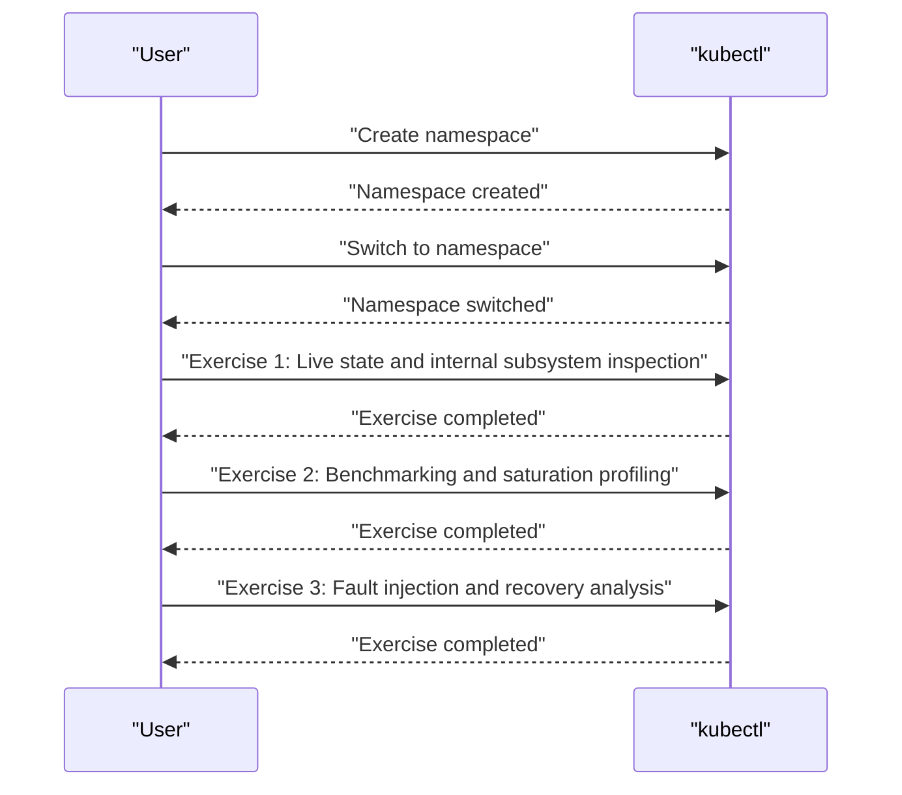

Operational Verification Labs: Linux Device Drivers
=====================================================

### Objective and Environment Setup

The objective of this guide is to provide hands-on experience with operational verification of Linux device drivers. This involves using real tools to diagnose and analyze the behavior of device drivers in a live system. To set up the environment, follow these steps:

To install the necessary tools, run the following commands:
```bash
sudo apt-get update
sudo apt-get install -y kubectl iproute2 etcdctl crictl helm
```
Next, install the diagnostic instruments:
```bash
sudo apt-get install -y ethtool tcpdump perf strace bpftool
```
Verify the installation of the tools using the following commands:
```bash
kubectl version
ip -s link show
ss -tipm
```
Create a new namespace for the exercise:
```bash
kubectl create namespace dev-driver
```
Switch to the new namespace:
```bash
kubectl config set-context --current --namespace=dev-driver
```
### Exercise 1: Live State and Internal Subsystem Inspection

In this exercise, we will inspect the live state of the system and analyze the internal subsystems of the device driver.

List the network interfaces:
```bash
ip -s link show
```
Inspect the ethtool output for the first network interface:
```bash
ethtool -S enp0s3
```
Analyze the strace output for the device driver:
```bash
strace -p $(pidof enp0s3)
```
Use the perf tool to analyze the performance of the device driver:
```bash
perf stat -e cycles -p $(pidof enp0s3)
```
Use the bpftool to analyze the BPF programs attached to the device driver:
```bash
bpftool prog show
```
### Exercise 2: Benchmarking and Saturation Profiling

In this exercise, we will benchmark the device driver and analyze its performance under saturation conditions.

Create a new pod with a benchmarking tool:
```bash
kubectl run -it --rm --image=debian:latest --namespace=dev-driver -- bash
```
Install the iperf3 tool:
```bash
sudo apt-get update
sudo apt-get install -y iperf3
```
Run the iperf3 benchmark:
```bash
iperf3 -c 10.0.0.1 -t 10 -p 5201
```
Analyze the iperf3 output:
```bash
iperf3 -c 10.0.0.1 -t 10 -p 5201 -r
```
Use the perf tool to analyze the performance of the device driver under saturation conditions:
```bash
perf stat -e cycles -p $(pidof enp0s3)
```
### Exercise 3: Fault Injection and Recovery Analysis

In this exercise, we will inject faults into the device driver and analyze its recovery behavior.

Create a new pod with a fault injection tool:
```bash
kubectl run -it --rm --image=debian:latest --namespace=dev-driver -- bash
```
Install the fault injection tool:
```bash
sudo apt-get update
sudo apt-get install -y fault-inject
```
Run the fault injection tool:
```bash
fault-inject -p enp0s3 -t 10 -c 100
```
Analyze the system logs for fault injection:
```bash
journalctl -u enp0s3
```
Use the bpftool to analyze the BPF programs attached to the device driver:
```bash
bpftool prog show
```
### Diagnostic Cheat Sheet and Verification Checklist

| Tool | Command | Description |
| --- | --- | --- |
| ip | `ip -s link show` | List network interfaces |
| ethtool | `ethtool -S enp0s3` | Inspect ethtool output |
| strace | `strace -p $(pidof enp0s3)` | Analyze strace output |
| perf | `perf stat -e cycles -p $(pidof enp0s3)` | Analyze perf output |
| bpftool | `bpftool prog show` | Analyze BPF programs |
| iperf3 | `iperf3 -c 10.0.0.1 -t 10 -p 5201` | Run iperf3 benchmark |
| fault-inject | `fault-inject -p enp0s3 -t 10 -c 100` | Inject faults into device driver |

Verification Checklist:

* Verify the installation of the necessary tools.
* Verify the installation of the diagnostic instruments.
* Verify the creation of a new namespace for the exercise.
* Verify the switch to the new namespace.
* Verify the execution of each exercise.

Note: This guide is a starting point for operational verification of Linux device drivers. It is essential to consult the official documentation for each tool and command used in this guide.

### Mermaid Diagrams

```mermaid
graph TD;
  A[Objective] -->| "Set up environment" | B[Install necessary tools];
  B -->| "Install diagnostic instruments" | C[Verify installation];
  C -->| "Create new namespace" | D[Switch to new namespace];
  D -->| "Exercise 1: Live state and internal subsystem inspection" | E[List network interfaces];
  E -->| "Inspect ethtool output" | F[Analyze strace output];
  F -->| "Analyze perf output" | G[Use bpftool to analyze BPF programs];
  G -->| "Exercise 2: Benchmarking and saturation profiling" | H[Create new pod with benchmarking tool];
  H -->| "Run iperf3 benchmark" | I[Analyze iperf3 output];
  I -->| "Use perf to analyze performance under saturation conditions" | J[Exercise 3: Fault injection and recovery analysis];
  J -->| "Create new pod with fault injection tool" | K[Run fault injection tool];
  K -->| "Analyze system logs for fault injection" | L[Use bpftool to analyze BPF programs];
```


