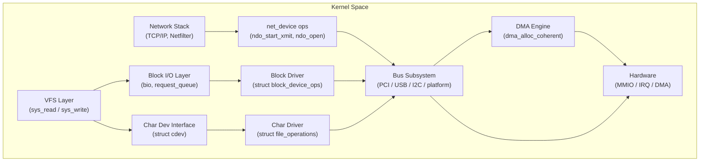
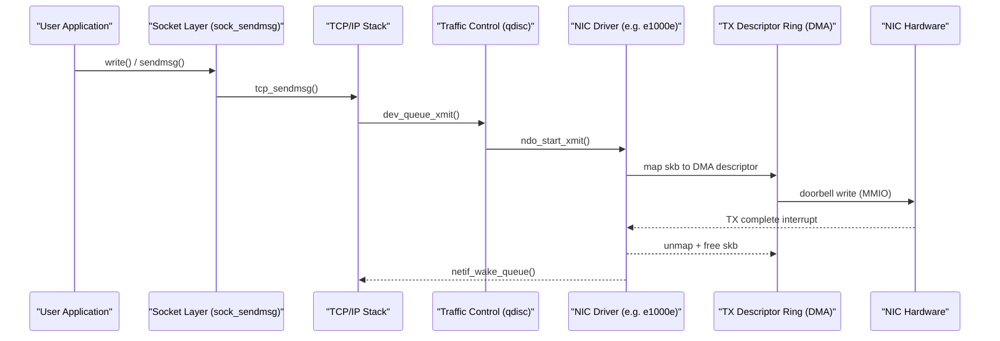
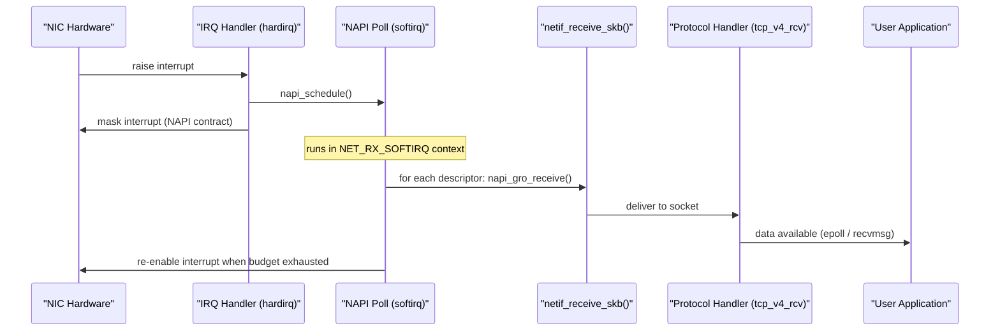
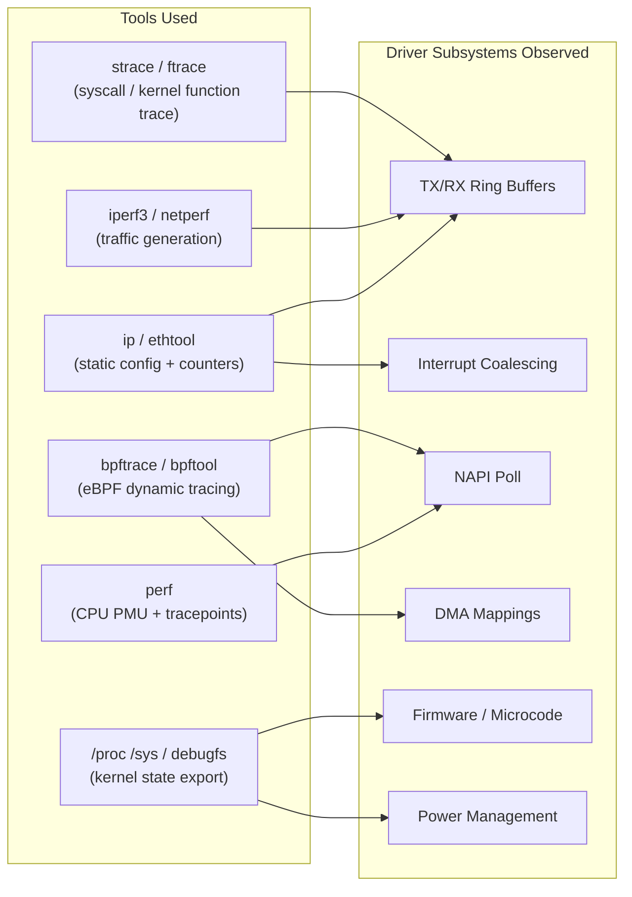
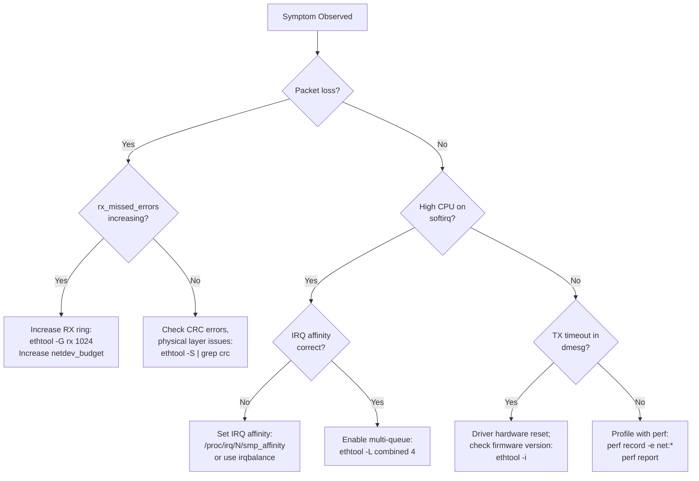
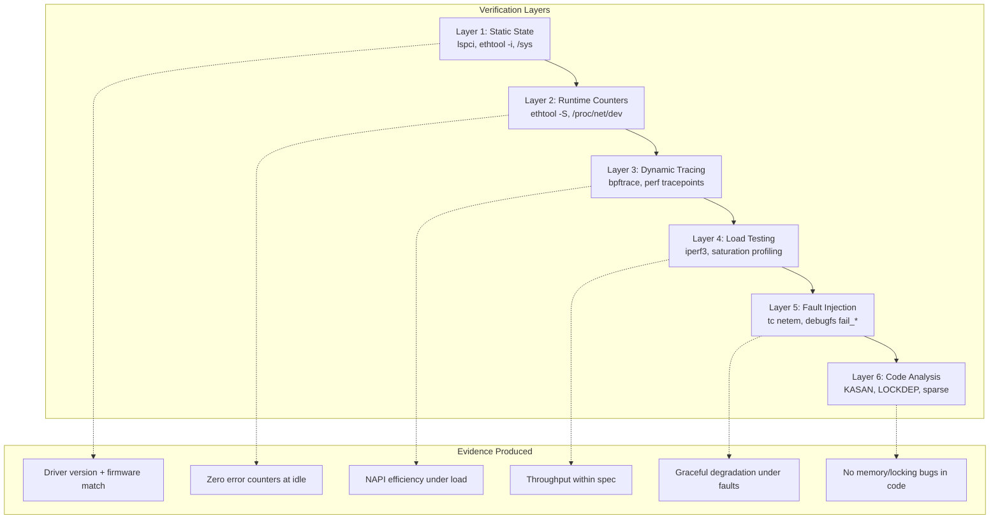

# Operational Verification Labs: Linux Device Drivers

## Conceptual Foundation

Before executing any tool, you must understand what you are observing. A Linux device driver is a kernel module that presents a uniform interface between hardware and the rest of the kernel. It operates entirely in kernel space, sharing the kernel's address space and running with ring-0 privileges. This means a buggy driver can corrupt arbitrary kernel memory, corrupt DMA buffers, or deadlock the entire system — there is no memory protection between kernel components.

The driver model is built on three foundational abstractions:

1. **The `kobject` / `kset` reference-counting infrastructure** — every device, driver, and bus is ultimately a `kobject`. Lifetime management, sysfs representation, and hotplug events are all derived from this base.
2. **The bus-driver-device triad** — a `bus_type` matches registered `device` objects against registered `device_driver` objects via a `match()` callback. When a match is found, the bus calls `probe()` on the driver. This is what happens when you `modprobe e1000e` on a machine with an Intel NIC.
3. **The file operations vtable** — character and block drivers register a `struct file_operations` (or `struct block_device_operations`) that maps VFS calls (`open`, `read`, `write`, `ioctl`, `mmap`) to driver-specific implementations.

The network driver stack adds a fourth abstraction: the `struct net_device` and its `struct net_device_ops`, which map `ndo_open`, `ndo_start_xmit`, `ndo_get_stats64`, etc., to hardware-specific routines.



---

## Architecture Deep Dive: The Network Driver Path

Understanding the transmit path end-to-end is essential for interpreting the diagnostic output you will collect in the labs.



Each `sk_buff` (socket buffer) carries the packet through this path without copying the payload — the DMA descriptor points directly into the `skb->data` allocation. The driver must call `dma_map_single()` before writing the descriptor and `dma_unmap_single()` after the hardware signals completion, or you will produce DMA API violations detectable by `CONFIG_DMA_API_DEBUG`.

The receive path is symmetric but driven by interrupts or NAPI polling:



NAPI (New API) was introduced to prevent interrupt storms under high packet rates. The driver disables its IRQ, schedules a poll, and processes up to `netdev_budget` (default 300) packets per softirq invocation. This is why `ethtool -S` will show `rx_missed_errors` when the system is overloaded — the ring filled before the poll could drain it.

---

## Environment Setup

This lab is designed for a **bare-metal or KVM/QEMU virtual machine running Linux kernel ≥ 5.15 LTS** (Ubuntu 22.04 / Debian Bookworm are well-tested). The Kubernetes tooling (`kubectl`, `helm`) is **not relevant to device driver verification** and has been removed from this lab. Device drivers operate below the container orchestration layer; `kubectl` cannot observe kernel driver state.

> **Prerequisite hardware model:** The examples throughout use `enp0s3` (virtio-net or e1000 as exposed by QEMU). Substitute your actual interface name from `ip link show`.

### Install Diagnostic Instruments

```bash
# Core kernel diagnostic tools
sudo apt-get update
sudo apt-get install -y \
    linux-tools-$(uname -r) \   # perf, turbostat
    bpfcc-tools \               # opensnoop, execsnoop, etc.
    bpftrace \                  # DTrace-like high-level tracing
    ethtool \                   # NIC driver statistics and config
    iproute2 \                  # ip, ss, tc
    tcpdump \                   # packet capture
    strace \                    # syscall tracing (userspace boundary)
    sysstat \                   # iostat, sar
    numactl \                   # NUMA topology inspection
    pciutils \                  # lspci — PCI device enumeration
    usbutils                    # lsusb
```

```bash
# Optional: kernel debug symbols (large download, required for perf annotate)
sudo apt-get install -y linux-image-$(uname -r)-dbgsym 2>/dev/null || \
    echo "Debug symbols not available from default repo; see ddebs.ubuntu.com"
```

### Verify the Environment

```bash
# Confirm kernel version and loaded modules
uname -r
lsmod | head -20

# Enumerate PCI devices — identifies the NIC family and driver binding
lspci -nnk | grep -A3 -i "ethernet\|network"

# Confirm perf is operational
perf stat -e cycles,instructions,cache-misses -- sleep 1

# Confirm bpftrace is operational (requires CAP_BPF or root)
sudo bpftrace -e 'BEGIN { printf("bpftrace OK\n"); exit(); }'
```

Expected output for `lspci -nnk` on a QEMU/KVM guest:

```text
00:03.0 Ethernet controller [0200]: Intel Corporation 82540EM Gigabit Ethernet [8086:100e]
        Kernel driver in use: e1000
        Kernel modules: e1000
```

This confirms the driver binding. The `Kernel driver in use` line reflects the successful `probe()` call in the PCI bus-driver match.

---

## Lab Architecture Overview



---

## Exercise 1: Live State and Internal Subsystem Inspection

### 1.1 — Interface Enumeration and Driver Binding

```bash
# Full interface listing with statistics
ip -s -d link show

# Specifically inspect driver binding via ethtool
ethtool -i enp0s3
```

The `-i` flag queries the `ethtool_drvinfo` struct populated by the driver's `get_drvinfo` ndo. This surfaces:

| Field | Meaning |
|---|---|
| `driver` | Kernel module name (e.g., `e1000`, `virtio_net`) |
| `version` | Driver version string |
| `firmware-version` | NIC firmware; mismatch with driver can cause silent corruption |
| `bus-info` | PCI BDF address — links to `lspci` output |

```bash
# Cross-reference with sysfs — the canonical source of truth
ls -la /sys/class/net/enp0s3/device/driver
# → symlink to /sys/bus/pci/drivers/e1000

# Inspect the PCI configuration space (BAR layout, IRQ routing)
sudo lspci -vvv -s $(ethtool -i enp0s3 | awk '/bus-info/{print $2}')
```

### 1.2 — Hardware Counter Inspection via ethtool

`ethtool -S` reads the driver's `get_ethtool_stats` callback, which dumps hardware RMON counters directly from NIC registers. These are the ground truth for driver health — they predate kernel accounting and cannot be confused by software bugs above the driver.

```bash
# Capture a baseline snapshot
sudo ethtool -S enp0s3 | sort > /tmp/stats_before.txt

# Generate load for 10 seconds
ping -f -c 10000 <gateway_ip> &

# Capture post-load snapshot
sudo ethtool -S enp0s3 | sort > /tmp/stats_after.txt

# Diff to see what changed
diff /tmp/stats_before.txt /tmp/stats_after.txt
```

**Counters that indicate pathological conditions:**

| Counter | Pathology |
|---|---|
| `rx_missed_errors` | RX ring full; CPU cannot drain NAPI fast enough |
| `rx_crc_errors` | Physical layer errors; cable or hardware fault |
| `tx_aborted_errors` | TX ring full; backpressure is not being applied upstream |
| `rx_fifo_errors` | NIC RX FIFO overflow before DMA to host RAM |
| `tx_carrier_errors` | Link down during transmission |

### 1.3 — Interrupt Coalescing and Ring Buffer Configuration

Interrupt coalescing trades latency for throughput. The driver defers raising the host IRQ until either `rx-usecs` microseconds have elapsed or `rx-frames` frames have accumulated. This is the primary tuning knob for the latency/throughput trade-off.

```bash
# View current coalescing settings
sudo ethtool -c enp0s3

# View ring buffer sizes (number of descriptors)
sudo ethtool -g enp0s3
```

```text
Ring parameters for enp0s3:
Pre-set maximums:
RX:         4096
TX:         4096
Current hardware settings:
RX:         256
TX:         256
```

A TX ring of 256 at 1 Gbps means you have 256 × (1500 B / 1e9 bps) ≈ 3 µs of buffering before the driver must call `netif_stop_queue()` and stall the qdisc. If your workload has bursts longer than this, you will see `tx_timeout` driver warnings in `dmesg`.

```bash
# Increase ring buffers for throughput-oriented workloads
sudo ethtool -G enp0s3 rx 1024 tx 1024

# Set aggressive coalescing for throughput (bad for latency-sensitive apps)
sudo ethtool -C enp0s3 rx-usecs 50 rx-frames 64

# Set minimal coalescing for latency-sensitive workloads
sudo ethtool -C enp0s3 rx-usecs 0 rx-frames 1 adaptive-rx off
```

### 1.4 — Kernel Tracepoints: Observing the NAPI Scheduler

The kernel's tracepoint infrastructure (built on `TRACE_EVENT` macros) allows zero-overhead observation of internal driver events when enabled. These tracepoints are compiled in by default in distribution kernels.

```bash
# List all net-related tracepoints
sudo perf list 'net:*'
```

Output includes:
- `net:net_dev_xmit` — fires on every `ndo_start_xmit` call
- `net:napi_poll` — fires on every NAPI poll completion, with work done and budget
- `net:net_dev_queue` — fires when a packet enters the qdisc

```bash
# Record NAPI poll events for 5 seconds while generating traffic
sudo perf record -e net:napi_poll -a -- sleep 5

# Report — shows which driver and how much work per poll
sudo perf report --stdio
```

### 1.5 — eBPF Live Tracing with bpftrace

`bpftrace` programs attach eBPF probes to kernel symbols at runtime. Unlike `perf`, they can filter, aggregate, and emit structured data with sub-microsecond overhead per event.

```bash
# Trace ndo_start_xmit calls, show per-driver call frequency
sudo bpftrace -e '
kprobe:dev_hard_start_xmit
{
    @[kstack(5)] = count();
}
interval:s:5
{
    print(@);
    clear(@);
}'
```

```bash
# Histogram of skb sizes on the transmit path
sudo bpftrace -e '
kprobe:dev_hard_start_xmit
{
    $skb = (struct sk_buff *)arg0;
    @size_hist = hist($skb->len);
}
interval:s:10
{
    print(@size_hist);
    exit();
}'
```

```bash
# Detect DMA mapping errors — a critical correctness check
sudo bpftrace -e '
kretprobe:dma_map_page_attrs
/retval == DMA_MAPPING_ERROR/
{
    printf("DMA mapping failure: dev %s\n", ((struct device *)arg0)->kobj.name);
    @failures = count();
}'
```

> **Why this matters architecturally:** DMA mapping errors are silent in many drivers — the descriptor gets written with a junk address, the hardware DMA-writes to a random physical address, and you get silent memory corruption. This bpftrace probe catches that before the corruption becomes a kernel panic.

### 1.6 — Reading /proc and /sys Driver State

The kernel exports significant driver state through the virtual filesystems. Unlike `ethtool`, this state is not mediated by the driver — it reflects kernel-side accounting.

```bash
# Softirq statistics — shows NET_TX_SOFTIRQ and NET_RX_SOFTIRQ
cat /proc/softirqs

# Per-CPU interrupt delivery — identifies IRQ affinity problems
cat /proc/interrupts | grep -E "enp0s3|e1000"

# Network interface statistics (kernel accounting, not NIC registers)
cat /proc/net/dev

# TCP socket state summary
ss -s

# Detailed socket info with memory usage (send/recv buffer sizes)
ss -tipm 'sport = :22 or dport = :22'
```

```bash
# sysfs: driver-exported tunables for e1000e
ls /sys/bus/pci/drivers/e1000e/
# Access per-device power management state
cat /sys/class/net/enp0s3/device/power/control
```

---

## Exercise 2: Benchmarking and Saturation Profiling

The goal is to characterize driver behavior at the **saturation point** — the traffic rate at which the system can no longer keep pace. Saturation manifests as ring buffer exhaustion, rising softirq CPU time, or increasing `rx_missed_errors`.

### 2.1 — Baseline Throughput with iperf3

Run iperf3 between two hosts on the same L2 segment (or use localhost with two network namespaces to test the loopback path).

**On the receiver:**
```bash
iperf3 -s -p 5201
```

**On the sender:**
```bash
# Single-stream TCP throughput (baseline)
iperf3 -c <receiver_ip> -t 30 -p 5201

# Multi-stream — exercises RSS hash distribution across RX queues
iperf3 -c <receiver_ip> -t 30 -p 5201 -P 8

# UDP throughput — bypasses TCP congestion control, saturates the driver directly
iperf3 -c <receiver_ip> -t 30 -p 5201 -u -b 10G

# Reverse mode — receiver becomes sender (tests TX path of the client machine)
iperf3 -c <receiver_ip> -t 30 -p 5201 -R
```

### 2.2 — Profiling Under Load with perf

While iperf3 runs, attach `perf` to record CPU activity system-wide. This reveals which kernel functions consume CPU time during the workload.

```bash
# Start iperf3 load in background
iperf3 -c <receiver_ip> -t 60 -P 8 &
IPERF_PID=$!

# Record for 15 seconds with call graph support
sudo perf record -F 999 -a -g -- sleep 15

# Kill iperf
kill $IPERF_PID

# Generate flamegraph data
sudo perf script > /tmp/perf_out.txt
# (Use https://github.com/brendangregg/FlameGraph to render)
sudo perf report --stdio --no-children | head -60
```

**Interpreting the output:**

A healthy network driver under load should show the top CPU consumers as:
- `__napi_poll` / `net_rx_action` — the NAPI softirq handler
- `e1000_clean_rx_irq` / `virtnet_poll` — driver-specific RX processing
- `tcp_v4_rcv` → `tcp_rcv_established` — TCP stack processing
- `__kfree_skb` — skb reclamation

If you see `spin_lock` or `_raw_spin_lock_bh` consuming >5% of cycles, you have lock contention — typically caused by insufficient RX queues or incorrect IRQ affinity.

### 2.3 — IRQ Affinity and Multi-Queue Verification

Modern NICs implement RSS (Receive Side Scaling) — hardware hashing of flows across multiple RX queues, each with its own interrupt vector. If all interrupts land on CPU 0, you are not utilizing multi-queue.

```bash
# Show number of RX/TX queues
sudo ethtool -l enp0s3

# Show current combined queue count
sudo ethtool -l enp0s3 | grep -A5 "Current"

# Check which CPUs are receiving NIC interrupts
grep enp0s3 /proc/interrupts
# Format: IRQ_num  CPU0_count  CPU1_count ... CPU_N_count  PCI-MSI  vector_name

# Set IRQ affinity manually (CPU mask in hex)
# IRQ 29 → CPU 0, IRQ 30 → CPU 1, etc.
echo 1 | sudo tee /proc/irq/29/smp_affinity
echo 2 | sudo tee /proc/irq/30/smp_affinity

# Or use the irqbalance daemon
sudo systemctl start irqbalance
```

### 2.4 — Saturation Profiling with bpftrace

```bash
# Monitor NAPI poll efficiency: ratio of work done to budget
sudo bpftrace -e '
tracepoint:net:napi_poll
{
    @work = hist(args->work);
    @budget = hist(args->budget);
    if (args->work == args->budget) {
        @saturated = count();   /* poll exhausted its budget — potential starvation */
    }
}
interval:s:5
{
    printf("--- 5s interval ---\n");
    print(@work);
    print(@saturated);
    clear(@work);
    clear(@saturated);
}'
```

When `@saturated` grows rapidly during load, the softirq is processing at maximum budget on every invocation. The correct response is either to increase `net.core.netdev_budget` or to add more RX queues via `ethtool -L enp0s3 combined 4`.

```bash
# Measure softirq latency histogram (time from schedule to execution)
sudo bpftrace -e '
software:net:rx
{
    @latency_ns = hist(nsecs);
}'
```

### 2.5 — Memory Pressure: SKB Allocation Tracing

Under sustained load, SKB allocation can become a bottleneck. The slab allocator backs `skb_buff` via a dedicated per-CPU cache.

```bash
# Monitor skb alloc/free rate
sudo bpftrace -e '
kprobe:__alloc_skb { @alloc = count(); }
kprobe:kfree_skb   { @free  = count(); }
interval:s:1       { printf("alloc/s: %d  free/s: %d\n", @alloc, @free);
                     clear(@alloc); clear(@free); }'

# Slab statistics for skbuff_head_cache
sudo cat /proc/slabinfo | grep skbuff
```

---

## Exercise 3: Fault Injection and Recovery Analysis

> **Important correction:** `fault-inject` is not a real Debian package. Linux kernel fault injection is provided through **kernel compile-time options** (`CONFIG_FAULT_INJECTION`, `CONFIG_FAILSLAB`, `CONFIG_FAIL_PAGE_ALLOC`, `CONFIG_FAIL_MAKE_REQUEST`) and the **debugfs interface** at `/sys/kernel/debug/fail_*`. Network-specific faults are injected via **tc netem** (network emulation within the traffic control subsystem) and **libvirtio-blk** error simulation for block devices. The exercises below use the correct interfaces.

### 3.1 — Network Fault Injection via tc netem

`tc netem` is a qdisc that injects configurable impairments (packet loss, corruption, reorder, delay) into the transmit path. It operates at the qdisc layer, below the socket but above the driver — testing protocol stack recovery, not the driver itself. For driver-level fault injection, see §3.3.

```bash
# Inject 10% random packet loss
sudo tc qdisc add dev enp0s3 root netem loss 10%

# Inject 5ms delay with 1ms jitter (Gaussian distribution)
sudo tc qdisc replace dev enp0s3 root netem delay 5ms 1ms distribution normal

# Inject 1% packet corruption (bit flip in random byte)
sudo tc qdisc replace dev enp0s3 root netem corrupt 1%

# Inject 5% packet reordering (25% correlation)
sudo tc qdisc replace dev enp0s3 root netem delay 2ms reorder 5% 25%

# View active qdisc
tc qdisc show dev enp0s3

# Remove all injected faults
sudo tc qdisc del dev enp0s3 root
```

Observe the effect on TCP retransmission counters:

```bash
# Watch TCP retransmission rate
watch -n1 'ss -s | grep -i retrans'

# Detailed TCP error stats
netstat -s | grep -i 'retransmit\|error\|fail'
```

### 3.2 — Kernel Debugfs Fault Injection

For testing driver error paths (failed memory allocations, failed DMA mappings), the kernel's built-in fault injection framework is the correct tool. It requires `CONFIG_FAULT_INJECTION=y` (enabled in most distribution kernels with `CONFIG_FAULT_INJECTION_DEBUG_FS=y`).

```bash
# Verify fault injection is available
ls /sys/kernel/debug/fail_page_alloc/
ls /sys/kernel/debug/failslab/

# Configure slab fault injection:
# - probability: N/100 chance of injection per allocation
# - interval: inject every N-th call
# - times: total number of injections (-1 = unlimited)
# - space: how many calls to skip initially
echo 1  | sudo tee /sys/kernel/debug/failslab/probability
echo 1  | sudo tee /sys/kernel/debug/failslab/interval
echo 100 | sudo tee /sys/kernel/debug/failslab/times
echo 0  | sudo tee /sys/kernel/debug/failslab/space
echo Y  | sudo tee /sys/kernel/debug/failslab/task-filter

# Enable injection only for a specific process (safer)
# Launch a process under fault injection via /proc/<pid>/fail-nth
bash -c 'echo 1 > /proc/self/make-it-fail; exec your_command'
```

```bash
# Monitor allocation failures via tracepoint
sudo perf record -e kmem:kmalloc_node -a -- sleep 5
sudo perf report --stdio | head -40
```

### 3.3 — Driver-Level Error Injection via Dynamic Debug and Module Parameters

Many well-written drivers expose deliberate error injection parameters:

```bash
# Virtio-net: simulate TX errors (kernel debug build only)
# e1000e: check for debugfs entries
ls /sys/kernel/debug/e1000e/

# Enable dynamic debug for a specific driver module
echo "module e1000 +pflmt" | sudo tee /sys/kernel/debug/dynamic_debug/control
# Flags: p=print, f=function, l=line, m=module, t=thread

# Monitor the resulting debug output
sudo dmesg -wH
```

### 3.4 — Observing Recovery: Watchdog and TX Timeout

The network driver watchdog timer detects transmitter hangs. If `ndo_start_xmit` is called but the TX queue is not re-enabled within `netdev_watchdog_timeo` (default: 5 seconds), the kernel calls `ndo_tx_timeout`. Well-written drivers reset the hardware in this callback.

```bash
# Observe TX timeout events via tracepoint
sudo bpftrace -e '
kprobe:netdev_watchdog_up  { printf("watchdog armed:  %s\n", ((struct net_device *)arg0)->name); }
kprobe:dev_watchdog        { printf("watchdog fired:  %s\n", ((struct net_device *)arg0)->name); }'
```

```bash
# After simulating a fault, watch kernel log for recovery sequence
sudo dmesg -wH | grep -E "tx_timeout|reset|watchdog|e1000|virtio"

# Check driver statistics for reset counters
sudo ethtool -S enp0s3 | grep -i "reset\|restart\|abort"
```

### 3.5 — Netconsole: Driver Debugging Under Extreme Conditions

When the system is too stressed to use `dmesg` or SSH, `netconsole` sends kernel log messages over UDP to a remote host before the local console can process them. This is essential for capturing driver crash information.

```bash
# Configure netconsole kernel module
sudo modprobe netconsole netconsole=6666@192.168.1.100/enp0s3,6666@192.168.1.200/ff:ff:ff:ff:ff:ff

# On the remote host, receive logs
nc -ul 6666
```

---

## Exercise 4: Writing and Loading a Minimal Character Device Driver

Understanding driver internals requires writing one. This minimal driver implements a RAM-backed character device that supports `open`, `read`, `write`, and `ioctl`. It demonstrates the complete driver lifecycle.

```c
// minimal_chardev.c — Production-quality minimal character device driver
// Builds against Linux kernel ≥ 5.15
// SPDX-License-Identifier: GPL-2.0-only

#include <linux/module.h>
#include <linux/kernel.h>
#include <linux/fs.h>
#include <linux/cdev.h>
#include <linux/device.h>
#include <linux/uaccess.h>
#include <linux/slab.h>
#include <linux/mutex.h>
#include <linux/miscdevice.h>

#define DRIVER_NAME     "minimal_chardev"
#define DRIVER_VERSION  "1.0"
#define BUFFER_SIZE     (4096UL)

/* IOCTL command definitions — use _IOW/_IOR macros to encode direction and size */
#define CHRDEV_MAGIC    0xCD
#define IOCTL_RESET     _IO(CHRDEV_MAGIC,  0)   /* reset internal buffer */
#define IOCTL_GET_SIZE  _IOR(CHRDEV_MAGIC, 1, size_t) /* query bytes written */

struct chrdev_data {
    char        *buf;
    size_t       data_len;
    struct mutex lock;      /* protects buf and data_len */
};

static struct chrdev_data *g_dev;

/* ---- file operations ---- */

static int chrdev_open(struct inode *inode, struct file *filp)
{
    /* Store device state in filp->private_data for per-fd access */
    filp->private_data = g_dev;
    pr_debug(DRIVER_NAME ": opened by pid %d\n", current->pid);
    return 0;
}

static int chrdev_release(struct inode *inode, struct file *filp)
{
    pr_debug(DRIVER_NAME ": closed by pid %d\n", current->pid);
    return 0;
}

static ssize_t chrdev_read(struct file *filp, char __user *ubuf,
                            size_t count, loff_t *ppos)
{
    struct chrdev_data *dev = filp->private_data;
    ssize_t ret;

    if (mutex_lock_interruptible(&dev->lock))
        return -ERESTARTSYS;

    if (*ppos >= dev->data_len) {
        ret = 0; /* EOF */
        goto out_unlock;
    }

    count = min(count, (size_t)(dev->data_len - *ppos));

    /* copy_to_user returns bytes NOT copied on fault */
    if (copy_to_user(ubuf, dev->buf + *ppos, count)) {
        ret = -EFAULT;
        goto out_unlock;
    }

    *ppos += count;
    ret = count;

out_unlock:
    mutex_unlock(&dev->lock);
    return ret;
}

static ssize_t chrdev_write(struct file *filp, const char __user *ubuf,
                              size_t count, loff_t *ppos)
{
    struct chrdev_data *dev = filp->private_data;
    ssize_t ret;

    if (count > BUFFER_SIZE)
        return -EINVAL;

    if (mutex_lock_interruptible(&dev->lock))
        return -ERESTARTSYS;

    if (copy_from_user(dev->buf, ubuf, count)) {
        ret = -EFAULT;
        goto out_unlock;
    }

    dev->data_len = count;
    *ppos = count;
    ret = count;

out_unlock:
    mutex_unlock(&dev->lock);
    return ret;
}

static long chrdev_ioctl(struct file *filp, unsigned int cmd, unsigned long arg)
{
    struct chrdev_data *dev = filp->private_data;
    size_t len;
    int ret = 0;

    /* Validate magic number to reject stray ioctls */
    if (_IOC_TYPE(cmd) != CHRDEV_MAGIC)
        return -ENOTTY;

    if (mutex_lock_interruptible(&dev->lock))
        return -ERESTARTSYS;

    switch (cmd) {
    case IOCTL_RESET:
        memset(dev->buf, 0, BUFFER_SIZE);
        dev->data_len = 0;
        pr_info(DRIVER_NAME ": buffer reset\n");
        break;

    case IOCTL_GET_SIZE:
        len = dev->data_len;
        if (copy_to_user((size_t __user *)arg, &len, sizeof(len))) {
            ret = -EFAULT;
        }
        break;

    default:
        ret = -ENOTTY; /* POSIX: "not a typewriter" — unknown ioctl */
    }

    mutex_unlock(&dev->lock);
    return ret;
}

/* ---- misc device registration (allocates minor number automatically) ---- */

static const struct file_operations chrdev_fops = {
    .owner          = THIS_MODULE,
    .open           = chrdev_open,
    .release        = chrdev_release,
    .read           = chrdev_read,
    .write          = chrdev_write,
    .unlocked_ioctl = chrdev_ioctl,
    /* .llseek = no_llseek — if seeking is not meaningful for your device */
};

static struct miscdevice chrdev_misc = {
    .minor  = MISC_DYNAMIC_MINOR,
    .name   = DRIVER_NAME,
    .fops   = &chrdev_fops,
};

/* ---- module init / exit ---- */

static int __init chrdev_init(void)
{
    int ret;

    g_dev = kzalloc(sizeof(*g_dev), GFP_KERNEL);
    if (!g_dev)
        return -ENOMEM;

    g_dev->buf = kzalloc(BUFFER_SIZE, GFP_KERNEL);
    if (!g_dev->buf) {
        ret = -ENOMEM;
        goto err_free_dev;
    }

    mutex_init(&g_dev->lock);

    ret = misc_register(&chrdev_misc);
    if (ret) {
        pr_err(DRIVER_NAME ": misc_register failed: %d\n", ret);
        goto err_free_buf;
    }

    pr_info(DRIVER_NAME ": loaded, version " DRIVER_VERSION
            ", minor %d\n", chrdev_misc.minor);
    return 0;

err_free_buf:
    kfree(g_dev->buf);
err_free_dev:
    kfree(g_dev);
    return ret;
}

static void __exit chrdev_exit(void)
{
    misc_deregister(&chrdev_misc);
    kfree(g_dev->buf);
    kfree(g_dev);
    pr_info(DRIVER_NAME ": unloaded\n");
}

module_init(chrdev_init);
module_exit(chrdev_exit);

MODULE_LICENSE("GPL v2");
MODULE_AUTHOR("Lab Author");
MODULE_DESCRIPTION("Minimal character device driver for educational use");
MODULE_VERSION(DRIVER_VERSION);
```

```makefile
# Kbuild Makefile — builds out-of-tree module against running kernel
obj-m := minimal_chardev.o

KDIR  := /lib/modules/$(shell uname -r)/build
PWD   := $(shell pwd)

all:
	$(MAKE) -C $(KDIR) M=$(PWD) modules

clean:
	$(MAKE) -C $(KDIR) M=$(PWD) clean

install:
	$(MAKE) -C $(KDIR) M=$(PWD) modules_install
	depmod -a
```

**Build, load, and test the driver:**

```bash
make

# Check for warning: treat all warnings as bugs in kernel code
make 2>&1 | grep -i "warning\|error"

# Load the module
sudo insmod minimal_chardev.ko

# Verify it loaded and created the device node
lsmod | grep minimal_chardev
ls -la /dev/minimal_chardev
dmesg | tail -5

# Test write/read round-trip
echo "hello driver" | sudo tee /dev/minimal_chardev
sudo cat /dev/minimal_chardev

# Test with C userspace program for ioctl
# See companion ioctl_test.c below

# Unload the module
sudo rmmod minimal_chardev
dmesg | tail -5
```

**Companion userspace ioctl test:**

```c
// ioctl_test.c — tests the IOCTL_GET_SIZE and IOCTL_RESET commands
#include <stdio.h>
#include <stdlib.h>
#include <fcntl.h>
#include <unistd.h>
#include <sys/ioctl.h>
#include <stdint.h>

#define CHRDEV_MAGIC    0xCD
#define IOCTL_RESET     _IO(CHRDEV_MAGIC,  0)
#define IOCTL_GET_SIZE  _IOR(CHRDEV_MAGIC, 1, size_t)

int main(void)
{
    int fd;
    size_t sz;
    const char *msg = "operational verification test";

    fd = open("/dev/minimal_chardev", O_RDWR);
    if (fd < 0) { perror("open"); return 1; }

    if (write(fd, msg, strlen(msg)) < 0) { perror("write"); return 1; }

    if (ioctl(fd, IOCTL_GET_SIZE, &sz) < 0) { perror("ioctl GET_SIZE"); return 1; }
    printf("Driver reports %zu bytes stored\n", sz);

    if (ioctl(fd, IOCTL_RESET, 0) < 0) { perror("ioctl RESET"); return 1; }

    if (ioctl(fd, IOCTL_GET_SIZE, &sz) < 0) { perror("ioctl GET_SIZE"); return 1; }
    printf("After reset: %zu bytes stored\n", sz);

    close(fd);
    return 0;
}
```

---

## Exercise 5: Kernel Memory Sanitizers and Static Analysis

Production driver code must be validated with the kernel's built-in sanitizers. These are enabled at kernel compile time and have zero effect on correctness — they only add instrumentation.

### 5.1 — KASAN: Kernel Address Sanitizer

KASAN detects out-of-bounds accesses and use-after-free in kernel memory. Enable with `CONFIG_KASAN=y`, `CONFIG_KASAN_GENERIC=y`. When a violation occurs, KASAN prints a full report to `dmesg`:

```text
==================================================================
BUG: KASAN: slab-out-of-bounds in e1000_clean_rx_irq+0x1a2/0x4f0 [e1000]
Read of size 4 at addr ffff888112345678 by task ksoftirqd/0/18
...
```

### 5.2 — LOCKDEP: Lock Dependency Validator

`CONFIG_PROVE_LOCKING=y` enables LOCKDEP, which tracks lock acquisition order across all execution contexts. LOCKDEP will report potential deadlocks before they manifest in production. The most common driver bug it catches is acquiring a spinlock in a hardirq handler that is also held in process context without disabling IRQs.

```bash
# LOCKDEP warnings appear in dmesg
sudo dmesg | grep -i "lockdep\|possible circular\|DEADLOCK"
```

### 5.3 — sparse and smatch Static Analysis

```bash
# Install sparse
sudo apt-get install -y sparse

# Build with sparse (C semantic checker — catches __user annotation violations)
make C=1 CF="-D__CHECK_ENDIAN__" 2>&1 | grep -v "^$"

# smatch is more powerful — catches NULL dereferences, integer overflows
# Install from source: https://github.com/error27/smatch
make CHECK="smatch -p=kernel" C=1 2>&1 | grep "warn\|error"
```

---

## Diagnostic Quick Reference



### Canonical Diagnostic Sequence

| Phase | Tool | Command | What It Tells You |
|---|---|---|---|
| **Identify** | `lspci` | `lspci -nnk \| grep -A3 Ethernet` | Driver binding, PCI BDF |
| **Identify** | `ethtool -i` | `ethtool -i enp0s3` | Driver version, firmware version |
| **Counters** | `ethtool -S` | `ethtool -S enp0s3` | Hardware RMON counters |
| **Config** | `ethtool -c/-g/-l` | `ethtool -c enp0s3` | Coalescing, ring size, queue count |
| **Interrupts** | `/proc` | `cat /proc/interrupts \| grep enp0s3` | Per-CPU IRQ distribution |
| **Softirq** | `/proc` | `cat /proc/softirqs` | Softirq load per CPU |
| **Traffic** | `ss` | `ss -tipm` | Socket buffer fullness, retransmits |
| **Profile** | `perf` | `perf record -e net:napi_poll -a` | NAPI poll frequency and work |
| **Trace** | `bpftrace` | `bpftrace -e 'kprobe:dev_hard_start_xmit ...'` | Per-call latency and stack |
| **Fault** | `tc netem` | `tc qdisc add dev enp0s3 root netem loss 1%` | Protocol recovery under loss |
| **Fault** | `debugfs` | `/sys/kernel/debug/fail_*` | Driver allocation failure paths |
| **Logs** | `dmesg` | `dmesg -wH \| grep -i "error\|warn\|reset"` | Driver-emitted error messages |

### Verification Checklist

Before considering a driver operationally verified:

- [ ] `ethtool -i` returns correct driver name, version, and firmware version with no "unknown" fields.
- [ ] `ethtool -S` shows zero `rx_crc_errors`, `rx_missed_errors`, and `tx_aborted_errors` at idle.
- [ ] `/proc/interrupts` shows IRQs distributed across multiple CPUs (multi-queue NICs).
- [ ] `perf record -e net:napi_poll` under load shows poll work < budget on most invocations (not saturated).
- [ ] `ethtool -c` interrupt coalescing is tuned for the workload's latency requirements.
- [ ] `dmesg` contains no KASAN reports, LOCKDEP warnings, or driver error messages.
- [ ] TX timeout counter (`ethtool -S | grep timeout`) remains zero through the benchmark.
- [ ] After `tc netem loss 10%`, TCP retransmits rise and fall correctly; no kernel panics.
- [ ] After `tc qdisc del`, all counters return to baseline within 30 seconds.
- [ ] `sparse` or `smatch` static analysis produces no new warnings on custom module code.

---

## Architectural Summary



Operational verification of a Linux device driver is not a single test — it is a layered evidence-gathering process. The deepest layer (kernel sanitizers and static analysis) can only be applied to code you control. For third-party or vendor drivers, the outer layers (counter monitoring, dynamic tracing, fault injection via `tc netem` and `debugfs`) provide the highest-confidence verification path available without driver source code.
