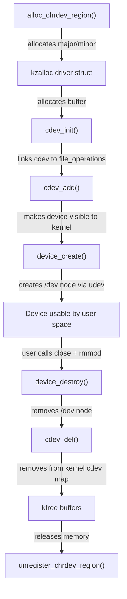
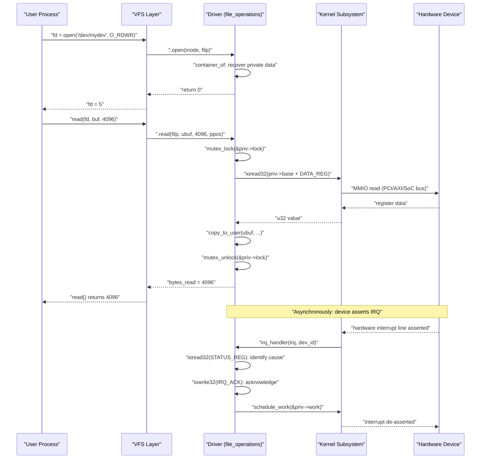

# Lesson 1: Linux Device Driver Fundamentals

## 1. First-Principles Intuition & Invariants

A device driver is kernel code that translates a generic, well-defined operating-system interface (such as read, write, ioctl) into the specific sequence of hardware register writes, DMA transfers, and interrupt acknowledgements that a particular piece of peripheral hardware requires. The fundamental design invariant is this: the kernel exposes a uniform contract to user space, and the driver absorbs all device-specific complexity behind that contract. User-space programs should never need to know whether they are talking to an NVMe controller, a USB serial adapter, or a virtualized virtio device—they simply call `open()`, `read()`, `write()`, `close()`, and `ioctl()`.

The Linux kernel achieves this abstraction through three orthogonal classification axes:

- **Character devices** expose a byte-stream or record-oriented interface via `struct file_operations`. Examples: `/dev/ttyS0`, `/dev/random`, `/dev/i2c-0`. These are accessed with `open`/`read`/`write`/`ioctl`/`mmap`/`release`.
- **Block devices** expose a fixed-size block interface (typically 512-byte or 4096-byte sectors) and integrate with the kernel's block I/O layer (`struct block_device_operations`, the bio subsystem, and the I/O scheduler). Examples: `/dev/sda`, `/dev/nvme0n1`.
- **Network devices** do not live in `/dev` at all. They are registered with `register_netdev()` and exposed through `struct net_device_ops`. User space interacts with them via sockets (`AF_PACKET`, `AF_INET`) and the `ioctl(SIOCGIFHWADDR)` family, not via file descriptors.

This three-way split is a deliberate architectural decision: character devices optimize for low-overhead, unstructured access; block devices integrate with the page cache and I/O scheduler for throughput-oriented storage; network devices bypass the VFS entirely because networking has its own protocol-stack layering that does not map cleanly onto file semantics.

### The User-Space / Kernel-Space Boundary

The kernel runs in privileged mode (ring 0 on x86, EL1 on ARM). User space runs unprivileged (ring 3 / EL0). The only legitimate transitions are:

1. **System calls** (synchronous, initiated by user space via `syscall` instruction)
2. **Hardware interrupts** (asynchronous, initiated by hardware, transparent to user space)
3. **Kernel threads** (cooperative, initiated within the kernel itself)

A driver operates in kernel context. When a user-space process calls `read(fd, buf, count)`, the kernel routes through the VFS layer, dispatches to the driver's `file_operations.read` callback, and the driver executes in the context of the calling process (with the process's memory mapping active but at privilege ring 0). This is critical: if the driver sleeps (calls `schedule()`, `mutex_lock()`, `wait_event_interruptible()`), it blocks the calling process, not the entire kernel. Other processes and other CPUs continue executing.

The one exception is the interrupt handler (top half), which runs in interrupt context. Interrupt context has no associated process, cannot sleep, cannot call any function that might sleep, and must complete as quickly as possible. Deferred work mechanisms—tasklets, softirqs, workqueues—exist precisely to move non-time-critical work out of interrupt context into a context where sleeping is permitted.

### Device Discovery: ACPI, Device Tree, and Probing

On x86 and server platforms, hardware is discovered dynamically via **ACPI** (Advanced Configuration and Power Interface). The ACPI DSDT/SSDT tables enumerate devices and their resource assignments. The kernel's ACPI subsystem parses these tables and matches devices to drivers via `_HID` (hardware ID) and `_CID` (compatible ID) strings.

On ARM, RISC-V, and embedded platforms, hardware is described statically via the **Device Tree** (DTB—a compiled binary blob loaded by the bootloader). The Device Tree is a hierarchical data structure where each node represents a device, containing properties like `compatible` strings, register addresses (`reg`), interrupt lines (`interrupts`), and clock references. The kernel's OF (Open Firmware) subsystem parses the DTB and matches devices to drivers via `of_match_table` entries.

On both platforms, the matching process ends with the kernel calling the driver's `probe()` function, passing a `struct device *` or a bus-specific wrapper (e.g., `struct platform_device *`). The `probe()` function is the driver's initialization entry point—it claims resources, maps I/O memory, registers interrupt handlers, and exposes the device to user space. The inverse is `remove()`, called when the device is detached or the driver module is unloaded.

## 2. Core Architecture & Mechanics

### The Module Skeleton

A kernel module is an ELF object file (`hello.ko`) that the kernel's module loader (`insmod`/`modprobe`) dynamically links into the running kernel. The module declares two special macros: `module_init()` and `module_exit()`, which tag the functions the kernel calls on load and unload.

```c
// Minimal character device driver module skeleton
#include <linux/module.h>
#include <linux/kernel.h>
#include <linux/fs.h>
#include <linux/cdev.h>
#include <linux/device.h>
#include <linux/uaccess.h>
#include <linux/slab.h>
#include <linux/mutex.h>

#define DEVICE_NAME "mydev"
#define CLASS_NAME  "myclass"
#define BUFFER_SIZE 4096

struct mydev_data {
    struct cdev cdev;
    struct device *dev;
    char *buffer;
    size_t buffer_len;
    struct mutex lock;     /* protects buffer and buffer_len */
};

static int major_num;
static struct class *mydev_class;
static struct mydev_data *mydev;

static int mydev_open(struct inode *inode, struct file *filp)
{
    struct mydev_data *dev;

    /* cdev is embedded in mydev_data; recover the container */
    dev = container_of(inode->i_cdev, struct mydev_data, cdev);
    filp->private_data = dev;

    return 0;
}

static ssize_t mydev_read(struct file *filp, char __user *ubuf,
                          size_t count, loff_t *ppos)
{
    struct mydev_data *dev = filp->private_data;
    size_t bytes_to_copy;
    ssize_t ret;

    mutex_lock(&dev->lock);

    if (*ppos >= dev->buffer_len) {
        ret = 0;  /* EOF */
        goto unlock;
    }

    bytes_to_copy = min(count, (size_t)(dev->buffer_len - *ppos));

    if (copy_to_user(ubuf, dev->buffer + *ppos, bytes_to_copy)) {
        ret = -EFAULT;
        goto unlock;
    }

    *ppos += bytes_to_copy;
    ret = bytes_to_copy;

unlock:
    mutex_unlock(&dev->lock);
    return ret;
}

static ssize_t mydev_write(struct file *filp, const char __user *ubuf,
                           size_t count, loff_t *ppos)
{
    struct mydev_data *dev = filp->private_data;
    size_t bytes_to_copy;
    ssize_t ret;

    mutex_lock(&dev->lock);

    if (*ppos >= BUFFER_SIZE) {
        ret = -ENOSPC;
        goto unlock;
    }

    bytes_to_copy = min(count, (size_t)(BUFFER_SIZE - *ppos));

    if (copy_from_user(dev->buffer + *ppos, ubuf, bytes_to_copy)) {
        ret = -EFAULT;
        goto unlock;
    }

    *ppos += bytes_to_copy;
    if (*ppos > dev->buffer_len)
        dev->buffer_len = *ppos;

    ret = bytes_to_copy;

unlock:
    mutex_unlock(&dev->lock);
    return ret;
}

static int mydev_release(struct inode *inode, struct file *filp)
{
    return 0;
}

static const struct file_operations mydev_fops = {
    .owner   = THIS_MODULE,
    .open    = mydev_open,
    .read    = mydev_read,
    .write   = mydev_write,
    .release = mydev_release,
};

static int __init mydev_init(void)
{
    dev_t devno;
    int ret;

    /* Dynamically allocate a major/minor pair */
    ret = alloc_chrdev_region(&devno, 0, 1, DEVICE_NAME);
    if (ret) {
        pr_err("alloc_chrdev_region failed: %d\n", ret);
        return ret;
    }
    major_num = MAJOR(devno);

    mydev = kzalloc(sizeof(*mydev), GFP_KERNEL);
    if (!mydev) {
        ret = -ENOMEM;
        goto unreg_region;
    }

    mydev->buffer = kzalloc(BUFFER_SIZE, GFP_KERNEL);
    if (!mydev->buffer) {
        ret = -ENOMEM;
        goto free_dev;
    }

    mutex_init(&mydev->lock);

    /* Initialize the cdev and link it to file_operations */
    cdev_init(&mydev->cdev, &mydev_fops);
    mydev->cdev.owner = THIS_MODULE;

    /* Add the cdev to the kernel's cdev map at devno */
    ret = cdev_add(&mydev->cdev, devno, 1);
    if (ret) {
        pr_err("cdev_add failed: %d\n", ret);
        goto free_buffer;
    }

    /* Create a /sys/class entry and a /dev node (udev will handle the rest) */
    mydev_class = class_create(CLASS_NAME);
    if (IS_ERR(mydev_class)) {
        ret = PTR_ERR(mydev_class);
        goto del_cdev;
    }

    mydev->dev = device_create(mydev_class, NULL, devno, NULL, DEVICE_NAME);
    if (IS_ERR(mydev->dev)) {
        ret = PTR_ERR(mydev->dev);
        goto destroy_class;
    }

    pr_info("mydev loaded: major=%d minor=0\n", major_num);
    return 0;

destroy_class:
    class_destroy(mydev_class);
del_cdev:
    cdev_del(&mydev->cdev);
free_buffer:
    kfree(mydev->buffer);
free_dev:
    kfree(mydev);
unreg_region:
    unregister_chrdev_region(MKDEV(major_num, 0), 1);
    return ret;
}

static void __exit mydev_exit(void)
{
    dev_t devno = MKDEV(major_num, 0);

    device_destroy(mydev_class, devno);
    class_destroy(mydev_class);
    cdev_del(&mydev->cdev);
    kfree(mydev->buffer);
    kfree(mydev);
    unregister_chrdev_region(devno, 1);

    pr_info("mydev unloaded\n");
}

module_init(mydev_init);
module_exit(mydev_exit);

MODULE_LICENSE("GPL");
MODULE_AUTHOR("Author Name");
MODULE_DESCRIPTION("Example character device driver");
```

### The Registration Lifecycle

The registration path follows a strict sequence, and each step has a matching teardown. The ordering matters: if `cdev_add` succeeds but `device_create` fails, you must call `cdev_del` before freeing the buffer. The `goto`-based cleanup chain in the init function above is the canonical kernel pattern for handling this without code duplication.



### I/O Memory Access

Most modern peripherals are **memory-mapped**: the CPU communicates with the device by reading and writing to specific physical addresses. The kernel maps these physical addresses into the kernel's virtual address space using `ioremap()` (or `devm_ioremap_resource()` for managed mappings), and the driver accesses device registers through the returned virtual pointer using accessor functions.

```c
#include <linux/io.h>
#include <linux/platform_device.h>

struct mydev_regs {
    u32 control;     /* offset 0x00 */
    u32 status;      /* offset 0x04 */
    u32 data;        /* offset 0x08 */
    u32 irq_mask;    /* offset 0x0C */
};

static int mydev_probe(struct platform_device *pdev)
{
    struct resource *res;
    void __iomem *base;
    struct mydev_regs __iomem *regs;

    res = platform_get_resource(pdev, IORESOURCE_MEM, 0);
    if (!res)
        return -ENODEV;

    /* devm_ prefix: kernel auto-frees on remove() */
    base = devm_ioremap_resource(&pdev->dev, res);
    if (IS_ERR(base))
        return PTR_ERR(base);

    regs = (struct mydev_regs __iomem *)base;

    /* Write to device register */
    iowrite32(0x1, &regs->control);
    iowrite32(0xFF, &regs->irq_mask);

    /* Read from device register */
    u32 status = ioread32(&regs->status);

    return 0;
}
```

The `__iomem` annotation is a sparse-based type qualifier. It does not change code generation, but enables static analysis to catch bugs where a driver dereferences an I/O pointer directly (e.g., `regs->status = 0`) instead of using the proper accessor (`iowrite32(0, &regs->status)`). Direct dereference may appear to work on some architectures, but on others it bypasses bus-specific ordering requirements or causes alignment faults. The accessor functions ensure correct endianness handling (the kernel's `ioread32`/`iowrite32` are little-endian on all architectures that support them; use `ioread32be`/`iowrite32be` for big-endian devices) and insert the appropriate memory barriers on architectures that require them.

### Interrupt Handling

When a device needs kernel attention, it asserts an interrupt line. The kernel routes the hardware interrupt to a registered handler. The registration uses `request_irq()` or, for managed drivers, `devm_request_irq()`.

```c
#include <linux/interrupt.h>
#include <linux/irq.h>

struct mydev_priv {
    void __iomem *regs;
    int irq;
    /* deferred work context */
    struct work_struct work;
};

static irqreturn_t mydev_irq_handler(int irq, void *dev_id)
{
    struct mydev_priv *priv = dev_id;
    u32 status;

    /* Read device interrupt status register */
    status = ioread32(priv->regs + STATUS_REG);

    if (status == 0)
        return IRQ_NONE;  /* not our interrupt */

    /* Acknowledge the interrupt so the device deasserts the line */
    iowrite32(status, priv->regs + IRQ_ACK_REG);

    /* Schedule deferred work — we cannot sleep in IRQ context */
    schedule_work(&priv->work);

    return IRQ_HANDLED;
}

static void mydev_work_handler(struct work_struct *work)
{
    struct mydev_priv *priv =
        container_of(work, struct mydev_priv, work);

    /* Now we are in process context — sleeping is permitted */
    /* Process the interrupt event: read data, update state, etc. */
}

static int mydev_probe(struct platform_device *pdev)
{
    struct mydev_priv *priv;

    priv = devm_kzalloc(&pdev->dev, sizeof(*priv), GFP_KERNEL);
    if (!priv)
        return -ENOMEM;

    INIT_WORK(&priv->work, mydev_work_handler);

    priv->irq = platform_get_irq(pdev, 0);
    if (priv->irq < 0)
        return priv->irq;

    /* Register interrupt handler: shared, triggered on rising edge */
    int ret = devm_request_irq(&pdev->dev, priv->irq,
                               mydev_irq_handler,
                               IRQF_SHARED | IRQF_TRIGGER_RISING,
                               "mydev", priv);
    if (ret) {
        dev_err(&pdev->dev, "failed to request IRQ %d: %d\n",
                priv->irq, ret);
        return ret;
    }

    return 0;
}
```

The two-phase interrupt pattern—top half (hard IRQ) for acknowledgement and scheduling, bottom half (workqueue) for actual processing—is the standard discipline because the top half blocks all other interrupts on the same line (and, on some architectures, all interrupts globally). Deferring non-critical work keeps interrupt latency low and the system responsive.

### The Linux Device Model

The kernel maintains a unified device model centered on three core structures:

```mermaid
graph TB
    subgraph "Linux Device Model"
        BUS["struct bus_type"]
        DRV["struct device_driver"]
        DEV["struct device"]

        BUS -->|match(): binds device to driver| DEV
        BUS -->|match(): binds device to driver| DRV
        DRV -->|probe()/remove()| DEV
        DEV -->|parent/child hierarchy| DEV2["child device"]
    end

    subgraph "Bus-specific wrappers"
        PLAT["struct platform_driver"]
        PLATDEV["struct platform_device"]
        PCI["struct pci_driver"]
        PCIDEV["struct pci_dev"]
        USB["struct usb_driver"]
        USBDEV["struct usb_device / usb_interface"]
    end

    PLAT -->|inherits| DRV
    PLATDEV -->|inherits| DEV
    PCI -->|inherits| DRV
    PCIDEV -->|inherits| DEV
    USB -->|inherits| DRV
    USBDEV -->|inherits| DEV
```

`struct device` is the base type. Every device in the system, regardless of bus, has one. It tracks the parent device, the bus it sits on, the driver bound to it, power management state, and a kobject that links it into the sysfs hierarchy. Bus-specific structures (`struct platform_device`, `struct pci_dev`, `struct usb_interface`) embed a `struct device` and add bus-specific fields.

`struct device_driver` holds the driver's name, the bus it binds against, the `probe`/`remove` callbacks, and power management operations. Bus-specific driver types (`struct platform_driver`, `struct pci_driver`) embed a `struct device_driver` and wrap the callbacks.

`struct bus_type` defines the matching logic (`match`), the probe/remove dispatch, and sysfs attributes for the bus. The `platform_bus` is a virtual bus for devices that are not on a discoverable bus—on Device Tree systems, the platform bus matches platform drivers against DT `compatible` strings.

### Platform Driver Example

Platform drivers are the standard pattern for embedded and SoC-internal peripherals. They pair with the Device Tree or ACPI platform device declarations.

```c
#include <linux/module.h>
#include <linux/platform_device.h>
#include <linux/of.h>
#include <linux/of_device.h>
#include <linux/mod_devicetable.h>

struct mydev_priv {
    void __iomem *base;
    int irq;
    struct clk *clk;
};

static const struct of_device_id mydev_dt_ids[] = {
    { .compatible = "vendor,mydev-v1" },
    { .compatible = "vendor,mydev-v2", .data = (void *)2 },
    { /* sentinel */ }
};
MODULE_DEVICE_TABLE(of, mydev_dt_ids);

static int mydev_probe(struct platform_device *pdev)
{
    struct mydev_priv *priv;
    struct resource *res;

    priv = devm_kzalloc(&pdev->dev, sizeof(*priv), GFP_KERNEL);
    if (!priv)
        return -ENOMEM;

    platform_set_drvdata(pdev, priv);

    /* Map I/O memory (devm_ auto-cleans on remove) */
    res = platform_get_resource(pdev, IORESOURCE_MEM, 0);
    priv->base = devm_ioremap_resource(&pdev->dev, res);
    if (IS_ERR(priv->base))
        return PTR_ERR(priv->base);

    /* Get and enable clock */
    priv->clk = devm_clk_get(&pdev->dev, NULL);
    if (IS_ERR(priv->clk))
        return dev_err_probe(&pdev->dev, PTR_ERR(priv->clk),
                              "failed to get clock\n");

    clk_prepare_enable(priv->clk);

    /* Device is now initialized and ready */
    dev_info(&pdev->dev, "probed successfully\n");
    return 0;
}

static int mydev_remove(struct platform_device *pdev)
{
    struct mydev_priv *priv = platform_get_drvdata(pdev);

    clk_disable_unprepare(priv->clk);

    dev_info(&pdev->dev, "removed\n");
    return 0;
}

static struct platform_driver mydev_driver = {
    .probe  = mydev_probe,
    .remove = mydev_remove,
    .driver = {
        .name           = "mydev",
        .of_match_table = mydev_dt_ids,
    },
};

module_platform_driver(mydev_driver);

MODULE_LICENSE("GPL");
MODULE_DESCRIPTION("Platform driver for mydev peripheral");
```

`module_platform_driver()` is a macro that expands to the `module_init`/`module_exit` boilerplate, registering and unregistering the `platform_driver` with the platform bus. On `insmod`, the platform bus iterates its device list, calls `match()` against each `of_device_id`, and for each match, calls `mydev_probe()`.

## 3. Concurrency, Synchronization, and Failure Modes

### Concurrency Sources in Drivers

A driver is subject to re-entrancy from multiple sources simultaneously:

1. Multiple user-space processes calling `read()`/`write()`/`ioctl()` concurrently on the same device node.
2. Interrupt handlers firing while a `read()` or `write()` is in progress.
3. Timer callbacks and deferred work executing concurrently with user-initiated operations.
4. On SMP systems, multiple CPUs executing driver code simultaneously.
5. Power management callbacks (`suspend`, `resume`) racing with normal I/O.

The kernel provides several synchronization primitives, each with specific constraints:

| Primitive | Can Sleep? | Context | Typical Use |
|---|---|---|---|
| `spinlock_t` | No | Any | Short critical sections, IRQ-safe variants available |
| `mutex_t` | Yes | Process only | Longer critical sections, protecting large data structures |
| `rwlock_t` | No | Any | Read-heavy data with short critical sections |
| `rw_semaphore_t` | Yes | Process only | Read-heavy data, longer sections |
| `atomic_t` | N/A | Any | Simple integer counters, flags |
| `seqlock_t` | No | Any | Read-heavy, write-rarely, lightweight reads |

The fundamental rule: spinlocks and atomic operations can be used in any context (including interrupt context) but must not sleep. Mutexes and semaphores can sleep and are therefore restricted to process context. Mixing the two incorrectly leads to deadlocks or kernel panics.

```c
/* Example: protecting shared state with a spinlock in IRQ context */
struct ring_buf {
    u8 data[BUF_SIZE];
    size_t head, tail;
    spinlock_t lock;
};

static irqreturn_t producer_irq(int irq, void *dev_id)
{
    struct ring_buf *rb = dev_id;
    unsigned long flags;

    spin_lock_irqsave(&rb->lock, flags);
    /* Critical section: insert data into ring buffer */
    if ((rb->head + 1) % BUF_SIZE != rb->tail) {
        rb->data[rb->head] = read_from_hw();
        rb->head = (rb->head + 1) % BUF_SIZE;
    }
    spin_unlock_irqrestore(&rb->lock, flags);

    return IRQ_HANDLED;
}

static ssize_t consumer_read(struct file *filp, char __user *buf,
                             size_t count, loff_t *ppos)
{
    struct ring_buf *rb = filp->private_data;
    unsigned long flags;
    ssize_t copied = 0;

    while (copied < count) {
        u8 byte;

        spin_lock_irqsave(&rb->lock, flags);
        if (rb->head == rb->tail) {
            spin_unlock_irqrestore(&rb->lock, flags);
            break;  /* buffer empty */
        }
        byte = rb->data[rb->tail];
        rb->tail = (rb->tail + 1) % BUF_SIZE;
        spin_unlock_irqrestore(&rb->lock, flags);

        if (put_user(byte, buf + copied))
            return -EFAULT;
        copied++;
    }

    return copied;
}
```

`spin_lock_irqsave()` disables interrupts on the current CPU before taking the lock, and `spin_unlock_irqrestore()` restores the previous interrupt state. This is essential because if the interrupt handler and the process-context code both acquire the same spinlock without disabling interrupts, the handler could fire on the same CPU while the process holds the lock, and the handler would spin forever waiting for the lock that the process holds—a deadlock that freezes the CPU.

### Power Management

The Linux power management framework hooks into the device model. Drivers register callbacks via `struct dev_pm_ops` or the legacy `suspend`/`resume` fields in `struct device_driver`. Runtime PM (`pm_runtime_*` API) allows drivers to power-gate individual devices on demand rather than only during system-wide suspend.

```c
static const struct dev_pm_ops mydev_pm_ops = {
    /* System suspend: device fully active -> low power */
    .suspend        = mydev_suspend,
    /* System resume: low power -> fully active */
    .resume         = mydev_resume,
    /* Runtime PM: idle -> powered off */
    .runtime_suspend = mydev_runtime_suspend,
    /* Runtime PM: powered off -> active */
    .runtime_resume  = mydev_runtime_resume,
};

static int mydev_suspend(struct device *dev)
{
    struct mydev_priv *priv = dev_get_drvdata(dev);

    /* Save device context, disable interrupts, gate clocks */
    iowrite32(0, priv->base + CONTROL_REG);
    clk_disable_unprepare(priv->clk);

    return 0;
}

static int mydev_resume(struct device *dev)
{
    struct mydev_priv *priv = dev_get_drvdata(dev);

    clk_prepare_enable(priv->clk);
    iowrite32(CONTROL_ENABLE, priv->base + CONTROL_REG);

    return 0;
}
```

### DMA and Memory Coherency

When a device transfers data directly to/from system RAM (DMA), cache coherency becomes a concern. On x86, the hardware enforces coherency via snooping. On ARM and other architectures, the driver must explicitly manage cache lines.

The kernel provides the DMA API (`dma_alloc_coherent`, `dma_alloc_noncoherent`, `dma_map_single`, `dma_map_page`) which abstracts these architecture-specific details. Coherent allocations return memory that is accessible by both CPU and device without explicit flushing. Non-coherent (or streaming) mappings require `dma_sync_*` calls before and after device access.

```c
#include <linux/dma-mapping.h>

struct mydev_priv {
    void *cpu_addr;          /* kernel virtual address */
    dma_addr_t dma_handle;   /* bus address for device */
    size_t dma_size;
};

static int mydev_dma_setup(struct device *dev, struct mydev_priv *priv)
{
    priv->dma_size = 4096;

    /* Coherent: CPU and device see the same data without explicit sync */
    priv->cpu_addr = dma_alloc_coherent(dev, priv->dma_size,
                                        &priv->dma_handle,
                                        GFP_KERNEL);
    if (!priv->cpu_addr)
        return -ENOMEM;

    /* Program the device with the DMA bus address */
    iowrite32(priv->dma_handle, priv->base + DMA_ADDR_REG);

    return 0;
}

static void mydev_dma_teardown(struct device *dev, struct mydev_priv *priv)
{
    dma_free_coherent(dev, priv->dma_size,
                      priv->cpu_addr, priv->dma_handle);
}
```

### Error Handling and Cleanup

The single most common source of driver bugs is improper cleanup in error paths. The kernel community enforces strict discipline: every allocation that succeeds must be reversed if a later step fails. The `devm_` (device-managed) family of functions automates this by attaching cleanup callbacks to the `struct device`, so resources are automatically freed when the driver detaches. For non-managed resources, the goto-chain pattern shown in the module skeleton is mandatory.

```c
/* Anti-pattern: leaking resources on error */
static int bad_probe(struct platform_device *pdev)
{
    void *buf1 = kmalloc(1024, GFP_KERNEL);
    /* BUG: no check for NULL */

    void *buf2 = kmalloc(2048, GFP_KERNEL);
    if (!buf2)
        return -ENOMEM;  /* BUG: buf1 leaked */

    /* ... */
    return 0;
}

/* Correct pattern: goto-chain cleanup */
static int good_probe(struct platform_device *pdev)
{
    void *buf1, *buf2;
    int ret;

    buf1 = kmalloc(1024, GFP_KERNEL);
    if (!buf1)
        return -ENOMEM;

    buf2 = kmalloc(2048, GFP_KERNEL);
    if (!buf2) {
        ret = -ENOMEM;
        goto free_buf1;
    }

    /* ... */

    return 0;

free_buf2:
    kfree(buf2);
free_buf1:
    kfree(buf1);
    return ret;
}
```

### The Full Architecture: How a User-Space Read Reaches Hardware



This diagram captures the essential reality of driver operation: the synchronous path (system call through VFS to hardware register access) and the asynchronous path (interrupt to deferred work) run concurrently, and the synchronization primitives ensure they do not corrupt shared state.

## Summary

A Linux device driver is the translation layer between the kernel's uniform VFS/socket interfaces and the idiosyncratic register-level protocol of a specific piece of hardware. The driver registers with the appropriate subsystem (character, block, net), maps device memory, handles interrupts, manages concurrency with the correct primitives for each execution context, and tears down cleanly on failure or removal. The `devm_` managed-resource API and the goto-chain error pattern are the two most important tools for writing drivers that do not leak resources. Platform drivers with Device Tree `compatible` matching are the standard entry point for embedded peripheral development, and the same architectural principles—file operations, I/O memory access, interrupt handling, and carefully scoped synchronization—apply across all bus-specific driver types.
