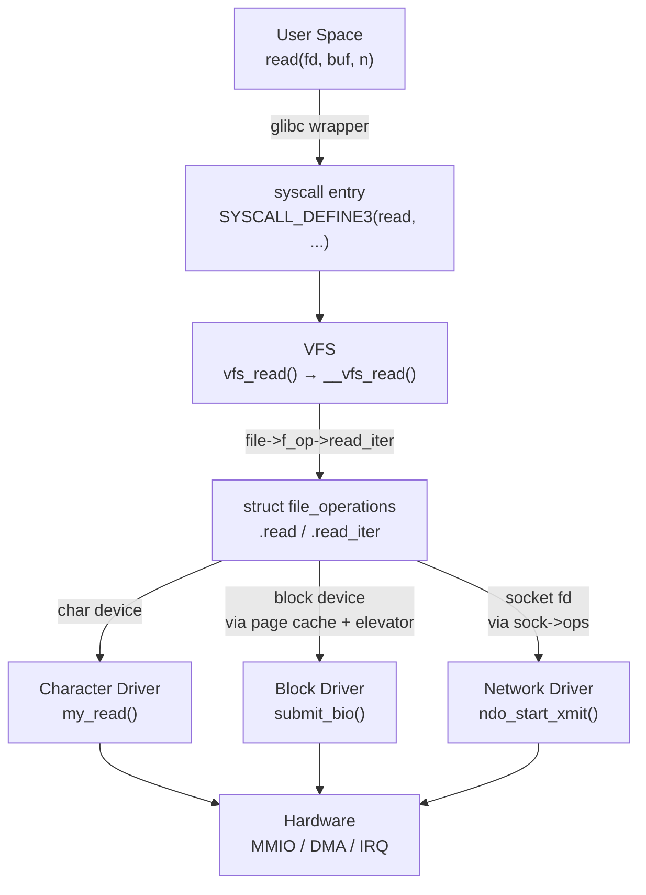
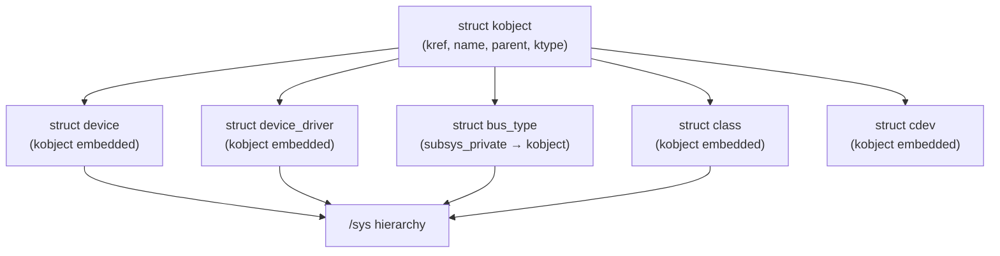
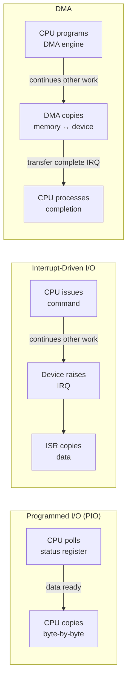
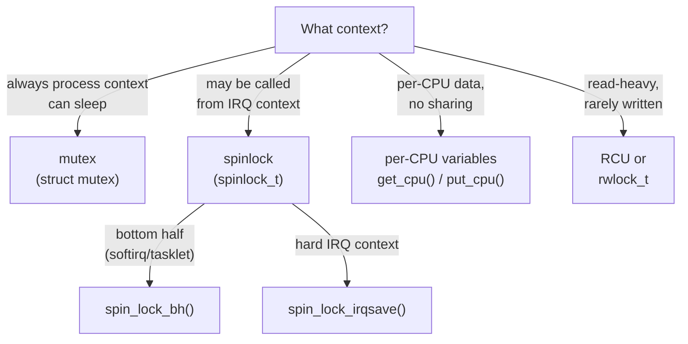
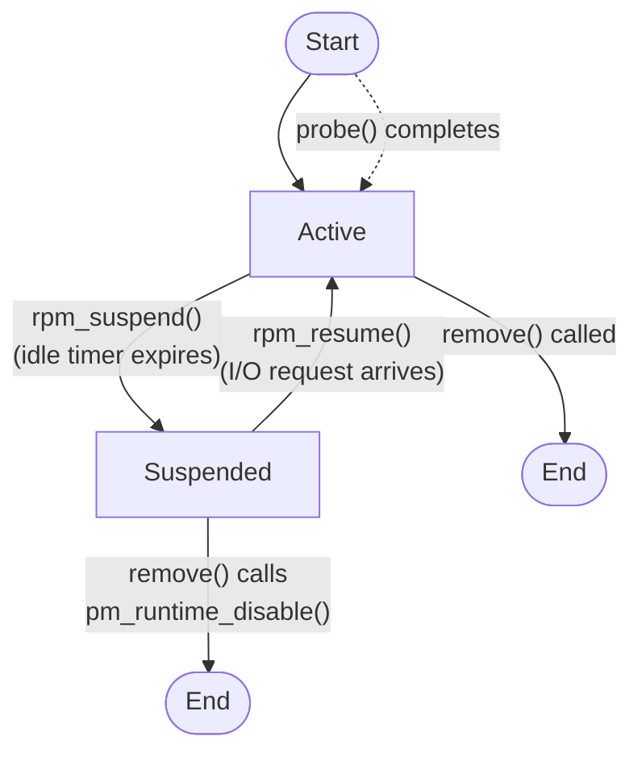
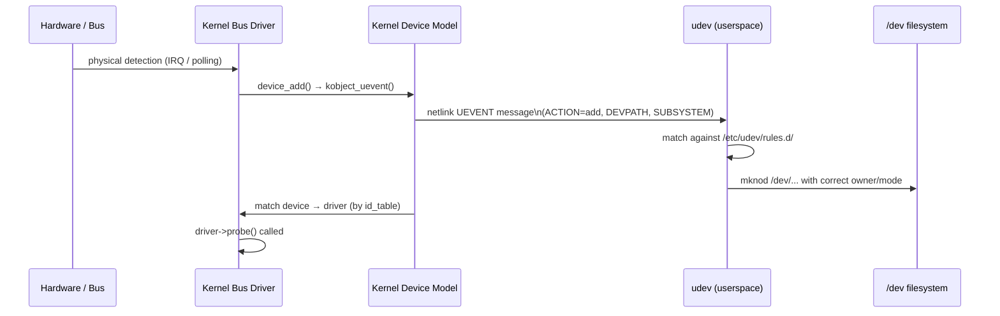
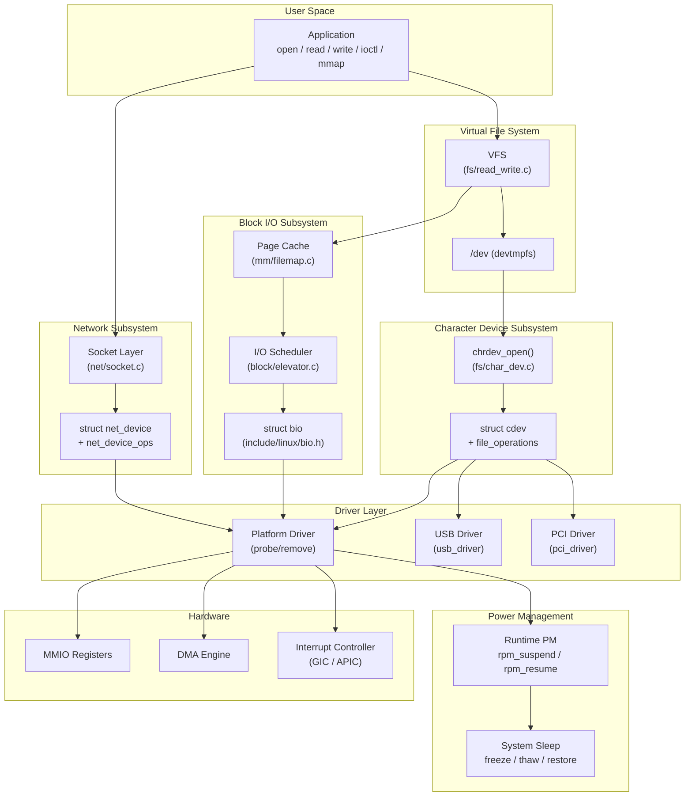

# Lesson 2: Driver Model and Interfaces

## 1. First-Principles Intuition & Invariants

### The Fundamental Contract

The Linux kernel mediates all access to hardware through a uniform abstraction: **everything is a file**. This is not merely a philosophical stance — it is an architectural invariant enforced at every layer of the I/O stack. User-space programs interact with hardware through Virtual File System (VFS) operations (`open`, `read`, `write`, `ioctl`, `mmap`, `close`), and the VFS dispatches those calls downward through a chain of well-defined interfaces until they reach driver code that speaks directly to hardware registers or DMA controllers.

The driver model therefore has one primary responsibility: **translate the generic VFS contract into device-specific behavior**, while upholding kernel invariants around locking, memory safety, power management, and hot-plug lifecycle.

### The Three Device Abstractions

Linux partitions hardware into three canonical abstractions, each reflecting a fundamentally different I/O model:

**Character devices** present an ordered, unbuffered byte stream. There is no kernel-managed block cache between the caller and the device; `read(2)` and `write(2)` are dispatched directly to driver callbacks. The kernel enforces no minimum transfer size. Examples: serial UARTs (`/dev/ttyS0`), pseudo-terminals (`/dev/pts/*`), input devices (`/dev/input/event*`), raw framebuffers (`/dev/fb0`).

**Block devices** present a randomly addressable array of fixed-size sectors (historically 512 bytes, now commonly 4096 bytes for Advanced Format drives). All I/O is routed through the **page cache** and the **block I/O (bio) layer**. The kernel may reorder, merge, and schedule requests before they reach the driver. Examples: NVMe namespaces (`/dev/nvme0n1`), SCSI disks (`/dev/sda`), eMMC partitions (`/dev/mmcblk0p1`).

**Network interfaces** are not surfaced as files at all — they are reached via the socket API (`socket(2)`, `sendmsg(2)`, `recvmsg(2)`). The kernel's networking stack (`net/core`, `net/ipv4`, etc.) interacts with drivers through `struct net_device_ops`. There are no major/minor numbers; interfaces are identified by name (`eth0`, `wlan0`) and an `ifindex`.

### Major and Minor Numbers

Every character and block device node in the filesystem (`/dev/*`) carries a **major number** and a **minor number**, encoded as a `dev_t` (a `u32` split 12:20 since kernel 2.6). The major number identifies the driver registered to handle the device class; the minor number is an opaque cookie passed to the driver to distinguish individual devices or sub-units within that class. The kernel uses `MAJOR()`, `MINOR()`, and `MKDEV()` macros to manipulate `dev_t` values.

```
dev_t = MKDEV(major, minor)   /* encodes both into one u32 */
major = MAJOR(dev)            /* extracts upper 12 bits    */
minor = MINOR(dev)            /* extracts lower 20 bits    */
```

The `/proc/devices` virtual file lists all currently registered character and block major numbers and their associated driver names. The `udev` daemon (or `mdev` in embedded contexts) reads `uevent` messages from the kernel's `sysfs`/`kobject` infrastructure and creates the corresponding `/dev` nodes automatically, so manual `mknod(1)` is rarely needed on modern systems.

---

## 2. Core Architecture & Mechanics

### The VFS Dispatch Chain

Understanding how a user-space `read(2)` syscall reaches a driver requires tracing the full dispatch path. The VFS is the unifying layer; `struct file_operations` is the contract it enforces.



### `struct file_operations` — The Core Interface

`struct file_operations` (defined in `include/linux/fs.h`) is the primary vtable a character driver must populate. Every field is a function pointer; unused fields are left `NULL` and the VFS handles them gracefully (e.g., a `NULL` `.llseek` causes `lseek(2)` to return `-ESPIPE`).

```c
/* include/linux/fs.h (simplified, kernel 6.x) */
struct file_operations {
    struct module   *owner;          /* THIS_MODULE — prevents unload while open */
    loff_t          (*llseek)(struct file *, loff_t, int);
    ssize_t         (*read)(struct file *, char __user *, size_t, loff_t *);
    ssize_t         (*write)(struct file *, const char __user *, size_t, loff_t *);
    ssize_t         (*read_iter)(struct kiocb *, struct iov_iter *);
    ssize_t         (*write_iter)(struct kiocb *, struct iov_iter *);
    int             (*mmap)(struct file *, struct vm_area_struct *);
    int             (*open)(struct inode *, struct file *);
    int             (*flush)(struct file *, fl_owner_t id);
    int             (*release)(struct inode *, struct file *);
    long            (*unlocked_ioctl)(struct file *, unsigned int, unsigned long);
    long            (*compat_ioctl)(struct file *, unsigned int, unsigned long);
    int             (*fsync)(struct file *, loff_t, loff_t, int datasync);
    __poll_t        (*poll)(struct file *, struct poll_table_struct *);
    /* ... additional fields omitted for clarity ... */
};
```

> **Note on `.read` vs `.read_iter`:** The `.read_iter` interface (introduced to replace `.read` for vectored and asynchronous I/O) operates on a `struct kiocb` (kernel I/O control block) and a `struct iov_iter` (scatter-gather iterator). New drivers should implement `.read_iter` and `.write_iter` rather than the scalar `.read`/`.write` to gain automatic support for `readv(2)`, `preadv2(2)`, and io_uring.

### Device Registration: The Full Lifecycle

Registering a character device involves four distinct objects that must be properly initialized and linked:

| Object | Type | Purpose |
|---|---|---|
| Major/minor range | `dev_t` | Numerical identity in the kernel's device namespace |
| `cdev` | `struct cdev` | Links a `dev_t` range to a `file_operations` vtable |
| `class` | `struct class *` | Represents a device class in sysfs (`/sys/class/`) |
| `device` | `struct device *` | Represents one device instance; triggers udev `uevent` |

```c
#include <linux/module.h>
#include <linux/kernel.h>
#include <linux/fs.h>
#include <linux/cdev.h>
#include <linux/device.h>
#include <linux/uaccess.h>
#include <linux/slab.h>
#include <linux/mutex.h>

#define DRIVER_NAME   "mychardev"
#define DEVICE_COUNT  1

/* Per-device state — one instance per minor number */
struct mydev_data {
    struct cdev   cdev;
    struct mutex  lock;        /* serializes concurrent access */
    char          *buf;        /* kernel-side data buffer      */
    size_t        buf_size;
};

static struct class  *mydev_class;
static dev_t          mydev_devt;    /* base dev_t assigned by alloc_chrdev_region */
static struct mydev_data *devices;   /* array of DEVICE_COUNT instances */

/* ------------------------------------------------------------------ */
/*  File operations                                                     */
/* ------------------------------------------------------------------ */

static int mydev_open(struct inode *inode, struct file *filp)
{
    struct mydev_data *dev;

    /* Recover per-device data via container_of on inode->i_cdev */
    dev = container_of(inode->i_cdev, struct mydev_data, cdev);
    filp->private_data = dev;   /* stash for subsequent ops */
    return 0;
}

static int mydev_release(struct inode *inode, struct file *filp)
{
    /* Nothing to tear down for this simple driver */
    return 0;
}

static ssize_t mydev_read(struct file *filp, char __user *ubuf,
                          size_t count, loff_t *ppos)
{
    struct mydev_data *dev = filp->private_data;
    ssize_t retval = 0;

    if (mutex_lock_interruptible(&dev->lock))
        return -ERESTARTSYS;

    if (*ppos >= dev->buf_size)
        goto out;   /* EOF */

    if (*ppos + count > dev->buf_size)
        count = dev->buf_size - *ppos;

    /*
     * copy_to_user() handles:
     *   - safe cross-privilege-level copy
     *   - page fault handling for demand-paged user buffers
     *   - returns bytes NOT copied on partial failure
     */
    if (copy_to_user(ubuf, dev->buf + *ppos, count)) {
        retval = -EFAULT;
        goto out;
    }

    *ppos += count;
    retval = count;

out:
    mutex_unlock(&dev->lock);
    return retval;
}

static ssize_t mydev_write(struct file *filp, const char __user *ubuf,
                           size_t count, loff_t *ppos)
{
    struct mydev_data *dev = filp->private_data;
    ssize_t retval = 0;

    if (count > dev->buf_size)
        return -EINVAL;

    if (mutex_lock_interruptible(&dev->lock))
        return -ERESTARTSYS;

    if (copy_from_user(dev->buf + *ppos, ubuf, count)) {
        retval = -EFAULT;
        goto out;
    }

    *ppos += count;
    retval = count;

out:
    mutex_unlock(&dev->lock);
    return retval;
}

static const struct file_operations mydev_fops = {
    .owner   = THIS_MODULE,
    .open    = mydev_open,
    .release = mydev_release,
    .read    = mydev_read,
    .write   = mydev_write,
    .llseek  = default_llseek,   /* uses f_pos; correct for byte-stream devices */
};

/* ------------------------------------------------------------------ */
/*  Module init / exit                                                  */
/* ------------------------------------------------------------------ */

static int __init mydev_init(void)
{
    int ret, i;

    /*
     * Dynamically allocate a major number.
     * Avoids hard-coding and collisions with existing drivers.
     * Kernel range 0–11 is statically assigned; dynamic allocation
     * uses the range 234–254 (or lower if needed).
     */
    ret = alloc_chrdev_region(&mydev_devt, 0, DEVICE_COUNT, DRIVER_NAME);
    if (ret < 0) {
        pr_err("%s: alloc_chrdev_region failed: %d\n", DRIVER_NAME, ret);
        return ret;
    }

    /* Create /sys/class/mychardev/ — udev uses this to set permissions */
    mydev_class = class_create(THIS_MODULE, DRIVER_NAME);
    if (IS_ERR(mydev_class)) {
        ret = PTR_ERR(mydev_class);
        goto err_unregister_region;
    }

    devices = kcalloc(DEVICE_COUNT, sizeof(*devices), GFP_KERNEL);
    if (!devices) {
        ret = -ENOMEM;
        goto err_class_destroy;
    }

    for (i = 0; i < DEVICE_COUNT; i++) {
        struct mydev_data *dev = &devices[i];
        dev_t devt = MKDEV(MAJOR(mydev_devt), MINOR(mydev_devt) + i);

        mutex_init(&dev->lock);

        dev->buf_size = PAGE_SIZE;   /* one page = 4096 bytes on x86-64 */
        dev->buf = kzalloc(dev->buf_size, GFP_KERNEL);
        if (!dev->buf) {
            ret = -ENOMEM;
            goto err_cleanup_devices;
        }

        /* Link cdev → file_operations and add to kernel's cdev table */
        cdev_init(&dev->cdev, &mydev_fops);
        dev->cdev.owner = THIS_MODULE;

        ret = cdev_add(&dev->cdev, devt, 1);
        if (ret) {
            pr_err("%s: cdev_add failed for minor %d: %d\n",
                   DRIVER_NAME, i, ret);
            kfree(dev->buf);
            goto err_cleanup_devices;
        }

        /*
         * device_create() causes the kernel to emit a uevent, which
         * udev handles by creating /dev/mychardev<i> with appropriate
         * ownership and permissions from udev rules.
         */
        if (IS_ERR(device_create(mydev_class, NULL, devt, NULL,
                                 DRIVER_NAME "%d", i))) {
            ret = PTR_ERR(device_create(mydev_class, NULL, devt,
                                        NULL, DRIVER_NAME "%d", i));
            cdev_del(&dev->cdev);
            kfree(dev->buf);
            goto err_cleanup_devices;
        }
    }

    pr_info("%s: registered with major %d\n", DRIVER_NAME, MAJOR(mydev_devt));
    return 0;

err_cleanup_devices:
    for (i--; i >= 0; i--) {
        device_destroy(mydev_class,
                       MKDEV(MAJOR(mydev_devt), MINOR(mydev_devt) + i));
        cdev_del(&devices[i].cdev);
        kfree(devices[i].buf);
    }
    kfree(devices);
err_class_destroy:
    class_destroy(mydev_class);
err_unregister_region:
    unregister_chrdev_region(mydev_devt, DEVICE_COUNT);
    return ret;
}

static void __exit mydev_exit(void)
{
    int i;

    for (i = 0; i < DEVICE_COUNT; i++) {
        device_destroy(mydev_class,
                       MKDEV(MAJOR(mydev_devt), MINOR(mydev_devt) + i));
        cdev_del(&devices[i].cdev);
        kfree(devices[i].buf);
    }
    kfree(devices);
    class_destroy(mydev_class);
    unregister_chrdev_region(mydev_devt, DEVICE_COUNT);
    pr_info("%s: unregistered\n", DRIVER_NAME);
}

module_init(mydev_init);
module_exit(mydev_exit);

MODULE_LICENSE("GPL");
MODULE_AUTHOR("Your Name");
MODULE_DESCRIPTION("Example character device driver");
```

### The `kobject` / `sysfs` Spine

Beneath `struct device`, `struct class`, and `struct bus_type` lies `struct kobject` — the universal reference-counted object that backs every entry in `sysfs`. Every `kobject` has a `kref` (kernel reference count), a name, a parent pointer (forming the sysfs tree), and a `kobj_type` that describes its attributes and release function. Device drivers rarely manipulate `kobject` directly; instead they work with the higher-level wrappers.



This embedding pattern — placing `struct kobject` as the first member of higher-level structs — enables `container_of()` to recover the enclosing object from a bare `kobject *`. It is the same idiom used to recover `struct mydev_data` from `inode->i_cdev` in the driver above.

### The Platform Bus and Device Tree Binding

For SoC peripherals that are not self-enumerating (unlike PCI or USB), Linux uses the **platform bus**. Devices are described either in a Device Tree Source (`.dts`) file or via `struct platform_device` registered in board files. The kernel matches platform devices to platform drivers by comparing the device's `compatible` string against the driver's `of_match_table`.

```c
/* Driver registration for a hypothetical SPI-attached sensor */
static const struct of_device_id mysensor_of_match[] = {
    { .compatible = "vendor,mysensor-v2", },
    { /* sentinel */ }
};
MODULE_DEVICE_TABLE(of, mysensor_of_match);

static int mysensor_probe(struct platform_device *pdev)
{
    struct device *dev = &pdev->dev;

    /* Retrieve a GPIO from Device Tree: gpios = <&gpio0 17 GPIO_ACTIVE_HIGH>; */
    struct gpio_desc *reset_gpio = devm_gpiod_get(dev, "reset", GPIOD_OUT_LOW);
    if (IS_ERR(reset_gpio))
        return dev_err_probe(dev, PTR_ERR(reset_gpio),
                             "Failed to get reset GPIO\n");

    /* devm_* resources are automatically released when pdev is unbound */
    dev_info(dev, "mysensor probed successfully\n");
    return 0;
}

static int mysensor_remove(struct platform_device *pdev)
{
    /* devm_ resources are cleaned up automatically; explicit teardown here
     * is only needed for resources not managed by devres. */
    return 0;
}

static struct platform_driver mysensor_driver = {
    .probe  = mysensor_probe,
    .remove = mysensor_remove,
    .driver = {
        .name           = "mysensor",
        .of_match_table = mysensor_of_match,
        .pm             = &mysensor_pm_ops,   /* optional power management */
    },
};
module_platform_driver(mysensor_driver);
```

The `module_platform_driver()` macro expands to a `module_init` / `module_exit` pair that calls `platform_driver_register` / `platform_driver_unregister`, eliminating boilerplate.

---

## 3. I/O Models: From Programmed I/O to DMA

### Programmed I/O vs. Interrupt-Driven I/O vs. DMA

The choice of I/O model has a first-order impact on CPU utilization and latency:



PIO is acceptable only for very low-bandwidth devices (a few bytes per transaction). Interrupt-driven I/O adds hardware-initiated notification but still requires CPU involvement for each data word. DMA eliminates per-word CPU involvement entirely — the CPU programs a descriptor ring and the DMA engine manages memory bus transactions autonomously.

### Interrupt Handling: Top Half and Bottom Half

The kernel splits interrupt handling into two stages to minimize the time spent with interrupts disabled:

**Top half (Interrupt Service Routine, ISR):** Runs with the interrupt line masked. Must be fast — acknowledge the hardware, copy minimal state, and schedule deferred work.

**Bottom half:** Runs later, with interrupts re-enabled. Performs the bulk of processing. Linux provides three mechanisms in ascending order of scheduling flexibility:

| Mechanism | Context | Use Case |
|---|---|---|
| Softirq | Per-CPU, non-preemptible | Network RX/TX, block completions |
| Tasklet | Built on softirq, serialized per tasklet | Legacy drivers |
| Workqueue | Process context (can sleep) | General deferred work |

```c
#include <linux/interrupt.h>
#include <linux/workqueue.h>

struct mydev_irq_data {
    unsigned int        irq;
    void __iomem       *base;      /* MMIO base address */
    struct work_struct  work;      /* deferred processing */
    u32                 status;    /* captured in ISR */
};

/* Bottom half: runs in process context, may sleep */
static void mydev_work_handler(struct work_struct *work)
{
    struct mydev_irq_data *d =
        container_of(work, struct mydev_irq_data, work);

    pr_debug("mydev: deferred processing status=0x%08x\n", d->status);
    /* ... process d->status, wake up waiting processes, etc. ... */
}

/* Top half: runs with IRQ masked, must be fast */
static irqreturn_t mydev_isr(int irq, void *dev_id)
{
    struct mydev_irq_data *d = dev_id;
    u32 status;

    /* Read and acknowledge status register atomically */
    status = readl(d->base + STATUS_REG);
    if (!(status & IRQ_PENDING_MASK))
        return IRQ_NONE;   /* Not our interrupt (shared IRQ line) */

    writel(status, d->base + STATUS_ACK_REG);   /* clear IRQ at source */

    /* Capture status for bottom half; avoid heavy work here */
    d->status = status;
    schedule_work(&d->work);

    return IRQ_HANDLED;
}

static int mydev_request_irq(struct mydev_irq_data *d, struct device *dev)
{
    INIT_WORK(&d->work, mydev_work_handler);

    /*
     * IRQF_SHARED: IRQ line is shared with other devices.
     *   - ISR must check status register and return IRQ_NONE if not ours.
     * IRQF_ONESHOT: for threaded IRQs — keep IRQ masked until thread completes.
     */
    return devm_request_irq(dev, d->irq, mydev_isr,
                            IRQF_SHARED, "mydev", d);
}
```

### DMA API: Coherent vs. Streaming Mappings

The kernel's DMA API (`include/linux/dma-mapping.h`) abstracts IOMMU management, cache coherency, and bus address translation. There are two fundamental mapping types:

**Coherent (consistent) DMA:** Memory is permanently mapped and cache-coherent for the lifetime of the mapping. CPU and device always see the same data. Use for control structures (descriptor rings, status pages).

```c
/* Allocate 4 KB of coherent DMA memory */
dma_addr_t dma_handle;
void *cpu_addr = dma_alloc_coherent(dev, PAGE_SIZE, &dma_handle, GFP_KERNEL);
/* cpu_addr: kernel virtual address (CPU uses this)   */
/* dma_handle: bus address (device DMA engine uses this) */

/* ... program device with dma_handle ... */

dma_free_coherent(dev, PAGE_SIZE, cpu_addr, dma_handle);
```

**Streaming DMA:** A one-time mapping of an existing buffer for a single DMA transaction. Requires explicit sync calls because the CPU cache and device view may diverge.

```c
/* Map an existing kernel buffer for device-to-memory (DMA_FROM_DEVICE) */
dma_addr_t dma_handle = dma_map_single(dev, kbuf, len, DMA_FROM_DEVICE);
if (dma_mapping_error(dev, dma_handle))
    return -ENOMEM;

/* ... program device with dma_handle, initiate transfer ... */

/* After device completes transfer: sync before CPU reads */
dma_sync_single_for_cpu(dev, dma_handle, len, DMA_FROM_DEVICE);

/* CPU reads kbuf here */

/* When done, unmap */
dma_unmap_single(dev, dma_handle, len, DMA_FROM_DEVICE);
```

The direction flags (`DMA_TO_DEVICE`, `DMA_FROM_DEVICE`, `DMA_BIDIRECTIONAL`) allow the DMA API to perform the minimum necessary cache operations on architectures where DMA is not automatically cache-coherent (ARM Cortex-A without hardware cache coherency interconnect, MIPS, RISC-V without IOMMU).

---

## 4. High-Performance I/O: Concurrency, Locking, and Failure Modes

### Locking Taxonomy

Kernel concurrency bugs are among the most catastrophic failure modes because they manifest non-deterministically and can corrupt global state. Driver authors must choose the correct synchronization primitive for each scenario:



The critical rule: **a mutex cannot be acquired in interrupt context** because it may sleep, and interrupt context is atomic (no process to reschedule). Attempting to do so deadlocks. If a lock must be shared between process context and IRQ context, use `spin_lock_irqsave()` / `spin_unlock_irqrestore()`.

### Wait Queues and Blocking I/O

Blocking I/O is the cornerstone of well-behaved character drivers. A `read()` call that finds no data available should sleep the calling process rather than spin or return an error. Linux implements this through **wait queues** (`wait_queue_head_t`).

```c
#include <linux/wait.h>
#include <linux/sched.h>

static DECLARE_WAIT_QUEUE_HEAD(mydev_read_wq);
static bool data_available;        /* protected by mydev_lock */
static DEFINE_SPINLOCK(mydev_lock);

/* Called from driver's read() — blocks until data arrives */
static ssize_t mydev_blocking_read(struct file *filp, char __user *ubuf,
                                   size_t count, loff_t *ppos)
{
    int ret;

    /*
     * wait_event_interruptible() atomically:
     *   1. Checks the condition.
     *   2. If false, adds current task to wq and sets state TASK_INTERRUPTIBLE.
     *   3. Calls schedule() to yield the CPU.
     *   4. On wake-up or signal, re-checks condition in a loop.
     * Returns 0 on condition true, -ERESTARTSYS on signal delivery.
     */
    ret = wait_event_interruptible(mydev_read_wq, data_available);
    if (ret)
        return -ERESTARTSYS;

    /* ... copy data to ubuf ... */
    return count;
}

/* Called from ISR's bottom half when new data arrives */
static void mydev_data_ready(void)
{
    unsigned long flags;

    spin_lock_irqsave(&mydev_lock, flags);
    data_available = true;
    spin_unlock_irqrestore(&mydev_lock, flags);

    /* Wake all tasks sleeping on this queue */
    wake_up_interruptible(&mydev_read_wq);
}
```

### `ioctl`: Extending the File Interface

For device-specific operations that do not map onto `read`/`write` semantics, `ioctl` provides an extensible command interface. The `.unlocked_ioctl` callback in `file_operations` replaces the original `.ioctl` (which held the Big Kernel Lock). `.compat_ioctl` is required when a 32-bit user-space process issues ioctls to a 64-bit kernel, because struct layouts with pointer fields differ.

Command numbers must be constructed with the `_IO`, `_IOR`, `_IOW`, or `_IOWR` macros defined in `include/uapi/asm-generic/ioctl.h`. These macros encode the direction (read/write), the type (a unique 8-bit magic number per driver), the command number, and the argument size into a single `unsigned int`. This encoding allows the kernel to validate argument sizes before the driver sees them.

```c
/* mydev_ioctl.h — shared between kernel driver and user space */
#ifndef MYDEV_IOCTL_H
#define MYDEV_IOCTL_H

#include <linux/ioctl.h>

#define MYDEV_MAGIC  0xAD   /* pick a unique magic from Documentation/userspace-api/ioctl/ioctl-number.rst */

struct mydev_config {
    __u32 speed_hz;
    __u8  mode;
    __u8  bits_per_word;
};

#define MYDEV_IOCTL_RESET       _IO(MYDEV_MAGIC,  0)
#define MYDEV_IOCTL_GET_CONFIG  _IOR(MYDEV_MAGIC, 1, struct mydev_config)
#define MYDEV_IOCTL_SET_CONFIG  _IOW(MYDEV_MAGIC, 2, struct mydev_config)

#endif /* MYDEV_IOCTL_H */
```

```c
/* In driver source */
static long mydev_ioctl(struct file *filp, unsigned int cmd, unsigned long arg)
{
    struct mydev_data *dev = filp->private_data;
    struct mydev_config cfg;

    /*
     * _IOC_TYPE() and _IOC_NR() validation is good practice to reject
     * commands intended for other drivers early.
     */
    if (_IOC_TYPE(cmd) != MYDEV_MAGIC)
        return -ENOTTY;

    switch (cmd) {
    case MYDEV_IOCTL_RESET:
        mydev_do_reset(dev);
        return 0;

    case MYDEV_IOCTL_GET_CONFIG:
        /* copy_to_user: kernel → user, returns bytes NOT copied */
        if (copy_to_user((void __user *)arg, &dev->config, sizeof(cfg)))
            return -EFAULT;
        return 0;

    case MYDEV_IOCTL_SET_CONFIG:
        if (copy_from_user(&cfg, (const void __user *)arg, sizeof(cfg)))
            return -EFAULT;
        /* Validate fields before applying */
        if (cfg.speed_hz == 0 || cfg.bits_per_word < 4)
            return -EINVAL;
        mutex_lock(&dev->lock);
        dev->config = cfg;
        mydev_apply_config(dev);
        mutex_unlock(&dev->lock);
        return 0;

    default:
        return -ENOTTY;   /* POSIX: "not a typewriter" — unknown ioctl */
    }
}
```

### `mmap`: Zero-Copy User-Space Access

For high-bandwidth devices, the overhead of `copy_to_user()` / `copy_from_user()` in every `read`/`write` call becomes a bottleneck. `mmap` eliminates this by mapping device memory or kernel buffers directly into the user-space virtual address space. The kernel populates the page table entries of the VMA with physical pages belonging to the device or driver buffer — no kernel/user copies occur.

```c
static int mydev_mmap(struct file *filp, struct vm_area_struct *vma)
{
    struct mydev_data *dev = filp->private_data;
    unsigned long size = vma->vm_end - vma->vm_start;

    if (size > dev->buf_size)
        return -EINVAL;

    /*
     * VM_IO: marks the VMA as an I/O mapping — prevents core dump inclusion,
     *        disables swap, and prevents speculative prefetch.
     * VM_DONTEXPAND: prevent mremap() from enlarging the mapping.
     */
    vma->vm_flags |= VM_IO | VM_DONTEXPAND | VM_DONTDUMP;
    vma->vm_page_prot = pgprot_noncached(vma->vm_page_prot);  /* for MMIO */

    /*
     * remap_pfn_range() installs page table entries mapping the VMA
     * to the physical page frame numbers starting at dev->phys_addr.
     */
    if (remap_pfn_range(vma,
                        vma->vm_start,
                        dev->phys_addr >> PAGE_SHIFT,
                        size,
                        vma->vm_page_prot))
        return -EAGAIN;

    return 0;
}
```

For kernel-allocated buffers (not MMIO), use `vm_insert_page()` or `dma_mmap_coherent()` instead of `remap_pfn_range()`.

---

## 5. Driver Lifecycle: Power Management and Hot-Plug

### Runtime Power Management

Modern drivers must implement the kernel's **Runtime PM** framework (`drivers/base/power/runtime.c`). Runtime PM allows the kernel to automatically suspend a device when it has been idle for a configurable period and resume it on demand, transparent to user space.



The driver implements `.runtime_suspend` and `.runtime_resume` callbacks in a `struct dev_pm_ops`, then calls `pm_runtime_enable()` during probe. The kernel's PM core manages the state machine; the driver only describes the hardware transitions.

### Hot-Plug: The `uevent` Path

When a USB device is inserted or a PCIe card is detected, the sequence is:



For USB drivers specifically, the `struct usb_device_id` table serves the same role as `of_match_table` for platform devices — it specifies which Vendor ID / Product ID combinations the driver handles:

```c
static const struct usb_device_id myusb_id_table[] = {
    { USB_DEVICE(0x1234, 0x5678) },   /* Vendor 0x1234, Product 0x5678 */
    { }   /* Terminating entry */
};
MODULE_DEVICE_TABLE(usb, myusb_id_table);
```

`MODULE_DEVICE_TABLE()` causes `depmod(8)` to include this mapping in `modules.alias`, enabling `modprobe` to automatically load the driver when the matching device is detected.

---

## 6. Architecture Reference: Full Driver Stack

The following diagram integrates all subsystems discussed in this lesson into a single reference view of the Linux I/O stack.



---

## 7. Summary of Invariants and Key Takeaways

The Linux driver model enforces several invariants that every driver author must internalize:

**Reference counting is mandatory.** Every `kobject`-backed object is reference-counted. Calling `get_device()` / `put_device()` correctly prevents use-after-free when devices are removed while operations are in flight. The `devm_*` family of allocation functions ties resource lifetime to a device's refcount, eliminating entire classes of cleanup bugs.

**Context determines what you can do.** Interrupt context (ISR, softirq, tasklet) is atomic — no sleeping, no memory allocation with `GFP_KERNEL`, no mutex acquisition. Process context (probe, file operation callbacks, workqueue handlers) may sleep. Violating this rule causes deadlocks or kernel panics.

**User/kernel memory boundaries are enforced.** Direct pointer dereference of user-space addresses from kernel context will fault or silently produce wrong data on architectures with SMAP (Supervisor Mode Access Prevention). Always use `copy_to_user()`, `copy_from_user()`, `get_user()`, or `put_user()`.

**`dev_t` encoding has changed.** The historical 8-bit major / 8-bit minor split (pre-2.6) is no longer correct. Since 2.6, `dev_t` is a 32-bit value with 12 bits of major and 20 bits of minor. Code that hardcodes bit shifts instead of using `MAJOR()` / `MINOR()` / `MKDEV()` will silently break on devices with minor numbers above 255.

**`ioctl` command numbers must be unique.** Using overlapping magic numbers with another driver causes catastrophic misrouting of commands. Always consult `Documentation/userspace-api/ioctl/ioctl-number.rst` before claiming a magic byte.

**DMA direction flags are not optional.** On cache-incoherent architectures, failing to specify `DMA_FROM_DEVICE` vs. `DMA_TO_DEVICE` correctly skips necessary cache flush/invalidate operations, producing data corruption that is extremely difficult to debug.
