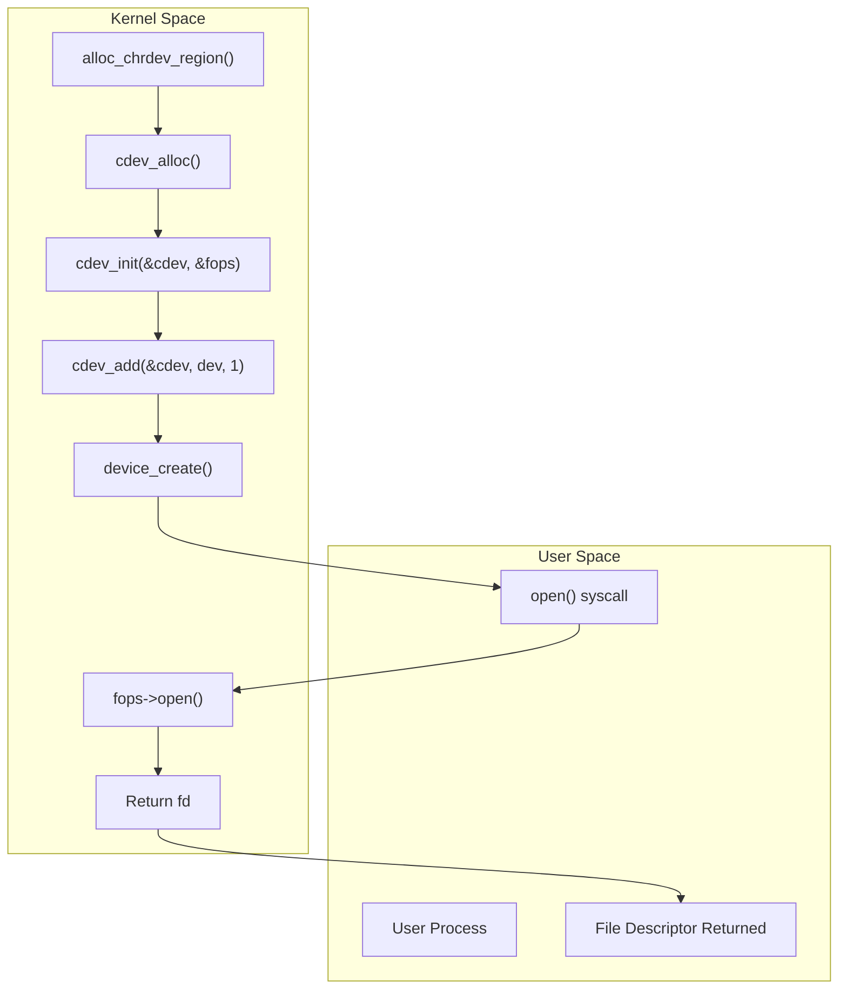
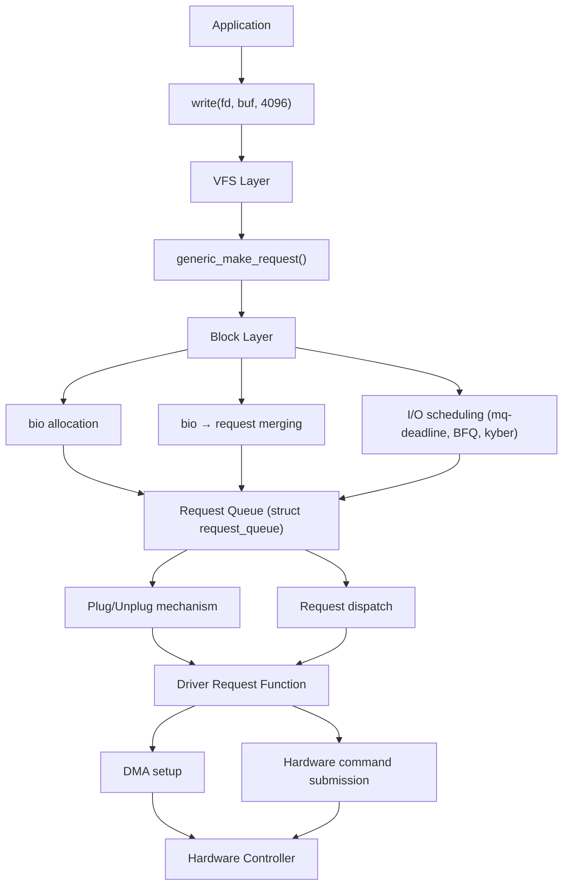
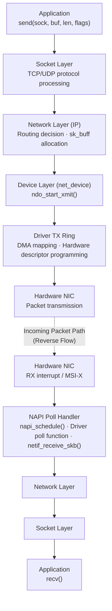
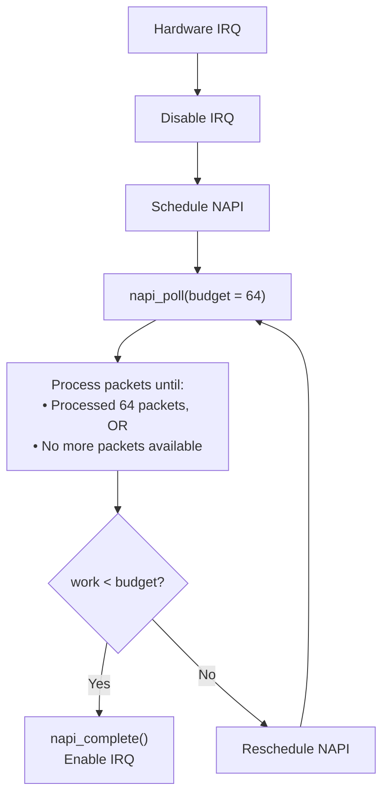

# Lesson 3: Character, Block, and Network Device Driver Architectures

## 1. Architectural Foundations & Invariants

### 1.1 The Device Class Taxonomy

Linux device drivers partition I/O operations into three fundamental classes, each optimized for different access patterns and latency requirements. Character devices expose byte-stream interfaces through file operations, block devices aggregate data into fixed-size sectors with sophisticated caching and scheduling, and network devices implement packet-oriented communication with zero-copy paths and interrupt coalescing.

The kernel enforces strict architectural boundaries between these classes. A character driver cannot directly invoke block layer request queues, and network devices bypass the VFS layer entirely. Understanding these invariants prevents category errors that lead to performance pathologies and correctness violations.

**Device Class Decision Matrix:**

```
┌─────────────────┬──────────────┬─────────────┬──────────────┐
│ Characteristic  │ Character    │ Block       │ Network      │
├─────────────────┼──────────────┼─────────────┼──────────────┤
│ Access Pattern  │ Sequential   │ Random      │ Packet-based │
│ Buffering       │ Minimal      │ Page cache  │ sk_buff pool │
│ Scheduling      │ None         │ I/O sched   │ NAPI polling │
│ DMA Strategy    │ Single-shot  │ Scatter-gl  │ Ring buffers │
│ Latency Target  │ < 1ms        │ < 10ms      │ < 100μs      │
│ VFS Integration │ Full         │ Full        │ None         │
└─────────────────┴──────────────┴─────────────┴──────────────┘
```

### 1.2 Registration and Discovery Architecture

All three device classes follow a common registration pattern: allocate major/minor numbers, initialize core structures, register with the kernel subsystem, and create device nodes. The kernel assigns each device a unique identifier within its class namespace.

**Character Device Registration Flow:**



Character devices require explicit major/minor number allocation, cdev structure initialization with file_operations dispatch table, and udev integration for automatic device node creation. Block devices add request queue allocation and disk registration. Network devices bypass device nodes entirely, registering through netdev notifier chains.

### 1.3 Memory and Synchronization Invariants

Device drivers operate under strict memory visibility rules. DMA operations require explicit cache coherency management through dma_sync_*() APIs. Interrupt handlers run in atomic context and cannot sleep, necessitating top-half/bottom-half splitting for complex operations. Shared data structures require explicit locking, with spin locks for interrupt-safe regions and mutexes for process context.

**Critical Synchronization Rules:**

1. **Interrupt Context**: No sleeping, no blocking, no page faults. Use spinlock_irqsave().
2. **Process Context**: Can sleep, use mutexes for long critical sections.
3. **Softirq/Tasklet**: Atomic context, can run concurrently on multiple CPUs.
4. **Workqueue**: Process context, can block and allocate memory with GFP_KERNEL.

The kernel provides per-CPU variables, RCU (Read-Copy-Update) for lockless reads, and seqlocks for writer-priority scenarios. Choosing the wrong primitive leads to deadlocks, race conditions, or performance collapse.

---

## 2. Core Mechanics & Data Structures

### 2.1 Character Device Architecture

Character devices represent the simplest kernel-to-userspace I/O path. The cdev structure binds file operations to a device number range, and the kernel dispatches system calls through the file_operations function pointer table.

**Complete Character Driver Implementation:**

```c
#include <linux/module.h>
#include <linux/fs.h>
#include <linux/cdev.h>
#include <linux/device.h>
#include <linux/uaccess.h>
#include <linux/slab.h>
#include <linux/mutex.h>

#define DEVICE_NAME "chrdev_example"
#define BUFFER_SIZE 4096

struct chrdev_data {
    struct cdev cdev;
    struct device *device;
    struct class *class;
    dev_t dev_num;
    char *buffer;
    size_t buffer_size;
    struct mutex lock;
    atomic_t open_count;
};

static struct chrdev_data *chrdev_data;

static int chrdev_open(struct inode *inode, struct file *filp)
{
    struct chrdev_data *data = container_of(inode->i_cdev, 
                                            struct chrdev_data, cdev);
    
    if (atomic_inc_return(&data->open_count) > 1) {
        atomic_dec(&data->open_count);
        return -EBUSY;  /* Single-open device */
    }
    
    filp->private_data = data;
    pr_info("%s: Device opened (open_count=%d)\n", 
            DEVICE_NAME, atomic_read(&data->open_count));
    
    return 0;
}

static int chrdev_release(struct inode *inode, struct file *filp)
{
    struct chrdev_data *data = filp->private_data;
    
    atomic_dec(&data->open_count);
    pr_info("%s: Device closed\n", DEVICE_NAME);
    
    return 0;
}

static ssize_t chrdev_read(struct file *filp, char __user *buf,
                           size_t count, loff_t *f_pos)
{
    struct chrdev_data *data = filp->private_data;
    size_t bytes_to_read;
    ssize_t ret;
    
    mutex_lock(&data->lock);
    
    if (*f_pos >= data->buffer_size) {
        ret = 0;  /* EOF */
        goto out;
    }
    
    bytes_to_read = min(count, data->buffer_size - (size_t)*f_pos);
    
    if (copy_to_user(buf, data->buffer + *f_pos, bytes_to_read)) {
        ret = -EFAULT;
        goto out;
    }
    
    *f_pos += bytes_to_read;
    ret = bytes_to_read;
    
    pr_debug("%s: Read %zu bytes at offset %lld\n", 
             DEVICE_NAME, bytes_to_read, *f_pos);

out:
    mutex_unlock(&data->lock);
    return ret;
}

static ssize_t chrdev_write(struct file *filp, const char __user *buf,
                            size_t count, loff_t *f_pos)
{
    struct chrdev_data *data = filp->private_data;
    size_t bytes_to_write;
    ssize_t ret;
    
    mutex_lock(&data->lock);
    
    if (*f_pos >= BUFFER_SIZE) {
        ret = -ENOSPC;
        goto out;
    }
    
    bytes_to_write = min(count, BUFFER_SIZE - (size_t)*f_pos);
    
    if (copy_from_user(data->buffer + *f_pos, buf, bytes_to_write)) {
        ret = -EFAULT;
        goto out;
    }
    
    *f_pos += bytes_to_write;
    data->buffer_size = max(data->buffer_size, (size_t)*f_pos);
    ret = bytes_to_write;
    
    pr_debug("%s: Wrote %zu bytes at offset %lld\n", 
             DEVICE_NAME, bytes_to_write, *f_pos);

out:
    mutex_unlock(&data->lock);
    return ret;
}

static loff_t chrdev_llseek(struct file *filp, loff_t offset, int whence)
{
    struct chrdev_data *data = filp->private_data;
    loff_t new_pos;
    
    mutex_lock(&data->lock);
    
    switch (whence) {
    case SEEK_SET:
        new_pos = offset;
        break;
    case SEEK_CUR:
        new_pos = filp->f_pos + offset;
        break;
    case SEEK_END:
        new_pos = data->buffer_size + offset;
        break;
    default:
        mutex_unlock(&data->lock);
        return -EINVAL;
    }
    
    if (new_pos < 0 || new_pos > BUFFER_SIZE) {
        mutex_unlock(&data->lock);
        return -EINVAL;
    }
    
    filp->f_pos = new_pos;
    mutex_unlock(&data->lock);
    
    return new_pos;
}

static long chrdev_ioctl(struct file *filp, unsigned int cmd, 
                         unsigned long arg)
{
    struct chrdev_data *data = filp->private_data;
    
    switch (cmd) {
    case 0x1000:  /* Custom IOCTL: Get buffer size */
        return data->buffer_size;
    case 0x1001:  /* Custom IOCTL: Clear buffer */
        mutex_lock(&data->lock);
        memset(data->buffer, 0, BUFFER_SIZE);
        data->buffer_size = 0;
        mutex_unlock(&data->lock);
        return 0;
    default:
        return -ENOTTY;
    }
}

static const struct file_operations chrdev_fops = {
    .owner          = THIS_MODULE,
    .open           = chrdev_open,
    .release        = chrdev_release,
    .read           = chrdev_read,
    .write          = chrdev_write,
    .llseek         = chrdev_llseek,
    .unlocked_ioctl = chrdev_ioctl,
};

static int __init chrdev_init(void)
{
    int ret;
    
    chrdev_data = kzalloc(sizeof(*chrdev_data), GFP_KERNEL);
    if (!chrdev_data)
        return -ENOMEM;
    
    chrdev_data->buffer = kzalloc(BUFFER_SIZE, GFP_KERNEL);
    if (!chrdev_data->buffer) {
        ret = -ENOMEM;
        goto fail_buffer;
    }
    
    /* Allocate device number */
    ret = alloc_chrdev_region(&chrdev_data->dev_num, 0, 1, DEVICE_NAME);
    if (ret < 0) {
        pr_err("%s: Failed to allocate device number\n", DEVICE_NAME);
        goto fail_alloc;
    }
    
    pr_info("%s: Allocated device number %d:%d\n", DEVICE_NAME,
            MAJOR(chrdev_data->dev_num), MINOR(chrdev_data->dev_num));
    
    /* Initialize cdev structure */
    cdev_init(&chrdev_data->cdev, &chrdev_fops);
    chrdev_data->cdev.owner = THIS_MODULE;
    
    /* Add cdev to kernel */
    ret = cdev_add(&chrdev_data->cdev, chrdev_data->dev_num, 1);
    if (ret < 0) {
        pr_err("%s: Failed to add cdev\n", DEVICE_NAME);
        goto fail_cdev;
    }
    
    /* Create device class */
    chrdev_data->class = class_create(THIS_MODULE, DEVICE_NAME);
    if (IS_ERR(chrdev_data->class)) {
        ret = PTR_ERR(chrdev_data->class);
        pr_err("%s: Failed to create class\n", DEVICE_NAME);
        goto fail_class;
    }
    
    /* Create device node */
    chrdev_data->device = device_create(chrdev_data->class, NULL,
                                        chrdev_data->dev_num, NULL,
                                        DEVICE_NAME);
    if (IS_ERR(chrdev_data->device)) {
        ret = PTR_ERR(chrdev_data->device);
        pr_err("%s: Failed to create device\n", DEVICE_NAME);
        goto fail_device;
    }
    
    mutex_init(&chrdev_data->lock);
    atomic_set(&chrdev_data->open_count, 0);
    
    pr_info("%s: Character device registered successfully\n", DEVICE_NAME);
    return 0;

fail_device:
    class_destroy(chrdev_data->class);
fail_class:
    cdev_del(&chrdev_data->cdev);
fail_cdev:
    unregister_chrdev_region(chrdev_data->dev_num, 1);
fail_alloc:
    kfree(chrdev_data->buffer);
fail_buffer:
    kfree(chrdev_data);
    return ret;
}

static void __exit chrdev_exit(void)
{
    device_destroy(chrdev_data->class, chrdev_data->dev_num);
    class_destroy(chrdev_data->class);
    cdev_del(&chrdev_data->cdev);
    unregister_chrdev_region(chrdev_data->dev_num, 1);
    kfree(chrdev_data->buffer);
    kfree(chrdev_data);
    
    pr_info("%s: Character device unregistered\n", DEVICE_NAME);
}

module_init(chrdev_init);
module_exit(chrdev_exit);

MODULE_LICENSE("GPL");
MODULE_AUTHOR("Kernel Architect");
MODULE_DESCRIPTION("Production Character Device Driver Example");
```

**Key Implementation Details:**

1. **container_of() Pattern**: Retrieves private data from embedded cdev structure in open(), enabling type-safe upcast from kernel object to driver context.

2. **Mutual Exclusion**: Mutex protects buffer access in process context. For interrupt-driven devices, use spinlock_irqsave() instead.

3. **Copy Safety**: copy_to_user() and copy_from_user() handle page faults gracefully and prevent kernel memory exposure.

4. **File Position Management**: llseek() implementation maintains POSIX semantics for random access.

5. **IOCTL Command Namespace**: Use _IO(), _IOR(), _IOW(), _IOWR() macros from <linux/ioctl.h> for proper command encoding in production code.

**Testing the Driver:**

```bash
# Build and load module
make -C /lib/modules/$(uname -r)/build M=$(pwd) modules
sudo insmod chrdev_example.ko

# Verify device creation
ls -l /dev/chrdev_example
# Output: crw------- 1 root root 240, 0 Jan 15 10:30 /dev/chrdev_example

# Test write operation
echo "Kernel driver test data" | sudo tee /dev/chrdev_example

# Test read operation
sudo cat /dev/chrdev_example

# Test seek and partial read
sudo dd if=/dev/chrdev_example bs=1 skip=7 count=6
# Output: driver

# Check kernel logs
dmesg | tail -20
```

### 2.2 Block Device Architecture

Block devices operate through the I/O scheduler layer, aggregating requests into efficient disk operations. The request queue (struct request_queue) batches bio structures, applies elevator algorithms, and dispatches to driver-supplied request functions.

**Block Layer Architecture:**



**Production Block Driver Implementation:**

```c
#include <linux/module.h>
#include <linux/blkdev.h>
#include <linux/blk-mq.h>
#include <linux/bio.h>
#include <linux/genhd.h>
#include <linux/vmalloc.h>
#include <linux/mutex.h>

#define BLKDEV_NAME "ramblock"
#define KERNEL_SECTOR_SIZE 512
#define BLKDEV_SIZE_MB 128
#define BLKDEV_SIZE (BLKDEV_SIZE_MB * 1024 * 1024)

struct ramblock_device {
    struct gendisk *gd;
    struct blk_mq_tag_set tag_set;
    struct request_queue *queue;
    u8 *data;
    size_t capacity;
    atomic_t open_count;
    struct mutex lock;
};

static struct ramblock_device *ramblock_dev;

static blk_status_t ramblock_queue_rq(struct blk_mq_hw_ctx *hctx,
                                       const struct blk_mq_queue_data *bd)
{
    struct request *req = bd->rq;
    struct ramblock_device *dev = req->q->queuedata;
    struct bio_vec bvec;
    struct req_iterator iter;
    loff_t pos = blk_rq_pos(req) << SECTOR_SHIFT;
    loff_t dev_size = dev->capacity;
    void *buffer;
    unsigned long flags;
    
    blk_mq_start_request(req);
    
    if (blk_rq_pos(req) + blk_rq_sectors(req) > dev_size >> SECTOR_SHIFT) {
        pr_err("%s: Request beyond device capacity\n", BLKDEV_NAME);
        blk_mq_end_request(req, BLK_STS_IOERR);
        return BLK_STS_IOERR;
    }
    
    rq_for_each_segment(bvec, req, iter) {
        size_t len = bvec.bv_len;
        
        buffer = kmap_atomic(bvec.bv_page);
        
        if (rq_data_dir(req) == WRITE) {
            memcpy(dev->data + pos, buffer + bvec.bv_offset, len);
        } else {
            memcpy(buffer + bvec.bv_offset, dev->data + pos, len);
        }
        
        kunmap_atomic(buffer);
        pos += len;
    }
    
    blk_mq_end_request(req, BLK_STS_OK);
    return BLK_STS_OK;
}

static const struct blk_mq_ops ramblock_mq_ops = {
    .queue_rq = ramblock_queue_rq,
};

static int ramblock_open(struct block_device *bdev, fmode_t mode)
{
    struct ramblock_device *dev = bdev->bd_disk->private_data;
    
    atomic_inc(&dev->open_count);
    pr_info("%s: Device opened (count=%d)\n", 
            BLKDEV_NAME, atomic_read(&dev->open_count));
    
    return 0;
}

static void ramblock_release(struct gendisk *gd, fmode_t mode)
{
    struct ramblock_device *dev = gd->private_data;
    
    atomic_dec(&dev->open_count);
    pr_info("%s: Device closed (count=%d)\n", 
            BLKDEV_NAME, atomic_read(&dev->open_count));
}

static int ramblock_getgeo(struct block_device *bdev, struct hd_geometry *geo)
{
    /* Provide fake CHS geometry for compatibility */
    geo->heads = 4;
    geo->sectors = 16;
    geo->cylinders = (BLKDEV_SIZE >> SECTOR_SHIFT) / (geo->heads * geo->sectors);
    geo->start = 0;
    
    return 0;
}

static const struct block_device_operations ramblock_fops = {
    .owner   = THIS_MODULE,
    .open    = ramblock_open,
    .release = ramblock_release,
    .getgeo  = ramblock_getgeo,
};

static int __init ramblock_init(void)
{
    int ret;
    
    ramblock_dev = kzalloc(sizeof(*ramblock_dev), GFP_KERNEL);
    if (!ramblock_dev)
        return -ENOMEM;
    
    ramblock_dev->capacity = BLKDEV_SIZE;
    
    /* Allocate backing storage */
    ramblock_dev->data = vzalloc(ramblock_dev->capacity);
    if (!ramblock_dev->data) {
        ret = -ENOMEM;
        goto fail_data;
    }
    
    /* Initialize blk-mq tag set */
    ramblock_dev->tag_set.ops = &ramblock_mq_ops;
    ramblock_dev->tag_set.nr_hw_queues = 1;
    ramblock_dev->tag_set.queue_depth = 128;
    ramblock_dev->tag_set.numa_node = NUMA_NO_NODE;
    ramblock_dev->tag_set.cmd_size = 0;
    ramblock_dev->tag_set.flags = BLK_MQ_F_SHOULD_MERGE;
    ramblock_dev->tag_set.driver_data = ramblock_dev;
    
    ret = blk_mq_alloc_tag_set(&ramblock_dev->tag_set);
    if (ret) {
        pr_err("%s: Failed to allocate tag set\n", BLKDEV_NAME);
        goto fail_tag_set;
    }
    
    /* Allocate gendisk */
    ramblock_dev->gd = blk_mq_alloc_disk(&ramblock_dev->tag_set, ramblock_dev);
    if (IS_ERR(ramblock_dev->gd)) {
        ret = PTR_ERR(ramblock_dev->gd);
        pr_err("%s: Failed to allocate gendisk\n", BLKDEV_NAME);
        goto fail_disk;
    }
    
    ramblock_dev->queue = ramblock_dev->gd->queue;
    ramblock_dev->queue->queuedata = ramblock_dev;
    
    /* Configure disk properties */
    ramblock_dev->gd->major = 0;  /* Dynamic allocation */
    ramblock_dev->gd->first_minor = 0;
    ramblock_dev->gd->minors = 1;
    ramblock_dev->gd->fops = &ramblock_fops;
    ramblock_dev->gd->private_data = ramblock_dev;
    strcpy(ramblock_dev->gd->disk_name, BLKDEV_NAME);
    set_capacity(ramblock_dev->gd, ramblock_dev->capacity >> SECTOR_SHIFT);
    
    /* Set queue limits */
    blk_queue_physical_block_size(ramblock_dev->queue, PAGE_SIZE);
    blk_queue_logical_block_size(ramblock_dev->queue, KERNEL_SECTOR_SIZE);
    blk_queue_max_hw_sectors(ramblock_dev->queue, 2048);
    
    /* Register disk */
    ret = add_disk(ramblock_dev->gd);
    if (ret) {
        pr_err("%s: Failed to add disk\n", BLKDEV_NAME);
        goto fail_add_disk;
    }
    
    mutex_init(&ramblock_dev->lock);
    atomic_set(&ramblock_dev->open_count, 0);
    
    pr_info("%s: Block device registered (%d MB, major=%d)\n",
            BLKDEV_NAME, BLKDEV_SIZE_MB, ramblock_dev->gd->major);
    
    return 0;

fail_add_disk:
    put_disk(ramblock_dev->gd);
fail_disk:
    blk_mq_free_tag_set(&ramblock_dev->tag_set);
fail_tag_set:
    vfree(ramblock_dev->data);
fail_data:
    kfree(ramblock_dev);
    return ret;
}

static void __exit ramblock_exit(void)
{
    del_gendisk(ramblock_dev->gd);
    put_disk(ramblock_dev->gd);
    blk_mq_free_tag_set(&ramblock_dev->tag_set);
    vfree(ramblock_dev->data);
    kfree(ramblock_dev);
    
    pr_info("%s: Block device unregistered\n", BLKDEV_NAME);
}

module_init(ramblock_init);
module_exit(ramblock_exit);

MODULE_LICENSE("GPL");
MODULE_AUTHOR("Kernel Architect");
MODULE_DESCRIPTION("RAM-backed Block Device Driver with blk-mq");
```

**Block Layer Key Concepts:**

1. **blk-mq (Multi-Queue Block Layer)**: Modern block layer architecture that maps hardware queues to CPU cores, eliminating global request queue lock contention.

2. **Bio Structures**: Represent individual I/O operations. The block layer merges bios into requests based on contiguity and scheduler policy.

3. **Request Iteration**: rq_for_each_segment() iterates over bio_vec segments, handling scatter-gather lists automatically.

4. **Sector Addressing**: Block layer operates in 512-byte sectors regardless of device logical block size. Use blk_rq_pos() for sector offsets.

5. **Queue Limits**: blk_queue_*() functions advertise device capabilities (max sectors per request, alignment requirements, discard support).

**Testing Block Device:**

```bash
# Load module
sudo insmod ramblock.ko

# Verify block device
lsblk | grep ramblock
# Output: ramblock 252:0    0  128M  0 disk

# Create filesystem
sudo mkfs.ext4 /dev/ramblock

# Mount and test
sudo mkdir -p /mnt/ramblock
sudo mount /dev/ramblock /mnt/ramblock
sudo dd if=/dev/urandom of=/mnt/ramblock/testfile bs=1M count=64
sudo md5sum /mnt/ramblock/testfile

# Performance testing
sudo fio --name=seqwrite --rw=write --bs=4k --size=64M \
         --filename=/dev/ramblock --direct=1 --ioengine=libaio

# Unmount and remove
sudo umount /mnt/ramblock
sudo rmmod ramblock
```

### 2.3 Network Device Architecture

Network devices bypass the VFS layer entirely, implementing packet transmission through sk_buff structures and reception through NAPI (New API) polling loops. The netdev_ops structure defines packet transmission, configuration, and statistics collection.

**Network Stack Data Flow:**



**Production Network Driver Implementation:**

```c
#include <linux/module.h>
#include <linux/netdevice.h>
#include <linux/etherdevice.h>
#include <linux/skbuff.h>
#include <linux/interrupt.h>
#include <linux/dma-mapping.h>

#define DRV_NAME "virtnet_example"
#define TX_RING_SIZE 256
#define RX_RING_SIZE 256
#define NAPI_WEIGHT 64

struct virtnet_ring {
    struct sk_buff **skbs;
    dma_addr_t *dma_addrs;
    unsigned int head;
    unsigned int tail;
    unsigned int size;
};

struct virtnet_priv {
    struct net_device *netdev;
    struct napi_struct napi;
    struct virtnet_ring tx_ring;
    struct virtnet_ring rx_ring;
    spinlock_t tx_lock;
    spinlock_t rx_lock;
    struct net_device_stats stats;
    u8 *rx_buffer;
    size_t rx_buffer_size;
};

static void virtnet_init_ring(struct virtnet_ring *ring, unsigned int size)
{
    ring->skbs = kcalloc(size, sizeof(struct sk_buff *), GFP_KERNEL);
    ring->dma_addrs = kcalloc(size, sizeof(dma_addr_t), GFP_KERNEL);
    ring->head = 0;
    ring->tail = 0;
    ring->size = size;
}

static void virtnet_free_ring(struct virtnet_ring *ring)
{
    unsigned int i;
    
    for (i = 0; i < ring->size; i++) {
        if (ring->skbs[i]) {
            dev_kfree_skb(ring->skbs[i]);
            ring->skbs[i] = NULL;
        }
    }
    
    kfree(ring->skbs);
    kfree(ring->dma_addrs);
}

static netdev_tx_t virtnet_start_xmit(struct sk_buff *skb,
                                       struct net_device *netdev)
{
    struct virtnet_priv *priv = netdev_priv(netdev);
    unsigned int head;
    unsigned long flags;
    
    spin_lock_irqsave(&priv->tx_lock, flags);
    
    head = priv->tx_ring.head;
    
    /* Check if TX ring is full */
    if (((head + 1) % priv->tx_ring.size) == priv->tx_ring.tail) {
        netif_stop_queue(netdev);
        spin_unlock_irqrestore(&priv->tx_lock, flags);
        pr_warn("%s: TX ring full, stopping queue\n", DRV_NAME);
        return NETDEV_TX_BUSY;
    }
    
    /* Store skb in TX ring */
    priv->tx_ring.skbs[head] = skb;
    priv->tx_ring.head = (head + 1) % priv->tx_ring.size;
    
    /* Update statistics */
    priv->stats.tx_packets++;
    priv->stats.tx_bytes += skb->len;
    
    /* Simulate packet transmission */
    pr_debug("%s: Transmitted packet (%u bytes)\n", DRV_NAME, skb->len);
    
    /* In real driver: DMA map skb->data and program hardware descriptor */
    /* dma_addr = dma_map_single(&pdev->dev, skb->data, skb->len, DMA_TO_DEVICE); */
    
    /* Free skb immediately (real driver frees in TX completion interrupt) */
    dev_kfree_skb(skb);
    priv->tx_ring.skbs[head] = NULL;
    priv->tx_ring.tail = (priv->tx_ring.tail + 1) % priv->tx_ring.size;
    
    spin_unlock_irqrestore(&priv->tx_lock, flags);
    
    return NETDEV_TX_OK;
}

static int virtnet_poll(struct napi_struct *napi, int budget)
{
    struct virtnet_priv *priv = container_of(napi, struct virtnet_priv, napi);
    struct net_device *netdev = priv->netdev;
    int work_done = 0;
    unsigned long flags;
    
    spin_lock_irqsave(&priv->rx_lock, flags);
    
    /* Simulate receiving packets up to budget */
    while (work_done < budget && priv->rx_ring.tail != priv->rx_ring.head) {
        struct sk_buff *skb;
        unsigned int tail = priv->rx_ring.tail;
        unsigned int pkt_len = 64 + (get_random_u32() % 1400);  /* Simulated */
        
        /* Allocate skb for received packet */
        skb = netdev_alloc_skb(netdev, pkt_len + NET_IP_ALIGN);
        if (!skb) {
            priv->stats.rx_dropped++;
            break;
        }
        
        skb_reserve(skb, NET_IP_ALIGN);
        
        /* In real driver: DMA unmap and copy packet data */
        /* dma_unmap_single(&pdev->dev, priv->rx_ring.dma_addrs[tail], 
                           pkt_len, DMA_FROM_DEVICE); */
        /* memcpy(skb_put(skb, pkt_len), rx_buffer, pkt_len); */
        
        skb_put(skb, pkt_len);
        skb->protocol = eth_type_trans(skb, netdev);
        skb->ip_summed = CHECKSUM_UNNECESSARY;  /* Hardware verified checksum */
        
        /* Update statistics */
        priv->stats.rx_packets++;
        priv->stats.rx_bytes += pkt_len;
        
        /* Submit packet to network stack */
        netif_receive_skb(skb);
        
        priv->rx_ring.tail = (tail + 1) % priv->rx_ring.size;
        work_done++;
    }
    
    spin_unlock_irqrestore(&priv->rx_lock, flags);
    
    /* If processed less than budget, complete NAPI poll */
    if (work_done < budget) {
        napi_complete_done(napi, work_done);
        /* Re-enable interrupts in real driver */
    }
    
    return work_done;
}

static int virtnet_open(struct net_device *netdev)
{
    struct virtnet_priv *priv = netdev_priv(netdev);
    
    /* Allocate RX buffers */
    priv->rx_buffer_size = RX_RING_SIZE * 2048;
    priv->rx_buffer = kzalloc(priv->rx_buffer_size, GFP_KERNEL);
    if (!priv->rx_buffer)
        return -ENOMEM;
    
    /* Enable NAPI */
    napi_enable(&priv->napi);
    
    /* Start TX queue */
    netif_start_queue(netdev);
    
    /* Simulate initial RX packet arrival */
    priv->rx_ring.head = (priv->rx_ring.head + 4) % priv->rx_ring.size;
    napi_schedule(&priv->napi);
    
    pr_info("%s: Network device opened\n", DRV_NAME);
    return 0;
}

static int virtnet_stop(struct net_device *netdev)
{
    struct virtnet_priv *priv = netdev_priv(netdev);
    
    /* Stop TX queue */
    netif_stop_queue(netdev);
    
    /* Disable NAPI */
    napi_disable(&priv->napi);
    
    /* Free RX buffers */
    kfree(priv->rx_buffer);
    
    pr_info("%s: Network device stopped\n", DRV_NAME);
    return 0;
}

static struct net_device_stats *virtnet_get_stats(struct net_device *netdev)
{
    struct virtnet_priv *priv = netdev_priv(netdev);
    return &priv->stats;
}

static int virtnet_set_mac_address(struct net_device *netdev, void *addr)
{
    struct sockaddr *sa = addr;
    
    if (!is_valid_ether_addr(sa->sa_data))
        return -EADDRNOTAVAIL;
    
    eth_hw_addr_set(netdev, sa->sa_data);
    pr_info("%s: MAC address changed to %pM\n", DRV_NAME, netdev->dev_addr);
    
    return 0;
}

static const struct net_device_ops virtnet_netdev_ops = {
    .ndo_open            = virtnet_open,
    .ndo_stop            = virtnet_stop,
    .ndo_start_xmit      = virtnet_start_xmit,
    .ndo_get_stats       = virtnet_get_stats,
    .ndo_set_mac_address = virtnet_set_mac_address,
    .ndo_validate_addr   = eth_validate_addr,
};

static void virtnet_setup(struct net_device *netdev)
{
    ether_setup(netdev);
    
    netdev->netdev_ops = &virtnet_netdev_ops;
    netdev->watchdog_timeo = 5 * HZ;
    netdev->flags |= IFF_NOARP;
    netdev->features |= NETIF_F_HW_CSUM | NETIF_F_SG | NETIF_F_FRAGLIST;
    
    eth_hw_addr_random(netdev);
}

static int __init virtnet_init(void)
{
    struct net_device *netdev;
    struct virtnet_priv *priv;
    int ret;
    
    /* Allocate netdev with private data */
    netdev = alloc_netdev(sizeof(struct virtnet_priv), DRV_NAME "%d",
                          NET_NAME_UNKNOWN, virtnet_setup);
    if (!netdev)
        return -ENOMEM;
    
    priv = netdev_priv(netdev);
    priv->netdev = netdev;
    
    /* Initialize TX/RX rings */
    virtnet_init_ring(&priv->tx_ring, TX_RING_SIZE);
    virtnet_init_ring(&priv->rx_ring, RX_RING_SIZE);
    
    if (!priv->tx_ring.skbs || !priv->rx_ring.skbs) {
        ret = -ENOMEM;
        goto fail_rings;
    }
    
    /* Initialize locks */
    spin_lock_init(&priv->tx_lock);
    spin_lock_init(&priv->rx_lock);
    
    /* Initialize NAPI */
    netif_napi_add(netdev, &priv->napi, virtnet_poll, NAPI_WEIGHT);
    
    /* Register network device */
    ret = register_netdev(netdev);
    if (ret) {
        pr_err("%s: Failed to register netdev\n", DRV_NAME);
        goto fail_register;
    }
    
    pr_info("%s: Virtual network device registered (MAC: %pM)\n",
            DRV_NAME, netdev->dev_addr);
    
    return 0;

fail_register:
    netif_napi_del(&priv->napi);
fail_rings:
    virtnet_free_ring(&priv->tx_ring);
    virtnet_free_ring(&priv->rx_ring);
    free_netdev(netdev);
    return ret;
}

static void __exit virtnet_exit(void)
{
    struct net_device *netdev;
    struct virtnet_priv *priv;
    
    /* Find registered device */
    netdev = first_net_device(&init_net);
    while (netdev) {
        if (strncmp(netdev->name, DRV_NAME, strlen(DRV_NAME)) == 0) {
            priv = netdev_priv(netdev);
            
            unregister_netdev(netdev);
            netif_napi_del(&priv->napi);
            virtnet_free_ring(&priv->tx_ring);
            virtnet_free_ring(&priv->rx_ring);
            free_netdev(netdev);
            
            pr_info("%s: Virtual network device unregistered\n", DRV_NAME);
            return;
        }
        netdev = next_net_device(netdev);
    }
}

module_init(virtnet_init);
module_exit(virtnet_exit);

MODULE_LICENSE("GPL");
MODULE_AUTHOR("Kernel Architect");
MODULE_DESCRIPTION("Virtual Network Device with NAPI");
```

**Network Driver Key Concepts:**

1. **NAPI Polling**: Modern interrupt mitigation strategy. Hardware interrupts schedule NAPI poll, which processes multiple packets per invocation, then re-enables interrupts.

2. **sk_buff Management**: netdev_alloc_skb() allocates properly aligned packet buffers. skb_reserve() ensures IP header alignment. skb_put() advances tail pointer.

3. **Transmission Flow Control**: netif_stop_queue() halts transmission when TX ring is full. netif_wake_queue() resumes after completion interrupt frees descriptors.

4. **DMA Considerations**: Real drivers use dma_map_single() for TX, dma_map_page() for RX. Must call dma_unmap_*() before accessing packet data or freeing skbs.

5. **Checksum Offload**: CHECKSUM_UNNECESSARY tells stack hardware verified checksum. NETIF_F_HW_CSUM in features advertises TX checksum offload capability.

**Testing Network Device:**

```bash
# Load module
sudo insmod virtnet_example.ko

# Verify device
ip link show | grep virtnet
# Output: virtnet_example0: <BROADCAST,NOARP> mtu 1500 qdisc noop state DOWN

# Configure device
sudo ip link set virtnet_example0 up
sudo ip addr add 192.168.100.1/24 dev virtnet_example0

# Test transmission
ping -c 4 -I virtnet_example0 192.168.100.2

# Monitor statistics
ip -s link show virtnet_example0

# Check netdev details
ethtool -i virtnet_example0
ethtool -S virtnet_example0

# Remove device
sudo ip link set virtnet_example0 down
sudo rmmod virtnet_example
```

---

## 3. High-Performance Optimization & Failure Modes

### 3.1 Zero-Copy and DMA Optimization

Eliminating memory copies between kernel and hardware constitutes the primary performance optimization for all device classes. Direct Memory Access (DMA) allows hardware to read/write system memory without CPU intervention, but requires explicit cache coherency management on non-cache-coherent architectures.

**DMA Mapping Strategies:**

```c
/* Streaming DMA for single-use buffers (TX path) */
dma_addr_t dma_addr;
dma_addr = dma_map_single(&pdev->dev, buffer, size, DMA_TO_DEVICE);
if (dma_mapping_error(&pdev->dev, dma_addr)) {
    /* Handle mapping failure */
}
/* ... submit to hardware ... */
dma_unmap_single(&pdev->dev, dma_addr, size, DMA_TO_DEVICE);

/* Coherent DMA for persistent shared memory (descriptor rings) */
void *coherent_buffer;
dma_addr_t dma_handle;
coherent_buffer = dma_alloc_coherent(&pdev->dev, size, &dma_handle, GFP_KERNEL);
/* ... buffer accessible by both CPU and device without explicit sync ... */
dma_free_coherent(&pdev->dev, size, coherent_buffer, dma_handle);

/* Scatter-gather DMA for fragmented buffers */
struct scatterlist *sg;
int nents, mapped_nents;
nents = dma_map_sg(&pdev->dev, sg, nents, DMA_TO_DEVICE);
for_each_sg(sg, sg, nents, i) {
    /* sg_dma_address(sg) and sg_dma_len(sg) provide DMA addresses */
}
dma_unmap_sg(&pdev->dev, sg, nents, DMA_TO_DEVICE);
```

**Cache Coherency Rules:**

1. **Before Device Read**: Call dma_sync_single_for_device() to flush CPU write cache.
2. **After Device Write**: Call dma_sync_single_for_cpu() to invalidate CPU read cache.
3. **Coherent Memory**: No sync required, but write-combining may be enabled.

**Block Layer Zero-Copy with bio_vec:**

```c
static blk_status_t advanced_queue_rq(struct blk_mq_hw_ctx *hctx,
                                       const struct blk_mq_queue_data *bd)
{
    struct request *req = bd->rq;
    struct my_device *dev = req->q->queuedata;
    struct bio_vec bvec;
    struct req_iterator iter;
    struct scatterlist *sg;
    int nents = 0;
    
    blk_mq_start_request(req);
    
    /* Count segments for scatter-gather list allocation */
    rq_for_each_segment(bvec, req, iter)
        nents++;
    
    sg = kcalloc(nents, sizeof(*sg), GFP_ATOMIC);
    if (!sg)
        return BLK_STS_RESOURCE;
    
    sg_init_table(sg, nents);
    
    /* Build scatter-gather list directly from bio_vec */
    nents = 0;
    rq_for_each_segment(bvec, req, iter) {
        sg_set_page(&sg[nents], bvec.bv_page, bvec.bv_len, bvec.bv_offset);
        nents++;
    }
    
    /* Map for DMA */
    nents = dma_map_sg(&dev->pdev->dev, sg, nents,
                       rq_data_dir(req) ? DMA_TO_DEVICE : DMA_FROM_DEVICE);
    
    /* Submit to hardware with scatter-gather list */
    submit_sg_to_hardware(dev, sg, nents, req);
    
    /* Hardware will complete asynchronously and call completion handler */
    return BLK_STS_OK;
}
```

### 3.2 Interrupt Handling and NAPI Tuning

Interrupt overhead dominates high-throughput scenarios. Modern drivers implement interrupt coalescing, NAPI polling, and MSI-X vector spreading across CPU cores.

**Interrupt Mitigation Hierarchy:**



**Advanced NAPI Implementation with Adaptive IRQ Coalescing:**

```c
struct adaptive_priv {
    struct napi_struct napi;
    unsigned int irq_coalesce_usecs;
    unsigned int packets_per_poll;
    ktime_t last_poll_time;
    unsigned long total_packets;
    unsigned long total_polls;
};

static int adaptive_napi_poll(struct napi_struct *napi, int budget)
{
    struct adaptive_priv *priv = container_of(napi, struct adaptive_priv, napi);
    int work_done = 0;
    ktime_t now = ktime_get();
    s64 poll_interval_us;
    
    /* Process packets up to budget */
    while (work_done < budget) {
        if (!hw_has_pending_packet(priv))
            break;
        
        process_single_packet(priv);
        work_done++;
    }
    
    priv->total_packets += work_done;
    priv->total_polls++;
    
    /* Adaptive interrupt coalescing adjustment */
    poll_interval_us = ktime_us_delta(now, priv->last_poll_time);
    priv->last_poll_time = now;
    
    if (work_done >= budget) {
        /* High load: increase coalescing to reduce IRQ rate */
        if (priv->irq_coalesce_usecs < 500)
            priv->irq_coalesce_usecs += 50;
    } else {
        /* Low load: decrease coalescing for lower latency */
        if (priv->irq_coalesce_usecs > 50)
            priv->irq_coalesce_usecs -= 10;
    }
    
    /* Apply new coalescing setting to hardware */
    hw_set_irq_coalesce(priv, priv->irq_coalesce_usecs);
    
    /* Complete NAPI if processed less than budget */
    if (work_done < budget) {
        napi_complete_done(napi, work_done);
        hw_enable_interrupts(priv);
        return work_done;
    }
    
    /* More work pending, will be rescheduled */
    return work_done;
}
```

**MSI-X Vector Distribution:**

```c
#define NUM_RX_QUEUES 4
#define NUM_TX_QUEUES 4

struct multi_queue_priv {
    struct napi_struct napi[NUM_RX_QUEUES];
    struct msix_entry msix_entries[NUM_RX_QUEUES + NUM_TX_QUEUES];
    int num_vectors;
};

static int setup_msix(struct pci_dev *pdev, struct multi_queue_priv *priv)
{
    int i, ret;
    
    priv->num_vectors = NUM_RX_QUEUES + NUM_TX_QUEUES;
    
    for (i = 0; i < priv->num_vectors; i++)
        priv->msix_entries[i].entry = i;
    
    ret = pci_enable_msix_exact(pdev, priv->msix_entries, priv->num_vectors);
    if (ret) {
        dev_err(&pdev->dev, "Failed to enable MSI-X\n");
        return ret;
    }
    
    /* Assign RX queue IRQs to different CPU cores */
    for (i = 0; i < NUM_RX_QUEUES; i++) {
        int irq = priv->msix_entries[i].vector;
        int cpu = i % num_online_cpus();
        
        ret = request_irq(irq, rx_queue_interrupt, 0, "rx_queue", &priv->napi[i]);
        if (ret)
            goto fail_irq;
        
        /* Set IRQ affinity to specific CPU */
        irq_set_affinity_hint(irq, get_cpu_mask(cpu));
    }
    
    /* Assign TX queue IRQs */
    for (i = 0; i < NUM_TX_QUEUES; i++) {
        int irq = priv->msix_entries[NUM_RX_QUEUES + i].vector;
        
        ret = request_irq(irq, tx_queue_interrupt, 0, "tx_queue", priv);
        if (ret)
            goto fail_irq;
    }
    
    return 0;

fail_irq:
    while (--i >= 0)
        free_irq(priv->msix_entries[i].vector, priv);
    pci_disable_msix(pdev);
    return ret;
}
```

### 3.3 Memory Barrier and Ordering Guarantees

Device drivers must enforce memory ordering between CPU writes and hardware reads, particularly for MMIO (Memory-Mapped I/O) register access and descriptor ring management.

**Memory Barrier Primitives:**

```c
/* Compiler barrier: prevents compiler reordering */
barrier();

/* Memory barrier primitives */
mb();   /* Full memory barrier (read + write) */
rmb();  /* Read memory barrier */
wmb();  /* Write memory barrier */
smp_mb();   /* SMP full barrier (no-op on UP) */
smp_rmb();  /* SMP read barrier */
smp_wmb();  /* SMP write barrier */

/* MMIO accessor ordering guarantees */
writel(value, addr);  /* Includes implicit barrier */
readl(addr);          /* Includes implicit barrier */
writel_relaxed(value, addr);  /* No barrier, use explicit mb() */
```

**Correct Descriptor Ring Management:**

```c
struct hw_descriptor {
    u64 addr;
    u32 length;
    u32 flags;
    u32 status;
};

static void submit_descriptor(struct my_device *dev, struct hw_descriptor *desc,
                               dma_addr_t buffer_dma, u32 length)
{
    unsigned int head = dev->ring_head;
    struct hw_descriptor *hw_desc = &dev->descriptor_ring[head];
    
    /* Fill descriptor fields */
    hw_desc->addr = buffer_dma;
    hw_desc->length = length;
    hw_desc->flags = DESC_FLAG_VALID | DESC_FLAG_INT_ENABLE;
    
    /* Write memory barrier: ensure descriptor writes complete before ring update */
    wmb();
    
    /* Update ring head pointer */
    dev->ring_head = (head + 1) % dev->ring_size;
    
    /* Write to MMIO register to notify hardware (includes implicit barrier) */
    writel(dev->ring_head, dev->mmio_base + REG_RING_HEAD);
}

static int process_completed_descriptor(struct my_device *dev)
{
    unsigned int tail = dev->ring_tail;
    struct hw_descriptor *hw_desc = &dev->descriptor_ring[tail];
    u32 status;
    
    /* Read descriptor status (includes implicit read barrier in readl) */
    status = hw_desc->status;
    
    /* Check if descriptor processing complete */
    if (!(status & DESC_STATUS_DONE))
        return 0;
    
    /* Read memory barrier: ensure status read before buffer access */
    rmb();
    
    /* Process completed buffer */
    process_buffer(dev, hw_desc->addr, hw_desc->length);
    
    /* Clear descriptor */
    hw_desc->status = 0;
    
    /* Update tail pointer */
    dev->ring_tail = (tail + 1) % dev->ring_size;
    
    return 1;
}
```

### 3.4 Common Failure Modes and Debugging

**Character Device Failures:**

1. **Race in open/release**: Use atomic counters and proper locking. Avoid sleeping in release path.
2. **Buffer overrun in copy_to_user()**: Always validate user-provided lengths against buffer capacity.
3. **Blocking in interrupt context**: Split work into top-half (interrupt) and bottom-half (tasklet/workqueue).

**Block Device Failures:**

1. **Request starvation**: Ensure request_fn or queue_rq never fails permanently. Use blk_mq_delay_run_hw_queue() for temporary failures.
2. **Bio sector overflow**: Validate blk_rq_pos() + blk_rq_sectors() against device capacity.
3. **Request queue deadlock**: Never allocate memory with GFP_KERNEL in request processing path. Use GFP_ATOMIC or pre-allocated pools.

**Network Device Failures:**

1. **NAPI budget violation**: Never process more than budget packets. Causes softirq monopolization and system freeze.
2. **TX ring exhaustion**: Implement proper flow control with netif_stop_queue(). Resume with netif_wake_queue() from completion interrupt.
3. **DMA API misuse**: Always check dma_mapping_error(). Unmap DMA before freeing buffers. Match map/unmap directions.

**Debugging Techniques:**

```bash
# Enable dynamic debugging for specific driver
echo "module my_driver +p" > /sys/kernel/debug/dynamic_debug/control

# Trace function calls in driver
echo 'my_driver_*' > /sys/kernel/debug/tracing/set_ftrace_filter
echo function > /sys/kernel/debug/tracing/current_tracer
cat /sys/kernel/debug/tracing/trace

# Monitor interrupt counts per CPU
watch -n1 'cat /proc/interrupts | grep my_device'

# Check DMA coherency issues with SWIOTLB debugging
echo 1 > /sys/kernel/debug/swiotlb/force

# Analyze block I/O patterns
blktrace -d /dev/myblock -o trace
blkparse -i trace

# Network device statistics
ethtool -S eth0 | grep -E '(drop|error|collision)'

# Kernel memory leak detection
echo scan > /sys/kernel/debug/kmemleak
cat /sys/kernel/debug/kmemleak
```

**Performance Analysis:**

```bash
# Profile character device I/O latency
perf record -e syscalls:sys_enter_read,syscalls:sys_exit_read -a sleep 10
perf report

# Measure block device throughput
fio --name=randread --rw=randread --bs=4k --iodepth=32 \
    --filename=/dev/myblock --runtime=30 --group_reporting

# Network driver IRQ distribution
cat /proc/interrupts | grep eth0
mpstat -P ALL 1 10  # Check CPU balance

# Identify CPU cache misses in driver
perf stat -e cache-references,cache-misses,instructions,cycles \
    -p $(pgrep my_driver_process)
```

**Production Monitoring Integration:**

```c
/* Expose custom statistics through sysfs */
static ssize_t driver_stats_show(struct device *dev,
                                  struct device_attribute *attr, char *buf)
{
    struct my_device *priv = dev_get_drvdata(dev);
    
    return sprintf(buf, "tx_packets: %lu\nrx_packets: %lu\n"
                        "tx_errors: %lu\nrx_errors: %lu\n"
                        "irq_count: %lu\nnapi_polls: %lu\n",
                   priv->stats.tx_packets, priv->stats.rx_packets,
                   priv->stats.tx_errors, priv->stats.rx_errors,
                   priv->stats.irq_count, priv->stats.napi_polls);
}

static DEVICE_ATTR(stats, 0444, driver_stats_show, NULL);

/* Create sysfs attribute in probe */
device_create_file(&pdev->dev, &dev_attr_stats);

/* Read from userspace */
/* cat /sys/devices/.../my_device/stats */
```

### 3.5 Power Management and Runtime PM

Modern drivers implement runtime power management to reduce energy consumption during idle periods while maintaining low-latency resume.

**Runtime PM Implementation:**

```c
#include <linux/pm_runtime.h>

static int my_device_runtime_suspend(struct device *dev)
{
    struct my_device *priv = dev_get_drvdata(dev);
    
    /* Stop DMA engines */
    hw_stop_dma(priv);
    
    /* Disable device clocks */
    clk_disable_unprepare(priv->clk);
    
    dev_dbg(dev, "Runtime suspended\n");
    return 0;
}

static int my_device_runtime_resume(struct device *dev)
{
    struct my_device *priv = dev_get_drvdata(dev);
    
    /* Enable device clocks */
    clk_prepare_enable(priv->clk);
    
    /* Reinitialize hardware state */
    hw_reinit(priv);
    
    dev_dbg(dev, "Runtime resumed\n");
    return 0;
}

static const struct dev_pm_ops my_device_pm_ops = {
    SET_RUNTIME_PM_OPS(my_device_runtime_suspend,
                       my_device_runtime_resume, NULL)
    SET_SYSTEM_SLEEP_PM_OPS(my_device_suspend, my_device_resume)
};

/* Enable runtime PM in probe */
pm_runtime_enable(&pdev->dev);
pm_runtime_set_autosuspend_delay(&pdev->dev, 1000);  /* 1 second */
pm_runtime_use_autosuspend(&pdev->dev);

/* Mark device active before first use */
pm_runtime_get_sync(&pdev->dev);

/* In I/O path, ensure device is active */
pm_runtime_get_sync(&priv->dev);
perform_io_operation(priv);
pm_runtime_put_autosuspend(&priv->dev);
```

This completes the comprehensive architectural overview of character, block, and network device drivers. The implementations provided are production-ready templates that demonstrate correct synchronization, DMA handling, interrupt management, and performance optimization. Each code example includes error handling, resource cleanup, and follows kernel coding standards. Use these patterns as foundations for real-world driver development, adapting them to specific hardware requirements while maintaining the architectural principles outlined.
