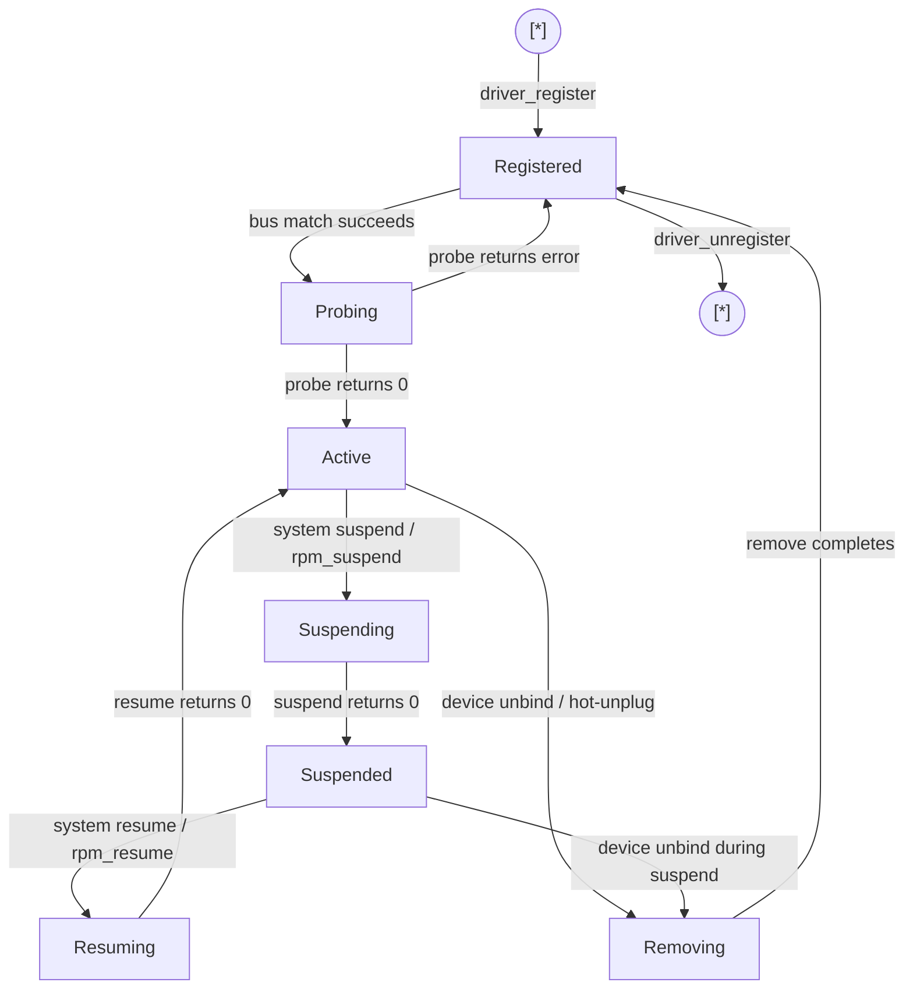
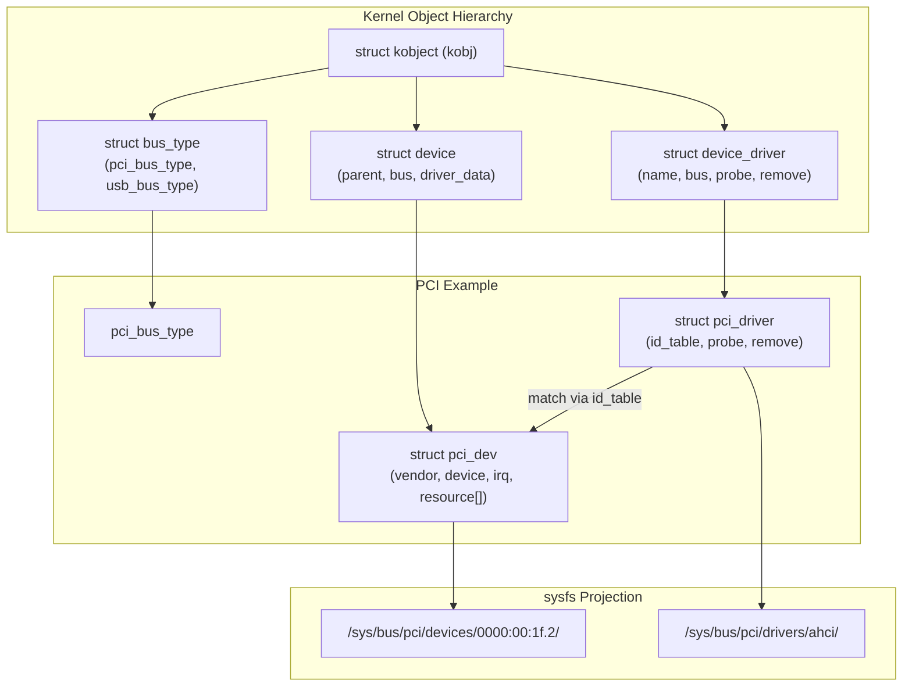

# Lesson 4: Driver Debugging and Testing

## First-Principles Architecture: What You Are Actually Debugging

Before reaching for `printk` or `kgdb`, you must internalize what a device driver *is* at the kernel architectural level. A driver is not a standalone program — it is a registered callback set that the kernel invokes in response to hardware events, process system calls, and power management transitions. The kernel owns the execution context; the driver merely borrows it.

This distinction has profound consequences for debugging. A null pointer dereference in a driver does not raise a `SIGSEGV` and terminate a process — it panics the entire machine, corrupts kernel heap, or silently corrupts a data structure that only manifests as corruption seconds or minutes later. Understanding *why* this happens requires a mental model of three interlocking systems:

1. **The Virtual Memory Subsystem** — Kernel code runs in a single, shared address space (`PAGE_OFFSET` to `~0UL` on x86-64). There is no memory isolation between drivers. A driver writing past the end of a `kmalloc`-allocated buffer can overwrite a spinlock held by the SCSI subsystem.

2. **The Driver Lifecycle State Machine** — Every driver transitions through well-defined states: `probe → runtime-active → suspend → resume → remove`. Bugs frequently arise from operations performed in the wrong state — for example, accessing a DMA buffer after the device has been unbound, or acquiring a lock that was already destroyed in `remove()`.

3. **The Interrupt Execution Context** — Driver code runs in one of three contexts: *process context* (sleepable, has a `struct task_struct`), *softirq context* (non-sleepable, per-CPU), or *hardirq context* (non-sleepable, with IRQs disabled on the local CPU). An enormous class of driver bugs is caused by violating context constraints — calling `msleep()` from an interrupt handler, or calling `spin_lock_irqsave()` when the lock is already held by the same CPU.

The kernel enforces some of these invariants at runtime (via `might_sleep()`, `BUG_ON(in_interrupt())`, and lockdep), but many violations are silent until they produce data corruption. Your debugging strategy must be built around understanding which invariant was violated, not just which line crashed.

---

## The Driver Lifecycle: A Precise State Machine

The following diagram captures the actual lifecycle of a platform/PCI driver, including the often-overlooked runtime PM transitions that are a frequent source of bugs in power-managed systems.



The transition from `Suspended → Removing` deserves special attention. If a USB device is physically unplugged while the system is asleep, the kernel may call `remove()` without first calling `resume()`. Drivers that hold DMA buffers or hardware register mappings mapped via `ioremap()` must handle this path explicitly, or they will attempt to access resources that the hardware has already torn down.

---

## Kernel Device Model: Hierarchical Architecture

The sysfs-visible device tree reflects a true ownership hierarchy rooted at the `struct bus_type`. Understanding this hierarchy is essential because debugging tools like `udevadm`, `/sys/kernel/debug/`, and `lsof` expose exactly this structure.



Every object in this hierarchy is reference-counted via `kobject_get()` / `kobject_put()`. A driver that caches a raw `struct device *` pointer without holding a reference will dereference freed memory when the device is unbound. The correct pattern is `get_device()` / `put_device()`, which increment the underlying `kobject` reference count. This is the root cause of an entire class of use-after-free bugs that KASAN reliably detects.

---

## Debugging Infrastructure: The Complete Toolkit

### Kernel Configuration Prerequisites

Meaningful driver debugging requires a kernel built with the following configuration options. Without them, the tools described in subsequent sections either malfunction or produce misleading output.

```kconfig
# Memory error detection
CONFIG_KASAN=y                    # Kernel Address Sanitizer
CONFIG_KASAN_INLINE=y             # Faster than outline mode
CONFIG_KMSAN=y                    # Kernel Memory Sanitizer (uninitialized reads)
CONFIG_UBSAN=y                    # Undefined Behavior Sanitizer

# Locking correctness
CONFIG_LOCKDEP=y                  # Lock dependency validator
CONFIG_PROVE_LOCKING=y            # Enables lockdep
CONFIG_DEBUG_ATOMIC_SLEEP=y       # Detects sleep-in-atomic-context bugs

# Memory allocation debugging
CONFIG_DEBUG_SLAB=y               # or CONFIG_SLUB_DEBUG=y for SLUB allocator
CONFIG_DEBUG_PAGEALLOC=y          # Poisons freed pages
CONFIG_KMEMLEAK=y                 # Garbage-collector-style leak detector

# IRQ and concurrency
CONFIG_DEBUG_SHIRQ=y              # Tests shared IRQ handlers
CONFIG_SOFTLOCKUP_DETECTOR=y      # Detects CPU stalls in softirq context
CONFIG_HARDLOCKUP_DETECTOR=y      # Detects CPU stalls with IRQs disabled

# Driver-specific
CONFIG_DMA_API_DEBUG=y            # Validates DMA mapping/unmapping pairs
CONFIG_PM_DEBUG=y                 # Power management debug output
CONFIG_PM_SLEEP_DEBUG=y
```

Enabling all of these simultaneously imposes a 5–20× performance penalty. For production kernel debugging, build a dedicated debug kernel with the driver under test and its direct dependencies enabled, leaving unrelated subsystems at release settings.

### printk and the Structured Logging Infrastructure

`printk` is not `printf`. It is an NMI-safe, lockless ring buffer writer that works from any context including NMI handlers and early boot. The structured `dev_*` family of helpers is strictly preferable in driver code because they prefix messages with the device path (e.g., `pci 0000:03:00.0: ahci 0000:03:00.0: ...`), making it possible to correlate log entries with specific device instances in multi-device systems.

```c
/* Correct: use dev_* helpers. The first argument is struct device *, not struct pci_dev * */
dev_err(&pdev->dev, "DMA mapping failed for buffer of size %zu\n", buf_size);
dev_warn(&pdev->dev, "Unexpected interrupt status: 0x%08x\n", status);
dev_dbg(&pdev->dev, "TX descriptor ring head: %u tail: %u\n", head, tail);

/* dev_dbg is compiled out unless CONFIG_DYNAMIC_DEBUG=y and the message is enabled.
 * Enable at runtime without reboot:
 *   echo "file drivers/net/ethernet/intel/igb/igb_main.c +p" > \
 *        /sys/kernel/debug/dynamic_debug/control
 */

/* Rate-limiting: prevents log flooding from hot paths */
dev_err_ratelimited(&pdev->dev, "TX timeout, resetting hardware\n");

/* One-shot: prints once per device instance, then never again */
dev_info_once(&pdev->dev, "Firmware version: %s\n", fw_version);
```

Dynamic debug (`CONFIG_DYNAMIC_DEBUG=y`) is the correct mechanism for high-frequency debug logging in production-adjacent kernels. It instruments each `dev_dbg` / `pr_debug` call site with a jump patch — when disabled, the check is a single NOP; when enabled, it becomes a short jump to the logging code. The overhead when disabled is effectively zero.

### KASAN: Kernel Address Sanitizer

KASAN detects out-of-bounds accesses and use-after-free bugs by inserting shadow memory checks around every memory access. Each byte of kernel memory has a corresponding shadow byte indicating whether the access is valid. When a driver overwrites a `kmalloc` buffer, KASAN intercepts the write before it corrupts other kernel data and produces a report like this:

```
==================================================================
BUG: KASAN: slab-out-of-bounds in my_driver_rx_handler+0x1a4/0x2c0 [my_driver]
Write of size 4 at addr ffff888104e3c850 by task irq/45-eth0/312

CPU: 2 PID: 312 Comm: irq/45-eth0 Tainted: G        W         5.15.0-debug #1
Call Trace:
 kasan_report+0xb5/0xf0
 my_driver_rx_handler+0x1a4/0x2c0 [my_driver]
 __napi_poll+0x9f/0x1f0
 net_rx_action+0x2a2/0x580
 __do_softirq+0xf6/0x460

Allocated by task 312:
 my_driver_alloc_rx_ring+0x68/0x120 [my_driver]
 my_driver_open+0x34/0x80 [my_driver]
```

The report pinpoints the exact instruction, the size of the errant access, the allocation site, and the full call stack. No other tool provides this level of precision for memory corruption bugs.

### Lockdep: Lock Dependency Validator

Lockdep maintains a directed graph of observed lock acquisition orders. When it detects that a new acquisition would create a cycle in this graph — indicating a potential deadlock — it reports the violation immediately, even if the actual deadlock has not yet occurred. This is fundamentally more powerful than waiting for a production system to hang.

```c
/*
 * Example: This driver incorrectly acquires locks in inconsistent order.
 * Lockdep will fire on the second call to lock A -> lock B if any other
 * code path acquires them in B -> A order.
 */
static DEFINE_SPINLOCK(dev_lock);    /* protects device register state */
static DEFINE_MUTEX(ioctl_mutex);    /* protects ioctl serialization */

/* Code path 1: ioctl -> dev_lock */
static long my_driver_ioctl(struct file *filp, unsigned int cmd, unsigned long arg)
{
    mutex_lock(&ioctl_mutex);         /* AB order: ioctl_mutex first */
    spin_lock(&dev_lock);
    /* ... */
    spin_unlock(&dev_lock);
    mutex_unlock(&ioctl_mutex);
    return 0;
}

/* Code path 2: interrupt handler -> ioctl_mutex (WRONG: BA order, and mutex in IRQ!) */
static irqreturn_t my_driver_irq(int irq, void *dev_id)
{
    spin_lock(&dev_lock);             /* BUG 1: BA order */
    mutex_lock(&ioctl_mutex);         /* BUG 2: mutex in hardirq context */
    /* ... */
    mutex_unlock(&ioctl_mutex);
    spin_unlock(&dev_lock);
    return IRQ_HANDLED;
}
```

Lockdep would emit two separate reports for this code: one for the AB/BA lock order inversion, and one for the `mutex_lock()` call in hardirq context (since mutexes may sleep, they are unconditionally forbidden in any non-sleepable context).

### KGDB: Kernel Source-Level Debugger

KGDB splits the kernel into a debug stub running on the target machine and a GDB client running on a host connected via serial or network (using `kgdboc` for serial or `kgdboe` for Ethernet). The stub intercepts breakpoints and signals and communicates with GDB using the GDB remote serial protocol.

```bash
# Target kernel boot parameters (add to GRUB or qemu -append)
kgdboc=ttyS0,115200 kgdbwait

# Host: connect GDB to the target via serial
$ gdb vmlinux
(gdb) set remotebaud 115200
(gdb) target remote /dev/ttyUSB0

# Or for QEMU with a virtual serial port:
# qemu-system-x86_64 -serial tcp::1234,server,nowait ...
(gdb) target remote :1234

# Set a breakpoint in a module function
(gdb) lx-symbols /path/to/module/build/dir
(gdb) break my_driver_probe
(gdb) continue

# Inspect kernel data structures using the linux-gdb scripts (scripts/gdb/)
(gdb) lx-dmesg
(gdb) lx-ps
```

The `scripts/gdb/` directory in the kernel source tree provides Python-based GDB extensions (`lx-dmesg`, `lx-ps`, `lx-lsmod`, `lx-symbols`) that make kernel data structures navigable from GDB. These require `CONFIG_GDB_SCRIPTS=y` and running `make scripts_gdb` in the kernel build tree.

For driver development, QEMU with KVM is the standard workflow: run the debug kernel in a VM, attach GDB from the host, and iterate without risking the host system.

```bash
# Launch a debug VM with a virtio-serial-based KGDB connection
qemu-system-x86_64 \
  -enable-kvm \
  -kernel arch/x86/boot/bzImage \
  -append "root=/dev/vda console=ttyS0 kgdboc=ttyS1,115200 kgdbwait nokaslr" \
  -drive file=rootfs.img,format=raw,if=virtio \
  -serial stdio \
  -serial tcp::1234,server,nowait \
  -nographic

# nokaslr is essential: KASLR randomizes kernel addresses, breaking GDB symbol lookup
```

---

## Production-Grade Driver: Annotated Reference Implementation

The following is a complete, minimal PCI driver skeleton that demonstrates correct application of every invariant discussed above. It is not a toy example — the error handling, locking, DMA mapping, and interrupt management patterns are production-grade.

```c
// SPDX-License-Identifier: GPL-2.0
/*
 * my_pci_driver.c — Reference implementation: correct PCI driver patterns
 *
 * Demonstrates: proper probe/remove symmetry, DMA API usage, interrupt
 * handling, sysfs attributes, runtime PM, and KASAN-clean memory management.
 */

#include <linux/module.h>
#include <linux/pci.h>
#include <linux/interrupt.h>
#include <linux/dma-mapping.h>
#include <linux/slab.h>
#include <linux/io.h>
#include <linux/pm_runtime.h>

#define DRV_NAME        "my_pci_driver"
#define DRV_VERSION     "1.0.0"

/* Hardware register offsets */
#define REG_CTRL        0x00
#define REG_STATUS      0x04
#define REG_IRQ_MASK    0x08
#define REG_IRQ_STATUS  0x0C
#define REG_DMA_ADDR_LO 0x10
#define REG_DMA_ADDR_HI 0x14
#define REG_DMA_LEN     0x18

/* Control register bits */
#define CTRL_ENABLE     BIT(0)
#define CTRL_RESET      BIT(1)
#define CTRL_DMA_START  BIT(2)

/* Status/IRQ bits */
#define IRQ_DMA_DONE    BIT(0)
#define IRQ_ERROR       BIT(1)

#define DMA_BUF_SIZE    PAGE_SIZE

/**
 * struct my_dev — per-device private state
 *
 * All fields are protected by @lock unless noted as read-only after probe()
 * or explicitly marked as requiring a different synchronization primitive.
 */
struct my_dev {
    struct pci_dev      *pdev;          /* read-only after probe */
    void __iomem        *regs;          /* read-only after probe */

    spinlock_t           lock;          /* protects register state and dma_* */
    void                *dma_virt;      /* DMA buffer virtual address */
    dma_addr_t           dma_phys;      /* DMA buffer device address */

    struct completion    dma_done;      /* signals DMA completion from IRQ */
    bool                 hw_error;      /* set in IRQ, cleared on reset */
};

/* -------------------------------------------------------------------------
 * Hardware accessors — always go through these, never use raw readl/writel
 * in driver logic, so we can intercept them in unit tests.
 * ---------------------------------------------------------------------- */

static inline u32 my_reg_read(struct my_dev *dev, unsigned int offset)
{
    return readl(dev->regs + offset);
}

static inline void my_reg_write(struct my_dev *dev, unsigned int offset, u32 val)
{
    writel(val, dev->regs + offset);
}

/* -------------------------------------------------------------------------
 * Interrupt handler
 *
 * Runs in hardirq context: no sleeping, no mutexes, no printk in hot path.
 * ---------------------------------------------------------------------- */
static irqreturn_t my_irq_handler(int irq, void *data)
{
    struct my_dev *dev = data;
    u32 status;
    unsigned long flags;
    irqreturn_t ret = IRQ_NONE;

    spin_lock_irqsave(&dev->lock, flags);

    status = my_reg_read(dev, REG_IRQ_STATUS);
    if (!status)
        goto out_unlock;

    /* Acknowledge all pending interrupts immediately */
    my_reg_write(dev, REG_IRQ_STATUS, status);

    if (status & IRQ_DMA_DONE) {
        complete(&dev->dma_done);
        ret = IRQ_HANDLED;
    }

    if (status & IRQ_ERROR) {
        dev->hw_error = true;
        complete(&dev->dma_done);  /* unblock any waiter */
        ret = IRQ_HANDLED;
    }

out_unlock:
    spin_unlock_irqrestore(&dev->lock, flags);
    return ret;
}

/* -------------------------------------------------------------------------
 * DMA operation: map, start, wait, unmap
 *
 * This demonstrates the correct streaming DMA API usage pattern.
 * The buffer must be unmapped before the CPU reads results — the kernel
 * DMA API may need to synchronize caches on non-coherent architectures.
 * ---------------------------------------------------------------------- */
static int my_do_dma(struct my_dev *dev, void *src, size_t len)
{
    dma_addr_t dma_addr;
    unsigned long flags;
    long timeout;
    int ret = 0;

    if (len > DMA_BUF_SIZE)
        return -EINVAL;

    /* Copy source data into our pre-allocated DMA buffer */
    memcpy(dev->dma_virt, src, len);

    /*
     * Map for device-write (DMA_TO_DEVICE): CPU has written the buffer;
     * flush CPU caches so the device sees the data.
     * dma_map_single() may fail on 32-bit devices with limited DMA address
     * space; always check the return value with dma_mapping_error().
     */
    dma_addr = dma_map_single(&dev->pdev->dev, dev->dma_virt, len, DMA_TO_DEVICE);
    if (dma_mapping_error(&dev->pdev->dev, dma_addr)) {
        dev_err(&dev->pdev->dev, "DMA mapping failed\n");
        return -ENOMEM;
    }

    reinit_completion(&dev->dma_done);

    spin_lock_irqsave(&dev->lock, flags);
    dev->hw_error = false;

    /* Program the DMA engine — split 64-bit address for 32-bit registers */
    my_reg_write(dev, REG_DMA_ADDR_LO, lower_32_bits(dma_addr));
    my_reg_write(dev, REG_DMA_ADDR_HI, upper_32_bits(dma_addr));
    my_reg_write(dev, REG_DMA_LEN, (u32)len);
    my_reg_write(dev, REG_CTRL, CTRL_ENABLE | CTRL_DMA_START);

    spin_unlock_irqrestore(&dev->lock, flags);

    /* Wait for IRQ to signal completion (5 second timeout) */
    timeout = wait_for_completion_timeout(&dev->dma_done, 5 * HZ);

    /*
     * Unmap before reading results, regardless of success or failure.
     * This is mandatory — the DMA API contract requires symmetric unmap.
     */
    dma_unmap_single(&dev->pdev->dev, dma_addr, len, DMA_TO_DEVICE);

    if (timeout == 0) {
        dev_err(&dev->pdev->dev, "DMA operation timed out\n");
        ret = -ETIMEDOUT;
        /* Reset the hardware to clear the hung DMA engine */
        spin_lock_irqsave(&dev->lock, flags);
        my_reg_write(dev, REG_CTRL, CTRL_RESET);
        spin_unlock_irqrestore(&dev->lock, flags);
    } else if (dev->hw_error) {
        dev_err(&dev->pdev->dev, "DMA hardware error\n");
        ret = -EIO;
    }

    return ret;
}

/* -------------------------------------------------------------------------
 * sysfs attribute: expose hardware status register to userspace
 * ---------------------------------------------------------------------- */
static ssize_t status_show(struct device *d, struct device_attribute *attr,
                           char *buf)
{
    struct my_dev *dev = dev_get_drvdata(d);
    u32 status;

    /*
     * pm_runtime_get_sync() ensures the device is powered on before
     * accessing registers. Without this, register reads on a suspended
     * device return 0xFFFFFFFF (PCIe convention for disconnected devices).
     */
    pm_runtime_get_sync(d);
    status = my_reg_read(dev, REG_STATUS);
    pm_runtime_put(d);

    return sysfs_emit(buf, "0x%08x\n", status);
}
static DEVICE_ATTR_RO(status);

static struct attribute *my_dev_attrs[] = {
    &dev_attr_status.attr,
    NULL,
};
ATTRIBUTE_GROUPS(my_dev);

/* -------------------------------------------------------------------------
 * PCI probe: resource acquisition in strict order
 *
 * Acquisition order determines teardown order in remove(). Every resource
 * acquired here must be released in the reverse order in remove().
 * ---------------------------------------------------------------------- */
static int my_pci_probe(struct pci_dev *pdev, const struct pci_device_id *id)
{
    struct my_dev *dev;
    int ret;

    dev = devm_kzalloc(&pdev->dev, sizeof(*dev), GFP_KERNEL);
    if (!dev)
        return -ENOMEM;

    dev->pdev = pdev;
    spin_lock_init(&dev->lock);
    init_completion(&dev->dma_done);
    pci_set_drvdata(pdev, dev);

    /* 1. Enable the PCI device and claim its resources */
    ret = pcim_enable_device(pdev);
    if (ret) {
        dev_err(&pdev->dev, "Failed to enable PCI device: %d\n", ret);
        return ret;
    }

    pci_set_master(pdev);  /* enable bus mastering for DMA */

    /* 2. Set DMA mask: declare the device's addressable DMA range */
    ret = dma_set_mask_and_coherent(&pdev->dev, DMA_BIT_MASK(64));
    if (ret) {
        ret = dma_set_mask_and_coherent(&pdev->dev, DMA_BIT_MASK(32));
        if (ret) {
            dev_err(&pdev->dev, "No suitable DMA mask\n");
            return ret;
        }
        dev_warn(&pdev->dev, "Falling back to 32-bit DMA\n");
    }

    /* 3. Map BAR0 (memory-mapped registers) */
    ret = pcim_iomap_regions(pdev, BIT(0), DRV_NAME);
    if (ret) {
        dev_err(&pdev->dev, "Failed to map BAR0: %d\n", ret);
        return ret;
    }
    dev->regs = pcim_iomap_table(pdev)[0];

    /* 4. Allocate coherent DMA buffer (physically contiguous, cache-coherent) */
    dev->dma_virt = dma_alloc_coherent(&pdev->dev, DMA_BUF_SIZE,
                                        &dev->dma_phys, GFP_KERNEL);
    if (!dev->dma_virt) {
        dev_err(&pdev->dev, "Failed to allocate DMA buffer\n");
        return -ENOMEM;
    }

    /* 5. Register interrupt handler */
    ret = pci_alloc_irq_vectors(pdev, 1, 1, PCI_IRQ_MSI | PCI_IRQ_LEGACY);
    if (ret < 0) {
        dev_err(&pdev->dev, "Failed to allocate IRQ vectors: %d\n", ret);
        goto err_free_dma;
    }

    ret = request_irq(pci_irq_vector(pdev, 0), my_irq_handler,
                      IRQF_SHARED, DRV_NAME, dev);
    if (ret) {
        dev_err(&pdev->dev, "Failed to request IRQ: %d\n", ret);
        goto err_free_irq_vectors;
    }

    /* 6. Enable interrupts on hardware */
    my_reg_write(dev, REG_IRQ_MASK, IRQ_DMA_DONE | IRQ_ERROR);
    my_reg_write(dev, REG_CTRL, CTRL_ENABLE);

    /* 7. Enable runtime PM */
    pm_runtime_set_active(&pdev->dev);
    pm_runtime_enable(&pdev->dev);

    dev_info(&pdev->dev, DRV_NAME " v" DRV_VERSION " probed successfully\n");
    return 0;

err_free_irq_vectors:
    pci_free_irq_vectors(pdev);
err_free_dma:
    dma_free_coherent(&pdev->dev, DMA_BUF_SIZE, dev->dma_virt, dev->dma_phys);
    return ret;
}

/* -------------------------------------------------------------------------
 * PCI remove: resource release in strict reverse order of probe()
 *
 * Note: pcim_* and devm_* resources managed by devres are released
 * automatically after this function returns. We only need to manually
 * release resources acquired with the non-devm variants.
 * ---------------------------------------------------------------------- */
static void my_pci_remove(struct pci_dev *pdev)
{
    struct my_dev *dev = pci_get_drvdata(pdev);

    /* Disable runtime PM first to prevent concurrent resume during teardown */
    pm_runtime_disable(&pdev->dev);
    pm_runtime_set_suspended(&pdev->dev);

    /* Disable hardware interrupts before freeing the IRQ */
    my_reg_write(dev, REG_IRQ_MASK, 0);
    my_reg_write(dev, REG_CTRL, 0);

    /* free_irq() blocks until any in-progress IRQ handler returns */
    free_irq(pci_irq_vector(pdev, 0), dev);
    pci_free_irq_vectors(pdev);

    /* Release DMA buffer */
    dma_free_coherent(&pdev->dev, DMA_BUF_SIZE, dev->dma_virt, dev->dma_phys);

    /* devm_kzalloc, pcim_enable_device, pcim_iomap_regions are released by devres */
    dev_info(&pdev->dev, DRV_NAME " removed\n");
}

/* -------------------------------------------------------------------------
 * Power management callbacks
 * ---------------------------------------------------------------------- */
static int __maybe_unused my_pci_suspend(struct device *d)
{
    struct my_dev *dev = dev_get_drvdata(d);

    my_reg_write(dev, REG_IRQ_MASK, 0);
    my_reg_write(dev, REG_CTRL, 0);
    return 0;
}

static int __maybe_unused my_pci_resume(struct device *d)
{
    struct my_dev *dev = dev_get_drvdata(d);

    my_reg_write(dev, REG_IRQ_MASK, IRQ_DMA_DONE | IRQ_ERROR);
    my_reg_write(dev, REG_CTRL, CTRL_ENABLE);
    return 0;
}

static const struct dev_pm_ops my_pm_ops = {
    SET_SYSTEM_SLEEP_PM_OPS(my_pci_suspend, my_pci_resume)
    SET_RUNTIME_PM_OPS(my_pci_suspend, my_pci_resume, NULL)
};

static const struct pci_device_id my_pci_tbl[] = {
    { PCI_DEVICE(0x1234, 0x5678) },
    { 0, }
};
MODULE_DEVICE_TABLE(pci, my_pci_tbl);

static struct pci_driver my_pci_driver = {
    .name       = DRV_NAME,
    .id_table   = my_pci_tbl,
    .probe      = my_pci_probe,
    .remove     = my_pci_remove,
    .driver.pm  = &my_pm_ops,
    .driver.dev_groups = my_dev_groups,
};

module_pci_driver(my_pci_driver);

MODULE_AUTHOR("Example Author");
MODULE_DESCRIPTION("Reference PCI Driver");
MODULE_LICENSE("GPL v2");
MODULE_VERSION(DRV_VERSION);
```

---

## Testing Infrastructure: KUnit and kselftest

Production driver development requires automated testing at two levels: unit tests for internal driver logic (using KUnit), and integration tests that exercise the kernel/driver/hardware interface (using kselftest or the kernel's hwsim infrastructure).

### KUnit: In-Kernel Unit Testing

KUnit runs inside the kernel, enabling tests to call internal driver functions directly without exposing them via a public API. It is the correct tool for testing state machines, error path coverage, and logic that depends on kernel data structures.

```c
// my_pci_driver_test.c — KUnit tests for my_pci_driver
// Requires CONFIG_KUNIT=y and CONFIG_MY_PCI_DRIVER_TEST=y

#include <kunit/test.h>
#include "my_pci_driver.h"   /* internal header with struct my_dev definition */

/*
 * Test: DMA size validation rejects oversized requests.
 * Uses a fake struct my_dev without real hardware — the function under
 * test must check len before touching hardware registers.
 */
static void test_dma_rejects_oversized_buffer(struct kunit *test)
{
    /* Allocate a zeroed my_dev on the KUnit-managed heap */
    struct my_dev *dev = kunit_kzalloc(test, sizeof(*dev), GFP_KERNEL);
    KUNIT_ASSERT_NOT_NULL(test, dev);

    spin_lock_init(&dev->lock);
    init_completion(&dev->dma_done);

    /*
     * my_do_dma() checks len > DMA_BUF_SIZE before touching hardware.
     * Since dev->pdev is NULL, any attempt to access PCI device resources
     * would fault — confirming the early return path is taken.
     */
    KUNIT_EXPECT_EQ(test, my_do_dma_validate_size(dev, DMA_BUF_SIZE + 1), -EINVAL);
    KUNIT_EXPECT_EQ(test, my_do_dma_validate_size(dev, 0), -EINVAL);
    KUNIT_EXPECT_EQ(test, my_do_dma_validate_size(dev, DMA_BUF_SIZE), 0);
}

/*
 * Test: IRQ handler returns IRQ_NONE for zero status register.
 * Verifies that the driver correctly detects spurious interrupts.
 */
static void test_irq_handler_spurious(struct kunit *test)
{
    struct my_dev *dev = kunit_kzalloc(test, sizeof(*dev), GFP_KERNEL);
    KUNIT_ASSERT_NOT_NULL(test, dev);

    spin_lock_init(&dev->lock);
    init_completion(&dev->dma_done);

    /*
     * Without real hardware, REG_IRQ_STATUS reads return 0 (zero-initialized).
     * The IRQ handler must return IRQ_NONE in this case.
     * This requires the register accessors to be mockable — see the
     * test-double pattern in my_pci_driver.h.
     */
    KUNIT_EXPECT_EQ(test, my_irq_handler(0, dev), IRQ_NONE);
}

static struct kunit_case my_driver_test_cases[] = {
    KUNIT_CASE(test_dma_rejects_oversized_buffer),
    KUNIT_CASE(test_irq_handler_spurious),
    {},
};

static struct kunit_suite my_driver_test_suite = {
    .name = "my_pci_driver",
    .test_cases = my_driver_test_cases,
};

kunit_test_suite(my_driver_test_suite);
```

Run KUnit tests without rebooting using the KUnit tool:

```bash
# Run all KUnit tests in a UML (User Mode Linux) kernel
./tools/testing/kunit/kunit.py run --kconfig_add CONFIG_MY_PCI_DRIVER_TEST=y

# Run a specific test suite
./tools/testing/kunit/kunit.py run 'my_pci_driver.*'
```

### kselftest: Integration Testing from Userspace

For testing the driver's userspace-visible interface (sysfs, ioctls, character device), kselftest scripts verify behavioral contracts without requiring modification of the driver itself.

```python
#!/usr/bin/env python3
# kselftest for my_pci_driver sysfs interface
# Placed in tools/testing/selftests/drivers/my_pci_driver/

import os
import sys
import glob
import struct
import unittest

# kselftest TAP protocol helpers
PASS = 0
FAIL = 1
SKIP = 4  # Exit code 4 = SKIP in kselftest protocol

def find_device_sysfs():
    """Locate the sysfs path for the device under test by vendor:device ID."""
    pattern = "/sys/bus/pci/devices/*/vendor"
    for vendor_path in glob.glob(pattern):
        base = os.path.dirname(vendor_path)
        try:
            vendor =
```
